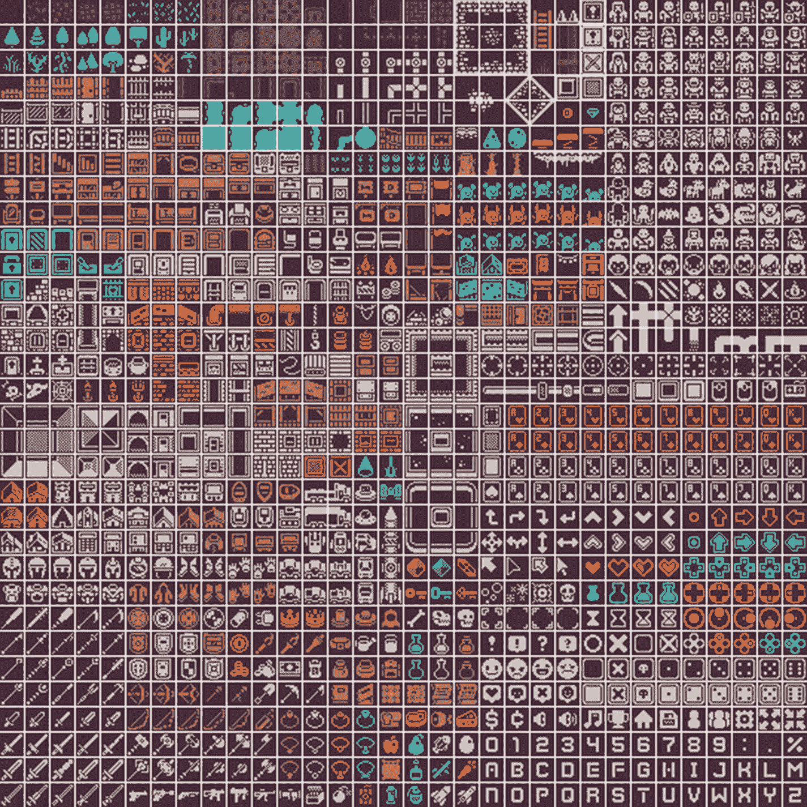
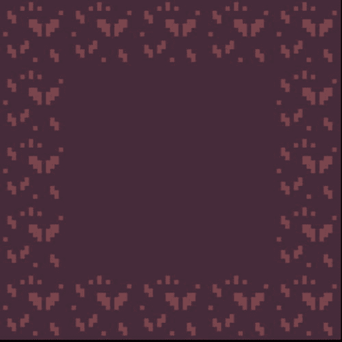
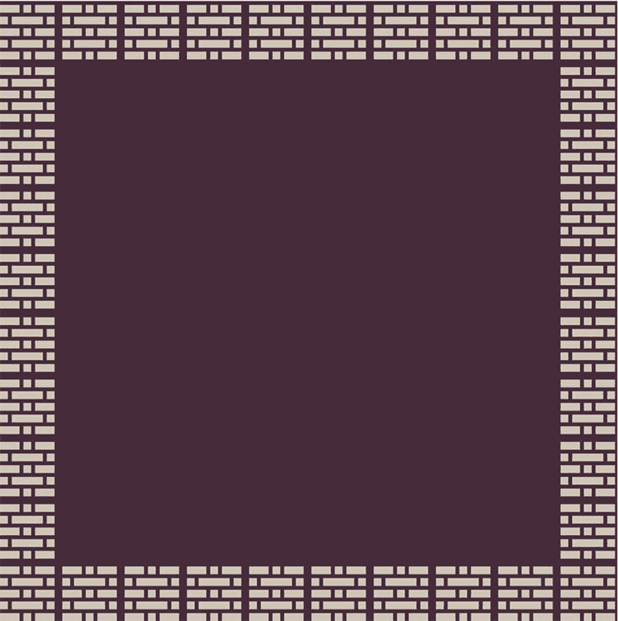
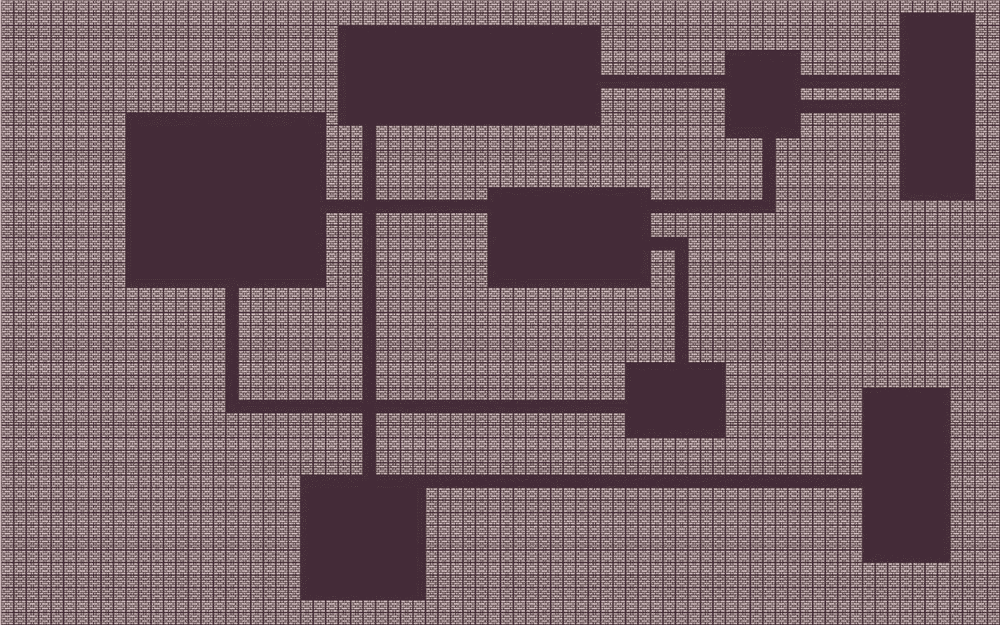
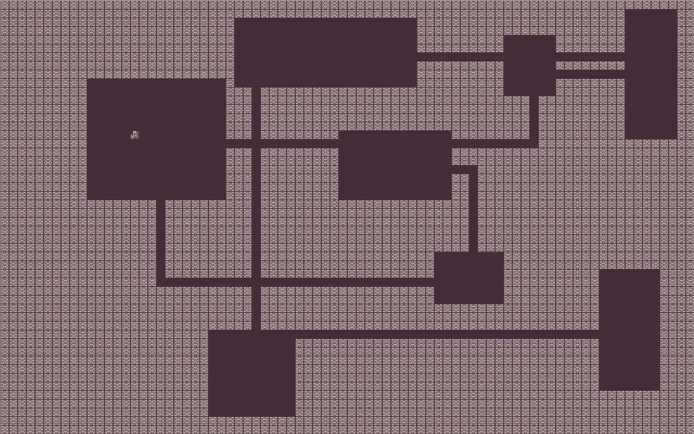

# 第三章：地下城

在上一章中，我们学习了如何在屏幕上绘制图形，以及如何创建基本的游戏循环。本章将以此为基础，为我们 Roguelike 游戏搭建一个基本的地下城。但在深入编写更多代码之前，了解一些关于瓦片地图以及如何利用它们来构建地下城的知识非常重要。

## 什么是瓦片地图？

瓦片地图最初用于在旧式计算机和视频游戏机中节省空间和内存。与其为整个关卡使用一张巨大的图像，不如通过组合较小的图块来构建关卡图形。这样一来，游戏只需获取并绘制当前玩家可见区域所需的图块，而无需将可能大得多的文件加载到内存中。这样做的附带好处是，使得创建关卡编辑器变得更加容易，因为游戏关卡所使用的组件是独立的，并且易于放置到新的关卡设计中。它们也被证明非常适合程序化生成，因为程序可以算法生成一个关卡，然后找出需要哪些瓦片来组装它以进行显示。

出于我们的目的，我们将瓦片地图定义为一个网格，我们在每个单元格中放置方形位图，以组装出地下城和必要的游戏元素。如果你曾玩过像《龙与地下城》这样的纸质角色扮演游戏，并且不得不用方格纸绘制地图，你会注意到这与我们本章的软件将要做的有很多相似之处。

本书 Roguelike 项目中使用的地下城最终将包含多个层级。每个层级将是一个瓦片地图网格，墙壁、房间、走廊和其他元素被放置在其中，以组装成一个可识别的、类似 RPG 的地下城。让我们学习如何绘制一些瓦片。

## 绘制瓦片地图

本节的源代码位于 `chapter-3/example-1-simple-tilemap` 文件夹中；你需要它来跟着学习。HTML 文件与其他示例相同；它只是加载 Phaser 和我们的 `game.js` 文件，本节所有有趣的部分实际上都发生在这个文件中。

### 预加载精灵表

精灵表是一个图像文件，它将许多不同的图形合并到一个文件中。网页游戏倾向于使用它们，因为它们只需要一次网络传输就能将所有必要的图像加载到玩家的计算机上。

我们的示例所使用的精灵表是一种简单的类型，其中所有图像都具有相同的大小，并且它们并排放置，就像一页排列整齐的邮票集一样。例如，假设每个图像是 10 像素 x 10 像素，并且精灵表中有两行共十个图像，这意味着你有一个高 20 像素、宽 50 像素的单个图像文件，其中包含了所有图像。

人们通常将精灵表中包含的这些图像称为精灵，但你可能也会看到同一个名词被用于指代屏幕上移动的游戏元素，如果你刚接触游戏开发并在网上搜索学习资料，这可能会让人感到困惑。我称它们为瓦片，除非它们指的是代表移动元素的游戏对象，比如玩家或怪物。不过，它们都来自同一个文件。

我们的精灵表来自 Kenney 免费提供的游戏美术资源包，^(²⁰) 而且它看起来非常棒（图 3-1）。



图 3-1

示例精灵表

可以看到，里面有许多不同的瓦片，我们将能够组合它们以获得丰富的 Roguelike 体验。该精灵表中的每个图像都是一个边长为 16 像素的正方形。它们之间由 1 像素的间隙隔开。预加载精灵表的源代码需要传递所有这些信息。来自 `game.js` 文件的 `preload()` 函数是：

```
preload: function () {
    this.load.spritesheet(
        'tiles',
        'assets/colored.png',
        {
            frameWidth: 16,
            frameHeight: 16,
            spacing: 1
        });
}
```

与我们见过的其他 `preload()` 函数非常相似，我们使用 `this.load.*` 命名空间中的函数来加载精灵表。该函数的参数是我们稍后用来引用该精灵表的键、精灵表图像的路径以及一个配置对象。此配置对象中可以设置许多可选参数；我们只设置了工作表中每个图像的尺寸以及它们之间的间隙。

有了这些，我们就可以开始绘制一些瓦片地图了，这些地图类似于你上学时可能用过的方格纸网格，我们在每个单元格中放置瓦片以形成我们的地下城图像。这些瓦片将来自我们之前看到的精灵表。


### 基础瓦片地图

为了表示瓦片地图网格，我们将使用一个二维数组，其中每个元素都是一个数字，对应着我们精灵表中的一块瓦片。一个 5x5 的地牢，每侧都是有纹理的地板，其他地方都是空地板，可以表示为：

```
let dungeon = [
[1,1,1,1,1],
[1,0,0,0,1],
[1,0,0,0,1],
[1,0,0,0,1],
[1,1,1,1,1]
]
```

这将生成一个看起来像这样的地牢：



如果你检查精灵表，你会发现地板区域是表中的第一张图片，而每侧的有纹理地板是第二张图片。由于 JavaScript 中的数组索引从零开始，这些就成了精灵表中的 `image 0` 和 `image 1`。

构建地图数组时有一个重要的注意事项。如果你使用与精灵表索引匹配的数字，之后又修改了精灵表，最终你将需要更改所有地图，或者在运行时创建一些程序来重新映射这些数字。更好的做法是使用对你和你的设计有意义的数字来构建地图，并在将地图绘制到屏幕之前，将这些数字重新映射为精灵表中对应所需瓦片的值。这样一来，如果你将来更改了所使用的精灵表，就只需修改那个映射数据。

`create()` 函数是我们组装瓦片地图的地方。本节示例代码中使用的地图是一个 10x10 的地图。

```
let level = [
[1, 1, 1, 1, 1, 1, 1, 1, 1, 1],
[1, 0, 0, 0, 0, 0, 0, 0, 0, 1],
[1, 0, 0, 0, 0, 0, 0, 0, 0, 1],
[1, 0, 0, 0, 0, 0, 0, 0, 0, 1],
[1, 0, 0, 0, 0, 0, 0, 0, 0, 1],
[1, 0, 0, 0, 0, 0, 0, 0, 0, 1],
[1, 0, 0, 0, 0, 0, 0, 0, 0, 1],
[1, 0, 0, 0, 0, 0, 0, 0, 0, 1],
[1, 0, 0, 0, 0, 0, 0, 0, 0, 1],
[1, 1, 1, 1, 1, 1, 1, 1, 1, 1],
]
```

在我们的地图中，我们将 `0` 映射为地板，将 `1` 映射为墙壁。之后，我们需要将它们重新映射为我们正在使用的瓦片地图的正确值。精灵表中的地板确实与我们所使用的值相同，但对于墙壁，我们将使用图片 `554`，它是一堵砖墙。

```
const wall = 554
const floor = 0
level = level.map(r => r.map(t => t == 1 ? wall : floor))
```

为了将这个瓦片地图绘制到屏幕上，我们需要创建一个配置对象，其中包含其相关信息，以保存关卡数据和每个瓦片的尺寸。由于我们的瓦片是 16 像素的正方形，我们将这个值存储在一个常量中，因为在本示例中我们会多次用到它。

```
const tileSize = 16
const config = {
data: level,
tileWidth:  tileSize,
tileHeight: tileSize,
}
```

让我们使用这个配置对象来创建一个瓦片地图，并为其附加一个瓦片集。瓦片集将把我们的精灵表与瓦片地图匹配起来。

```
const map = this.make.tilemap(config);
const tileset = map.addTilesetImage('tiles', 'tiles', tileSize, tileSize, 0, 1);
```

通过将配置对象传递给 `this.make.tilemap()` 来创建瓦片地图，然后使用附加到新 `map` 上的一个继承函数来添加瓦片集图像。你可以使用 `this.make.*` 中的函数创建各种游戏对象；它们属于 `GameObjectCreator` 类。^(²¹)

这个 `addTilesetImage`^(²²) 函数接收了很多参数；其中大部分是可选的，但我注意到，如果在这个示例中不传递它们，地图就无法工作。

Phaser 支持多种不同的地图数据格式，不仅仅是我们正在使用的数组。许多开发者使用像 Tiled^(²³) 这样的地图编辑器来构建他们的地图。这些编辑器可以以丰富的格式导出地图，Phaser 可以导入这些格式。由于我们没有使用这类工具，我们最终不得不手动指定许多本应存在于导出的地图数据中的数据。

`addTilesetImage` 的第一个参数是地图数据中导出的瓦片集名称。我们没有地图数据，因为我们没有使用地图编辑器。我们传递了 `tiles`，这和我们在精灵表加载时使用的键相同。第二个参数是来自 `preload()` 的缓存图像的键，也就是 `tiles`。如果我们不传递这第二个参数，它会使用第一个参数作为查找图像的键；这有点令人困惑。我们只是将两者都传递，以便清楚地说明我们在做什么。其余参数都是本应在地图编辑器导出时存在的数据，由于我们手工组装所有内容，因此我们需要显式传递这些数据。第三个和第四个参数是瓦片的尺寸，即宽度和高度。第五个和第六个参数与精灵表周围的边距以及图像之间的间隙有关。所有值都以像素为单位。

Phaser 的瓦片地图可以在其中包含多个图层，就像在经典的旧式动画中将醋酸纤维片叠放在一起，或者使用 Adobe Photoshop 图层一样。这些图层可用于将游戏元素分离为背景层和前景层，以便它们可以相互叠加。

有两种类型的图层：动态图层和静态图层；前者牺牲了一些速度和性能，以便能够对每个瓦片应用强大的效果。对于本示例中将要绘制的瓦片地图，我们将使用静态瓦片地图，因为我们目前没有做任何此类效果。

```
const ground = map.createStaticLayer(0, tileset, 0, 0);
```

尽管我们将静态图层赋值给了 `ground` 变量，但我们之后不会用它做任何操作。这只是为了说明这是地面图层，地板和墙壁都在其中。`createStaticLayer()` 的第一个参数是图层 ID；这可以是一个数字或字符串，其他函数会使用它来引用该图层。我们使用 `0`，因为只有在加载从 Tiled 地图编辑器导出的地图时，才会使用字符串命名。第二个参数是你之前创建的瓦片集。

如果你在浏览器中加载该示例，你将看到一个如图 3-2 所示的瓦片地图。



**图 3-2** 基础瓦片地图

这就是绘制瓦片地图的方法。本节内容很多，查阅 Phaser 函数的链接文档会非常有帮助。另一个现在要做的练习是尝试操作那个地图数组和不同的值。你能在那个房间里放置四根柱子吗？或者在地板上放一具骷髅？

那么绘制地牢呢？嗯，这是我们下一个示例的内容。


## 基础地牢

此时有必要说明为何将程序化生成部分留到后续章节。许多人认为 Roguelike 游戏最显著的特征就是程序化生成；坦诚地说，我也属于这个阵营。

不过，如果将其延后到本书后续章节处理，我们就能先夯实游戏的基础机制，并在到达那些章节时更深入地理解 Phaser 框架和游戏开发。如此一来，我们就能专注于程序化生成本身，体会它如何改变并丰富整个游戏开发体验，而不必同时学习游戏开发基础与程序化生成。

下一个样例位于`chapter-3/example-2-basic-dungeon`文件夹，其代码与前一样例完全相同。唯一变化是将 level 数组修改为真正的地牢风格地图，而非 10x10 的简单网格。另一个小改动是将 HTML 中引用的`game.js`标记为*JavaScript 模块*，以便在其中使用`import`从其他文件加载地图数据。level 数据因过于庞大而被放置在主源码外部，这也是此处未粘贴代码的原因。

加载后您将看到如图 3-3 所示的地牢。



图 3-3

基础地牢

## 添加玩家角色

本样例将结合本章及前一章所学的技术，因此会让人感到熟悉。其文件夹为`chapter-3/example-3-playable-dungeon`。随着样例代码不断增长并复用之前样例的代码片段，我将仅展示被修改或新增的部分。建议阅读本章时在电脑上打开源码，或至少在学习下一章前查阅相关代码。

玩家角色的图像来自与地牢元素相同的精灵表（spritesheet），因此无需修改样例的`preload()`函数来加载额外的图像文件。

在第 2 章中，我们构建了一个简单的游戏循环，通过读取`update()`函数中的方向键状态来改变显示文本的位置。这种方法更适合动作角色扮演游戏（Action RPG）而非我们正在构建的 Roguelike 游戏——后者更注重回合制策略思考而非快速实时操作。Phaser 框架虽不限定游戏类型，但更偏向实时动作，并内置了许多支持此类场景的功能。然而回合制是我们对 Roguelike 游戏的核心要求之一，这意味着需要在 Phaser 的基础上构建自己的回合制机制。

此时源码的组织和规划复杂度开始提升。添加玩家角色听起来简单，但为了实现这一目标，我们需要实现大量核心游戏机制的相关功能。这虽繁重，但通过将其拆解为小块任务就能游刃有余。关键步骤是停止将所有代码塞入`preload()`、`create()`和`update()`函数，转而构建辅助模块和类。在这个样例中，我们将创建回合管理器、地牢管理器以及玩家角色类等新模块。

本书中的许多抽象概念和工作流程源自桌面角色扮演游戏（RPG）和兵棋推演。如果您从未接触过此类游戏，建议在阅读本书时加以了解。许多 YouTube 频道和播客会录制游戏过程（包括专业演员参与的游玩录像），花时间观摩这些内容或许能帮您理解本章构建的机制。

### 始于地牢管理器

如前所述，Phaser 功能强大但并非专为 Roguelike 设计。为创建更高效的项目，我们将构建辅助模块来抽象 Phaser 的部分功能，从而能更多地从 Roguelike 的视角而非 Phaser 的视角进行思考。

地牢管理器的主要职责是加载关卡并连接必要的 Phaser 管道以在屏幕上显示。之前样例中`create()`函数的部分代码将迁移到地牢模块中。随着 Roguelike 复杂度提升，该模块将积累更多功能。在本样例中，我们将用它加载预设关卡，并创建所需的瓦片地图（tilemap）、瓦片集（tileset）和动态图层（dynamic layer）。之所以改用动态图层，是因为玩家将在该图层上移动，而静态图层无法修改瓦片。

未来引入程序化生成时，只需修改此模块内部逻辑，其余游戏代码保持不变。将这些流程重构进模块，正是为后续章节打基础。

地牢管理器的职责包括：

*   加载预设关卡
*   将关卡中的数字映射到精灵表中的对应瓦片
*   创建瓦片集、瓦片地图和动态图层

地牢管理器的代码位于`dungeon.js`中，让我们逐段分析。我们使用 ES6 模块，如果您不熟悉其用法和结构，请查阅 MDN Web 文档^((24))。

首先导入关卡数据：

```javascript
import level from "./level.js"
```

地牢管理器的全部代码包含在一个名为`dungeon`的对象字面量中，并在文件末尾将其作为*默认导出*。在`dungeon`对象内部，我们创建了一个`sprite`字面量对象，用于将人类可读的键映射到精灵表中的数值。

```javascript
sprites: {
floor: 0,
wall: 554,
}
```

这些值稍后将用于映射函数，类似于`chapter-3/example-1-simple-tilemap/`例子的做法。

`initialize()`函数用于处理此前样例的`create()`函数中的所有代码。该函数接收调用它的当前场景（scene）作为参数。

```javascript
initialize: function (scene) {
this.scene = scene
scene.level = level.map(r => r.map(t => t == 1 ? this.sprites.wall : this.sprites.floor))
const tileSize = 16
const config = {
data: scene.level,
tileWidth: tileSize,
tileHeight: tileSize,
}
const map = scene.make.tilemap(config)
const tileset = map.addTilesetImage('tiles', 'tiles', 16, 16, 0, 1)
this.map = map.createDynamicLayer(0, tileset, 0, 0)
}
```

它首先保存场景的引用，以便未来游戏实体在导入地牢管理器后能对场景进行操作。

可以看出，这段代码结合了本章第一个和第二个样例的特性：既像第一个样例那样通过映射调用，将地图中的数值替换为精灵表中对应的墙壁值；又像第二个样例那样使用外部加载的关卡数据。

其余代码几乎是从前一个样例复制而来，但有几处重要改动。创建的动态图层被保存到`dungeon.map`中，玩家角色类将使用该图层来检查地图并决定移动方向。在实现玩家类之前，我们必须先讨论回合（turn）与回合管理机制。


## 创建回合管理器

实现回合管理器有多种方式。游戏开发者可以随心所欲地过度设计它，而 roguelike 游戏的魅力之一，恰恰就在于回合机制那精巧复杂的运作方式。

我最喜欢的回合制电脑游戏在回合管理上都有着相同的机制：每个角色在其回合内拥有一定数量的行动点数，执行行动会消耗点数，当点数耗尽时回合结束。由于 Phaser 引擎每秒会多次调用`update`，我们无法简单地在那里阻断行动，并以命令式的方式处理玩家输入。我们必须在高频调用的`update`之上，自行编写回合管理器，以实现段落开头概述的机制。代码将类似于一个状态机；每个游戏实体都会在“拥有可花费点数”、“点数耗尽”和“刷新点数”这三个状态之间切换。实现回合管理器的一个简单方法是像动作游戏那样处理玩家移动，并在每次移动后，遍历其他游戏实体及其行动。我们的示例将比这更复杂一些，但又不会走向一个极其复杂的解决方案；我们的目标是实现与之前概述的机制类似的玩法。

我们所有的游戏实体，无论是玩家、怪物，还是我们未来发明的其他东西，都将是新的 JS 类。这些类必须实现以下方法：

| **方法** | **说明** |
| --- | --- |
| `turn()` | 当轮到该实体时调用。应执行该回合所需的所有行动。 |
| `over()` | 返回一个布尔值，指示该实体的回合是否结束。 |
| `refresh()` | 在新回合开始前调用。 |

在每个回合开始时，我们的管理器会对每个实体调用`refresh()`。然后每个实体执行它们的`turn()`。如果所有实体的`over()`都返回`true`，则开始一个新的回合。设计`over()`方法的原因是，如果你在其中不返回`true`，该实体将在下一轮获得对`turn()`的另一次调用。这使得实体在未来一个回合可以拥有多次行动，例如创建一个怪物，它在一个回合内能移动多个格子，而玩家只能移动一格。这可以很容易地给玩家带来恐惧感。

回合管理器位于`turnManager.js`文件中，自成模块；它是一个单例，被`game.js`中的`update()`代码使用。该代码位于一个名为`tm`的字面量对象内（`tm`是 turn manager 的缩写，因为更短，方便在书中粘贴代码）。我们将使用 JavaScript 的`Set`^(²⁵)来存放地牢中的实体，并提供函数来向这个集合中添加和移除实体；此外，它还通过拥有`turn()`、`over()`和`refresh()`这些函数来模拟前面的工作流程，这些函数会调用集合中每个实体对应的同名函数。

让我们来看看用于管理实体的代码。

```
entities: new Set(),
addEntity: (entity) => tm.entities.add(entity),
removeEntity: (entity) => tm.entities.remove(entity),
```

使用`Set()`来保存实体可以防止我们重复添加同一个实体；这类 bug 有时很难追踪，因此使用不支持多次添加同一实体的数据结构能让我们的代码更安全。这里有两个函数，一个用于添加实体，另一个用于移除实体；虽然我们在本示例中没有使用移除函数，但将来会用到，所以现在就实现它会更方便。

接下来，让我们实现`turn()`函数的代码，它负责调用每个实体的`turn()`方法。如前所述，我们本可以选择一个更简单的回合管理器，但我认为那样不如这个有趣。`turn()`函数所做的是遍历实体集合，检查每个实体的回合是否`over()`；如果没有，就选取该实体并调用其`turn()`方法，然后*跳出循环*。

这种跳出非常重要，因为它使得在调用其他实体的`turn()`之前，该实体的`turn()`可以被再次调用。因为在下一次场景`update()`调用时，循环会从断点处重新开始执行。这使得我们的实体能够拥有*每回合多次行动*的能力，当我们开始构建新的角色类和怪物时，这将非常有用。

Phaser 运行场景`update()`循环的速度非常快；这就是游戏能达到 60 帧每秒的原因。但问题在于，如果我们在每次`update()`时都简单地调用`tm.turn()`，游戏运行速度会过快。我的意思是，如果玩家按下方向键将角色向下移动一格，而我们的游戏以 60 帧运行，那么按键将在多个`update()`循环中被注册为按下状态，导致角色朝那个方向飞速冲刺。我们的回合处理机制本身没问题，只是新回合的执行速度太快了。

为了应对这个问题，回合管理器中有一个简单的防抖代码。它会记录`turn()`上次执行的时间（毫秒），并且只有在自上次调用过去 150 毫秒后，才允许再次调用它。这就像给一辆快车踩刹车，让你能稍微慢下来，欣赏沿途风景。我们在`tm`对象中存储了一个名为`lastCall`的属性，并用当前日期初始化它；此外还有一个`interval`属性，设置为我们希望在每个回合之间等待的毫秒数。

```
turn: () => {
let now = Date.now()
let limit = tm.lastCall + tm.interval
if (now > limit) {
for (let e of tm.entities) {
if (!e.over()) {
e.turn()
break;
}
}
tm.lastCall = Date.now()
}
}
```

最有趣的部分如前所述，是可中断的循环。有了这个模块，实现和理解玩家类就变得容易多了。


### 玩家类

将玩家角色设计为一个类，并非因为我们计划实现多个玩家，而是因为这将成为其他游戏实体的通用模式。一旦我们实现其他角色类型，它们就可以继承自这个基类。玩家类的代码位于 `player.js` 文件中。

作为 `player.js` 默认导出的玩家类，会导入地牢管理器（一个单例），从而能够访问场景和关卡数据，用于计算移动逻辑。

在这个游戏实体中，我们采用了战棋游戏和战术角色扮演游戏中常见的“移动点数”概念。基本上，每个游戏实体每回合拥有一定数量的移动点数。每次移动会消耗一个移动点数。当移动点数归零时，其 `turn()` 方法返回 `over()`（回合结束）。我们的玩家角色初始拥有一个移动点数，并在每次 `refresh()` 时恢复该点数。未来为游戏增加更多复杂性时，我们还会引入其他类型的点数，但目前仅此足矣，因为本示例只关注移动功能。

玩家类的构造函数接收玩家角色在地图上的坐标作为参数。在该函数中，我们存储坐标、创建并存储用于移动的光标键、保存该角色使用的精灵引用，并将精灵绘制到地图上（由于类已导入地牢模块，因此可以访问地图）。

```
constructor(x, y) {
this.movementPoints = 1
this.cursors = dungeon.scene.input.keyboard.createCursorKeys()
this.x = x
this.y = y
this.sprite = 29
dungeon.map.putTileAt(this.sprite, this.x, this.y)
}
```

除了存储一系列供后续使用的引用外，这里有一个我们之前未见过的方法：`putTileAt()`。它来自动态层类，允许我们在指定坐标放置不同的瓦片。我们将用它来模拟玩家在地图上的移动：将目标位置的瓦片精灵替换为玩家角色精灵，同时将原位置的精灵恢复为地面瓦片。

理解了这些机制后，实现 `refresh()` 和 `over()` 方法就变得容易了。

```
refresh() {
this.movementPoints = 1
}
over() {
return this.movementPoints == 0
}
```

相当简单，对吧？`turn()` 方法则稍微复杂一些，它类似于第 2 章中用于移动文本的代码。在 `turn()` 方法开头，我们存储玩家当前的位置，并创建一个布尔变量来记录玩家是否移动。

```
let oldX = this.x
let oldY = this.y
let moved = false
```

然后，检查玩家是否还有剩余移动点数；接着检测每个光标键，并根据需要更新坐标。

```
if (this.movementPoints > 0) {
if (this.cursors.left.isDown) {
this.x -= 1
moved = true
}
if (this.cursors.right.isDown) {
this.x += 1
moved = true
}
if (this.cursors.up.isDown) {
this.y -= 1
moved = true
}
if (this.cursors.down.isDown) {
this.y += 1
moved = true
}
if (moved) {
this.movementPoints -= 1
}
}
```

如果 `moved` 为 `true`，则从移动点数中减去一个点数。这将最终导致 `over()` 返回 `true`，从而结束玩家的回合。代码执行到这一部分时，玩家角色的坐标已更新到新位置，但屏幕尚未刷新，因此如果玩家撞墙，我们仍可以撤销移动。

```
let tileAtDestination = dungeon.map.getTileAt(this.x, this.y)
if (tileAtDestination.index == dungeon.sprites.wall) {
this.x = oldX
this.y = oldY
}
```

`getTileAt()` 函数是之前见过的 `putTileAt()` 的逆函数。最后，只需将玩家角色绘制到新位置，并将原位置的瓦片替换为地面瓦片即可。

```
if (this.x !== oldX || this.y !== oldY) {
dungeon.map.putTileAt(this.sprite, this.x, this.y)
dungeon.map.putTileAt(dungeon.sprites.floor, oldX, oldY)
}
```

至此，玩家类已完整实现。除了处理移动功能外，它没有做其他事情，但这正是我们当前项目的目标。现在，是将所有这些内容整合回场景中的时候了。

### 更新场景

本示例中的 `game.js` 文件比之前的文件简单得多，因为我们已将其中的大部分逻辑提取到了刚才实现的模块中。它与之前的示例非常相似，但在文件顶部，我们首先导入新模块和玩家类。

```
import dungeon from "./dungeon.js"
import tm from "./turnManager.js"
import PlayerCharacter from "./player.js"
```

与之前的示例相比，唯一的改动在于 `create()` 和 `update()` 函数。`preload()` 函数保持不变，仅加载精灵表。

看看新的 `create()` 函数是多么简洁：

```
create: function () {
dungeon.initialize(this)
let player = new PlayerCharacter(15, 15)
tm.addEntity(player)
}
```

它只是初始化地牢管理器（传入场景本身），然后创建一个新的玩家实例，并将其添加到回合管理器中。

`update()` 函数也非常简单。它检查所有实体的回合是否结束；如果结束，则对所有实体调用 `refresh()`，然后不断重复调用 `turn()`。

```
update: function () {
if (tm.over()) {
tm.refresh()
}
tm.turn()
}
```

在浏览器中加载该示例时，你会看到一个地牢，玩家角色位于左上角的房间中，如图 3-4 所示。你可以使用方向键控制角色移动。得益于我们的防抖代码，持续按住某个方向键会使角色朝该方向缓慢移动。你会与墙壁发生碰撞，并且可以通过同时按下两个方向键实现对角移动（因为 `turn()` 代码会在单次迭代中检测所有输入），从而节省部分移动点数。



图 3-4

可游玩的地牢

## 练习

你是否能修改玩家类，使其每回合拥有更多移动次数？你是否能让玩家挖穿墙壁？

### 总结

本章终于引领我们踏上了类 rogue 游戏开发的旅程。通过你的努力，现在既拥有了地牢，又拥有了一个可移动的角色。让我们回顾一下所学内容：

-   如何在类 rogue 游戏开发环境中使用 Phaser 场景生命周期函数，如 `preload()`、`create()` 和 `update()`。
-   如何在一个不限定游戏类型的开发库之上实现回合制机制。
-   什么是瓦片地图以及如何使用它们。

请仔细学习并熟悉最终示例；我们将在后续章节中继续使用并改进地牢模块、回合管理器模块以及玩家类，因为下一章我们将添加怪物。


