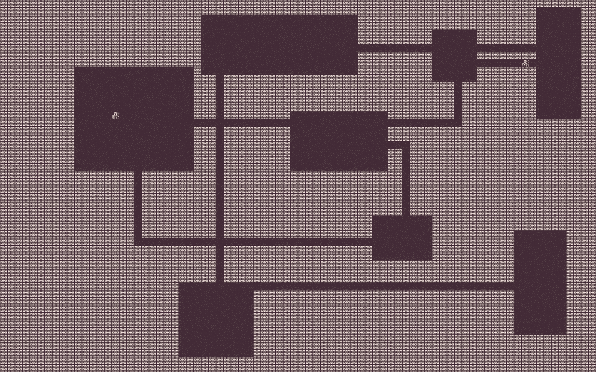
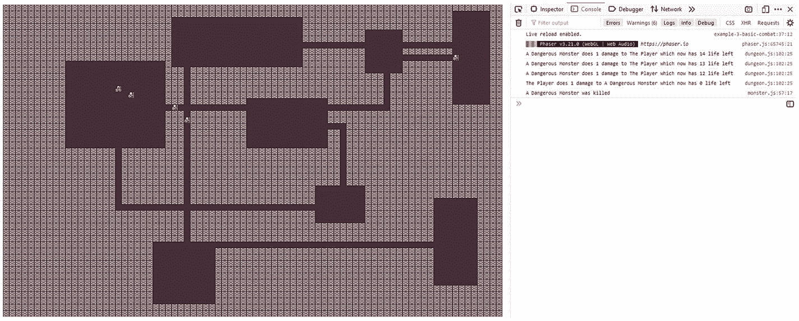

# 4. 敌人与永久死亡

在开始处理敌人和战斗机制之前，我们准备对代码库进行一次大规模重构。这将使我们更容易处理多个游戏实体（如敌人和怪物），并引入 Phaser 的一些新特性。

新的 `dungeon` 模块将承担比之前更多的职责，因为它将要同时管理关卡渲染和游戏实体移动。此前，我们的玩家类在需要移动时会直接修改动态图层瓦片地图。重构后，该类将调用 `dungeon` 模块提供的函数来进行移动。目标是让后续开发怪物类更加容易；如果每个游戏实体类都直接探测和修改瓦片地图，那么维护游戏代码将会相当困难，因为任何改动都可能涉及多个类。

本章所用第一个示例的源代码位于 `chapter-4/example-1-tween-movement/`。

## 地牢初始化

地牢的初始化函数基本保持不变；我们只是调整了一些变量的位置，以便其他函数更容易访问它们。新的 `initialize` 函数如下所示：

```
initialize: function (scene) {
	this.scene = scene
	this.level = level
	let levelWithTiles = level.map(r => {
		return r.map(t => {
			return t == 1 ? this.sprites.wall : this.sprites.floor
		})
	})
	const config = {
		data: levelWithTiles,
		tileWidth: this.tileSize,
		tileHeight: this.tileSize,
	}
	const map = scene.make.tilemap(config)
	const tileset = map.addTilesetImage('tiles', 'tiles', this.tileSize, this.tileSize, 0, 1)
	this.map = map.createDynamicLayer(0, tileset, 0, 0)
}
```

该函数基本没有变化；我们只是将一些变量移动到了 `dungeon` 对象的内部。在此函数末尾，我们设置了以下属性：

- `dungeon.scene`：存储了对 Phaser 场景的引用
- `dungeon.map`：存储了对用于地面瓦片的 Phaser 动态图层的引用
- `dungeon.level`：存储了对用于关卡数据的原始数组的引用

对 `dungeon` 模块的主要新增内容与游戏实体移动相关，接下来我们就来处理这些。

## 移动支持

在上一章中，玩家只是瓦片地图上的一个瓦片，移动是通过将目标瓦片与玩家互换，并将原位置变为地板瓦片来实现的。我们也将对此进行重构，并将玩家改为使用精灵（sprite）。这样重构的原因是精灵可以使用补间动画（tween）进行动画处理，我们将改用这些来实现移动。

精灵是放置在游戏世界中的自由浮动游戏对象。通常，像玩家角色、敌人、子弹以及其他玩家可交互或正在场景中移动的对象，在 2D 游戏中都是用精灵来实现的。

如前所述，这一切都是为了能够使用补间动画。你可能已经注意到上一章中玩家的移动有些笨拙。玩家角色基本上是从原始位置瞬移到最终位置。通常这并没有太大影响，因为这种瞬移发生在玩家角色上，是玩家输入的结果，所以你通常正看着角色并与它交互，因此即使移动是瞬间且笨拙的，也是你所预期的移动。但一旦我们开始添加敌方游戏实体，这种行为就会变得非常不受欢迎。你肯定不希望玩家因为移动缺乏足够的视觉反馈来吸引注意力，而去猜测哪些怪物移动过。

补间动画允许我们随时间操控游戏对象的属性。我们将使用它们来在几毫秒内将游戏实体的位置从一个瓦片移动到下一个瓦片。玩家角色将从一个瓦片移动到另一个瓦片，而不是瞬间在瓦片之间传送。

不过，我们必须考虑到一个重要的脱节。我们对 roguelike 游戏的思维模型是一个代表地牢的方形网格，怪物和玩家都放置在其中。`level` 数组存储了这种表示，但如前所述，我们将有一个动态图层，上面漂浮着精灵，这是一种显示 `level` 数组内部实际发生的不同方式。因此，我们将要实现的移动函数将作用于精灵和补间动画，但同时要考虑 `level` 中的数据。

### 初始化实体

就像关卡有一个 `initialize` 函数一样，我们将实现一个名为 `initializeEntity` 的函数，用于为给定的实体设置精灵并将其添加到地牢中。该函数将由我们的游戏实体类的构造函数调用。

```
initializeEntity: function(entity) {
	let x = this.map.tileToWorldX(entity.x)
	let y = this.map.tileToWorldY(entity.y)
	entity.sprite = this.scene.add.sprite(x, y, "tiles", entity.tile)
	entity.sprite.setOrigin(0)
}
```

该函数接收一个游戏实体，并使用动态图层的 `tileToWorldX` 函数，将瓦片地图网格中的坐标转换为基于像素的绝对坐标，供漂浮在动态图层上方的精灵使用。例如，如果玩家位于网格中的 2x1 位置，那么它实际上对应像素坐标中的 16x0。动态地图知道每个瓦片的大小，并在瓦片坐标与世界坐标之间进行转换。

接下来，我们为实体添加一个新属性；我们称之为 `sprite`，它保存了对所创建精灵的引用。这段代码与第 2 章中用于向屏幕添加文本的代码非常相似。Phaser 的 `scene.add.*` 方法非常一致。前两个参数是精灵应放置的位置。第三个和第四个参数是精灵的像素宽度和高度。第五个是精灵表，最后一个是你要使用的瓦片。你可能已经注意到瓦片来自 `entity.tile`，并且在上一章中我们将对瓦片的引用称为 `entity.sprite`；在下一节重构玩家时，我们将更改这一命名。

### 移动实体

要移动一个实体，我们需要该实体及其目标位置。将创建一个补间动画来随时间推移实现坐标变化，如下方代码所示：

```
moveEntityTo: function(entity, x, y) {
entity.moving = true
this.scene.tweens.add({
targets: entity.sprite,
onComplete: () => {
entity.moving = false
entity.x = x
entity.y = y
},
x: this.map.tileToWorldX(x),
y: this.map.tileToWorldY(y),
ease: "Power2",
duration: 200
})
}
```

`moveEntityTo` 函数在实体上存储了一个新属性，用于记录该实体是否正在移动。该属性稍后将在玩家类的 `over` 函数中使用，以判断回合是否结束。

所有场景都自带补间管理器 (`scene.tweens.*`)^(²⁹)，使得使用补间变得非常便捷。函数 `scene.tweens.add` 用于添加负责动画化实体移动的补间。它接收一个参数，即描述补间的配置对象。^(³⁰) 这些配置非常灵活，允许你对应该发生的事件进行非常具体的控制。我们的补间非常简单，仅随时间推移动画化坐标变化。该配置对象中使用的属性包括：

- `target`：引用哪些精灵正在被补间。
- `onComplete`：补间完成后执行的函数。用于将 `entity.moving` 设为 false，并将目标坐标保存为游戏实体的当前坐标。这样，实体坐标和精灵坐标互不绑定，实体位置仅在补间结束时才发生变化。
- `x` 和 `y`：精灵的最终坐标。
- `ease`：用于动画化过渡的函数。所选函数视觉效果令人愉悦。
- `duration`：补间应持续的时间（毫秒）。

此函数中未进行任何检查以验证游戏实体是否在穿墙或移动是否非法。这是有意为之，因为每个游戏实体类可能有不同的方式来判断何为合法移动。例如，你可以创建一个实际上可以穿墙的鬼魂。

尽管如此，我们仍需要为游戏实体类提供一个简便函数，用于检查某个坐标是否为可行走图块。

```
isWalkableTile: function (x, y) {
return level[y][x] !== 1
}
```

这是一个简单的函数，它检查我们的原始关卡数组，以确定该图块是否为墙壁。有了这些函数，我们就可以重构玩家类了。

## 玩家变为精灵

对玩家类的更改虽然很小，但分散在该类的大多数方法中。第一个需要进行的更改是确保构造函数使用新的 `initializeEntity` 函数。

```
constructor(x, y) {
this.movementPoints = 1
this.cursors = dungeon.scene.input.keyboard. createCursorKeys()
this.x = x
this.y = y
this.tile = 29
this.hp = 10
this.moving = false
dungeon.initializeEntity(this)
}
```

这里只有两处更改：我们将用于表示玩家角色的图块值的属性名从`sprite`改为了`tile`，因为现在`sprite`属性将用于保存对`initializeEntity`创建的精灵的引用，而`initializeEntity`在构造函数末尾被调用。在该类的上一个版本中，它在末尾直接操作动态层，使其与地图实现高度耦合；新代码更易于维护，并提供了必要的关注点分离。

补间将用于移动，我们从上一节得知，它们会保存一个名为`moving`的属性，以标记游戏实体是否正在移动。`over`方法应考虑这一点；我们不希望游戏实体在停止移动之前就结束回合。

```
over() {
return this.movementPoints == 0 && !this.moving
}
```

尽管用于玩家的精灵有自己的坐标，但它们与游戏实体自身以网格系统表示的坐标不同。正如移动补间使用的`onComplete`回调中所解释的，移动的最终位置仅在补间结束时才设置，并且由于回合只有在玩家停止移动后才结束，因此不会引发竞态条件。这意味着在用于处理移动的`turn`方法中，我们不应在响应方向键按下时直接设置玩家的坐标。我们需要做的是，确定玩家想要去的位置，检查是否为合法移动，然后使用`moveEntityTo`将玩家角色移动到那里并更新坐标。

```
turn() {
let moved = false
let newX = this.x
let newY = this.y
if (this.movementPoints > 0 && !this.moving) {
if (this.cursors.left.isDown) {
newX -= 1
moved = true
}
if (this.cursors.right.isDown) {
newX += 1
moved = true
}
if (this.cursors.up.isDown) {
newY -= 1
moved = true
}
if (this.cursors.down.isDown) {
newY += 1
moved = true
}
if (moved) {
this.movementPoints -= 1
if (dungeon.isWalkableTile(newX, newY)) {
dungeon.moveEntityTo(this, newX, newY)
}
}
}
}
```

此函数的大部分内容保持不变，但不同于上一章示例中直接设置`this.x`和`this.y`，这里我们设置两个新变量`newX`和`newY`，它们稍后将作为参数传递给`moveEntityTo`函数。我们没有直接检查地图数据，而是使用`isWalkableTile`函数来判断移动是否合法。

现在我们可以完成并运行示例了，但还需要进行一次最终重构。在上一章中，我们向回合管理器引入了一个简单的防抖函数，以防止玩家在 Phaser 运行速度极快时眨眼间触发多个回合。由于我们的实体在补间结束前不会结束回合，因此我们可以移除该防抖代码，并在认为游戏运行过快时调整补间持续时间。

重构回合管理器是一个好机会，不仅仅是移除防抖代码。我们还用更好的解决方案替换了上一示例中的循环：在`tm.currentIndex`中保存当前活动实体的索引，并在该实体回合结束时推进索引。

```
const tm = {
entities: new Set(),
addEntity: (entity) => tm.entities.add(entity),
removeEntity: (entity) => tm.entities.remove(entity),
refresh: () => {
tm.entities.forEach(e => e.refresh())
tm.currentIndex = 0
},
currentIndex: 0,
turn: () => {
if (tm.entities.size > 0) {
let entities = [...tm.entities]
let e = entities[tm.currentIndex]
if (!e.over()) {
e.turn()
} else {
tm.currentIndex++
}
}
},
over: () => [...tm.entities].every(e => e.over()),
}
export default tm
```

用于存储上次调用时间以及判断给定间隔是否已过去的相关数学代码都已移除。现在的回合管理器代码更加简洁，而游戏速度则成为所使用的补间的副产品。

现在是时候在浏览器中加载该示例了；它看起来与上一章的示例相同，直到你移动玩家角色，然后你会注意到角色在图块之间的移动变得多么平滑，从而带来更愉快的体验。

在我看来，这个地牢感觉相当舒适，是时候引入一些危险了。该添加一个怪物了。

## 我们的第一只怪物

在这个示例中，我们将创建一只怪物并添加到地牢中。它只会追逐玩家角色；我们将在下一个示例中添加战斗功能。本示例位于`chapter-4/example-2-first-monster/`目录下。

我们将使用成熟的 A* 搜索算法，而不是自己编写寻路算法。这是一种非常常见的算法，许多游戏都使用它在两个游戏实体之间找到一条合适的路径。为了简化工作，我们将使用由薛乔徐（Xueqiao Xu）开发的免费 A* 实现——`PathFinding.js`。该库与我们的源代码一起打包在`assets/`文件夹中，并通过本示例的 HTML 文件引用。

```
第 4 章 - 示例 2 - 第一只怪物
```

由于该库已通过 HTML 引入，我们在构建怪物时无需使用`import`加载它。`PathFinding.js`将作为一个名为`PF`的全局变量使用。

### 创建基本怪物类

怪物的代码位于`monster.js`文件中，与玩家角色的类非常相似。与我们将要构建的所有其他游戏实体类一样，它们都包含由回合管理器调用的`turn`、`over`和`refresh`方法。

```
import dungeon from "./dungeon.js"
export default class BasicMonster {
constructor(x, y) {
this.movementPoints = 1
this.x = x
this.y = y
this.tile = 26
dungeon.initializeEntity(this)
}
}
```

我们的基本怪物使用精灵表中的第 26 号瓦片作为图像，并且移动速度与玩家相同。`refresh`和`over`方法与玩家类完全相同。

```
refresh() {
this.movementPoints = 1
}
over() {
return this.movementPoints == 0 && !this.moving
}
```

这使得怪物每回合移动一格，这是一个适中的速度。当你运行此示例后，可以尝试为`refresh`和初始移动点数设置不同的值。如果初始值很大，怪物会在第一回合冲刺，因为回合调用会一直重复直到值归零；如果`refresh`期间增加的点数更多，怪物就会比玩家移动得更快，这种效果会增加大量紧张感。

在`turn`方法中移动怪物需要解释一下`PathFinding.js`库的工作原理。在尝试寻找两个实体之间的路径之前，你需要一个**网格**（grid）和一个**查找器**（finder）。

**网格**是库对我们游戏关卡数据的表示形式。有时这种网格与关卡数据的数据结构不匹配，但幸运的是，我们使用了与它们完全相同的数据结构，可以直接将我们的关卡数据传递给创建网格的函数。网格可以使用一个数组的数组来表示方形网格，其中`0`表示可通行区域，`1`表示障碍区域。

这个库包含许多寻路算法；我们将使用 A* 算法，但也可以使用其他算法。也许对于其他怪物，我们会尝试不同的寻路算法。当你创建**查找器**时，需要指定它应该使用哪种算法。

创建这两个对象后，就可以使用寻路函数获取两个实体之间的路径。返回的值是一个数组，包含从怪物位置到玩家位置逐格移动的步骤。

```
turn() {
let oldX = this.x
let oldY = this.y
if (this.movementPoints > 0) {
let pX = dungeon.player.x
let pY = dungeon.player.y
let grid = new PF.Grid(dungeon.level)
let finder = new PF.AStarFinder()
let path = finder.findPath(oldX, oldY, pX, pY, grid)
if (path.length > 2) {
dungeon.moveEntityTo(this, path[1][0], path[1][1])
}
this.movementPoints -= 1
}
}
```

这段代码与玩家类非常相似，其余方法也是如此；主要的变化在于，怪物不再检查光标键并决定位置，而是使用寻路库创建 `grid` 和 `finder`，并尝试找到自身与玩家之间的路径。检查路径数组是否包含两个以上元素的原因在于，它同时包含了怪物和玩家的位置，因此如果只有两个元素，说明怪物就在玩家旁边，无需移动。

## 将怪物添加到地牢

要将怪物添加到地牢，我们需要修改 `game.js` 文件。所需的修改非常简单：在 `create` 函数中，将玩家添加到回合管理器之后，添加怪物。

首先，在文件顶部导入新的怪物类。

```
import BasicMonster from "./monster.js"
```

然后修改 `create` 函数。

```
create: function () {
dungeon.initialize(this)
dungeon.player = new PlayerCharacter(15, 15)
tm.addEntity(dungeon.player)
tm.addEntity(new BasicMonster(70, 8))
}
```

只有一处改动，即最后一行，向回合管理器添加了一只新怪物。你可以尝试将该行复制几次并更改坐标，以向地牢中添加多只怪物。

现在你可以运行此示例了。加载后，界面应如图 4-1 所示。



**图 4-1** 基本怪物

左上角的小骷髅怪物会在玩家移动后开始移动，并持续尝试接近玩家位置。你可以尝试逃跑，但无处可逃。稍微绕一圈，看看自己能躲避骷髅多久。尝试添加多只怪物或改变它们的移动点数。

在下一节中，我们将添加战斗功能。

## 基本战斗机制

要实现完善的战斗机制，我们需要为这个小示例添加更多内容，因为目前无法得知玩家或敌人的任何属性。这一步将在下一章中完成，届时我们将探索宝藏和升级，这两者都需要更好的用户界面。在本节中，我们将只关注攻击和造成伤害。本节示例位于 `chapter-4/example-3-basic-combat/` 目录下。

与移动类似，我们将为游戏实体添加**行动点**（action points）。每回合如果它们还有剩余行动点，就可以攻击范围内的另一个实体。通过现在定义攻击范围，我们为以后添加不同武器、魔法（以及可怕的怪物）奠定了基础。我们还需要添加某种生命值计量器，以追踪一个实体在被移除游戏前能承受多少伤害。

### 从基础怪物到危险怪物

如果我们先处理怪物部分会更有趣。我们需要修改它的所有方法，以便考虑到用于追踪战斗相关特性的新属性。通过先修改怪物，然后在其他文件中进行必要的重构，我们采用了一种自上而下的设计方法。我们先编写期望的 API，然后再实现它。

让我们从修改 `monster.js` 中的怪物构造函数开始。

```
constructor(x, y) {
this.name = "一个危险的怪物"
this.movementPoints = 1
this.actionPoints = 1
this.healthPoints = 1
this.x = x
this.y = y
this.tile = 26
dungeon.initializeEntity(this)
}
```

怪物新增了许多属性。添加 `name` 属性是为了方便后续修改用户界面。另外两个属性——`actionPoints` 和 `healthPoints`——分别用于追踪实体在一回合内可以执行多少动作或攻击，以及它在被摧毁前能承受多少伤害。

`refresh` 和 `over` 方法都需要考虑这些新属性，以确保怪物在完成动作之前不会跳过当前回合。

```
refresh() {
this.movementPoints = 1
this.actionPoints = 1
}
over() {
return this.movementPoints == 0 && this.actionPoints == 0 && !this.moving
}
```

修改 `refresh` 方法中的 `actionPoints` 值，可以让怪物在一回合内进行多次攻击；这能显著增加游戏的紧张感。我们不使用属性来定义怪物攻击造成的伤害，而是采用函数来实现，这样更容易编写不同的数值，并在后续模拟掷骰子的效果。该函数返回的值就是怪物攻击对玩家造成的伤害量。

```
attack() {
return 1
}
```

为怪物被击杀时添加一个小的回调函数很重要。虽然我们目前还用不上，但后续会用它来向浏览器控制台记录信息。一旦战斗开始，地牢管理器会自动调用该函数（`attack` 方法也会被自动调用）。

```
onDestroy() {
console.log(`${this.name} 已被击杀`)
}
```

正如你可能已经猜到的，最大的变化实际上在于 `turn` 函数。除了移动之外，它还需要追踪剩余多少 `actionPoints`，并在距离足够近时攻击玩家。其中来自地牢模块的函数将在下一节中实现；别担心，我们正在编写期望的 API，稍后我们会让这个 API 成为现实。

```
turn() {
let oldX = this.x
let oldY = this.y
let pX = dungeon.player.x
let pY = dungeon.player.y
let grid = new PF.Grid(dungeon.level)
let finder = new PF.AStarFinder()
let path = finder.findPath(oldX, oldY, pX, pY, grid)
if (this.movementPoints > 0) {
if (path.length > 2) {
dungeon.moveEntityTo(this, path[1][0], path[1][1])
}
this.movementPoints -= 1
}
if (this.actionPoints > 0) {
if (dungeon.distanceBetweenEntities(this, dungeon.player) <= 2) {
dungeon.attackEntity(this, dungeon.player)
}
this.actionPoints -= 1
}
}
```

这段代码的开头部分负责处理移动，我们对这部分已经很熟悉了。在末尾，有一个最终的 `if` 子句：先检查是否还有剩余 `actionPoints`，然后检查怪物与玩家之间的距离（以方格为单位），并根据距离的远近决定是否攻击玩家。

由于攻击代码位于移动代码之后，这意味着在单个回合内，怪物可以先靠近玩家，然后发动攻击。如果顺序反过来，玩家就有机会在移动发生前逃脱。调整这些子句的顺序可以创造截然不同的怪物。例如，你可以设计一个攻击力极强但会在移动前攻击的怪物。玩家只要确保怪物不在自己附近开始回合，就能避免这种攻击。编写 Roguelike 游戏的部分乐趣就在于设计巧妙的机制，让玩家去发现并开始围绕这些机制进行策略思考。

在能够测试这些内容之前，我们必须先实现缺失的函数。

## 重构地下城管理器

要为地下城管理器添加战斗支持，需要进行多项更改。其中最重要的变化之一是，地下城管理器需要知道场景中有哪些实体，这意味着它需要访问回合管理器。到目前为止，这两个模块一直是完全独立的，理论上你可以用完全不同的机制来替换它们，例如，通过简单地修改回合管理器，就能制作一个动作类 Roguelike 游戏，而不是回合制游戏。

在本章之后，这两个模块将仍保持相对独立，但地下城模块在需要计算实体之间的距离以及判断某个格子是否可行走时（不能再从怪物身上走过去了），会从回合管理器获取实体集合来获取实体。

因此，我们必须在 `dungeon.js` 中的地下城模块开头导入回合管理器。

```
import level from "./level.js"
import tm from "./turnManager.js"
```

用于计算某个格子是否可行走的函数必须进行修改，以考虑到所有实体的位置。我们不希望怪物和玩家相互踩踏。

```
isWalkableTile: function (x, y) {
    // 检查所有实体。
    let allEntities = [...tm.entities]
    for (let e = 0; e < allEntities.length; e++ ) {
        let entity = allEntities[e]
        if (entity.x == x && entity.y == y) {
            return false
        }
    }
    // 检查关卡
    let tileAtDestination = dungeon.map.getTileAt(x, y)
    return tileAtDestination.index !== dungeon.sprites.wall
}
```

现在这个函数中有两个检查。第一个检查遍历所有实体，尝试匹配实体的坐标是否与调用函数时使用的参数相同。如果相同，则该格子不可行走。第二个检查是我们之前已有的，用于检查该位置格子的值。

请注意，怪物不使用此函数，因此它们仍然可以互相踩踏。此函数仅由玩家使用，并防止玩家穿过怪物。此更改的一个副作用是，怪物现在可以围困玩家，除非玩家能够杀死任何怪物，否则它们将被困住，每回合都会受到伤害。如果你不希望这样，可以移除第一个检查，并允许玩家穿过（并占据）与怪物相同的格子。

该函数的一个重要方面是它返回一个布尔值，这意味着即使玩家类知道它不能走进某个位置，它也无法知道该位置是被墙壁还是游戏实体占据。为了解决这个问题，我们实现了 `entityAtTile` 函数，该函数返回给定格子上的实体，或者 `false`。

```
entityAtTile: function (x, y) {
    let allEntities = [...tm.entities]
    for (let e = 0; e < allEntities.length; e++ ) {
        let entity = allEntities[e]
        if (entity.x == x && entity.y == y) {
            return entity
        }
    }
    return false
}
```

这是 `isWalkableTile` 的一个变体，但它不是只返回一个布尔值，而是返回占据该格子的实体。这两个函数可以合并成一个反向工作的函数，比如一个返回实体或 `false` 的 `isBlockedTile`，然后玩家类可以使用布尔取反运算符来检查是否可以移动到这个空间。我决定不那样做，因为代码会变得不清晰。这段代码可能包含更多重复，但它更容易理解和重构，这两点在游戏中非常重要。

## 怪物类使用 `distanceBetweenEntities` 来判断玩家是否足够近；让我们来实现它。

```
distanceBetweenEntities: function(e1, e2) {
    let grid = new PF.Grid(dungeon.level)
    let finder = new PF.AStarFinder({
        allowDiagonal: true
    })
    let path = finder.findPath(e1.x, e1.y, e2.x, e2.y, grid)
    if (path.length >= 2) {
        return path.length
    } else {
        return false
    }
}
```

这段代码与怪物类中使用的移动代码非常相似。主要区别在于，查找器初始化为支持对角线移动。我们的怪物不能对角线移动，但玩家可以；如果玩家需要逃离怪物，这为他们提供了战术优势，因为玩家每移动一格对角线，怪物就需要浪费两回合移动。如果距离计算不使用对角线移动来计算路径，你会根据实体位置得到奇怪的值；它们看起来只隔两格，但函数会报告它们隔了三格。

通过调整是否允许对角线移动、不同的得分刷新率以及可变伤害结果，你可以创造出感觉截然不同的怪物。例如，想象一个吸血鬼领主；它会在自己的房间里待着，直到玩家来到距离它 15 格以内，然后它才会苏醒；之后，它每回合移动三格，并且每回合发动大量攻击。你能实现这一点吗？

## 接下来要实现的逻辑函数是 `attackEntity`。该函数的本质相当容易理解；它需要调用攻击者的 `attack` 方法，并从被攻击实体的 `healthPoints` 中减去该值。

与移动函数类似，如果我们为攻击动作添加一些视觉反馈，游戏体验会更好。因此，该函数中会有一个补间动画；它会让攻击者快速移动到受害者的格子，然后快速返回其原始格子。

当调用 `attackEntity` 时，攻击者可能已经在移动；我所说的移动是指已经有一个针对攻击者的补间动画正在发生。如果攻击者刚刚移动，或者攻击者每回合有多次攻击并且正在攻击，就可能发生这种情况。该函数中会进行一些数学计算，以跟踪当前情况并为补间动画添加一些延迟，以防止它们过多重叠。

代码中大多数与战斗相关的实际部分将在补间动画的 `onComplete` 回调中处理，这样它就会在动画之后发生。除此之外的代码只是一种计算补间动画自身延迟的复杂方式，以避免与其他补间动画重叠。

由于这个补间动画需要移动到受害者的格子再返回，我们使用了一个名为 `yoyo` 的属性；这是一个布尔值，它会导致补间动画在完成后反向重复。

`hold` 属性是补间动画在重复或反向返回之前应保持位置的毫秒数。

`duration` 和 `delay` 不言自明；它们表示整个过程应该有多快，以及补间管理器在开始补间动画之前应该等待多久。

```
attackEntity: function(attacker, victim) {
    attacker.moving = true
    attacker.tweens = attacker.tweens || 0
    attacker.tweens += 1
    this.scene.tweens.add({
        targets: attacker.sprite,
        onComplete: () => {
            attacker.sprite.x = this.map.tileToWorldX(attacker.x)
            attacker.sprite.y = this.map.tileToWorldX(attacker.y)
            attacker.moving = false
            attacker.tweens -= 1
            let damage = attacker.attack()
            victim.healthPoints -= damage
            console.log(`${attacker.name} 对 ${victim.name} 造成 ${damage} 点伤害，${victim.name} 还剩 ${victim.healthPoints} 点生命值`)
            if (victim.healthPoints <= 0) {
                this.removeEntity(victim)
            }
        },
        x: this.map.tileToWorldX(victim.x),
        y: this.map.tileToWorldY(victim.y),
        ease: "Power2",
        hold: 20,
        duration: 80,
        delay: attacker.tweens * 200,
        yoyo: true
    })
}
```

`onComplete` 内部有很多逻辑。让我们逐段拆解。初始块管理补间计数和移动标志，以便将实体标记为静止，并减少其补间计数，从而在所有补间完成时最终归零。

该块的另一个重要部分是，它将精灵坐标重置为应有的位置。那个补间动画会将精灵移动到受害者的瓦片位置，然后再回到补间动画开始时的位置；因此，如果由于任何原因补间动画最终相互重叠，补间动画的起始位置将不是精灵原本应该所在的位置，从而导致补间动画结束时精灵处于错误的位置。重置该值对于在动画结束时将精灵对齐到网格至关重要。

下一个块实际上获取伤害并将其施加给受害者，非常简单。它后面的内容是我们之前未使用过的，一个简单的 `console.log` 调用，用于输出关于攻击的一些数据。我们这样做是因为我们还没有更好的用户界面，而我们需要知道发生了什么。

在 `onComplete` 回调的末尾，有一个检查，用于查看受害者的 `healthPoints` 是否耗尽并将其从游戏中移除。攻击后，受害者的 `healthPoints` 有可能变成负值，因此我们需要小心处理。在我这里的一些初始测试中，我制造了一个不朽的骷髅，因为我当时检查 `healthPoints` 是否恰好为零，而我的骷髅生命值达到了负值，尽管这对于一个亡灵怪物来说相当合适，但却造就了一个无情且无法杀死的对手。

如果实体被杀死，则必须将其移除；接下来我们实现 `removeEntity` 函数。

```
removeEntity: function(entity) {
tm.entities.delete(entity)
entity.sprite.destroy()
entity.onDestroy()
}
```

要理解该函数，我们需要记住游戏中加载了每个游戏实体的两种表示形式。有浮动在动态地图上方的精灵，以及添加到回合管理器的游戏实体实例。因此，从游戏中移除一个实体意味着从两个地方移除它，并调用实例的 `onDestroy` 方法（以防它需要进行任何清理或输出一些消息）。一旦实体不再与任何活动数据结构关联，它将被 JavaScript 垃圾回收器回收。

如果你仅凭这些更改启动示例，那么游戏将非常有挑战性，因为玩家无法攻击怪物。是时候通过重构玩家类来改变这一点了。

### 玩家类学会了如何攻击

对玩家类的更改与对怪物类的更改类似。毕竟，我们的游戏实体都是同一类。新的构造函数填充了我们为怪物设置的相同属性，但使用了不同的值，以使玩家更难被杀死。

```
constructor(x, y) {
this.name = "The Player"
this.movementPoints = 1
this.actionPoints = 1
this.healthPoints = 15
this.cursors = dungeon.scene.input.keyboard.createCursorKeys()
this.x = x
this.y = y
this.tile = 29
this.moving = false
dungeon.initializeEntity(this)
}
```

`refresh`函数与怪物类相同，只是重新填充`actionPoints`和`movementPoints`。

```
refresh() {
this.movementPoints = 1
this.actionPoints = 1
}
```

玩家类和怪物类的一个重要区别是，如果你仔细观察，会发现怪物无论是否移动或攻击，都会消耗它们的`movementPoints`和`actionPoints`；这样做的目的是，如果它们没有可攻击的人或没有可移动的距离，它们就会跳过自己的回合。这是一种解决该问题的简单方法，但确实有效。

另一方面，玩家不需要进行此类检查；玩家的`over`检查与之前的示例相同，只是检查玩家是否正在移动以及其`movementPoints`是否已耗尽。玩家通过移动来攻击，因此如果没有移动尝试，就没有攻击。

我们添加了一个`onDestroy`回调，如果玩家被杀死，它会重新加载页面，这是一种简陋的重新开始游戏的方式；并且添加了一个与怪物类类似的`attack`函数。

Roguelike 游戏通常具有永久死亡（permadeath）特性；这意味着一旦玩家死亡，游戏将重新开始，带来全新的体验。我们目前还没有进行程序化生成，因此玩家死亡后重新开始会导致完全相同的体验。尽管如此，如果玩家死亡且游戏重新开始，他们将需要再次杀死所有敌人。当我们开始使用程序化生成时，永久死亡将具有完全不同的感觉。

```
attack() {
return 1
}
onDestroy() {
alert("OMG! you died!")
location.reload()
}
```

正如预期的那样，最大的变化是`turn`函数。玩家的攻击方式是，如果它试图移动到一个被阻塞的瓦片，并且该瓦片恰好包含一个实体，那么玩家就会攻击该实体。

```
turn() {
let oldX = this.x
let oldY = this.y
let moved = false
let newX = this.x
let newY = this.y
if (this.movementPoints > 0) {
if (this.cursors.left.isDown) {
newX -= 1
moved = true
}
if (this.cursors.right.isDown) {
newX += 1
moved = true
}
if (this.cursors.up.isDown) {
newY -= 1
moved = true
}
if (this.cursors.down.isDown) {
newY += 1
moved = true
}
if (moved) {
this.movementPoints -= 1
if (!dungeon.isWalkableTile(newX, newY)) {
let enemy = dungeon.entityAtTile(newX, newY)
if (enemy && this.actionPoints > 0) {
dungeon.attackEntity(this, enemy)
this.actionPoints -= 1
}
newX = oldX
newY = oldY
}
if (newX !== oldX || newY !== oldY) {
dungeon.moveEntityTo(this, newX, newY)
}
}
}
if (this.healthPoints <= 5) {
this.sprite.tint = Phaser.Display.Color.GetColor(255,0,0)
}
}
```

移动代码与上一个示例相比没有真正改变。它仍然检查每个光标键，并生成一对`newX`和`newY`，表示玩家试图去的位置。不同之处在于，如果它是一个被阻塞的瓦片，我们会尝试通过调用`entityAtTile`来获取占据该瓦片的实体。如果返回的值是一个实体（因此不是`false`），玩家就使用`attackEntity`来攻击它。

一个小补充是最后的`if`子句，它检查玩家剩余多少`healthPoints`；如果数值低于阈值，它会将玩家精灵着色为红色，以表明处于危险之中。

你可以在`refresh`回调中为玩家添加一些`healthPoints`，这样玩家会随时间恢复生命值。

完成这些更改后，你可以加载示例并尝试杀死怪物。回到`game.js`中添加更多怪物以提高难度会更有趣。在图 4-2 中，你可以看到在地牢中添加更多怪物并尝试战斗的结果。我将控制台的输出添加到了这个截图中，以便我们更好地了解发生了什么。



图 4-2

基本战斗

## 练习

本章提供了很好的实验机会。我一直在内容中穿插一些想法，希望你可以尝试其中的一些。如果你没有，这里有一些供你实现的实验：

*   创建一种新的骷髅类型，移动速度更快但伤害更低。

*   创建一个怪物，直到玩家距离它 15 格时才移动。然后它会追击玩家并造成大量伤害。

*   不要总是造成固定的伤害量，尝试将该值替换为一个随机数。

### 总结

本章内容非常重要，请务必亲自动手实验最后一个示例中的代码，深入理解玩家与怪物类之间的交互方式。

玩家移动中使用的相同生命周期方法——`turn`、`over` 和 `refresh`——在配合寻路库使用时，同样可以用来创建怪物。

`Sprites` 为我们提供了极大的自由度与灵活性，能够通过补间动画和色调来为实体制作动画效果。但必须注意保持实体位置与精灵位置同步，因为现在的游戏实体已比简单的瓦片要复杂得多。

角色死亡会导致游戏体验重新开始，玩家将失去此前取得的所有进度。在我看来，这是 roguelike 游戏体验的一个重要特征，它能让玩家变得更加谨慎。

将移动和战斗处理逻辑集中在地牢模块中，使我们能够快速尝试创建新的游戏实体，并将它们释放到地牢中。大胆尝试吧，比如在地牢里放一个行动迅速且无法杀死的怪物，然后与之互动。

在下一章中，我们将引入宝物和装备，把游戏体验推向极致。

脚注 1 2 3 4 5