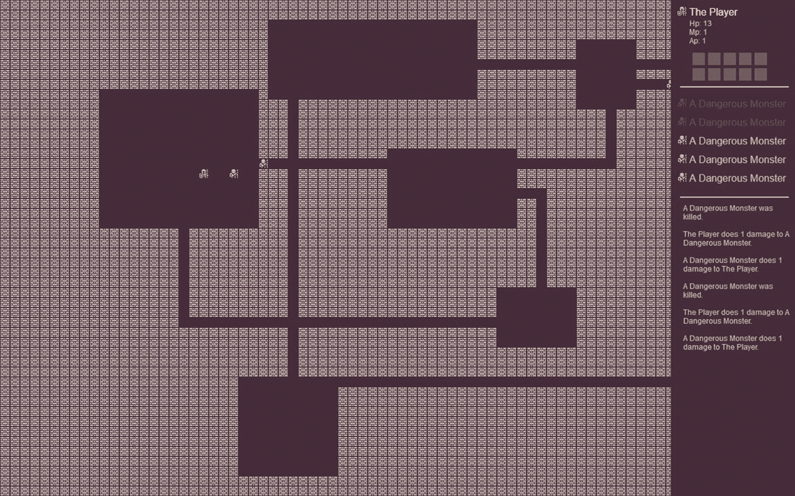
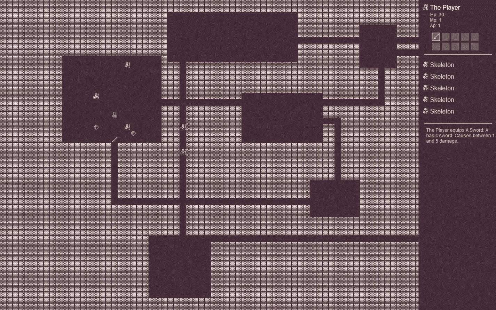

# 5. 宝物与装备

在本章中，我们将学习如何为游戏添加宝物和装备。这些物品将与玩家角色和怪物一样，作为游戏实体存在，并被放置在地牢内的随机位置。

为这些物品提供支持，不仅仅是创建实体并扔到地图上那么简单。我们还需要一个用户界面来处理背包系统。在处理物品本身之前，我们需要先完善游戏 UI。

## 为游戏创建用户界面

在游戏开发过程中，我们已经到了需要更好 UI 来支持新增功能的阶段。为了创建这个用户界面，我们将重构目前使用的大部分文件，因为游戏循环和所有游戏实体都需要感知到新的 UI。完成这些修改后，我们的界面将如图 5-1 所示。



图 5-1

地牢用户界面

该 UI 基于屏幕右侧的侧边栏，包含三个不同的区域。顶部区域显示玩家信息，列有：

*   玩家的精灵图像及其名称

*   生命值

*   移动点数

*   行动点数

*   十个背包栏位

接着是当前层级的怪物列表。当怪物被击杀后，其条目会变暗。为了节省空间，我选择暂不显示怪物的属性数据。

最后一个区域是游戏近期行动的文本输出，记录了玩家与怪物之间的交互情况。

### 实现方式

在第 2 章中，我们学习了 Phaser 场景。^(³³) 为了实现 UI，我们将利用 Phaser 的场景叠放功能，将一个场景叠加在另一个场景之上。我们会缩小地牢场景以释放右侧空间，然后将 UI 场景覆盖上去，仅在右侧进行绘制。

每个游戏实体（包括怪物和玩家）都会接收 UI 场景，并通过一个名为 `createUI` 的特殊回调函数来实现实体 UI 的绘制。通过让每个实体负责自身的 UI 绘制，从维护性角度来看，我们减轻了工作量——因为在决定重构某个实体的 UI 时，需要修改的文件数量减少了。

如前所述，这会对代码库进行大规模的改动，但也会为更复杂的机制和功能打开大门。让我们从重构 `game.js` 开始。

第一个示例的文件位于 `chapter-5/example-1-basic-ui`。

### Game.js 重构

到目前为止，我们一直将游戏启动引导与世界场景混杂在同一个 `game.js` 文件中。现在，我们将把世界场景提取到单独的文件中，并精简 `game.js` 启动文件中的代码量。UI 场景也会放在单独的文件中。这两个文件将由 `game.js` 导入，并在 Phaser 游戏配置对象中使用。

```js
import ui from "./ui.js"
import world from "./world.js"
const config = {
type: Phaser.AUTO,
width: 80 * 16,
height: 50 * 16,
backgroundColor: "#472d3c",
parent: "game",
pixelArt: true,
zoom: 1,
scene: [world, ui],
physics: {
default: "arcade",
arcade: {
gravity: { y: 0 }
}
}
}
const game = new Phaser.Game(config)
```

文件变得简单多了；所有冗余代码都已被移除。除了删掉大量代码行之外，最大的变化是导入了两个场景，并将它们加载到 `scene: [world, ui]` 这一行中。

完成重构后，接下来该处理 `world.js` 了。

### 实现 `world.js`

新的 `world.js` 大部分内容只是从之前版本的 `game.js` 中移除的代码，但其中也包含一些将在本节稍后解释的新部分。

在文件顶部，我们先导入所有需要的模块：

```js
import dungeon from "./dungeon.js"
import tm from "./turnManager.js"
import PlayerCharacter from "./player.js"
import BasicMonster from "./monster.js"
```

`world.js` 文件是包含本书截至目前所实现所有游戏内容的场景，因此它应该看起来非常熟悉。

```js
const world = {
key: "world-scene",
active: true,
```

第一个改动是为场景添加了一个 `key` 属性和一个 `active` 标志。我们在 `game.js` 的游戏配置对象中传入了多个场景。在这些场景中，Phaser 只会自动加载那些 `active` 设置为 `true` 的场景。设置 `key` 是为了让一个场景可以通过名称引用另一个场景。

```js
preload: function () {
this.load.spritesheet('tiles', 'assets/colored.png',
{
frameWidth: 16,
frameHeight: 16,
spacing: 1
})
},
```

`preload` 函数保持不变。重要的变化出现在下一个函数 `create` 中。

```js
create: function () {
dungeon.initialize(this)
// 加载游戏实体
dungeon.player = new PlayerCharacter(15, 15)
tm.addEntity(dungeon.player)
tm.addEntity(new BasicMonster(20, 20))
tm.addEntity(new BasicMonster(20, 10))
tm.addEntity(new BasicMonster(76, 10))
tm.addEntity(new BasicMonster(29, 24))
tm.addEntity(new BasicMonster(29, 20))
```

`create` 函数的开头部分初始化了地牢并加载了游戏实体——这些与我们之前所做的非常相似。`create` 函数的下一部分则是新增的内容。它使用 Phaser 场景内置的相机管理器来改变场景视口，以便在右侧留出空白区域供 UI 场景填充。

```js
// 设置相机，使游戏视口
// 在右侧缩小，为 UI 场景
// 腾出空间。
let camera = this.cameras.main
camera.setViewport(0, 0, camera.worldView.width-200, camera.worldView.height)
camera.setBounds(0, 0, camera.worldView.width, camera.worldView.height)
camera.startFollow(dungeon.player.sprite)
```

`setViewport` 函数用于缩小视口。`setBounds` 限制了相机移动范围，确保它在移动时不会超出地牢边界。相机之所以会移动，是因为我们使用了 `startFollow` 函数来追踪玩家位置。

```js
// 触发 UI 场景构建
this.events.emit('createUI')
},
```

每个场景都自带一个事件管理器。我们将利用事件在世界场景和 UI 场景之间来回发送消息。在 `create` 阶段触发事件的原因在于：UI 场景需要在游戏实体就位后才能渲染用户界面。如果我们简单地在游戏配置对象中将两个场景的 `active` 都设置为 `true`，就会导致竞态条件——它们会同时尝试渲染，而此时必要的元素尚未加载完毕，无法正常工作。

```js
update: function () {
if (tm.over()) {
tm.refresh()
}
tm.turn()
}
}
export default world
```

`update` 函数也保持不变。最后，由于该场景现在是一个 JS 模块，我们导出了 `world` 对象。

在实现 UI 场景之前，我们先简要回顾一下对 `dungeon.js` 的一些补充。

### 新的 `dungeon.js` 功能

在地牢模块中，有一些 `console.log()` 调用用于向控制台输出有用信息。这类文本实际上应该归属于游戏 UI。为了支持这一需求，我们需要将这些调用重构为 UI 场景后续可以使用的形式。

在地牢模块中添加了一个 `msgs` 数组，用于存储这些文本数据：

```js
let dungeon = {
msgs: [],
```

新增的 `log` 函数用于填充该数组：

```js
log: function(text) {
this.msgs.unshift(text)
this.msgs = this.msgs.slice(0,8)
}
```

该函数将 `msgs` 数组的元素数量限制为最多八个。新文本被插入到数组前端，以便玩家能先读取最近发生的事件。

之后，只需将攻击函数中的 `console.log` 调整为使用新的 `log` 函数：

```js
this.log(`${attacker.name} 对 ${victim.name} 造成了 ${damage} 点伤害。`)
```

# 构建 UI 场景

现在，是时候构建 UI 场景了。

好的，作为高级文档工程师和翻译员，我将遵循您提供的格式和注意事项，将给定的英文文本翻译成中文。

### 创建 UI 场景

UI 场景的源代码位于 `ui.js` 文件中。它与我们使用的世界场景非常相似。它同时拥有 `create` 和 `update` 方法，但没有 `preload` 方法，因为世界场景会预加载该场景也会使用的瓦片地图。

这个场景的一个重要特性是，它依赖于被加载到回合管理器中的实体才能正常工作。由于我们无法保证在 `create` 开始执行时所有实体都已加载完毕，因此我们将依赖于实体的那部分代码包装成一个自定义事件的回调函数，该事件将由世界场景在完成将实体加载到回合管理器后发送。

UI 场景需要访问回合管理器以获取实体，并访问地牢模块以获取 `msgs` 数组：

```javascript
import dungeon from "./dungeon.js"
import tm from "./turnManager.js"

const ui = {
  key: "ui-scene",
  active: true,
```

该场景有一个自定义的键，以便源代码的其他部分能够获取它，并且它被设置为在游戏启动时加载。

一个 `createdUI` 布尔值将被 `create` 和 `update` 方法用来判断用户界面是否已添加到屏幕上。这是必要的，因为 `update` 可能会在世界场景的自定义事件到达之前运行；在这种情况下，还没有 UI 可以更新，它不应该尝试访问它。

```javascript
create: function () {
  this.createdUI = false
  this.scene.get('world-scene').events.on('createUI', () => {
    let iterator = tm.entities.values()
    let x = (80 * 16) - 190
    let y = 10
    for (let entity of iterator) {
      if (typeof entity.createUI === "function") {
        let height = entity.createUI({
          scene: this,
          x,
          y,
          width: 198
        })
        y += height
      }
    }
    this.add.line(x+5, y, 0, 10, 175, 10, 0xcfc6b8).setOrigin(0)
    this.log = this.add.text(x+10, y+20, "", {
      font: '12px Arial',
      color: '#cfc6b8',
      wordWrap: {
        width: 180
      }
    })
    this.createdUI = true
  })
},
```

`create` 函数需要为世界场景发送的自定义事件添加一个回调函数。每个场景都有自己的事件管理器。我们必须使用世界场景的事件管理器。如果我们仅仅在 UI 场景的事件管理器上为该事件名称注册一个回调函数，它永远不会被触发，因为事件不会在不同的管理器之间传递。为此，我们首先获取场景本身的引用——最终使用了我们设置的键——然后使用该场景的事件管理器来注册一个回调函数。让我在这里重复一下那行代码，以便更清楚：

```
this.scene.get('world-scene').events.on('createUI' ...
```

该回调函数内部是用户界面的创建代码。它依赖于从 `dungeon.entities` 集合中获取一个迭代器。为每个实体调用一个名为 `createUI` 的函数。该函数接收一个包含坐标和用户界面宽度的配置对象；然后每个实体可以自行决定其应占用的高度并返回该值。这个值用于计算下一个实体的位置。

通过这种方式，每个实体可以创建自己的自定义 UI，或者根本不创建界面，只返回零。从 UI 场景的角度来看，玩家和怪物都是一样的。它对每个实体调用 `createUI`，并让每个实体管理自己的界面。尽管这为每个实体增加了更多代码，但从长远来看，它更加灵活，并且由于每个实体的代码是独立的，因此更易于维护。

迭代器循环可能看起来有点奇怪。阅读脚注中引用的文档页面会清楚得多。基本上，当遍历 `values()` 时，迭代器返回的值就是实体本身。

在所有实体 UI 创建完成后，我们添加一条线，作为实体用户界面和下一个部分（即用于显示 `dungeon.msgs` 数组中数据的文本对象）之间的视觉分隔符。之后，UI 创建完毕，我们可以将 `createdUI` 标志设置为 true。

实现 UI 场景的下一步是 `update` 函数，它非常简单，以及导出场景。

```javascript
update: function() {
  if (this.createdUI) {
    let text = dungeon.msgs.join(`\n\n`)
    this.log.setText(text)
  }
}
}
export default ui
```

`dungeon.msgs` 数组使用两个回车符连接，以便消息之间有一些视觉分隔。处理自动换行的代码由 Phaser 本身提供。在 `create` 函数中创建文本对象时，我们将自动换行的宽度设置为 180。这将使文本消息在我们游戏的 UI 中整齐地排列成一列。

剩下的就是为每个实体实现 `createUI` 方法。我们为怪物使用的 UI 比玩家的简单；让我们先从它开始。

### 实现怪物 UI

怪物用户界面非常简单；它只显示怪物的精灵图和名称。在本书的截图中不明显的一点是，它会在怪物行动回合更改其名称的颜色，以便玩家知道哪个怪物正在移动。这会产生一个不错的效果，因为随着回合的进行，每个怪物的名称会依次闪烁，直到再次轮到玩家行动。

让我们实现 `createUI` 函数。

```javascript
createUI(config) {
  let scene = config.scene
  let x = config.x
  let y = config.y
  this.UIsprite = scene.add.sprite(x, y, "tiles", this.tile).setOrigin(0)
  this.UItext = scene.add.text(x+20, y, this.name, { font: '16px Arial', fill: '#cfc6b8' })
  return 30
}
```

`config` 对象包含位置和对 UI 场景的引用——也包含了宽度，但在此函数中未使用——这些值用于定位 `sprite` 和 `text` 对象。

此函数返回的值由 UI 场景用于计算下一个实体的坐标。这允许实体用户界面具有灵活的高度。

在实体的回合中实现闪烁，可以通过修改 `over` 函数来实现，因为该函数实际知道回合是否结束。我们要实现的另一个视觉效果是，当怪物被击杀时，其名称变暗。这可以在 `onDestroy` 函数中实现。

```javascript
over() {
  let isOver = this.movementPoints == 0 && this.actionPoints == 0 && !this.moving
  if (isOver && this.UItext) {
    this.UItext.setColor("#cfc6b8")
  } else {
    this.UItext.setColor("#fff")
  }
  return isOver
}

onDestroy() {
  dungeon.log(`${this.name} was killed.`)
  this.UIsprite.setAlpha(0.2)
  this.UItext.setAlpha(0.2)
}
```

检查 `UItext` 是否已被创建是很重要的，因为 `over` 函数可能在 UI 场景从世界接收到自定义事件之前被调用。根据回合是否结束，我们更改文本的颜色。

当怪物被击杀时，`dungeon.log` 用于向游戏的文本显示区域添加一条消息，并且通过更改其透明度使实体 UI 变暗。

玩家 UI 与此非常相似，但它拥有更多元素；让我们来实现它。

### 玩家界面

除了与怪物界面类似的精灵图和名称显示外，玩家界面还包含状态栏和物品栏位——这些栏位目前虽未使用，但将在下一个关于装备的示例中派上用场。

为了支持新界面，我们将实现一个 `createUI` 函数，并修改 `over` 函数，使其在玩家回合时高亮显示角色名称。由于 `createUI` 函数包含多个不同部分，我们将分步讲解。

```
createUI(config) {
let scene = config.scene
let x = config.x
let y = config.y
let accumulatedHeight = 0
```

为简化界面占用高度的计算，我们添加了一个名为`accumulatedHeight`的变量。在构建玩家界面的每个部分时，我们会将其高度累加至此变量。

```
// 角色精灵图和名称
this.UIsprite = scene.add.sprite(x, y, "tiles", this.tile).setOrigin(0)
this.UIheader = scene.add.text(
x + 20,
y,
this.name,
{
font: '16px Arial',
color: '#cfc6b8'
})
```

添加英雄精灵及名称的方式与怪物界面相同。

```
// 角色状态
this.UIstatsText = scene.add.text(
x + 20,
y + 20,
`生命值: ${this.healthPoints}\n 移动力: ${this.movementPoints}\n 行动力: ${this.actionPoints}`,
{
font: '12px Arial',
fill: '#cfc6b8'
})
accumulatedHeight += this.HPtext.height + this.UIsprite.height
```

角色状态栏仅是一个包含换行符的文本。使用`模板字符串`^(³⁶)进行变量插值，可将数据的正确值填入显示文本。此文本采用的字体小于上一部分，使我们能在更小的空间内展示更多信息。

物品栏通过空白方块展示。共有十个栏位，排列成两行，每行五个。这个数字并非随意设定；后续我们将使用键盘上的数字键来激活装备，因此每个栏位对应一个键盘按键。

```
// 物品栏屏幕
let itemsPerRow = 5
let rows = 2
this.UIitems = []
for (let row = 1; row <= rows; row++) {
for (let cell = 1; cell <= itemsPerRow; cell++) {
let rx = x + (25 * cell)
let ry = y + 50 + (25 * row)
this.UIitems.push(
scene.add.rectangle(rx, ry, 20, 20, 0xcfc6b8, 0.3).setOrigin(0)
)
}
}
accumulatedHeight += 90
```

通过嵌套循环，创建了一个包含十个矩形的`UIitems`数组。^(³⁷)在下一个示例中，我们将利用此数组将空白栏位替换为装备。

`createUI`函数的最后一个部分仅是一条用作分隔线的线条，用于区分玩家界面与其他实体。

```
// 分隔线
scene.add.line(x+5, y+120, 0, 10, 175, 10, 0xcfc6b8). setOrigin(0)
return accumulatedHeight
```

至此，玩家界面的创建已全部完成，但还需实现其回合时的高亮效果，并确保状态显示能及时更新。幸运的是，这两项工作都可以在`over`函数中完成。

```
over() {
let isOver = this.movementPoints == 0 && !this.moving
if (isOver && this.UIheader) {
this.UIheader.setColor("#cfc6b8")
} else {
this.UIheader.setColor("#fff")
}
if (this.UIstatsText) {
this.UIstatsText.setText( `生命值: ${this.healthPoints}\n 移动力: ${this.movementPoints}\n 行动力: ${this.actionPoints}`)
}
return isOver
}
```

该函数与怪物版本的`over`类似，但额外增加了一段代码，用于用当前数值更新`UIStatsText`。

至此，第一个示例所需的所有改动均已完成。运行该示例，您将能体验到新的用户界面。下一个示例将专注于创建装备。

## 创建装备与宝物

在本书中，装备与宝物将以相同方式实现。这可能与更复杂的 Roguelike 游戏实现方式不同，但足以满足本书的教学目的。更复杂的游戏通常会为每种游戏实体构建专门的数据结构和类。为降低本书理解难度并使代码更易于实验，我们采用灵活的类定义，并使所有实体遵循统一接口。

装备与宝物都将作为新的游戏实体类型——类似于玩家和怪物——但它们不会移动，也不具备用户界面。通过将它们设为游戏实体，它们能在被拾取之外，对游戏体验产生更大影响。它们将拥有自己的`turn`和`over`版本，这意味着装备能在每个回合产生影响。一个典型例子是诅咒之剑：它威力强大，但每回合会吸取玩家的生命值。

在开始疯狂创建物品之前，我们需要对现有文件进行一些额外工作。当前，我们已有用于展示玩家所持物品的界面，但还缺乏其他必要的逻辑。

本示例的代码位于`chapter-5/example-2-equipment/`目录下；打开后，您会发现其中新增了几个文件夹，用于更好地组织代码。`items`文件夹存储了游戏中所有物品，`enemies`文件夹则存放所有敌人。

我已将原来的`monster.js`移至`enemies`文件夹并重命名为`skeleton.js`；`world.js`中的代码也已相应更新。

所有游戏实体现在都将拥有一个名为`type`的新属性，它是一个字符串，用于声明实体的类型。目前有三种实体类型：角色、敌人、物品——所有现有游戏实体的构造函数均已更新以设置此属性。所有实体的`healthPoints`数值均已提高，以便我们能更充分地体验武器及其效果。

完成上述重构后，我们就可以开始修改`player.js`实体了。

### 为玩家角色添加物品支持

支持物品所需的大部分工作都集中在`player.js`类中。其他实体与物品的交互较少，即使有交互也会委托给玩家处理。玩家将在游戏过程中收集物品。携带物品与装备物品是两个独立的行为。这样一来，我们可以创建像药水这样的物品——装备后立即触发效果，然后自我销毁。

玩家携带的所有物品都将显示在上个示例中创建的物品栏网格中；装备的物品会以不透明状态显示并带有白色边框，其他物品则呈暗淡状态且无边框。

玩家通过按键盘上与所选栏位对应的数字键来装备或卸下物品。共有两行五个栏位，因此数字键从 0 到 9，其中 0 对应第十个栏位（以便与键盘上的排列顺序匹配）。

由于玩家类现在比之前庞大得多，我将分小节讲解，以使内部代码更清晰。接下来的小节顺序将与文件中的实际代码布局略有不同。我在此处如此解释是为了帮助理解其工作原理，但文件本身的组织结构更利于阅读和维护。

#### 装备物品

当玩家装备物品时，我们会将该物品的 `active` 属性设为 `true`。为实现此功能，我们实现了一个 `toggleItem` 函数，该函数接收一个对应物品栏槽位的数字，并根据其之前的状态将该物品切换为激活或非激活状态。

```
toggleItem(itemNumber) {
const item = this.items[itemNumber]
if (item) {
if (item.weapon) {
this.items.forEach(i => i.active = i.weapon ? false : i.active)
}
item.active = !item.active
if (item.active) {
dungeon.log(`${this.name} equips ${item.name} :   ${item.description}.`)
item.equip(itemNumber)
}
}
}
```

函数中的第一个 `if` 子句是为了确保我们确实是在尝试切换物品。如果我们试图传入一个与空槽位匹配的数字，函数将直接退出。

我们利用该函数来对玩家实施特定的游戏机制：玩家一次只能装备一件武器。装备一件武器会导致所有其他武器自动卸下。

如果切换操作是激活某件物品，我们会借此机会在游戏界面中显示一些有用的文本。

每个物品也可以实现自己的 `equip` 函数。当用户将该物品设为激活状态时，此函数将被调用。

#### 从物品栏中移除物品

目前，在从物品栏移除物品方面，我们有两个需求：一是希望支持诸如药水这类物品——它们会产生效果后自我销毁；二是希望支持能够移除其他物品的物品。

为满足这两种用例，我们将构建两个不同的函数。第一个函数通过传入玩家物品栏中的槽位位置来移除物品。
```

```
removeItem(itemNumber) {
const item = this.items[itemNumber]
if (item) {
this.items.forEach(i => {
i.UIsprite.destroy()
delete i.UIsprite
})
this.items = this.items.filter(i => i !== item)
this.refreshUI()
}
}
```

要移除一个物品，我们需要：

-   删除物品对应的 `UIsprite`，即我们放置在代表物品栏槽位的 `UIitem` 矩形之上的精灵。
-   删除物品的 `UIsprite` 属性，以便刷新用户界面的函数能重新创建它。
-   将该 `item` 从物品数组中移除。
-   刷新用户界面以显示更改。

我们实现的另一个函数，则通过检查物品的某些属性是否与给定值匹配来移除物品。借助此函数，你可以构建一个物品，比如，调用它并传入 `cursed` 作为属性、`true` 作为值，就能移除所有被诅咒的物品。

```
removeItemByProperty(property, value) {
this.items.forEach(i => {
i.UIsprite.destroy()
delete i.UIsprite
})
this.items = this.items.filter(i => i[property] !== value)
this.refreshUI()
}
```

### 改变攻击方式

乍一看，这似乎与物品处理无关，但实际上是相关的。在此示例之前，玩家的攻击力是由 `attack` 函数返回的一个数值。我们仍将从该函数返回一个数值，但现在计算方式会有所不同。

玩家的攻击力将由当前装备的武器决定。为了更轻松地计算，我们将实现一个便捷的辅助函数来返回已装备的物品。

```
equippedItems() {
return this.items.filter(i => i.active)
}
```

现在，轻松计算玩家的攻击力就变得很容易了。

```
attack() {
const items = this.equippedItems()
const combineDamage = (total, item) => total + item.damage()
const damage = items.reduce(combineDamage, 0)
return damage
}
```

你可能会想，如果玩家装备了一件不造成任何伤害的物品会怎样；嗯，在这种情况下，该物品的 `damage` 函数会返回零。

在本示例结束之前，我们将在构造函数中通过预填充 `items` 数组（放置一把剑）并默认将其激活，从而为玩家提供一个物品。若不这样做，游戏开始时玩家将没有任何武器，而连一根尖木棍都不带就走进地牢可不是明智之举。

### 修改构造函数

为了支持物品系统，构造函数需要做两处更改。我们需要添加一个 `items` 数组属性，以及用于处理按数字键以装备或卸下物品的事件处理器。第一点相当简单。

```
this.items = []
```

第二点则稍微复杂一些。它类似于光标键的处理方式。我们使用场景内置的键盘插件来注册一个通用的 `keyup` 事件处理器。此事件在按键释放时触发；如果我们是在 `keydown` 时触发，那么如果用户持续按住按键，就会不断收到重复事件，这对我们的用例来说是不可取的。

在事件处理器内部，我们获取被按下按键的 `key` 值。该 `key` 属性会被传入 `Number` 构造函数；如果结果是一个数值，则表示玩家按下了数字键；如果是 `NaN`，则表示他们按下了其他键，我们可以直接忽略。

如果按下的键是数字，那么我们切换对应的物品。

```
dungeon.scene.input.keyboard.on("keyup", (event) => {
let key = event.key
if (!isNaN(Number(key))) {
if (key == 0) {
key = 10
}
this.toggleItem(key - 1)
}
});
```

请注意，我们需要将 0 视为 10，这样键盘上数字键的排布才能在视觉上与屏幕上的槽位对应起来。

### 刷新用户界面

由于有这么多物品操作在进行，我们需要一个函数来同步屏幕上显示的内容与实际 `items` 数组中的数据。此函数将在每次回合时调用，以确保显示始终保持最新。

`refreshUI` 函数需要反复检查 `items` 数组中的每个物品是否都有对应的 `UIsprite`。这是一个放置在物品栏槽位上方、用来表示物品的精灵。当玩家捡起物品时，该函数会在 `items` 数组中找到该物品，发现它没有 `UIsprite`，便会添加一个，从而使该物品出现在物品栏用户界面中。

该函数的另一个职责是确保物品栏显示能够反映哪些物品已装备或未装备，具体做法是在已激活物品周围绘制一个白色边框。

```
refreshUI() {
for (let i = 0; i < this.items.length; i++) {
let item = this.items[i]
if (!item.UIsprite) {
let x = this.UIitems[i].x + 10
let y = this.UIitems[i].y + 10
item.UIsprite = this.UIscene.add.sprite(x, y, "tiles", item.tile)
}
if (!item.active) {
item.UIsprite.setAlpha(0.5)
this.UIitems[i].setStrokeStyle()
}
else {
item.UIsprite.setAlpha(1)
this.UIitems[i].setStrokeStyle(1, 0xffffff)
}
}
}
```

我们玩家类中添加的最后一部分是对回合函数的一些更改。包含物品的格子是不可通行的，但它们也不是敌人；移动到包含物品的格子上应该拾取物品，而不是攻击它。

### 回合修补

与其展示`turn()`函数的完整内容（它非常长，会占据超过一个书页），我在这里只展示修改过的部分。在函数末尾，我们确保更新用户界面。

```
this.refreshUI()
```

另一个修改在负责移动的`if`代码块内部。如果玩家移动了，我们需要检查他们是否碰到了物品并捡起它。

```
if (moved) {
this.movementPoints -= 1
if (!dungeon.isWalkableTile(newX, newY)) {
let entity = dungeon.entityAtTile(newX, newY)
if (entity && entity.type == "enemy" && this.actionPoints > 0) {
dungeon.attackEntity(this, entity)
this.actionPoints -= 1
}
if (entity && entity.type == "item" && this.actionPoints > 0) {
this.items.push(entity)
dungeon.itemPicked(entity)
dungeon.log(`${this.name} 捡起了 ${entity.name}: ${entity.description}`)
this.actionPoints -= 1
} else {
newX = oldX
newY = oldY
}
}
if (newX !== oldX || newY !== oldY) {
dungeon.moveEntityTo(this, newX, newY)
}
}
```

看起来可能复杂，但实际上比表面简单。内部的第一个`if`子句通过检查目标格子上`entity`的`type`属性，双重确认它是否是敌人。如果是敌人且玩家有足够的`actionPoints`，就会发起攻击。

第二个检查是确认`entity`是否为物品；这也是通过检查其`type`属性完成的。如果是，物品就会被放入背包（即存入`items`数组）。`dungeon`模块新增了一个函数（稍后会详细介绍），用于从地牢地图上移除该物品——被捡起的物品应该从地图上消失，但仍保留在回合管理器中。

重要的一点是，捡起物品和攻击敌人对移动的影响不同。你无法走进敌人所在的位置，因此执行攻击后会将玩家位置还原回原始坐标；但你可以走进物品所在的位置，这会使玩家捡起它并占据其地图位置。

## 重构地牢模块

`dungeon`模块也需要一些修复，因为到目前为止，回合管理器中所有实体都会在地图上显示。但捡起物品后，物品会离开地图，却仍保留在回合管理器中（以便每个回合都能产生效果，如果有的话）。

尽管这是一个小细节，但它改变了计算哪些格子可以通行的方式。我们不能简单地遍历回合管理器中的所有实体并检查坐标是否匹配。我们必须确认实体是否实际拥有`sprite`属性。

## isWalkableTile 函数

```
isWalkableTile: function (x, y) {
// 检查所有实体。
let allEntities = [...tm.entities]
for (let e = 0; e < allEntities.length; e++ ) {
let entity = allEntities[e]
if (entity.sprite && entity.x == x && entity.y == y) {
return false
}
}
// 检查关卡地图
let tileAtDestination = dungeon.map.getTileAt(x, y)
return tileAtDestination.index !== dungeon.sprites.wall
},
```

当物品被捡起时，我们删除其 `sprite` 属性。这会使物品从地图上消失，同时标记该格子为可通行。

`entityAtTile` 函数也需要类似的修改。

```
entityAtTile: function (x, y) {
let allEntities = [...tm.entities]
for (let e = 0; e < allEntities.length; e++ ) {
let entity = allEntities[e]
if (entity.sprite && entity.x == x && entity.y == y) {
return entity
}
}
return false
},
```

移除实体和捡起物品是两个独立的函数，但实现非常相似。

```
removeEntity: function(entity) {
tm.entities.delete(entity)
entity.sprite.destroy()
delete entity.sprite
entity.onDestroy()
},
itemPicked: function(entity) {
entity.sprite.destroy()
delete entity.sprite
},
```

区别在于 `removeEntity` 还会将实体从回合管理器中移除，并调用 `entity.onDestroy` 函数。

实体的初始化也需要修改，因为我们可能会在回合管理器中添加一些不会出现在地图上的实体（例如，玩家开局时就带有某些武器）。做法是双重确认实体是否设置了坐标。没有坐标的实体不会放置在地图上。

```
initializeEntity: function(entity) {
if (entity.x && entity.y) {
let x = this.map.tileToWorldX(entity.x)
let y = this.map.tileToWorldY(entity.y)
entity.sprite = this.scene.add.sprite(x, y, "tiles", entity.tile)
entity.sprite.setOrigin(0)
}
},
```

## 让我们创造一些物品

我们终于准备好发挥创意，为游戏打造一些酷炫的物品了。本节讨论的所有物品都将放在 `items` 文件夹中，每个物品都有自己的文件。

物品属于游戏实体，因此它们需要实现普通实体生命周期所需的所有函数，例如 `turn()`、`over()` 和 `refresh()`。不仅如此，所有物品还需要实现 `createUI()` 和 `damage()`。大多数物品在这些函数内部可能什么都不做，但它们必须存在，因为我们的其他源代码假定它们存在。我们当然可以修改所有其他源代码，在调用这些函数之前检查它们是否存在，但这会使游戏的其他部分更难维护；更好的做法是直接确保这些函数都存在。

尽管如此，如果为每个物品都填充这些函数的空桩代码会相当繁琐。为了解决这个问题，我们创建了一个通用物品类，用空操作（即空函数）实现所有这些函数。我们的物品只需继承这个通用物品类，然后只需要实现它们想要改变的函数即可。

这将使我们的实际物品更紧凑，易于理解和维护。让我们来实现这个通用物品类。

### 实现通用物品类

这个通用物品类的代码位于 `items` 文件夹内的 `genericItem.js` 文件中。尽管它不是一个令人兴奋的类，但它很好地发挥了作用——为我们省去了为每个要创建的物品编写所有样板代码的麻烦。

```
export default class GenericItem {
constructor(x,y) {
this.active = false
this.type = "item"
this.weapon = false
this.name = "无名物品"
this.description = "它没什么特别的"
if (x && y) {
this.x = x
this.y = y
}
}
damage() {
return 0
}
turn() {
}
equip() {
}
unequip() {
}
refresh() {
}
over() {
return true
}
createUI() {
return 0
}
}
```

在构造函数内部，有一个 `if` 子句检查我们是否通过传递坐标来实例化物品。这是因为我们可能希望实例化的物品不在地图上，而是直接由玩家持有。这些物品没有坐标，因为它们从未出现在地图上。

有些函数需要返回值，以确保它们对游戏不产生任何影响，而不是简单地不返回任何值。

`over()` 函数需要返回 `true`，否则回合管理器会一直等待该物品交出回合，导致游戏卡死。

由于物品不会在游戏中添加自己的用户界面，`createUI()` 应该返回零高度。

同理，`damage()` 函数默认应该返回零。如果该函数没有返回任何值，一个造成零伤害的已装备物品会导致 `attack()` 函数计算出 `NaN`。

默认情况下，物品既不是武器，也未装备。让我们来创造一把剑；没有它，玩家处境危险。

## 制作一把剑

玩家在游戏开始时获得的初始剑的代码位于 `sword.js` 文件中。

```javascript
import GenericItem from "./genericItem.js"
import dungeon from "../dungeon.js"
export default class Sword extends GenericItem {
constructor(x, y) {
super(x,y)
this.tile = 994
this.name = "一把剑"
this.description = "一把基础剑，可造成 1 到 5 点伤害。"
this.weapon = true
dungeon.initializeEntity(this)
}
damage() {
return Phaser.Math.Between(1, 5)
}
}
```

这把剑非常简单。它继承了通用物品类，修改了部分属性，例如其视觉表现所用的瓦片编号、名称和描述，并确保将其标记为武器。

它实现的唯一函数是 `damage` 函数。为了增加趣味性，我们让这把剑造成 1 到 5 点的随机伤害。

现在，我们需要在游戏开始时，通过将其与 `player.js` 的构造函数关联，来给予玩家这把剑。使用以下代码导入该物品：

```javascript
import Sword from "./items/sword.js"
```

并在构造函数中，紧挨着 `dungeon.initialize(this)` 函数调用的上方，添加以下代码：

```javascript
this.items.push(new Sword())
this.toggleItem(0)
```

就这样！玩家在游戏开始时就会装备上一把剑。不过这可不是什么好剑；我们来制作一把更好的。

## 制作一把长剑

长剑的代码位于 `longSword.js` 文件中，与剑的代码几乎相同。它只改变了造成的伤害值以及相关的元数据，例如名称、描述和瓦片图像。

```javascript
import GenericItem from "./genericItem.js"
import dungeon from "../dungeon.js"
export default class LongSword extends GenericItem {
constructor(x, y) {
super(x,y)
this.tile = 992
this.name = "一把长剑"
this.description = "一把长剑，可造成 4 到 8 点伤害。"
this.weapon = true
dungeon.initializeEntity(this)
}
damage() {
return Phaser.Math.Between(4, 8)
}
}
```

我们稍后会把这把剑添加到地牢的某个位置。我敢打赌，玩家会毫不犹豫地冲向它，因为它比游戏开始时给的那把小刀造成的伤害多得多。

## 制作一颗宝石

玩家在地牢中探索时收集宝物是游戏的一部分。我们的宝石实现非常简单，因为宝石除了被收集之外，没有任何其他作用。宝石代码位于 `gem.js` 中。

```markdown
```javascript
import GenericItem from "./genericItem.js"
import dungeon from "../dungeon.js"
export default class Gem extends GenericItem {
constructor(x,y) {
super(x,y)
this.tile = 720
this.name = "宝石"
dungeon.initializeEntity(this)
}
}
```

这颗宝石非常没用，甚至都没有描述。拥有一些本身无用的物品，可以成为你游戏设计中很棒的一部分。你可以让另一个物品在其 `equip` 函数中检查玩家收集了多少颗无用宝石，并且在达到一定数量之前拒绝工作，从而使宝石成为该物品的某种燃料或锁。你还可以制作一只贪婪的怪物，只有当玩家拥有宝石时才会攻击他们。一个物品本身没有用途，并不意味着它不能与其他物品配合使用，以提供更令人难忘的游戏体验，所以尽量不要把宝石和一般的宝物仅仅视为游戏中的替代货币；在我看来，它们还有其他更有价值的作用。

在我们的游戏中，我们不会实现商店或任何形式的游戏经济，因此宝石只会用于与其他物品搭配。但玩家可能仍然想要收集它们；毕竟它们闪闪发光。所以，为了巧妙地告诫玩家不要贪婪，我们来制作一颗被诅咒的宝石。

### 那被诅咒的宝石呢？

诅咒物品和陷阱都是 Roguelike 游戏的常见元素。在更成熟的游戏中，开发者通常会为玩家提供某种方式来检测这些物品，以此奖励那些在抓取眼前所有闪亮物品之前会先思考的策略型玩家。我们让这个游戏保持非常简约的风格，并且不提供任何方式让玩家在捡起宝石之前判断它是否被诅咒。在微型地牢中，生活就是这么艰难。

被诅咒的宝石的代码位于 `cursedGem.js` 文件中。这个物品比我们之前看到的那些物品要复杂一些。被诅咒的宝石是一个完整的游戏实体，拥有 `actionPoints` 和回合 `actions`。

在每个回合中，它会判断玩家是否捡起了它。如果捡起了，它就会激活自己，使其出现在用户界面中，显示为已装备——这是为了营造戏剧效果，就好像它违背玩家意愿自行装备一样——并且每回合对玩家造成 1 点伤害。如果玩家卸下它，它会在下一个回合自行重新装备。毕竟它被诅咒了。

```javascript
import GenericItem from "./genericItem.js"
import dungeon from "../dungeon.js"
export default class CursedGem extends GenericItem {
constructor(x,y) {
super(x,y)
this.tile = 720
this.name = "被诅咒的宝石"
this.description = "一颗被诅咒的宝石，现在粘在了你的手上。你只能通过找到一瓶药水来移除它。"
this.actionPoints = 1
this.cursed = true
dungeon.initializeEntity(this)
}
turn() {
if (dungeon.player.items.includes(this)) {
this.active = true
dungeon.log(`被诅咒的宝石对玩家造成 1 点伤害。找到药水来解除诅咒。`)
dungeon.player.healthPoints -= 1
}
this.actionPoints = 0
}
refresh() {
this.actionPoints = 1
}
over() {
return this.actionPoints == 0
}
}
```

就像我们的骷髅一样，被诅咒的宝石每回合获得一个行动点，并且无论发生什么都会消耗掉它。这种模式使其每回合行动一次。

在每个回合中，它会检查玩家的物品数组，寻找自身的实例。这种直接检查的方式在一个更大的游戏中可能会很危险，但我们的代码库很小，我们可以侥幸成功。不过，你会惊讶地发现，一些大型游戏也会采用一些权宜之计。更重要的是你要关注你的游戏设计，让你的游戏玩起来有趣；如果你在过程中需要采用一些技巧，我不会评判；这是你自己的游戏，它非常出色。

如果它发现自己在玩家物品栏中，它就会伤害玩家并向用户界面发送一条消息。这是必要的，因为如果没有它，玩家可能不会注意到自己每回合都在受到伤害。每回合持续出现的文本也增加了寻找解药的紧迫感，也就是我们接下来要实现的药水。

### 制作一瓶药水

药水的代码位于 `potion.js` 文件中。药水是解除被诅咒宝石的解药。当装备时，它会移除玩家物品栏中所有被诅咒的物品，然后移除自身。

这是我们第一个使用 `equip` 函数的物品。这个函数只有在物品被设置为激活状态时才会触发。它会接收物品在玩家物品栏中的槽位编号，以便通过调用 `player.removeItem(index)` 更容易地创建自毁物品。

```javascript
import GenericItem from "./genericItem.js"
import dungeon from "../dungeon.js"
export default class Potion extends GenericItem {
constructor(x,y) {
super(x,y)
this.tile = 761
this.name = "神圣药水"
this.description = "一种装备后可以移除被诅咒物品的药水。"
dungeon.initializeEntity(this)
}
equip(itemNumber) {
dungeon.log(`一道祝福穿过你的身体，移除了所有被诅咒的物品。`)
dungeon.player.removeItemByProperty("cursed", true)
dungeon.player.removeItem(itemNumber)
}
}
```

如你所见，通过利用 `equip` 函数，创建药水非常容易。还可以轻松创建其他药水，例如为玩家增加更多 `healthPoints` 或在几个回合内提升玩家的攻击力。

既然我们有一些物品可以供玩家使用了，那么是时候将它们添加到地牢中去了。我们将通过修改世界场景来实现这一点。

### 向地牢中添加物品

要开始使用我们刚刚创建的物品，首先必须在 `world.js` 文件顶部导入它们。

```javascript
import CursedGem from "./items/cursedGem.js"
import Gem from "./items/gem.js"
import LongSword from "./items/longSword.js"
import Potion from "./items/potion.js"
```

在 `create` 函数中，与添加骷髅实体相同的位置，我们还要添加一些物品。为了方便定位文件，让我展示包含玩家和骷髅的源代码。

```javascript
tm.addEntity(dungeon.player)
tm.addEntity(new Skeleton(20, 20))
tm.addEntity(new Skeleton(20, 10))
tm.addEntity(new CursedGem(15, 20))
tm.addEntity(new Potion(18, 18))
tm.addEntity(new LongSword(18, 22))
tm.addEntity(new Gem(21, 21))
tm.addEntity(new Skeleton(76, 10))
tm.addEntity(new Skeleton(29, 24))
tm.addEntity(new Skeleton(29, 20))
```

现在你可以开始体验物品玩法了。在浏览器中加载示例代码后，你会看到更加丰富的地图，并获得更完整的游戏体验，如图 5-2 所示。



图 5-2

带有物品的地牢

### 添加怪物战利品

在 Roguelike 和 RPG 游戏中，常见的机制是怪物被击杀时会掉落物品或宝藏。你可能已经猜到，我们只需在怪物的 `onDestroy` 函数中向回合管理器添加新实体，就能实现这一功能。下一个示例的源代码位于 `chapter-5/example-3-loot/` 文件夹中。

与前一个示例相比，我们唯一修改的文件是 `skeleton.js` 的源代码。我们希望骷髅被击杀时可能掉落某些物品。这样一来，玩家就无法确切知道是否会掉落物品以及会掉落什么物品。

首先，在文件顶部导入我们希望用于掉落的物品。我们还需要导入回合管理器，因为需要用它来将掉落的物品添加到地图中。
```

```markdown
## 练习

本章有太多令人跃跃欲试的内容，我甚至可以再写五页来给你提供实验灵感；不过，还是让我给你三个挑战：

- 你能制作出一瓶治疗药水吗？

- 你能制作出一种能提升玩家攻击力三回合然后自行销毁的药水吗？

- 你能创造一对新的怪物和宝石，并让怪物只在你拾取宝石后开始追击你吗？你能让怪物变得恐怖吗？

### 总结

我们的游戏现在开始更像一个真正的游戏了。拥有物品和怪物，让我们能够以更有创意的方式塑造游戏体验。

在继续下一章之前，请确保你：

- 理解物品在玩家类中的工作原理

- 理解我们每个物品的工作方式

- 自己创建一些物品

制作屏幕右侧的游戏用户界面涉及许多复杂部分。理解场景如何相互叠加也很重要。

在下一章中，我们将为玩家设计新的角色职业；让我们继续前进。
```