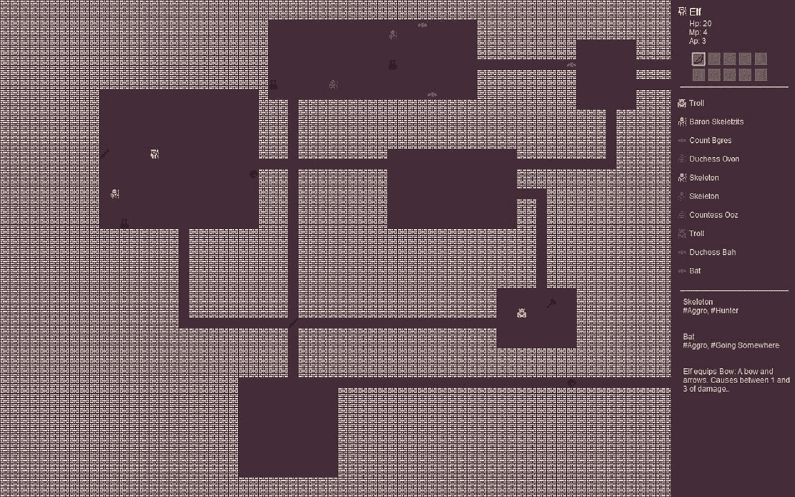

# 7. 程序化生成的怪物与物品

终于，我们来到了 roguelike 游戏的核心支柱之一：程序化生成很可能是玩家在想到这一类型时首先浮现在脑海中的事物之一，通常还会联想到永久死亡和 ASCII 图形。在深入代码之前，最好先解释一下什么是程序化生成，它的优势是什么，以及最重要的是，它在本书中扮演的角色。

程序化生成是一个深奥的话题，本书用两章篇幅无法完全涵盖。本书是对 roguelike 开发的入门介绍，是一份供你实验、从开发角度体验这一类型的初步蓝图。我们无法探索该类型中经典作品所巧妙使用的所有潜在算法、库和技术，但我们可以带你了解其工作原理，在我们的游戏中实现一些程序化技术，并为你指出相关主题更深入信息的获取途径。

在本章中，我们将程序化生成的范围限定为两种实体——物品和敌人——地牢生成将留到下一章。作为作者，我纠结了很久如何构思本章内容。我希望它能让之前已经接触过程序化生成的读者感到新鲜（我确信你们中有些人已经接触过），同时也要让第一次接触的开发者能够理解并掌握。我的解决方案是创建一个基于本书所有读者都应该熟悉的通用概念——标签——的系统。

## 标签介绍

标签在我们的网络生活中是一个无处不在的概念。它们渗透在我们所接触的大多数社交网络的各个角落，是一种非常易于识别的行业术语，适合在此基础上进行构建。我们可以将标签视为归属于某些特征和行为集合的标记。它们以一种易于理解和快速传达的方式，涵盖了被表示对象的某个方面。举个例子，想象一下你脑海中的一辆汽车。如果你看到这辆车的图片上贴着一个 `#electric` 标签，你会立刻意识到你正在看一辆电动汽车。

标签的另一个好处是它们是可组合的。你可以将多个标签应用于同一事物，使其成为所有这些标签的总和。前面提到的那辆车还可以贴上 `#fourbyfour`（四驱）、`#manualshift`（手动挡）和 `#red`（红色）等标签，为你提供关于车辆的更多背景信息。

这正是我们将在本书中所做的：创建一个标签系统，可以将其应用于实体，以定义它们的行为或增强它们的特性。在本章结束时，我们将拥有诸如 `#cursed`（被诅咒的）和 `#golden`（金色的）这样的标签，我们可以将它们应用在一把剑上，使其成为一件诱人但危险的武器。

### 你这难道不是在描述混入（Mixins）吗？

混入是面向对象编程中用于组合和代码复用的常见模式。当你有一个汽车类和一个飞行类，并希望通过混合这两个类来创建一个飞行汽车类时，这通常是答案。但这并不是我们的标签系统将要做的。它将在不同的特征集合之间进行组合，但其方式不会像混入那样浅显。我说“浅显”是指，开发人员通常在他们希望一个对象成为两个或多个类的方法和属性之和时，会选择使用混入。我们的标签系统将会不同，它将作为管道（pipelines）来工作。

### 标签作为管道

如果标签被实现为混入，那么它们所附加的实体将是每个标签的方法和属性的总和。这与我们的实体系统的运作方式不符。我们的游戏实体拥有一系列生命周期方法——`turn`（回合）、`over`（结束）、`refresh`（刷新）等等——这些方法是明确定义的；向它们附加更多的函数是行不通的。

可行的方式是附加多个版本的生命周期方法，并让代码的行为变成这样：执行一个方法时，实际上是执行该方法的多个版本所组成的管道。这样一来，每当某个方法被调用时，该方法不仅会为实体本身调用，还会为该实体附带的每个标签调用。假设有一个 `#cursed`（被诅咒的）标签，它每回合从实体身上扣除 1 点 `healthPoint`（生命值）。为了实现这一点，该标签需要实现一个 `turn`（回合）函数，就像我们的实体所做的那样；当实体的 `turn` 函数被调用时，该实体所附带的全部标签的 `turn` 函数也会被调用。

### 制作优秀的标签

当标签足够灵活时，它们的效果最好。将我们已经拥有的行为简单地分解成离散的单元然后收工，这虽然很诱人，但这会低估标签的潜力。

在我看来，当标签根据上下文具有不同含义时，它们的效果最好。一艘带有 `#sinking`（沉没）标签的船是件坏事；一艘潜艇带有同样的标签则是家常便饭。其理念是让标签成为优势或劣势，取决于它们如何被应用。一个 `#burning`（燃烧）的实体可能每回合都失去 `healthPoints`（生命值），但一把 `#burning`（燃烧）的剑会给玩家提供攻击加成，并将 `#burning`（燃烧）标签附加到它所伤害的实体上。标签是一样的，都是 `#burning`（燃烧），但它的工作方式取决于它是应用于玩家、敌人，还是物品。

并非所有标签都能做到如此灵活；有些标签可能只是可重用的、无聊特性的离散单元。但我们拥有的灵活标签越多，我们的游戏（以及我们的创作过程）就会变得越有趣。

### 标签与程序化生成

程序化生成可以概括为编写代码，为每场游戏生成全新的内容和行为。这是一个简短的、不完整的定义。你可以把程序化生成想象成一个按需生产新内容的工厂。其中一些内容可能是可识别的，但整体体验将是新鲜的。

程序化生成标签首先会让它们失去吸引力，因为它们将不再是那些我们喜爱和理解的、一眼就能认出的标签。我们要做的是利用程序化生成来选择标签并将其应用于物品和敌人，从而为我们的关卡创造新鲜的内容。

你已经见过我们的骷髅了；它们是我们迄今为止实现的唯一敌人。现在想象一下，程序化生成将 `#royal`（皇家）标签应用于它，使其成为骷髅伯爵（Count Skeletah），然后应用 `#going-somewhere`（要去某处）标签，这意味着骷髅伯爵实际上并不关心玩家的位置，而是忙于前往另一个目的地，最后应用 `#vegan`（素食者）标签，这使得骷髅伯爵永远不会伤害玩家。在这一切之下，它仍然是一个骷髅，但标签让它变得新颖且令人难忘。

正如你可能意识到的，实现所有这些将需要对我们的代码进行一次重大重构。

## 添加对标签的支持

本章示例所需的工作不仅仅是添加标签以及该功能所需的必要基础设施。为了让标签生效，需要有实体来附加它们。因此，在本章中，我们将对我们的敌人和物品进行一次全面改造，增加更多种类，并定制我们已有的内容。

正因如此，我们将在本章中构建一个单一的示例。在添加了支持标签所需的所有代码以及更多敌人之后，本章将接着讲解所有标签的实现。

本章的代码位于 `chapter-7/example-1-tags/`。

### 让实体可标记化

我们的实体都具有相似的形态，但它们继承自不同的类。所有英雄类都继承自 `BasicHero`，而物品类则继承自 `GenericItem`。在重构的初始阶段，我们将创建一个名为 `Taggable` 的新类，并让上述两个类都继承自它。这样，每个英雄类都将成为 `BasicHero` 的实例，而 `BasicHero` 又是 `Taggable` 的实例；物品类的情况类似，只不过它继承的是 `GenericItem` 而非 `BasicHero`。

在深入探讨 `Taggable` 类的代码之前，最好先解释一下它的工作原理。其主要驱动力是尽可能减少对现有实体的修改。尽管我们最终会接触到大部分实体，但这并非因为它们需要修改以支持标签，而是因为我们需要对某些方面进行调整，以便标签能与之协同工作，并让游戏开发体验更加愉快。

标签将是 JavaScript 对象，而不是类，因为我们希望附加到标签上的函数位于对象自身内部，而不是它们的原型上。当一个标签被应用到某个实体时，它的函数会被复制到实体中的一些特殊属性上，而实体中原有的同名函数则会被包装成一个新函数，该函数会调用原始代码以及所有插入到该特殊属性中的函数，其运作方式如同一个管道。

我们并没有将标签系统设计成一个独立的库，而是创建了 `Taggable` 类，这样通过在每个标签代码中利用 `this` 引用，可以更方便地处理实体本身。

`Taggable` 类的代码位于 `taggable.js` 文件中。此外，还会有一个名为 `tags.js` 的文件，我们将在创建 `Taggable` 类之后创建它，用于保存每个可用标签的引用。新类的声明和 `tags` 对象的导入都很简单。

```javascript
import tags from "./tags.js"
export default class Taggable {
}
```

将要在此类中实现的每个函数都应放在由 `class` 关键字定义的块内。为了便于解释，我将它们拆分成独立的函数，但在实际代码中，它们都位于类内部。让我们从最重要的函数 `addTag` 开始，该函数将被调用来将标签附加到实体上。为了能完全理解这个函数的作用，让我先向你展示一个简单的标签。如果你之前见过标签，那么解释 `addTag` 会更容易。我将展示的标签是 `#iron`。

## 一个标签就是一个对象

一个标签就是一个对象。它包含一个描述自身的名称；一个 `initialize` 函数（类似于类中的构造函数），当该标签被添加到实体时会被调用；以及一个或多个与实体生命周期函数同名的函数。

这些在标签和实体之间共享的函数，其第一个参数始终是传入管道函数后得到的结果值。在这个铁标签示例中，有一个 `attack` 函数。如果该标签被应用于武器，并且该武器用于攻击另一个实体时，这个函数就会被调用。首先，实体自身的 `attack` 函数会被调用；然后将结果值传递给标签管道中的第一个 `attack` 函数。管道中的每个函数都会接收前一个被调用函数返回的值。这样，在返回值最终返回给最初调用它的对象之前，它们都有机会修改这个值。

在编写这些函数时需要格外小心，因为标签可以附加到不同的实体上，如果你对游戏的工作原理不够关注，它们可能会以不良方式影响实体。例如，我们知道任何从 `protection` 函数返回正数的物品，在实体受到攻击时都会被计为防御加成。如果你在创建标签的 `protection` 函数时没有考虑到这一点，你可能会让标签为那些原本并不提供防护加成的物品提供防护加成。这可能符合你的预期，也可能不符合；无论如何，最好检查一下之前的值是否是数字，如果它是零，就不要修改它。这样，将铁标签附加到剑上就不会增加玩家的防御加成，但附加到盾牌上就会。

这个铁标签如果应用到武器上，会为攻击值增加 `+1`；如果应用到其他物品上，会为防御加成增加 `+1`；如果应用到玩家或敌人身上，则没有任何效果，因为它们不使用 `attack` 或 `protection` 函数。

随着我们共同阅读代码，一切会变得清晰。如果你现在还不完全理解关于铁标签的一切，不必担心；我把这个例子放在这里，是为了让你在阅读 `addTag` 函数的代码时，有一个真实的标签可以参照。

```javascript
const iron = {
  name: "Iron",
  initialize: function () {
    this.name = `Iron ${this.name}`
    this.tint = 0xccbc00
    if (this.sprite) {
      this.sprite.tint = this.tint
      this.sprite.tintFill = true
    }
  },
  attack(acc = 0) {
    if (acc > 0) {
      acc += 1
    }
    return acc
  },
  protection(acc = 0) {
    if (acc > 0) {
      acc += 1
    }
    return acc
  }
}
export default iron
```

## `addTag` 函数

`addTag` 函数接收一个模板对象作为参数；这个对象就是一个标签蓝图，类似于前面提到的铁标签。该函数的第一步是创建一个新对象，并将蓝图复制过来。这样做是为了确保每个应用了标签的实体都有自己独立的对象；如果不这样做，那么将同一个标签应用到两个或更多不同的实体上，最终会导致所有这些实体指向同一个对象，这可能会引发一些非常复杂的调试问题。

如前所述，我们将把标签中的函数复制到实体中。但我们不会复制所有内容。`name` 是一个属性，我们将在代码的其他部分用它来引用该标签，因此我们用一个变量保存它，然后从标签对象中删除它。`initialize` 函数会被调用一次，然后从对象中删除。如果它被复制过来，那么在向一个对象应用第二个标签时，你最终会再次调用第一个标签的 `initialize` 函数。我在开发这个示例时就遇到了这个问题；花了好一会儿才弄明白发生了什么。最终帮我发现问题的是，在执行 `initialize` 函数时，我注意到了重命名实体的操作，因此多次调用同一个 `initialize` 函数导致实体的最终名称变成了“iron iron iron sword”，从而让我找到了问题的根源。

在 `addTag` 处理函数的末尾返回 `this`，可以确保我们能够将结果值传递给那些期望接收实体的函数，例如回合管理模块的 `addEntity` 函数。对一个实体调用 `addTag` 会得到一个带有标签的新实体。

请记住，由于代码使用了 `apply`，对 `this` 的引用指向的是标签所应用到的实体，而不是标签本身。初始化标签后，就需要复制函数，并确保将它们封装成一个管线。对于标签中的每个函数，我们使用 `addTagHandler` 函数将其添加到附加到实体上的标签处理器中。标签处理器是这样一个对象：其键为函数名，值为函数数组。因此，在我们示例的“铁”标签中，有一个 `attack` 函数；这意味着在标签处理器对象中，将会有一个名为 `attack` 的属性，该属性持有一个数组，其中包含来自该标签的 `attack` 函数。

如果我们只是简单地填充该标签处理器对象，那么在实体上调用诸如 `attack` 之类的生命周期方法并不会导致管线运行；要做到这一点，我们需要用一个新的包装函数来替换同名的实体函数，这个包装函数会调用自身以及管线；这就是 `wrapFunction` 函数的作用。

复制完成后，我们将标签名称添加到一个数组中，该数组用于存储实体已应用的标签。这样做是为了我们日后能够进行检查并确定哪些标签已被应用，因为对实体属性的复制和操作并不会为这些新函数的来源留下记录。

```javascript
addTag(template) {
  let tag = {}
  Object.assign(tag, template)
  let name = tag.name
  delete tag.name
  tag.initialize.apply(this)
  delete tag.initialize
  let keys = Object.keys(tag)
  keys.forEach(handlerName => {
    this.wrapFunction(handlerName)
    this.addTagHandler(handlerName, tag[handlerName])
  })
  if (!this._tags) {
    this._tags = [name]
  } else {
    this._tags.push(name)
  }
  return this
}
```

## `addTagHandler` 函数

`addTagHandler` 函数略显繁琐，但易于理解。前两个 `if` 语句只是检查实体上是否附加了一个标签处理器对象，如果不存在，则为其初始化一个属性，该属性对应被重写的函数。以“铁”标签的 `attack` 函数为例，在执行 `addTagHandler` 之后，实体的状态将如下所示：

```
Entity = {
  _tagHandlers: {
    Attack: [function() … ]
  }
}
```

```javascript
addTagHandler( handlerName , handler) {
  if (!this._tagHandlers) {
    this._tagHandlers = {}
  }
  if (!this._tagHandlers[handlerName]) {
    this._tagHandlers[handlerName] = []
  }
  this._tagHandlers[handlerName].push(handler)
}
```

## `wrapFunction` 函数

标签系统的精髓在于 `wrapFunction` 函数。

```javascript
wrapFunction(handlerName) {
  if (!this._tagHandlers || !this._tagHandlers [handlerName]) {
    let originalFunction = this[handlerName]
    this[handlerName] = (...args) => {
      let ret = originalFunction.apply(this, args)
      return this.executeTag(handlerName, ret, ...args)
    }
  }
}
```

在闭包中保存对原始函数的引用，允许我们用一个新的函数覆盖该属性值。当这个新函数被执行时，它会先调用原始函数，然后通过 `executeTag` 函数执行该命名函数对应的标签处理器中的每一个函数。

如果一个“匕首”实体有一个原始的 `attack` 函数，如下所示：

```
attack() {
  return 1
}
```

那么在对 `attack` 调用 `wrapFunction` 之后，新的 `attack` 函数将类似于以下伪代码：

```
attack() {
  let originalFunction = 
  let ret = originalFunction.apply(this, args)
  return this.executeTag(name, ret, ...args)
}
```

理解 `wrapFunction` 的工作原理至关重要：它如何在一个闭包中捕获一个函数的值，然后用一个新的函数覆盖原本指向该值的属性。这就是我们能够将标签应用于未修改的实体并使其正常工作的原因；我们在保留对原始代码引用的同时，覆盖了它们的属性。

```
executeTag(handlerName, ret, ...args) {
if (this._tagHandlers && this._tagHandlers [handlerName]) {
this._tagHandlers[handlerName].forEach(handler => {
args = [ret, ...args]
ret = handler.apply(this, args)
})
}
return ret
}
```

执行一个管线就是遍历数组中的函数，并将前一个函数的结果值传递给下一个函数，直到全部完成，最终的值被返回。如果那段代码看起来有点难以理解，可能是因为它使用了展开语法⁴¹和`apply`方法⁴²，后者允许我们在显式设置`this`的值以匹配实体的同时调用函数。

此时，向一个实体添加多个标签需要我们链式调用`addTag`，例如`entity.addTag(iron).addTag(rusty)`；这种代码很难通过程序化生成来实现。更好的做法是拥有一个接受标签名称数组的函数，然后逐个将它们添加到实体上。为此，需要一个对象来保存对每个可用标签的引用；这就是`tags`模块的作用。我们只会在最后创建这个模块，但现在我们可以使用它，已知它在一个对象中保存了对标签的引用，该对象中的每个属性都与标签的名称相同，例如：

```
tags = {
iron: iron,
rusty: rusty
}
```

有了这样的模块，我们可以基于`addTag`的循环来实现`addTags`。

```
addTags(templateNames) {
templateNames.forEach(t => {
if (tags[t]) {
this.addTag(tags[t])
}
})
return this
}
```

始终确保返回实体，这样对`addTag`和`addTags`的调用就可以链接在一起，并传递给其他模块。

拥有添加标签的方法只是游戏的一部分；我们还需要有移除它的方法。想象一下，玩家被施加了“中毒”标签，然后在喝了一瓶生命药水后，中毒效果被移除。必须有一种方法能够进入标签处理器，移除来自“中毒”标签的函数。这比乍看起来要棘手，因为每次向实体添加标签时，我们都在创建一个新对象。这意味着，即使一个标签保存在一个对象中，并且有一个实体应用了该标签，也并不代表实体中的标签处理器指向标签对象中的函数。它们是在`addTag`处理器中被复制到一个全新的标签对象中的，然后从这个全新的对象被放置到实体的标签处理器中。由于 JavaScript 中布尔运算符的工作方式，调和这些信息是很棘手的。使用`==`或`===`比较两个函数，只有当它们实际指向同一个函数时才返回`true`，如果它们是同一函数的副本，则不会返回`true`。

为了解决这个问题，我们将使用函数的`toString`⁴³方法，该方法将函数序列化回字符串，基本上就是回溯到源代码，然后比较它们是否相同。由于标签对象中保存的函数与标签处理器中的函数之间没有差异，它们应该生成相同的字符串，因此一旦转换为字符串形式，就可以相互比较。

我们需要能够进行这种比较，以便在标签处理器中找到哪些函数属于每个标签并将其移除。

```
removeTag(template) {
let tag = {}
Object.assign(tag, template)
let name = tag.name
delete tag.name
delete tag.initialize
let keys = Object.keys(tag)
keys.forEach(handlerName => {
let functionAsString = tag[handlerName].toString()
let handlersAsString = this._tagHandlers [handlerName].map(handler => handler.toString())
let index = handlersAsString.findIndex(handlerAsString=> handlerAsString == functionAsString)
this._tagHandlers[handlerName].splice(index, 1)
})
let tagPosition = this._tags.findIndex(tag => tag == name)
this._tags.splice(tagPosition, 1)
}
```

移除一个标签就是遍历标签对象的所有属性，检查实体的标签处理器中是否存在匹配的函数，如果存在，则从数组中移除该函数，并从已应用标签的列表中移除该标签名称。

我们的`Taggable`类现在可以投入使用了。最容易重构并添加可加标签支持的基础类是`hero`类。

### 使英雄可标签化

为了让 `BasicHero` 类支持标签，只需进行一处极为简单的修改。在 `classes/basicHero.js` 中，我们需要更改顶部的导入语句和类声明，改为：

```
import dungeon from "../dungeon.js"
import Taggable from "../taggable.js"
export default class BasicHero extends Taggable {
  constructor(x, y) {
    super(x, y)
```

其余部分基本保持不变。只需导入 `Taggable` 类，确保 `BasicHero` 继承自该类，并确保调用父类的构造函数即可。

现在，我们可以对英雄应用标签了！接下来，我们为物品添加同样的支持。

### 使物品可标签化

这几乎就是复制粘贴对 `BasicHero` 类所做的修改。导入 `Taggable` 类，确保 `GenericItem` 继承自该类，并记得调用其构造函数。

同时保持类的其余部分不做任何改动。虽然让敌人可标签化也需要完全相同的修改，但在那个特定情况下，我们需要做更多的工作。

```
import Taggable from "../taggable.js"
export default class GenericItem extends Taggable {
  constructor(x, y) {
    super(x, y)
```

## 创造敌人

到目前为止，我们只有一个敌人实体——骷髅，这已经不够用了。与处理物品和英雄的方式类似，我们将创建一个基础敌人类，并让所有敌人都继承自该类。这个基础类将包含通用行为和桩函数，就像 `GenericItem` 类的实现方式一样。实现之后，我们将重构骷髅类，使其基于新类构建，然后添加更多敌人类型。

所有敌人类型都将放在 `enemies/` 文件夹中，该文件夹与 `classes/` 和 `items/` 文件夹同级。

### 基础敌人类

通常，Roguelike 游戏中敌人的种类变化会比可用的英雄原型更多。当然，有些 Roguelike 游戏使用程序化生成来同时生成两者，从而产生无限种组合，但我这里想说的重点是：如果我们把基础敌人类设计好，创建和维护各种怪物就会变得更容易，比维护不同的英雄类型更简单。

就我们的示例游戏而言，所有怪物的运作方式都相同。它们被放置在迷宫中并四处走动。有时，如果条件合适，它们会攻击玩家。当它们死亡时，可能会掉落一些战利品。

为了实现英雄原型，我们大量依赖函数；几乎一切都是类方法，很少使用属性。这样做是为了在调用方法时能有更多变化。在怪物方面，我们将采用不同的方法。在基础敌人的构造函数中，我们将设置大量实例属性。诸如 `over` 和 `refresh` 这样的生命周期方法将以通用的方式工作，但考虑到这些属性，这种敌人变化的方式更多是调整这些数值，而不是编写新的函数。这意味着作用于敌人的标签将在 `initialize` 函数中完成大部分工作，从而改变敌人的属性。

在基础敌人类的源码中，我将使用一些尚未创建的函数。我会解释它们的作用，在本章后面部分会创建它们。这个基础类将完成大量工作；之后创建怪物就会变得更容易。

该类的源码位于 `enemies/basicEnemy.js`。

```
import dungeon from "../dungeon.js"
import tm from "../turnManager.js"
import Taggable from "../taggable.js"
import { getRandomItem } from "../items.js"
import GenericItem from "../items/genericItem.js"
```

基础敌人类需要访问地牢模块，以便在 UI 上显示文本信息。使用回合管理器是为了在敌人被杀死时能够将战利品添加到地牢中。与其他实体类型一样，`BasicEnemy` 将继承自 `Taggable` 类。最后两个导入是我们尚未实现的内容。例如，`tags.js` 将是一个包含对所有可用标签引用的模块，而 `items.js` 将是一个包含引用和辅助函数的模块，用于处理可用物品。需要访问这些函数，以便在敌人被杀死时确定掉落哪个物品。至于 `GenericItem` 的导入，我稍后会解释。

# 基础敌人类实现详解

## 类定义与构造函数

```javascript
export default class BasicEnemy extends Taggable {
  constructor(x, y) {
    super(x, y)
    this.name = "Basic Enemy"
    this.movementPoints = 1
    this.actionPoints = 1
    this.healthPoints = 1
    this.maxHealthPoints = this.healthPoints
    this.moving = false
    this.weapon = new GenericItem()
```

与之前的实体类似，基础实体继承自 `Taggable` 类，并初始化所有实体都需要的属性。这段源码片段中的最后一行有些出人意料；我们用一个虚拟物品创建了一个 `weapon` 属性。这是因为在本章后面，会对地牢模块的 `attackEntity` 函数进行修改。在上一章中，该函数的签名是：

```javascript
attackEntity: function (attacker, victim, rangedAttack = false, tint = false) {
```

这意味着由实体自行确定 `rangedAttack` 和 `tint` 的值。在本章中，该签名将改为更易于维护且更灵活的形式：

```javascript
attackEntity: function (attacker, victim, weapon) {
```

这样修改的目的是为了帮助武器包含标签，但这一点将在关于地牢模块重构的部分中得到更好的解释。目前，只需说明由于调用 `attackEntity` 时，实体必须传递一个武器作为参数，因此才创建了一个虚拟武器物品。

```javascript
this.refreshRates = {
  movementPoints: 1,
  actionPoints: 1,
  healthPoints: 0
}
```

与其在 `refresh` 函数中硬编码这些值，不如将它们添加到 `constructor`（构造函数）中，这些值可以在 `initialize` 调用期间被标签（tags）所操控。这些值将被 `refresh` 的基础敌人实现所使用。

```javascript
this.damage = {
  max: 4,
  min: 1
}
this.defense = {
  max: 0,
  min: 0
}
```

`attack` 和 `protection` 都将使用构造函数设置的值。这将使我们能够仅通过创建新类并实现一个新构造函数来创造新怪物，或者通过应用标签（tag）从根本上改变一个怪物。

```javascript
this.loot = []
this.x = x
this.y = y
this.tile = 26
this.type = "enemy"
}
```

构造函数的最后几行我们已经很熟悉了；它们只是设置了敌人所需的最终属性。

## 刷新与回合逻辑

```javascript
refresh() {
  this.movementPoints = this.refreshRates.movementPoints
  this.actionPoints = this.refreshRates.actionPoints
  if (this.refreshRates.healthPoints > 0 && this.healthPoints <= this.maxHealthPoints) {
    this.healthPoints += this.refreshRates.healthPoints
  }
}
```

因为我们在构造函数中设置了所有这些属性，`refresh` 函数变成了一个通用的函数，对所有敌人都适用。`this.maxHealthPoints` 和 `this.refreshRates.healthPoints` 的存在允许创建那些每回合都能恢复一些 `healthPoints` 的怪物。将基础怪物的这个刷新率设为零，可以确保我们不会让创建的所有怪物都开始回血。

## 攻击与防御机制

```javascript
attack() {
  return Phaser.Math.Between(this.damage.min, this.damage.max)
}
protection() {
  return Phaser.Math.Between(this.defense.min, this.defense.max)
}
```

基于构造函数设置的最小值和最大值的 `attack` 和 `protection` 通用实现，对我们所有的怪物来说已经足够了。请记住，这些实现背后的理念是能够通过标签来改变这些函数返回的值，因为在调用这些函数并将结果值传入标签流水线（`tags pipeline`）之后，标签流水线会对这些值进行处理。

```javascript
turn() {
}
```

我有没有让你大吃一惊？ `turn` 留空了，因为它将由标签来决定。想象一下，我们有一些包含回合逻辑的标签；一个标签可以让怪物无论玩家在地牢中的哪个位置都去追逐玩家。这就是骷髅的行为方式。那个标签可以叫做 `#hunter`。另一个标签可以让敌人选择一个地点并移动到那里；那个标签可以叫做 `#going-somewhere`。这两个标签决定了敌人每回合的行为方式；更具体地说，它们将执行实体的移动和攻击。如果实体有一个执行移动的 `turn` 实现，并且一个标签也有一个移动实现，那么哪个移动会成功呢？在多次调用 `turn` 的情况下，`movementPoints` 的计算将如何进行？

为了解决所有这些情况，我们将一些标签归类为*怪物行为标签*，并确保每个敌人拥有且仅拥有其中一个标签。怪物在地牢中的行为方式将取决于那个标签。

```javascript
over() {
  let isOver = this.movementPoints == 0 && this.actionPoints == 0 && !this.moving
  if (isOver && this.UItext) {
    this.UItext.setColor("#cfc6b8")
  } else {
    this.UItext.setColor("#fff")
  }
  return isOver
}
```

`over` 函数中没什么新内容；它和我们之前在所有的例子中为骷髅使用的函数完全一样。

## 用户界面与交互

下一个函数有点不同。它是 `onDestroy` 函数，在怪物被杀死并准备掉落战利品时被调用。在该函数中，我们将使用一个尚未实现的 `getRandomItem` 函数。这个函数将返回一个已应用了标签的随机物品。前两个参数是物品的坐标；最后两个参数是要从修饰符标签集和效果标签集中应用多少个标签；这些集合只是包含一些具有共同特征的标签名称的数组。修饰符集合会改变物品的某些特性。效果集合每回合会产生一些效果。

跟踪实体和标签有点困难；这就是为什么对 `createUI` 函数进行了修改。每个敌人在用户界面侧边栏上都有一个自己的 UI。新的 `createUI` 函数会将每个敌人用户界面使用的精灵和文本标记为可点击。点击它们会在侧边栏的文本输出区域输出实体的描述。地牢模块提供了一个名为 `describeEntity` 的新函数，该函数接收一个实体并输出它的名称、标签和描述。

```javascript
createUI(config) {
  let scene = config.scene
  let x = config.x
  let y = config.y
  this.UIsprite = scene.add.sprite(x, y, "tiles", this.tile)
    .setOrigin(0)
    .setInteractive({ useHandCursor: true })
  if (this.tint) {
    this.UIsprite.tint = this.tint
  }
  this.UIsprite.on("pointerup", pointer => {
    if (pointer.leftButtonReleased()) {
      dungeon.describeEntity(this)
    }
  })
  this.UItext = scene.add.text(x + 20, y, this.name, { font: '12px Arial', fill: '#cfc6b8' })
    .setInteractive({ useHandCursor: true })
  this.UItext.on("pointerup", pointer => {
    if (pointer.leftButtonReleased()) {
      dungeon.describeEntity(this)
    }
  })
  return 30
}
```

这是通过在文本和精灵上使用 `setInteractive` 来实现的。`useHandCursor` 使得鼠标指针在这些游戏元素上时变为手形，从而帮助玩家发现它们是可点击的。

一个处理器 `on("pointerup", ...)` 被用来创建一个回调函数，该函数调用 `dungeon.describeEntity`。在基础英雄类中也做了同样的修改，以便点击玩家背包中的物品也能显示其描述。

基础敌人类已经准备好了；我们准备重新制作骷髅。

## 重新审视骷髅

新骷髅实体的代码将放在 `enemies/skeleton.js` 中；它非常简单，因为大部分工作实际上是由基础敌人类完成的。

## 创建敌人

整个骷髅类只不过是对基础敌人构造函数所设置的属性进行定制。设置了一个`weapon`名称，因为新的`attackEntity`在发生攻击时会在侧边栏中显示它。

```javascript
import dungeon from "../dungeon.js"
import BasicEnemy from "./basicEnemy.js"
export default class Skeleton extends BasicEnemy {
constructor(x, y) {
super(x, y)
this.name = `Skeleton`
this.movementPoints = 3
this.actionPoints = 1
this.healthPoints = 4
this.refreshRates = {
movementPoints: 3,
actionPoints: 1,
healthPoints: 0
}
this.damage = {
max: 4,
min: 1
}
this.x = x
this.y = y
this.tile = 26
this.type = "enemy"
this.weapon.name = "pike"
dungeon.initializeEntity(this)
}
}
```

### 创建一个蝙蝠

蝙蝠的代码位于`enemies/bat.js`中；它同样只是一个定制的构造函数。

```javascript
import dungeon from "../dungeon.js"
import BasicEnemy from "./basicEnemy.js"
export default class Bat extends BasicEnemy {
constructor(x, y) {
super(x, y)
this.name = `Bat`
this.movementPoints = 5
this.actionPoints = 1
this.healthPoints = 2
this.refreshRates = {
movementPoints: 5,
actionPoints: 1,
healthPoints: 0
}
this.damage = {
max: 3,
min: 1
}
this.x = x
this.y = y
this.tile = 282
this.type = "enemy"
this.weapon.name = "bite"
dungeon.initializeEntity(this)
}
}
```

蝙蝠在`healthPoints`和它能造成的伤害方面都很弱，但它移动速度非常快，并且根据应用给它的标签，它会很快接近玩家。

### 制作兽人

兽人的源代码位于`enemies/orc.js`。

```javascript
import dungeon from "../dungeon.js"
import BasicEnemy from "./basicEnemy.js"
export default class Orc extends BasicEnemy {
constructor(x, y) {
super(x, y)
this.name = `Orc`
this.movementPoints = 2
this.actionPoints = 1
this.healthPoints = 4
this.refreshRates = {
movementPoints: 2,
actionPoints: 1,
healthPoints: 0
}
this.damage = {
max: 5,
min: 2
}
this.x = x
this.y = y
this.tile = 57
this.type = "enemy"
this.weapon.name = "club"
dungeon.initializeEntity(this)
}
}
```

兽人比蝙蝠和骷髅速度慢，但攻击力更强。根据它们最终获得的标签，它们可以变得非常强大。

### 制作巨魔

现在可能已经很明显了，巨魔的代码位于`enemies/troll.js`。

```javascript
import dungeon from "../dungeon.js"
import BasicEnemy from "./basicEnemy.js"
export default class Troll extends BasicEnemy {
constructor(x, y) {
super(x, y)
this.name = `Troll`
this.movementPoints = 2
this.actionPoints = 1
this.healthPoints = 8
this.refreshRates = {
movementPoints: 2,
actionPoints: 1,
healthPoints: 0
}
this.damage = {
max: 6,
min: 3
}
this.x = x
this.y = y
this.tile = 286
this.type = "enemy"
this.weapon.name = "club"
dungeon.initializeEntity(this)
}
}
```

巨魔是我们实现的最强大的敌人。它们更难被杀死，并且能造成大量伤害。

有了这些敌人，我们就可以创建一个包含所有敌人引用的敌人模块。这样，当我们需要它们时，就不需要在源代码中逐个导入敌人文件，只需导入这个模块即可。在这个模块中，我们还将实现获取随机怪物的函数。

### 实现敌人模块

敌人模块位于示例的根文件夹中，名为`enemies.js`；这是所有实体模块的约定。英雄类位于`classes/`文件夹中，但其模块位于顶层的`classes.js`。物品和敌人模块都将位于顶层文件夹中。

```javascript
import Skeleton from "./enemies/skeleton.js"
import Orc from "./enemies/orc.js"
import Bat from "./enemies/bat.js"
import Troll from "./enemies/troll.js"
import { getRandomTagsForEnemy } from "./tags.js"
const enemies = {
Skeleton,
Orc,
Bat,
Troll
}
export default enemies
export function getRandomEnemy(x, y, modifierCount = 1, effectCount = 1) {
let key = Phaser.Utils.Array.GetRandom(Object.keys(enemies))
let tags = getRandomTagsForEnemy(modifierCount, effectCount)
return new enemieskey.addTags(tags)
}
```

该模块导入了我们创建的所有敌人，并设置了一个默认导出，该导出是一个包含对所有这些敌人引用的对象。该模块中最有趣的部分是`getRandomEnemy`函数，它从该对象中随机选取一个元素，并在返回之前为其应用随机标签。一旦我们实现了标签模块，这个函数就会变得更清晰，但我可以提前告诉你，它基本上和这个函数是一样的；有一些对象保存了所有的键，我们从中提取标签，并将它们作为名称数组返回，以便与`Taggable`类中的`addTags`方法一起使用。

我知道，通过逐个查看这些高度关联的模块来描述和理解它们如何相互协作是很棘手的。在编辑器中查看源代码会更容易得多，因为你可以比在书中更容易地从一个文件跳转到另一个文件。通过在本章的最后部分讨论标签模块，我可以确保在我们讨论其实现时，你已经清楚它们应该如何工作。此外，通过将标签创建部分放在章节末尾，我希望能够吸引你在练习部分创建更多标签，因为那时所有内容都还记忆犹新。

## 创建物品模块

就像我们实现敌人模块一样，我们也必须创建一个物品模块。它们的结构是相同的：一个默认导出，包含所有物品的对象；一个具名导出，允许你获取一个随机物品。

# 重构地牢模块

需要对地牢模块进行一些调整，以便更好地支持标签并简化开发流程。侧边栏中显示的敌人用户界面现在可点击，玩家背包中的物品也可点击。两者都会调用需要实现的 `describeEntity` 方法。

```javascript
describeEntity: function (entity) {
if (entity) {
let name = entity.name
let description = entity.description || ""
let tags = entity._tags ? entity._tags.map(t => `#${t}`).join(", ") : ""
dungeon.log(`${name}\n${tags}\n${description}`)
}
}
```

该函数只需要完成两件事：拼接出格式良好的字符串，并在用户界面中显示。图 7-1 展示了示例运行时的效果。



图 7-1 敌人描述

由于本章中我们将开始将敌人随机放置在 `dungeon` 中的不同位置，因此需要一个函数来随机查找可行走的地块。

```javascript
randomWalkableTile: function () {
let x = Phaser.Math.Between(0, dungeon.level[0].length - 1)
let y = Phaser.Math.Between(0, dungeon.level.length - 1)
let tileAtDestination = dungeon.map.getTileAt(x, y)
while (typeof tileAtDestination == "undefined" || tileAtDestination.index == dungeon.sprites.wall) {
x = Phaser.Math.Between(0, dungeon.level[0].length - 1)
y = Phaser.Math.Between(0, dungeon.level.length - 1)
tileAtDestination = dungeon.map.getTileAt(x, y)
}
return { x, y }
}
```

该函数的工作方式是：随机选取一个位置，然后检查它是否为墙壁；如果是墙壁，则循环选择另一个不同的位置。最终返回一个包含坐标的对象。

攻击实体的逻辑也发生了变化。主要目的是为了在攻击成功时能够从攻击流程中执行标签。这些是函数的一些细微调整。

```javascript
attackEntity: function (attacker, victim, weapon) {
attacker.moving = true
attacker.tweens = attacker.tweens || 0
attacker.tweens += 1
let rangedAttack = weapon.range() ? weapon.attackTile : false
let tint = weapon.range() && weapon.tint ? weapon.tint : false
```

函数的签名发生了变化。现在 `weapon` 成为函数调用的参数之一。基础敌人和基础英雄都已经过修改，使得它们在调用 `attackEntity` 时会传递武器参数。函数开始后，我们创建了与之前相同的变量 `rangedAttack` 和 `tint`，函数主体基本保持不变，仅有两处小调整。

在近战攻击和远程攻击中，用于显示攻击信息的 `dungeon.log` 调用已经修改，以包含武器名称。两种情况下，新的代码都是：

```javascript
this.log(`${attacker.name} does ${damage} damage to ${victim.name} with ${weapon.name}.`)
```

在这两处 `log` 调用之后的那一行各新增了一行代码。

```javascript
weapon.executeTag("damagedEntity", victim)
```

这样修改的原因是为了支持诸如 `#burning` 这样的标签——当它被应用于一把剑时，会在成功攻击的受害者身上执行 `addTag(burning)`。在这个示例之前，实体无法判断它们对 `attackEntity` 的调用是否成功。这使得标签很难在攻击过程中产生效果。这个新的 `damageEntity` 处理器会被实现了该功能的标签调用，从而让标签有机会对攻击的目标产生某种副作用。

# 创建标签

最后，我们终于可以开始处理标签本身了。我们的一些标签将是灵活的，并根据它们被应用于物品、武器、敌人还是玩家而提供不同的行为。其他标签将具有单一功能，作为可插入的行为或特性，为游戏增添趣味或怪物的行为特性。一个名为 `tags/` 的文件夹将存放所有标签，每个标签将拥有自己的文件。

## 让怪物更具攻击性

`aggro` 标签位于 `tags/aggro.js`；它仅对敌人产生效果，通过给予它们每回合更多的行动次数来使其更具攻击性。因此，如果一个敌人每回合攻击玩家一次，那么一个具有攻击性的敌人会攻击三次。

```javascript
const aggro = {
name: "Aggro",
initialize: function () {
if (this.type === "enemy") {
this.tint = 0x00bc00
this.refreshRates.actionPoints += 2
if (this.sprite) {
this.sprite.tint = this.tint
this.sprite.tintFill = true
}
}
}
}
export default aggro
```

这是一个很好的示例，展示了标签如何仅仅修改由怪物构造函数设置的值。正如我们所知，当一个标签被应用于实体时，它的 `initialize` 函数会被执行。在 `aggro` 标签中，我们检查该标签是否被应用于敌人，如果是，我们会进行一些外观上的修改，然后增加该实体的行动点数量。

根据不同的标签使用不同色调的想法有双重意义：一方面，游戏变得更加有趣；另一方面，调试也更容易，因为你可以在地图和侧边栏上看到相同的色调，从而更容易将侧边栏中的用户界面与地图上的实体进行匹配。

之前，我们初始化一个骷髅是这样的：

```javascript
tm.addEntity(new Skeleton(x,y))
```

现在，我们可以这样做：

```javascript
tm.addEntity(new enemies.Skeleton(x,y).addTags(["aggro"]))
```

来初始化一个具有攻击性的骷髅。

## 创建快速怪物

该模块的源代码位于 `items.js`。与敌人不同，本章中的物品本身没有做任何修改，因此所需做的就是创建这个模块。

```javascript
import Axe from "./items/axe.js"
import Bow from "./items/bow.js"
import CursedGem from "./items/cursedGem.js"
import Gem from "./items/gem.js"
import Hammer from "./items/hammer.js"
import HealthPotion from "./items/healthPotion.js"
import LongSword from "./items/longSword.js"
import Potion from "./items/potion.js"
import ScrollOfFireball from "./items/scrolloffireball.js"
import ScrollOfLightning from "./items/scrolloflightning.js"
import Shield from "./items/shield.js"
import Sword from "./items/sword.js"
import { getRandomTagsForItem } from "./tags.js"
const items = {
Axe,
Bow,
CursedGem,
Gem,
Hammer,
HealthPotion,
LongSword,
Potion,
ScrollOfFireball,
ScrollOfLightning,
Shield,
Sword
}
export default items
export function getRandomItem(x, y, modifierCount = 1, effectCount = 1) {
let key = Phaser.Utils.Array.GetRandom(Object.keys(items))
let tags = getRandomTagsForItem(modifierCount, effectCount)
return new itemskey.addTags(tags)
}
```

在`tags/fast.js`文件中，你可以找到此标签的代码。

```
const fast = {
name: "Fast",
initialize: function () {
if (this.type === "enemy") {
this.tint = 0x00bb00
this.refreshRates.movementPoints += 2
if (this.sprite) {
this.sprite.tint = this.tint
this.sprite.tintFill = true
}
}
}
}
export default fast
```

它与`aggro`标签非常相似，但不同的是，它增加的是`movementPoints`而不是`actionPoints`。

## 金色物品如何？

Roguelike 游戏里充满了金色物品，对吧？`tags/golden.js`是我们第一个灵活的标签。

```
import dungeon from "../dungeon.js"
const golden = {
name: "Golden",
initialize: function () {
this.name = `Golden ${this.name}`
this.tint = 0xccbc00
if (this.sprite) {
this.sprite.tint = this.tint
this.sprite.tintFill = true
}
if (this.type == "item") {
this.equipHPBonus = 1
}
},
```

金色标签的灵活性体现在，它根据所应用物品的不同而产生不同的效果。如果该标签被应用在非物品实体上，那么所有变化都纯粹是外观性的。

如果该标签被添加到一个物品上，我们会设置一个特殊的`equipHPBonus`变量，它的作用将在下一段代码中变得清晰。

```
equip(acc, itemNumber, entity) {
if (this.equipHPBonus > 0) {
dungeon.log(`+${this.equipHPBonus} 装备金色物品的生命值加成。`)
entity.healthPoints += this.equipHPBonus
this.equipHPBonus = 0
}
},
```

该标签重写了`equip`函数。装备金色物品会先运行物品默认的`equip`函数，然后运行这个`equip`函数。在`equip`函数中，我们检查在`initialize`函数中设置的那个属性是否大于零。如果是，我们就将实体（也就是玩家）的`healthPoints`增加我们在标签初始化期间设置在该属性中的同等数值。

你可能会好奇`equip`是否总是将实体作为参数传递。其实不是；我是在本章中添加了这一点的。这只是对基础英雄的一处改动，使得`toggleItem`现在使用`equip(itemNumber, this)`代替之前的`equip(itemNumber)`。

```
attack(acc = 0) {
if (acc > 0) {
acc += 1
}
return acc
},
```

对`attack`的修改只影响武器，因为`attack`被调用时会以物品自身的`attack`函数的返回值作为参数。非武器物品的该函数总是返回零，所以我们的金色标签只增加武器的攻击力。

```
protection(acc = 0) {
if (acc > 0) {
acc += 1
}
return acc
}
}
export default golden
```

`protection`完全相同，普通物品和武器在调用`protection`时返回零。一些防御性物品（如盾牌）会返回正值。在这种情况下，该值会增加。

### 我们不妨也弄个银色标签

在`tags/silver.js`文件中，你可以找到银色标签的代码。和在大多数游戏中一样，银色不如金色有价值，因此这个标签的效果也更少。

```
import dungeon from "../dungeon.js"
const silver = {
name: "Silver",
initialize: function () {
this.name = `Silver ${this.name}`
this.tint = 0xccbc00
if (this.sprite) {
this.sprite.tint = this.tint
this.sprite.tintFill = true
}
if (this.type == "item") {
this.equipHPBonus = 2
}
},
equip(acc, itemNumber, entity) {
if (this.equipHPBonus > 0) {
dungeon.log(`+${this.equipHPBonus} 装备银色物品的生命值加成。`)
entity.healthPoints += this.equipHPBonus
this.equipHPBonus = false
}
}
}
export default silver
```

它不提供任何`attack`或`protection`加成，但给予实体的`healthPoints`加成比金色标签更大。

### 还有一个铁质标签

铁质标签位于`tags/iron.js`中，与金色标签相比，它是银色标签的反面。银色只是`healthPoints`加成，而铁质标签只是`attack`和`protection`加成。

```
const iron = {
name: "Iron",
initialize: function () {
this.name = `Iron ${this.name}`
this.tint = 0xccbc00
if (this.sprite) {
this.sprite.tint = this.tint
this.sprite.tintFill = true
}
},
attack(acc = 0) {
if (acc > 0) {
acc += 1
}
return acc
},
protection(acc = 0) {
if (acc > 0) {
acc += 1
}
return acc
}
}
export default iron
```

### 让敌人贵族化

我曾做过这样一个天真的梦：给一个骷髅贴上标签，让它变成“骷髅勋爵”（Lord Skeletah），那将非常恐怖。让一个敌人贵族化会给予它大量加成，并将其名字改为一个古怪的称号。在`tags/royal.js`文件中可以找到这个标签的源码。

```
const royal = {
name: "Royal",
initialize: function () {
if (this.type === "enemy") {
this.tint = 0xccbc00
this.refreshRates.actionPoints += 2
this.refreshRates.movementPoints += 2
this.refreshRates.healthPoints += 1
if (this.sprite) {
this.sprite.tint = this.tint
this.sprite.tintFill = true
}
let title = Phaser.Utils.Array.GetRandom([ "伯爵", "公爵", "勋爵", "公爵夫人", "男爵", "男爵夫人", "女伯爵"])
let suffix = Phaser.Utils.Array.GetRandom([
"啊", "奥兹", "冯", "奇茨", "格雷斯"])
this.name = `${title} ${this.name.slice(0, this.name.length-2)}${suffix}`
}
}
}
export default royal
```

大部分源码只是在玩字符串，为敌人编造有趣的贵族名字，但在所有这些随机数组选择和字符串操作之间，敌人的所有刷新率都被提高了。哦，还有，贵族敌人会随时间推移恢复生命。

进入地下城，发现一个既是贵族又在追捕你的敌人，那是相当危险的。

### 制作一个灵活的燃烧标签

和其他标签一样，燃烧标签位于`tags/burning.js`中。这个标签对我而言体现了灵活标签的概念。正如任何《权力的游戏》粉丝都能告诉你，挥舞一把火焰之剑与自身处于火焰之中有着天壤之别。

物品上的燃烧标签会导致每次用该物品攻击成功时，火焰蔓延到其他实体。

如果燃烧标签是在怪物或玩家身上，那么他们会在若干回合内每回合受到伤害，直到通过`removeTag`移除该标签。

```
import dungeon from "../dungeon.js"
const burning = {
name: "Burning",
initialize: function (damage = 2, howManyTurns = 3) {
this._burnDamage = damage
this._howManyTurns = howManyTurns
if (this.type === "item") {
this.tint = 0x002300
if (this.sprite) {
this.sprite.tint = this.tint
this.sprite.tintFill = true
}
},
```

这是我们第一个在 `initialize` 函数中具有潜在参数的标签。我们目前不会使用它们，将依赖于它们的默认值，但有了这些参数，我们就为游戏中出现毁灭性的火焰铺平了道路。

燃烧造成的伤害将持续 `howManyTurns` 回合，并对实体造成 `damage` 数值的伤害。

由于它每回合都会产生效果，因此它有自己的 `turn` 函数实现。

```
turn() {
if (this.type !== "item") {
if (this._howManyTurns > 0 && !this._burningActivated) {
this._burningActivated = true
this.healthPoints -= this._burnDamage
this._howManyTurns -= 1
dungeon.log(`${this.name} 受到燃烧 ${this._burnDamage} 点伤害。`)
}
if (this._howManyTurns == 0) {
this.removeTag(burning)
}
}
},
```

在实现这种副作用时，我们需要记住 `turn` 函数在一个回合内会被调用多次。这就像 Phaser 的 `update` 函数在一个循环中被调用，直到玩家的回合“结束”。如果这个标签仅仅在每次 `turn` 调用时造成伤害，那么玩家甚至在他们的第一个回合结束前就会死亡，因为 Phaser 可能每秒调用 `turn` 函数多次。

解决方法是使用一个标志，在应用伤害之前的 `turn` 期间检查该标志。这个标志只在 `refresh` 期间重置，而 `refresh` 是一个每回合仅调用一次的函数，从而确保我们每回合只造成一次伤害。在 `howManyTurns` 过去后，该标签被移除。

```
refresh() {
this._burningActivated = false
},
```

`Refresh` 只是翻转那个标志，以便下一次调用 `turn` 造成伤害。谈到伤害，下一个函数是 `damageEntity`。当一次成功的攻击发生时，会调用此函数，它接收的 `entity` 参数是攻击的受害者。

```
damagedEntity(entity) {
entity.addTag(burning)
return entity
}
}
export default burning
```

当 `damageEntity` 被调用时，火焰会蔓延到另一个实体（受害者），并在 `howManyTurns` 内对其造成伤害。

## 制作有毒物品

毒药标签位于 `tags/poison.js`，其实现方式与燃烧标签相同。唯一区别在于名称、视觉效果以及 `damage` 和 `howManyTurns` 的数值。燃烧效果持续三回合，每回合造成两点伤害，而毒药效果持续十回合，每回合造成一点伤害。

## 物品也可以被诅咒

同一标签实现方式的另一个变体是诅咒，位于 `tags/cursed.js`；它持续五回合，每回合造成一点伤害，除此之外与其他标签相同。

## 让敌人动起来

现在来创建一些标签，用于控制敌人的行为。与我们目前实现的前几个标签不同，这些标签不能对单个敌人重复使用。每个敌人应该只能拥有一个怪物行为标签。这些标签的作用是为怪物提供 `turn` 实现。

### 猎人

我们之前的基础实现就是这样做的。它会找到玩家在地牢中的任何位置，规划一条通往玩家的路径，然后追猎玩家直至其死亡。对于猎人标签 `tags/hunter.js`，我们将把这种行为抽象成一个独立的标签。

```
import dungeon from "../dungeon.js"
const hunter = {
name: "Hunter",
initialize: function () {
if (this.type === "enemy") {
this.tint = 0xe3e3e3
if (this.sprite) {
this.sprite.tint = this.tint
}
}
},
```

初始化部分并没有什么特别有趣的地方。它主要是为了给精灵添加颜色编码，方便我们在地图上找到它们，除此之外没别的。

```
turn() {
let oldX = this.x
let oldY = this.y
let pX = dungeon.player.x
let pY = dungeon.player.y
let grid = new PF.Grid(dungeon.level)
let finder = new PF.AStarFinder()
let path = finder.findPath(oldX, oldY, pX, pY, grid)
if (this.movementPoints > 0) {
if (path.length > 2) {
dungeon.moveEntityTo(this, path[1][0], path[1][1])
}
this.movementPoints -= 1
}
if (this.actionPoints > 0) {
if (dungeon.distanceBetweenEntities(this, dungeon.player) <= 2) {
dungeon.attackEntity(this, dungeon.player, this.weapon)
}
this.actionPoints -= 1
}
}
}
export default hunter
```

`turn` 的实现是从之前的基础代码中复制粘贴过来的。它会找到玩家，规划一条通往玩家的路径，如果距离足够近，就会攻击玩家。`attackEntity` 调用已做了修改，以传递正在使用的武器。

### 漫无目的游荡的怪物

如果地牢里的每个敌人都是猎人，那么游戏很快就会变成一场暴动。这个标签位于 `tags/goingSomewhere.js`，它允许我们创建一个乍一看似乎根本不关心玩家的怪物。

当一个怪物处于“漫无目的游荡”状态时，它会在地图中选择一个随机位置，然后每回合开始向该位置移动。一旦到达目的地，它会再选择另一个随机格子，并重复此过程。只有当玩家靠近它时，它才会注意到玩家，并将其目的地改为玩家所在位置。

```
import dungeon from "../dungeon.js"
const goingSomewhere = {
name: "Going Somewhere",
initialize: function () {
if (this.type === "enemy") {
this.tint = 0xdd0000
if (this.sprite) {
this.sprite.tint = this.tint
this.sprite.tintFill = true
}
}
},
```

这又是一个平淡无奇的初始化，只是加了些颜色，帮助我们区分哪些敌人在做什么。

```
turn() {
let oldX = this.x
let oldY = this.y
let dX = this._destinationX
let dY = this._destinationY
if (!dX || !dY ) {
let randomCoords = dungeon.randomWalkableTile()
this._destinationX = randomCoords.x
this._destinationY = randomCoords.y
dX = this._destinationX
dY = this._destinationY
}
```

首先，实体需要选择一个目的地格子。这就是前面第一个 `if` 子句所做的事。

```
if (oldX == dX && oldY == dY) {
// arrived at destination, find new target.
let randomCoords = dungeon.randomWalkableTile()
this._destinationX = randomCoords.x
this._destinationY = randomCoords.y
dX = this._destinationX
dY = this._destinationY
}
```

如果实体到达了目的地，那么它会选择一个新的目的地，然后再次开始移动。

## 标签系统

我添加了一个 `console.log` 调用来帮助找出每个带有此标签的敌人正在前往何处。在测试这些标签时，我厌倦了追赶它们，如果知道它们要去哪里，规划一条通往它们的路径就变得更容易了。

```javascript
console.log(`${this.name} going to ${dX},${dY}`)
let grid = new PF.Grid(dungeon.level)
let finder = new PF.AStarFinder()
let path = finder.findPath(oldX, oldY, dX, dY, grid)
if (this.movementPoints > 0) {
  if (path.length > 1) {
    dungeon.moveEntityTo(this, path[1][0], path[1][1])
  }
  this.movementPoints -= 1
}
```

如果玩家足够接近，那么敌人就会靠近。请注意，这并不一定能让敌人像猎人那样攻击或追击玩家。如果玩家离开，敌人就会移动到玩家之前占据的那个格子上，然后选择另一个目的地。

```javascript
// If the player is near, go after them.
if (dungeon.distanceBetweenEntities(this, dungeon.player) <= 5) {
  this._destinationX = dungeon.player.x
  this._destinationY = dungeon.player.y
}
```

只有在玩家离该敌人非常近的时候，它才会攻击。

```javascript
// Attack player if you can
if (this.actionPoints > 0) {
  if (dungeon.distanceBetweenEntities(this, dungeon.player) <= 2) {
    dungeon.attackEntity(this, dungeon.player, this.weapon)
  }
  this.actionPoints -= 1
}
```

在 `refresh` 期间调用 `dungeon.log` 只是为了通知玩家实体发现了他们并且很生气。

```javascript
refresh() {
  if (dungeon.distanceBetweenEntities(this, dungeon.player) <= 5) {
    dungeon.log(`${this.name} grrrr!!!`)
  }
}
export default goingSomewhere
```

### 巡视地牢

在 `tags/patrolling.js` 文件中，你会发现 `goingSomewhere` 标签的一个变体。`goingSomewhere` 标签会随机选择一个格子，移动过去，到达目的地后再选择一个新的随机格子；而 `patrolling` 标签则会让怪物从地牢中的起始位置来回移动到一个随机选择的格子。当它到达目标格子后，会返回起始格子，如此循环往复。

它通过记录初始位置和目标位置来实现这一行为。

```javascript
import dungeon from "../dungeon.js"
const patrolling = {
  name: "Patrolling",
  initialize: function () {
    if (this.type === "enemy") {
      this.tint = 0xdd00cd
      if (this.sprite) {
        this.sprite.tint = this.tin
        this.sprite.tintFill = true
      }
      this._initialX = this.x
      this._initialY = this.y
      let randomCoords = dungeon.randomWalkableTile()
      this._destinationX = randomCoords.x
      this._destinationY = randomCoords.y
      this._targetX = this._destinationX
      this._targetY = this._destinationY
    }
  },
```

初始位置保存在 `this._initialX` 和 `this._initialY` 中；目标格子的坐标保存在 `this._destinationX` 和 `this._destinationY` 中。这两组坐标中的一组会被复制到 `this._targetX` 和 `this._targetY` 中，作为实体移动的目标。

`turn()` 的实现与 `goingSomewhere` 的实现非常相似，但它不是选择一个新的随机点，而是在起始位置和一个预先选定的随机目的地之间切换。

```javascript
turn() {
  let oldX = this.x
  let oldY = this.y
  if (oldX == this._initialX && oldY == this._initialY) {
    // 到达起始位置，寻找新目标。
    this._targetX = this._destinationX
    this._targetY = this._destinationY
  }
  if (oldX == this._destinationX && oldY == this._destinationY) {
    this._targetX = this._initialX
    this._targetY = this._initialY
  }
  console.log(`${this.name} patrolling to ${this._targetX},${this._targetY}`)
  let grid = new PF.Grid(dungeon.level)
  let finder = new PF.AStarFinder()
  let path = finder.findPath(oldX, oldY, this._targetX, this._targetY, grid)
  if (this.movementPoints > 0) {
    if (path.length > 1) {
      dungeon.moveEntityTo(this, path[1][0], path[1][1])
    }
    this.movementPoints -= 1
  }
  // 如果玩家接近，则追击玩家。
  if (dungeon.distanceBetweenEntities(this, dungeon.player) <= 5) {
    this._targetX = dungeon.player.x
    this._targetY = dungeon.player.y
  }
  if (this.actionPoints > 0) {
    if (dungeon.distanceBetweenEntities(this, dungeon.player) <= 2) {
      dungeon.attackEntity(this, dungeon.player, this.weapon)
    }
    this.actionPoints -= 1
  }
},
```

根据标签初始化时选择的路径长度，玩家可能会了解怪物的移动规律并避开它。如果有一个强大的怪物在巡视，那么玩家可以通过潜行并绕路来避免战斗。

```javascript
refresh() {
  if (dungeon.distanceBetweenEntities(this, dungeon.player) <= 5) {
    dungeon.log(`${this.name} raaawwrr!!!`)
  }
}
export default patrolling
```

## 创建标签模块

所有部分都已完成，现在可以实现标签模块了，其源代码位于 `tags.js` 文件中。该模块的结构与敌人模块和物品模块相同。

除了导出所有可用的标签外，该模块还导出用于获取随机怪物和随机物品的函数。

```javascript
import aggro from "./tags/aggro.js"
import fast from "./tags/fast.js"
import goingSomewhere from "./tags/goingsomewhere.js"
import patrolling from "./tags/patrolling.js"
import golden from "./tags/golden.js"
import iron from "./tags/iron.js"
import silver from "./tags/silver.js"
import hunter from "./tags/hunter.js"
import poison from "./tags/poison.js"
import burning from "./tags/burning.js"
import royal from "./tags/royal.js"
import cursed from "./tags/cursed.js"
```

首先导入每一个单独的标签。

# 标签系统与程序化生成

```javascript
const tags = {
aggro,
fast,
goingSomewhere,
golden,
silver,
iron,
hunter,
poison,
burning,
royal,
patrolling,
cursed
}
```

它组装了一个对象，其中包含所有标签，并将被导出。之后，我们创建专门的数组，其中包含覆盖特定领域的标签。

```javascript
export const materials= [
"golden",
"silver",
"iron"
]
```

材料是修改物品性质的标签。

```javascript
export const enemyModifiers = [
"aggro",
"fast",
"royal"
]
```

敌人修饰符是应用于怪物的增益效果。

```javascript
export const behaviors = [
"goingSomewhere",
"hunter",
"patrolling"
]
```

行为仅适用于敌人；它们将提供 `turn()` 函数的实现。

```javascript
export const effects = [
"poison",
"burning",
"cursed"
]
```

效果是会在每次 `turn()` 时引起副作用的标签。

```javascript
export function getRandomTagsForItem(modifierCount = 1, effectCount = 0) {
let res = new Set()
while (modifierCount > 0) {
res.add(Phaser.Utils.Array.GetRandom(materials))
modifierCount--
}
while (effectCount > 0) {
res.add(Phaser.Utils.Array.GetRandom(effects))
effectCount--
}
return [...res]
}
```

该函数返回一个数组，用于对物品使用 `addTags()`。它通过从 `materials` 和 `effects` 中选择一定数量的标签来实现。使用 `Set` 是为了确保同一个标签不会被应用多次。

```javascript
export function getRandomTagsForEnemy(modifierCount = 1) {
let res = new Set()
while (modifierCount > 0) {
res.add(Phaser.Utils.Array.GetRandom(enemyModifiers))
modifierCount--
}
res.add(Phaser.Utils.Array.GetRandom(behaviors))
return [...res]
}
export default tags
```

相应的、用于获取适用于敌人的标签数组的函数非常相似，只是我们没有应用材料或效果。怪物会获得 `enemyModifiers` 和一个 `behavior`。

在对世界场景进行最后的重构之后，我们就可以测试所有这些新增功能了。

## 重构世界场景

与其在世界场景（位于 `world.js` 中）中硬编码怪物及其位置，我们计划将其重构为在随机位置使用随机物品和怪物。

首先，我们需要修改导入语句以引入新模块。

```javascript
import dungeon from "./dungeon.js"
import tm from "./turnManager.js"
import classes from "./classes.js"
import { getRandomItem } from "./items.js"
import { getRandomEnemy } from "./enemies.js"
```

下一个需要的改动很简单；只需从 `create()` 函数中删除所有添加骷髅和物品的代码块即可。在创建玩家之后，添加以下代码：

```javascript
dungeon.player = new classes.Elf(15, 15)
tm.addEntity(dungeon.player)
let  monsterCount= 10
while(monsterCount> 0) {
let tile = dungeon.randomWalkableTile()
tm.addEntity(getRandomEnemy(tile.x, tile.y))
monsterCount--
}
let itemCount = 10
while(itemCount > 0) {
let tile = dungeon.randomWalkableTile()
tm.addEntity(getRandomItem(tile.x, tile.y))
itemCount--
}
```

这将会在地牢中的随机位置创建十个怪物和十个物品。尝试玩上几次看看吧。

## 程序化生成并非随意堆砌随机元素

打个比方，我们在本章中到目前为止所做的一切，就像是想要乘船游览：爬上船，却没有帆、没有马达、也没有桨，只是任由船只随意漂向任何地方。这或许有趣，但你无法真正掌控局面。

程序化生成的核心在于利用随机性来引导游戏走向你期望的方向，同时保持内容的新鲜感并提升游戏的可重玩性。在当前的代码阶段，我们就像那些拥有无限时间的打字机猴子——最终或许能写出莎士比亚的戏剧，但在过程中，一切都充满混乱。

`Phaser` 提供了从数组中获取随机项的函数，且能偏向数组前部的元素——这个函数名为 `weightedPick`——它提供了一种简单而有效的偏差控制方法。如果你使用如下数组来调用该函数：

```
["skeleton", "skeleton", "skeleton", "bat", "bat", "orc"]
```

地牢生成将偏向于生成骷髅和蝙蝠。同样的方法也可以让大多数怪物变成*巡逻*和*游荡*类型，而不是更具危险性的猎手类型。

将这一函数应用于标签选择也是个好主意。皇家标签应该很稀有，而且大多数物品实际上并不需要标签。使用如下数组：

```
[false, false, false, "iron", "iron", "silver", "golden"]
```

将使大多数物品不带任何标签。在 `getRandomTagsForItem` 参数的默认值下，数组中的效果是不可能实现的。而采用偏差方法则可以让特效默认变得稀有。

这仅仅是探索了 `weightedPick` 这一个函数——`Phaser` 在其 `Phaser.Utils.Array` 命名空间中还提供了其他有用的函数，可用于定制化算法，以做出程序化生成中的决策。你可以根据玩家当前的实力调整游戏的偏差；也可以考虑时间因素，让游戏在夜晚变得更难。这完全由你决定。

只需记住，我们到目前为止构建的代码并不具备偏差性；我的意思是，它尚未处于我们可控的偏差之下——它只是纯粹的随机，而这样的随机并不会成就一款好游戏。诸如 `damage`、`points` 等实体属性的值都未经实际游玩测试和真正的质量保证流程。在当前的代码阶段，我们玩得开心，但除非你掌控代码，引导程序化生成和游玩体验走向你期望的游戏方向，否则你无法打造出一款优秀或令人难忘的游戏。

### 练习题

本章篇幅巨大。标签系统蕴含着巨大的创意潜力，所以在继续前进之前，你能做到以下这些吗？

* 创建一个素食行为标签？

* 为返回随机物品和怪物的函数添加偏差，并根据玩家职业让游戏变得更容易或更难？

* 能否创建一个亡灵法师（一种怪物，根据情况可以召唤不死骷髅来协助自己）？

### 本章小结

在本章中，我们探索了一个标签系统，它使我们能够创建可组合的代码单元，这些单元可以相互组合与重组，以生成各种物品和敌人。

在进入下一章之前，请确保你：

* 理解 `Taggable` 类的工作原理

* 清楚掌握每个标签的行为及其用途

* 通过调整代码和随机生成例程，尝试过不同的偏差设置

在下一章中，我们将深入探讨如何生成新地牢，并为游戏添加一些偏差。

脚注 1 2 3 4 5