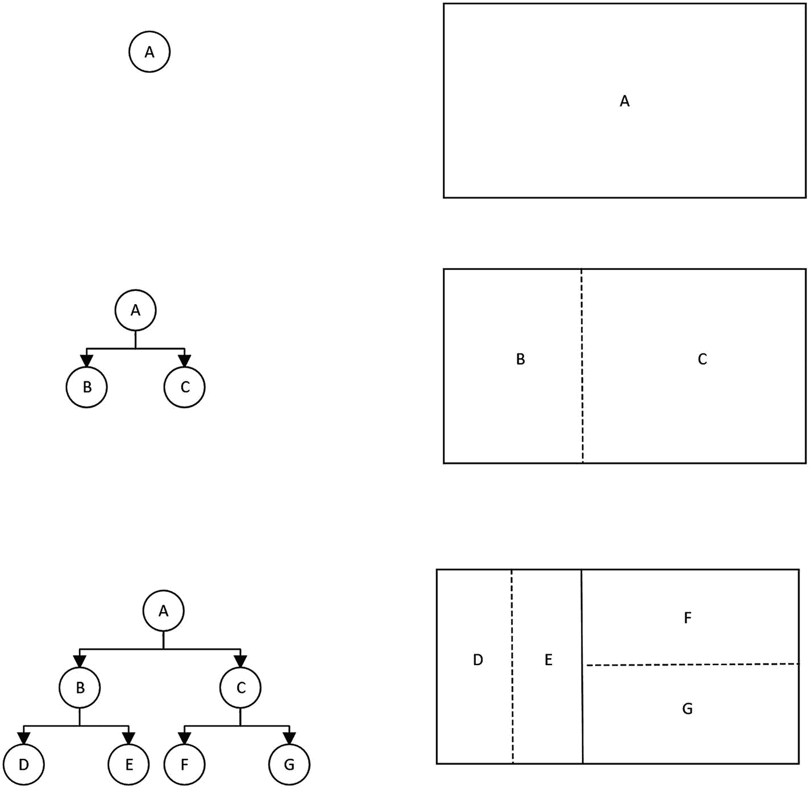
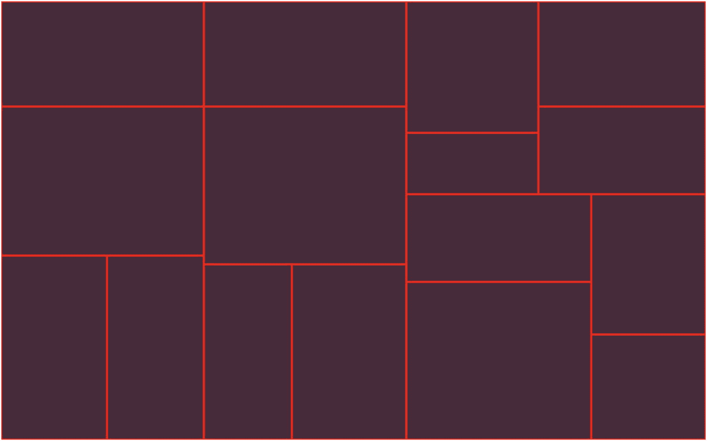
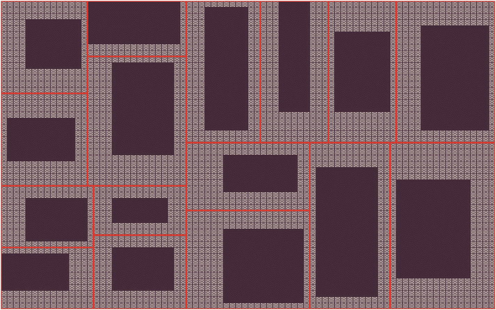
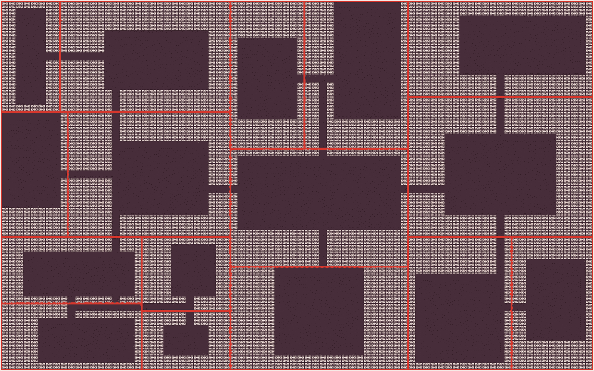
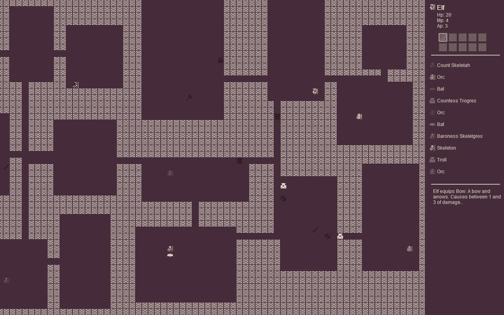

# 8. 程序化生成地牢

对许多人来说，程序化生成地牢是 roguelike 游戏类型的主要定义特征之一，即便不是最重要的那个。正因如此，过去几十年间围绕这一主题积累了大量工作、知识和开发技术，对于这样一本入门书籍来说，要涵盖 roguelike 开发者可用的重要技术是不切实际的。因此，我们将专注于一种易于理解和实验的地牢生成类型，同时简要描述其他方法但不予实现。需要理解的是，尽管本章解释的地牢生成算法很简单，但它是一种经过实战检验的地牢生成方式，已被众多游戏采用。

在本章中学习如何生成地牢，是思考一般地牢生成方法、以及如何实现新颖方式或针对某些意图调整现有算法的第一步。随着你的游戏开发之路不断推进，你将学习更复杂的实现方法，并尝试那些超出此处所能涵盖范围的高级技术。但即使你达到了旅程中那些更精妙的阶段，你始终可以回到这里学到的基础知识并继续使用。

## 地牢、趣味与可重复游玩性

地牢生成，乃至程序化生成，其核心并非混沌与随机。如果你所做的仅仅是将随机参数抛入一堆函数，期待另一端能诞生出美妙之物，那你与那些对着墙壁扔泥巴、盼着它或许能形成可辨认图案的人并无区别。说实话，对着墙扔泥巴可能正是你想做的事；这也没问题。我并不反对这样做；我只是想说这需要是你的本意，而非因为你对过程失去控制而导致的意外。

思考地牢生成的关键词是`意图`。你将精心设计一个算法，借助一些输入，为你的游戏生成一个地牢。你希望这些地牢带有某种感觉，无论是体现在设计方式上，还是它们将提供的挑战上；无论是什么让这些地牢成为`你的地牢`，其背后必须有一个意图。在这个学习阶段，直接选择一个通用算法，像使用市场购买的、批量生产的现成餐食一样直接套用，也是可以的。很多人会随着时间推移，为这些现成餐食开发自己独特的改良配方；如果你上网搜索改善方便面的方法，会发现一整个相关食谱亚文化。游戏开发算法也是如此；有现成的组件，你可以直接插入游戏中使用。我们之前对寻路算法就是这么做的，但花些时间摆弄这些现成组件，并尝试做出带有你个人印记的东西，是很有价值的。

摆弄算法不仅是一种将个人创造力注入其中的方式，也是一种更深入理解该算法的途径。尤其是当你意外搞砸一切时，戴上你的电脑取证探长帽，着手调试它。

最终目标可以概括为：尝试生成有趣好玩的 dungeons。对你和你的玩家来说，这意味的东西，可能与其他玩家和开发者说某个地牢有趣时的含义不同。有些人被极度困难的关卡和在每一步都带来挑战的地牢所吸引；另一些人则追求有趣的视觉效果，更沉醉于游戏沉浸式的品质和在他们眼前展开的世界。对于本章来说，一个很好的练习是：亲自玩几次我们将要生成的地牢，尝试找出你认为有趣且有回报的地方，然后调整代码，让它更符合你的喜好。

另一个关键方面是`可重复游玩性`；程序化生成的地牢和内容提供了最大化的可重复游玩性，让玩家能获得无尽的游戏乐趣。但程序化生成有其局限性，也许你正在做的东西只能在某种特定感觉下生成地牢。时间一长，尽管走廊和房间会变化，但它们都似曾相识，游戏便不再像以前那样有趣。这没关系，因为游戏的乐趣并不仅仅取决于地牢生成，而是游戏体验的总和；也许地牢在你的游戏中并非扮演主要角色。用本章介绍的技术生成的地牢也会如此；它们彼此之间会非常相似。因此，为了保持游戏的新鲜感，我们需要想清楚该如何处理它。这有点像手头只有固定的几种食材，却试图构思新菜谱；这是可行的。

同时实现`有趣和可重复游玩`，大概是 Roguelike 开发者能从玩家那里得到的最喜爱的反馈之一。依我看来，可重复游玩性的关键因素在于，开发者拥有稳定且充分理解其原理的程序化生成机制。如果这一前提不满足，游戏可能会生成有缺陷的地牢，从而毁掉那次游戏体验。我曾玩过一款流行的主机 Roguelike 游戏，它生成了一个很漂亮的地牢，却把我的角色放在了一个无法移动的位置。我被困在那里，心里纳闷这个边界情况怎么没有被处理好。任何代码库都会出现 bug，而在处理程序化生成时，我们不仅要注意代码中的 bug，还要注意代码运行时输出所导致的 bug；这是一件棘手的事情，我们可以原谅并理解边界情况。我只是重启了游戏，下一次运行就正常了，只是我很快就被一个看起来像蟾蜍的东西杀死了，非常丢人。可重复游玩性是你掌控自己算法所带来的副作用。据我所知，没有任何一款可重复游玩性强的游戏，其开发者是完全不掌控其程序化生成逻辑的。

“有趣”更难衡量和推理，但我相信它归结于实现预期与颠覆预期之间的平衡行为。如果你所做的全都颠覆玩家的预期，你的游戏很快就会变得像那些平淡无奇的“跳吓”电影一样。你肯定能让人惊讶，但人们可能并不觉得这有趣。如果你所做的全都是满足预期，那么游戏就会变得平淡无奇、缺乏记忆点、毫无趣味。你仍然可以这么做，因为有时候你需要的只是在思考别的事情时，机械地完成游戏流程，但你可能不会向其他人推荐这款游戏。

我们一直在构建的这个小型游戏更像是一个练习，所以它包含了很多我刚才提到的平淡无奇的预期满足。要创造出我们在 Roguelike 中钟爱的那种体验，需要时间、质量保证和玩家测试，这超出了书本示例代码所能涵盖的范围。不过，我们仍然可以指出，代码在哪些方面可以做得更有趣，以及深刻理解在哪方面能提高可重复游玩性。

在你的 Roguelike 游戏所有程序化生成的内容中，地牢生成很可能是玩家最先注意到的。它是你游戏的迎宾卡，是探索的邀请函。在本章中，我们不打算好高骛远，而是要稳扎稳打，用一种非常经典的方法来做。我们的地牢生成将是可理解的、易于修改的，而且最重要的是，`难以搞砸`。

### 如何搞砸地牢设计

我们不妨先避开算法细节，思考一下地牢中不想要的设计。假设我们的游戏是经典 roguelike 类型，英雄需要深入多层充满挑战与混乱的地牢，试图完成某个任务目标，那么怎样的地牢才算糟糕？这里说的糟糕纯粹指地牢布局，而非布局确定后内部放置的内容。

糟糕的地牢包含无法通行的区域，即玩家无法进入某些地点。我并非指玩家需要解谜或通过挑战才能进入的区域，也不是那些仅为美观而设置、玩家本就不该进入的区域。我说的是地牢布局中本应能进入、却因玩家所处位置与该房间之间没有任何可行路径而无法进入的房间——就像当你将`算法`接入其中，忽略门、怪物等任何阻碍物后，它仍然返回`null path`的情况。我们必须确保关卡是可以通行的。

另一种搞砸的方式（可能只是我个人看法，对他人影响不大）是关卡入口与出口距离过近，基本为玩家提供了一条快速通道。这算是个次要问题，因为玩过这种地牢的玩家都知道，快速深入会让角色在实力较弱时就遭遇更危险的怪物。不过对我来说，这确实削弱了部分乐趣，尤其是悬疑感。每次作为玩家走下楼梯时，我总在想：下一个出口有多远？我和它之间又藏着什么？我们的算法会尽量让出入口保持适当距离，虽然无法绝对完美，但绝非单纯随机。

这就是本章的核心准则：玩家必须穿越多个房间才能继续前进的可通行地牢。我们将采用名为`二叉空间分割`（BSP）的工具来构建地牢。

### 使用 BSP 构建地牢

二叉空间分割是一种通过递归将空间细分为更小空间的技术。由此生成的所有空间都是`凸形`的，意味着在该空间内任意两点之间连成的直线都不会超出该空间范围。其背后的数学与计算机科学研究与应用都很有趣，如果你对此感兴趣，一定要深入了解。不过就本章目标而言，我们不会深究理论，而是用最简单的方式构建地牢。

我们将构建一种称为 BSP 树的树形结构。这是一棵二叉树，其中节点要么有两个子节点，要么是叶子节点。作为完全二叉树，所有叶子节点的父节点都有两个子节点。

构建这棵树时，我们会选择关卡网格，在地图上随机选点，在确保区域不会过小的约束下将关卡一分为二。第二次迭代时，将这两个区域分别在内部随机位置再次分割，以此类推。图 8-1 展示了两次迭代后的树与地图。



图 8-1

BSP 树可视化

RogueBasin 网站^(⁴⁶)对此过程有更详细的描述。我们将实现的算法基于该文章及其参考 JS 实现^(⁴⁷)（该实现使用 Canvas 而非 Phaser）。

将地图分割成所需数量的区域后，我们会得到一组互不重叠的矩形。这非常理想，因为我们可以在每个区域内放置地牢房间，且房间互不相交。只要房间小于其所在区域，所有房间都能适配。

连接房间只需遍历`BSP 树`，用通道连接兄弟节点即可。以图 8-1 为例，我们连接`D`与`E`、`F`与`G`，然后连接`B`与`C`。完成后，无论`D`、`E`、`F`、`G`房间或关联通道位于何处，都能确保地牢中任意位置之间存在路径。

### 使用 BSP 树生成房间区域

我将本章的地牢生成拆分为多个示例，以便分别关注每个步骤。请查看`chapter-8/example-1-areas`。第一个示例的目标是使用`BSP 树`生成足够容纳房间的区域。

我没有沿用上一章的最终示例，而是移除了该文件夹中的大部分代码，仅保留加载世界场景所必需的内容，使其仍可识别为我们的游戏。这样做是为了在理清地牢生成步骤时让代码更易理解。完成后，本章的最终示例将包含上一章所有代码及地牢生成代码。

移除的部分包括所有游戏实体和用户界面侧边栏。在规划地牢地图布局时无需处理这些。我保留了地牢模块和回合管理器等其他代码，因为它们相互引用，我不想为了演示代码而大幅修改剩余模块。

示例的工作流程保持不变。`game.js`为 Phaser 设置`config`对象并加载`world.js`场景。场景从`dungeon.js`加载地牢模块，并调用`dungeon.initialize()`初始化瓦片地图。稍后我们会对此初始化过程进行一些调整，但首先需要构建 BSP 相关的必要代码。让我们创建`bspdungeon.js`文件，存放地牢生成代码，该代码完全自包含，无需导入任何内容。

## 创建 `DNode` 类

BSP 树由节点组成。为此我们创建名为`DNode`（地牢节点）的新类。节点需要跟踪其左右子节点（如有）及其包含的区域。

```
class DNode {
constructor(area) {
this.left = false
this.right = false
this.area = area
}
```

将节点管理与区域处理解耦是明智的做法，因此我们将区域属性捆绑在节点结构中。每个节点只知道其潜在子节点和所包含的区域内容。

可以预见，我们很快需要遍历这些区域，为此要访问树中的节点。该类添加了`forEachArea`函数来满足此需求。该函数类似于数组等可迭代对象中的`forEach`函数^(⁴⁸)，会对树中每个区域执行`回调`。

```
forEachArea(f) {
f(this.area)
if (this.left) {
this.left.forEachArea(f)
}
if (this.right) {
this.right.forEachArea(f)
}
}
}
```

## 创建 `DArea` 类

每个 `DNode` 都将包含一个 `DArea`（代表地牢区域，给这些命名时我灵感并不充沛）。该区域需要记录其位置（`x` 和 `y` 坐标）及其尺寸（`height` 和 `width` 值）。

```
class DArea {
constructor(x, y, w, h) {
this.x = x
this.y = y
this.w = w
this.h = h
}
}
```

我们并不会在这种类架构上玩出完整的`套娃`^(⁴⁹)效果，为每个区域直接放置一个房间，而是在下一个示例中动态放置它们。理解我们为何不这样做很重要；因为只有树的叶子节点才拥有房间，树枝节点则没有，因此无需在 `DArea` 类中添加房间属性。鉴于我们递归算法的特性，拥有房间的节点与不应拥有房间的节点之间的比例，并不支持将属性放置在类上。这与节点中左右子节点的情况不同。大多数节点都会有子节点；只有最终节点（叶子节点）没有子节点，正因为如此，那些属性才被添加到了 `DNode` 类中。

## 构建 BSP 树

利用前面的类，让我们添加一个名为 `makeTree` 的函数，该函数给定一个初始区域和迭代次数，将使用 BSP 算法递归地分割该区域。这个初始区域应该相当于整个地图。

```
function makeTree(area, iterations) {
let root = new DNode(area)
if (iterations != 0) {
let [a1, a2] = splitArea(root.area)
root.left = makeTree(a1, iterations - 1)
root.right = makeTree(a2, iterations - 1)
}
return root
}
```

开始时，该函数创建树的根节点，然后循环调用自身若干次，分割给定的区域，并将分割后的每一侧放入节点的 `left` 和 `right` 子节点中。

按照这个递归函数的构建方式，最后一次迭代自然会产生叶子节点，这些节点没有子节点，也是我们未来房间所在的位置。

如果你觉得那个 `let` 语句看起来很新奇，那是因为它使用了`解构赋值`^(⁵⁰)来创建 `a1` 和 `a2` 变量，以存放要放入左 `DNode` 和右 `DNode` 的区域。这些节点无需知道这些区域是如何计算出来的，它们只需要容纳这些区域并不断分割即可。

整个项目的关键在于那个将包围区域分割成子区域的函数。

## 分割区域

为了分割一个区域，该函数会抛硬币决定是水平分割还是垂直分割。然后，它会在给定的区域内找到一个随机的 X 或 Y 坐标，并根据该坐标计算出两个子区域。

如果我们让这个算法按描述的方式运行，由于使用随机数来选取坐标，它可能会生成过于狭窄而无法容纳房间的区域。我们不会将随机数生成器限制在看起来还行（但可能仍然不好）的值上，而是会根据分割区域的方向计算宽高比或高宽比，并根据该比率丢弃那些值，通过递归请求新的分割。

```
function splitArea(area) {
let x1, y1, w1, h1 = 0
let x2, y2, w2, h2 = 0
if (Phaser.Math.Between(0, 1) == 0) {
// 垂直分割
let divider = Phaser.Math.Between(1, area.w)
x1 = area.x
y1 = area.y
w1 = divider
h1 = area.h
x2 = area.x + w1
y2 = area.y
w2 = area.w - w1
h2 = area.h
if (w1 / h1 < 0.45 || w2 / h2 < 0.45) {
return splitArea(area)
}
```

`x1`、`y1`、`w1` 和 `h1` 代表一个区域，而 `x2`、`y2`、`w2` 和 `h2` 代表另一个区域。如果比率小于 0.45，则丢弃这些区域。更改该值会改变区域给人的感觉，这是你可以尝试调整的地方。介于 0.45 和 1.05 之间的值似乎能产生不错的地牢；低于或高于该范围则会导致混乱，有时甚至无法使用。

水平分割的代码基本相同，但坐标的计算会根据需要调整。

```
} else {
// 水平分割
let divider = Phaser.Math.Between(1, area.h)
x1 = area.x
y1 = area.y
w1 = area.w
h1 = divider
x2 = area.x
y2 = area.y + h1
w2 = area.w
h2 = area.h - h1
if (h1 / w1 < 0.45 || h2 / w2 < 0.45) {
return splitArea(area)
}
}
let a1 = new DArea(x1, y1, w1, h1)
let a2 = new DArea(x2, y2, w2, h2)
return [a1, a2]
}
```

通过从此函数返回一个包含两个区域的数组，我们可以在 `makeTree` 中使用解构赋值来挑选这些值，并将它们分配到树中的正确位置。

我们现在拥有了进行 BSP 地牢生成所需的所有代码；只缺少一个地牢类。

## 创建 `BSPDungeon` 生成器类

在 `makeTree` 的多次迭代结束时，我们树的叶子节点将包含足够容纳我们房间的区域。`BSPDungeon` 类的工作是挑选这些区域，并输出一个可用的关卡数组，供地牢模块使用。

如果你还记得关卡数组的工作原理，它是一个 Y 和 X 坐标构成的矩阵，包含 0 或 1，取决于单元格是墙体还是可行走的地砖。我们有一个硬编码的关卡，存储在 JS 文件中，并在本书的所有章节中一直重复使用。从现在开始，这个关卡数组将在运行时由 `BSPDungeon` 类生成。

```
export default class BSPDungeon {
constructor(width, height, iterations) {
this.rootArea = new DArea(0, 0, width , height )
this.tree = makeTree(this.rootArea, iterations)
this.initializeLevelData()
}
```

一个 `BSPDungeon` 需要地图尺寸来计算 BSP 树的根区域以及 BSP 过程应运行的迭代次数。一旦 `makeTree` 函数完成，就可以初始化关卡数据数组。

```
initializeLevelData() {
let lvl = []
for (let y = 0; y <= this.rootArea.h; y++) {
lvl[y] = lvl[y] || []
for (let x = 0; x <= this.rootArea.w; x++) {
lvl[y][x] = 0 // 空
}
}
this.levelData = lvl
}
```

`initializeLevelData` 函数确保我们有一个有效的关卡数据数组，其中包含足够的单元格来容纳我们的地牢地图。在此示例中，我将它们全部初始化为空，这样在渲染到屏幕时就不会分散我们的注意力，但一旦我们回到构建实际游戏时，这些地砖将被初始化为墙体。

最后，我们添加一个访问器方法来返回关卡数据。从技术上讲，这并不是必需的，因为代码可以直接从实例对象中获取这些数据，但我认为使用这样的方法更好，以防将来在返回数据之前需要进行额外的计算。

```
toLevelData() {
return this.levelData
}
}
```

#### 改变世界场景

世界场景已被精简，仅包含渲染自身所需的必要代码，不再处理游戏实体和用户界面。首先导入新的 `BSPDungeon` 类，然后加载精灵表数据——尽管我们只是将瓦片设置为第一个位置的空瓦片。`update` 函数已被做成一个空桩函数，因为我们只需将区域渲染到屏幕上，无需与它们交互。

```
import dungeon from "./dungeon.js"
import BSPDungeon from "./bspdungeon.js"
const world = {
key: "world-scene",
active: true,
preload: function () {
this.load.spritesheet('tiles', './assets/colored_transparent.png',
{
frameWidth: 16,
frameHeight: 16,
spacing: 1
})
},
```

这段代码的有趣之处在于对 `create` 函数所做的修改。

```
create: function () {
let dg = new BSPDungeon(80, 50, 4)
let level = dg.toLevelData()
dungeon.initialize(this, level)
let camera = this.cameras.main
camera.setViewport(0, 0, camera.worldView.width, camera.worldView.height)
camera.setBounds(0, 0, camera.worldView.width, camera.worldView.height)
```

我们初始化了一个新的 `BSPDungeon` 实例，其网格大小为 80x50，并指示算法对其迭代四次。生成的地图数据被传递给 `dungeon.initialize()`——该方法已通过补丁进行修改，使其从参数而非文件中加载地图，这是一个小改动。严格来说，这个演示并不需要设置摄像机，但我们习惯了这么做，所以就保留了下来。

该函数接下来的部分比较巧妙；它将使用 `forEachArea` 代码来遍历 `BSPDungeon` 实例 `tree` 中的区域，并向场景中添加矩形，使它们可见。

```
dg.tree.forEachArea(a => {
let x = dungeon.map.tileToWorldX(a.x)
let y = dungeon.map.tileToWorldY(a.y)
let w = a.w * 16
let h = a.h * 16
this.add.rectangle(x, y, w, h).setStrokeStyle(4, 0xff0000, 1, 0.7).setOrigin(0)
})
```

除了将地图单位转换为实际像素的一些数学计算外，这段代码几乎直接将区域属性与创建矩形的参数对应了起来。矩形被设置为透明，仅通过 `setStrokeStyle` 函数调用设置了其描边。别忘了将图形的原点设置为左上角；默认原点是中心坐标，而我们的数学计算并非基于此。

完成文件其余部分很简单：

```
},
update: function () {
}
}
export default world
```

加载这个示例后，你应该能够看到由 BSP 树算法生成的区域。尝试多次刷新页面，观察生成的不同空间，并想象在每个区域内部，将会有一个房间。

你看到的图像将类似于图 8-2，但由于它们是程序化生成的，所以区域会有所不同。



图 8-2

地牢中的区域

是时候在这些区域中添加一些房间了；我们进入下一个示例。

### 创建房间

这个示例的起点是 `BSPDungeon` 类。示例代码位于 `chapter-8/example-2-rooms/` 目录下。我们需要一个新类来表示房间；我们称它为 `DRoom`。

该类将在其 `constructor` 方法中接收一个区域；这个区域代表了房间的约束范围。我们将使用随机数生成来决定房间的位置和尺寸，并注意使其适配在给定区域内部。

```
class DRoom {
constructor(area) {
this.x = Math.floor(area.x + (Phaser.Math.Between(1, area.w) / 3))
this.y = Math.floor(area.y + (Phaser.Math.Between(1, area.h) / 3))
this.w = area.w - (this.x - area.x)
this.h = area.h - (this.y - area.y)
this.w -= Math.floor(Phaser.Math.Between(1, this.w / 3))
this.h -= Math.floor(Phaser.Math.Between(1, this.h / 3))
}
}
```

#### 遍历叶子节点

房间只会位于 BSP 树的叶子节点上，因此我们有必要找到一种方法来遍历它们。就像我们使用 `forEachArea` 遍历区域一样，我们将在 `DNode` 类中实现一个名为 `forEachLeaf` 的新方法。

```
forEachLeaf(f) {
if (!this.left && !this.right) {
f(this.area)
}
if (this.left) {
this.left.forEachLeaf(f)
}
if (this.right) {
this.right.forEachLeaf(f)
}
}
```

这只是对 `forEachArea` 的一个变体，它仅对叶子节点执行调用函数。你也可以只使用 `forEachArea`，然后在回调中检查节点是否为叶子节点，但何不简化操作，直接添加你所需的方法呢。

#### 雕刻矩形

一旦遍历了叶子节点中的每个区域，我们就需要一个函数，以便能按房间形状雕刻出矩形。这个函数只需将地图数据中对应房间的单元格翻转为可通行的空瓦片即可。

我们将直接使用坐标和尺寸来操作，而不是将房间对象传递给该函数，这主要是因为函数内部的循环会用到它们。

```
fillRect(x, y, w, h, tile) {
for (let y1 = y; y1 < y + h; y1++) {
for (let x1 = x; x1 < x + w; x1++) {
this.levelData[y1][x1] = tile
}
}
}
```

#### 制作房间

到目前为止，我们已拥有组装房间所需的所有部件。`makeRooms` 是 `BSPDungeon` 类的一个方法，它遍历树中的叶子节点，并在每个节点中生成一个房间。为使其更易读，我让它在内部使用了一个辅助函数，而不是将回调直接编码在 `forEachLeaf` 调用中。

```
makeRooms() {
const makeRoom = (area) => {
area.room = new DRoom(area)
this.fillRect(area.room.x, area.room.y, area.room.w, area.room.h, 0)
}
this.tree.forEachLeaf(makeRoom)
}
```

请注意，我们在地图数据中将房间矩形填充为 0；这意味着我们需要将 `initializeLevelData` 的值翻转为 1，以便初始数组全部设置为墙壁。如果像上一个演示那样保留为 0，那么我们的房间将会不可见，因为周围没有墙壁瓦片。

#### 将房间添加到构造函数中

修补 `BSPDungeon` 的构造函数只需改动一行代码；在初始化地图数据之后调用 `makeRooms` 方法即可。

```
constructor(width, height, iterations) {
this.rootArea = new DArea(0, 0, width , height )
this.tree = makeTree(this.rootArea, iterations)
this.initializeLevelData()
this.makeRooms()
}
```

在浏览器中加载此示例，你应该能够同时看到上一个示例中的区域以及其中的房间。效果应类似于图 8-3。



图 8-3

地牢中的房间

尝试多次刷新页面，观察程序化生成的变化。试着调整 `splitArea` 函数中的那些比例，看看它们如何影响地牢布局。

下一个示例是关于如何连接这些房间的。

#### 制作走廊

在`chapter-8/example-3-corridors/`目录下，你可以找到这个示例的文件。正如你可能想到的，这个新示例所需的所有改动都将在`BSPDungeon`类中进行。

制作走廊将涉及在BSP树中选择两个兄弟节点，然后选取它们内部的区域，并计算每个区域的中心点。接着在这两个坐标之间放置一条由可通行空瓦片组成的直线。

这是一种易于理解的方法，但比较初级，因为它只有在你确定房间与其区域的中心点相交时才行得通。可以通过修补`DRoom`构造函数来确保这一点；这留作读者练习。

### 在关卡数据中绘制一条线

此函数是`BSPDungeon`类中的一个方法；它与`fillRect`方法类似，但旨在绘制一条线而非一个方块，因此其循环的参数集略有不同。

```
line(x1, y1, x2, y2, tile) {
for (let y = y1; y <= y2; y++) {
for (let x = x1; x <= x2; x++) {
this.levelData[y][x] = tile
}
}
}
```

### 制作走廊

新函数与`makeRooms`函数非常相似；这个制作走廊的新方法将遍历BSP树，在各种同级区域之间绘制连线。

```
makeCorridors() {
const makePath = (node) => {
if (node.left && node.right) {
let x1 = Math.floor(node.left.area.x + (node.left.area.w/2))
let y1 = Math.floor(node.left.area.y + (node.left.area.h/2))
let x2 = Math.floor(node.right.area.x + (node.right.area.w/2))
let y2 = Math.floor(node.right.area.y + (node.right.area.h/2))
this.line(x1, y1, x2, y2, 0)
makePath(node.left)
makePath(node.right)
}
}
makePath(this.tree)
}
```

运行此示例后，可以看到一个如图 8-4 所示的连通地牢。



**图 8-4**

地牢中的走廊

虽然花费了一些时间，但我们终于完成了程序化地牢的布局。我们的地牢有一种块状感：所有房间都是方形的，走廊也是笔直的。感觉就像是地牢领主因为赶时间而购买了预制模块一样，但谁又说得准呢？在我看来这已经足够好了，是时候将这一切整合到我们的游戏中去了。

## 一个程序化生成的地牢

将前一章的标签示例与本章当前完成的工作相融合，是位于`chapter-8/example-4-pcg-dungeon/`的新示例的重点。

代码与标签示例相同，但我们向文件夹中添加了`BSPDungeon`类，修改了地牢模块以使其接收关卡数据作为参数，并在世界场景的顶部添加了对`BSPDungeon`类的导入。

之后，我们需要修改世界场景的构造函数，以使用新的程序化生成的关卡数据。请注意，在此示例中，我们没有添加彩色矩形，因此只需初始化`BSPDungeon`实例并将关卡数据传递给地牢模块即可。

```
create: function () {
let dg = new BSPDungeon(80, 50, 4)
let level = dg.toLevelData()
dungeon.initialize(this, level)
// 加载游戏实体
let p = dungeon.randomWalkableTile()
dungeon.player = new classes.Elf(p.x, p.y)
tm.addEntity(dungeon.player)
```

除了添加玩家之外，其余所有代码保持不变。在构建此示例之前，玩家位置是硬编码为 15x15 的；现在我们使用变量`p`在地牢中选择一个随机的可行走瓦片。

在图 8-5 中，你可以看到它大概的样子。你是否已经厌倦了总是使用同一张地图？那种日子已经一去不复返了。



**图 8-5**

程序化生成的地牢

让摄像机跟随玩家移动的一个很酷的附带效果是，我们无需担心英雄角色出现在屏幕之外，因为摄像机会移动以确保角色处于视野之中。

不过，我们还可以让这个地牢变得更好一些。我在本章中添加了一个额外的示例，位于`chapter-8/example-5-better-dungeon/`，它改变了物品和敌人在地图上的放置方式。

## 更好的地牢

这是对前一个示例的一个微小但重要的改动。在前一个示例中，我们只是在地牢中随机选择可行的瓦片，然后在关卡中放置 X 个怪物。我认为这不是最好的做法。

相反，我修改了世界场景的`create`函数，使其遍历所有房间并决定每个房间的处理方式。为此，我首先在地牢模块中添加了一个新函数，允许我在一个房间内部选择一个随机的可行走瓦片。我曾考虑直接修改原始的`randomWalkableTile`函数，使其接收参数以设置约束条件，但这将要求我更改一些行为标签的工作方式，因此我决定创建一个新函数。

```
randomWalkableTileInRoom: function (x, y, w, h) {
let rx = Phaser.Math.Between(x, (x + w) - 1)
let ry = Phaser.Math.Between(y, (y + h) - 1)
let tileAtDestination = dungeon.map.getTileAt(rx, ry)
while (typeof tileAtDestination == "undefined" || tileAtDestination.index == dungeon.sprites.wall) {
rx = Phaser.Math.Between(x, (x + w) - 1)
ry = Phaser.Math.Between(y, (y + h) - 1)
tileAtDestination = dungeon.map.getTileAt(rx, ry)
}
return { x: rx, y: ry }
}
```

世界场景中`create`代码的改动不仅是遍历每个房间，还要决定每个房间的类型。房间类型包括空房间、只有一个怪物的房间、有两个怪物和一个物品的房间，以及宝藏室。通过使用`weightedPick`^(⁵¹)，我可以将随机生成偏向于空房间和只有一个怪物的房间，并使宝藏室极其罕见。

在`BSPDungeon`类中新增了一个`getRooms`方法。

```
getRooms() {
let rooms = []
this.tree.forEachLeaf(area => {
rooms.push(area.room)
})
return rooms
}
```

此函数返回一个数组，便于在世界场景中迭代。我们对场景所做的另一项改动是玩家的起始位置；我们让玩家从BSP树中最左边的房间开始。这并不一定是屏幕的最左边，而是包含在用于生成地牢的最左边叶子节点中的那个房间。

```
create: function () {
let dg = new BSPDungeon(80, 50, 4)
let level = dg.toLevelData()
dungeon.initialize(this, level)
// 获取房间
let rooms = dg.getRooms()
// 将玩家放置在最左侧
// 树节点的房间中。
let node = dg.tree.left
while (node.left !== false) {
node = node.left
}
let r = node.area.room
let p = dungeon.randomWalkableTileInRoom(r.x, r.y, r.w, r.h)
dungeon.player = new classes.Elf(p.x, p.y)
tm.addEntity(dungeon.player)
```

下一步是遍历房间。

```
rooms.forEach(room => {
let area = room.w * room.h
let monsterCount = 0
let itemCount = 0
let roomType = Phaser.Math.RND.weightedPick ([0,0,0,0,1,1,1,1,1,1,2,2,2,2,3])
```

`weightedPick`函数从数组中返回一个随机元素，但偏向于数组前部的元素。通过重复元素，我们增加了它们被选中的几率，特别是在数组开头添加元素时。

使用一个 `switch` 语句，根据 `roomType` 变量的值来更改每个房间中物品和怪物的数量。`switch` 语句中的每个 `case` 都会通过给 `mc` 变量和 `ic` 变量赋值来分别设置房间中的怪物数量和物品数量。

```
switch (roomType) {
case 0:
// 空房间。
monsterCount = 0
itemCount = 0
break
case 1:
// 一只怪物。
monsterCount = 1
itemCount = 0
break
case 2:
// 怪物和物品。
monsterCount = 2
itemCount = 1
break
case 3:
// 宝藏室。
monsterCount = 0
itemCount = 5
break
}
```

设置好数值后，我们使用之前相同的代码，一个 `while` 循环向地牢和回合管理器添加实体，但这次我们使用 `randomWalkableTileInRoom` 而不是 `randomWalkableTile`，以便将实体放置在正确的位置。

```
while(mc > 0) {
let tile = dungeon.randomWalkableTileInRoom (room.x, room.y, room.w, room.h)
tm.addEntity(getRandomEnemy(tile.x, tile.y))
mc--
}
while(ic > 0) {
let tile = dungeon.randomWalkableTileInRoom (room.x, room.y, room.w, room.h)
tm.addEntity(getRandomItem(tile.x, tile.y))
ic--
}
})
```

这些改动使得实体的放置看起来更加自然。

## 练习

- 尝试使用不同的比率来修改`BSPDungeon`类，观察地牢布局的变化。
- 你能否让走廊变成 L 形或 Z 形，而不是直线？
- 想出不同的策略来在地图上放置怪物和物品。

### 总结

在本章中，我们研究了如何使用程序化生成来生成地牢布局。我们学习了一种许多 Roguelike 游戏使用的常见基本技术，称为*二叉空间分割*，以及如何应用它。

在继续之前，请确保你理解了`BSPDungeon`类的工作原理，并尝试对其进行大幅修改，确保你开始理解是什么让一个关卡对你来说有趣。

在下一章中，我们将完成将这个示例打造成一个具有多个层级和胜利条件的休闲 Roguelike 游戏。

脚注 1 2 3 4 5 6