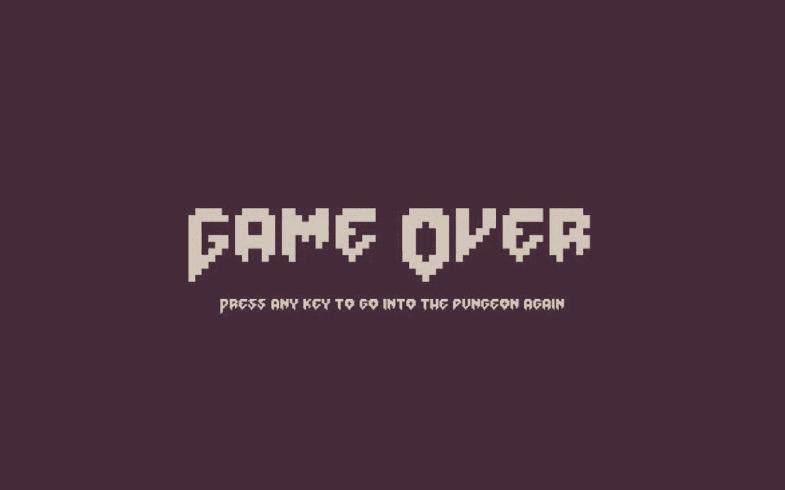
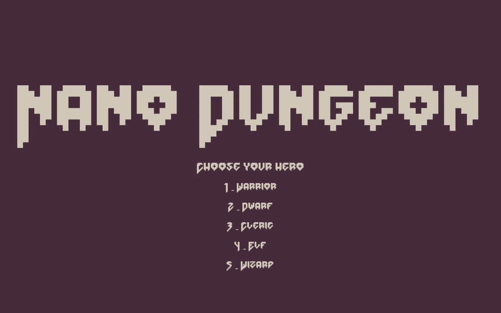
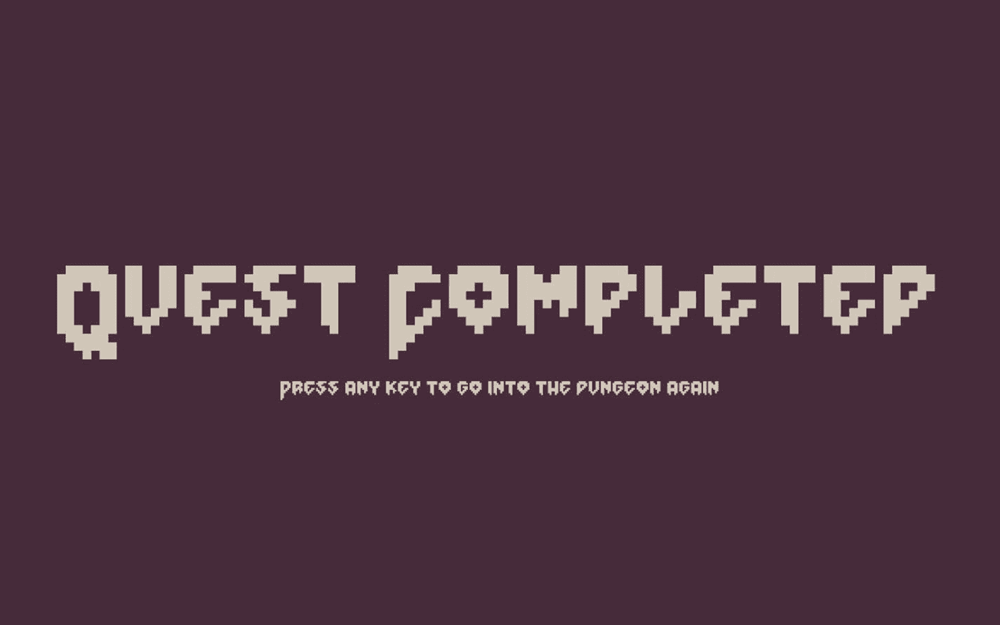

# 9. 完成游戏

任何有自尊心的地牢都不止一层。如果你不打算挖得很深，那么挖掘地下巢穴并重复使用某种古老的洞穴结构就没有意义。到游戏的这个阶段为止，我们都将地牢视为单层结构，因为这样更容易编码和推理。在本章中，我们将为地牢添加多个层级，并创建游戏介绍、游戏结束和获胜所需的其他场景。最复杂的部分是多个层级的支持，因为它需要重构我们的一些游戏文件。

## 添加多个层级

一种简单的伪造多层级的方法是在关卡中放置楼梯，一旦玩家到达楼梯，就重新启动场景，这将导致关卡被重新生成，并呈现为全新的房间和走廊集合。尽管这种方法看起来不错，但它有一个问题：它阻止了玩家返回之前访问过的层级，因为到达向上的楼梯会导致上层关卡被随机化，不再与之前相同。除非你的地牢探索游戏有一个关于地牢层级不断变化、当你移开视线时房间和走廊似乎会移动的背景故事，否则我认为你无法蒙混过关。

相反，我们将修改我们的 BSP 地牢生成器，使其一次生成多个层级。我们将把地牢生成和初始化从世界场景移到地牢模块中，因为当玩家下楼梯或上楼梯时，我们将重新启动该场景和 UI 场景。`dungeon`模块是一个单例，可以在这些重启期间维持状态，从而跟踪层级、玩家属性和位置。还需要对通用游戏实体类进行其他小的重构，以便它们能够应对场景重启。

此示例的源文件位于`chapter-9/example-1-multiple-levels/`。

### 修改`BSPDungeon`以支持多个层级

更改的实质是，我们将把旧的`BSPDungeon`类重命名为`BSPLevel`，然后创建一个新的`BSPDungeon`类，该类在初始化时会创建多个`BSPLevel`实例，跟踪它们，同时提供上下移动和检索当前关卡数据信息的功能。

我们在`dungeon`模块中所做的与`BSPDungeon`类所做的工作之间存在重叠。两者都处理地牢并具有支持它们的功能；概念上的区别在于，你可以用另一个地牢生成类替换`BSPDungeon`，并继续使用`dungeon`模块。这就是它们分离的原因，这样你就可以在不放弃所有内容的情况下替换其中一个。它们之间存在一些紧密耦合的地方；它们并非完全独立。这是为了让代码更容易理解，但即使存在这种耦合，添加新的地牢生成方法也比将所有内容捆绑在同一个文件上容易。

重构的第一步是将类`BSPDungeon`重命名为`BSPLevel`。完成后，我们就可以编写新的`BSPDungeon`类了。

```javascript
export default class BSPDungeon {
  constructor(config) {
    let levels = []
    for (let c = 0; c < config.levels; c++) {
      levels.push(new BSPLevel(config.width, config.height, config.iterations))
    }
    this.levels = levels
    this.currentLevel = 0
  }
```

新的`BSPDungeon`类将接收一个地牢配置对象作为参数。将对象作为参数可以让我们更容易地为本章后面的示例扩充地牢生成，而不是向函数添加更多参数。配置对象包含地牢的宽度和高度、每个关卡应进行的 BSP 迭代次数以及地牢中的关卡数量。这些参数中的大多数用于初始化新的`BSPLevel`实例，而关卡数量决定了关卡生成循环应执行的次数。最后一行虽小但很重要，它将当前关卡设置为地牢的第一层。玩家将从这里开始。将此值改为更高的数字将使玩家从地牢深处开始游戏，这可能是你游戏的一个叙事功能，例如，你可能正在制作一个游戏，其中玩家被俘虏并囚禁在地牢中，他们的任务是逃脱。

如果你还记得之前的示例，世界场景会直接访问`BSPDungeon`实例中的关卡数据。这不再有效，因为类属性已更改。我们将提供一个 API 来呈现与之前相同的数据集，但会考虑`currentLevel`的值。

```javascript
getCurrentLevel() {
  return this.levels[this.currentLevel].toLevelData()
}
getRooms() {
  return this.levels[this.currentLevel].getRooms()
}
getTree() {
  return this.levels[this.currentLevel].tree
}
```

这三个方法类似于我们在第 8 章中使用的直接访问。第一个函数`getCurrentLevel`用于返回关卡数据数组以初始化瓦片地图。第二个函数`getRooms`用于将物品和怪物放置到关卡中。第三个函数`getTree`用于计算玩家的位置。

所有这些函数都基于`currentLevel`的值。当玩家上楼梯或下楼梯时，我们需要递增或递减此属性。

```javascript
goDown() {
  if (this.currentLevel < this.levels.length - 1) {
    this.currentLevel++
  } else {
    console.error("can't go down, already at the bottom of the dungeon.")
  }
}
goUp() {
  if (this.currentLevel > 0) {
    this.currentLevel--
  } else {
    console.error("can't go up, already at top of the dungeon.")
  }
}
```

这两个函数非常简单；它们只需要进行一些错误检查，以确保我们不会将`currentLevel`的值设置为无意义的数字。

### 让地牢模块创建地牢

如前所述，我们需要将部分地牢创建代码从世界场景中移入地牢模块。当我们重启场景（在层级间移动时的必要操作）时，`create` 函数会再次运行。我们不能将地牢生成代码放在那里，因为那样会导致每次玩家在层级间移动时，整个多层地牢都会重新生成。

此外，还需要实现支持多层级结构的附加代码。地牢模块将负责启动通过楼梯移动的过程，就像它负责移动和战斗一样。

由于我们使用场景重启来实现楼梯移动，在地牢模块中追踪地牢是否已初始化，比在世界场景中更容易。为此，我们为地牢模块对象添加了一个 `initialized` 属性，其默认值为 `false`。

```javascript
let dungeon = {
msgs: [],
sprites: {
floor: 0,
wall: 554,
},
initialized: false,
```

在给定的游戏会话中，场景重启会导致 `dungeon.initialize` 被多次调用。每次玩家通过楼梯移动且世界场景的 `create` 函数运行时，该函数都会被调用。该函数会再次检查 `initialized` 属性的值，并且仅在其为 `false` 时实例化一个新的 `BSPDungeon`。这些代码大部分是从世界场景中移植过来的。

```javascript
initialize: function (scene) {
// 只创建一次地牢。
if (!this.initialized) {
console.log("地牢尚未初始化")
let dungeonConfig = {
width: 80,
height: 50,
iterations: 4,
levels: 5
}
this.dungeon = new BSPDungeon(dungeonConfig)
this.initialized = true
}
```

第一个代码块负责初始化 `BSPDungeon` 并保存对它的引用。

```javascript
console.log(`地牢模块：当前地牢层级`, this.dungeon.currentLevel)
this.level = this.dungeon.getCurrentLevel()
this.rooms = this.dungeon.getRooms()
this.tree = this.dungeon.getTree()
this.scene = scene
this.levelWithTiles = this.level.map(r => r.map(t => t == 1 ? this.sprites.wall : this.sprites.floor))
const config = {
data: this.levelWithTiles,
tileWidth: 16,
tileHeight: 16,
}
```

在之前的示例中，这段代码分布在场景和此模块之间；现在它都集中在了一个地方。我们仍然保存了对诸如 `rooms` 和 `tree` 等各种属性的引用，因为我们把处理游戏实体放置的任务留给了世界场景。它需要在那里访问这些数据。

```javascript
const map = scene.make.tilemap(config)
const tileset = map.addTilesetImage('tiles', 'tiles', 16, 16, 0, 1)
this.map = map.createDynamicLayer(0, tileset, 0, 0)
},
```

## 地牢模块的清理与重启

这个代码库一个特别混乱的特征是精灵创建分布在各处。每个游戏实体都会创建并保存对自己精灵的引用，无论是在地图上还是在 UI 中放置。在层级间移动需要销毁这些精灵和引用。对于大多数实体来说，这将是垃圾回收以及场景重启不再关心它们的副作用，但有一个特殊的实体我们会持续追踪，并确保它能在这些重启中存活下来；这个实体就是玩家。

为了让玩家在这些重启中存活，我们需要将其重置为类似于初始实例化的状态，但不要重新初始化其属性，例如 `healthPoints` 和 `actionPoints`。我们将在开始重构 `basicHero` 类时处理这个问题；现在我们需要关注的是地牢模块。我们将创建一个清理函数，它会调用我们稍后要实现的内务管理函数。

在重置场景之前进行清理的另一个重要方面是确保回合管理器为空。我们不希望上一层级的所有实体散落在下一层级中。

```
cleanup: function () {
this.msgs = []
dungeon.player.cleanup()
tm.cleanup()
},
```

通过楼梯移动时，会伴随一个视觉特效，使屏幕渐变为黑色，然后渲染新的层级。在我实现这个功能时，遇到了一个代码 bug，这是由于我误解了此类函数的工作方式。摄像机有一个 `fadeOut` 函数，它接收一些数值参数，告诉它淡出操作需要多长时间、淡出到什么颜色，以及一个回调函数。我原本希望这个回调函数在整个过程结束时被调用，但根据 `fadeOut` 文档的解释，它实际上会在淡出过程中的每一帧被调用。^(⁵²) 这只是个警示故事，说明有时候你可能熟悉某些编码实践，但实际情况并非你所使用的库的工作方式。Phaser 的文档非常全面，应该超越我在本书中分享的链接去深入探索。

解决方案是使用一个监听 `camerafadeoutcomplete` 事件的事件监听器。

```
goDown: function () {
this.scene.cameras.main.once('camerafadeoutcomplete', () => {
this.cleanup()
this.dungeon.goDown()
this.scene.events.emit('dungeon-changed')
}, this);
this.scene.cameras.main.fadeOut(1000, 0, 0, 0);
},
```

在地牢模块内部出现 `this.dungeon` 有点令人困惑。那个 `dungeon` 属性实际上指向的是 `BSPDungeon` 的实例。我找不到用其他名词来命名该属性。其逻辑是：当淡出完成时，地牢模块会清理自身，通知 `BSPDungeon` 将 `currentLevel` 向下移动一层，并发送一个自定义事件。

根据 Phaser 文档，有多种方法可以重启场景，在网上搜索这个话题会得到各种截然不同的做法（有些实际上是 Phaser 2 的，已经不再适用）。我发现最可靠的重启场景的方法是从场景内部进行。当我尝试从地牢模块内部执行此操作时，无法使其可靠地工作。显然，最好的方法正是如此——发送一个自定义事件，让每个场景自行处理。`world` 和 `ui` 场景都会监听这个自定义的 `dungeon-changed` 事件。一旦事件发生，它们就会调用各自原型的 `restart` 方法。

由于我们仍在重新设计地牢模块，此处以及其他一些文件中还有一些内容需要修补，那就是*输入处理*。唯一处理输入的是 `basicHero` 类。不幸的是，它是通过向场景附加*输入监听器*来实现的。由于使用场景重启来移动层级，当玩家在地牢中上下移动时，这些输入监听器会被丢弃。玩家是唯一能在重启中存活的实体；这意味着其构造函数只会被调用一次，在游戏开始时，并且该实体的引用会被保留，并在每次场景切换时经过一些清理后重用。当前，我们从构造函数内部附加输入监听器，这种做法将会改变，以便我们将那段代码重构到它们自己的独立方法中；这样，当玩家在层级间移动时，地牢模块可以调用该函数来重新设置监听器，而无需调用玩家的构造函数。

所有这些将在我们重构玩家类时进一步解释；现在，我们需要做的是更改地牢模块中的 `initializeEntity` 函数，以调用将用于设置那些输入处理器的函数。

```
initializeEntity: function (entity) {
if (entity.x && entity.y) {
let x = this.map.tileToWorldX(entity.x)
let y = this.map.tileToWorldY(entity.y)
entity.sprite = this.scene.add.sprite(x, y, "tiles", entity.tile)
entity.sprite.setOrigin(0)
if (entity.tint) {
entity.sprite.tint = entity.tint
entity.sprite.tintFill = true
}
entity.setEvents()
}
},
```

改动仅体现在最后一行，我们在此调用了 `entity.setEvents()`。此函数将被添加到 `basicHero` 类，以及 `genericItem` 和 `basicEnemy` 类中；不过对于后两者，它们只会是空存根。

我们的新地牢模块已准备就绪，并处理了原本属于世界场景的一些代码——这正是我们接下来要聚焦的文件。

### 修改世界场景

为了从该场景支持多个关卡，需要进行少量修改；这是因为从场景本身的角度来看，它始终只处理单一地牢关卡。我们需要做一些清理工作，移除已复制到地牢模块的代码，并实现一个 `dungeon-changed` 事件的监听器，除此之外，其余部分保持不变。

对 `create` 函数的修改集中在顶部，其大部分内容保持不变。

```
create: function () {
this.events.once('dungeon-changed', () => {
this.scene.restart()
})
```

首先，在 `create` 函数中，我们为自定义的 `dungeon-changed` 事件注册了一个事件监听器。除了调用 `restart` 之外，内部无需做太多操作；其余所有的清理工作已由地牢模块处理。

```
dungeon.initialize(this)
```

`initialize` 方法的签名已更改，因为世界场景不再处理地牢生成。这些功能现在由地牢模块负责。

接下来，我们使用已设置的新属性，这样就不需要对用于将玩家放置在地牢中的代码做太多修改。

```
// 获取房间
let rooms = dungeon.rooms
// 将玩家放置在最左侧树节点对应的房间
let node = dungeon.tree.left
while (node.left !== false) {
node = node.left
}
let r = node.area.room
let p = dungeon.randomWalkableTileInRoom(r.x, r.y, r.w, r.h)
if (!dungeon.player) {
dungeon.player = new classes.Elf(p.x, p.y)
} else {
dungeon.player.x = p.x
dungeon.player.y = p.y
dungeon.player.refresh()
dungeon.initializeEntity(dungeon.player)
}
tm.addEntity(dungeon.player)
```

不过，注意最后的 `if` 子句很重要。它再次检查玩家是否已初始化。在场景重启的情况下，`dungeon.player` 值将已设置为我们某个英雄类的实例。如果是这种情况，我们不会实例化新英雄，而是直接定位已有英雄，并通过 `initializeEntity` 将其添加到关卡中。在 `create` 函数结束前调用 `refresh` 非常重要，这样在新关卡中，玩家会以满行动点和移动点开始。

在场景重启期间，`camera.worldView` 的值会被设为零，因为场景尚未渲染。因此，我们的 `camera.setBounds` 代码需要重构，否则当玩家在关卡间移动时，摄像机将会出问题。

```
camera.setBounds(0, 0, this.game.config.width, this.game.config.height)
```

我们还需要向 UI 场景添加一个 `dungeon-changed` 监听器。

### 修改 UI 场景

此文件只需做一处修改，就是前面提到的自定义事件处理函数。让我们像在世界场景中一样，将其添加到 `create` 函数的顶部。

```
create: function () {
console.log("create ui")
this.createdUI = false
this.scene.get('world-scene').events.once(
'dungeon-changed', () => {
this.scene.restart()
})
```

到目前为止，我们一直在调用并假设存在许多尚未实现的清理函数。让我们在下一节中逐一介绍它们。

### 清理函数

我一直称它们为清理函数，因为它们旨在场景重启前整理我们的游戏状态。它们需要被添加到许多不同的文件中，有些比其他更复杂，但本节我们将把较简单的函数作为一个长节来处理，以便快速完成它们，重新投入到有趣的事情中。

首先，让我们对回合管理器进行必要的修改。我们需要一种在场景重启前清空它的方法，以避免将游戏实体从一个关卡带到另一个关卡。在 `turnManager.js` 中，添加以下函数：

```
cleanup: () => {
tm.entities.forEach(e => {
if (e.sprite) {
e.sprite.destroy()
}
if (e.UIsprite) {
e.UIsprite.destroy()
}
})
tm.removeAllEntities()
}
```

在使用 `removeAllEntities` 将实体集重置为空集合之前，我们需要销毁所有实体精灵。老实说，我最初认为这不是必需的，场景重启会销毁精灵，但在为本章实现示例时，我最终在屏幕上得到了重复的精灵。那个 bug 可能出在其他地方；正如我之前提到的，我假设淡出回调只执行一次，所以重复的精灵可能是多个回调执行的副作用，而且那是我首次实验时略有不同的代码库。

无论如何，我明确说明了所遇到的挑战和 bug（其中大部分是我自己造成的），因为我们经常读到这样的书：所有代码都是完美的，第一次就运行成功，并且我们会有一种感觉，即作者始终确切知道发生了什么，从一开始就实现了完美的代码。如果读者花更多时间思考，他们会注意到这不仅不可能，而且不现实；如果作者对编程的掌握如此精通，以至于每本书都能信手拈来数十个复杂的示例，并且从第一行代码起就完美无缺、没有 bug，那么我们作为用户和开发者在日常生活中为什么还会遇到 bug？作者和我们其他开发者一样；他们只是有幸能够反复编辑，直到一切看起来足够整洁完美，适合分享。

这会导致一种潜在的幻想心态，即作者从不犯错，而现实中我们都会犯错。我曾有长达一周的时间陷入困境，试图修复其中一些演示中的问题，因为遇到了 bug 和误解；这种事情每个人都经历过。随着你在游戏开发领域的进步，或者如果你是一位经验丰富的游戏开发者，你可能会同意，你最终会得到一些感觉像迷信的代码——以某种方式做事，因为感觉或表现更好。

这就是我在这里手动销毁精灵的原因；用另一种方式引起了麻烦，我无法足够精确地定位问题来修复它。这样做感觉没必要（因为场景重启无论如何都会销毁它们）且浪费资源，但它有效，所以我保留了它。很可能，如果你开始研究流行开源 roguelike 游戏的代码库，你会看到类似的东西，并附带注释说“运行此例程两次，因为它效果更好”。没有完美的开发者，没有完美的代码库，也没有从空文件直接通往年度最佳游戏奖的坦途。作为一本为书写示例的作者，坦诚地说明我遇到的挑战，将粉碎我可能拥有的任何潜在象牙塔式智者开发 wizard 的形象，但这是正确之举。本书背后的方法是技术实验，通过反复工作和重写源代码来构建游戏。死胡同、挑战和处理 bug 都是这个过程的一部分。

在经历了一段关于开发者现实世界的简短讨论后，是时候回到清理例程了。地牢模块的新 `initializeEntity` 方法调用了 `entity.setEvents`；我们必须在 `genericItem.js` 和 `basicEnemy.js` 中为其实现空函数。

```
setEvents() {
}
```

`basicHero` 类的对应版本稍显复杂，尤其是因为该类需要做的不仅仅是添加那个函数。

## 穿梭楼梯的英雄

在 `basicHero.js` 类中需要进行两项修改。我们需要将输入处理逻辑外部化到独立的 `setEvents` 函数中；这很容易实现，但还需解决玩家如何与楼梯互动的问题。

构造函数已修改为仅为某些属性设置基本默认值。

```
constructor(x, y) {
super(x,y)
this.name = "The Hero"
this.movementPoints = 1
this.actionPoints = 1
this.healthPoints = 30
this.x = x
this.y = y
this.tile = 29
this.moving = false
this.type = "character"
this.items = []
}
```

输入处理现在整合在 `setEvents` 函数中。

```
setEvents() {
dungeon.scene.input.keyboard.addCapture(["SPACE", "UP","DOWN","LEFT","RIGHT"])
dungeon.scene.input.keyboard.on("keyup", (event) => {
if (!this.over()) {
this.processInput(event)
}
event.stopPropagation()
});
dungeon.scene.input.on("pointerup", (event) => {
if (!this.over()) {
this.processTouchInput(event)
}
});
}
```

谈到输入，让我们在 `processInput` 中添加两个新的键盘快捷键。这些新指令并非成品游戏中会包含的内容；我们添加它们是为了在开发过程中提供便利。它们将是用于在地牢中上下移动的快捷键；这样我们就不需要玩完整局游戏来验证层级间移动是否工作正常。

```
// 下到地牢下层
if (event.key == "d") {
dungeon.goDown()
return
}
// 上到地牢上层
if (event.key == "u") {
dungeon.goUp()
return
}
```

遵循游戏实体的范式，楼梯将作为一种新的游戏实体。它们将由世界场景（稍后详述）放置在地图中，玩家可以像与其他实体互动一样走入其中。一旦触发，我们将根据楼梯类型在地牢中上下移动。为实现这一点，我们需要在 `turn` 函数中添加一个额外的 `if` 块，紧跟在检查实体是否为 `item` 类型的代码块之后。

```
// 检查目标位置的实体是否为楼梯
if (entity && entity.type == "stairs" ) {
if (entity.direction == "down") {
dungeon.goDown()
} else {
dungeon.goUp()
}
}
```

地牢模块在其自身的清理函数中会调用 `basicHero` 类中同名的一个维护函数。此函数需要遍历当前英雄实例的多个属性，并删除其中所有找到的精灵。这是必需的，因为我们在场景重启时保留了玩家对象，如果不删除这些精灵，场景中就会产生重复的精灵。

```
cleanup() {
delete this.UIheader
delete this.UIstatsText
delete this.UIsprite
delete this.UIitems
delete this.UIscene
delete this.sprite
this.items.forEach(i => {
if (i.UIsprite) {
delete i.UIsprite
}
})
}
```

所有上述属性都将在世界场景的 `create` 函数中调用 `dungeon.initializeEntity` 并传入 `dungeon.player` 时重新初始化。

只需进行这些修改，你就可以启动示例，并通过按 `u` 和 `d` 键在层级间导航，但这还称不上有趣。要完成第一个演示，我们需要在地牢中放置一些楼梯。

### 用楼梯连接各层

楼梯是游戏实体，但种类唯一。因此，我们不会像处理其他实体那样为它们创建单独的文件夹，而是直接在 `items/` 文件夹内创建 `stairs.js`，因为别无更佳位置。请注意，我们不会将它们添加到 `items.js` 模块中；我们不希望 `getRandomItem` 函数突然返回楼梯。

楼梯游戏实体的主要功能是占据地图上的一个图块，并具有特定的 `stairs` 类型和方向（向下或向上）。

```
import GenericItem from "./genericItem.js"
import dungeon from "../dungeon.js"
export default class Stairs extends GenericItem {
constructor(x, y, direction = "down") {
super(x,y)
if (direction == "down") {
this.tile = 195
} else {
this.tile = 194
}
this.name = "Stairs"
this.type =  "stairs"
this.direction = direction
dungeon.initializeEntity(this)
}
}
```

你可能已经注意到，构造函数与大多数其他游戏实体的构造函数略有不同。这只是为了避免创建两个不同的楼梯文件（一个向上，一个向下）。通过此版本，我们可以在类初始化时传入不同的参数来改变楼梯的方向。

### 计算楼梯位置

确定楼梯最佳位置的最佳地点是在 `BSPLevel` 类中。利用 BSP 树中的不同分支，更容易将下楼和上楼楼梯放置在彼此远离的位置。让我们在 `BSPLevel` 构造函数中添加另一行代码。

```
this.addStairs()
```

层级本身并不知道它们在地牢中的位置，因此最好同时计算向上和向下楼梯的位置。当我们在 `BSPDungeon` 中暴露当前层级的楼梯时，我们会确保根据玩家是在地牢顶部还是底部，隐藏其中一个楼梯。

```
addStairs() {
// 将下楼楼梯放置在
// 最右侧树节点的房间中。
let node = this.tree.right
while (node.right !== false) {
node = node.right
}
let r = node.area.room
let dx = Phaser.Math.Between(r.x+1, r.x+r.w-1)
let dy = Phaser.Math.Between(r.y+1, r.y+r.h-1)
this.down = {
x: dx,
y: dy
}
// 将上楼楼梯放置在
// 最左侧树节点的房间中。
node = this.tree.left
while (node.left !== false) {
node = node.left
}
r = node.area.room
let ux = Phaser.Math.Between(r.x+1, r.x+r.w-1)
let uy = Phaser.Math.Between(r.y+1, r.y+r.h-1)
this.up = {
x: ux,
y: uy
}
}
```

放置它们的代码与我们将玩家放置在层级中的代码非常相似。这样，当玩家向地牢下层移动时，最终会到达与向上楼梯相同的房间。

### 在 `BSPDungeon` 类中暴露楼梯

添加一个 `getStairs` 函数，返回玩家当前所在层级可用的楼梯，这足以满足我们的需求。

```
getStairs() {
let stairs = {}
if (this.currentLevel < this.levels.length - 1) {
stairs.down = this.levels[this.currentLevel].down
}
if (this.currentLevel > 0) {
stairs.up = this.levels[this.currentLevel].up
}
return stairs
}
```

务必仔细检查玩家是否在地牢顶部或底部，并隐藏那些会导致 `currentLevel` 被设置为无效值的楼梯。

### 在地牢模块中暴露楼梯

避免直接访问 `BSPDungeon` 实例，以便将来更容易替换。更好的做法是向地牢模块添加一个新属性来暴露楼梯。

```
this.level = this.dungeon.getCurrentLevel()
this.rooms = this.dungeon.getRooms()
this.tree = this.dungeon.getTree()
this.stairs = this.dungeon.getStairs()
```

### 在地图中添加楼梯

楼梯应该是添加到地牢中的第一个实体。为此，我们将修改世界场景的 `create` 函数。它们可以在设置 `rooms` 变量后立即被添加到轮次管理器中。

```
// 添加楼梯
let stairs = dungeon.stairs
if (stairs.down) {
tm.addEntity(new Stairs(stairs.down.x, stairs.down.y, "down"))
}
if (stairs.up) {
tm.addEntity(new Stairs(stairs.up.x,
stairs.up.y, "up"))
}
```

现在你有了一个多层地牢，可以尝试使用我们设置的键盘快捷键向上或向下移动，或者通过艰难的方式——战斗到楼梯处——来移动。

第一个演示到此结束。我们现在拥有一个可穿越的地牢，而不再是单一层级。当你尝试到达第五层时，你会发现这个游戏完全不平衡，非常容易死亡。因此，我们应该改变玩家死亡的处理方式，并为他们呈现一个漂亮的游戏结束画面。

### 创建游戏结束场景

这个新示例位于 `chapter-9/example-2-game-over/` 目录下。到目前为止，我们在显示一个无聊的提示信息后，只是简单地重新加载页面来重启游戏；是时候添加一个像样的*游戏结束*画面了。

新场景将在屏幕中央显示"Game Over"，下方有一段较小的文字提示玩家按任意键重新开始游戏。在这个场景中，我们将使用 Jack Oatley 设计的一款华丽新字体 `Doomed`，而不是之前使用的单调字体。要加载该字体，只需在 `index.html` 中添加少量样式即可。

```
@font-face {
font-family: "doomed";
src: url(assets/doomed.ttf);
font-weight: bold;
font-style: normal;
}
body {
font-family: "doomed";
}
```

字体文件已放置在 `assets/` 文件夹中。Phaser 具有加载位图字体的功能，这类字体对我们正在开发的这类游戏效果更佳，但创建此类字体超出了本书的范畴，因此我选择使用一款免费可用的 TrueType 字体。

浏览器只有在需要显示内容时才会加载通过 `font-face` 声明的字体。不幸的是，如果我们尝试在 Phaser 中使用该字体，就会出现竞态条件——Phaser 试图显示文本的同时，浏览器正在加载字体。为了解决这个问题，我们将在 `game.js` 中修改游戏初始化逻辑，强制在游戏开始前加载字体。

```
document.fonts.load('10pt "Doomed"').then(() => {
const game = new Phaser.Game(config)
})
```

需要新建一个文件来实现该场景；我们将其命名为 `gameOver.js`。

```
const gameOver = {
key: "game-over-scene",
active: false,
preload: function () {
},
```

该场景中无需 `preload` 任何内容，也无需向 `update` 添加任何代码，因为没有动画效果。只有 `create` 方法包含代码。

```
create: function () {
const x = this.cameras.main.worldView.x + this.cameras.main.width / 2;
const y = this.cameras.main.worldView.y + this.cameras.main.height / 2;
this.add.text(
x,
y,
"Game Over",
{
font: "120px 'Doomed'",
color: "#cfc6b8"
}).setOrigin(0.5)
this.add.text(
x,
y+100,
"Press any key to go into the dungeon again",
{
font: "24px 'Doomed'",
color: "#cfc6b8"
}).setOrigin(0.5)
```

使用新的 `Doomed` 字体，我们在屏幕中央上下交错添加了两大段文字。为了处理*按任意键*的操作，我们将使用一个简单的*输入事件处理器*来重新加载页面。

```
this.input.keyboard.on("keyup", (event) => {
location.reload()
})
```

文件的其余部分只是完成 JavaScript 模块的通用样板代码和一个空的 update 函数。

```
},
update: function () {
}
}
export default gameOver
```

不过，仅有场景还不够，因为 `game.js` 中的游戏初始化并不知道这个场景的存在。我们需要将其导入。

```
import gameOver from "./gameover.js"
```

然后将其添加到场景数组中：

```
scene: [world, ui, gameOver],
```

你可能没有注意到，在游戏结束场景对象中，`active` 属性被设置为 `false`。如果设置为 `true` 并且出现在该数组中，它就会在屏幕上与世界场景和 UI 场景重叠显示。

此前，游戏结束的逻辑是自包含的，并在 `basicHero` 类中处理。现在，我们将从地牢模块中调用一个函数。

```
onDestroy() {
dungeon.gameOver()
}
```

并在地牢模块中实现该函数。

```
gameOver: function () {
this.ui.scene.stop()
this.scene.scene.start("game-over-scene");
},
```

Phaser 的场景管理方式在场景和场景管理器文档中有详细说明。在我们的游戏结束函数中，我们停止了 UI 场景，这将导致它关闭自身并从屏幕上移除，但我们没有对世界场景执行同样的操作，因为从该场景调用 `scene.start` 会使其停止并被 `game-over-scene` 替换。我们必须手动关闭 UI 场景，因为不希望在替换世界场景后，UI 场景与游戏结束画面重叠。

现在进入游戏，让你的角色死亡，你将看到一个非常漂亮的游戏结束画面，如图 9-1 所示。



**图 9-1** – 游戏结束

比那个愚蠢的提示框好看多了，对吧？为了搭配这个华丽的游戏结束画面，我们将在下一节中以相同的风格构建一个开始画面。

## 构建游戏开场界面

游戏开场界面的目的是让玩家选择想要扮演的英雄职业；完成后将如图 9-2 所示。



**图 9-2** 游戏开场界面

这个新场景将在游戏启动时首先加载，并在玩家做出选择后负责启动世界场景和 UI 场景。

在 `chapter-9/example-3-game-intro/` 目录下，你可以找到这个新示例的文件。虽然这个新场景看起来比游戏结束场景更复杂，但相比之前的示例，它需要修改的文件更少。一个名为 `intro.js` 的新文件将承载我们的游戏开场场景。

```
import classes from "./classes.js"
import dungeon from "./dungeon.js"
const intro = {
key: "intro-scene",
active: true,
preload: function () {
},
```

需要同时导入 `classes` 和 `dungeon`，因为该场景需要知道哪些英雄原型可供玩家选择，并能将玩家的选择传递给地牢初始化代码。

```
create: function () {
const x = this.cameras.main.worldView.x + this.cameras.main.width / 2;
const y = this.cameras.main.worldView.y + this.cameras.main.height / 2;
this.add.text(
x,
y - 100,
"Nano Dungeon",
{
font: "160px 'Doomed'",
color: "#cfc6b8"
}).setOrigin(0.5)
this.add.text(
x,
y + 30,
"Choose your hero",
{
font: "28px 'Doomed'",
color: "#cfc6b8"
}).setOrigin(0.5)
```

到目前为止，这段代码几乎与游戏结束场景如出一辙，同样是居中显示的大号文字。代码的下一部分将动态计算哪些职业可用，并将其显示在屏幕上。这是通过检查 `classes` 对象中的键，并使用循环创建选项来实现的。

```
let classNames = Object.keys(classes)
for (let h = 0; h < classNames.length; h++) {
let inc = 50 * h
this.add.text(
x,
y + 80 + inc,
`${h + 1} - ${classNames[h]}`,
{
font: "24px 'Doomed'",
color: "#cfc6b8"
}).setOrigin(0.5)
}
```

处理玩家选择的代码与 `basicHero` 类中用于切换装备物品的代码类似，是一个简单的 `keyup` 事件处理程序，用于检查按下的键是否为数字。如果是，我们会尝试访问对应的英雄职业，并将 `dungeon.hero` 设置为对该职业的引用。这样，在世界场景中首次初始化玩家角色时，我们只需要访问该属性即可获取职业引用。

```
this.input.keyboard.on("keyup", (event) => {
let classNames = Object.keys(classes)
let key = event.key
if (!isNaN(Number(key))) {
let hero = classNames[key - 1]
if (hero) {
dungeon.hero = hero
this.scene.stop()
this.scene.run("ui-scene")
this.scene.run("world-scene")
}
}
```

保存玩家选择的引用后，剩下的就是停止开场场景并启动游戏。

```
})
},
update: function () {
}
}
export default intro
```

接着添加完成场景模块所需的其余代码。为了完成这个示例，我们需要对世界场景中的玩家初始化做一个小小的调整。到目前为止，我们一直硬编码玩家将使用哪个职业；现在我们将从 `dungeon.hero` 属性中选取。

```
if (!dungeon.player) {
dungeon.player = new classesdungeon.hero
} else {
dungeon.player.x = p.x
dungeon.player.y = p.y
dungeon.player.refresh()
dungeon.initializeEntity(dungeon.player)
}
tm.addEntity(dungeon.player)
```

*Nano Dungeon* 现在感觉像一个更完整的游戏示例了，但我们仍然缺少一个获胜方式。这正是下一节和示例的主题。

### 完成任务

在这个示例中，我们不打算在当前模块中硬编码获胜场景，而是创建一个专门用于任务管理的新模块。这个模块会很简单，但易于实验，以便鼓励您自己调整并创建新的任务和场景。这是我们游戏的最后一个示例，其代码位于 `chapter-9/example-4-quest/` 中。

其背后的理念是一系列函数集合，每次执行 `dungeon.initialize` 函数时都会运行这些函数。这些函数可以通过探测地牢模块本身来检查游戏中的任何内容，并为游戏添加或移除实体。本质上，这并非一个真正的任务模块；它实际上更类似于我们的标签系统，是一系列为每个地牢层级执行的函数集合。

对于 *Nano Dungeon*，目标将是捡起位于地牢最深层的 Nano Dungeon 护符。捡起该物品将立即完成游戏。我知道这有点平淡无奇，但它是一个获胜场景，并且易于理解、实现和修改。

#### 任务完成场景

由于我们在前两个示例中一直在实现新界面，让我们从这个新示例开始，实现*任务完成*场景。它只是*游戏结束场景*的一个变体，代码相同但文本不同。其代码位于 `questComplete.js` 中。

```
const questComplete = {
key: "quest-complete-scene",
active: false,
preload: function () {
},
create: function () {
const x = this.cameras.main.worldView.x + this.cameras.main.width / 2;
const y = this.cameras.main.worldView.y + this.cameras.main.height / 2;
this.add.text(
x,
y,
"Quest Completed",
{
font: "120px 'Doomed'",
color: "#cfc6b8"
}).setOrigin(0.5)
this.add.text(
x,
y+100,
"Press any key to go into the dungeon again",
{
font: "24px 'Doomed'",
color: "#cfc6b8"
}).setOrigin(0.5)
this.input.keyboard.on("keyup", (event) => {
location.reload()
})
},
update: function () {
}
}
export default questComplete
```

与其他结束场景一样，这个场景需要通过导入到 `game.js` 中来添加到游戏初始化中：

```
import questComplete from "./questComplete.js"
```

并将其添加到场景数组：

```
scene: [intro, world, ui, gameOver, questComplete],
```

这样就处理好了我们获胜场景的结束画面。在地牢模块内部，有一个`gameOver`函数，用于玩家角色被杀死时。需要在那里创建一个名为`questComplete`的新函数，用于玩家赢得游戏时。

```
questComplete: function() {
this.ui.scene.stop()
this.scene.scene.start("quest-complete-scene");
},
```

所有这些更改都与我们之前看到的游戏结束示例类似。新的内容现在开始出现，我们在`quest.js`中实现新的任务模块。

#### 创建任务模块

我们的默认任务是捡起地牢底部的护符，因此要有效实现这一点，我们需要导入护符物品（我们稍后将实现）、地牢模块和回合管理器。

```
import Amulet from "./items/amulet.js"
import dungeon from "./dungeon.js"
import tm from "./turnManager.js"
```

任务只是一系列为每个地牢层级执行的函数；它们可以修改游戏，插入必要的物品和条件以呈现任务。在我们这里实现的场景中，我们需要一个函数来将护符添加到地牢底部。我们知道这些任务函数将在每个层级的`dungeon.initialize`内部执行，因此在我们的`addAmulet`函数中，我们需要判断`currentLevel`是否是该地牢的最深层，如果是，则需要找到一个位置来放置珍贵的护符。

```
function addAmulet() {
if (dungeon.dungeon.currentLevel == dungeon.dungeon. levels.length - 1) {
let room = Phaser.Math.RND.weightedPick(dungeon.rooms)
let pos = dungeon.randomWalkableTileInRoom(room.x, room.y, room.w, room.h)
tm.addEntity(new Amulet(pos.x, pos.y))
console.log(`amulet added to`, pos)
}
}
```

为了更方便地与我们的任务函数交互，让我们导出一个数组。

```
const quest = [
addAmulet
]
export default quest
```

#### 重构地下城模块

在 `dungeon.js` 模块中，导入新的任务模块：

```js
import quest from "./quest.js"
```

调用任务函数只是在 `initialize` 函数底部添加一个简单的功能。

```js
quest.forEach(f => f())
```

这将导致所有函数在每一层初始化时运行。这种方法足够灵活，可以让你实现多种游戏结局场景；我稍后会给出一些建议，但现在，让我们先创建护身符。

#### 创建护身符物品

护身符的代码将放在 `items/amulet.js` 中，但不会将护身符添加到 `items.js` 中，因为与楼梯一样，我们不希望它在随机放置战利品时意外出现在地下城中。

在内部，护身符的工作方式将与 `cursedGem.js` 类似。它将有一个 `actionPoint` 和一个回合实现；这样，在它存在于游戏中的每个回合，它都会检查玩家是否获得了它，如果获得了，护身符将调用 `dungeon.questComplete`。

```js
import GenericItem from "./genericItem.js"
import dungeon from "../dungeon.js"
export default class Amulet extends GenericItem {
constructor(x,y) {
super(x,y)
this.tile = 942
this.name = "Amulet"
this.description = "The Amulet of Nano Dungeon."
this.actionPoints = 1
dungeon.initializeEntity(this)
}
```

护身符是一个漂亮的蓝色项链挂件。使用键盘快捷键向下进入地下城，可以使你在开发游戏时更容易找到它。

它内部的重要代码在 `turn` 函数中，该函数检查玩家是否在背包中拥有它，如果有，则完成游戏。

```js
turn() {
if (dungeon.player.items.includes(this)) {
dungeon.questComplete()
}
this.actionPoints = 0
}
```

剩余的代码只是模板，用于确保 `actionPoints` 在每个回合都会刷新。

```js
refresh() {
this.actionPoints = 1
}
over() {
return this.actionPoints == 0
}
}
```

#### 游戏已完成

我们做到了！我们使用一个非特定类型的游戏开发库，从零开始实现了一个简单的休闲 Roguelike 游戏。如果你能成功存活到第五层并拿到护身符，就会看到一个如图 9-3 所示的画面。



图 9-3

任务完成

我们的游戏足够灵活，可以扩展成一个真正的 Roguelike 游戏，而不仅仅是本书的一个示例。它拥有一个可工作的游戏实体系统，可以创建支持你想实现的任何高级机制的道具。标签系统允许敌人和道具由最小的可复用组件组装而成；通过更多基础怪物类型和更多标签进行扩展，可以带来非常充实的体验。结合这个新的任务模块，只需在其中创建新的道具和函数，就能在游戏中添加新的胜利或失败场景。

但我们必须意识到，*Nano Dungeon* 并不是一个好游戏；它只是展示如何创建一个基础的、原版的、休闲 Roguelike 游戏的技术和实验。我们没有做任何努力来设计一个具有故事、氛围和连贯元素的优秀游戏。由于这只是本书的一个示例，也没有进行游戏测试来反复检验娱乐价值和难度平衡。制作游戏不仅仅是编写代码。其中涉及的内容要多得多，^(⁵⁵) 有些人甚至会说编写代码是最简单的部分。

我这么说并不是为了打击你，或者否定本书已完成的内容。每一位学习者，在任何艺术形式上，在创作杰作之前都会做大量的练习。*Nano Dungeon* 既是一个练习，也是一个进行更多练习的工具集。在源代码上进行实验是一种非常有价值的学习方式，我努力让这些示例易于修改。*Nano Dungeon* 不是终点，而是旅程的起点。

## 发布

由于我们的游戏由静态文件构成，任何 Web 服务器都能托管它。你可以使用已有的任何 VPS 或共享主机账户将其发布到 Web，并分享给朋友和测试人员。具体步骤因托管方式而异。通常，只需打开一个流行的 SFTP 客户端，将文件拖放到服务器账户中即可。

我偏好的游戏发布平台是 `itch.io`。^(⁵⁶) 它为游戏开发者提供免费托管、分析、论坛和许多功能。一旦你开始制作自己的 Roguelike 游戏，我认为你真的应该在那里发布。他们的网站上有关于如何将 HTML5 游戏发布到其平台的说明。^(⁵⁷) 只需将包含游戏文件的 zip 文件上传到他们的网站即可。

如果你在日常开发中已经在使用 Node.js，有两家公司提供托管静态文件的解决方案，在制作小型 Web 应用和原型的人群中非常受欢迎。`Vercel`^(⁵⁸) 和 `Surge`^(⁵⁹) 是许多热门 Web 开发社区中常被提及的名字，许多 Web 开发模板也会附带使用这些工具部署应用的说明。请注意，这两个工具提供的功能远比我这里概述的要多，你应该查看它们的网站以获取更多信息，了解其法律条款和服务限制。我认为它们是向全世界分享你的游戏的好方法。

### 使用 Vercel 发布

你可以使用以下命令全局安装 `Vercel` npm 模块：

```bash
npm install --global vercel
```

然后只需导航到游戏所在的文件夹，并从中执行 `vercel` 命令；`vercel` 会将所有内容上传到其服务器，并为你提供一个访问 URL。请注意，你需要先在其页面上注册一个免费账户，然后才能使用该工具，因为它会在上传资源之前要求你提供登录名和密码。

### 使用 Surge 发布

使用 `Surge` 的工作流程与我们之前看到的非常相似；你全局安装 `Surge` npm 模块：

```bash
npm install --global surge
```

然后，使用终端导航到包含你想分享的游戏的文件夹，并执行 `surge` 命令。它会上传你所有的游戏文件，并为你提供一个访问 URL。与 `Vercel` 一样，你需要一个 `Surge` 账户才能使用他们的应用，但与 `Vercel` 不同的是，当你第一次使用命令行 `surge` 应用时，就可以直接从命令行注册该服务。

## 练习

# 现在游戏已经完成，我将建议一些练习和改动

这些改动需要对代码库进行更多调试，而不仅仅是调整某个道具中的一些数值。不过，你应该清楚如何实现它们，因为我在整本书中已经暗示了其中的大部分方法。

## 创建一个地下城 Boss 怪物，并将其放置在护身符附近。

## 修改任务，使玩家在获得护身符后，需要爬回第一层并离开地下城才能获胜。

## 实现一个等级 progression 系统，让玩家属性随时间提升。

## 让更深层的敌人更危险。

## 创建能在地下城中央产出强力魔法道具的支线任务，使玩家能更好地装备以继续主线任务。

## 实现从背包中丢弃道具的功能。

## 在 intro 之后添加一个新场景，讲述一点引导游戏开始的故事。

## 让敌人能够使用道具。

## 当玩家向上走时，英雄角色会在错误的位置初始化。他们应该被放置在向下的楼梯附近。重构代码，使初始位置考虑到玩家是从哪里来的。