## 2. 使用 Tiled Editor

Rex van der Spuy^(1 )

(1)加拿大，安大略省，多伦多

如果说有什么软件是每个游戏开发者都应该学会使用的，那非 `Tiled Editor` 莫属（`www.mapeditor.org`）。`Tiled Editor` 是一款行业标准的开源应用程序，它让你能够轻松创建视觉上复杂的布局，然后将该布局导出为 JSON 数据文件，供你构建游戏世界使用。由于 `Tiled Editor` 仅输出数据，因此它既适用于 JavaScript，也同样适用于使用任何其他技术（如 C#、Java 或 Objective-C）制作游戏。而且它不仅仅适用于游戏——当你需要设计一个用代码难以描述或极其耗时的大型复杂布局时，都可以使用它。

在本章中，我们将详细研究如何使用 `Tiled Editor`，以便你能够快速将其应用于自己的项目中。你将了解如何：

-   准备你的源图像。
-   配置 `Tiled Editor`。
-   使用图层和对象。
-   理解 JSON 数据输出。
-   将 JSON 数据导入你的游戏代码，并使用它来创建精灵。
-   创建一个摄像机，使其在大型滚动游戏世界中跟随游戏角色。

学习如何使用 `Tiled Editor` 并导入其数据所需付出的微小努力，对于它将带给你的巨大生产力提升来说，是完全值得的。

我们将通过制作一个实用的小型 RPG（角色扮演游戏）引擎来学习如何使用 `Tiled Editor`，如图 2-1 所示。运行本章源文件中的 `fantasy.html` 来试用完成后的原型。使用方向键控制精灵角色在世界中行走，并收集三样物品：一颗心、一个骷髅和一只土拨鼠（有点像一只胖乎乎的、毛茸茸的豚鼠）。

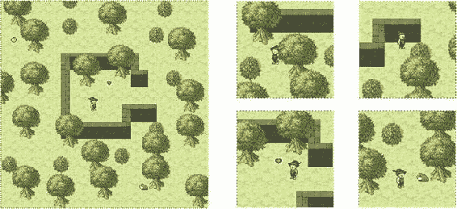

### 图 2-1. 帮助精灵在游戏世界中收集物品

所有游戏对象都具有正确的深度层级，虽然墙壁、树木和灌木丛会阻挡精灵的道路，但他可以像在真实的 3D 空间中一样绕过它们。如果仅使用纯代码来绘制对象的位置和深度，创建如此复杂的布局将相当困难——因此，这是 `Tiled Editor` 的完美用武之地！

## 选择你的图像

首先要从包含游戏图形的图块集开始。

### 注意

# 图块集与地图创建

图块集，也称为精灵表，是将所有游戏图像作为子图像包含在单个图像中。

你需要使用图形编辑器（如 Illustrator、Pixelmator、Photoshop、Gimp 或 Piskel）创建游戏图形，然后使用 Shoebox 或 Texture Packer 等工具打包。

整个滚动游戏世界仅使用了图 2-2 中所示的少量图像构建而成。完成的游戏世界看起来很复杂，但使用这个图块集仅用了几分钟就拼凑完成了。大多数精灵图像是 64 x 64 像素，但右上角较小的图像是 32x32 像素。大树是 128x128 像素。你可以混合搭配任意大小的精灵图像，但如果将它们保持在 2 的幂次方大小（`8x8`、`16x16`、`32x32` 等），你的工作会轻松得多。

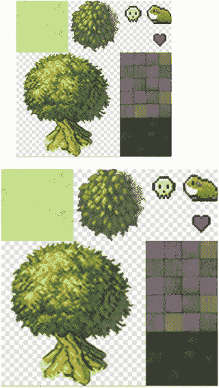

### 图 2-2. 从一个图块集开始

你可以看到，该图块集包含了关卡中除一个角色之外的所有精灵：精灵角色。这是因为我们稍后会直接在游戏代码中添加这个动画精灵。（你将在后续步骤中看到如何操作）。

## 创建地图

**地图** 是 Tiled Editor 对你正在创建的游戏屏幕布局的称呼。它只是一个由单元格组成的矩形网格。我们在本章中创建的游戏地图是一个 24 x 24 的单元网格，每个单元宽高均为 32 像素。这意味着整个地图的宽度和高度为 768 像素。

要在 Tiled Editor 中创建新地图，请从菜单中选择“文件 ➤ 新建”。将出现“新建地图”对话框，让你设置地图属性，如图 2-3 所示。对于平面的 2D 地图，选择`正交`方向。选择 CSV 图层格式，以便地图信息以数组形式输出。同时，保持 Tile 渲染顺序的默认值“右下”。然后，设置地图的宽度和高度（以图块为单位），然后定义每个图块的宽度和高度。如果你的图块集包含不同大小的图像，请将图块高度和宽度设置为*最小*图像的大小。在此示例中，图块集上最小的图像是 32x32 像素。完成后选择“确定”。

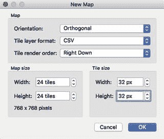

### 图 2-3. 设置地图属性

### 注意

本书使用的是写作时最新的 `Tiled Editor` 版本 0.15.0。你使用的版本可能在组织方式、布局和输出上略有不同，因此请将这些细节视为通用指南，并根据实际情况自行判断如何应用。

接下来，加载你的图块集。点击 Tiled Editor 工作区右侧 `图块集` 面板中的 `新建图块集` 按钮。为你的图块集命名，并将 `类型` 设置为“基于图块集图像”。浏览到图块集所在位置，并定义每个图块的高度和宽度。同样，将此高度和宽度设置为你最小精灵图像的大小。在本示例中，我将图块集命名为“fantasy”，并将图块宽度和高度设置为 32 像素，如图 2-4 所示。如果你的图块集中每个图像周围有间距（内边距），请在此处输入间距数值。（像 Texture Packer 这类软件生成的图块集会在每个子图像周围添加两个像素的默认内边距）。完成后点击 `确定`。

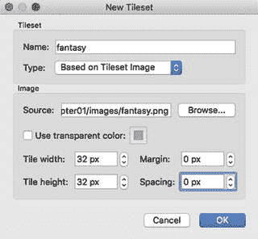

### 图 2-4. 设置图块集

### 注意

如果需要，你可以为每个关卡使用多个图块集，并且图块集可以是任意大小。你也可以选择不使用图块集，而是通过选择 `类型` 选项中的“基于图像集合”来使用单独的图像文件构建游戏。这使得 Tiled Editor 成为一个极其灵活的布局工具。

完成后，你会看到你的图块集加载到 `图块集` 面板中，如图 2-5 所示。

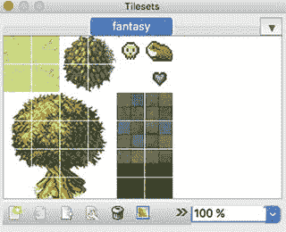

### 图 2-5. 加载你的图块集

## 设置图像属性

你可以为图块集上的每个图像创建并设置属性，并且你可以在游戏代码中访问所有这些属性。在本示例中，我想为骷髅头、心脏和土拨鼠图像分配名称。以下是如何为每个图像分配名称：

1.  点击一个图像，找到 `属性` 面板中的 `自定义属性` 部分。

2.  创建一个名为 `name` 的新属性，并为该图像指定一个名称。

我将这些图像分别命名为“skull”、“marmot”和“heart”，如图 2-6 所示。在本章后面，你将看到如何在游戏代码中将此信息作为对象属性进行访问。

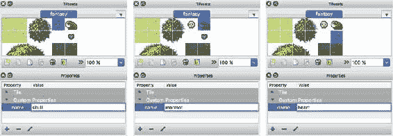

### 图 2-6. 设置可选的图像属性

## 使用图层

现在你可以开始构建地图了！Tiled Editor 允许你创建**图层**，以便在游戏世界的不同元素之间进行组织。在一个简单的地图中，你可能有一个名为 `maze` 的图层，其中包含迷宫的所有墙壁，以及另一个名为 `enemies` 的图层，其中包含游戏中的所有敌人。我们在此示例中构建的地图稍微复杂一些，因为我们使用图层来帮助创建浅 3D 效果。我们的地图使用六个图层，从地面开始，垂直向上，一直到树梢：

*   `ground（地面）`：草地。该图层用于放置精灵脚下的事物。

*   `obstacles（障碍物）`：树木的底部、灌木丛的底部和墙壁的底部。这些是精灵脚以上但头部以下的事物。

*   `items（物品）`：心脏、骷髅头和土拨鼠。这些东西也大约处于中等高度。

*   `objects（对象）`：精灵。它也处于中等高度，但应显示在物品的前面。

*   `wallTops（墙顶）`：墙壁的顶部。这些位于精灵头部上方。

*   `treeTops（树顶）`：树木的顶部。这些位于墙壁顶部上方。

图 2-7 显示了游戏中的一个场景，你可以同时看到所有这些深度图层。你能将每个图层与最终场景中的对应部分匹配起来吗？你是否注意到上层的事物覆盖了下层的事物？

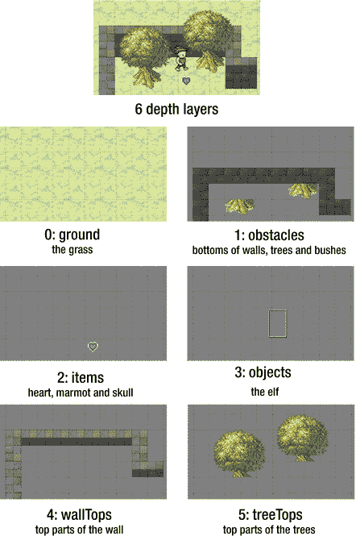

### 图 2-7. 构成此场景的所有精灵已被组织成 6 个深度图层

### 注意

这种伪 3D 效果有时被称为 2.5D。就像你坐在椅子上，俯视着游戏发生的桌面。精灵本身是平面的，像一张张纸，但如果它们靠近屏幕底部，看起来就离我们更近；如果靠近屏幕顶部，看起来就更远。

通过根据从底部到顶部的深度来组织图层，我们可以轻松地创造出深度的错觉。离观察者更近的精灵会遮挡住那些更远的精灵。

通过点击图 2-8 中 `图层` 面板的 `新建图层` 按钮来创建这六个图层。

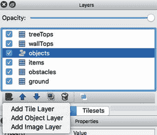

### 图 2-8. 创建一些地图图层

从 `新建图层` 按钮菜单中可以看出，你可以创建三种类型的图层：`Tile`（图块）、`Object`（对象）和 `Image`（图像）图层。

*   `Tile Layer（图块图层）`：使用矩形图块来构成这类图层。这非常适合固定网格布局，大多数 2D 游戏关卡都是这样设计的。图块图层上的任何内容最终都会形成一个图像 ID 代码数组。在本示例中，除了精灵之外的所有内容都是在 `Tile` 图层上创建的。

*   `Object Layer（对象图层）`：用于应该自由放置而不是固定在刚性网格系统中的精灵。它也适用于放置当前图块集中没有的对象，或者稍后由代码生成的对象。你还可以使用对象图层来添加非可视的游戏元素，这些元素可在游戏中提供一些有用的数据。`Object` 图层上的任何内容在最终的 JSON 文件中都将被描述为一个 JavaScript 对象。在本示例中，精灵角色将位于对象图层上。

*   `Image Layer（图像图层）`：用于放置单个图像。使用 `图层属性` 面板中的 `图像` 字段来浏览图像或设置其 URL。当你将地图导出为 JSON 文件时，此信息将生成图像文件的路径及其 `x` 和 `y` 像素坐标。

### 注意

通过使用对象和图像图层，Tiled 成为任何类型游戏（不仅仅是基于图块的游戏）的非常灵活的视觉布局编辑器。关于需要多少层、精灵的大小和形状，或者每种图层类型上应该放置什么类型的事物，没有固定规则。只需使用对你的游戏类型有意义的任何组织系统即可。

我们现在准备开始设计地图。

## 构建地图

我们将从最底层（地面）开始，然后逐层向上。

选择 `ground（地面）` 图层，点击草地图块，然后使用油漆桶工具用草地填充关卡，如图 2-9 所示。

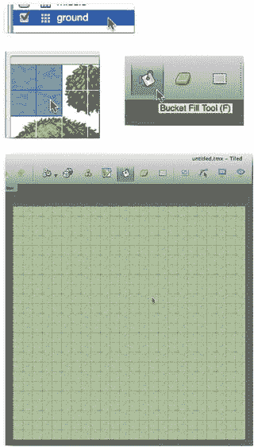

### 图 2-9. 使用油漆桶工具用草地填充关卡

接下来是 `obstacles（障碍物）` 图层。这些是阻止精灵角色移动的事物。你可以将 `obstacles` 图层上的任何事物视为迷宫的墙壁。这包括树干、墙壁底部和灌木丛底部。

按住 `command` 或 `ctrl` 键可同时选择多个图块图像。选择 `图章` 工具，并使用它将精灵图像印到关卡上。使用 `橡皮擦` 工具修正任何错误。参见图 2-10。

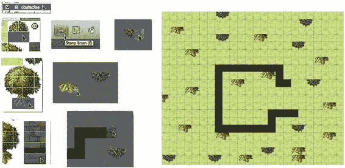

### 图 2-10. 添加障碍物

接下来，添加道具层。这些是精灵能够拾取的东西。我们在道具层只需要三样东西：心形、骷髅头和土拨鼠。使用印章工具将这些添加到图层中，如图 2-11 所示。

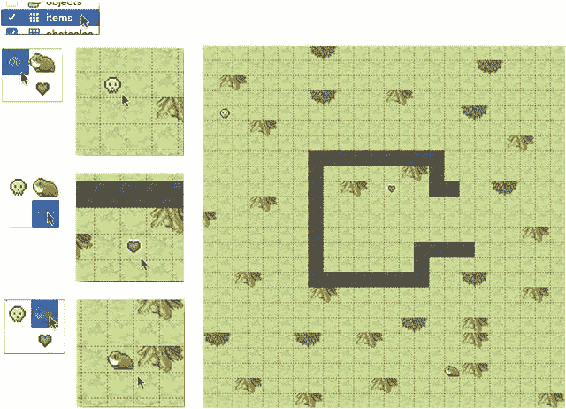

### 图 2-11. 添加可收集物品

接下来是对象层。我们将在这里添加精灵角色——以数据对象的形式。精灵没有在瓦片集中用图片表示，因为稍后我们将通过代码将其构建为一个复杂的动画精灵。你可以用一个简单的精灵占位图，并以我添加其他图片相同的方式将其添加到地图中，但我想借此机会向你展示 Tiled Editor 的对象是如何工作的。

从图 2-12 中可以看到，精灵所在的图层类型叫做 `objects`。这是一种特殊的图层，允许你自由放置物品，而无需将它们吸附到网格上。它还允许你为对象指定自定义的宽度和高度。这意味着你可以放置任意大小的对象，并精确指定其屏幕坐标中的 `x` 和 `y` 值。对象图层上的内容在导出的 JSON 文件中将以 JavaScript 对象数组的形式呈现，并且你可以为每个对象赋予一组独一无二的属性。

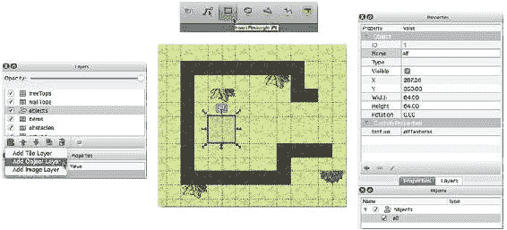

### 图 2-12. 添加一个对象并为其设置属性

要向对象图层添加内容，请使用某个形状工具，然后在希望对象出现的位置绘制形状。上下文相关的“属性”面板将显示你正在创建的新对象的属性。Tiled Editor 的对象有一些默认属性，例如位置和大小，这些属性与我们在本书中使用的精灵对象的属性非常接近。在这个例子中，我将对象名称设置为 `"elf"`，并将其宽度和高度设置为 64 像素。你可以根据需求更改或添加任意数量的其他属性，所有这些属性都将在最终的游戏代码中访问得到。任何你以这种方式创建的对象，都可以从 Tiled Editor 便捷的“对象”面板中访问。

还有两个图层需要添加：`wallTops` 和 `treeTops`，如图 2-13 所示。

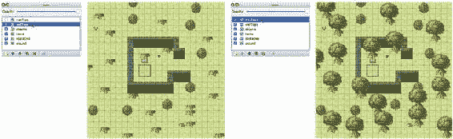

### 图 2-13. 添加墙壁顶部和树冠

现在，大功告成！

## 理解 JSON 地图数据

当你完成地图构建后，请按照以下步骤将地图保存并导出为 JSON 数据：

1.  从主菜单中选择 `文件` ➤ `另存为...`，将文件保存为 Tiled Editor 自有的 TMX 格式。

2.  选择 `地图` ➤ `地图属性...`。在属性面板中找到 `瓦片图层格式` 属性，并选择 `CSV`。CSV（逗号分隔值）选项会将地图图层导出为数字数组，这正是我们需要的。

3.  通过选择 `文件` ➤ `导出为...` 将地图数据导出为 JSON，并选择 `JSON` 作为文件类型。

4.  现在我们有了一个包含潜在有用地图数据的 JSON 文件，但我们该如何使用它呢？

重要的是要记住，地图中的每个图层都以数组形式表示。这意味着 JSON 文件将至少包含六个数组。其中五个数组包含的是瓦片集帧 ID 代码。还有一个数组代表对象图层，它是一个对象数组。JSON 文件还会提供关于地图、瓦片的高度和宽度，以及所有瓦片属性的信息。所有这些额外信息都包含在拥有自己子数组的子对象中。数据量很大，如果你是第一次打开 JSON 数据文件，可能会被眼前的内容搞得不知所措。别让它吓到你！你很快就会发现，它的结构非常合乎逻辑，一旦理解了它，在游戏程序中使用所有这些数据就会变得很容易。

### 注意

Tiled Editor 的数据输出已成为游戏设计行业的事实标准，因此学习其结构以及如何将其整合到你自己的游戏中，是一项值得长期投入的技能。

我们尽量保持简单，先从安全距离审视一下 JSON 文件的总体结构。下面是一个简略版本，展示了最重要的属性。

```
{
  //地图的属性            
  "backgroundcolor": "#ffffff",
  "height": 24,
  "nextobjectid": 2, //仅供 Tiled Editor 内部使用
  "orientation": "orthogonal",
  "properties": {/* 你可能设置的任何自定义属性 */},
  "renderorder": "right-down",
  "tileheight": 32,
  "tilewidth": 32,
  "version": 1,
  "width": 24,

  //`layers` 属性是一个对象数组。每个对象都包含            
  //另一个数组，该数组代表该图层的地图数据。图层            
  //对象还包含图层属性，包括其名称、类型和大小            
  "layers":[
    {"data": [1, 2, 1, 2, 1, 2, ...], //图层属性...},
    {"data": [0, 0, 0, 0, 0, 0, ...], //图层属性...},
    {"data": [0, 0, 0, 0, 0, 0, ...], //图层属性...},
    {"objects": [{"name":"elf", //...更多对象属性...}], //图层属性...},
    {"data": [0, 0, 0, 0, 0, 0, ...] ], //图层属性...},
    {"data": [19, 20, 21, 22, 0, ...], //图层属性...},
  ],

  //`tilesets` 属性是一个对象数组。每个对象            
  //代表地图中使用的一个瓦片集。（本例中我们只用了            
  //一个。）这些对象包含默认的瓦片集            
  //属性，以及自定义属性，比如精灵图像名称            
  "tilesets":[
    { //...瓦片集属性，例如每个瓦片的宽度和高度。
      //我们设置的自定义瓦片名称属性：
      "tileproperties": {
        "11": {"name": "heart"},
        "4": {"name": "skull"},
        "5": {"name": "marmot"}
      },
    }
  ]
}
```

大部分地图数据，即那些实际告诉你地图每个单元格中内容的数据，都位于每个图层对象的 `"data"` 属性中。让我们看看第一个图层对象内部是什么：

```
{
  "data":[
      1,2,1,2,1,2,1,2,1,2,1,2,1,2,1,2,1,2,1,2,1,2,1,2,
      7,8,7,8,7,8,7,8,7,8,7,8,7,8,7,8,7,8,7,8,7,8,7,8,
      1,2,1,2,1,2,1,2,1,2,1,2,1,2,1,2,1,2,1,2,1,2,1,2,
      7,8,7,8,7,8,7,8,7,8,7,8,7,8,7,8,7,8,7,8,7,8,7,8,
      ...等等。
    ],
   "height": 24,
   "name": "ground",
   "opacity": 1,
   "type": "tilelayer",
   "visible": true,
   "width": 24,
   "x": 0,
   "y": 0
},
```

你可以看到，它包含一些有用的属性，比如图层的名称和类型。`data` 数组是一个包含 576 个数字的列表，这些数字代表该图层上的所有瓦片（24x24 瓦片 = 576）。这些数字被称为 `网格 ID` 或 `gid`，每个数字都指向瓦片集中的一张图片。Tiled Editor 从左到右对瓦片集中的每张图片进行编号，从 1 开始。图 2-14 显示了前 12 个瓦片集图像的网格 ID。你可以看到，1、2、7 和 8 与草地瓦片相匹配。`data` 数组使用这些数字来表示每个图层的视觉布局。

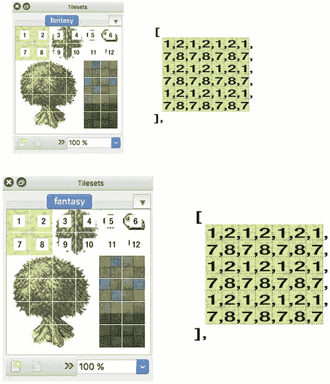

### 图 2-14. 网格编号用于在数组中表示精灵图像

在我们的地图中，创建了五个图块层和一个对象层。对象层包含一个名为 `objects` 的数组，在本例中该数组只包含一个对象：精灵。你可以看到，我们为精灵分配的所有属性（如其名称和尺寸）都可以作为此数组中的一个对象来访问。

# 使用 JSON 数据构建关卡

JSON 数据并不关心我们想用它制作什么样的游戏，也不关心你使用的是什么技术。你可以用同样的数据制作基于 Objective-C、Haxe、Unity 或 Elm 的游戏。这意味着你需要编写一个函数来解释这些数据，并决定应如何使用它来构建游戏关卡。如何处理这些数据完全由你决定。

## 决定如何使用数据

从哪里开始？根据你想制作的游戏类型，制定一系列关于如何解释所有这些数据的规则。对于我想制作的奇幻角色扮演游戏，我提出了以下要求：

*   整个游戏世界将包含在一个名为 `world` 的**容器组**中。“容器组”只是我用来描述包含嵌套子**精灵**的对象的术语。（回忆一下，精灵就是构成游戏世界的交互式图像）。

*   每个图块集层也应该是 `world` 容器内的一个独立组。这里有五个图块集层，这意味着最终会有五个组：`ground`、`obstacles`、`items`、`wallTops` 和 `treeTops`。所有这些层都有一个 `name` 属性，我会将该名称属性分配给层组，以便稍后访问。

*   对象层上的任何内容都应作为一个简单的 JavaScript 对象返回给游戏。之后我可以决定如何使用该对象中的数据。如果需要，我会使用对象的 `name` 属性来访问它。在当前示例中只有一个对象：精灵。

*   层内的所有图像都将被创建为精灵。

*   我需要一种方法来引用我在世界中创建的所有对象。我将添加两个搜索函数，允许我通过名称搜索对象。`world.getObject("name")` 将检索与所查找对象的 `name` 属性匹配的单个对象。它可以是精灵、层组或数据对象。`world.getObjects("elf", "obstacles", "marmot")` 返回一个对象数组，其名称与参数中的名称相匹配。

*   为了尽可能保持简单，我将限制每个地图只使用一个图块集。

这是我提出的要求列表，但你的要求可能会根据你所制作的游戏类型以及所需的灵活性而有所不同。

### 游戏代码 API

在我们探讨如何实现这些规则之前，让我们先看看完成后的 API 会是什么样子。我将能够像这样创建一个新的游戏世界：

```
let world = makeTiledWorld(data.json, tileset.png);
```

然后世界将神奇地出现，完全就像我在 Tiled Editor 中设计的那样。如果我想从世界中检索一个层组、精灵或对象，可以这样做：

```
let elf = world.getObject("elf");
```

我可以像这样将一组对象作为一个数组来检索：

```
let items = world.getObjects("heart", "skull", "marmot");
```

如果我有多个精灵共享相同的图块集名称属性，我也可以将它们全部检索到一个数组中。例如，如果我有一个名为 “wall” 的图块集图像，并且在世界中使用了这个图像 20 次，我可以像这样将所有墙精灵检索到一个数组中：

```
let walls = world.getObjects("wall");
```

这是一个简单的 API，对于大多数类型的游戏来说，它足以提供我所需的灵活性。

那么，如何实现这一切呢？

## 编写 `makeTiledWorld` 函数

我可以编写一个名为 `makeTiledWorld` 的函数来完成所有工作。关于代码如何工作的所有细节都包含在注释中，但我将在代码清单之后重点介绍几个重要特性。

### 注意

此代码清单展示了 Hexi 游戏引擎如何实现 `makeTiledWorld`，其中包含一些你应该了解的具体实现细节。`Container` 和 `Sprite` 是 PixiJS 对象。Pixi 的资源加载器用于加载 JSON 文件。（Hexi 使用 PixiJS 作为其底层渲染引擎和资源加载器）。`frame` 函数是 Hexi 引擎内置的一个自定义函数，用于从单个父图像中捕获矩形子图像。你需要在你所使用的任何技术中找到这些细节的等效实现。

---

以下是原始文本中关于数据结构的说明部分，已按要求排版：

```
{
  "draworder": "topdown",
  "height": 24,
  "name": "objects",
  "opacity": 1,
  "type": "objectgroup",
  "visible": true,
  "width": 24,
  "x": 0,
  "y": 0,
  "objects":[
    {
      "height": 64,
      "name": "elf",
      "properties": {/* 任何自定义属性 */},
      "rotation": 0,
      "type": "",
      "visible": true,
      "width": 64,
      "x": 287,
      "y": 350
    }]
}
```

最后，还有一个名为 `tilesets` 的数组，它代表了用于构建此关卡的所有图块集。每个图块集都表示为一个对象，在本示例中我们只使用了一个图块集：

```
"tilesets":[
  {
    "columns": 6,
    "firstgid": 1,
    "image": "../images/fantasy.png",
    "imageheight": 192,
    "imagewidth": 192,
    "margin": 0,
    "name": "fantasy",
    "properties": {/* 任何自定义属性 */},
    "spacing": 0,
    "tilewidth": 32,
    "tileheight": 32,
    "tileproperties": {
      "11": {"name": "heart"},
      "4": {"name": "skull"},
      "5": {"name": "marmot"}
    }
  }
]
```

可以看到，我们为 heart、skull 和 marmot 分配的自定义名称属性位于 `tileproperties` 子对象中。注意，它们的 ID 编号比图块集中的网格编号小 1。

### 注意

这些数字相差 1 是有一定逻辑的，但只有当你使用多个图块集来制作地图时才能体会到这一点。如果你确实使用了多个图块集，请继续阅读！`tileproperties` 中使用的 ID 编号是 Tiled Editor 所称的图块集中图块的“本地”ID。这些本地 ID 从 0 开始编号。数据数组中使用的 ID 则是“全局”图块 ID。这些全局 ID 可以跨越多个图块集。这意味着第一个图块集可能从 1 开始编号，第二个图块集可能从 32 开始，而第三个可能从 96 开始（0 保留给“无图块”）。你可以使用每个本地图块集的 `firstgid` 属性来确定全局 ID 应来自哪个图块集。然后，通过减去 `firstgid`，你可以将其映射为该图块集中的本地 ID。但如果只使用单个图块集，直接减 1 即可，因为这就是第一个图块集的 `firstgid`。有点困惑？别担心！只有当你使用多个图块集创建第一个地图时，这一切才会开始变得有意义。

现在所有这些数据对你来说开始有意义了吗？如果你和我一样，你那小小的程序员之心一定会欣喜若狂！因为你知道这些都是非常有价值的东西。你可以利用所有这些数据，自动生成所有精灵并布局游戏地图。那么，我们该如何深入利用它呢？

```javascript
makeTiledWorld(jsonTiledMap, tileset) {
  //获取 JSON 文件的引用
  let tiledMap = PIXI.loader.resources[jsonTiledMap].data;

  //创建一个名为 `world` 的容器组，用于包含来自 `tiledMap` 的所有图层、精灵
  //和对象。`world` 对象将在 `makeTiledWorld`
  //函数完成后返回给主游戏程序
  let world = new Container();

  //设置构成地图的每个图块的宽度和高度。
  //（本例中图块大小为 32x32 像素）
  world.tileheight = tiledMap.tileheight;
  world.tilewidth = tiledMap.tilewidth;

  //计算世界的 `width` 和 `height`，单位为像素
  world.worldWidth = tiledMap.width * tiledMap.tilewidth;
  world.worldHeight = tiledMap.height * tiledMap.tileheight;

  //获取世界（以图块计）的高度和宽度引用，
  //以备后续使用（你会用到的！）
  world.widthInTiles = tiledMap.width;
  world.heightInTiles = tiledMap.height;

  //创建一个 `objects` 数组，用于存储对地图中任何
  //命名对象的引用。命名对象都具有
  //在 Tiled Editor 中分配的 `name` 属性
  world.objects = [];

  //每个图块周围的可选间距（填充）
  //这部分是为了解决图块周围的间距问题，
  //该间距在使用纹理图集图块集时很常见。在 Tiled Editor 中创建新地图时设置
  //`spacing` 属性
  let spacing = tiledMap.tilesets[0].spacing;

  //计算图块集上有多少列。
  //这等于图像的宽度除以每个图块的宽度，
  //再加上每个图块周围可能有的可选间距
  let numberOfTilesetColumns =
    Math.floor(
      tiledMap.tilesets[0].imagewidth
      / (tiledMap.tilewidth + spacing)
    );

  //遍历所有地图图层
  tiledMap.layers.forEach(tiledLayer => {
    //为此图层创建一个容器组，并复制
    //该图层的所有属性到该组上
    let layerGroup = new Container();

    Object.keys(tiledLayer).forEach(key => {
      //将图层的所有属性添加到组中，但不包括
      //宽度和高度（因为容器组会根据其内容自行计算这些值）
      if (key !== "width" && key !== "height") {
        layerGroup[key] = tiledLayer[key];
      }
    });

    //将 Tiled Editor 的 `opacity` 属性转换为 Container 的
    //等效 `alpha` 属性
    layerGroup.alpha = tiledLayer.opacity;

    //将该组添加到 `world`
    world.addChild(layerGroup);

    //将该组推入 `world` 的 `objects` 数组
    //以便稍后可以访问它
    world.objects.push(layerGroup);

    //当前图层是 `tilelayer` 吗？
    if (tiledLayer.type === "tilelayer") {
      //遍历该图层的 `data` 数组
      tiledLayer.data.forEach((gid, index) => {
        let tileSprite, texture, mapX, mapY, tilesetX, tilesetY,
            mapColumn, mapRow, tilesetColumn, tilesetRow;

        //如果网格 ID 号（`gid`）不为零，则创建一个精灵
        if (gid !== 0) {
          //计算出我们当前所在的地图列和行号，然后
          //计算网格单元的 x 和 y 像素位置
          mapColumn = index % world.widthInTiles;
          mapRow = Math.floor(index / world.widthInTiles);
          mapX = mapColumn * world.tilewidth;
          mapY = mapRow * world.tileheight;

          //计算出图块集图像所在的列和行号，
          //然后使用这些值计算该图像在图块集上的
          //x 和 y 像素位置
          tilesetColumn = ((gid - 1) % numberOfTilesetColumns);
          tilesetRow = Math.floor((gid - 1) / numberOfTilesetColumns);
          tilesetX = tilesetColumn * world.tilewidth;
          tilesetY = tilesetRow * world.tileheight;

          //补偿图块周围可能存在的任何可选间距（填充），
          //如果有的话。这段代码会累积从图块集左侧开始的间距偏移量，
          //并将它们添加到当前图块的位置中
          if (spacing > 0) {
            tilesetX
              += spacing
              + (spacing * ((gid - 1) % numberOfTilesetColumns));
            tilesetY
              += spacing
              + (spacing * Math.floor((gid - 1) / numberOfTilesetColumns));
          }

          //使用上述值从图块集图像创建精灵的图像。
          //自定义的 `frame` 方法从图块集中捕获正确的图像
          texture = frame(
            tileset, tilesetX, tilesetY,
            world.tilewidth, world.tileheight
          );

          //我已决定任何具有 `name` 属性的图块都很重要
          //并且应该在 `world.objects` 数组中可访问
          let tileproperties = tiledMap.tilesets[0].tileproperties,
              key = String(gid - 1);

          //如果 JSON 的 `tileproperties` 对象有一个与当前图块匹配的子对象，
          //并且该子对象有一个 `name` 属性，
          //则创建一个精灵并将图块属性赋值给
          //该精灵
          if (tileproperties[key] && tileproperties[key].name) {
            //创建一个精灵
            tileSprite = new Sprite(texture);

            //将该图块的所有属性复制到精灵上
            //（包括 `name` 属性）
            Object.keys(tileproperties[key]).forEach(property => {
              tileSprite[property] = tileproperties[key][property];
            });

            //将该精灵推入 `world` 的 `objects` 数组
            //以便稍后可以通过 `name` 访问它
            world.objects.push(tileSprite);
          }
          //如果图块没有 `name` 属性，则仅用它
          //创建一个普通精灵（它只需要一个纹理）
          else {
            tileSprite = new Sprite(texture);
          }

          //将精灵放置在地图上
          tileSprite.x = mapX;
          tileSprite.y = mapY;

          //记录该精灵在数组中的索引号
          //（我们将用它进行碰撞检测，你将在下一章学习）
          tileSprite.index = index;

          //记录该精灵在图块集上的 `gid`。
          //这对后续的碰撞检测也很有用
          tileSprite.gid = gid;

          //将该精灵添加到当前图层组
          layerGroup.addChild(tileSprite);
        }
      });
    }

    //我们现在已经处理完图块图层，让我们继续！

    //这一层是 Tiled Editor 的 `objectgroup` 吗？
    if (tiledLayer.type === "objectgroup") {
      tiledLayer.objects.forEach(object => {
```

## 搜索函数

我们只是要获取对象的属性，以便后续决定如何处理它。获取对象所在图层组的引用：

`object.group = layerGroup;`

将对象推入世界的 `objects` 数组：

`world.objects.push(object);`

`world.getObject` 和 `world.getObjects`（带"s"的版本）用于搜索并返回 `world.objects` 数组中的任何精灵或对象。任何在 Tiled Editor 中具有 `name` 属性的对象都会出现在搜索结果中。`getObject` 返回单个对象，`getObjects` 返回对象数组。`getObject` 实际返回搜索函数本身，因此你可以使用以下格式直接访问单个对象：

`sprite.x = world.getObject("anySprite").x;`
`sprite.y = world.getObject("anySprite").y;`

```javascript
world.getObject = objectName => {
    let searchForObject = () => {
      let foundObject;
      world.objects.some(object => {
        if (object.name && object.name === objectName) {
          foundObject = object;
          return true;
        }
      });
      if (foundObject) {
        return foundObject;
      } else {
        throw new Error("没有名称为 " + objectName + " 的对象");
      }
    };

    // 返回搜索函数
    return searchForObject();
};

world.getObjects = objectNames => {
    let foundObjects = [];
    world.objects.forEach(object => {
      if (object.name && objectNames.indexOf(object.name) !== -1) {
        foundObjects.push(object);
      }
    });
    if (foundObjects.length > 0) {
      return foundObjects;
    } else {
      throw new Error("找不到这些对象");
    }
    return foundObjects;
};
```

就这样，我们完成了！最后，将 `world` 对象返回给游戏程序：

`return world;`

（你可以在本章源文件的 Hexi `src` 文件夹的 `tileUtilities` 模块中找到 `makeTiledWorld` 的完整工作代码）。

这段代码通过遍历 JSON 数据中的所有数组，并利用这些信息来创建精灵并将它们放置在 `world` 中。但有一个重要的细节需要指出。每个精灵都创建了两个新属性：`index` 和 `gid`。

```javascript
tileSprite.index = index;
tileSprite.gid = gid;
```

`index` 是精灵在地图数组中的数组位置编号。`gid` 是精灵纹理图像在瓦片集上的网格 ID 编号。这两个属性在后续碰撞检测中会非常有用，你将在第 3 章中找到具体用法。敬请期待！

现在让我们了解如何使用 `makeTiledWorld` 来构建游戏。

## 创建游戏世界

查看本章源文件中的 `fantasy.js` 文件，可以找到我们创建的游戏世界的工作示例。图 2-15 将左侧最终渲染的地图与我们最初在 Tiled Editor 中设计的地图进行了对比。

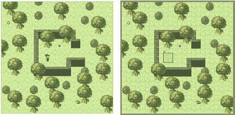

### 图 2-15. 渲染后的游戏世界与我们用 Tiled Editor 设计的地图一致

使用键盘方向键让精灵在游戏世界中行走，你会注意到精灵的深度层次也是正确的。让我们了解 `makeTiledWorld` 函数是如何构建这个场景的。

### 创建精灵

当游戏代码的 `setup` 函数运行时，世界会通过 `makeTiledWorld` 从 JSON 文件和瓦片集图像中创建。

```javascript
world = g.makeTiledWorld(
    "maps/fantasy.json",
    "images/fantasy.png"
  );
```

这会生成地图，并让我们通过一个名为 `world` 的对象访问所有地图数据。

动画精灵角色是使用另一张名为 `walkcycle.png` 的瓦片集图像创建的，该图像包含精灵的所有动画帧，如图 2-16 所示。

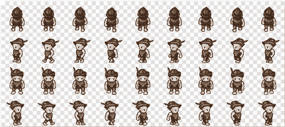

### 图 2-16. 精灵的动画瓦片集

以下是游戏 `setup` 函数中使用该动画瓦片集创建精灵的代码。

```javascript
elf = g.sprite(g.filmstrip("images/walkcycle.png", 64, 64));
```

自定义的 `filmstrip` 函数捕获 `walkcycle` 瓦片集中每个 64x64 像素的帧，并用它来初始化精灵。

你记得我们在 Tiled Editor 中创建了一个占位对象来代表精灵，并用它来设置精灵的 `x` 和 `y` 位置。接下来我们要做的是使用这些值来定位新的精灵。我们添加到 `world` 对象中的 `getObject` 方法能够从地图数据中提取任何具有 `name` 属性的内容。以下是使用 `getObject` 捕获精灵的 `x` 和 `y` 地图数据值，并将其应用于精灵的 `x` 和 `y` 位置属性的方法。

```javascript
elf.x = world.getObject("elf").x;
elf.y = world.getObject("elf").y;
```

这个新的精灵还不是世界的一部分，因此将其添加到世界的对象层。首先获取对象层的引用，然后使用 `addChild` 将精灵添加到其中。

```javascript
let objectsLayer = world.getObject("objects");
objectsLayer.addChild(elf);
```

游戏的其余部分负责移动精灵并使其动画化。它还实现了碰撞检测，你将在下一章全面了解其工作原理。

### 更改精灵的深度层

精灵可以在树木和墙壁后面及前面行走，且无需任何其他深度排序代码即可确保其正确显示。这怎么可能？因为后台运行的 PixiJS 渲染器会按照创建的先后顺序显示精灵——后创建的精灵显示在先创建的精灵之前。大多数 2D 渲染器都以相同方式工作。而且，由于我们是从最底层（地面）开始创建精灵，并逐层向上，因此 Tiled Editor 上层中的精灵会渲染在下层精灵的前面。这一切都是自动发生的，这得益于我们在 Tiled Editor 中设计图层时的精心规划，以及 `makeTiledWorld` 函数中创建精灵的顺序。

但如果在游戏进行过程中想要更改精灵的深度层，该怎么办？例如，也许精灵在某个地方发现了梯子，能够爬到墙壁顶部。如何让精灵显示在墙壁之上但在树冠之下？

获取 `"treeTops"` 图层组的引用，并将精灵添加到其中。

```javascript
world.getObject("treeTops").addChild(elf);
```

图 2-17 显示了结果。

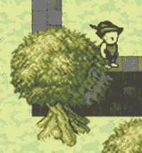

### 图 2-17. 更改精灵的深度层

既然我们有一个广阔的游戏世界可以探索，让我们添加滚动摄像头。

#### 滚动世界摄像机

我们的游戏地图远比显示它的游戏屏幕要大得多。但你会注意到，它会非常自然地滚动，以跟随精灵移动。在本节中，你将学习如何实现这种滚动游戏摄像机，从而运用这些概念为你的游戏构建类似的摄像机。

但在我们了解其制作方法之前，首先快速浏览一下你需要编写的高级游戏代码，以便创建和使用摄像机。首先，像这样在游戏世界中初始化摄像机：

```javascript
```

# 游戏摄像机

`camera = g.worldCamera(world, world.worldWidth, world.worldHeight, anyCanvasElement);`

第一个参数是一个包含`x`、`y`属性的精灵。第二和第三个参数以像素为单位定义游戏世界的宽度和高度。最后一个参数是渲染游戏世界的画布 HTML 元素。

摄像机对象有两个有用的方法可以用来控制它：`centerOver`和`follow`。你可以使用`centerOver`方法让摄像机自身居中于某个精灵之上，像这样：

```javascript
camera.centerOver(sprite);
```

使用以下方法让摄像机在游戏循环中跟随任何精灵，像这样：

```javascript
function gameLoop() {
  camera.follow(sprite);
}
```

摄像机有一个不可见的内部边界，其大小为画布尺寸的一半。你可以在图 2-18 的第一张图片中看到这个不可见的内部边界。精灵可以在这个边界内自由移动，只有当精灵越过边界时，摄像机才会开始移动。当摄像机到达地图边缘时会停止移动，但精灵可以一直走到地图边缘。图 2-18 展示了所有这些特性，从而产生了自然的滚动效果。

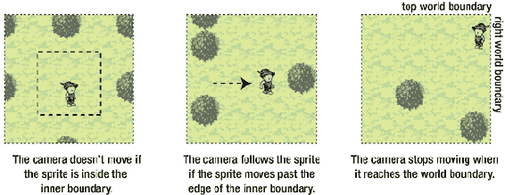

### 图 2-18. 一个让精灵在游戏世界中自由移动的滚动游戏摄像机

- 你可以将摄像机视为一种悬浮在世界上方的不可见精灵。它拥有`x`和`y`位置，以及高度和宽度。摄像机有一个名为`follow`的方法，可以改变摄像机的`x`和`y`坐标，以跟上它所跟随的任何精灵；还有一个名为`centerOver`的方法，可以将摄像机居中于任何精灵之上。它还会根据地图尺寸检查自身位置，以便在到达地图边缘时停止移动。

- 以下是实现所有这些功能的完整`worldCamera`函数。

```javascript
worldCamera(world, worldWidth, worldHeight, canvas) {
  //定义一个具有实用属性的 `camera` 对象
  let camera = {
    width: canvas.width,
    height: canvas.height,
    _x: 0,
    _y: 0,
    //`x` 和 `y` 的 getter/setter
    //当你改变摄像机的位置时，
    //它们会向相反方向移动世界的位置
    get x() {
      return this._x;
    },
    set x(value) {
      this._x = value;
      world.x = -this._x;
    },
    get y() {
      return this._y;
    },
    set y(value) {
      this._y = value;
      world.y = -this._y;
    },
    //摄像机的中心 x 和 y 位置
    get centerX() {
      return this.x + (this.width / 2);
    },
    get centerY() {
      return this.y + (this.height / 2);
    },
    //边界属性定义了一个矩形区域，其大小为游戏屏幕的一半
    //如果摄像机跟随的精灵位于此区域内，摄像机将不会滚动。如果精灵
    //越过此边界，后面的 `follow` 函数将改变
    //摄像机的 x 和 y 位置，以滚动游戏世界
    get rightInnerBoundary() {
      return this.x + (this.width / 2) + (this.width / 4);
    },
    get leftInnerBoundary() {
      return this.x + (this.width / 2) - (this.width / 4);
    },
    get topInnerBoundary() {
      return this.y + (this.height / 2) - (this.height / 4);
    },
    get bottomInnerBoundary() {
      return this.y + (this.height / 2) + (this.height / 4);
    },
    //接下来的代码定义了两个摄像机
    //方法：`follow` 和 `centerOver`
    //使用 `follow` 方法让摄像机跟随一个精灵
    follow: function(sprite) {
      //检查精灵相对于内部边界的位置。如果精灵
      //移出边界，则移动摄像机以跟随精灵
      if(sprite.x < this.leftInnerBoundary) {
        this.x = sprite.x - (this.width / 4);
      }
      if(sprite.y < this.topInnerBoundary) {
        this.y = sprite.y - (this.height / 4);
      }
      if(sprite.x + sprite.width > this.rightInnerBoundary) {
        this.x = sprite.x + sprite.width - (this.width / 4 * 3);
      }
      if(sprite.y + sprite.height > this.bottomInnerBoundary) {
        this.y = sprite.y + sprite.height - (this.height / 4 * 3);
      }
      //如果摄像机到达地图边缘，则停止其移动
      if(this.x < 0) {
        this.x = 0;
      }
      if(this.y < 0) {
        this.y = 0;
      }
      if(this.x + this.width > worldWidth) {
        this.x = worldWidth - this.width;
      }
      if(this.y + this.height > worldHeight) {
        this.y = worldHeight - this.height;
      }
    },
    //使用 `centerOver` 方法将摄像机居中于一个精灵之上
    centerOver: function(sprite) {
      //将摄像机居中于一个精灵之上
      this.x = (sprite.x + sprite.halfWidth) - (this.width / 2);
      this.y = (sprite.y + sprite.halfHeight) - (this.height / 2);
    }
  };
  //返回 `camera` 对象
  return camera;
};
```
