# 3. 基于瓦片的碰撞检测

Rex van der Spuy¹

(1)加拿大多伦多，安大略省

在游戏中检测碰撞主要有两种方式。第一种是比较屏幕上精灵的 x 和 y 像素位置。如果它们的形状重叠，则发生碰撞。这种碰撞检测策略称为**窄阶段碰撞**。如果你使用过带有类似 `hitTestRectangle` 或 `hitTestCircle` 等碰撞函数的游戏引擎来检查形状是否重叠，那么这些很可能就是窄阶段碰撞函数。它们使用向量数学（线性代数）来判断精灵的形状是否重叠。因此，你可以实现非常精确的像素级碰撞精度，这对于基于物理的动作游戏非常重要。

另一种检测碰撞的方式是使用基于瓦片的方法。**基于瓦片的碰撞**系统不使用几何学来检测碰撞。它所做的只是读取精灵在数组中的索引号。如果某个精灵位于数组地图中已被另一个精灵占据的位置，则发生碰撞。例如，如果一个精灵在地图上的位置与墙壁相同，那么你就知道该精灵碰到了墙壁。然后你可以设置某种碰撞反应，比如阻止精灵移动。

### 注意
基于瓦片的碰撞是一种**宽阶段碰撞**，你将在第 6 章中了解更多相关信息。

基于瓦片碰撞的一大优势是，你不必检查每个对象是否与其他所有对象发生碰撞，也无需进行任何几何计算。相反，你只需要读取一个数组。这使得它在 CPU 效率上远高于窄阶段碰撞测试。更重要的是，你可以为不同类型的事物（如“墙壁”、“敌人”或“物品”）设置少量通用的碰撞检查。即使地图上有数百个这样的元素，每种类型也只需运行一次碰撞检查。这使得基于瓦片的碰撞非常适合可能包含数百个同类元素的巨大游戏地图。并且由于基于瓦片的碰撞通过读取地图数组工作，你可以利用精灵在地图上的位置及其局部环境信息，用于 AI 或其他游戏逻辑。

基于瓦片碰撞的缺点是无法提供像素级精度。但事实证明，对于许多或大多数 2D 动作游戏来说，精确的像素级碰撞并非必要。基于瓦片的碰撞有一种独特“手感”：坚实、可预测，就像在玩一款真正的电子游戏。上世纪 70 和 80 年代整个 8 位和 16 位视频游戏革命都建立在基于瓦片的碰撞之上，它至今仍是你需要了解的最重要的视频游戏碰撞技术。

### 注意
既想要像素级精度，又想要瓦片级效率？你可以先使用基于瓦片的方法检查碰撞，兼得两者之长。然后，如果检测到一般性碰撞，再使用第二次窄阶段测试来获得进一步的像素级精度。你将在第 6 章中找到具体实现方法。

在本章中，你将通过一些经典的迷宫游戏示例，学习基于瓦片碰撞的基础知识。你将有机会了解如何使用瓦片编辑器构建一个平面 2D 视频游戏环境，以及如何使用地图数组分析该环境。我们还将为基于瓦片的游戏构建一个通用碰撞函数。最后，我们将把所有这些新技能应用到第 2 章的幻想 RPG 游戏原型中。

## 理解基于瓦片的碰撞

以下是进行基于瓦片碰撞所需了解的基础知识。在开始之前，你的精灵需要一个新的属性，名为 `index`：

```
playerSprite.index
```

`index` 只是一个数字，用于指示精灵在地图数组中的位置。

要找到这个数字，你需要将精灵的中心 x 和 y 屏幕位置转换为其对应的数组索引号。下面是一个通用的 `getIndex` 函数，你可以用来完成这项工作：

```
getIndex(x, y, tilewidth, tileheight, mapWidthInTiles) {
  //将像素坐标转换为地图索引坐标            
  let index = {};
  index.x = Math.floor(x / tilewidth);
  index.y = Math.floor(y / tileheight);
  //返回索引号            
  return index.x + (index.y * mapWidthInTiles);
};
```

下一步是找出游戏世界中可能位于同一位置的其他事物。例如，假设你有一个包含敌人位置的地图数组。你可以将其命名为 `enemyMapArray`。

```
enemyMapArray = [0, 0, 0, 5, 0, 0, 5, 0, /*...*/];
```

任何有敌人的位置都用数字“5”表示。任何没有敌人的位置都用“0”表示。这些数字称为**网格索引** ID 号，或简称为 **gid**。

你可以像这样找出 `playerSprite` 所在位置的 gid：

```
gid = enemyMapArray[playerSprite.index];
```

如果这个 gid 值是“5”，那么你就知道 `playerSprite` 与某个敌人位于同一位置。碰撞发生了！

```
if (gid === 5) {
    //碰撞！            
}
```

你现在知道 `playerSprite` 撞上了一个敌人。但具体是哪一个呢？

要弄清楚这一点，你的游戏需要一个数组来存储对所有敌人精灵的引用：

```
enemySprites = [enemySprite1, enemySprite2, enemySprite3, /*...*/ ];
```

这些精灵中的每一个也需要一个 `index` 属性，用于指示它们在 `enemyMapArray` 中的位置：

```
enemySprite1.index = 52;
enemySprite2.index = 3;
enemySprite3.index = 108;
//...
```

要找到玩家位置处的敌人精灵，请遍历 `enemySprites` 数组，找到与 `playerSprite` 具有相同 `index` 编号的那个。那就是 `playerSprite` 正在碰撞的敌人。

```
if (gid === 5) {
  enemySprites.some(enemy => {
    if (playerSprite.index === enemy.index) {
      //你找到了碰撞到的敌人精灵！            
    }
  });
}
```

## 总结

平铺地图编辑器是游戏设计者可以学习的最有用的软件工具之一。你已经学会了如何设置游戏地图；导入图块集；以及使用平铺地图编辑器的图层、对象和工具来设计你的游戏世界。你还学会了如何读取平铺地图编辑器的 JSON 地图数据，并使用这些数据构建可重用的代码，以制作各种不同的游戏。此外，你还发现了正确设置游戏对象深度层级，以及添加一个能够跟随游戏角色在世界中移动的摄像机是多么容易。

但是，我们还没结束！你会注意到，在本章的演示游戏中，当精灵角色在世界中行走时，它的路径会被树木、灌木丛和墙壁阻挡。并且，精灵可以拾取世界中的物体。这又是如何实现的呢？你将在下一章中了解，届时我们将详细探讨基于瓦片的游戏的碰撞检测。

© Rex van der Spuy 2017

Rex van der Spuy, 《高级游戏开发者工具包》, 10.1007/978-1-4842-1097-0_3

---

- （你可以在 `hexi/src/modules/gameUtilities/src/gameUtilities.js` 中找到 `worldCamera` 函数）。

- 可以看到，摄像机实际上只是一个数据模型，用于确定世界的哪一部分应该在画布上可见。摄像机将自身的大小和位置与它所跟随的精灵以及世界的边缘进行比较。

- 诀窍在于摄像机实际上从未移动。当你改变它的 `x` 和 `y` 位置时，它实际上是以相反的量移动世界的位置。

```
set x(value) {
  this._x = value;
  world.x = -this._x;
},
set y(value) {
  this._y = value;
  world.y = -this._y;
},
```

- 这使得摄像机看起来像是在世界中移动，而实际上它是在向相反方向移动世界。

以上就是基于瓦片碰撞的基础知识，接下来我们将了解如何在游戏中实现它们。

### 收集物品

让我们看一个非常实际的例子来演示这一点。运行 `simpleCollision.html` 文件，如图 3-1 所示，使用键盘方向键帮助外星人角色收集炸弹。每次外星人收集到一个炸弹，该炸弹就会从地图上消失。消息输出了外星人在屏幕上的 x 和 y 位置，以及其当前的地图索引号。

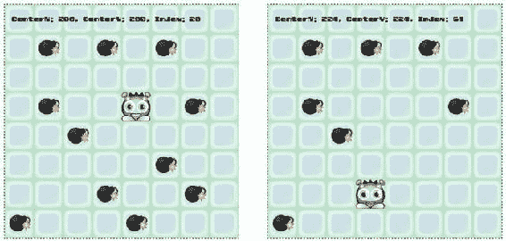

### 图 3-1. 使用基于瓦片碰撞的物品收集

### 设计游戏世界

在第 2 章中，你学习了如何使用瓦片编辑器快速设计游戏世界。本章中的所有示例游戏原型我都使用了相同的方法制作。我使用了三个图层：`backgroundLayer`（背景层）、`bombLayer`（炸弹层）和 `alienLayer`（外星人层），如图 3-2 所示。

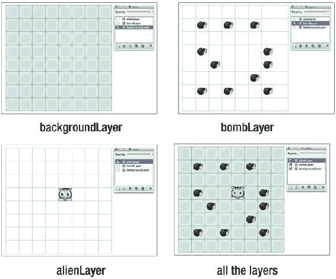

### 图 3-2. 三个地图图层

瓦片集中的外星人和炸弹图片都被赋予了名称属性值：“alien”和“bomb”，如图 3-3 所示。这将使我们稍后能够在游戏代码中轻松地使用 `world.getObject`（针对单个对象）和 `world.getObjects`（针对对象数组）来引用它们，正如你在前一章所学的那样。

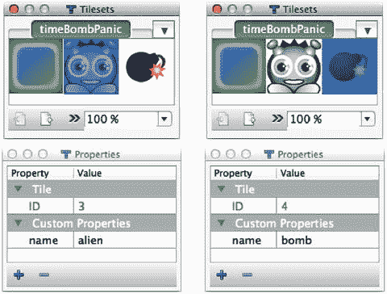

### 图 3-3. 为外星人和炸弹图片命名

### 初始化游戏世界

游戏代码会加载瓦片集图像以及 Tiled Editor 生成的 JSON 文件。`setup` 函数通过 `makeTiledWorld` 来创建世界。

```
world = g.makeTiledWorld(
  "maps/simpleCollision.json",
  "images/timeBombPanic.png"
);
```

这会在画布上绘制精灵和图层。在 Tiled Editor 中，我们为任何对象赋予的 `name` 属性，都可以在 `world.objects` 数组中访问到。我们可以通过 `world.getObject`（用于单个对象）或 `world.getObjects`（带“s”，用于对象数组）按名称获取对这些对象的引用。以下是获取外星人精灵引用的方法。

```
alien = world.getObject("alien");
```

我们的游戏还需要引用炸弹图层，以便访问它的 `data` 数组。

```
bombLayer = world.getObject("bombLayer");
bombMapArray = bombLayer.data;
```

现在，`bombLayer` 是一个容器，包含所有作为子精灵的炸弹。`bombMapArray` 是一个有用的数组，它告诉我们世界中所有炸弹的网格位置。（数组中的炸弹的 `gid` 数字将为 `5`）。

我们还需要一个包含所有炸弹精灵的数组，可以像这样从世界中获取：

```
bombSprites = world.getObjects("bomb");
```

`world.getObjects` 会搜索世界中的 `objects` 数组，并找到任何 `name` 属性为 `"bomb"` 的对象。在这个例子中，`"bomb"` 匹配了世界中的所有 11 个炸弹精灵。`bombSprites` 现在是一个数组，其中包含对每个这些精灵的引用。

现在，让我们了解如何使用炸弹地图数据来检测碰撞。

### 理解炸弹地图

`bombMapArray` 是一个有用的数字数组，与屏幕上炸弹精灵的位置相对应。你可以在图 3-4 中看到这一点。每个 `"5"` 代表一个炸弹，每个 `"0"` 代表一个空单元格。

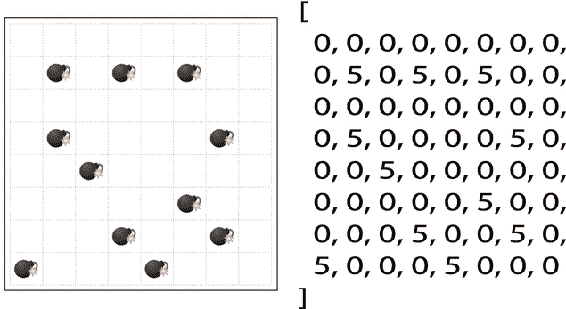

### 图 3-4. 与 Tiled Editor 中炸弹图层匹配的炸弹数组

当创建炸弹精灵时，每个新精灵都会被赋予自己的 `index` 属性。`index` 属性存储了炸弹在这个数组中的初始位置。

我们需要知道外星人角色是否与地图上的某个炸弹位于同一位置。为此，我们必须将外星人的中心 `x` 和 `y` 屏幕坐标转换为其对应的数组索引号。我们可以借助 `getIndex` 函数来完成此操作。

```
alien.index = getIndex(
  alien.centerX, alien.centerY,
  world.tilewidth, world.tileheight, world.widthInTiles
);
```

要判断外星人是否碰到了其中一个炸弹，需检查外星人的索引号是否与炸弹地图中的炸弹 `gid` 数字（`"5"`）匹配。

```
//找出外星人在炸弹数组中的位置是否与炸弹的 gid 数字匹配
if (bombMapArray[alien.index] === 5) {
  //如果匹配，则过滤炸弹精灵数组，找到
  //与外星人位置匹配的那个
  bombSprites = bombSprites.filter(bomb => {
    //这个炸弹精灵的索引号是否与外星人相同？
    if (bomb.index === alien.index) {
      //如果相同，则通过将炸弹的 gid 设置为 `0`
      //从 `bombMapArray` 中移除该炸弹
      bombMapArray[bomb.index] = 0;
      //从其容器组中移除该炸弹精灵
      g.remove(bomb);
      //从 `bombSprites` 数组中过滤掉该炸弹
      return false;
    } else {
      //如果不匹配，则将该炸弹保留在 `bombSprites` 数组中
      return true;
    }
  });
}
```

可以看到，如果外星人和炸弹共享相同的索引号，则它们一定占据了相同的地图位置。在这种情况下，通过将该位置的 `gid` 数字设置为 0，将炸弹从关卡的炸弹地图中擦除。

```
bombMapArray[bomb.index] = 0;
```

然后，使用一个名为 `remove` 的函数将炸弹精灵从游戏中移除。

```
g.remove(bomb);
```

游戏代码实际上维护着游戏中所有炸弹的实时地图。运行游戏，拾取几个炸弹，然后检查关卡的 `bombMapArray`（你可以在控制台中看到其输出）。你会注意到，每次拾取一个炸弹时，该单元格的 `gid` 值都会被设置为 `"0"`。炸弹已从地图上擦除。图 3-5 显示了在拾取了几个炸弹后，地图的 `bombMapArray` 看起来是什么样的。你可以看到，它与屏幕上炸弹的位置完美匹配。

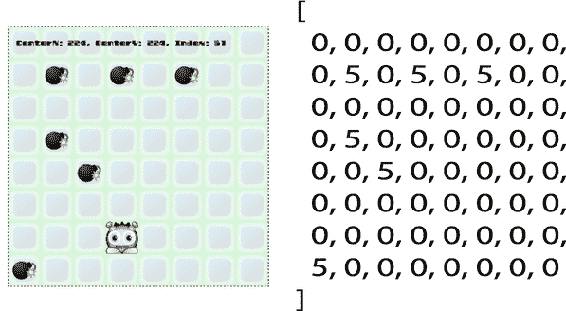

### 图 3-5. 当一个炸弹被拾取时，其在游戏地图中的 gid 数字被设置为零

在数组中拥有这种类型的数据更新，对于执行各种其他游戏逻辑分析非常有用，你将会在后面看到这一点。

### 使外星人沿网格移动

在我们继续讨论基于瓦片的碰撞之前，先快速了解一下外星人角色的移动系统是如何工作的。像许多迷宫游戏角色一样，外星人与地图的网格单元精确对齐地移动。这意味着，当你按下按键改变其方向时，外星人不会朝新方向移动，直到它进入网格的新行或新列。这确保了它能干净利落地过渡到新的行列中。这有助于保持你的碰撞检测系统简单可靠。

如何判断游戏角色是否与地图网格单元精确对齐？通过检查精灵的 `x` 和 `y` 屏幕坐标是否可以被地图瓦片的宽度和高度整除。以下是用于检查此情况的经典代码片段。

```
if(Math.floor(sprite.x) % world.tilewidth === 0
&& Math.floor(sprite.y) % world.tilehieght === 0) {
  //是的，精灵与地图的行和列对齐了
}
```

你还需要确保精灵的速度可以被 `tilewidth` 和 `tileheight` 整除。这能确保精灵实际拥有的像素位置能使上述检查结果为真。这意味着，如果你的瓦片宽度和高度是 `64`，那么你精灵的速度必须是能整除 `64` 的数：`1`、`2`、`4`、`8`、`16` 或 `32`。如果精灵的速度是 `5`、`7` 或 `11`，它们永远无法整除 `64`，因此精灵将永远不会精确地对齐到地图的行或列。

以下是此示例中的实现方式。`setup` 函数创建了响应方向键按下的键盘按键对象。然后在外星人上创建了一个名为 `direction` 的属性，按键动作会改变该 `direction` 的值。

```javascript
//创建键盘对象
leftArrow = g.keyboard(37);
upArrow = g.keyboard(38);
rightArrow = g.keyboard(39);
downArrow = g.keyboard(40);

//在外星人上创建一个 `direction` 属性
alien.direction = "";

//分配按键的 `press` 动作，以改变外星人的 `direction`
leftArrow.press = () => alien.direction = "left";
upArrow.press = () => alien.direction = "up";
rightArrow.press = () => alien.direction = "right";
downArrow.press = () => alien.direction = "down";
```

当按下任意方向键时，外星人的 `direction` 会变为：`"up"`、`"down"`、`"left"` 或 `"right"`。游戏循环在每一帧检查此方向，并相应地改变外星人的速度：

```javascript
if(Math.floor(alien.x) % world.tilewidth === 0
&& Math.floor(alien.y) % world.tileheight === 0) {
  switch (alien.direction) {
    case "up":
      alien.vy = -4;
      alien.vx = 0;
      break;
    case "down":
      alien.vy = 4;
      alien.vx = 0;
      break;
    case "left":
      alien.vx = -4;
      alien.vy = 0;
      break;
    case "right":
      alien.vx = 4;
      alien.vy = 0;
      break;
  }
}
```

然后，游戏循环移动外星人，并使用一个名为 `contain` 的自定义函数将其限制在画布边界内。

```javascript
alien.x += alien.vx;
alien.y += alien.vy;
g.contain(alien, g.stage);
```

### 注意

对于任何依赖读取数组索引位置的游戏来说，留意地图边界都尤为重要。这是因为你不希望精灵的 `x`/`y` 坐标计算出的数组索引数字小于或大于数组中的元素数量。如果发生这种情况，你可能会遇到一些神秘的“未定义”错误信息。这些错误很难追踪，尤其是在它们不常发生的情况下。但这还不是最糟糕的情况。最糟糕的是你根本不会收到任何错误信息。相反，你只会注意到各种看似没有明显原因的疯狂随机错误。如果发生这种情况，请检查你的精灵的索引和位置值！

在接下来的示例中，你将看到如何通过保持精灵与网格行和列对齐，来轻松实现带有墙壁的迷宫游戏。

### 与移动精灵的碰撞

如果所有的炸弹都在移动，会发生什么？它们的地图索引数字会不断变化。为了帮助跟踪这一点，请为你的精灵添加另一个名为 `gid` 的新属性。

```javascript
playerSprite.gid
```

`gid` 存储了引用精灵在瓦片集上图像的网格索引数字。如果玩家精灵的瓦片集图像是顶行的第四个，你可以像这样将其 `gid` 设置为 4：

```javascript
playerSprite.gid = 4;
```

你在前一章学到的 `makeTileWorld` 函数在创建游戏世界时会自动为所有精灵添加一个 `gid` 属性。

如果精灵在四处移动，请使用它们的 `gid` 和 `index` 属性来实时更新它们在地图数组中的位置。使用 `updateMap` 函数来帮助你完成此操作。`updateMap` 接受原始数组和你想要更新位置的一个精灵或精灵数组。它还需要知道世界的宽度、高度和 `widthInTiles`。它返回一个包含这些精灵新位置的新数组。

```javascript
mapArray = updateMap(mapArray, bombSprites, world);
```

以下是完成所有工作的完整 `updateMap` 函数。（请注意，此代码使用了你在本章前面学到的 `getIndex` 函数）。

```javascript
function updateMap(mapArray, spritesToUpdate, world) {
  //首先创建一个用零填充的新地图数组。
  //新地图数组的大小将与原始数组完全相同
  let newMapArray = mapArray.map(gid => {
    gid = 0;
    return gid;
  });
  //`spritesToUpdate` 是一个精灵数组吗？
  if (spritesToUpdate instanceof Array) {
    //获取 `spritesToUpdate` 数组中每个精灵的索引数字
    //并将精灵的 `gid` 添加到地图上匹配的索引处
    spritesToUpdate.forEach(sprite => {
      //找到新的索引数字
      sprite.index = getIndex(
        sprite.centerX, sprite.centerY,
        world.tilewidth, world.tileheight, world.widthInTiles
      );
      //将精灵的 `gid` 数字添加到地图上正确的
      //索引处
      newMapArray[sprite.index] = sprite.gid;
    });
  }
  //`spritesToUpdate` 只是一个单独的精灵吗？
  else {
    let sprite = spritesToUpdate;
    //找到新的索引数字
    sprite.index = getIndex(
      sprite.centerX, sprite.centerY,
      world.tilewidth, world.tileheight, world.widthInTiles
    );
    //将精灵的 `gid` 数字添加到地图上正确的
    //索引处
    newMapArray[sprite.index] = sprite.gid;
  }
  //返回新的地图数组以替换之前的地图数组
  return newMapArray;
}
```

（你可以在 `hexi/src/modules/tileUtilities/src/tileUtilities.js` 中找到 `updateMap` 函数。）

`updateMap` 接收一个精灵数组，使用它们的索引位置创建一张新地图，并用新地图替换之前的地图。这是确保所有位置都是最新的最可靠方法，并且允许两个或多个精灵在同一个位置共享一个 `gid` 数字。`updateMap` 应在游戏循环中调用，在精灵的位置被改变之后、检查碰撞之前。

既然你知道了如何实时更新地图，那么如何使用这些信息来检查碰撞呢？

### 通过比较数组位置检查碰撞

如果你的游戏中有大量移动的精灵，你可以使用数组比较技术来检查碰撞。在本章的第一个示例中，我们像这样检查外星人和炸弹之间的碰撞：

```javascript
if (bombArray[alien.index] === 5) //碰撞！
```

这对于检查单个精灵与一组精灵的效果很好。但如果你想要检查一组移动的精灵与另一组移动的精灵之间的碰撞呢？

诀窍是将一张地图叠加到另一张地图上。如果这些地图中的任何内容共享相同的索引数字，就会发生碰撞。

以下是其基本工作原理：

首先，从包含不同种类事物的两张地图开始。`mapOne` 存储“1”，`mapTwo` 存储“2”：

```javascript
mapOne = [0, 0, 1, 0, 1, 0];
```

mapTwo = [0, 2, 0, 0, 2, 0];

你想要找出是否有任何地图位置同时被 1 和 2 占据？有吗？我们可以清楚地看到，确实有。在索引数字 4 处。

但是我们如何用代码检查这个呢？像这样：

```javascript
mapOne.forEach((gid, index) => {
  if (mapTwo[index] === 2 && gid === 1) {
    console.log("在位置 " + index + " 处发生碰撞");
  }
});
```

这会显示：

```
在位置 4 处发生碰撞
```

如果你有大量位置不断变化的精灵，这可能是检查碰撞最有效的方法。

让我们看一个实际示例，演示这些新技术。运行 `movingCollision.html` 文件，查看带有移动炸弹的示例游戏新版本。使用箭头键让外星人追逐并收集炸弹，如图 3-6 所示。

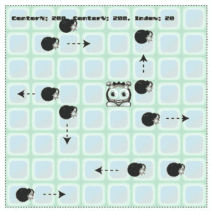

### 图 3-6. 在地图上追逐移动的炸弹

这个新示例使用了相同的三个地图层：“backgroundLayer”、“bombLayer” 和 “alienLayer”。图 3-7 显示了每一层的数据数组。

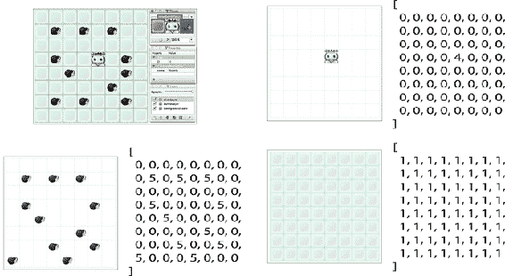

### 图 3-7. Tiled Editor 中的三个地图图层

`setup` 函数通过以下方式获取对外星人图层数据数组的引用：

```
alienMapArray = world.getObject("alienLayer").data;
```

然后，在游戏循环中每帧更新外星人的位置后，会调用 `updateMap` 来更新数组中外星人的位置。

```
alienMapArray = updateMap(alienMapArray, alien, world);
```

这意味着 `alienMapArray` 将始终包含外星人的当前位置。

炸弹的位置会在一个 `forEach` 循环中更新。循环结束后，会使用 `updateMap` 函数将每个炸弹的新位置更新到 `bombMapArray` 中。以下是实现此功能的代码：

```
bombSprites.forEach(bomb => {
  //`atXEdge` 和 `atYEdge` 会根据精灵是否位于画布边缘返回 `true` 或 `false`
  let atXEdge = (sprite, container) => {
    return (sprite.x === 0 || sprite.x + sprite.width === container.width)
  }
  let atYEdge = (sprite, container) => {
    return (sprite.y === 0 || sprite.y + sprite.width === container.height)
  }
  //如果炸弹位于地图网格的列或行上，则改变其方向
  if (Math.floor(bomb.x) % world.tilewidth === 0
      && Math.floor(bomb.y) % world.tileheight === 0)
  {
    //如果炸弹位于画布边缘，
    //则反转其速度以使其保持在内部
    if (atXEdge(bomb, g.canvas)) {
      bomb.vx = -bomb.vx;
    }
    else if (atYEdge(bomb, g.canvas)) {
      bomb.vy = -bomb.vy;
    }
    //如果炸弹位于画布内部，则为其指定一个随机的新方向
    else {
      changeDirection(bomb);
    }
  }
  //移动炸弹
  bomb.x += bomb.vx;
  bomb.y += bomb.vy;
});
```

现在，`bombMapArray` 将包含当前帧中炸弹位置的最新记录。您会注意到在上面的代码中，每当炸弹位于网格单元格中心时，就会调用一个名为 `changeDirection` 的函数——接下来我们来看看它是如何工作的。

### 为炸弹指定随机方向

炸弹只有在与网格行或列对齐时才会改变方向。并且，如果炸弹位于画布边缘，则无法改变方向，这可以防止生成无效的数组索引号。以下是 `changeDirection` 函数，它在满足这些条件时被调用。

```
//方向改变辅助函数
function changeDirection(sprite) {
  let up = 1,
    down = 2,
    left = 3,
    right = 4,
    direction = g.randomInt(1, 4);
  switch (direction) {
    case right:
      sprite.vx = 2;
      sprite.vy = 0;
      break;
    case left:
      sprite.vx = -2;
      sprite.vy = 0;
      break;
    case up:
      sprite.vx = 0;
      sprite.vy = -2;
      break;
    case down:
      sprite.vx = 0;
      sprite.vy = 2;
      break;
  }
}
```

这只是一个非常简单的 `switch` 语句，它改变精灵的速度以匹配其随机分配的方向。

### 碰撞检测

如果您在任何时候快照 `alienMapArray` 或 `bombMapArray`，您会发现它们的内容与画布上精灵的位置相匹配，如图 3-8 所示。

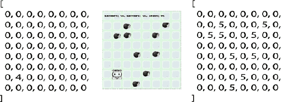

### 图 3-8. 实时更新精灵的地图位置

碰撞是通过比较这两个数组来检测的。代码遍历 `bombMapArray`，检查每个索引位置的 `gid` 是否为 `5`。如果是，并且 `alienMapArray` 在相同索引号处有 `4`，则发生碰撞。然后代码会过滤掉该位置上的任何炸弹精灵。（该位置可能不止一个炸弹）。当找到匹配项时，炸弹会从地图中清除，并且精灵会被移除。

```
bombMapArray.forEach((gid, index) => {
  //外星人是否与炸弹具有相同的索引号？
  if (alienMapArray[index] === 4 && gid === 5) {
    //是的，因此过滤掉该位置上的所有炸弹精灵
    //（可能不止一个）
    bombSprites = bombSprites.filter(bomb => {
      if (bomb.index === index) {
        //从数组中移除炸弹的 gid 编号
        bombMapArray[bomb.index] = 0;
        //从 `bombLayer` 组中移除炸弹
        g.remove(bomb);
        return false;
      } else {
        return true;
      }
    });
  }
});
```

到目前为止，所有这些示例都展示了如何使用精灵的中心点来检测碰撞。但对于许多游戏来说，您需要更高的精度。接下来，我们来看看如何使我们的碰撞检测更精确一些。

## 使用角点

我们的碰撞系统到目前为止的一个局限是，我们只使用精灵的中心 x/y 点来确定其地图数组位置。

```
sprite.index = getIndex(
  sprite.centerX, sprite.centerY,
  world.tilewidth, world.tileheight, world.widthInTiles
);
```

这意味着，即使精灵部分进入了相邻的单元格，`getIndex` 也不会检测到其位置发生了变化。只有当精灵的中心点穿过单元格边界时，它才会检测到变化。您可以在图 8-9 中看到，即使外星人碰到了炸弹，也只有在外星人的中心进入炸弹所在的单元格时，才会检测到碰撞。见图 3-9。

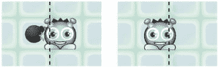

### 图 3-9. 使用精灵的中心点来确定其地图位置

这可能不是问题，事实上，在这个示例中，这种效果看起来非常自然。但对于许多类型的碰撞，您可能希望使用精灵的精确边缘作为碰撞边界。这对于与墙壁等不应有任何重叠的物体，或者与火焰等需要立即反应的物体的碰撞来说非常重要。

那么，如何确定精灵的边缘是否位于新的地图位置呢？不要使用中心点。而是使用精灵的 4 个角点。图 3-10 显示了这四个角点的位置。

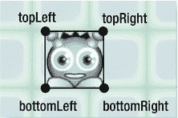

### 图 3-10. 为获得更高精度，请检查精灵的 4 个角的位置

计算这些点很容易。使用 `getPoints` 函数来计算并返回一个包含这四个点 x/y 坐标的对象。`getPoints` 接受一个参数：要查找其角点的精灵。它返回一个对象，该对象有四个子对象属性，分别表示精灵四个角的位置：`topLeft`、`topRight`、`bottomLeft` 和 `bottomRight`。

```javascript
function getPoints(s) {
  return {
    topLeft: {x: s.x, y: s.y},
    topRight: {x: s.x + s.width - 1, y: s.y},
    bottomLeft: {x: s.x, y: s.y + s.height - 1},
    bottomRight: {x: s.x + s.width - 1, y: s.y + s.height - 1}
  };
}
```

（底部和左侧的角点比精灵的宽度和高度小 1 像素，这样这些点就保持在精灵内部，而不是外部）。

### 注意

为什么在 `getCorners` 函数中要使用 `“s”` 而不是 `“sprite”`？虽然我通常建议使用描述性变量名，但通过使用明显的简写，你可以让密集且重复的数学计算更加紧凑和易读。

现在，不再仅仅通过检查精灵的中心点来定位地图位置，而是检查所有四个角点。如果这些角点与你关注的精灵的 `gid` 具有相同的索引，则说明发生了碰撞。

首先，使用上面的 `getPoints` 函数来获取精灵的四个角点。

```javascript
sprite.collisionPoints = getPoints(sprite);
```

创建一个 `collisionGid` 变量，用于存储你想要检查与精灵是否发生碰撞的单元格的 `gid`。

```javascript
let collisionGid = 5;
```

你还需要一个 `mapArray`，其中包含具有上述 `collisionGid` 的精灵。

```javascript
let mapArray = anyMapArray;
```

然后遍历所有四个点，并为每个点调用自定义的 `checkPoints` 函数。

```javascript
let hit = Object.keys(sprite.collisionPoints).some(checkPoints);
```

如果任何一个角点与 `mapArray` 中具有与我们关注的 `collisionGid` 相同的 `gid` 的单元格相交，则 `checkPoints` 函数返回 `true`。

```javascript
function checkPoints(key) {
  //获取当前要检查的点的引用。            
  //(`topLeft`, `topRight`, `bottomLeft` 或 `bottomRight` )            
  let point = sprite.collisionPoints[key];
  //在地图数组中找到该点的索引号            
  let index = getIndex(
    point.x, point.y,
    world.tilewidth, world.tileheight, world.widthInTiles
  );
  //找出该点当前所在地图位置的 gid 值            
  let currentGid = mapArray[index];
  //如果该值与我们所关注的 gid 值匹配，            
  //则说明发生了碰撞            
  if (currentGid === collisionGid) {
    return true;
  } else {
    return false;
  }
}
```

如果某些角点（至少一个）与你关注的单元格接触，上述代码将返回 `true`。这是因为我们使用了 JavaScript 的 `some` 数组方法：

```javascript
var hit = Object.keys(sprite.collisionPoints).some(checkPoints);
```

一旦找到第一个发生碰撞的角点，循环就会退出，函数返回 `true`。这意味着如果第一个点，即精灵的 `topLeft` 角点发生了碰撞，循环会立即返回 `true`，而不再检查其他点。这对于确保对碰撞做出即时反应非常有用。

但是，如果你只想在每一个角点都与你关注的单元格接触时才检测到碰撞，该怎么做呢？请使用 JavaScript 的 `every` 数组方法，如下所示：

```javascript
var hit = Object.keys(sprite.collisionPoints).every(checkPoints);
```

在这种情况下，只有当每一个角点都参与碰撞时，`hit` 才会变为 `true`。这对于确保精灵完全位于一个单元格内部，或者完全覆盖另一个精灵非常有用。你可以利用这一点来高效地测试精灵的四个角是否都落在迷宫地板上，从而防止精灵穿墙而过。（在后续的示例中，你将看到如何做到这一点）。

现在你已经知道是否发生了碰撞，接下来使用索引号在地图的同一位置找到匹配的精灵。这只是你之前示例中相同代码的一个变体：

```javascript
if (hit) {
  enemySprites.some((enemy) => {
    if (enemy.index === collisionIndex) {
      //这就是你关注的精灵            
    }
  });
}
```

在我们继续深入之前，先来整合所有这些新代码。

## 一个可复用的基于瓦片的碰撞函数

你现在可以看到，基于瓦片的碰撞对于各种不同的游戏场景是多么有用。为了让我们轻松一点，我快速编写了一个通用的 `hitTestTile` 函数，这样你只需一行代码就能实现基于瓦片的碰撞。你可以将它放入任何游戏中，只要游戏中的精灵具有本书一直在使用的相同属性即可。该函数用于检测精灵与任何地图数组上的某个瓦片 `gid` 编号之间的碰撞。该函数还允许你设置要检测的碰撞类型：中心点、某些角点或每个角点。使用方法如下：

```javascript
let collisionObject = hitTestTile(sprite, mapArray, collisionGid, worldObject, pointsToCheck);
```

`hitTestTile` 返回一个碰撞对象，其中包含以下两个属性：

*   `collision.hit`：一个布尔值，如果发生碰撞则为 true。
*   `collision.index`：一个数字，表示碰撞发生的地图数组位置。

你可以使用这两个属性来决定如何处理碰撞。

第四个参数 `worldObject` 是一个定义基于瓦片的游戏世界的对象。它需要包含以下属性：

```javascript
world.tilewidth
world.tileheight
world.widthInTiles
```

（`widthInTiles` 是一个数字，表示你的瓦片地图的列数）。

我们在最后两章中使用的 `makeTiledWorld` 函数会自动为你返回一个包含这些属性的世界对象。但如果你是通过代码（而非使用 Tiled Editor）生成世界地图，只要你将自己的、包含上述三个相同属性的世界对象传递给它，你仍然可以使用 `hitTestTile`。

最后一个参数 `pointsToCheck` 决定了检查精灵上的哪些点以检测碰撞。你可以使用以下三个字符串选项之一：

```javascript
"every"
"some"
"center"
```

以下是完整的 `hitTestTile` 函数。这里没有新代码，它只是对我们在前面示例中使用的相同技术进行了重新编排。

```javascript
hitTestTile(sprite, mapArray, gidToCheck, world, pointsToCheck) {
```

## 碰撞检测与地图交互

`checkPoints` 辅助函数遍历精灵的角点，找出它们是否位于你关注的数组单元格内。如果是，则返回 `true`。

```javascript
let checkPoints = key => {
  //获取当前要检查的点的引用。
  //(`topLeft`, `topRight`, `bottomLeft` 或 `bottomRight` )
  let point = sprite.collisionPoints[key];

  //在地图数组中找到该点的索引号
  collision.index = this.getIndex(
    point.x, point.y,
    world.tilewidth, world.tileheight, world.widthInTiles
  );

  //找出该点当前所在地图位置的 gid 值
  collision.gid = mapArray[collision.index];

  //如果该值与我们所关注的 gid 值匹配，
  //则说明发生了碰撞
  if (collision.gid === gidToCheck) {
    return true;
  } else {
    return false;
  }
};
```

将 `"some"` 设置为 `pointsToCheck` 的默认值。

```javascript
pointsToCheck = pointsToCheck || "some";
```

该函数将返回的碰撞对象。

```javascript
let collision = {};
```

你想要检查哪些点？`"every"`、`"some"` 还是 `"center"`?

```javascript
switch (pointsToCheck) {
  case "center":
    //只有中心点接触时，`hit` 才为 true
    let point = {
      center: {
        x: sprite.centerX,
        y: sprite.centerY
      }
    };
    sprite.collisionPoints = point;
    collision.hit = Object.keys(sprite.collisionPoints).some(checkPoints);
    break;
  case "every":
    //每个角点都接触时，`hit` 才为 true
    sprite.collisionPoints = this.getPoints(sprite);
    collision.hit = Object.keys(sprite.collisionPoints).every(checkPoints);
    break;
  case "some":
    //仅当某些点接触时，`hit` 的值才为 true
    sprite.collisionPoints = this.getPoints(sprite);
    collision.hit = Object.keys(sprite.collisionPoints).some(checkPoints);
    break;
}
```

返回碰撞对象。若检测到碰撞，`collision.hit` 的值为 `true`。`collision.index` 可告知碰撞发生时所处地图数组的索引编号。

```javascript
return collision;
```

（你可以在本章的源文件 `hexi/src/modules/tileUtilities/src` 中找到此函数的可用版本）。

运行 `usingCornerPoints.html` 示例，可看到 `hitTestTile` 的实际应用。在此示例中，一旦外星人的任意角点进入包含炸弹的单元格，炸弹就会立即消失。如图 3-11 所示。

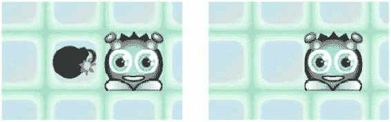

### 图 3-11. 使用部分角点进行即时碰撞检测

这种碰撞反应是否显得过于即时？你可以通过将 `"some"` 改为 `"every"` 来实现完全不同的效果：

```javascript
let alienVsBomb = hitTestTile(alien, bombMapArray, 5, world, "every");
```

现在，只有当每个角点都位于炸弹的单元格内时，才会检测到碰撞。这让外星人必须先完全包裹住炸弹，炸弹才会消失。图 3-12 说明了这一点。

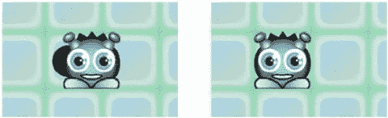

### 图 3-12. 仅当每个角点都位于地图单元格内时才检测碰撞

结果看起来非常自然，而这是一种使用基于几何的碰撞检测系统难以实现的效果。此外，使用每个角点进行碰撞检测还有另一个重要用途：你可以用它来将精灵限制在地图的特定位置。接下来让我们了解如何做到这一点。

## 使用反向碰撞检测来检查障碍物

对于迷宫或角色扮演游戏，你通常需要知道地图的哪些区域是角色可以行走的，哪些是不可以行走的。例如，角色应该能够在草地上行走，但不能穿过墙壁、岩石或树木。这些被称为地图的可行走区域和不可行走区域。通常你会发现，角色只允许在某一种东西上行走，但有很多东西它不能行走。因此，与其检查角色不能行走的三样东西（如墙壁、岩石和树木），不如只测试角色可以行走的那一样东西（例如草地）。如果角色在草地上，它可以行走；但如果它接触到其他任何东西，则不能行走。这是一种*反向*碰撞策略。之所以说它是反向的，是因为你通过检查精灵是否*没有碰到*另一个障碍物，来判断它是否撞上了障碍物。如果它在草地上，你就知道它没有碰到墙壁、岩石或树木。简单！对于某些类型的碰撞来说，这种方法非常高效。

如何知道一个精灵是否完全位于某个特定的地图单元格内？通过检查它的全部四个角点。如果精灵的四个角点都在同一个位置，就可以知道该精灵没有与其他任何单元格重叠。是的，你可能不会惊讶地发现，你可以通过使用 JavaScript 的 `every` 循环来检查这一点！让我们通过经典的迷宫墙壁示例来了解如何操作。

运行 `wallsAndBombs.js` 文件，使用方向键控制外星人在迷宫中穿行并拾取炸弹。外星人可以平滑地穿过走廊和拐角，但墙壁会阻挡其移动，如图 3-13 所示。

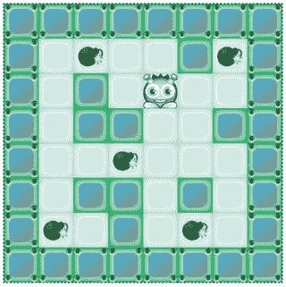

### 图 3-13. 在迷宫中穿行以拾取炸弹

图 3-14 显示了迷宫以及用于创建该迷宫的 `wallArray`。

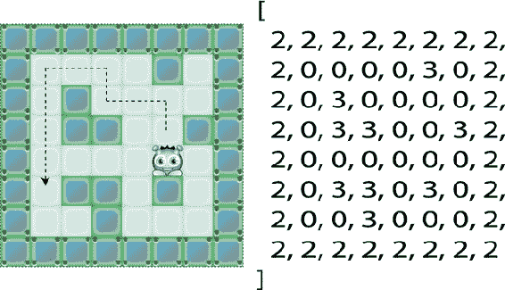

### 图 3-14. 添加墙壁以创建迷宫游戏

你可以看到，任何 gid 编号为 2 或 3 的都是墙壁。但由于我们将进行反向碰撞检查，我们对此不感兴趣。我们只关心任何不是墙壁的东西。也就是地图中用 `"0"` 表示的所有东西。因此，我们的碰撞算法将遵循以下逻辑：*如果外星人没有碰到 `"0"` 单元格，则阻止其移动。*

以下是游戏循环中实现此功能的全部代码。除了几个小细节外，它与前一个示例中的代码非常相似。

```javascript
let alienVsFloor = g.hitTestTile(alien, wallMapArray, 0, world, "every");

if (!alienVsFloor.hit) {
  //阻止外星人移动
  alien.x -= alien.vx;
  alien.y -= alien.vy;
  alien.vx = 0;
  alien.vy = 0;
}
```

可以看到，只有当每个角点都位于一个 `"0"` 单元格内时，`alienVsFloor` 才为真。如果 `alienVsFloor` 变为 `false`，我们就知道外星人碰到了非 `"0"` 的东西——那东西一定是墙壁。

此示例使用了最简单的碰撞反应代码。如果外星人撞到墙壁，则通过从其位置减去其速度，然后将其速度设为零来阻止其移动。

```javascript
alien.x -= alien.vx;
alien.y -= alien.vy;
alien.vx = 0;
alien.vy = 0;
```

我们可以使用如此简单的碰撞反应系统，是因为外星人的移动与地图的网格行和列对齐，并且我们没有使用任何物理机制来改变其速度。这些约束条件消除了一大类我们无需担心的碰撞问题。

为了了解这段代码在实际环境中的用法，以下是游戏循环中使用 `hitTestTile` 来检查外星人与地面，以及外星人与炸弹之间碰撞的全部代码。

```
//检查外星人与地面之间的碰撞
let alienVsFloor = g.hitTestTile(alien, wallMapArray, 0, world, "every");

//如果外星人没有碰到地砖，则阻止其移动
if (!alienVsFloor.hit) {
  alien.x -= alien.vx;
  alien.y -= alien.vy;
  alien.vx = 0;
  alien.vy = 0;
}

//检查外星人与炸弹之间的碰撞
let alienVsBomb = g.hitTestTile(alien, bombMapArray, 5, world, "every");

//查看外星人在炸弹数组中的位置是否与炸弹的 gid 编号匹配
if (alienVsBomb.hit) {
  //如果匹配，则过滤炸弹精灵并找到
  //与外星人位置相匹配的那个
  bombSprites = bombSprites.filter(function(bomb) {
    //该炸弹精灵的索引号是否与外星人相同？
    if (bomb.index === alienVsBomb.index) {
      //如果相同，则通过将 `bombMapArray` 中的 gid 设为 `0`
      //来从其中移除炸弹
      bombMapArray[bomb.index] = 0;
      //从其容器组中移除炸弹精灵
      g.remove(bomb);
      //从 `bombSprites` 数组中滤除该炸弹
      return false;
    } else {
      //如果不匹配，则将炸弹保留在 `bombSprites` 数组中
      return true;
    }
  });
}
```

现在我们有了一个实用的基于瓦片的碰撞系统，可用于各种基于瓦片的游戏。接下来，让我们了解如何在上一章开始构建的奇幻角色扮演游戏中运用所有这些新技能。

## 基于瓦片碰撞的角色扮演游戏

先试玩一下第 1 章的`fantasy.html`原型示例，重温一下它的运作方式。你会注意到精灵角色可以碰撞两类物体：

-   阻挡行动的障碍物：树桩、墙基和灌木丛底部。
-   可收集的物品：红心、骷髅头和土拨鼠。

图 3-15 展示了这一点。碰撞机制完全基于前几节学到的瓦片碰撞系统。但这里有一些有趣的新细节，这些细节并非边缘情况，而是许多类型游戏中你都需要解决的典型碰撞问题。

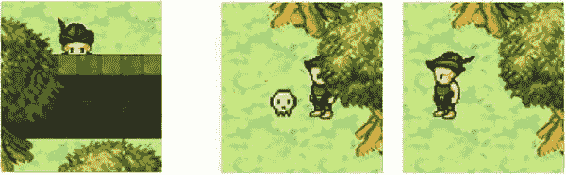

**图 3-15.** 障碍物阻挡行动，物品可被收集

### 定义碰撞区域

游戏地图中的所有瓦片都由整齐填充 32x32 像素方格的精美图形构成。然而，精灵角色并不遵循这一模式。它的精灵尺寸为 64x64 像素，而角色插画的实际尺寸为 28x52 像素。图 3-16 展示了这一点。

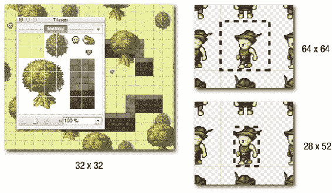

**图 3-16.** 所有尺寸均不相同

在迷宫游戏示例中这不成问题，因为瓦片尺寸、精灵尺寸以及迷宫单元格网格尺寸完全相同：都是 64x64 像素。现在该怎么办？

别担心！只需在精灵上创建一个碰撞区域即可。碰撞区域定义了精灵的哪个部位应对碰撞敏感。在本游戏中，我只希望精灵头部以下的身体区域对碰撞做出反应。这是一个 20x20 像素的方形区域，你可以在图 3-17 中看到它。它相对于精灵顶部向下偏移 44 像素，向左偏移 22 像素。

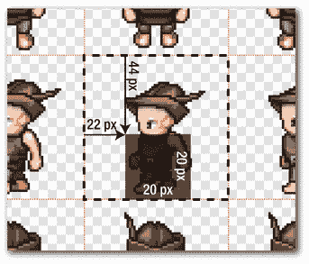

**图 3-17.** 精灵的碰撞区域

这保留了浅 2.5D 景深效果，因为它意味着精灵的头部不会撞到视觉上位于其上方但深度层更低的物体——例如墙壁或树木的顶部。

要在游戏代码中实现这一点，我们只需在精灵上创建一个定义此形状的`collisionArea`对象。以下是游戏设置函数中实现此功能的代码片段。

```
elf.collisionArea = {
  x: 22,
  y: 44,
  width: 20,
  height: 20
};
```

（有关完整上下文，请参考第 1 章的`fantasy.js`源文件）。

现在，不再使用精灵的四个角点，而是使用这个新的`collisionArea`的四个角点进行碰撞检测。为了实现这一点，请使用这个新版本的`getPoints`函数。

```
getPoints(s) {
  let ca = s.collisionArea;
  if (ca !== undefined) {
    return {
      topLeft: {
        x: s.x + ca.x,
        y: s.y + ca.y
      },
      topRight: {
        x: s.x + ca.x + ca.width,
        y: s.y + ca.y
      },
      bottomLeft: {
        x: s.x + ca.x,
        y: s.y + ca.y + ca.height
      },
      bottomRight: {
        x: s.x + ca.x + ca.width,
        y: s.y + ca.y + ca.height
      }
    };
  } else {
    return {
      topLeft: {
        x: s.x,
        y: s.y
      },
      topRight: {
        x: s.x + s.width - 1,
        y: s.y
      },
      bottomLeft: {
        x: s.x,
        y: s.y + s.height - 1
      },
      bottomRight: {
        x: s.x + s.width - 1,
        y: s.y + s.height - 1
      }
    };
  }
}
```

现在你可以为游戏中的任何精灵设置自定义碰撞区域。那么，这个幻想 RPG 游戏示例中的碰撞系统是如何工作的呢？

### 与障碍物的碰撞

你从第 2 章还记得，所有应阻止精灵移动的瓦片都创建在一个名为`obstacles`的地图层上，如图 3-18 所示。

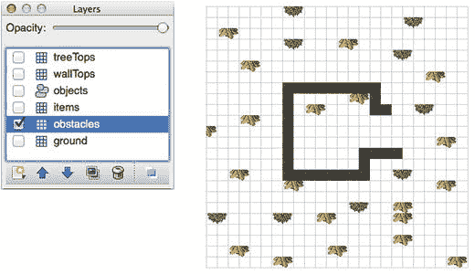

**图 3-18.** 地图的障碍物层

这导出一个漂亮的大数组，其中充满了代表障碍物的`gid`数字。但最重要的是，它也充满了零。数组中的任何`0`都表示“没有障碍物”。这意味着我们可以使用我们的小反证碰撞技巧。我们可以检查精灵碰撞区域的所有四个角是否都接触到了`0`单元格。如果任何一个不是`0`，我们就知道精灵撞到了障碍物。我们最终得到的代码几乎与我们早期迷宫游戏示例中用于检查迷宫墙壁的代码相同。以下是游戏循环中检查精灵是否接触障碍物的代码。如果接触了，代码会阻止精灵移动。

```
let obstaclesMapArray = world.getObject("obstacles").data;
let elfVsGround = g.hitTestTile(elf, obstaclesMapArray, 0, world, "every");

if (!elfVsGround.hit) {
  //阻止精灵移动
  elf.x -= elf.vx;
  elf.y -= elf.vy;
  elf.vx = 0;
  elf.vy = 0;
}
```

如果你想知道精灵撞到了哪种类型的障碍物呢？你可以使用`collision.index`属性在地图数组中查找其`gid`编号。以下是从`obstacleMapArray`中查找`gid`编号的方法：

```
obstaclesMapArray[elfVsGround.index]
```

如果精灵撞到了树的右侧，这将给出`33`。这意味着你现在可以获得关于精灵与环境交互情况的详细信息，并利用这些信息开始构建复杂的游戏逻辑。

### 与物品的碰撞

你还会记得，当我们在 Tiled Editor 中设计游戏地图时，我们给物品瓦片赋予了这些名称属性：`skull`、`heart`和`marmot`。物品也被添加到了它们自己的图层上，如图 3-19 所示。

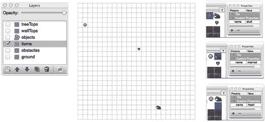

**图 3-19.** 物品瓦片位于它们自己的图层上，并具有名称属性

我们可以在游戏代码中使用这些自定义名称属性来判断精灵正在接触哪些物品。让我们来看看如何实现。

首先，我们需要获取对物品图层的引用。

```
itemsLayer = world.getObject("items");
```

记住`itemsLayer`是一个精灵容器。它包含该图层上的所有精灵；只有三个：红心、骷髅头和土拨鼠。你可以在图层的`children`数组中访问这些精灵。因此下一步是获取对`itemsLayer.children`的引用。

```
items = itemsLayer.children;
```

现在我们有了一个名为`items`的数组，其中包含三个物品精灵。

### 注记

你也可以选择*克隆*数组，而不是创建一个指向原始数组的直接引用指针。你可以像这样克隆数组：

```
items = itemsLayer.children.slice(0);
```

克隆数组的好处是，如果对`items`数组进行了修改，原始的`itemsLayer.children`数组将保持不变。当你需要将游戏重置为初始状态时，这会非常有用。

精灵与物品之间的碰撞是如何工作的？不出所料！这与本章前面例子中炸弹与外星人之间的碰撞完全相同。唯一新增的是，当碰撞发生时，屏幕上会显示一条持续三秒的消息，告知你精灵收集到的物品名称。

```
let itemsMapArray = world.getObject("items").data;
let elfVsItems = g.hitTestTile(elf, itemsMapArray, 0, world, "some");
if (!elfVsItems.hit) {
  items = items.filter(item => {
    //判断当前物品是否与精灵的位置匹配
    if (item.index === elfVsItems.index) {
      //显示消息
      message.visible = true;
      message.content = "You found a " + item.name;
      //让消息在三秒后消失
      g.wait(3000, function() {
        message.visible = false;
      });
      //移除物品
      itemsMapArray[item.index] = 0;
      g.remove(item);
      return false;
    } else {
      return true;
    }
  });
}
```

图 3-20 展示了收集到物品时屏幕上显示的消息效果。

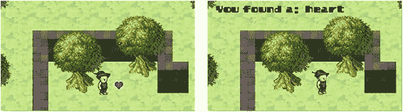

### 图 3-20. 显示物品的名称属性

基于瓦片的碰撞：解决！

## 小结

基于瓦片的碰撞是你能够学到的最有用的游戏设计技术之一。我们在本章中使用的简单系统可以作为你在 2D 动作游戏中进行大部分（或全部）碰撞检测的基础。现在你学会了如何在地图世界中定位对象、检测它与其他对象的碰撞、对这些碰撞做出反应，以及更新游戏世界。你可以使用通用的`hitTestTile`函数，配合`getIndex`和`getPoints`，来处理任何类型 2D 视频游戏的碰撞问题。

但是，如果我再次告诉你“我们还没结束！”你会不会感到惊讶？既然你已经理解了如何构建一个交互式基于瓦片的游戏世界，一个全新的游戏设计技术宇宙已向你敞开。在接下来的几章中，我们将深入探讨所有这些新技术：影响地图、宽相位碰撞、寻路、程序化关卡生成，以及下一章中的等距地图。希望你胃口大开！

© Rex van der Spuy 2017

Rex van der Spuy, 《高级游戏开发者工具包》，10.1007/978-1-4842-1097-0_4
