# 4. 等距地图

Rex van der Spuy¹

(1)加拿大，安大略省，多伦多

现在你已经了解了制作基于瓦片游戏的基础知识，让我们添加一个很酷的新功能：**等距投影**。等距投影是一种浅层的 3D 效果，游戏世界看起来像是旋转了 45 度，并且从上方以 30 度角观察。图 4-1 显示了一个典型的等距地图布局。

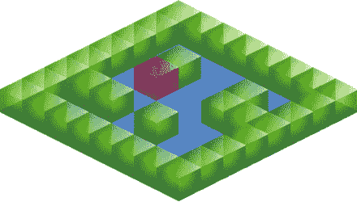

### 图 4-1. 等距投影是一种固定视角的 3D 效果

你的地图由代表立方体的形状组成，而不是正方形，就像从某个角度侧视边缘所见。它看起来是 3D 的，但等距 3D 与真正的 3D 有两个重大区别：

- 等距 3D 具有永久固定的视角。
- 等距 3D 没有地平线，因此游戏世界可以看起来无限延伸到世界的边缘之外。

等距地图是许多类型游戏（例如策略游戏、基于地图的冒险游戏和角色扮演游戏）的标准配置。它们的优势在于，与 2D 地图一样，它们能为玩家提供游戏世界一致的鸟瞰视角，因此很容易规划下一步行动。但与普通 2D 地图通常能提供的相比，3D 视角能带来更强的空间沉浸感。

在本章中，你将学习制作等距游戏地图的所有基础知识，包括如何完成以下操作：

- 在等距世界中移动游戏角色。
- 精确地对精灵进行深度排序。
- 在等距精灵之间进行碰撞检测。
- 使用指针选择等距精灵，并将其屏幕上的位置与地图数组的索引位置匹配。
- 如何使用瓦片编辑器设置和渲染等距游戏世界。

让我们一探究竟！

## 等距基础

你可能会惊讶地发现，制作等距游戏世界所需了解的唯一新知识，只是一点简单的数学运算。请看图 4-2，它以两种方式渲染了同一个游戏地图。

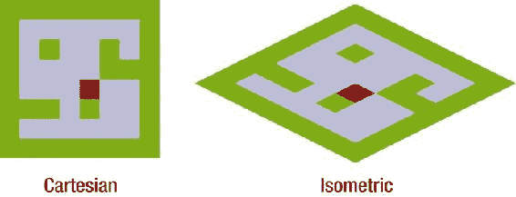

### 图 4-2. 同一地图的笛卡尔坐标渲染与等距渲染

这两个地图都是由相同的地图数组数据创建的。左边的例子使用**笛卡尔坐标**渲染地图。这是我们熟悉的普通`x`和`y`坐标，它们与轴平面成直角对齐。右边的例子使用**等距坐标**渲染地图。两个地图之间只有一个区别：等距地图中的瓦片只是被拉伸并旋转了 45 度。它们是同一张地图，只是通过不同的视角观察。这意味着，你只需应用一个简单的数学转换，就可以将任何普通的笛卡尔瓦片地图转换为等距瓦片地图。

以下是将平面笛卡尔地图上的`x`和`y`点转换为 3D 等距地图所需了解的几乎全部数学知识。要将笛卡尔`x`和`y`点转换为等距点，请使用以下公式：

```
isoX = cartX - cartY;
isoY = (cartX + cartY) / 2;
```

要将等距点转换为笛卡尔点，请使用以下公式：

```
cartX = (2 * isoY + isoX) / 2;
cartY = (2 * isoY - isoX) / 2;
```

就这样！你在本章中将要学习的其余代码，本质上只是为你提供一种使用这些公式在这两种坐标系之间进行转换的简便方法。

### 制作笛卡尔瓦片地图

在开始等距投影的冒险之旅前，让我们先回归基础，学习如何制作图 4-2 所示的笛卡尔瓦片地图。这也是一个精简瓦片地图渲染系统的优秀模型，如果你后续需要，可以将其扩展为功能更完整的系统。以下是本书源代码中`cartesian.js`文件的`setup`函数内用于生成地图的代码——注释逐步说明了代码的工作原理。

```
//创建定义等距瓦片世界的“world”容器
let world = g.group();
//设置每个瓦片的笛卡尔尺寸（像素）
world.cartTilewidth = 32;
world.cartTileheight = 32;
//定义世界的宽度和高度（以瓦片为单位）
world.widthInTiles = 8;
world.heightInTiles = 8;
//创建世界图层
world.layers = [
  //环境层。`2` 代表墙壁，
  //`1` 代表地板
  [
```

### 制作等距瓦片地图

创建新的等距地图需要添加两个要素。第一个是可用来显示每个瓦片的等距方形精灵。第二个是将笛卡尔坐标（常规 `x` 和 `y` 坐标）转换为等距坐标的方法。

#### 等距精灵

等距瓦片精灵就是一个旋转了 45 度并被压缩到一半高度的正方形，如图 4-3 所示。


**图 4-3.** 使用菱形瓦片作为绘制等距地图的基础

下面是一个名为 `isoRectangle` 的函数，用于创建这样的精灵。它使用 PixiJS 渲染系统绘制，但你也可以使用任何允许绘制图形的图形库（包括 Canvas API）实现相同的效果。

```javascript
function isoRectangle(width, height, fillStyle) {
  //计算出 `halfHeight` 值
  let halfHeight = height / 2;
  //绘制压扁并旋转后的正方形（菱形）
  let rectangle = new PIXI.Graphics();
  rectangle.beginFill(fillStyle);
  rectangle.moveTo(0, 0);
  rectangle.lineTo(width, halfHeight);
  rectangle.lineTo(0, height);
  rectangle.lineTo(-width, halfHeight);
  rectangle.lineTo(0, 0);
  rectangle.endFill();
  //从矩形生成纹理
  let texture = rectangle.generateTexture();
  //使用纹理创建精灵
  let sprite = new PIXI.Sprite(texture);
  //将精灵返回给主程序
  return sprite;
}
```

现在我们有了生成等距精灵的方法，还需要一种将笛卡尔 `x` 和 `y` 坐标转换为等距坐标的方法。

#### 弄清等距坐标

还记得本章开头向大家展示的将笛卡尔坐标 `x` 和 `y` 点转换为等距点的简单转换公式吗？

```javascript
isoX = cartX - cartY;
isoY = (cartX + cartY) / 2;
```

下面是如何使用这个公式为 `isoRectangle` 函数创建的精灵对象添加 `isoX` 和 `isoY` 属性的方法。

```javascript
sprite.isoX = sprite.x – sprite.y;
sprite.isoY = (sprite.x + sprite.y) / 2;
```

但是，为了让我们操作起来更简单，我们创建一个函数，将这两个新的 `isoX` 和 `isoY` 属性添加到*任何*精灵上。与此同时，我们还将精灵的笛卡尔坐标和尺寸捕获为 `cartX`、`cartY`、`cartWidth` 和 `cartHeight`——以备日后需要访问它们（剧透：我们会的！）。下面是实现此功能的 `addIsoProperties` 函数。

```javascript
function addIsoProperties(sprite, x, y, width, height){
  //Cartisian (flat 2D) properties
  sprite.cartX = x;
  sprite.cartY = y;
  sprite.cartWidth = width;
  sprite.cartHeight = height;
  //为等距属性添加 getter/setter
  Object.defineProperties(sprite, {
    isoX: {
      get() {
        return this.cartX - this.cartY;
      },
      enumerable: true,
      configurable: true
    },
    isoY: {
      get() {
        return (this.cartX + this.cartY) / 2;
      },
      enumerable: true,
      configurable: true
    },
  });
}
```

只需向这个函数提供任何具有普通 `x`、`y`、`width` 和 `height` 属性的精灵，它就会自动为你添加 `isoX`、`isoY` 以及额外的笛卡尔属性。

剩下的就简单了！让我们通过将第一个示例中的原始笛卡尔瓦片地图渲染为新的等距地图，来了解它到底有多简单。以下是 `isometric.js` 文件中 `setup` 函数的代码。你会注意到，除了新增了你刚刚了解的 `isoRectangle` 和 `addIsoProperties` 函数之外，它与第一个示例相同。

```javascript
//创建定义了我们基于等距瓦片世界的 `world` 容器
world = g.group();

//定义每个瓦片的大小和瓦片地图的大小
world.cartTilewidth = 32;
world.cartTileheight = 32;
world.widthInTiles = 8;
world.heightInTiles = 8;

//创建世界层
world.layers = [
  //环境层。`2` 代表墙壁，
  //`1` 代表地板
  [
    2, 2, 2, 2, 2, 2, 2, 2,
    2, 1, 1, 1, 1, 1, 1, 2,
    2, 1, 2, 1, 1, 2, 1, 2,
    2, 1, 1, 1, 1, 2, 2, 2,
    2, 1, 1, 1, 1, 1, 1, 2,
    2, 2, 2, 1, 2, 1, 1, 2,
    2, 1, 1, 1, 1, 1, 1, 2,
    2, 2, 2, 2, 2, 2, 2, 2
  ],
  //角色层。`3` 代表游戏角色
  //`0` 代表空单元格，不包含任何
  //精灵
  [
    0, 0, 0, 0, 0, 0, 0, 0,
    0, 0, 0, 0, 0, 0, 0, 0,
    0, 0, 0, 0, 0, 0, 0, 0,
    0, 0, 0, 0, 0, 0, 0, 0,
    0, 0, 0, 0, 3, 0, 0, 0,
    0, 0, 0, 0, 0, 0, 0, 0,
    0, 0, 0, 0, 0, 0, 0, 0,
    0, 0, 0, 0, 0, 0, 0, 0
  ]
];

//通过遍历每个数组来构建游戏世界
world.layers.forEach(layer => {
  //遍历每个数组元素
  layer.forEach((gid, index) => {
    //如果单元格不为空（0），则创建一个精灵
    if (gid !== 0) {
      //找到精灵所在的列和行，以及
      //它的 x 和 y 像素值。
      let column, row, x, y;
      column = index % world.widthInTiles;
      row = Math.floor(index / world.widthInTiles);
      x = column * world.cartTilewidth;
      y = row * world.cartTileheight;

      //接下来，根据其 `gid` 编号创建不同的精灵
      let sprite;
      switch (gid) {
        //地板
        case 1:
          //使用等距矩形创建精灵
          sprite = isoRectangle(world.cartTilewidth, world.cartTileheight, 0xCCCCFF);
          break;
        //墙壁
        case 2:
          sprite = isoRectangle(world.cartTilewidth, world.cartTileheight, 0x99CC00);
          break;
        //角色
        case 3:
          sprite = isoRectangle(world.cartTilewidth, world.cartTileheight, 0xFF0000);
      }

      //将这些属性添加到精灵上
      addIsoProperties(sprite, x, y, world.cartTilewidth, world.cartTileheight);

      //根据其等距坐标设置精灵的 `x` 和 `y` 像素位置
      sprite.x = sprite.isoX;
      sprite.y = sprite.isoY;

      //将精灵添加到 `world` 容器中
      world.addChild(sprite);
    }
  });
});

//在画布内定位世界
let canvasOffset = (g.canvas.width / 2) - world.cartTilewidth;
world.x += canvasOffset;
```

最后两行将等距世界在画布中居中。

这应该能向你证明，任何普通的方形瓦片地图都可以重新渲染为等距世界，而无需更改任何底层的基于瓦片的逻辑。

## 使用等距属性

现在，让我们更进一步，学习如何将地图数组索引号转换为等距坐标，以及如何再转换回来。运行本章源文件中的 `pointer.html` 文件，并在等距地图上移动鼠标指针。你会注意到，文本显示会告诉你鼠标指针所在地图的行和列、其对应的数组索引号，以及相应的笛卡尔 `x` 和 `y` 位置，如图 4-4 所示。

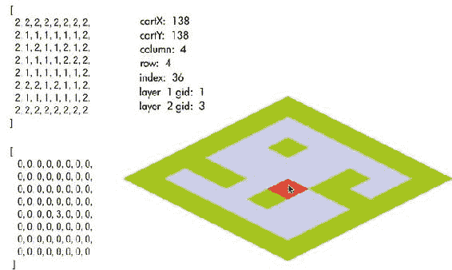

**图 4-4。** 将地图数组索引位置和笛卡尔坐标与等距位置相关联

例如，将指针移到红色方块上，你会看到该位置处两个地图层的 `gid` 编号。你还会看到与瓦片位置匹配的行号和列号。此外，显示内容还会告诉你，如果这是一个普通的 2D 地图，鼠标指针在该位置的笛卡尔 `x` 和 `y` 坐标会是多少。非常有用的信息！

这本质上是你在处理等距地图时的第一个“Hello World”。如果你对这些转换感到得心应手，那么像角色移动和碰撞这样的更高级功能就会自然而然地实现。

这里没有新的内容，只是我们使用了鼠标和指针对象的 `x` 和 `y` 坐标来帮助我们获取这些值。要从等距坐标转换为笛卡尔坐标，代码只是使用了本章开头展示的相同公式：

```javascript
cartX = (2 * isoY + isoX) / 2;
cartY = (2 * isoY - isoX) / 2;
```

我们唯一需要做的额外调整是补偿画布显示区域中等距地图可能存在的 x/y 偏移。以下是实现这一切的代码。

```javascript
pointer.cartX =
  (((2 * pointer.y + pointer.x) - (2 * world.y + world.x)) / 2)
  - (world.cartTilewidth / 2);
pointer.cartY =
  (((2 * pointer.y - pointer.x) - (2 * world.y - world.x)) / 2)
  + (world.cartTileheight / 2);
```

> **Note**
> 任何你可能正在使用的场景图或游戏引擎都会包含某种指针对象，它能提供 x 和 y 值。只需在你所使用的技术中识别出它，然后将这段代码应用到该对象上。

有了这些值，我们现在可以轻松计算图块的行和列位置。

```javascript
column = Math.floor(pointer.cartX / world.cartTilewidth);
row = Math.floor(this.cartY / world.cartTileheight);
```

最后，地图数组索引号：

```javascript
index = column + (row * world.widthInTiles);
```

# 等距地图中的指针与移动

为了让我们的生活更轻松，让我们使用名为`makeIsoPointer`的函数将这些属性添加到指针对象中。这样，我们就可以在需要时随时从指针中获取这些值。

```javascript
function makeIsoPointer(pointer, world) {
  Object.defineProperties(pointer, {
    //The isometric's world's Cartesian coordinates
    cartX: {
      get() {
        let x =
          (((2 * this.y + this.x) - (2 * world.y + world.x)) / 2)
          - (world.cartTilewidth / 2);
        return x;
      },
      enumerable: true,
      configurable: true
    },
    cartY: {
      get() {
        let y =
          (((2 * this.y - this.x) - (2 * world.y - world.x)) / 2)
          + (world.cartTileheight / 2);
        return y;
      },
      enumerable: true,
      configurable: true,
    },
    //The tile's column and row in the array
    column: {
      get() {
        return Math.floor(this.cartX / world.cartTilewidth);
      },
      enumerable: true,
      configurable: true
    },
    row: {
      get() {
        return Math.floor(this.cartY / world.cartTileheight);
      },
      enumerable: true,
      configurable: true,
    },
    //The tile's index number in the array
    index: {
      get() {
        let index = {};
        //Convert pixel coordinates to map index coordinates
        index.x = Math.floor(this.cartX / world.cartTilewidth);
        index.y = Math.floor(this.cartY / world.cartTileheight);
        //Return the index number
        return index.x + (index.y * world.widthInTiles);
      },
      enumerable: true,
      configurable: true,
    },
  });
}
```

现在你可以像这样将这些属性添加到你的指针中：

```javascript
makeIsoPointer(g.pointer, world);
```

并且你可以像这样在文本字段中显示它们：

```javascript
message.content = `
  cartX: ${Math.floor(g.pointer.cartX)}
  cartY: ${Math.floor(g.pointer.cartY)}
  column: ${g.pointer.column}
  row: ${g.pointer.row}
  index: ${g.pointer.index}
  layer 1 gid: ${world.layers[0][Math.floor(g.pointer.index)]}
  layer 2 gid: ${world.layers[1][Math.floor(g.pointer.index)]}
`;
```

这是本章源代码中`pointer.js`文件里唯一产生图[4-4]输出的新代码，其余代码与我们之前的示例相同。

我们在处理等距地图方面的所有核心技能已经就绪，所以让我们看看如何开始使用它们来制作游戏。

## 在等距世界中移动

接下来，让我们了解如何让游戏角色在这个等距地图上移动。运行本章源文件中的`movement.html`文件，并使用键盘方向键在迷宫中移动红色方块，如图[4-5]所示。一个文本字段会显示红色方块当前所在的地图数组索引号。

**图 4-5.** 使用方向键移动红色方块

别慌——你已经知道如何做到这一点了！所有代码所做的就是将你在前一章学到的基于图块的地图移动技术与我们的新等距技能结合起来。为了向你证明这一点，让我们来看看添加到现有代码库中的新代码。

首先，你需要定义“玩家”角色是什么。在这个例子中，它是一个红色方块。因此，在绘制图块地图的`switch`语句中，将其引用为玩家对象。

```javascript
case 3:
  sprite = isoRectangle(world.cartTilewidth, world.cartTileheight, 0xFF0000);
  player = sprite;
```

在`setup`函数中，我们还需要定义键盘方向键和玩家对象的`direction`属性，以便在地图上移动它。让我们添加代码来实现这一点，这与我们在前一章中用来完成相同任务的代码完全相同。

```javascript
//Create the keyboard objects
leftArrow = g.keyboard(37);
upArrow = g.keyboard(38);
rightArrow = g.keyboard(39);
downArrow = g.keyboard(40);

//Assign the key `press` actions
player.direction = "none";
leftArrow.press = () => player.direction = "left";
upArrow.press = () => player.direction = "up";
rightArrow.press = () => player.direction = "right";
downArrow.press = () => player.direction = "down";
leftArrow.release = () => player.direction = "none";
upArrow.release = () => player.direction = "none";
rightArrow.release = () => player.direction = "none";
downArrow.release = () => player.direction = "none";
```

下一步是向游戏循环中添加代码，以使用键盘输入来移动玩家。这基本上与我们在 2D 地图上移动精灵的代码相同，但有一个重要的变化。代码不是直接操作精灵的屏幕 x 和 y 位置值，而是使用精灵的`cartX`和`cartY`属性。精灵的位置、速度和屏幕边界都通过`cartX`和`cartY`进行更新。仅在最后一步，才使用新计算出的`isoX`和`isoY`属性来设置精灵的屏幕位置。

为什么？因为使用`cartX`和`cartY`进行所有逻辑和定位计算，意味着你可以编写完全等同于为普通 2D 基于图块的地图编写的代码。这意味着没有新东西需要学习！以下是游戏循环中执行所有这些操作的代码，额外好处是，它还能告诉你精灵正在占据哪个地图数组索引位置。

```javascript
//Change the player character's velocity if it's centered over a grid cell
if (Math.floor(player.cartX) % world.cartTilewidth === 0
&& Math.floor(player.cartY) % world.cartTileheight === 0) {
  switch (player.direction) {
    case "up":
      player.vy = -2;
      player.vx = 0;
      break;
    case "down":
      player.vy = 2;
      player.vx = 0;
      break;
```

## 玩家移动与边界检测

```javascript
case "left":
  player.vx = -2;
  player.vy = 0;
  break;
case "right":
  player.vx = 2;
  player.vy = 0;
  break;
case "none":
  player.vx = 0;
  player.vy = 0;
  break;
}

//Update the player's Cartesian position based on its velocity
player.cartY += player.vy;
player.cartX += player.vx;

//Add world boundaries
let top = 0,
    bottom = (world.heightInTiles * world.cartTileheight),
    left = 0,
    right = (world.widthInTiles * world.cartTilewidth);

//Prevent the player from crossing any of the world boundaries
//Top
if (player.cartY < 0) {
  player.cartY = top;
}
//Bottom
if (player.cartY + player.cartHeight > bottom) {
  player.cartY = bottom - player.cartHeight;
}
//Left
if (player.cartX < left) {
  player.cartX = left;
}
//Right
if (player.cartX + player.cartWidth > right) {
  player.cartX = right - player.cartWidth;
}

//Position the sprite's screen `x` and `y` position
//using its isometric coordinates
player.x = player.isoX;
player.y = player.isoY;

//Get the player's index position in the map array
player.index = g.getIndex(
  player.cartX, player.cartY,
  world.cartTilewidth, world.cartTileheight, world.widthInTiles
);

//Display the player's x, y and index values
message.content = `index: ${player.index}`;
```

现在我们已经可以在游戏世界中移动精灵了，下一步是添加碰撞检测。

# 等距碰撞检测

为了让基于瓦片的碰撞检测在等距世界中正常工作，我们需要对上一章学到的 `getPoints` 函数进行一些修改。我们不应使用精灵在屏幕上的常规 `x`、`y`、`width` 和 `height` 值，而应使用其 `cartX`、`cartY`、`cartWidth` 和 `cartHeight` 值。下面是一个名为 `getIsoPoints` 的新函数，它实现了这一点。

```javascript
function getIsoPoints(s) {
  let ca = s.collisionArea;
  if (ca !== undefined) {
    return {
      topLeft: {
        x: s.cartX + ca.x,
        y: s.cartY + ca.y
      },
      topRight: {
        x: s.cartX + ca.x + ca.width,
        y: s.cartY + ca.y
      },
      bottomLeft: {
        x: s.cartX + ca.x,
        y: s.cartY + ca.y + ca.height
      },
      bottomRight: {
        x: s.cartX + ca.x + ca.width,
        y: s.cartY + ca.y + ca.height
      }
    };
  }
  else {
    return {
      topLeft: {
        x: s.cartX,
        y: s.cartY
      },
      topRight: {
        x: s.cartX + s.cartWidth - 1,
        y: s.cartY
      },
      bottomLeft: {
        x: s.cartX,
        y: s.cartY + s.cartHeight - 1
      },
      bottomRight: {
        x: s.cartX + s.cartWidth - 1,
        y: s.cartY + s.cartHeight - 1
      }
    };
  }
}
```

（记住，`ca` 指的是精灵的碰撞区域，你在第 3 章中已经学过。）

现在，我们需要在 `hitTestTile` 函数中将旧的 `getPoints` 替换为 `getIsoPoints`。我们还需要使用精灵的 `cartX` 和 `cartY` 值来计算其中心点。让我们使用一个名为 `hitTestIsoTile` 的新版 `hitTestTile` 函数来实现这一点。下面是 `hitTestIsoTile` 的节选版本，其中突出显示了新更新的代码。

```javascript
function hitTestIsoTile(sprite, mapArray, gidToCheck, world, pointsToCheck) {
  //...
  switch (pointsToCheck) {
    case "center":
      let point = {
        center: {
          x: s.cartX + ca.x + (ca.width / 2),
          y: s.cartY + ca.y + (ca.height / 2)
        }
      };
      sprite.collisionPoints = point;
      collision.hit = Object.keys(sprite.collisionPoints).some(checkPoints);
      break;
    case "every":
      sprite.collisionPoints = getIsoPoints(sprite);
      collision.hit = Object.keys(sprite.collisionPoints).every(checkPoints);
      break;
    case "some":
      sprite.collisionPoints = getIsoPoints(sprite);
      collision.hit = Object.keys(sprite.collisionPoints).some(checkPoints);
      break;
  }
  //...
}
```

这些是对我们旧的 `hitTestTile` 函数需要做的唯一更改。你可以在本章的源文件中找到完整的 `hitTestIsoTile` 函数。

我们现在可以在游戏循环中使用 `hitTestIsoTile` 来检查碰撞，如下所示：

```javascript
//获取墙壁地图数组的引用
wallMapArray = world.layers[0];
//使用 `hitTestIsoTile` 检查碰撞
let playerVsGround = hitTestIsoTile(player, wallMapArray, 1, world, "every");
//如果发生碰撞，阻止玩家移动。
//从其位置中减去其速度，然后将其速度设置为零
if (!playerVsGround.hit) {
  player.cartX -= player.vx;
  player.cartY -= player.vy;
```

## 深度分层

到目前为止，在这些示例中，我们只使用了扁平的菱形精灵来构建我们的等距世界。但在大多数游戏中，你会希望为精灵使用真实的、具有 3D 外观的形状。运行本章源文件中的 `depthLayering.html` 文件，查看这样一个等距世界的实际示例，如图 4-6 所示。

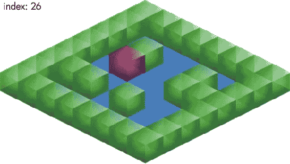

**图 4-6. 使用 3D 精灵构建等距世界**

它使用相同的地图，并沿用前面示例的键盘控制和碰撞逻辑。不同之处在于，这些瓦片由透明的立方体图像制成，并且按深度正确排序。深度排序意味着那些看起来离观察者更近的精灵会显示在更远的精灵前面。

### 按 `z` 属性值对精灵排序

我们需要向代码中添加两个新内容来进行正确的等距深度排序。首先，每个精灵都需要一个名为 `z` 的新属性，它决定了精灵的深度层级。

```javascript
sprite.z = depthLayer;
```

位于较低层级地图层上的精灵应该具有比较高层级地图层上的精灵更低的 `z` 值。你将在代码示例中看到如何找到此值并将其分配给精灵。

接下来，你需要根据这个新的 `z` 值对精灵进行排序。因为大多数显示系统会根据精灵在显示列表中的出现顺序将其绘制到屏幕上，所以你只需更改它们在列表中的顺序就能改变它们的深度层级。显示列表只是一个精灵数组，这意味着你只需要一个自定义的 JavaScript 数组排序方法，根据它们的 `z` 值对该数组中的精灵重新排序。

下面是一个名为 `byDepth` 的自定义排序函数，它正是这样做的。它通过将精灵的笛卡尔 `x` 和 `y` 坐标相加，再乘以其 `z` 值，来计算每个精灵的等距深度。然后，它会根据深度将数组中每一对相邻的精灵移动到更低或更高的索引位置。

```javascript
function byDepth(a, b) {
  //计算 `a` 和 `b` 的深度
  //（将 `1` 加到 `a.z` 和 `b.z` 上以避免乘以 0）
  a.depth = (a.cartX + a.cartY) * (a.z + 1);
  b.depth = (b.cartX + b.cartY) * (b.z + 1);

  //将深度较低的精灵移动到数组中更高的位置
  if (a.depth < b.depth) {
    //将精灵向下移动一个位置
    return -1;
  } else if (a.depth > b.depth) {
    //将精灵向上移动一个位置
    return 1;
  } else {
    //将精灵保持在相同位置
    return 0;
  }
}
```

返回值 `-1` 表示精灵将在数组中向下移动一位，值 `1` 表示它将向上移动一位。值为零表示精灵将保持其当前位置。要使用 `byDepth` 函数，只需将其作为参数提供给代表精灵显示列表的任意数组的 JavaScript `sort` 方法。许多场景图和游戏引擎使用一个名为 `children` 的数组来定义显示列表，因此你可以像这样按深度对 `children` 数组进行排序：

```javascript
world.children.sort(byDepth);
```

现在让我们了解如何在实际中使用它。

### 分层 3D 等距精灵

`depthLayering.js` 示例文件使用了一个由三个立方体图像组成的瓦片集，如图 4-7 所示。

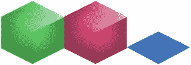

**图 4-7. 包含 3 个等距精灵图像的图块集**

绿色方块代表迷宫墙壁，红色方块代表玩家角色，蓝色图块代表地面。每个精灵都位于独立的地图层中。

```javascript
world.layers = [
  //地板层
  [
    1, 1, 1, 1, 1, 1, 1, 1,
    1, 1, 1, 1, 1, 1, 1, 1,
    1, 1, 1, 1, 1, 1, 1, 1,
    1, 1, 1, 1, 1, 1, 1, 1,
    1, 1, 1, 1, 1, 1, 1, 1,
    1, 1, 1, 1, 1, 1, 1, 1,
    1, 1, 1, 1, 1, 1, 1, 1,
    1, 1, 1, 1, 1, 1, 1, 1
  ],
  //墙壁层
  [
    2, 2, 2, 2, 2, 2, 2, 2,
    2, 0, 0, 0, 0, 0, 0, 2,
    2, 0, 2, 0, 0, 2, 0, 2,
    2, 0, 0, 0, 0, 2, 2, 2,
    2, 0, 0, 0, 0, 0, 0, 2,
    2, 2, 2, 0, 2, 0, 0, 2,
    2, 0, 0, 0, 0, 0, 0, 2,
    2, 2, 2, 2, 2, 2, 2, 2
  ],
  //玩家层
  [
    0, 0, 0, 0, 0, 0, 0, 0,
    0, 0, 0, 0, 0, 0, 0, 0,
    0, 0, 0, 0, 0, 0, 0, 0,
    0, 0, 0, 0, 0, 0, 0, 0,
    0, 0, 0, 0, 3, 0, 0, 0,
    0, 0, 0, 0, 0, 0, 0, 0,
    0, 0, 0, 0, 0, 0, 0, 0,
    0, 0, 0, 0, 0, 0, 0, 0
  ]
];
```

为了帮助绘制此地图，我们需要初始化一个新的 `z` 值来追踪每个图层的深度。`z` 值初始化为零，每新增一个图层就增加 1。每创建一个新精灵后，`z` 值被分配给精灵自身的 `z` 属性，以便在循环结束时能够正确地按深度排序。

```javascript
//`z`索引
let z = 0;

//通过遍历每个数组来构建游戏世界
world.layers.forEach(layer => {
  //遍历每个数组元素
  layer.forEach((gid, index) => {
    //如果单元格不为空(0),则创建一个精灵
    if (gid !== 0) {
      //查找精灵所在的列和行，以及
      //它的 x 和 y 像素值
      let column, row, x, y;
      column = index % world.widthInTiles;
      row = Math.floor(index / world.widthInTiles);
      x = column * world.cartTilewidth;
      y = row * world.cartTileheight;

      //接下来，根据`gid`编号创建不同的精灵
      let sprite;
      switch (gid) {
        //地板
        case 1:
          sprite = g.sprite(g.frame("images/isoTileset.png", 128, 0, 64, 64));
          break;
        //墙壁
        case 2:
          sprite = g.sprite(g.frame("images/isoTileset.png", 0, 0, 64, 64));
          break;
        //玩家
        case 3:
          sprite = g.sprite(g.frame("images/isoTileset.png", 64, 0, 64, 64));
          player = sprite;
          break;
      }

      //为精灵添加等距属性
      addIsoProperties(sprite, x, y, world.cartTilewidth, world.cartTileheight);

      //根据其等距坐标设置精灵的`x`和`y`像素位置
      sprite.x = sprite.isoX;
```

# 深度排序与等距地图

```javascript
sprite.y = sprite.isoY;

//为精灵添加新的`z`深度属性

sprite.z = z;

//将精灵添加到`world`容器中

world.addChild(sprite);

}

});

//每新增一个图层，`z`值增加`1`

z += 1;

});

//将玩家移动到环境的深度层中

player.z = 1;

//按深度对世界进行排序

world.children.sort(byDepth);
```

上面代码中的最后两行很重要。循环运行后，地板精灵的`z`值将为 0，墙壁精灵的`z`值将为 1，玩家角色（红色方块）的`z`值将为 2。但是，我们希望玩家角色与墙壁处于同一深度级别，因此我们需要手动将玩家的`z`属性设置为 1。如果我们保持其原始值 2，玩家将会漂浮在墙壁上方的一个图层上。代码最后做的事情是对`world`对象的`children`数组进行深度排序，以便将玩家精灵组织到正确的图层中。

### 更新深度

每当任何精灵改变其位置时，都需要再次进行深度排序。在此示例的游戏循环中，玩家精灵通过键盘在场景中移动。每次移动时，都需要对`world`对象的`children`数组中的所有精灵重新排序。

```javascript
if (player.vx !== 0 || player.vy !== 0) {

  world.children.sort(byDepth);

}
```

对数组排序是一项计算开销很大的操作，因此最好只在确实需要时才进行。这就是为什么上面的代码只在玩家精灵的速度发生变化时才执行排序的原因。

## 使用 Tiled 编辑器制作等距地图

如果你要制作一张庞大而复杂的等距地图，使用 Tiled 编辑器之类的工具来制作比手动编写地图层数组要容易得多。Tiled 编辑器内置了对等距地图的支持，我们可以利用它的输出来轻松生成任何类型的等距世界。我们只需要以正确的方式配置 Tiled 编辑器，并对第 2 章中的`makeTiledWorld`函数做一些小的修改即可。

运行图 4-8 所示的`cubes.html`，查看一个使用 Tiled 编辑器设计的游戏原型示例。它的运行方式与我们之前的示例非常相似，包括键盘移动、碰撞和深度分层。

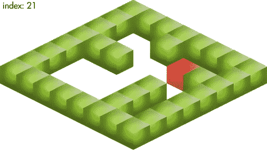

### 图 4-8. 使用 Tiled 编辑器构建的等距游戏原型

接下来，让我们了解如何自己使用 Tiled 编辑器来构建类似的东西。

### 配置和构建地图

在开始创建 Tiled 编辑器地图之前，请准备好包含你想要使用的等距图块的精灵表。并且，非常重要的一点是，记录下精灵的等距尺寸。以下是您需要了解的像素尺寸：

*   `tilewidth`：精灵的宽度，从它的左边缘到右边缘。
*   `tileheight`：图块*基底区域*的高度。这仅仅是定义等距精灵站立基底的压扁菱形的高度。通常，它是`tilewidth`值的一半。

图 4-9 说明了如何找到这些值。

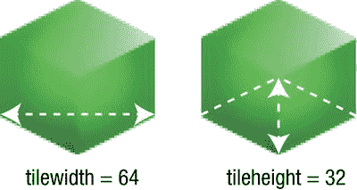

### 图 4-9. `tilewidth`和`tileheight`属性值

这些属性是 Tiled 编辑器使用的属性名称，您将能够在 Tiled 编辑器生成的 JSON 数据文件中访问它们。

> **注：** `tilewidth`和`tileheight`这两个属性名称是 Tiled 编辑器为 JSON 文件使用和生成的。因此，为了一致性，我保留了相同的名称和大小写。

现在，您可以使用这些值在 Tiled 编辑器中创建一个新的等距地图。打开 Tiled 编辑器，从主菜单中选择**文件** ➤ **新建**。在**新建地图**对话框中，选择**等距**作为**方向**，并使用我上面描述的`tilewidth`和`tileheight`值作为**宽度**和**高度**。图 4-10 展示了一个示例。

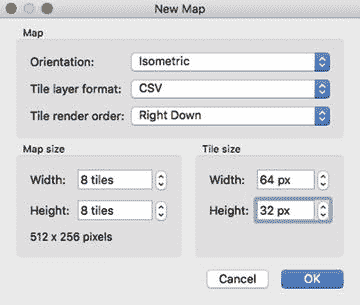

### 图 4-10. 在 Tiled 编辑器中创建新的等距地图

但还没完！我们还需要计算三个值：

*   `tileDepth`：等距精灵的总高度，以像素为单位。图 4-11 说明了这个值。

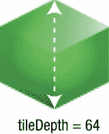

###### 图 4-11. `tileDepth`属性描述了等距精灵的总高度

*   `cartWidth`：每个图块网格单元格的笛卡尔宽度，以像素为单位。
*   `cartHeight`：每个图块网格单元格的笛卡尔高度，以像素为单位。

您需要将这些值作为自定义属性添加到 Tiled 编辑器的**地图属性**面板中。图 4-12 显示了应该是什么样子。

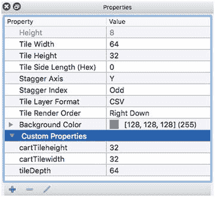

### 图 4-12. 添加自定义地图属性

当 `Tiled Editor` 生成 JSON 地图数据时，你将能够在 `properties` 字段中访问这些值。

```json
"properties":

    {

     "cartTileheight":"32",

     "cartTilewidth":"32",

     "tileDepth":"64"

    },
```

在后面的代码示例中，你将看到我们需要如何使用这些值来精确绘制等距地图。

现在你已经设置好了地图属性，请像第 2 章那样使用等距图块集来构建你的世界。图 4-13 展示了你的 `Tiled Editor` 工作区可能的外观。

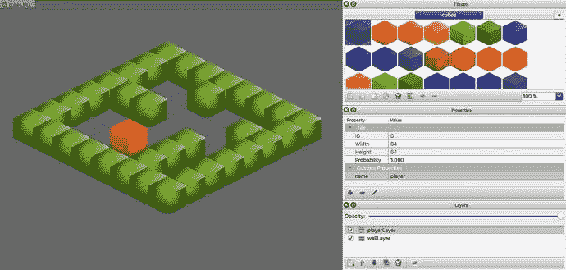

### 图 4-13. 在 Tiled Editor 中设计等距地图

在图 4-13 中，你可以看到我给红色立方体赋予了值为 `"player"` 的自定义名称属性。我还使用两个图层构建了地图：`playerLayer` 仅包含红色立方体，而 `wallLayer` 包含所有迷宫墙壁。

设计完地图后，将其导出为 JSON 文件，现在你就可以用它开始编写游戏代码了。

### `makeIsoTiledWorld` 函数

下一步是修改第 2 章中的 `makeTiledWorld` 函数，使其能够处理等距地图。以下是实现此功能的新版 `makeIsoTiledWorld`。它遵循与原版相同的格式，但应用了本章学到的关于等距地图的所有知识。我在代码中添加了从 A 到 I 的注释，以突出显示新的修改部分。

```javascript
function makeIsoTiledWorld(jsonTiledMap, tileset) {

//创建一个名为 `world` 的组，用于包含 `tiledMap` 中的所有图层、精灵

  //和对象。`world` 对象将被返回给主游戏程序

  let tiledMap = PIXI.loader.resources[jsonTiledMap].data;

//A. 你需要向 Tiled Editor 地图添加三个自定义属性：

  //`cartTilewidth`、`cartTileheight` 和 `tileDepth`。

  //检查这些自定义属性是否存在

  if (!tiledMap.properties.cartTilewidth

  && !tiledMap.properties.cartTileheight

  && !tiledMap.properties.tileDepth) {

    throw new Error(

      "请在 Tiled Editor 中设置自定义的 cartTilewidth、cartTileheight 和 tileDepth 地图属性"

    );

  }

//创建 `world` 容器

  let world = new PIXI.Container();

//B. 将 `tileHeight` 设置为 `tiledMap` 的 `tileDepth` 属性

  //使其与精灵图块图像的像素高度匹配

  world.tileheight = parseInt(tiledMap.properties.tileDepth);

  world.tilewidth = tiledMap.tilewidth;
```

//C. 定义每个图块的笛卡尔维度

`world.cartTileheight` = parseInt(`tiledMap.properties.cartTileheight`);

`world.cartTilewidth` = parseInt(`tiledMap.properties.cartTilewidth`);

//D. 使用 `world.cartTileHeight` 和 `world.cartTilewidth` 值

//计算世界的 `width` 和 `height`（以像素为单位）

`world.worldWidth` = `tiledMap.width` * `world.cartTilewidth`;

`world.worldHeight` = `tiledMap.height` * `world.cartTileheight`;

//获取世界的以图块为单位的宽度和高度引用，

//以备后续需要（你会的！）

`world.widthInTiles` = `tiledMap.width`;

`world.heightInTiles` = `tiledMap.height`;

//创建一个 `objects` 数组，用于存储对地图中任何

//命名对象的引用。命名对象都具有在 Tiled Editor 中分配的 `name` 属性

`world.objects` = [];

//每个图块周围的可选间距（内边距）

//这是为了考虑图块周围的间距，

//常用于纹理图集图块集。在 Tiled Editor 中创建新地图时设置

//`spacing` 属性

let `spacing` = `tiledMap.tilesets[0].spacing`;

//计算图块集上有多少列。

//这是图像宽度除以每个图块的宽度，

//再加上每个图块周围的可选间距

let `numberOfTilesetColumns` =

  Math.floor(

    `tiledMap.tilesets[0].imagewidth` / (`tiledMap.tilewidth` + `spacing`)

  );

//E. 一个 `z` 属性，用于帮助追踪精灵所在的深度层级

let `z` = 0;

//遍历所有地图图层

`tiledMap.layers.forEach(tiledLayer => {`

//为该图层创建一个组，并复制

//该图层的所有属性到该组上

let `layerGroup` = new `PIXI.Container`();

`Object.keys(tiledLayer).forEach(key => {`

//将图层的所有属性添加到该组，除了

//宽度和高度（因为组会根据其内容自行计算这些值）

if (`key` !== "width" && `key` !== "height") {

  `layerGroup[key]` = `tiledLayer[key]`;

}

});

//将 `opacity` 转换为 `alpha`

`layerGroup.alpha` = `tiledLayer.opacity`;

// 将图层组添加到 `world`（世界）中

`world.addChild(layerGroup)`;

// 将该图层组推入世界的 `objects`（对象）数组

// 以便稍后可以访问它

`world.objects.push(layerGroup)`;

// 当前图层是 `tilelayer`（瓦片图层）吗？

if (`tiledLayer.type` === "tilelayer") {

  // 遍历该图层的 `data`（数据）数组

  `tiledLayer.data.forEach((gid, index) => {`

    let `tileSprite`, `texture`, `mapX`, `mapY`, `tilesetX`, `tilesetY`,

      `mapColumn`, `mapRow`, `tilesetColumn`, `tilesetRow`;

    // 如果网格 id（`gid`）不为零，则创建一个精灵

    if (`gid` !== 0) {

      // 确定当前所在的图块列和行号，然后

      // 计算网格单元的 x 和 y 像素位置

      `mapColumn` = `index` % `world.widthInTiles`;

      `mapRow` = Math.floor(`index` / `world.widthInTiles`);

      // 使用笛卡尔坐标值来找到

      // `mapX` 和 `mapY` 的值

      `mapX` = `mapColumn` * `world.cartTilewidth`;

      `mapY` = `mapRow` * `world.cartTileheight`;

      // 确定图块集图像所在的列和行号，然后使用这些值计算

      // 图块集上图像的 x 和 y 像素位置

      `tilesetColumn` = ((`gid` - 1) % `numberOfTilesetColumns`);

      `tilesetRow` = Math.floor((`gid` - 1) / `numberOfTilesetColumns`);

      `tilesetX` = `tilesetColumn` * `world.tilewidth`;

      `tilesetY` = `tilesetRow` * `world.tileheight`;

      // 如果存在，补偿图块周围任何可选的间距（内边距）。

      // 这段代码累计图块集左侧的间距偏移量，并将它们添加到当前图块的位置

      if (`spacing` > 0) {

        `tilesetX`

          += `spacing` + (`spacing` * ((`gid` - 1) % `numberOfTilesetColumns`));

        `tilesetY`

          += `spacing` + (`spacing` * Math.floor((`gid` - 1) / `numberOfTilesetColumns`));

      }

      // 使用上述值从图块集图像创建精灵的图像

      `texture` = `g.frame`(

        `tileset`, `tilesetX`, `tilesetY`,

        `world.tilewidth`, `world.tileheight`

      );

      // 我决定任何具有 `name`（名称）属性的图块都是重要的

      // 并且应该在 `world.objects` 数组中可访问

      let `tileproperties` = `tiledMap.tilesets[0].tileproperties`,

        `key` = String(`gid` - 1);

      // 如果 JSON 的 `tileproperties` 对象有一个与当前图块匹配的子对象，

      // 并且该子对象有一个 `name`（名称）属性，

      // 则创建一个精灵并将图块属性赋值到

      // 该精灵上

      if (`tileproperties[key]` && `tileproperties[key].name`) {

        // 创建一个精灵

        `tileSprite` = new `PIXI.Sprite(texture)`;

        // 将图块的所有属性复制到精灵上

        // （这包括 `name`（名称）属性）

        `Object.keys(tileproperties[key]).forEach(property => {`

          `tileSprite[property]` = `tileproperties[key][property]`;

        });

        // 将精灵推入世界的 `objects`（对象）数组

        // 以便稍后可以通过 `name`（名称）访问它

        `world.objects.push(tileSprite)`;

      }

      // 如果图块没有 `name`（名称）属性，则只需用它来

// 创建一个普通精灵（它只需要一个纹理）

else {

  tileSprite = new PIXI.Sprite(texture);

}

// 为精灵添加等距属性

addIsoProperties(

  tileSprite, mapX, mapY,

  world.cartTilewidth, world.cartTileheight

);

// 使用等距位置将精灵添加到世界中

tileSprite.x = tileSprite.isoX;

tileSprite.y = tileSprite.isoY;

tileSprite.z = z;

// 记录精灵在数组中的索引号

// （稍后我们会用它进行碰撞检测）

tileSprite.index = index;

// 记录精灵在图块集上的 `gid`。

// 稍后这对碰撞检测也很有用

tileSprite.gid = gid;

// 将精灵添加到当前图层组

layerGroup.addChild(tileSprite);

}

});

}

// 这个图层是 `objectgroup`（对象组）吗？

if (tiledLayer.type === "objectgroup") {

  tiledLayer.objects.forEach(object => {

    // 我们只是要捕获对象的属性

    // 以便稍后决定如何处理它。

    // 获取对象所在的图层组的引用

    object.group = layerGroup;

    // 将对象推入世界的 `objects`（对象）数组

    world.objects.push(object);

  });

}

// z 索引加 1（第一个图层的 z 索引为 `1`）

z += 1;

});

// 搜索函数

world.getObject = (objectName) => {

  let searchForObject = () => {

    let foundObject;

    world.objects.some(object => {

      if (object.name && object.name === objectName) {

        foundObject = object;

        return true;

      }

    });

    if (foundObject) {

      return foundObject;

    } else {

      throw new Error("不存在属性名称为 " + objectName + " 的对象");

    }

  };

  // 返回搜索函数

  return searchForObject();

};

world.getObjects = (objectNames) => {

  let foundObjects = [];

  world.objects.forEach(object => {

    if (object.name && objectNames.indexOf(object.name) !== -1) {

      foundObjects.push(object);

    }

  });

  if (foundObjects.length > 0) {

    return foundObjects;

  } else {

    throw new Error("我找不到这些对象");

  }

  return foundObjects;

};

// 就这样，我们完成了！

// 最后，将 `world` 对象返回给游戏程序

return world;

```

有了这个新的 `makeIsoTiledWorld` 函数，我们就有了一种方法来绘制我们在 Tiled Editor 中创建的地图，并访问它包含的所有精灵。接下来让我们具体了解如何做到这一点。

# 构建游戏世界

使用`makeIsoTiledWorld`函数的方式与原始`makeTiledWorld`函数完全相同，因此无需学习任何新内容。唯一需要注意的是，如果你改变了任何精灵的位置或`z`属性，就需要使用自定义的`byDepth`函数重新对精灵进行深度排序。在本例中，所有精灵都位于每个地图图层容器的`children`数组中，因此你需要像这样进行深度排序：

```
mapLayer.children.sort(byDepth);
```

除此之外，没有其他需要学习的新内容。以下是图 4-8 所展示的`cubes.js`文件的完整应用代码。它加载了在 Tiled Editor 中创建的等距地图，并实现了键盘交互、碰撞检测和精确的深度排序。你在其他上下文中已经见过所有这些代码，注释中详细解释了其功能。

```
//The files we want to load
let thingsToLoad = [
  "images/cubes.png",
  "images/cubes.json"
];

//Create a new Hexi instance, and start it
let g = hexi(512, 512, setup, thingsToLoad);

//Scale the canvas to the maximum browser dimensions
g.scaleToWindow();

//Declare variables used in more than one function
let world, leftArrow, upArrow,
  rightArrow, downArrow, message, wallLayer,
  player, wallMapArray;

//Start Hexi
g.start();

function setup() {
  //Make the world from the Tiled JSON data
  world = makeIsoTiledWorld(
    "images/cubes.json",
    "images/cubes.png"
  );

  //Add the world to the `stage`
  g.stage.addChild(world);

  //Position the world inside the canvas
  let canvasOffset = (g.canvas.width / 2) - world.tilewidth / 2;
  world.x += canvasOffset;
  world.y = 0;

  //Get the objects we need from the world
  player = world.getObject("player");
  wallLayer = world.getObject("wallLayer");

  //Add the player to the wall layer and set it at
  //the same depth level as the walls
  wallLayer.addChild(player);
  player.z = 0;
  wallLayer.children.sort(byDepth);

  //Initialize the player's velocity to zero
  player.vx = 0;
  player.vy = 0;

  //Make a text object
  message = g.text("", "16px Futura", "black");
  message.setPosition(5, 0);

  //Create the keyboard objects
  leftArrow = g.keyboard(37);
  upArrow = g.keyboard(38);
  rightArrow = g.keyboard(39);
  downArrow = g.keyboard(40);

  //Assign the key `press` actions
```

```javascript
player.direction = "none";

leftArrow.press = () => player.direction = "left";
upArrow.press = () => player.direction = "up";
rightArrow.press = () => player.direction = "right";
downArrow.press = () => player.direction = "down";

leftArrow.release = () => player.direction = "none";
upArrow.release = () => player.direction = "none";
rightArrow.release = () => player.direction = "none";
downArrow.release = () => player.direction = "none";

//Set the game state to `play`
g.state = play;
}

function play() {
//Change the player character's velocity if it's centered over a grid cell
if (Math.floor(player.cartX) % world.cartTilewidth === 0
&& Math.floor(player.cartY) % world.cartTileheight === 0) {
switch (player.direction) {
case "up":
player.vy = -2;
player.vx = 0;
break;
case "down":
player.vy = 2;
player.vx = 0;
break;
case "left":
player.vx = -2;
player.vy = 0;
break;
case "right":
player.vx = 2;
player.vy = 0;
break;
case "none":
player.vx = 0;
player.vy = 0;
break;
}
}

//Update the player's Cartesian position, based on its velocity
player.cartY += player.vy;
player.cartX += player.vx;

//Wall collision
//Get a reference to the wall map array
wallMapArray = wallLayer.data;

//Use `hitTestIsoTile` to check for a collision
let playerVsGround = hitTestIsoTile(player, wallMapArray, 0, world, "every");

//If there's a collision, prevent the player from moving.
//Subtract its velocity from its position and then set its velocity to zero
if (!playerVsGround.hit) {
player.cartX -= player.vx;
player.cartY -= player.vy;
player.vx = 0;
player.vy = 0;
}

//Add world boundaries
let top = 0,
bottom = (world.heightInTiles * world.cartTileheight),
left = 0,
right = (world.widthInTiles * world.cartTilewidth);

//Prevent the player from crossing any of the world boundaries
//Top
if (player.cartY < 0) {
player.cartY = top;
}
//Bottom
if (player.cartY + player.cartHeight > bottom) {
player.cartY = bottom - player.cartHeight;
}
//Left
if (player.cartX < left) {
player.cartX = left;
}
//Right
if (player.cartX + player.cartWidth > right) {
player.cartX = right - player.cartWidth;
}

//Position the sprite's screen `x` and `y` position
//using its isometric coordinates
player.x = player.isoX;
player.y = player.isoY;

//Get the player's index position in the map array
player.index = g.getIndex(
player.cartX, player.cartY,
world.cartTilewidth, world.cartTileheight, world.widthInTiles
);

//Depth sort the sprites if the player is moving
if (player.vx !== 0 || player.vy !== 0) {
wallLayer.children.sort(byDepth);
}

//Display the player's x, y and index values
message.content = `index: ${player.index}`;
}
```

## 总结

不论你的游戏采用笛卡尔投影还是等距投影，处理基于瓦片的游戏的基本逻辑是相同的。正如本章所见，如果你知道如何绘制地图、添加键盘交互以及使用笛卡尔坐标进行碰撞检测，那么你可以将同样的逻辑应用于等距地图，只需添加两个简单的转换公式。你还学会了如何将这些公式应用于指针位置坐标，从而在屏幕上精确地选中等距精灵。此外，你还掌握了如何使用 Tiled Editor 创建和绘制等距地图，并利用`z`值对这些精灵进行精确的深度排序，使它们能够在正确的深度图层上显示。这些都是制作各种等距游戏（从策略游戏到地牢探险游戏）所需具备的基础技能。

既然你已经知道如何创建各种交互式基于瓦片的游戏环境，那么如何制作能够智能地在这些环境中导航的游戏角色呢？这就是下一章的内容：寻路。

© Rex van der Spuy 2017

Rex van der Spuy, 《高级游戏开发者工具包》, 10.1007/978-1-4842-1097-0_5
