# 5. 寻路基础

Rex van der Spuy¹

(1) 加拿大安大略省多伦多市

你现在已经知道如何制作基于瓦片的游戏世界，也知道了如何制作一个能够在这个世界中导航的玩家角色。但是，如何创建能够自主游荡和探索世界的精灵呢？花点时间来体验一下本章源文件中名为`tileBasedLineOfSight.html`的示例原型（如图 5-1 所示）。迷宫中有三个怪物，它们会随机游荡，直到发现外星人角色——然后就会穷追不舍。

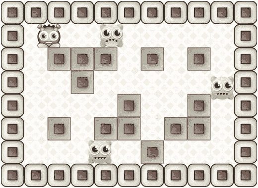

### 图 5-1. 怪物在游戏世界中自主导航并追逐玩家角色

这些怪物似乎拥有某种智能，其行为方式与我们对生物的预期非常吻合。但当然，这仅仅是一种有效的错觉，这要归功于一系列游戏编程技术，它们被统称为`寻路`：如何让精灵能够自主解析并在游戏世界中导航。在本章中，你将学习寻路的所有基础知识，包括：

-   如何分析和理解精灵所处的环境。
-   在迷宫中随机移动。
-   寻找距离目标最近的方向。
-   视线：如何判断一个精灵能否看到另一个精灵。

寻路实际上是人工智能（AI）的一种初级形式，你将能够应用这些技术，不仅适用于各种不同的游戏，也适用于任何需要基于数据在更大数据集中的上下文来解释其含义的编程问题。而且，实现起来相当容易！那么，让我们从一些寻路基础开始，然后深入探讨。

## 在迷宫中随机移动

学习寻路最好的起点是首先创建在迷宫中随机移动的精灵。运行`randomMovement.html`文件，你会找到一个与图 5-1 所示的迷宫游戏相同的简化版本。怪物不会主动寻找外星人角色，而是每当它们处于交叉路口时就会随机改变方向。让我们来了解一下这段代码的工作原理，同时学习所有的寻路基础知识。

### 方向与速度

当怪物精灵在游戏的设置函数中被创建时，它们会被初始化两个重要的属性：`direction`和`speed`，如下面的精灵创建代码中突出显示的部分所示：

```javascript
monsters = mapMonsters.map(mapMonster => {
  let monster = g.sprite(monsterFrames);
  monster.x = mapMonster.x;
  monster.y = mapMonster.y;
  monster.direction = "none";
  monster.speed = 4;
  monsterLayer.addChild(monster);
  mapMonster.visible = false;
  return monster;
});
```

`direction`是一个字符串，初始化为`"none"`——你稍后将看到我们如何为其赋予新的字符串值。`speed`是精灵每帧应移动的像素数，并且这个数字应能整除地图的`tilewidth`和`tileheight`大小。我们需要使用这些`direction`和`speed`值来帮助赋予怪物新的随机方向和速度。

### 在游戏循环中移动精灵

实际选择怪物新方向并使其移动的代码运行在游戏循环内。执行此操作的代码需要完成四项重要工作：

1.  判断怪物是否恰好位于一个地图瓦片单元格的正中心。
2.  如果是，则选择一个随机的新方向。
3.  使用怪物的新随机方向和速度来计算其速度向量。
4.  使用新的速度向量来移动怪物。

以下是在游戏循环中完成所有这些操作的代码。

```javascript
monsters.forEach(monster => {
  //1. 怪物是否直接位于一个地图瓦片单元格的中心？
  if (isCenteredOverCell(monster)) {
    //2. 是的，它在中心，因此找出哪些是合法的移动方向。
    //`validDirections` 返回一个数组，其中可以包含
    //以下任何字符串值："up", "right", "down" 或 "left"
    monster.validDirections = validDirections(
      monster, wallMapArray, 0, world
    );
    //3. 怪物能否改变方向？
    if (canChangeDirection(monster.validDirections)) {
      //4. 如果可以，从怪物的合法方向中随机选择一个新方向
      monster.direction = randomDirection(monster, monster.validDirections);
    }
    //5. 根据怪物的方向和速度计算其新的速度向量
    let velocity = directionToVelocity(monster.direction, monster.speed);
    monster.vx = velocity.vx;
    monster.vy = velocity.vy;
  }
  //6. 移动怪物
  monster.x += monster.vx;
  monster.y += monster.vy;
});
```

这是非常高层级的代码。你可以看到，所有重要的功能都封装在五个重要的函数中：`isCenteredOverCell`、`validDirections`、`canChangeDirection`、`randomDirection`和`directionToVelocity`。接下来我们将逐一审视这些函数，确切了解它们的工作原理。

### 精灵是否位于瓦片单元格的中心？

正如你在第 3 章所学到的，如果你的精灵只在恰好位于单元格中心时才改变方向，它们在基于瓦片的世界中移动会更加精确和精准。因此，代码做的第一件事就是通过一个名为`isCenteredOverCell`的辅助函数来判断这一点。向它传入一个精灵，如果精灵在中心位置，`isCenteredOverCell`将返回`true`，否则返回`false`。

```javascript
function isCenteredOverCell(sprite) {
  return Math.floor(sprite.x) % world.tilewidth === 0
  && Math.floor(sprite.y) % world.tileheight === 0
}
```

这是一段略显古怪的样板代码，它展示了取模运算符（`%`）有时是多么出人意料地有用。（提醒一下，取模运算符告诉你除法运算的余数是多少。）上面的代码找出精灵左上角位置的`x`和`y`坐标，除以瓦片的宽度和高度，看余数是否为零。如果是，那么你就知道精灵所处的`x`/`y`位置能够完全整除瓦片的尺寸。而这只能意味着一件事：精灵*正好*对齐在单元格之上。这是一个巧妙的小把戏——谢谢你，取模运算符！

如果精灵在中心位置，下一步就是找出精灵可以选择哪些可能的合法方向。

### 寻找有效方向

`validDirections`函数分析精灵当前所处的地图环境，并返回一个字符串数组，其中包含精灵可以移动的所有有效方向。

```javascript
monster.validDirections = validDirections(
  monster,       //精灵对象            
  wallMapArray,  //瓦片地图数组            
  0,             //代表空瓦片的 gid 值            
  world          //世界对象。它需要以下属性：            
                 //`tilewidth`、`tileheight`和`widthInTiles`            
);
```

`validDirections`返回的数组可以包含以下五个字符串值中的任意几个：`"up"`、`"down"`、`"left"`、`"right"`或`"none"`。其判定方式相当有趣，让我们先看一下整个`validDirections`函数，然后我会逐步讲解它的工作原理。

```javascript
function validDirections(sprite, mapArray, validGid, world) {

  //获取精灵当前在地图数组中的索引位置编号
  let index = g.getIndex(
    sprite.x,
    sprite.y,
    world.tilewidth,
    world.tileheight,
    world.widthInTiles
  );

  //一个包含精灵上、下、左、右四个方向瓦片单元格索引编号的数组
  let surroundingCrossCells = (index, widthInTiles) => {
    return [
      index - widthInTiles,  //上方的单元格
      index - 1,             //左侧的单元格
      index + 1,             //右侧的单元格
      index + widthInTiles,  //下方的单元格
    ];
  };

  //获取精灵上、右、左、下四个方向单元格的索引位置编号
  let surroundingIndexNumbers = surroundingCrossCells(index, world.widthInTiles);

  //查找与周围索引编号相匹配的所有瓦片 gid 编号
  let surroundingTileGids = surroundingIndexNumbers.map(index => {
    return mapArray[index];
  });

  //`directionList`是一个包含四个字符串值的数组，这些值可以是
  //"up"、"left"、"right"、"down"或"none"，具体取决于
  //对应方向是否存在具有有效 gid 的单元格
  let directionList = surroundingTileGids.map((gid, i) => {
    //可能的方向
    let possibleDirections = ["up", "left", "right", "down"];
    //如果方向有效，则选择该方向对应的字符串标识符
    //否则返回"none"
    if (gid === validGid) {
      return possibleDirections[i];
    } else {
      return "none";
    }
  });

  //我们不需要方向列表中的"none"，所以
  //把它过滤掉（它只是一个占位符）
  let filteredDirectionList = directionList.filter(direction => direction != "none");

  //返回过滤后的有效方向列表
  return filteredDirectionList;
}
```

现在，让我们深入了解它的实际工作原理！

## 精灵周围的瓦片

`validDirections`函数做的第一件事是找出哪些地图瓦片位于精灵周围。一个名为`surroundingCrossCells`的函数利用精灵在地图数组中的索引编号来解决这个问题。它返回一个包含四个地图索引编号的数组，这些编号分别代表精灵上方、左侧、右侧和下方的单元格。

```javascript
let surroundingCrossCells = (index, widthInTiles) => {
  return [
    index - widthInTiles,  //上方的单元格
    index - 1,             //左侧的单元格
    index + 1,             //右侧的单元格
    index + widthInTiles,  //下方的单元格
  ];
};

let surroundingIndexNumbers =
  surroundingCrossCells(index, world.widthInTiles);
```

图 5-2 展示了这些单元格相对于精灵的位置，以及它们对应的地图数组索引编号。在此示例中，迷宫的每一行有 11 个单元格，怪物精灵的位置索引编号为 38。精灵周围的地图数组索引编号从顶部开始顺时针方向依次为 27、39、49 和 37。

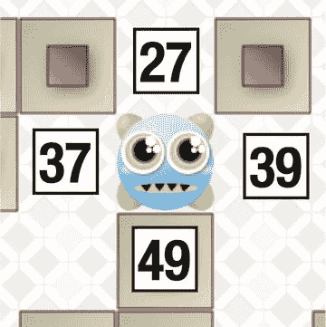

图 5-2. 查找精灵周围的单元格

现在我们有了一个名为`surroundingIndexNumbers`的数组，它告诉我们精灵周围单元格的索引编号。但这还不够；我们还需要知道这些单元格的 gid 值，这样才能了解它们包含哪种类型的瓦片。请记住，我们希望允许精灵移动到空瓦片，但阻止它移动到墙壁瓦片。因此，下一步是利用这些索引编号找出这些位置具体是哪些瓦片精灵。让我们将`surroundingIndexNumbers`映射到一个新数组，该数组告诉我们这些单元格的实际 gid 编号。方法如下：

```javascript
let surroundingTileGids = surroundingIndexNumbers.map(index => {
  return mapArray[index];
});
```

例如，图 5-2 中的索引编号 27、39、49 和 35 现在会被映射到一个包含以下 gid 值的新数组：0、0、2 和 0。数字 0 代表空单元格，数字 2 代表墙壁。图 5-3 说明了这一点。

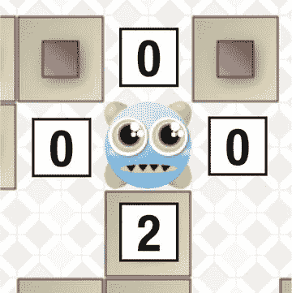

图 5-3. 通过获取周围单元格的 gid 编号来查明其中包含哪些类型的瓦片

## 有效方向

下一步是为精灵可以移动的四个可能方向分别赋予方向名称（字符串形式）。方向名称可以是以下任意一种：`"up"`、`"left"`、`"right"`、`"down"`或`"none"`。以下代码片段将我们的`surroundingTileGids`数组映射到一个名为`directionList`的新数组，其中包含这些方向字符串。

```javascript
let directionList = surroundingTileGids.map((gid, i) => {
  //可能的方向
  let possibleDirections = ["up", "left", "right", "down"];
  //如果方向有效，则选择该方向对应的字符串标识符
  //否则返回"none"
  if (gid === validGid) {
    return possibleDirections[i];
  } else {
    return "none";
  }
});
```

任何无效的 gid 都会被赋予方向名称`"none"`。图 5-4 展示了`directionList`函数生成的最终数组。

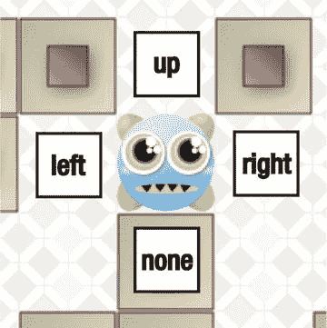

图 5-4. 查找方向名称

我们实际上不需要`"none"`这个值，所以把它过滤掉（它只是充当占位符）：

```javascript
let filteredDirectionList = directionList.filter(direction => {
  return direction != "none"
});
```

现在，`filteredDirectionList`就是我们的最终数组，其中包含了精灵可以移动的所有有效方向：

```javascript
["up", "left", "right"]
```

（或者，如果精灵四面完全被困住，这个数组将是空的——但我们稍后会讲到这一点！）

这个数组由`validDirections`函数返回，这完成了寻路过程的第一步。

### 怪物能否改变方向？

实际上，地图上只有某些特定位置怪物才应该改变方向。

*   当它们处于通道交叉口时。
*   如果它们处于死胡同（尽头路）时。
*   或者如果它们被四面墙壁困住（这种情况下它们应该完全停止移动）。

图 5-5 中的 X 标记出了我们使用的迷宫中这三种地图条件所在的位置。

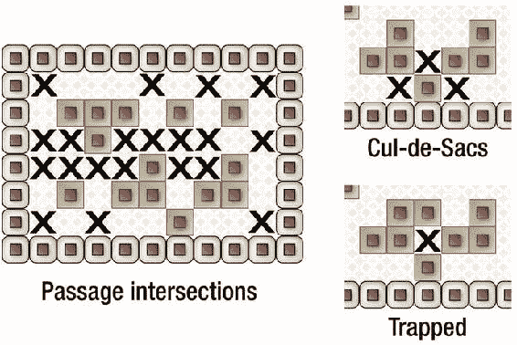

### 图 5-5. 查找方向名称

如果怪物不在地图中符合这些条件的位置，它们就会继续沿当前方向移动。

判断怪物当前所处的地图位置类型很容易。如果 `validDirections` 数组中没有元素，就说明该精灵被困住了。

```
let trapped = validDirections.length === 0;
```

如果 `validDirections` 数组中只有一个元素，就说明精灵处于死胡同中。

```
let inCulDeSac = validDirections.length === 1;
```

这些都很简单，但现在我们如何判断精灵是否处于通道交叉口呢？首先，问问自己："什么是通道交叉口？"仔细观察图 5-5，并思考如果精灵位于任何标记有 X 的地图位置，`validDirections` 数组中可能会包含哪些值。有什么想法吗？没错！通道交叉口总是会包含 "left" 或 "right" *以及* "up" 或 "down"。图 5-6 说明了这一点。

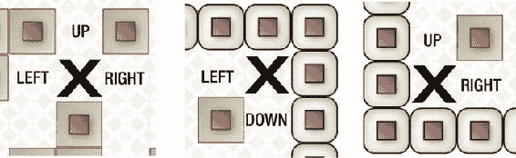

### 图 5-6. 通道交叉口总是包含一个左/右值和一个上/下值

以下是如何用代码表达这一点：

```
let up = validDirections.find(x => x === "up"),
    down = validDirections.find(x => x === "down"),
    left = validDirections.find(x => x === "left"),
    right = validDirections.find(x => x === "right"),
    atIntersection = (up || down) && (left || right);
```

如果 `atIntersection` 为 `true`，就说明精灵位于标记有 X 的通道交叉口之一。很简单！

现在我们已经知道如何判断精灵是被困住、处于死胡同还是通道交叉口了。那么，让我们把所有这些代码包装成一个更大的函数，名为 `canChangeDirection`。如果这些条件中的任何一个为真，它将返回 `true`，否则返回 `false`。

```
function canChangeDirection(validDirections = []) {
  // 精灵是否在死胡同中。如果 `validDirections` 数组中只有一个元素，则为 true                
  let inCulDeSac = validDirections.length === 1;
  // 精灵是否被困住。如果 `validDirections` 数组中没有元素，则为 true                
  let trapped = validDirections.length === 0;
  // 精灵是否在通道中。如果精灵位于包含 "left" 或 "right" 以及 "up" 或 "down" 值的位置，则为 true                
  let up = validDirections.find(x => x === "up"),
      down = validDirections.find(x => x === "down"),
      left = validDirections.find(x => x === "left"),
      right = validDirections.find(x => x === "right"),
      atIntersection = (up || down) && (left || right);
  // 如果精灵可以改变方向，则返回 `true`；否则返回 `false`                
  return trapped || atIntersection || inCulDeSac;
}
```

现在我们已经有办法判断精灵是否位于可以改变方向的地图位置，接下来让我们了解如何为其赋予一个新的随机方向。

#### 选择一个随机方向

既然我们已经知道精灵有哪些有效方向，接下来要做的就是随机选择一个。`randomDirection` 函数会从 `validDirections` 数组中随机返回一个字符串："up"、"left"、"right" 或 "down"。如果没有有效方向，则表示精灵四面都被困住了，该函数会返回字符串 "trapped"。以下是实现此功能的 `randomDirection` 函数：

```
function randomDirection(sprite, validDirections = []) {
  // `randomInt` 辅助函数返回一个介于最小值和最大值之间的随机整数                
  let randomInt = (min, max) => {
    return Math.floor(Math.random() * (max - min + 1)) + min;
  };
  // 精灵是否被困住？                
  let trapped = validDirections.length === 0;
  // 如果精灵没有被困住，则随机选择一个有效方向。否则，返回字符串 "trapped"                
  if (!trapped) {
    return validDirections[randomInt(0, validDirections.length - 1)];
  } else {
    return "trapped"
  }
}
```

#### 将方向字符串转换为速度数值

现在我们知道精灵应该朝哪个方向移动了。但是，为了让这个信息能用于移动精灵，我们需要将方向字符串转换为代表精灵速度的数值。一个名为 `directionToVelocity` 的函数负责完成这项工作：它返回一个包含 `vx` 和 `vy` 属性的对象，这两个属性对应精灵应该移动的方向。

```
function directionToVelocity(direction = "", speed = 0) {
  switch (direction) {
    case "up":
      return {
        vy: -speed,
        vx: 0
      }
      break;
    case "down":
      return {
        vy: speed,
        vx: 0
      };
      break;
    case "left":
      return {
        vx: -speed,
        vy: 0
      };
      break;
    case "right":
      return {
        vx: speed,
        vy: 0
      };
      break;
    default:
      return {
        vx: 0,
        vy: 0
      };
  }
};
```

如果怪物的方向是 "trapped"，则会触发默认情况，代表怪物速度的 `vx` 和 `vy` 值将为零。

要使精灵移动，请使用这些值更新精灵的速度：

```
let velocity = directionToVelocity(monster.direction, monster.speed);
monster.vx = velocity.vx;
monster.vy = velocity.vy;
```

然后将它们应用到精灵的当前位置：

```
monster.x += monster.vx;
monster.y += monster.vy;
```

这就是让怪物在迷宫中随机移动的方法！

## 追猎外星人

随机移动的怪物是一个好的开始，但对于更具挑战性的游戏，你可能希望怪物主动寻找并追捕玩家角色。运行本章源文件中的 `closestDirection.html` 文件，查看此类系统的交互式示例，如图 5-7 所示。

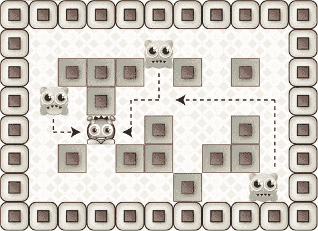

图 5-7. 怪物总是选择离玩家角色最近的方向

无论它们身在迷宫何处，怪物总是会选择朝更接近玩家角色的方向移动。

### 计算向量

为了实现这一点，你需要知道怪物四个可能方向中哪一个离外星人最近。第一步是在怪物和外星人的中心点之间绘制一条*向量*。向量只是一条不可见的数学线，其众多用途之一就是计算两个精灵之间的距离和角度。向量由两个值 `vx` 和 `vy` 表示，你可以像这样计算两个精灵之间的向量：

```javascript
let vx = spriteTwo.centerX - spriteOne.centerX,
    vy = spriteTwo.centerY - spriteOne.centerY;
```

`vx` 告诉我们对象在 X 轴上的距离。`vy` 告诉我们对象在 Y 轴上的距离。`vx` 和 `vy` 变量共同描述了两个对象之间的向量。

向量只是线的一种数学表示——你实际上不会在屏幕上看到它被显示出来。但是，如果你能看到它，它可能看起来有点像图 5-8 中两个精灵中心之间那条黑色的对角线。

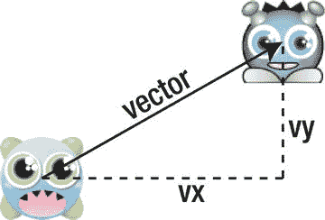

图 5-8. 向量可以帮助你计算两个精灵之间的距离和角度

为了让怪物追猎外星人，我们必须让它朝自身与外星人之间*距离最大*的水平或垂直方向移动。这是为什么呢？看看图 5-9。

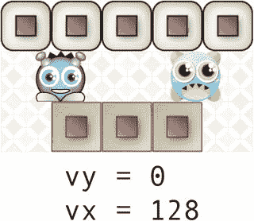

图 5-9. 沿精灵之间距离最大的轴移动怪物

很明显，如果怪物想要靠近玩家，它应该选择沿 X 轴的左方向。然而，X 轴也是两个物体之间距离最大的轴。这反直觉，但确实如此！

现在我们知道了这一点，可以使用一个简单的 `if/else` 语句来判断哪个方向是距离目标最近的方向：“上”、“下”、“左”或“右”。这里有一个名为 `closest` 的函数，它封装了所有逻辑并为我们返回正确的值：

```javascript
let closest = () => {
  //绘制 spriteTwo 和 spriteOne 之间的向量
  let vx = spriteTwo.centerX - spriteOne.centerX,
      vy = spriteTwo.centerY - spriteOne.centerY;
  //如果在 X 轴上的距离更大...
  if (Math.abs(vx) >= Math.abs(vy)) {
    //尝试左和右
    if (vx <= 0) {
      return "left";
    } else {
      return "right";
    }
  }
  //如果在 Y 轴上的距离更大...
  else {
    //尝试上和下
    if (vy <= 0) {
      return "up"
    } else {
      return "down"
    }
  }
};
```

现在让我们了解如何将其集成到现有代码中。

### 寻找最近方向

打开本章源文件中的 `closesestDirection.js` 文件，你会在 `play` 函数（游戏循环）中找到这段代码，它负责移动怪物并选择它们的新方向。除了第 4 步之外，它与我们本章开头使用的代码完全相同。

```javascript
monsters.forEach(monster => {
//1. 怪物是否正中心对准地图瓦片单元格？
  if (isCenteredOverCell(monster)) {
//2. 是的，它正中心对准，因此找出哪些是有效的移动方向。
  //`validDirections` 返回一个数组，可以包含以下
  //字符串值："up", "right", "down", "left" 或 "none"
  monster.validDirections = validDirections(
    monster, wallMapArray, 0, world
  );
//3. 怪物能否改变方向？
  if (canChangeDirection(monster.validDirections)) {
//4. 如果可以，选择距离外星人最近的方向
    monster.direction = closestDirection(monster, alien, monster.validDirections);
  }
//5. 使用怪物的方向和速度来找到它的新速度
  let velocity = directionToVelocity(monster.direction, monster.speed);
  monster.vx = velocity.vx;
  monster.vy = velocity.vy;
}
//6. 移动怪物
monster.x += monster.vx;
monster.y += monster.vy;
```

唯一新增的代码行是这一行：

```javascript
monster.direction = closestDirection(monster, alien, monster.validDirections);
```

一个名为 `closestDirection` 的新函数负责计算并返回怪物有效方向中距离外星人最近的那一个。如果没有匹配最近方向的有效方向，它会回退到随机选择一个方向。以下是实现所有这些功能的完整 `closestDirection` 函数：

```javascript
function closestDirection(spriteOne, spriteTwo, validDirections = []) {
//一个辅助函数，用于找到最近方向
  let closest = () => {
//绘制 spriteTwo 和 spriteOne 之间的向量
    let vx = spriteTwo.centerX - spriteOne.centerX,
        vy = spriteTwo.centerY - spriteOne.centerY;
//如果在 X 轴上的距离更大...
    if (Math.abs(vx) >= Math.abs(vy)) {
//尝试左和右
      if (vx <= 0) {
        return "left";
      } else {
        return "right";
      }
    }
//如果在 Y 轴上的距离更大...
    else {
//尝试上和下
      if (vy <= 0) {
        return "up"
      } else {
        return "down"
      }
    }
  };
//既是最近方向也是有效方向的方向
  let closestValidDirection = validDirections.find(x => x === closest());
//`randomInt` 辅助函数返回一个介于
  //最小值和最大值之间的随机整数
  let randomInt = (min, max) => {
    return Math.floor(Math.random() * (max - min + 1)) + min;
  };
//精灵被困住了吗？
  let trapped = validDirections.length === 0;
//如果精灵没有被困住，从`validDirections`数组中
  //选择最近的方向。如果没有最近的有效的方向，
  //则随机选择一个有效方向
```

这个函数的工作原理是：首先绘制两个精灵之间的向量，然后计算出哪一个方向对于`spriteOne`（猎人）来说最接近`spriteTwo`（目标）。代码会检查该方向是否也在`validDirections`数组中。如果是，则选择那个最近的方向；如果不是，则选择一个随机的新方向。

这个系统运行良好，但存在一个小问题：即使怪物的视线被迷宫墙壁阻挡，它们也知道哪个方向最接近外星人。也许怪物是在用声音探测外星人的位置，通过心灵感应交流，或者，不太可能的是，它们只是非常聪明？从美学上看，这个系统是可行的——它看起来正确，并且使游戏具有挑战性。但你可能想要创建一个怪物只有在真正*看到*外星人（且没有被墙壁阻挡）时才会做出反应的游戏。我们可以通过使用一种基本的游戏设计技术来实现这个功能，称为**视线**。

## 视线

如何判断一个精灵能否看到另一个精灵？在两者之间绘制一个向量，然后沿该向量以均匀间隔的点检查障碍物。如果该向量完全没有障碍，那么你就知道两个精灵之间存在直接视线。

运行本章源文件中的`lineOfSight.html`文件，查看交互式示例，如图 5-10 所示。在屏幕周围以各种组合拖放外星人、怪物和墙壁精灵。一条红色的线延伸在怪物和外星人之间，代表视线。如果视线未被遮挡，精灵之间的线会变暗，并且怪物会张开它的嘴。

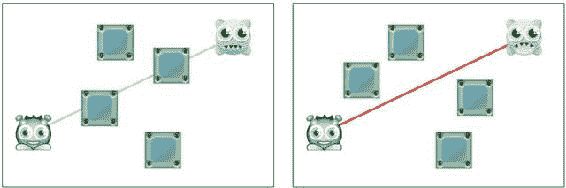

### 图 5-10. 检查两个精灵之间的视线

其工作原理是：一系列的点被不可见地放置在两个精灵之间的向量（线）上。如果其中任何一点碰到了盒子，那么你就知道视线被挡住了。如果这些点都没有碰到任何盒子，那么精灵之间就有一条清晰的视线。图 5-11 说明了这一点。

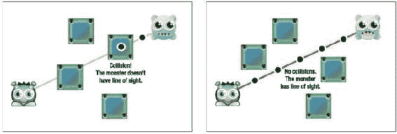

### 图 5-11. 沿线绘制点，并检查每个点是否与盒子发生碰撞

让我们逐步讲解你需要编写的代码，以实现这一功能。

### 计算向量

第一步是在两个精灵的中心之间绘制一个向量。

```javascript
let vx = spriteTwo.centerX - spriteOne.centerX,
    vy = spriteTwo.centerY - spriteOne.centerY;
```

接下来，我们需要找出这个向量的长度（以像素为单位）。向量的长度称为其**模长**，你可以通过以下方式计算：

```javascript
let magnitude = Math.sqrt(vx * vx + vy * vy);
```

我们希望沿着这个向量在等间距的位置上绘制点。为了帮助我们实现这一点，我们创建一个名为 `segment` 的变量，用于确定每个点之间的距离。

```javascript
let segment = spriteOne.width;
```

通常，你不希望点之间的间距小于最小精灵的宽度或高度。这是因为如果点之间的间距过大，碰撞检测可能会跳过并错过较小的障碍物精灵。

现在，既然我们知道了两个精灵之间向量的长度，也知道了碰撞点之间每个线段的长度，就可以计算出需要沿这条线使用多少个碰撞点了。

```javascript
let numberOfPoints = magnitude / segment;
```

例如，如果向量的模长是 256 像素，每个线段的长度是 64 像素，那么 `numberOfPoints` 的值就是 4。

### 查找碰撞点的位置

现在我们有足够的信息来计算沿向量分布的碰撞点的 x/y 坐标。我们将借助一个名为 `points()` 的函数来实现这一点，该函数返回一个包含具有 `x` 和 `y` 属性的对象的数组。我们将使用这个点对象数组来测试每个点与障碍物之间是否发生碰撞。以下是创建点对象数组的 `points()` 函数：

```javascript
let points = () => {
  // 初始化一个数组，用于存储所有沿向量分布的点
  let arrayOfPoints = [];
  // 为向量的每个线段创建一个点对象，并
  // 将其 x/y 坐标及其在地图数组中的索引编号存储起来
  for (let i = 1; i <= numberOfPoints; i++) {
    // 计算本次循环迭代中的新模长
    let newMagnitude = segment * i;
    // 计算单位向量
    let dx = vx / magnitude,
        dy = vy / magnitude;
    // 使用单位向量和 newMagnitude 计算出本循环迭代中
    // 下一个点的 x/y 坐标
    let x = spriteOne.centerX + dx * newMagnitude,
        y = spriteOne.centerY + dy * newMagnitude;
    // 将一个包含 x 和 y 属性的点对象推入 `arrayOfPoints`
    arrayOfPoints.push({x, y});
  }
  // 返回点对象数组
  return arrayOfPoints;
};
```

`points()` 函数的核心是一个循环，该循环为 `numberOfPoints` 指定的点数创建点对象。循环首先将循环索引值乘以 `segment` 的值，创建一个 `newMagnitude` 值。

```javascript
let newMagnitude = segment * i;
```

如果有四个点，且每个线段的宽度为 64 像素，那么随着循环的每次迭代，`newMagnitude` 的值将依次为 64、128、192 和 256。

接下来的两行代码计算出单位向量，用变量名 `dx` 和 `dy` 表示。

```javascript
let dx = vx / magnitude,
    dy = vy / magnitude;
```

单位向量（也称为归一化向量）仅仅是精灵之间主向量的一个微小平移缩放版本，其长度小于一个像素。它指向与主向量相同的方向，但由于它是向量可能的最小尺寸，我们可以用它来创建不同长度的新向量。

你可以在本书的配套资料《使用 HTML5 和 JavaScript 进行高级游戏设计》(Apress, 2015) 中找到关于向量数学的完整初学者指南。它通过大量用于游戏开发的实用示例详细解释了所有这些概念。

将单位向量乘以 `newMagnitude`，并将结果加到 `spriteOne` 的位置上，将给出沿向量分布的点的 x/y 坐标。

```javascript
let x = spriteOne.centerX + dx * newMagnitude,
    y = spriteOne.centerY + dy * newMagnitude;
```

图 5-12 展示了如果 `numberOfPoints` 为 4 且线段宽度为 64 像素时，循环每次迭代的结果。

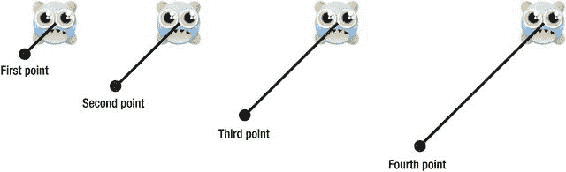

### 图 5-12. 查找沿向量分布的每个点的位置

这些点的 x/y 值存储在一个点对象中，并被推入一个名为 `arrayOfPoints` 的数组。

```javascript
arrayOfPoints.push({x, y});
```

循环结束后，`arrayOfPoints` 将包含一个对象列表，这些对象具有与我们在上一步中计算的 x 和 y 值相匹配的 `x` 和 `y` 属性。`points()` 函数返回这个数组：

```javascript
return arrayOfPoints;
```

现在，我们可以通过像这样调用 `points()` 函数来访问这个数组：

```javascript
points()
```

每当我们在游戏中需要时，这都会动态地重新计算并返回新的点数组。

### 测试点与障碍物的碰撞情况

现在我们需要某种方法来判断这些点中的任何一个是否碰到了某个障碍物。我们可以使用一个名为 `hitTestPoint()` 的基本几何碰撞函数，该函数检查一个带有 x/y 属性的单个点对象是否与一个矩形精灵相交。如果发生碰撞，`hitTestPoint()` 返回 `true`，否则返回 `false`。

```

# `lineOfSight` 函数

让我们把前几节学到的所有技术整合起来，构建一个可复用的 `lineOfSight` 函数。如果两个精灵之间存在清晰的视线，该函数将返回 `true`，否则返回 `false`。你可以这样在你的游戏代码中使用它：

```javascript
monster.lineOfSight = lineOfSight(
  monster, //精灵一
  alien,   //精灵二
  boxes,   //障碍物精灵的数组
  16       //每个碰撞点之间的距离
);
```

第四个参数决定了碰撞点之间的距离。为了获得更好的性能，请将这个值设置得大一些，最大可达你最小精灵的宽度（例如 `64` 或 `32`）。为了获得更高的精度，请使用较小的数值。

你可以使用 `lineOfSight` 的值来决定如何改变游戏中的某些内容。在 `lineOfSight.html` 示例文件中，它被用来张开怪物的嘴巴，并增加两个精灵之间连接线的透明度。

```javascript
if (monster.lineOfSight) {
  monster.show(monster.states.angry)
  line.alpha = 1;
} else {
  monster.show(monster.states.normal)
  line.alpha = 0.3;
}
```

（有关其工作原理的完整细节，请查看 `lineOfSight.js` 文件中的源代码，特别是关于如何初始化怪物不同状态的部分。）

以下是完整的 `lineOfSight` 函数。

```javascript
function lineOfSight(
  spriteOne,    //第一个精灵，具有 `centerX` 和 `centerY` 属性
  spriteTwo,    //第二个精灵，具有 `centerX` 和 `centerY` 属性
  obstacles,    //作为障碍物的精灵数组
  segment = 32  //碰撞点之间的距离
) {
//绘制从 spriteTwo 到 spriteOne 之间的向量
  let vx = spriteTwo.centerX - spriteOne.centerX,
      vy = spriteTwo.centerY - spriteOne.centerY;
//计算向量的模（以像素为单位的长度）
  let magnitude = Math.sqrt(vx * vx + vy * vy);
//需要测试多少个点？
  let numberOfPoints = magnitude / segment;
//创建一个 x/y 点的数组，这些点之间相隔 64 像素，
  //并从 `spriteOne` 延伸到 `spriteTwo`
  let points = () => {
//初始化一个用于存储所有点的数组
    //沿着向量
    let arrayOfPoints = [];
//为向量的每一段创建一个点对象，并
    //存储其在 map 数组中的 x/y 位置以及索引号
    for (let i = 1; i <= numberOfPoints; i++) {
//计算此循环迭代的新模长
      let newMagnitude = segment * i;
//获取单位向量
      let dx = vx / magnitude,
          dy = vy / magnitude;
//使用单位向量和 newMagnitude 计算出此循环迭代中
      //下一个点的 x/y 位置
      let x = spriteOne.centerX + dx * newMagnitude,
          y = spriteOne.centerY + dy * newMagnitude;
//将一个包含 x 和 y 属性的点对象推入 `arrayOfPoints`
      arrayOfPoints.push({x, y});
    }
//返回点对象数组
    return arrayOfPoints;
  };
//测试点与精灵之间是否存在碰撞
  let hitTestPoint = (point, sprite) => {
//判断点的位置是否在由精灵的
    //左、右、上、下边界定义的区域内
    let left = point.x > sprite.x,
        right = point.x < (sprite.x + sprite.width),
        top = point.y > sprite.y,
        bottom = point.y < (sprite.y + sprite.height);
//如果所有碰撞条件都满足，则说明该点
    //与精灵相交
    return left && right && top && bottom;
  };
//如果向量上的所有瓦片索引号都为 `0`，则 `noObstacles` 函数将返回 `true`，
  //这意味着它们不包含任何障碍物。如果其中任何一个不是 `0`，
  //则该函数返回 `false`，表示路径上有障碍物
  let noObstacles = points().every(point => {
    return obstacles.every(obstacle => {
      return !(hitTestPoint(point, obstacle))
    });
  });
//返回碰撞测试的真/假值
  return noObstacles;
}
```

# 基于瓦片的视线与导航

现在你已经知道如何判断两个精灵之间是否存在清晰的视线。同时，你也知道了如何让精灵在迷宫环境中导航。你需要学习的最后一件事是如何将这两种技术结合起来——别担心，这比你想象的要简单得多！

## 基于瓦片的视线

运行本章源文件中的 `tileBasedLineOfSight.html` 文件，可以查看如何在基于瓦片的迷宫环境中实现视线寻路系统的工作示例。在此示例中，怪物只有在沿着通道拥有清晰视线时才会追逐外星人，如图 5-13 所示。

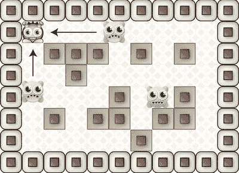

### 图 5-13. 怪物只有看到外星人时才会追逐它

为了使视线系统在基于瓦片的迷宫环境中良好运行，我们将进行以下两项修改：

*   我们将使用基于瓦片的碰撞检测，而不是基于几何碰撞检测，来检查精灵之间向量上的任何点是否与墙壁接触。
*   我们将把精灵之间的向量限制在直角方向上。这意味着我们只允许使用 `0`、`90` 或 `180` 度的角度来测试视线。

让我们了解如何添加这两个新特性，然后用它们构建一个新的 `tileBaseLineOfSight` 函数。

## 基于瓦片的碰撞检测

在迷宫游戏环境中使用基于瓦片的碰撞检测系统，其优势在于效率极高。在大型游戏中，你可以同时进行数百次基于瓦片的碰撞测试，而不会出现任何明显的性能损失。基于几何学（Geometry）的碰撞检测运算量要大得多，因此，尽管它可以非常精确，但你会付出性能上的代价。

在我们早前的视线示例中，我们使用了一个名为 `hitTestPoint` 的基于几何学的碰撞函数，它用来检测一个点是否位于某个矩形区域内。我们如何使用基于瓦片的碰撞来检测一个点与一个精灵（sprite）之间的碰撞呢？我们需要检测一个点的地图数组索引编号是否与我们要检测碰撞的精灵的地图数组索引编号相匹配。这意味着我们需要将每个点的 x/y 位置坐标转换成地图数组索引编号。我们已经知道如何做到这一点，这要使用你在第 3 章中学到的一个名为 `getIndex` 的函数：

```javascript
function getIndex(x, y, tilewidth, tileheight, mapWidthInTiles) {
  //将像素坐标转换为地图索引坐标
  let index = {};
  index.x = Math.floor(x / tilewidth);
  index.y = Math.floor(y / tileheight);
  //返回索引编号
  return index.x + (index.y * mapWidthInTiles);
};
```

如果你有一个点数组，其中所有点都具有与其在地图上的位置相对应的索引编号，那么你就知道这些点正在与共享相同索引编号的任何对象发生碰撞。然后，你可以通过使用该点的索引编号来查找该位置单元格的 gid 值，从而准确地找出该点正在与哪个对象发生碰撞。

```javascript
mapArray[point.index]
```

如果该点的 gid 编号与你感兴趣对象的 gid 编号匹配，那么就发生了碰撞。

对于视线碰撞测试，你专门寻找的是与**不包含任何障碍物**的单元格的碰撞。在本书中使用的示例中，所有没有障碍物的空单元格的 gid 编号都是 0。这意味着你可以遍历视线向量中的每一个点，如果所有这些点对应的 gid 值都是 0，那么你就知道没有碰撞发生。

```javascript
let noObstacles = points().every(point => {
  return mapArray[point.index] === 0
});
```

在上面的例子中，如果 `noObstacles` 返回 `true`，那么你就拥有清晰的视线。稍后你将看到这一段简短的代码是如何在我们完整的基于瓦片的碰撞系统中使用的。但首先，我们如何限制我们的视线测试，使其只允许直角方向呢？

## 限制角度

在我们早前的视线示例中，怪物精灵拥有 360 度的完整视野。而在迷宫游戏示例中，怪物的视线被限制在直角方向。这意味着怪物无法看到对角线上的拐角处；它们只能看到正前方的东西。这会让玩家感觉稍微容易一些，同时也能带来更自然的迷宫游戏体验。

在我们找到实现方法之前，先来了解一下如何计算一个向量（一条线）的角度。正如你已经学到的，一个向量由两个值定义：`vx` 和 `vy`。这是我们一直用来绘制两个精灵之间向量的代码：

```javascript
let vx = spriteTwo.centerX - spriteOne.centerX,
    vy = spriteTwo.centerY - spriteOne.centerY;
```

你可以使用以下便捷公式计算出该向量的角度（以度为单位）：

```javascript
let angle = Math.atan2(vy, vx) * 180 / Math.PI;
```

限制视线角度的第一步是创建一个包含所有有效角度的数组。例如，要将角度限制为 90 度，可以使用这些角度：

```javascript
let angles = [90, -90, 0, 180, -180];
```

下一步是创建一个函数，将向量的角度与数组中的角度进行比较。如果它们匹配，函数返回 `true`，如果不匹配，则返回 `false`。下面是一个实现此功能的 `validAngle` 函数：

```javascript
let validAngle = (vx, vy, angles) => {
  //找出两个精灵之间向量的角度
  let angle = Math.atan2(vy, vx) * 180 / Math.PI;
  //如果角度与某个有效角度匹配，则返回
  //`true`，否则返回 `false`
  if (angles.length !== 0) {
    return angles.some(x => x === angle);
  } else {
    return true;
  }
};
```

现在让我们来了解如何使用这些新技术来构建一个可复用的基于瓦片的视线函数。

## `tileBasedLineOfSight` 函数

下面是一个全新的 `tileBasedLineOfSight` 函数，它实现了基于瓦片的碰撞检测，并将角度限制为 90 度。你将在后文学习如何在游戏中使用它。

```javascript
function tileBasedLineOfSight(
  spriteOne,    //第一个精灵，包含 `centerX` 和 `centerY` 属性
  spriteTwo,    //第二个精灵，包含 `centerX` 和 `centerY` 属性
  mapArray,     //地图瓦片数组
  world,        //`world` 对象，包含 `tilewidth`、`tileheight`
                //和 `widthInTiles` 属性
  emptyGid = 0, //代表空瓦片的 Gid，通常为 `0`
  segment = 32, //碰撞点之间的间距
  angles = []   //你想将视线限制在其中的角度数组
) {
//计算 spriteTwo 和 spriteOne 之间的向量
  let vx = spriteTwo.centerX - spriteOne.centerX,
      vy = spriteTwo.centerY - spriteOne.centerY;
//求向量的长度（以像素为单位）
  let magnitude = Math.sqrt(vx * vx + vy * vy);
//我们需要测试多少个点？
  let numberOfPoints = magnitude / segment;
//创建一个从 `spriteOne` 延伸到 `spriteTwo` 的 x/y 点数组
  let points = () => {
//初始化一个数组，用于存储所有沿向量的点
    let arrayOfPoints = [];
//为向量的每个段创建一个点对象，并存储其 x/y 坐标
    //以及在地图数组中的索引号
    for (let i = 1; i <= numberOfPoints; i++) {
//计算本次循环迭代的新长度
      let newMagnitude = segment * i;
```

```javascript
//求单位向量
let dx = vx / magnitude,
    dy = vy / magnitude;

//使用单位向量和 newMagnitude 计算本次循环迭代中
//下一个点的 x/y 位置
let x = spriteOne.centerX + dx * newMagnitude,
    y = spriteOne.centerY + dy * newMagnitude;

//`getIndex` 函数将 x/y 坐标转换为
//地图数组的索引位置编号
let getIndex = (x, y, tilewidth, tileheight, mapWidthInTiles) => {
  //将像素坐标转换为地图索引坐标
  let index = {};
  index.x = Math.floor(x / tilewidth);
  index.y = Math.floor(y / tileheight);
  //返回索引号
  return index.x + (index.y * mapWidthInTiles);
};

//找出这个 x 和 y 点对应的地图索引号
let index = getIndex(
  x, y,
  world.tilewidth,
  world.tileheight,
  world.widthInTiles
);

//将该点存入 `arrayOfPoints` 数组
arrayOfPoints.push({
  x, y, index
});

//返回数组
return arrayOfPoints;
};

//基于瓦片的碰撞检测。
//如果向量的所有瓦片索引号均为 `0`（表示没有墙壁），
//则 `noObstacles` 函数返回 `true`。如果其中任何一个不为 0，
//则函数返回 `false`，表示路径中有墙壁阻挡
let noObstacles = points().every(point => {
  return mapArray[point.index] === emptyGid
});

//将视线限制为仅直角方向
//（我们不希望使用对角线）
let validAngle = () => {
  //计算两个精灵之间向量的角度
  let angle = Math.atan2(vy, vx) * 180 / Math.PI;
  //如果角度与有效角度之一匹配，返回 `true`，否则返回 `false`
  if (angles.length !== 0) {
    return angles.some(x => x === angle);
  } else {
    return true;
  }
};

//如果没有障碍物且视线角度为 90 度，则返回 `true`
if (noObstacles === true && validAngle() === true) {
  return true;
} else {
  return false;
}
```

搞定！这就是基于瓦片的视线检测。

## 总结

本章涵盖了你开始学习寻路所需的所有基础知识。你已经学会了如何分析和解读精灵所处的环境，并利用这些信息来决定精灵的移动方向——应该选择随机方向，还是最接近目标的方向？你还学会了一项每位游戏开发者都必须掌握的重要技术：如何确定视线。现在，你知道了如何在基于几何和基于瓦片的碰撞环境中使用视线。正如你在后续章节中将要看到的，所有这些技能不仅对寻路有用，也是构建基础 AI 的基础。当然，你完全可以把这些相同的技术应用到你的等距游戏地图中！

本章学到的技能会让你走得很远，但还有一项重要的寻路技能你需要掌握：如何找到两点之间的最短路径。这正是下一章的全部内容！

© Rex van der Spuy 2017

Rex van der Spuy, *高级游戏开发者工具包*, 10.1007/978-1-4842-1097-0_6
