# 6. 寻找最短路径

Rex van der Spuy

（1）加拿大安大略省多伦多市

路径查找中还有一个主要领域需要解决：如何穿过迷宫找到最短路径。事实证明，这不仅仅是一个有趣的旁支问题，更是你需要掌握的最重要的游戏设计技能之一。

到目前为止，我们在本书中介绍的所有玩家控制系统，都是通过键盘或鼠标让玩家在屏幕上移动。但游戏通常采用点击式控制系统：将鼠标指向地图上的某个位置并点击，角色便会自动走到那里，并神奇地找到通往目的地的最短路径，同时灵巧地避开所有障碍物。图形冒险游戏、几乎所有策略类游戏和回合制游戏都使用这种控制系统。它是如何运作的？这正是你将在本章中探索的内容！

让角色沿着最短路径移动实际上分为两步：

1.  **找到最短路径**：这需要测试起点与终点之间所有最可能的瓦片。你需要判断哪些瓦片能让你更快到达目的地，哪些包含需要避开的障碍物。测试结束后，你会得到一个指示最短路径的瓦片数组。
2.  **沿着路径中的瓦片移动**：你最终得到的瓦片数组就像面包屑一样，可供游戏角色跟随。指示角色从起始位置跟随这些面包屑到达目的地。

如果第一步看起来相当复杂，没错，确实如此！但好消息是，已经有非常出色的解决方案。这意味着你无需费心自己设计解决方案——只需选择一个现成的方案并在游戏中实现即可。

你可以使用多种不同的路径查找算法，包括最佳优先、广度优先以及迪杰斯特拉算法。它们都能较好地解决问题。但公认最好的算法是 A*（A 星）。A* 算法总体性能最优，且极其灵活。如果只学一种路径查找算法，那就是 A*。

A* 算法由彼得·哈特、尼尔斯·尼尔森和伯特伦·拉斐尔于 20 世纪 60 年代提出。它是对迪杰斯特拉算法的改进，后者由计算机科学先驱艾兹格·迪杰斯特拉于 20 世纪 50 年代提出。

在向你展示如何在游戏中运用 A* 算法之前，我们先来详细了解它的工作原理。

## 理解 A* 算法

我们可以为我们的进化祖先感到自豪。得益于出色的路径查找能力，他们成功避开了更大的原生生物，躲过了恐龙锋利的牙齿，并且没有沦为斯泰克方丹洞穴底部的化石遗骸。路径查找能力，对于像亚马逊树蛙一样生存至关重要，也如同早上赶公交车一样不可或缺。这是一种生存技能，让你能自动找出从 A 点到 B 点的最短路径，而不被吃掉、不饿死、也不上班迟到。看一眼图 6-1，你就能立刻看出 A 点与 B 点之间的最短路径。路径查找已经刻在我们的 DNA 里。

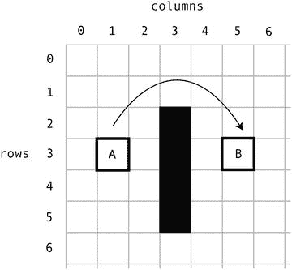

### 图 6-1. A 点和 B 点之间的最短路径是什么？对我们人类来说显而易见，但如何向计算机解释清楚？

另一方面，计算机就像被娇生惯养、获奖无数的波斯猫。它们整天无所事事，在互联网上花费大量时间，还总是睡觉。它们可不像我们一样，在原始汤中经过无数纪元的拼搏磨练出技能。我们需要用最直白的方式告诉它们：“这条路径好！”或者“这条路径不好！”，几乎得像挥舞着粗糙棍棒那样威胁它们。

但什么是“好路径”？在寻找最短路径时，好路径就是能让你更快到达目的地的路径。问题在于计算机无法看清全局。它们一次只能看到一小步。因此，告诉计算机如何找到最短路径的策略大致如下：

- 将整个路径分解成许多小步。
- 对于每一步，判断下一步该走哪一步。
- 走下一步，重复该过程，直到到达目标位置。

但计算机仍然必须能区分好路径和坏路径。我们来看看如何帮助它解决这个问题。

### 计算成本

猜个谜语：

每天早上报纸都送到你家门口。捡起它的最便宜的方式是什么？

A. 打开前门。

B. 走出后门，跳过花园篱笆，跑过小巷，叫辆出租车，绕街区一圈到前门？

选项 A 免费，但选项 B 花了你大约 4.75 美元的出租车费。这意味着选项 B 更贵。

`昂贵`是 A* 算法用来描述两点之间移动所需工作量的术语。A* 通过为路径上每个可能的步骤分配一个成本，来找出通往目的地最便宜的路线。成本最低的步骤就是更优的选择。A* 通过寻找成本最低的移动和价格最低的路径来工作。

A* 有一套自己的术语和词汇。`成本`和`费用`就是其中两个术语，你会看到，它们是描述其核心概念的便捷方式。稍后我还会介绍其他几个特定的 A* 术语。请特别留意即将出现的术语`节点`和`启发式`！

图 6-2 解释了我所说的成本的含义。想象一下，你是一个培养皿中的细菌，自由漂浮，在 A 点自顾自地活动。突然，一个巨大、饥饿的单细胞变形虫的阴影笼罩了你，它的唯一目标就是吞噬你的细胞质。你知道如果不立即躲起来，你就麻烦了。只有两个地方可以躲：B 点或 C 点。你必须在瞬间决定哪个最近。

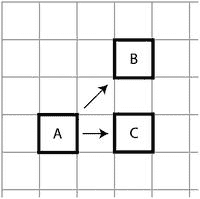

### 图 6-2. 离 A 点最近的是 B 点还是 C 点？

在图 6-2 的例子中，前往 B 点的时间比前往 C 点的时间多出约三分之一。实际上，从 A 点到 B 点所需的时间恰好是到 C 点的 1.41 倍。这意味着 C 点才是你为了躲避变形虫需要游过去的地方。1.41 这个数值就是对角线移动的成本。

在基于矩形网格的游戏世界中，只有两种移动选择，每种都有对应的成本：

- **对角线移动**：成本为 14。
- **直向移动**：水平或垂直移动，成本为 10。

这些成本具体是多少并不重要，只要它们能按比例代表在这些方向上移动所需的时间即可。因此，14 对 10 的比例与 1.4 对 1 相同，我们很方便地无需处理小数。如果你愿意，当然也可以在代码中使用 1.4 和 1。图 6-3 显示了单元格间移动的成本。

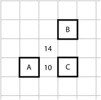

### 图 6-3. 穿过单元格的成本

现在我们有了向计算机描述什么是好路径的方法：成本最低的路径。

图 6-4 展示了从 A 到 B 的两条可能路径。你不仅能清楚地看到路径 1 是最短的，而且它恰好也是成本最低的。

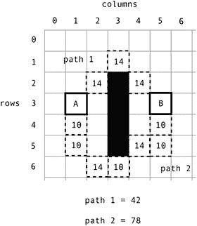

### 图 6-4. 最短路径也是成本最低的路径

之前我提到过，计算机在路径规划时，每次只能看到一步。从图 6-3 中可以看出，每一步都是到达 B 点所能选择的最低成本步骤。但这只有在你知道路径结果后才会变得显而易见。计算机在开始构建路径之前并不知道这一点。那么，它如何知道从 A 点出发，下一步该走哪一步呢？

### 寻找第二步

在 A*算法的术语中，路径上的每一步都称为一个`节点`。就我们而言，`节点`就是二维数组或网格中的单元格。不过，从现在开始我将称它们为`节点`，只是为了让你熟悉这个术语。你会在其他文献中关于寻路的讨论中广泛看到它的使用。A*算法使用“`节点`”这个术语，是因为你没有理由不能以矩形网格之外的其他方式来划分空间，比如使用六边形或圆形。但就我们的目的而言，当你听到我谈论`节点`时，只需知道我说的是网格单元格即可。

A*算法从 A 点开始搜索最短路径。A 点就是父`节点`。父`节点`是路径上一个确定无疑的步骤。显然，我们知道 A 点将是第一步，因此它会自动成为第一个父`节点`。

如果我们知道了第一步是什么，那么如何找到第二步呢？A*算法必须检查父`节点`周围的所有八个单元格，以找出哪一个是最有可能的候选`节点`。图 6-5 展示了 A 点作为父`节点`，以及需要检查的所有周围`节点`。（如果这些`节点`中有任何是墙壁或不可通行的物体，则会忽略它们。）

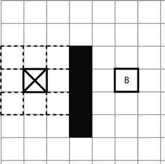

### 图 6-5. 检查父`节点`周围的所有`节点`，看看哪一个可能是路径上下一步最有可能的选择

这些周围的每个单元格都将当前的父`节点`声明为其父`节点`。A*算法中执行此操作的代码大致如下：

```
surroundingNode.parent = currentParent;
```

这一点很重要，因为它意味着 A*算法可以通过追踪父节点的链条来找到通往目的地的最佳路径。现在不必过多担心这个问题，你将在接下来的页面中看到它的工作原理。只需记住每个节点都有一个`parent`属性，用于跟踪路径中与之相连的节点。

然后，A*算法需要找出从父节点到周围子节点的移动成本是多少。事实证明，这恰好是一个重要的数字，因此 A*算法将这个成本称为`G`。图 6-6 显示了所有周围节点的`G`成本。

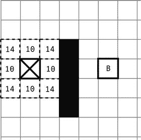

### 图 6-6. 每个周围节点都被赋予一个成本，在 A*算法的术语中称为`G`

然后 A*算法会计算出哪个周围节点更接近目的地 B 点。它会计算从 B 点到每个周围节点的移动成本。（目前，将挡在路上的墙壁视为不存在，但正如你将看到的，这会在后续测试中得到补偿。）图 6-7 展示了从第一个周围节点到 B 点的路径。你可以看到，它计算出从该节点到 B 点的测试路径成本为 54。

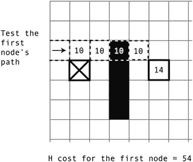

### 图 6-7. 计算从每个周围节点到 B 点的每条路径的成本

这种距离测试被称为启发式算法。启发式算法简单地意味着通过试错来找出答案。（它源自希腊词`heuriskein`，意思是“发现”。）然而，启发式算法并不是随机的试错。它是在一组可能产生我们寻求答案的逻辑规则内进行试错。A*算法并不知道哪个周围的子节点最终能得到成本最低的路径，所以它只是尝试所有八个节点。每条启发式路径的成本也恰好非常重要，因此 A*算法将这个成本称为`H`。

实际上，有三种常用的计算启发式路径的方法：曼哈顿距离、欧几里得距离和对角线距离。我们将在本章后面的“理解启发式算法”部分详细探讨每一种方法。现在，只需知道这些是计算从周围测试节点到目的地点的距离的特定方法即可。

A*算法会计算出每个周围子节点的`H`成本。如果你将`H`和`G`成本结合起来，就会得到第三个最终成本，称为`F`。图 6-8 显示了每个节点的所有`G`、`H`和`F`成本。

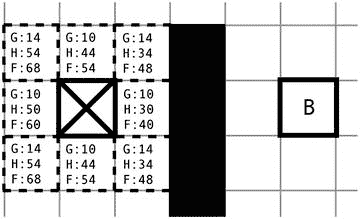

### 图 6-8. 通过将`G`和`H`成本相加，找出每个节点的最终`F`成本

胜出者是`F`成本最低的节点。你能看到它吗？它就是父节点正右方的那个节点，如图 6-9 所示。

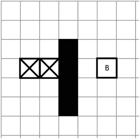

### 图 6-9. `F`成本最低的节点就成为路径上最有可能的下一步

这个节点现在成为一个潜在的新父节点。A*算法尚不确定这是否是最好的第二步，但就目前所能判断的，这是一个继续检查的相当不错的位置。（事实上，这并不是最好的第二步，但 A*算法很快就会发现问题所在，你将会看到。）

从图 6-9 中可以看出，每个父节点都代表了通往 B 点的路径上的一个潜在步骤。我使用“潜在”这个词是因为 A*算法在进行更多检查之前，并不确定任何给定的父节点是否是最佳步骤。你已经在图 6-9 中看到了一个问题的出现。新的父节点*并非*最佳的下一步。更好的做法是从 A 点沿对角线向上移动。图 6-10 说明了这一点。

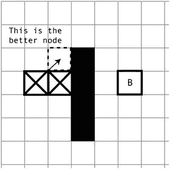

### 图 6-10. 显而易见的第一选择并不总是最好的。A*算法将如何发现从起点沿对角线向上移动更好？

幸运的是，A*算法有一套交叉检查节点并剔除此类低效情况的系统。A*算法通过维护两个列表来追踪路径上可能的最佳父节点：

*   `封闭列表`：这是一个无需再检查的节点列表。每当找到一个新的父节点时，它就会被添加到这个列表中。
*   `开放列表`：这是一个包含每个父节点周围所有节点的列表。这些是需要检查的节点。

当一个潜在的新父节点检查其周围的所有节点时，它会查看开放列表中每个节点之前的`G`成本。图 6-11 显示，其正上方节点的先前`G`成本是 14。

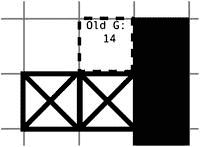

### 图 6-11. 旧的`G`成本是 14。它的新成本会比这更多还是更少？

为了找到新的`G`成本，A*算法会取当前父节点的`G`值，再加上 10，这是向上移动一个节点的成本。这样新的`G`成本总和就变成了 20。图 6-12 说明了这一点。

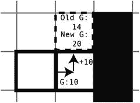

### 图 6-12：将父节点的 G 成本（10）加上向上移动一个节点的成本（10），得到新的 G 成本（20）

如果发现新成本更低，A* 会将节点的父节点更改为当前父节点：

```
if (newG < oldG) {
  surroundingNode.parent = currentParent;
} else {
  don't change the surrounding node's parent
}
```

但如果新的 G 成本更高，则节点的父节点不会改变。本例正是这种情况。它将保留第一步中分配的父节点，即起始节点。我们正在检查的当前父节点将遭到冷落。

这一点非常重要，因为 A* 通过将节点与其父节点链接在一起形成路径，就像一条链条。

A* 会对所有其他相邻节点执行同样的检查，并根据它们是否需要经过新的父节点来计算新的 G 成本，如图 6-13 所示。

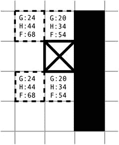

### 图 6-13：检查通过当前父节点路由路径是否会降低其他节点的 G 成本。结果显示不会

从图 6-13 可以看出，所有节点经过当前父节点的 G 成本都会更高。这意味着没有一个节点会将其父节点改为当前父节点。当前父节点彻底出局了！它没有子节点，因此肯定不会成为最短路径的一部分。

但 A* 仍然需要确定接下来测试哪个节点。它会忽略墙壁节点和上一个父节点。它会选择 F 成本最低的下一个节点作为新的父节点，如图 6-14 所示。

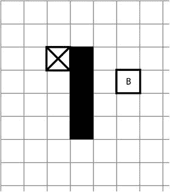

### 图 6-14：F 成本最低的相邻节点成为新的父节点

但如果某些节点成本相同会怎样？从图 6-13 可以看出，父节点正上方和正下方的节点并列第一，两者的低分都是 54。在这种情况下，A* 会选择在循环中首先被检查到的节点。如果碰巧选错了，后续的检查会进行纠正。但纯属偶然，这次第一个具有最低分数的节点恰好也是更好的选择。它被选为新的父节点，A* 继续进行检查。

也很可能不止一条最短路径。A* 构建的路径取决于它如何选择成本相同的节点。

我们已经测试了两个节点，并选定了第三个节点，如图 6-15 所示。

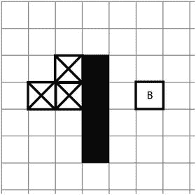

### 图 6-15：三个节点是路径上的候选节点，但谁会最终入选？

但其中只有两个节点属于路径。我们怎么知道的？因为右上角的节点将起始节点指定为其父节点。这种关系将两个节点链接在一起，如图 6-16 所示。它构成了路径中的前两个步骤。

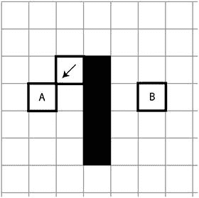

### 图 6-16：起始节点是右上角节点的父节点。这种关系将节点链接在一起

### 通过父节点链接节点

接着，A* 会继续遵循同样的逻辑，直到到达目标节点 B 点。在一个非常大的游戏世界中，这可能需要检查数百个节点。

当 A* 最终构建出路径时，它会从父节点到父节点进行追踪，以将起点和终点连接起来。如图 6-17 所示。

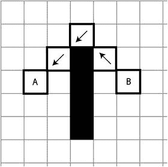

### 图 6-17：最终路径中的每个节点都引用其父节点

当 A* 到达目的地 B 点时，它会停止检查。然后 A* 只需要从 B 点开始，顺着父节点逆向工作，即可构建出路径。A* 算法会生成一个数组，告诉你从 A 点到 B 点需要经过哪些节点才能找到最短路径。

现在你已理解其原理，让我们来看看实际的 JavaScript 代码。

## 代码中的 A*

到现在应该相当明显了，节点在 A* 的世界里是相当重要的东西。每个节点需要存储相当多的信息：

- 它的位置（在网格中的行和列）。
- 它的 G、H 和 F 成本。
- 它的父节点。

因此，创建一个节点对象来存储这些信息是合情合理的。

### 创建节点图

处理节点的第一步是创建一个所谓的`节点图`。`节点图`是一个二维数组，与游戏的地图迷宫完全匹配。然而，`节点图`的每个单元格都包含一个节点对象。这些节点对象将存储我们需要的重要节点属性和值。

下面是一个名为 `nodes` 的简单函数，它为地图数组中的每个单元格返回一个节点对象数组。

```javascript
let nodes = (mapArray, mapWidthInTiles) => {
  return mapArray.map((cell, index) => {
    //计算此单元格的行和列
    let column = index % mapWidthInTiles;
    let row = Math.floor(index / mapWidthInTiles);
    //节点对象
    return node = {
      f: 0,
      g: 0,
      h: 0,
      parent: null,
      column: column,
      row: row,
      index: index
    };
  });
};
```

每个节点对象都包含成本属性、对其父节点的引用，以及行列和索引信息，这些信息使我们能够轻松地将节点与其在地图数组中的位置对应起来。你将看到这在 `shortestPath` 函数中是如何使用的，我们接下来将介绍该函数。

### `shortestPath`函数

我们 A*代码的核心是`shortestPath`函数。它返回一个数组，包含从点 A 到点 B 的最短路径。以下是调用它的示例，包括要使用的参数。

```javascript
let path = shortestPath(
  getIndex(alien.x, alien.y, 64, 64, 13),          // 起始地图索引            
  getIndex(g.pointer.x, g.pointer.y, 64, 64, 13)), // 目标索引            
  wallMapArray,                                    // 地图数组            
  13,                                              // 地图宽度（以瓦片为单位）            
  [2, 3],                                          // 障碍物 gid 数组            
  "manhattan"                                      // 要使用的启发式函数            
);
```

如你所见，这些参数与我们之前讨论的信息类型相匹配。我们尚未讨论的一项内容是所使用的启发式函数类型。我将在“理解启发式函数”部分解释启发式函数选项及其工作原理。

以下是完整的`shortestPath`函数。除了需要确保所有数据有效的少量额外检查外，它完全按照我之前对 A*算法工作原理描述的方式进行路径查找。请通读所有注释，并尝试将代码与之前的描述对应起来。

```javascript
function shortestPath(
  startIndex,
  destinationIndex,
  mapArray,
  mapWidthInTiles,
  obstacleGids = [],
  heuristic = "manhattan"
) {
// `nodes`函数创建节点对象数组              
  let nodes = (mapArray, mapWidthInTiles) => {
    return mapArray.map((cell, index) => {
// 计算此单元格的行和列              
      let column = index % mapWidthInTiles;
      let row = Math.floor(index / mapWidthInTiles);
// 节点对象              
      return node = {
        f: 0,
        g: 0,
        h: 0,
        parent: null,
        column: column,
        row: row,
        index: index
      };
    });
  };
// 初始化 shortestPath 数组              
  let shortestPath = [];
// 初始化节点映射              
  let nodeMap = nodes(mapArray, mapWidthInTiles);
// 初始化关闭列表和开放列表数组              
  let closedList = [];
  let openList = [];
// 声明直线或斜线移动的“代价”              
  let straightCost = 10;
  let diagonalCost = 14;
// 获取起始节点              
  let startNode = nodeMap[startIndex];
```

// 获取当前中心节点。第一个节点将与路径的起始位置匹配。
let `centerNode` = `startNode`;

// 将`centerNode`推入`openList`，因为它是我们将要检查的第一个节点。
`openList`.push(`centerNode`);

// 获取当前目标节点。第一个节点将与路径的结束位置匹配。
let `destinationNode` = `nodeMap`[`destinationIndex`];

// 所有包围当前地图索引号的节点。
let `surroundingNodes` = (`index`, `mapArray`, `mapWidthInTiles`) => {
  // 找出所有周围的节点（包括那些可能超出地图边界的节点——我们将在`validSurroundingNodes`函数中过滤掉它们）。
  let `allSurroundingNodes` = [
    `nodeMap`[`index` - `mapWidthInTiles` - 1],
    `nodeMap`[`index` - `mapWidthInTiles`],
    `nodeMap`[`index` - `mapWidthInTiles` + 1],
    `nodeMap`[`index` - 1],
    `nodeMap`[`index` + 1],
    `nodeMap`[`index` + `mapWidthInTiles` - 1],
    `nodeMap`[`index` + `mapWidthInTiles`],
    `nodeMap`[`index` + `mapWidthInTiles` + 1]
  ];

  // 可选地排除对角线节点，这通常更适合2D迷宫游戏。
  let `crossSurroundingNodes` = [
    `nodeMap`[`index` - `mapWidthInTiles`],
    `nodeMap`[`index` - 1],
    `nodeMap`[`index` + 1],
    `nodeMap`[`index` + `mapWidthInTiles`],
  ];

  // 寻找所有有效的周围节点，即地图边界内且不包含障碍物的节点。
  // 可选择将`allSurroundingNodes`替换为`crossSurroundingNodes`，以防止路径在节点间选择对角线方向。
  let `validSurroundingNodes` = `allSurroundingNodes`.filter(`node` => {
    // 若节点为`undefined`，则表示其超出了地图的顶部和底部边缘。
    let `nodeIsWithinTopAndBottomBounds` = `node` !== undefined;

    // 仅返回位于地图顶部和底部边界之间的节点。
    if (`nodeIsWithinTopAndBottomBounds`) {
      // 以下布尔值用于判断当前地图索引是否位于地图左边界或右边界，以及该索引周围的节点是否延伸至左右边界之外。
      let `indexIsOnLeftBorder` = `index` % `mapWidthInTiles` === 0;
      let `indexIsOnRightBorder` = (`index` + 1) % `mapWidthInTiles` === 0;
      let `nodeIsBeyondLeftBorder`
        = `node`.column % (`mapWidthInTiles` - 1) === 0
        && `node`.column !== 0;
      let `nodeIsBeyondRightBorder` = `node`.column % `mapWidthInTiles` === 0;

      // 通过遍历障碍物GID来判断节点是否包含障碍物。若在该节点位置找到任何障碍物，则返回`true`。
      let `nodeContainsAnObstacle` = `obstacleGids`.some(`obstacle` => {
        return `mapArray`[`node`.index] === `obstacle`;
      });

      // 如果索引位于左边界，且任何周围节点超出左边界，则不返回该节点。
      if (`indexIsOnLeftBorder`) {
        return !`nodeIsBeyondLeftBorder`;
      }
      // 如果索引位于右边界，且任何周围节点超出右边界，则不返回该节点。
      else if (`indexIsOnRightBorder`) {
        return !`nodeIsBeyondRightBorder`;
      }
      // 如果节点包含障碍物，则返回`false`。
      else if (`nodeContainsAnObstacle`) {
        return false;
      }
      // 如果通过了上述检查，则说明索引一定位于左右边界定义的区域内。因此返回该节点。
      else {
        return true;
      }
    }
  });

  // 返回`validSurroundingNodes`数组。
  return `validSurroundingNodes`;
};

// 启发式方法
// 1. 曼哈顿距离
let `manhattan` = (`testNode`, `destinationNode`) => {
  let `h`
    = Math.abs(`testNode`.row - `destinationNode`.row)
    * `straightCost` + Math.abs(`testNode`.column - `destinationNode`.column)
    * `straightCost`;
  return `h`;
};

// 2. 欧几里得距离
let `euclidean` = (`testNode`, `destinationNode`) => {
  let `vx` = `destinationNode`.column - `testNode`.column,
    `vy` = `destinationNode`.row - `testNode`.row,
    `h` = Math.floor(Math.sqrt(`vx` * `vx` + `vy` * `vy`) * `straightCost`);
  return `h`;
};

// 3. 对角线距离
let `diagonal` = (`testNode`, `destinationNode`) => {
  let `vx` = Math.abs(`destinationNode`.column - `testNode`.column),
    `vy` = Math.abs(`destinationNode`.row - `testNode`.row),
    `h` = 0;
  if (`vx` > `vy`) {
    `h` = Math.floor(`diagonalCost` * `vy` + `straightCost` * (`vx` - `vy`));
  } else {
    `h` = Math.floor(`diagonalCost` * `vx` + `straightCost` * (`vy` - `vx`));
  }
  return `h`;
};

// 遍历所有节点，直到当前的`centerNode`与`destinationNode`匹配。当两者相同时，说明我们已经到达路径终点。
while (`centerNode` !== `destinationNode`) {
  // 查找当前`centerNode`周围的所有节点。
  let `surroundingTestNodes` = `surroundingNodes`(`centerNode`.index, `mapArray`, `mapWidthInTiles`);
}

# A* 算法实现与最短路径函数

## 代码实现

```javascript
// 使用经典的 `for` 循环遍历所有 `surroundingTestNodes` 节点  
//（`for` 循环能带来边际性能提升。A* 算法对性能要求极高，  
// 因此每次循环迭代中即使微小的性能提升，  
// 也可能累积成显著的总体提升）  
for (let i = 0; i < surroundingTestNodes.length; i++) {

  // 获取当前测试节点的引用  
  let testNode = surroundingTestNodes[i];

  // 判断该节点位于直线轴还是对角线轴，并分配相应的成本

  // A. 声明成本变量  
  let cost = 0;

  // B. 它们是否位于同一行或同一列？  
  if (centerNode.row === testNode.row || centerNode.column === testNode.column) {

    // 如果是，则分配成本为 "10"  
    cost = straightCost;
  } else {

    // 否则，分配成本为 "14"  
    cost = diagonalCost;
  }

  // C. 计算成本（g、h 和 f）  
  // 当前节点的成本  
  let g = centerNode.g + cost;

  // 从该节点到目标节点的成本（启发式函数）  
  let h;
  switch (heuristic) {
    case "manhattan":
      h = manhattan(testNode, destinationNode);
      break;

    case "euclidean":
      h = euclidean(testNode, destinationNode);
      break;

    case "diagonal":
      h = diagonal(testNode, destinationNode);
      break;

    default:
      throw new Error("哎呀！看起来你拼错了启发式函数的名称");
  }

  // 最终成本  
  let f = g + h;

  // 判断 `testNode` 是否在 `openList` 或 `closedList` 数组中  
  let isOnOpenList = openList.some(node => testNode === node);
  let isOnClosedList = closedList.some(node => testNode === node);

  // 如果它在任一列表中，我们可以检查  
  // 这条路径是否为先前成本计算的更低成本替代方案。  
  // 新的 G 成本会影响最终的 F 成本  
  if (isOnOpenList || isOnClosedList) {
    if (testNode.f > f) {
      testNode.f = f;
      testNode.g = g;
      testNode.h = h;

      // 仅在新成本更低时才更改父节点  
      testNode.parent = centerNode;
    }
  }

  // 否则，将 `testNode` 添加到 `openList`  
  else {
    testNode.f = f;
    testNode.g = g;
    testNode.h = h;
    testNode.parent = centerNode;
    openList.push(testNode);
  }

  // `for` 循环在此结束  
}

// 将当前 `centerNode` 推入 `closedList`  
closedList.push(centerNode);

// 如果 `openList` 为空，则退出循环。  
// 这表示没有通往目标节点的路径，或者目标节点无效（例如墙壁图块）  
if (openList.length === 0) {
  return shortestPath;
}

// 根据最终成本对 `openList` 进行排序  
openList = openList.sort((a, b) => a.f - b.f);

// 将最终成本最低的节点设为新的 `centerNode`  
centerNode = openList.shift();

// `while` 循环在此结束  

// 现在我们有了所有候选节点，让我们找到最短路径！  
if (openList.length !== 0) {

  // 从目标节点开始  
  let testNode = destinationNode;
  shortestPath.push(testNode);

  // 通过父节点反向追溯，  
  // 直到找到起始节点  
  while (testNode !== startNode) {

    // 逐步遍历每个节点的父节点，  
    // 从目标节点开始，到起始节点结束  
    testNode = testNode.parent;

    // 将节点添加到数组的开头  
    shortestPath.unshift(testNode);

    // ...然后再次循环到下一个节点的父节点，直到  
    // 到达路径的终点  
  }
}

// 返回一个由节点组成的数组，这些节点相互连接形成  
// 最短路径  
return shortestPath;
```

## 使用 `shortestPath` 函数

在本章的源文件中，你会找到一个名为 `shortestPath.html` 的文件夹。运行该程序，你会看到一个外星角色坐在一个简单的迷宫环境中。用鼠标点击任意位置，程序将绘制从外星角色位置到鼠标点击位置的最短路径，如图 6-18 所示。

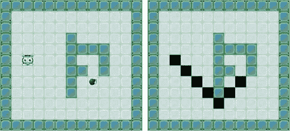

### 图 6-18：点击任意位置绘制最短路径

该程序通过计算外星精灵与鼠标位置之间的最短路径来工作。如你所知，`shortestPath` 函数会返回一个节点数组。每个节点都包含 `row`（行）和 `column`（列）属性，我们可以利用这些信息，为数组中的每个节点在屏幕上显示一个黑色方块精灵。

以下是程序中负责此功能的 `setup` 函数的相关代码。每次释放鼠标指针时，一个名为 `currentPathSprites` 的数组就会被填充上与最短路径节点匹配的黑色方块精灵。

```javascript
// 用于存储显示最短路径的精灵的数组                  

currentPathSprites = [];

// 鼠标指针的 `release` 函数，运行计算最短路径并绘制代表路径精灵的代码                  

g.pointer.release = () => {

  // 计算最短路径              

  let path = shortestPath(

    getIndex(alien.x, alien.y, 64, 64, 13),          // 起始地图索引              

    getIndex(g.pointer.x, g.pointer.y, 64, 64, 13), // 结束索引              

    wallMapArray,                                   // 地图数组              

    13,                                             // 地图宽度              

    [2, 3],                                         // 障碍物 gid              

    "manhattan"                                     // 启发式算法              

  );

  // 使用 Hexi 的 `remove` 方法移除 `currentPathSprites` 数组中任何可能存在的精灵              

  g.remove(currentPathSprites);

  // 显示最短路径              

  path.forEach(node => {

    // 通过将节点的 `column` 和 `row` 乘以每个方格的像素高度 (64)              

    // 来计算路径中每个方格的 x 和 y 位置              

    let x = node.column * 64,

        y = node.row * 64;
```

// 创建方块精灵并将其设置为我们上面计算出的 x 和 y 位置

let square = g.rectangle(64, 64, "black");

square.x = x;

square.y = y;

// 将精灵推入 `currentPath` 数组，
// 以便下次鼠标点击时能够轻松移除它们

currentPathSprites.push(square);

});

};

```

为完整起见，你会注意到上面的代码使用了一个名为 `remove` 的便捷函数，该函数内置于渲染引擎中。它的作用是从渲染器中移除单个精灵或精灵数组中的任何精灵。以下是执行此工作的 `remove` 函数，以防你在自己的程序中需要实现类似功能：

```

function remove(...sprites) {

  // 移除不在数组中的精灵

  if (!(sprites[0] instanceof Array)) {

    if (sprites.length > 1) {

      sprites.forEach(sprite  => {

        sprite.parent.removeChild(sprite);

      });

    } else {

      sprites[0].parent.removeChild(sprites[0]);

    }

  }

  // 移除精灵数组中的精灵

  else {

    let spritesArray = sprites[0];

    if (spritesArray.length > 0) {

      for (let i = spritesArray.length - 1; i >= 0; i--) {

        let sprite = spritesArray[i];

        sprite.parent.removeChild(sprite);

        spritesArray.splice(spritesArray.indexOf(sprite), 1);

      }

    }

  }

}

```

你可以看到，只要你拥有 `shortestPath` 数组，就可以通过多种方式使用它。在接下来的示例中，我将向你展示如何利用它让游戏角色穿越迷宫。但首先，让我们看一个我一直策略性回避的话题：启发式算法。

## 理解启发式算法

通常，到达目的地存在不止一条最短路径，如图 6-19 所示。

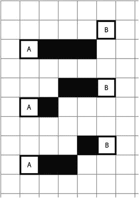

### 图 6-19。三条路径长度相同，但选择的路线不同

没有哪条路径绝对优于或劣于其他路径，它们都具有相同的代价。但每条路径都有其独特的风格。这种风格取决于 A* 算法在计算路径时使用的启发式算法。

**启发式算法** 是一种微型算法，其任务是基于一个简单公式来计算距离。有三种著名的启发式算法常用于 A* 算法：曼哈顿距离、欧几里得距离和对角线距离。图 6-20 展示了 `shortestPath` 函数中每种启发式算法所产生的不同路径。你更喜欢哪一种？

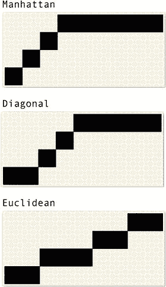

### 图 6-20。不同的启发式算法产生不同的路径

`shortestPath` 函数根据传递给它的最后一个参数来选择使用哪种启发式算法。

```

let path = shortestPath(

  getIndex(alien.x, alien.y, 64, 64, 13),

  getIndex(g.pointer.x, g.pointer.y, 64, 64, 13),

  wallMapArray,

  13,

  [2, 3],

  "manhattan"

);

```

在 `while` 循环中的一个 `switch` 语句通过将工作委托给指定的启发式方法来查找 `H` 的值。

```

let h;

switch (heuristic) {

  case "manhattan":

    h = manhattan(testNode, destinationNode);

    break;

  case "euclidean":

    h = euclidean(testNode, destinationNode);

    break;

  case "diagonal":

    h = diagonal(testNode, destinationNode);

    break;

  default:

    throw new Error("哎呀！看起来你拼错了启发式算法的名字");

}

```

每种启发式方法都以不同的方式计算起点和终点之间的距离。曼哈顿方法最为简单。它只是将行数和列数相加，然后将总和乘以代价。它忽略了任何可能的对角线捷径。

```

let manhattan = (testNode, destinationNode) => {

  let h

    = Math.abs(testNode.row - destinationNode.row)

    * straightCost + Math.abs(testNode.column - destinationNode.column)

    * straightCost;

  return h;

};

```

它之所以被称为曼哈顿，是因为如果你走在纽约市（曼哈顿岛）的街道上，你将无法对角线地穿过任何城市街区抄近路。

忽略可能的对角线路径使得曼哈顿启发式算法的处理速度很快。这很重要，因为 A* 是一个极其消耗 CPU 的算法。如果你需要为每帧中的大量游戏角色进行寻路，曼哈顿算法将有助于减少性能影响。然而，由于它没有考虑对角线路径，可能无法始终保证找到绝对最短的路径。

欧几里得方法使用勾股定理来计算距离。

```

let euclidean = (testNode, destinationNode) => {

  let vx = destinationNode.column - testNode.column,

    vy = destinationNode.row - testNode.row,

    h = Math.floor(Math.sqrt(vx * vx + vy * vy) * straightCost);

  return h;

};

```

欧几里得方法确实考虑了对角线，因此它可以生成一条看起来非常自然的路径。然而，由于使用了那个消耗资源的 `Math.sqrt` 方法，其处理速度比曼哈顿方法稍慢。

对角线方法补偿了直线移动和对角线移动的代价，因此最终能得到非常准确的成本估算。这意味着 A* 算法可能需要更少的搜索，产生更快的结果，并且肯定能得出可能的最短路径。

```

let diagonal = (testNode, destinationNode) => {

  let vx = Math.abs(destinationNode.column - testNode.column),

    vy = Math.abs(destinationNode.row - testNode.row),

    h = 0;

  if (vx > vy) {

    h = Math.floor(diagonalCost * vy + straightCost * (vx - vy));

  } else {

    h = Math.floor(diagonalCost * vx + straightCost * (vy - vx));

  }

  return h;

};

```

没有唯一正确的启发式算法。你只需要决定哪种算法能为你正在制作的游戏生成看起来最自然的路径。

## 圆角寻路

我们当前使用的 A*算法存在一个潜在问题：它通过单元格间的对角捷径来计算最短路径。虽然精确，但对迷宫游戏会产生困扰。在大多数迷宫游戏中，角色应沿墙壁边缘行走，对角切角会显得不自然。图 6-21 展示了这一矛盾。

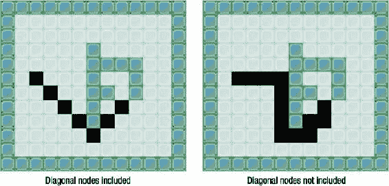

### 图 6-21 迷宫游戏路径通常不应切角寻径

防止路径对角切角的方案很简单：只需不检测与当前中心测试节点呈对角相邻的节点即可。在示例 A*实现的`surroundingNodes`函数中，当前会检测中心节点周围所有八个节点：

```

let allSurroundingNodes = [

  nodeMap[index - mapWidthInTiles - 1],

  nodeMap[index - mapWidthInTiles],

## 沿路径行走

知道如何寻径后，需要教会游戏角色如何沿路径行走。你可以在`walkPath.html`程序中找到可运行的示例。点击迷宫任意位置，外星精灵就会沿最短路径到达该点。A*算法使用了我们刚讨论的改进方法让路径实现圆角效果，如图 6-22 所示。

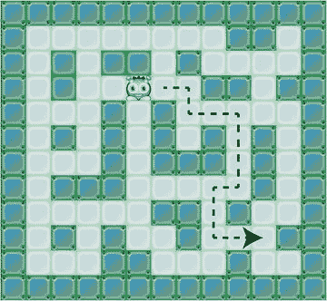

### 图 6-22 点击地图任意位置，游戏角色就会行走过去

其实现原理是：通过`shortestPath`函数生成一个包含 x/y 坐标对的二维数组。这些坐标点被称为**路径点**。每个路径点代表路径中每个节点的 x/y 位置。然后利用这些坐标点指导精灵的移动方向。让我们看看实现这些功能的代码。

首先，`setup`函数定义了指针的`release`方法。它将指针的 x 和 y 位置存入两个新变量`destinationX`和`destinationY`，并将布尔变量`calculateNewPath`设为`true`，标记需要在下个时机计算新路径。`setup`函数还定义了`wayPoints2DArray`变量，用于后续存储 x/y 路径点对。

```javascript
//该数组将用于存储 x/y 位置值对的子数组
//我们将用这些值改变外星精灵的速度
wayPoints2DArray = [];

//布尔变量，指针点击时设为 true
//计算新路径后设为 false
calculateNewPath = false;

//指针的`release`方法，在释放鼠标左键或触摸点时调用
g.pointer.release = () => {
  //将新路径的目标点设为指针当前的 x 和 y 位置
  destinationX = g.pointer.x;
  destinationY = g.pointer.y;
  //将`calculateNewPath`设为 true
  calculateNewPath = true;
};
```

其余重要代码位于游戏循环中——按照本书一直使用的实现方式，它位于名为`play`的函数中。以下是完整代码，附带注释说明各部分工作原理。（该代码使用了前几章学过的`isCenteredOverCell`和`getIndex`辅助函数。）

```javascript
function play() {
  //判断外星精灵是否位于瓦片单元格中心
  if (isCenteredOverCell(alien)) {
    //如果指针已将`calculateNewPath`设为 true，
    //计算精灵与指针位置（`destinationX`和`destinationY`）之间的最短路径
    if (calculateNewPath) {
      //计算最短路径
      let path = shortestPath(
        getIndex(alien.centerX, alien.centerY, 64, 64, 13), //起始索引
        getIndex(destinationX, destinationY, 64, 64, 13),   //结束索引
        wallMapArray,                                       //地图数组
        13,                                                 //地图宽度
        [2, 3],                                             //GID 数组
        "manhattan"                                         //启发函数
      );

      //移除`path`数组的第一个节点。因为不需要它：
      //外星精灵当前位置与`path`数组的第一个节点位置相同。
      //后续代码将指引外星精灵从当前位置移动到路径中的第一个新节点。
      path.shift();

      //如果路径不为空，用 x/y 位置值对的子数组填充`wayPoints2DArray`
      if (path.length !== 0) {
        //获取 x/y 坐标点的二维数组
        wayPoints2DArray = path.map(node => {
          //计算路径中每个方格的 x 和 y 位置
          //通过将节点的`column`和`row`乘以每个单元格的高度（像素）：
          //64 像素
          let x = node.column * 64,
              y = node.row * 64;
          // 返回一个包含每个节点 x 和 y 坐标的子数组
          return [x, y];
        });
      }

      // 将 `calculateNewPath` 设为 `false`，这样这段代码
      // 就不会在游戏循环中再次运行。（可以通过点击指针
      // 再次将其设为 `true`。）
      calculateNewPath = false;
    }

    // 根据外星人相对于当前、下一个路径点的 x/y 位置
    // 设置外星人的新速度。
    // 因为我们每次设置新速度后都会
    // 移除一个路径点元素，所以 `wayPoints2DArray`
    // 中的第一个元素始终指向外星人精灵要移动到的
    // 下一个路径点。
    if (wayPoints2DArray.length !== 0) {
      // 向左
      if (wayPoints2DArray[0][0] < alien.x) {
        alien.vx = -4;
        alien.vy = 0;
      // 向右
      } else if (wayPoints2DArray[0][0] > alien.x) {
        alien.vx = 4;
        alien.vy = 0;
      // 向上
      } else if (wayPoints2DArray[0][1] < alien.y) {
        alien.vx = 0;
        alien.vy = -4;
      // 向下
      } else if (wayPoints2DArray[0][1] > alien.y) {
        alien.vx = 0;
        alien.vy = 4;
      }

      // 移除当前路径点，这样下一次
      // `wayPoints2DArray` 中的第一个元素就能正确指向
      // 外星人精灵要移动到的下一个路径点。
      wayPoints2DArray.shift();

      // 如果没有剩余的路径点了，
      // 则将外星人的速度设为 0
    } else {
      alien.vx = 0;
      alien.vy = 0;
    }
  }

  // 根据新速度移动外星人精灵
  alien.x += alien.vx;
  alien.y += alien.vy;
}
```

在这个例子中，每当用户点击鼠标时就会计算一条新路径，但在你自己的游戏中，你可以修改这一点，使得每当发生任何导致精灵改变方向的重大事件时，就重新计算路径。

## 扩展与自定义 A* 算法

你肯定需要投入一些时间来熟悉 A* 算法并理解其所有细微之处。但这绝对值得，因为它是游戏设计的基础技术，应用于大多数游戏类型的所有平台。

A* 算法的一大吸引力在于其灵活性。如你所见，只需切换启发函数，就能生成不同类型的路径。但让 A* 算法如此灵活的不仅仅是启发函数。让我们看看 A* 算法提供的其他一些可能性。

### 可变地形

在本章的示例中，我们只有一种障碍物：墙壁。然而，你的游戏中可能有不同类型的障碍物，并非所有障碍物都无法穿越。

如果你的游戏中有一个泥潭会怎样？角色仍然可以穿过泥潭，但移动速度会减慢。你可以修改 A* 算法，让包含泥潭的节点具有高成本。例如，当 A* 算法遇到泥潭节点时，给 G 成本额外增加 20 或 30 点。这样 A* 算法就会计算是绕过泥潭更快，还是直接穿过泥潭走捷径更优。

策略游戏一直在使用这种技术。部队需要考虑是坚持在平原上快速行军，还是花时间翻山越岭。这种分析完全由 A* 算法对不同类型移动的成本分析来完成。

### 影响地图

另一个可以用 A* 算法解决的有趣问题。想象一下，你的敌方 AI 角色正在使用 A* 算法寻找通往地牢的最佳出口。唯一的问题是，你发现你可以轻松地通过躲在该出口附近，并在每个敌人盲目摸索过来时将其击倒来获得高分。这些敌人无法警告他们的同伴，尽管这可能是最短的路线，但也极其危险。

你可以通过使用所谓的**影响地图**来解决这个问题。如果游戏世界的某个区域变得特别危险，那么将这些节点的成本设得非常高。当 A* 算法搜索路径时，它就会避开这些代价高昂的危险区域。

你还可以扩展这个概念来解决多个敌人沿同一条路径移动的问题。在许多游戏中，如果所有敌人都选择同一条最短路径，会显得非常不自然。你可以通过追踪每个敌人选择的路径，并为这些节点分配高成本，来迫使敌人选择不同的路径。这样 A* 算法就会避开已被其他敌人选中的节点和路径。

### 迪杰斯特拉算法

之前，我提到 A* 算法是迪杰斯特拉算法的一种改进。有一个很好的理由让你选择使用迪杰斯特拉算法而非 A* 算法：即当你不知道路径的最终目的地时。

A* 算法和迪杰斯特拉算法的唯一区别在于，A* 算法增加了启发函数。在迪杰斯特拉算法中，H 值始终为零。这意味着当迪杰斯特拉算法开始寻找路径时，它不知道应该从哪个方向开始寻找。它需要比 A* 算法进行更多的搜索才能找到目标。

但是，如果你的游戏中不确定角色的最终目的地会是哪里呢？想象你正在设计一款策略或资源管理游戏，你的村民需要去收集草莓。小镇周围有四个草莓丛，但你不确定哪一个最近。如果你使用迪杰斯特拉算法，它会向所有方向向外搜索，直到找到第一个目标。如果你使用 A* 算法，你需要计算到每个草莓丛的四条不同路径，并选择最短的一条。迪杰斯特拉算法可以帮你省去这一步麻烦，因此在这种情况下是更好的选择。

如果你想使用迪杰斯特拉算法而不是 A* 算法，只需将所有 H 成本设为 0。A* 算法的其余代码保持不变。

不要重复造轮子！本章旨在让你完全理解 A* 算法的工作原理，旨在帮助你根据需求对其进行定制、重写和修改。不过，JavaScript 中有许多高质量的 A* 算法开源实现，可能在性能、灵活性或易于实现方面更适合你的用例。`Easystar.js` 和 `Pathfinding.js` 是不错的起点。

## 本章小结

本章简要介绍了寻路算法，希望能启发你思考如何在自己的游戏中使用这些技术。冒险游戏、策略游戏以及任何需要复杂 AI 的游戏都将从这些技术中受益。你已经学会了从零实现你自己的 A* 寻路算法所需的一切知识，以及如何使用它来让你基于瓦片的游戏世界中的精灵进行移动。

但这绝不意味着我们对基于瓦片的游戏的探讨就此结束！在下一章中，你将学到更多基于瓦片的游戏设计秘诀：如何使用瓦片轻松创建出人意料地复杂的自主 AI 实体，以及如何实现高效的宽相位碰撞检测系统。

© 雷克斯·范德斯普伊 2017

雷克斯·范德斯普伊，《高级游戏开发者工具包》，10.1007/978-1-4842-1097-0_7
