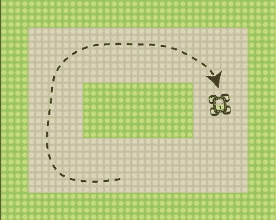
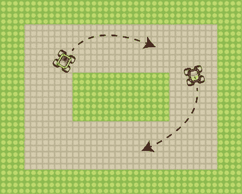
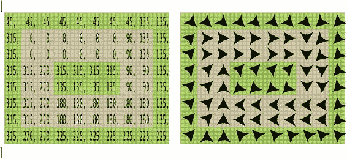
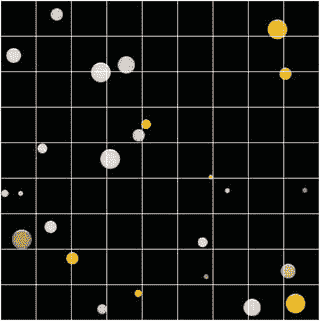
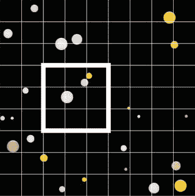
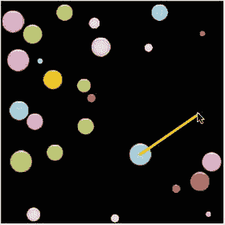
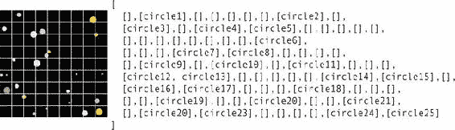

# 7. 基于瓦片的游戏：更多乐趣

Rex van der Spuy¹

(1)加拿大安大略省多伦多

本书大部分内容都在探讨基于瓦片的游戏设计方法如何帮助你轻松高效地解决一些复杂问题。它可以帮助你改进和简化从关卡设计、碰撞、游戏逻辑、人工智能到寻路等所有方面。但如果不探讨另外两种你一定会经常在游戏中用到的基于瓦片的设计策略，这本书就不算完整：

- **隐藏游戏数据**：你可以在地图单元格中隐藏关于游戏的特殊信息，用于创建复杂的人工智能实体。在本章中，你将通过为一个简单的赛车游戏原型创建一辆自动驾驶汽车来了解这一点。
- **宽阶段碰撞检测**：通过只检测可能发生碰撞的对象之间的碰撞，来提升计算密集型物理游戏的性能。你将通过实现一个名为**空间网格**的通用且轻量级的碰撞系统来学习这一点。

所以，系好安全带，发动引擎——我们准备上路了！

## 为人工智能系统使用额外的游戏数据

本章我们将首先探讨如何为赛车驾驶游戏创建一个电脑控制的汽车。但在那之前，我们先来看看如何创建一辆可以由键盘控制、在赛道上行驶的人力控制赛车。运行本章源文件中的`drivingGame.html`文件查看工作原型，如图 7-1 所示。使用键盘驾驶汽车在赛道上行驶。



### 图 7-1. 使用键盘驾驶汽车在赛道上行驶，但注意不要陷在草地上

这个小原型还实现了驾驶游戏中最烦人但又最不可或缺的功能之一：如果你驶离赛道，你的车就会陷入草地并减速。得益于我们基于瓦片的设计系统的优雅之处，这个功能实现起来非常简单，你将在接下来的章节中详细了解。但首先，让我们快速了解一下这个小原型是如何构建的。

下面你会找到使这个游戏运行的全部 JavaScript 文件。大部分代码你都会非常熟悉，所以可以把它看作是对基于瓦片的游戏世界构建基础的快速回顾。新的部分是玩家汽车的控制系统。代码会监听键盘方向键的按下：如果按下了上箭头，`moveForward`布尔值会被设为`true`；如果按下了右箭头和左箭头键，汽车的`rotationSpeed`会被设置。这些值随后会在游戏循环（`play`函数）中被用来旋转和移动汽车。以下是完整的代码清单，并带有解释一切工作原理的注释。

```javascript
//加载本游戏中使用的所有资源
let thingsToLoad = [
  "images/tileSet.png",
];

//创建一个新的 Hexi 实例并启动它
let g = hexi(640, 512, setup, thingsToLoad);

//将画布缩放到最大浏览器尺寸
g.scaleToWindow();

//启动游戏引擎
g.start();

//初始化变量
let car, world;

function setup() {
  //创建定义我们基于瓦片世界的`world`容器
  world = g.group();

  //设置每个瓦片的`tileWidth`和`tileHeight`（像素单位）
  world.tileWidth = 64;
  world.tileHeight = 64;

  //定义世界的宽度和高度（以瓦片为单位）
  world.widthInTiles = 10;
  world.heightInTiles = 8;

  //创建世界层级
  world.layers = [
    //环境层。`1`代表草地，
    //`2`代表赛道
    [
      1, 1, 1, 1, 1, 1, 1, 1, 1, 1,
      1, 2, 2, 2, 2, 2, 2, 2, 2, 1,
      1, 2, 2, 2, 2, 2, 2, 2, 2, 1,
      1, 2, 2, 1, 1, 1, 1, 2, 2, 1,
      1, 2, 2, 1, 1, 1, 1, 2, 2, 1,
      1, 2, 2, 2, 2, 2, 2, 2, 2, 1,
      1, 2, 2, 2, 2, 2, 2, 2, 2, 1,
      1, 1, 1, 1, 1, 1, 1, 1, 1, 1
    ],
    //角色层。`3`代表汽车
    //`0`代表不包含任何精灵的空单元格
    [
      0, 0, 0, 0, 0, 0, 0, 0, 0, 0,
      0, 0, 3, 0, 0, 0, 0, 0, 0, 0,
      0, 0, 0, 0, 0, 0, 0, 0, 0, 0,
```

# 在数组中存储隐藏的游戏数据

下一步是添加一辆能够自主导航赛道的 AI 控制汽车。为此，我们将创建一个新的地图数组，存储关于 AI 汽车应该根据其在赛道上的位置向哪个方向转弯的信息。这些数据是“隐藏”的，因为游戏玩家并不知道它的存在——它仅由游戏的 AI 系统用于做出决策。

你已经看到地图数组不仅用于绘制瓦片，还用于帮助解释游戏世界。在我们刚刚看的驾驶游戏示例中，数组中的草地数据不仅帮助在屏幕上绘制草地瓦片，还在游戏逻辑中发挥了关键作用。基于瓦片的游戏的优势在于地图数组数据包含有意义的信息，这些信息可用于游戏中从显示到 AI 系统的各个方面。

你可以更进一步。如果你在数组中存储更多关于游戏世界的信息，而不仅仅是屏幕上可见的内容，会怎么样呢？

想象一下你正在创建一个奇幻角色扮演游戏，玩家可以施放影响部分游戏世界的法术。吟游诗人角色施放了一个“不和谐噪音”法术，使得所有敌人从施法区域的游戏地图中逃离。你将如何向游戏描述这些信息？

你可以创建一个与游戏世界大小匹配的“法术地图”。你可以用某种代码（例如 `1`）标记所有受不和谐噪音影响的游戏世界区域。

```javascript
let spellMap = [
  0,0,0,0,0,0,0,0,0,0,
  0,0,0,0,0,0,0,0,0,0,
  0,0,0,0,0,0,0,0,0,0,
  0,0,0,0,0,0,0,0,0,0,
  0,0,0,0,0,0,0,0,0,0,
  0,0,0,0,0,0,0,0,0,0,
  0,0,0,0,0,0,0,0,0,0,
  0,0,0,0,0,0,0,0,0,0,
  0,0,0,0,0,0,0,0,0,0,
  0,0,0,0,0,0,0,0,0,0
];
```

上面最后几行代码的作用是当汽车驶入草地时使其减速。该代码比较汽车在地图上的索引位置。如果它在草地瓦片上（`gid` 为 `1`），则通过将摩擦力系数设置为 `0.25` 来增加汽车的摩擦力。否则，汽车必定在赛道上，因此将摩擦力系数设置为正常值 `0.96`。

```javascript
//通过逐一循环每个层级数组来构建游戏世界
world.layers.forEach(layer => {
  //遍历每个数组元素
  layer.forEach((gid, index) => {
    //如果单元格不为空(0)，则创建一个精灵
    if (gid !== 0) {
      //查找精灵所在的列和行，以及与该列和行位置匹配的 x 和 y 像素值
      let column, row, x, y;
      column = index % world.widthInTiles;
      row = Math.floor(index / world.widthInTiles);
      x = column * world.tileWidth;
      y = row * world.tileHeight;

      //接下来，根据其`gid`数字创建不同的精灵
      let sprite;
      switch (gid) {
        //赛道
        case 1:
          sprite = g.sprite(g.frame("images/tileSet.png", 192, 64, 64, 64));
          break;
        //草地
        case 2:
          sprite = g.sprite(g.frame("images/tileSet.png", 192, 0, 64, 64));
          break;
        // 汽车
        case 3:
          sprite = g.sprite(g.frame("images/tileSet.png", 192, 192, 48, 48));
          car = sprite;
      }

      // 使用计算出的 `x` 和 `y` 值定位精灵
      // 这些值与其在瓦片地图中的列和行相对应
      sprite.x = x;
      sprite.y = y;

      // 将精灵添加到 `world` 容器中
      world.addChild(sprite);
    }
  });
});

// 为汽车添加一些物理属性
car.vx = 0;
car.vy = 0;
car.accelerationX = 0.2;
car.accelerationY = 0.2;
car.rotationSpeed = 0;
car.friction = 0.96;
car.speed = 0;

// 将汽车的中心旋转点设置到精灵的中间位置
car.setPivot(0.5, 0.5);

// 汽车是否应该向前移动
car.moveForward = false;

// 定义方向键来控制汽车
let leftArrow = g.keyboard(37),
  upArrow = g.keyboard(38),
  rightArrow = g.keyboard(39),
  downArrow = g.keyboard(40);

// 如果按下了左箭头键，将汽车的 `rotationSpeed` 设置为 -0.1（向左旋转）
leftArrow.press = () => {
  car.rotationSpeed = -0.05;
};

// 如果释放了左箭头键且右箭头键未被按下，则将 `rotationSpeed` 设置为 0
leftArrow.release = () => {
  if (!rightArrow.isDown) car.rotationSpeed = 0;
};

// 对右箭头键执行相同操作，但将 `rotationSpeed` 设置为 0.1（向右旋转）
rightArrow.press = () => {
  car.rotationSpeed = 0.05;
};

rightArrow.release = () => {
  if (!leftArrow.isDown) car.rotationSpeed = 0;
};

// 如果按下了上箭头键，将 `car.moveForward` 设置为 `true`；释放时设置为 `false`
upArrow.press = () => {
  car.moveForward = true;
};

upArrow.release = () => {
  car.moveForward = false;
};

// 通过将游戏状态设置为 `play` 来启动游戏循环
g.state = play;
}

// 游戏循环
function play() {
  // 使用 `rotationSpeed` 来设置汽车的旋转角度
  car.rotation += car.rotationSpeed;

  // 如果 `car.moveForward` 为 `true`，则增加速度
  if (car.moveForward) {
    car.speed += 0.05;
  }
  // 如果 `car.moveForward` 为 `false`，则使用摩擦力使汽车减速
  else {
    car.speed *= car.friction;
  }

  // 使用 `speed` 值计算汽车旋转方向上的加速度
  car.accelerationX = car.speed * Math.cos(car.rotation);
  car.accelerationY = car.speed * Math.sin(car.rotation);

  // 将加速度和摩擦力应用于汽车的速度
  car.vx = car.accelerationX;
  car.vy = car.accelerationY;
  car.vx *= car.friction;
  car.vy *= car.friction;

  // 将汽车的速度应用于其位置，使其移动
  car.x += car.vx;
  car.y += car.vy;

  // 如果汽车陷入草地，则减速
  // 首先找到汽车的地图索引位置（使用 `getIndex` 辅助函数）
  let carIndex = getIndex(car.x, car.y, 64, 64, 10);

  // 获取赛道地图的引用
  let trackMap = world.layers[0];

  // 如果汽车在草地瓦片（`gid` 1）上，则将汽车的摩擦力设置为 0.25 以使其变得迟钝
  if (trackMap[carIndex] === 1) {
    car.friction = 0.25;
  }
  // 如果汽车不在草地瓦片上，则恢复其原始摩擦力值
  else {
    car.friction = 0.96;
  }
}
```

0,0,0,0,1,0,0,0,0,0,
0,0,0,1,1,1,0,0,0,0,
0,0,0,1,1,1,0,0,0,0,
0,0,0,0,1,0,0,0,0,0,
0,0,0,0,0,0,0,0,0,0,
0,0,0,0,0,0,0,0,0,0
];
```

然后，敌人可以利用这些信息来决定是否要冒险进入这些瓦片，以遭受耳膜破裂的风险。

这些信息不是视觉上的；它仅用于游戏逻辑。当你开始习惯于以基于瓦片的方式思考你的游戏时，你会发现许多原本复杂的问题可以通过这样的游戏数据数组轻松解决。

那么，我们如何添加一些类似的隐藏游戏数据来帮助我们创建一辆 AI 控制的赛车呢？

## 添加 AI 控制的汽车

运行`aiDrivingGame.html`程序，如图 7-2 所示。现在你有了一个对手：一辆 AI 控制的机器人汽车，它会尽全力在赛道上与你比赛。



这辆 AI 汽车并非遵循预先编写的动画，也没有专用的 AI 控制器。相反，它读取一个数字数组，该数组告诉它根据当前所在的地图单元应该以何种角度定位自己。它遵循一张不可见的“角度地图”。角度地图是游戏的第三个地图层，它为地图中的每个单元定义了以度为单位的角度。

```
[
  45,   45,  45,  45,  45,  45,  45,  45, 135, 135,
  315,   0,   0,   0,   0,   0,   0,  90, 135, 135,
  315,   0,   0,   0,   0,   0,   0,  90, 135, 135,
  315, 315, 270, 315, 315, 315, 315,  90,  90, 135,
  315, 315, 270, 135, 135, 135, 135,  90,  90, 135,
  315, 315, 270, 180, 180, 180, 180, 180, 225, 135,
  315, 315, 270, 180, 180, 180, 180, 180, 225, 135,
  315, 270, 270, 225, 225, 225, 225, 225, 225, 225
]
```

这些角度告诉 AI 汽车根据它所在的单元格，尝试以哪个角度进行自我定位。（0 度指向正右方，即 3 点钟方向。）你可以将这些角度值视为指向 AI 汽车需要行进方向的小箭头，如图 7-3 所示。



图 7-3：一组角度数组决定了 AI 汽车应尝试朝向的方向

AI 汽车要在赛道上行驶，只需将其自身旋转到当前所在单元格的最佳角度即可。而且，为了增加趣味性，代码会在这些角度上添加一些随机变化，范围在正负 20 度以内。这种随机性使得 AI 汽车的驾驶看起来更加自然，就像一个不完美的真人驾驶员。接下来，我们来详细讲解实现这一效果的新代码。

代码首先声明了三个新的全局变量：`aiCar`、`previousMapAngle` 和 `targetAngle`。

```
let car, world, aiCar, previousMapAngle, targetAngle;
```

然后，`setup` 函数创建了游戏所需的新数据。AI 汽车被添加到世界对象的第二层地图图层中，该图层用数字 4 表示。

```
[
  0, 0, 0, 0, 0, 0, 0, 0, 0, 0,
  0, 0, 3, 0, 0, 0, 0, 0, 0, 0,
  0, 0, 4, 0, 0, 0, 0, 0, 0, 0,
  0, 0, 0, 0, 0, 0, 0, 0, 0, 0,
  0, 0, 0, 0, 0, 0, 0, 0, 0, 0,
  0, 0, 0, 0, 0, 0, 0, 0, 0, 0,
  0, 0, 0, 0, 0, 0, 0, 0, 0, 0,
  0, 0, 0, 0, 0, 0, 0, 0, 0, 0
],
```

接着，角度数组作为世界对象的第三层地图图层被添加进来。

```
[
   45,  45,  45,  45,  45,  45,  45,  45, 135, 135,
  315,   0,   0,   0,   0,   0,   0,  90, 135, 135,
  315,   0,   0,   0,   0,   0,   0,  90, 135, 135,
  315, 315, 270, 315, 315, 315, 315,  90,  90, 135,
  315, 315, 270, 135, 135, 135, 135,  90,  90, 135,
  315, 315, 270, 180, 180, 180, 180, 180, 180, 135,
  315, 315, 270, 180, 180, 180, 180, 180, 180, 135,
  315, 270, 270, 225, 225, 225, 225, 225, 225, 225
]
```

用于构建世界的`switch`语句会这样创建新的`aiCar`精灵。

```
case 4:
  sprite = g.sprite(g.frame("images/tileSet.png", 192, 128, 48, 48));
  aiCar = sprite;
```

接着，两个汽车精灵的属性被初始化。

```
//一个为汽车添加物理属性的函数
let addCarProperties = carSprite => {
  carSprite.vx = 0;
  carSprite.vy = 0;
  carSprite.accelerationX = 0.2;
  carSprite.accelerationY = 0.2;
  carSprite.rotationSpeed = 0;
  carSprite.friction = 0.96;
  carSprite.speed = 0;
  //居中旋转点
  carSprite.setPivot(0.5, 0.5);
  //汽车是否应该向前移动
  carSprite.moveForward = false;
};
//为玩家汽车添加物理属性
addCarProperties(car);
//为 AI 汽车添加物理属性，并设置为在游戏开始时向前移动
addCarProperties(aiCar);
aiCar.moveForward = true;
```

其余的新代码位于`play`函数中。它计算出 AI 汽车的新目标角度应该是什么，尝试将汽车旋转到该角度，添加一些随机变化，并利用其物理属性移动汽车。这段代码如何工作的所有细节都在注释中。

```
//如果 `aICar.moveForward` 为 `true`，在速度低于最大速度限制 3 时增加速度
if (aiCar.moveForward && aiCar.speed <= 3) {
  aiCar.speed += 0.08;
}
//查找 AI 汽车的当前角度（以度为单位）
let currentAngle = aiCar.rotation * (180 / Math.PI);
//将计算出的角度限制在 0 到 360 之间
currentAngle = currentAngle + Math.ceil(-currentAngle / 360) * 360;
//找出其在地图上的索引位置
let aiCarIndex = getIndex(aiCar.x, aiCar.y, 64, 64, 10);
//找出该地图位置对应的目标角度
let angleMap = world.layers[2];
let mapAngle = angleMap[aiCarIndex];
//每次 AI 汽车遇到新的地图角度时，添加一个可选的 ±20 度随机变化
if (mapAngle !== previousMapAngle) {
  targetAngle = mapAngle + randomInt(-20, 20);
  previousMapAngle = mapAngle;
}
//如果不想在 AI 汽车的角度中添加任何随机变化
//请用以下代码替换上面的 if 语句：
//targetAngle = mapAngle;
```

//计算当前角度与目标角度之间的差值

`let difference = currentAngle - targetAngle;`

//判断是向左还是向右转动汽车

`if (difference > 0 && difference < 180) {`

//向左转

`aiCar.rotationSpeed = -0.03;`

`} else {`

//向右转

`aiCar.rotationSpeed = 0.03;`

`}`

//使用 `rotationSpeed` 设置汽车的旋转角度

`aiCar.rotation += aiCar.rotationSpeed;`

//使用 `speed` 值来计算沿着 AI 汽车旋转方向的加速度

`aiCar.accelerationX = aiCar.speed * Math.cos(aiCar.rotation);`

`aiCar.accelerationY = aiCar.speed * Math.sin(aiCar.rotation);`

//将加速度和摩擦力应用于 AI 汽车的速度

`aiCar.vx = aiCar.accelerationX`

`aiCar.vy = aiCar.accelerationY`

`aiCar.vx *= aiCar.friction;`

`aiCar.vy *= aiCar.friction;`

//将 AI 汽车的速度应用于其位置，使 AI 汽车移动

`aiCar.x += aiCar.vx;`

`aiCar.y += aiCar.vy;`

但还有一件事！为了游戏的公平性，如果 AI 汽车驶入草地，我们也需要让它减速。下面这段靠近 `play` 函数末尾的代码就是负责这个的。

```
//获取赛道地图的引用
let trackMap = world.layers[0];

//如果 AI 汽车在草地瓦片（gid 为 1）上，则通过将其摩擦力设置为 0.25 来使其减速，以模拟陷入泥泞
if (trackMap[aiCarIndex] === 1) {
  aiCar.friction = 0.25;
//如果汽车不在草地瓦片上，则恢复其原始摩擦力值
} else {
  aiCar.friction = 0.96;
}
```

运行示例文件，你会发现看着 AI 汽车驶入草地并挣扎着脱身是相当有趣的。

这个基本原型囊括了构建一个带有 AI 对手的完整赛车游戏所需了解的所有基本技术。以下是一些可以进一步发挥这些想法的建议：

*   通过改变或随机化 `rotationSpeed` 数值，创建不同技能水平的多种 AI 汽车。
*   让不同的 AI 汽车使用不同的角度地图来改变难度，让人类玩家无法预测。
*   分析每场比赛后人类玩家的表现，调整游戏难度以保持挑战性。
*   为 AI 汽车配备防碰撞系统，使它们在与其他汽车距离过近时能够转向避开。你可以在本书的姊妹篇《使用 HTML5 和 JavaScript 进行高级游戏设计》(Apress, 2015) 中找到构建此类系统所需的一切知识。

一旦你开始思考如何使用你在本章学到的知识来存储和利用游戏数据，你一定会发现更多解决棘手问题的方案。

# 宽相位与窄相位碰撞

游戏碰撞检测有两种通用的处理方式，分别称为`宽相位`和`窄相位`碰撞。

- `宽相位碰撞`：检查精灵是否处于碰撞的粗略区域，例如我们在前几章详细讨论过的基于瓦片的碰撞。其优势在于，这是针对大量精灵进行碰撞检测时极具性能效率的方式。因为它仅执行简单的数组查找，无需进行任何复杂的数学运算。
- `窄相位碰撞`：通过检查精灵的精确几何形状来判断它们的轮廓是否重叠。其优势在于，由于精度极高，窄相位碰撞对于物理模拟至关重要，例如检测两个台球之间的碰撞。其劣势在于，由于大量数学运算会加重 CPU 负担，它非常消耗性能。如果你要检测大量精灵之间的碰撞，速度可能会很慢。尽管本书不涉及如何实现窄相位碰撞系统，但你可以在《使用 HTML5 与 JavaScript 进行高级游戏设计》中找到从头构建此类系统所需的一切知识。

这两种碰撞系统构成了所有电子游戏中碰撞检测的基础。你如何决定使用哪一种？选择通常很简单：如果需要物理效果，就用窄相位；否则就用宽相位。但这里存在一个灰色地带！

如果你正在制作一个游戏，其中有数千个圆球需要相互弹跳，该怎么办？你尝试实现一个物理负担沉重的窄相位碰撞系统，但帧率降到了每秒 5 帧。太慢了！于是你实现了一个宽相位碰撞系统，轻松达到了每秒 60 帧。但现在你的圆球在弹开之前明显会相互重叠，看起来极其不精确。你该怎么办？

同时使用宽相位和窄相位碰撞！将你的碰撞系统分解为两个步骤：

1.  `宽相位检查`：首先使用宽相位碰撞来找出你关注的精灵是否彼此处于大致邻近区域，以及在本动画帧中是否可能足够接近并发生接触。
2.  `窄相位检查`：如果宽相位检查确定有可能发生碰撞，则运行一个更精确但更耗费 CPU 的窄相位检查。

实现这种两阶段碰撞策略的方法有很多，但我要向你展示最简单、最有用且通常最具性能效率的一种：`空间网格`。

## 空间网格

要创建空间网格，请将你的游戏世界划分为单元格。这些单元格应该多大？它们的大小应该相当于一个精灵在一个动画帧内可能移动的最大距离。例如，假设你正在创建一个弹珠游戏，并且你确定所有弹珠精灵的移动速度都不会超过每秒 64 像素。这意味着你可以使用一个空间网格，其中每个单元格宽 64 像素、高 64 像素。如果你的游戏屏幕是 512x512 像素，图 7-4 展示了这个网格的样子。



### 图 7-4. 将你的世界划分为单元格

在标准的窄相位碰撞系统中，每个精灵都需要与整个游戏中的其他所有精灵进行碰撞检测。这是很浪费的，因为碰撞检测会在位于屏幕完全相反两侧的精灵之间进行，即便它们绝无可能发生碰撞。但是，如果你使用空间网格，你的碰撞检测就会更有针对性。对于每个精灵，你只需要检测它与其直接相邻单元格中的精灵之间是否发生碰撞。

例如，请看图 7-5。屏幕左中位置有一个大的白色圆圈。那个白色圆圈所在的单元格，以及环绕它的八个单元格，共同构成了该圆圈的`碰撞区域`。这个碰撞区域是屏幕上该精灵有可能与任何其他精灵发生碰撞的唯一区域。



### 图 7-5. 仅检测同一碰撞区域内精灵之间的碰撞

因此，我们不需要检测这个大白色圆圈与屏幕上其他 24 个圆圈之间的碰撞，只需检测它与碰撞区域右上角那两个较小圆圈之间的碰撞。这减少了大约 90%的碰撞检测次数！

原理就这么简单！但是，你如何实际用代码创建这样一个空间网格系统，并在游戏中使用它呢？

## 实现空间网格

运行本章源文件中的 `spatialGrid.html` 文件，可以查看一个可运行的示例。这是一个简单的弹珠弹射游戏。用鼠标选择一个弹珠，拖拽，然后释放。观察弹珠在屏幕上弹跳并与其他弹珠碰撞，如图 7-6 所示。



### 图 7-6. 点击、拖拽并释放，观看弹珠在屏幕上弹跳

有关这个小游戏原型如何工作的详细信息，请查看完整的源代码。就我们的目的而言，我们只对空间网格碰撞系统的工作原理感兴趣。但是，关于我们即将查看的代码，有两点你需要了解：

- 所有代码都在游戏循环内运行，因此每一帧都会更新。
- 所有圆形精灵都引用自一个名为 `marbles.children` 的数组。

好了，明白了吗？现在我们来看看代码！

### 编码空间网格

我们首先需要创建网格。这只是一个二维数组，其中的单元格数量与我们想要的网格行数和列数相匹配。数组首先被初始化为空元素。然后，代码遍历所有精灵，并使用我们熟悉的 `getIndex` 函数，根据每个精灵的 x/y 像素坐标将它们插入到正确的单元格中。我们的代码在一个名为 `spatialGrid` 的函数中完成所有这些操作，该函数允许你指定网格的大小以及每个单元格的大小（以像素为单位）。

```
let spatialGrid = (widthInPixels, heightInPixels, cellSizeInPixels, spritesArray) => {
  //找出我们需要多少个单元格以及网格数组应该有多长
  let width = widthInPixels / cellSizeInPixels,
    height = heightInPixels / cellSizeInPixels,
```

# 空间网格与碰撞检测

```javascript
length = width * height;

//初始化一个空网格
let gridArray = [];

//向元素中添加空的子数组
for (let i = 0; i < length; i++) {
  //向每个元素添加空数组。我们将在这里
  //存储精灵引用
  gridArray.push([]);
}

//将精灵添加到网格
spritesArray.forEach(sprite => {
  //找出精灵当前的映射索引位置
  let index = getIndex(sprite.x, sprite.y, cellSizeInPixels, cellSizeInPixels, width);
  //将精灵添加到该索引位置的数组中
  gridArray[index].push(sprite);
});

//返回数组
return gridArray;
};

//创建空间网格并将大理石精灵添加到其中
let grid = spatialGrid(512, 512, 64, marbles.children);
```

现在我们有了一个名为 `grid` 的二维数组。它包含的每个子数组要么为空，要么以与屏幕上精灵位置相匹配的方式包含对精灵的引用。例如，你可能会得到一个如下所示的数组：

```
[
  [],[circle1],[],[],[],[],[],[circle2],[],
  [circle3],[],[circle4],[circle5],[],[],[],[],[],
  [],[],[],[],[],[],[],[],[circle6],
  [],[],[],[circle7],[circle8],[],[],[],[],
  [],[circle9],[],[circle10],[],[circle11],[],[],[],
  [circle12, circle13],[],[],[],[],[],[circle14],[circle15],[],
  [circle16],[circle17],[],[],[],[circle18],[],[],[],
  [],[],[circle19],[],[],[circle20],[],[],[circle21],
  [],[circle20],[circle23],[],[],[],[],[circle24],[circle25]
]
```

（精灵的实际名称，如 `circle1` 和 `circle2`，仅用于说明目的——这些名称实际上并非由代码生成。）

图 7-7 展示了这个数组如何与相同精灵的屏幕位置进行比较。



### 图 7-7. 精灵在数组中的位置与它们在屏幕上的位置相匹配

在精灵密集分布的游戏里，你可能会有许多单元格包含对多个精灵的引用。

下一步是遍历所有精灵，并找出其碰撞区域内是否有其他精灵。（请记住，碰撞区域是指精灵周围的八个单元格，加上精灵自身所在的单元格。）如果碰撞区域内有任何精灵，代码将使用一个名为 `movingCircleCollision` 的自定义函数执行窄阶段碰撞检查，以使精灵相互弹开（关于 `movingCircleCollision` 如何工作的详细信息，请参阅《Foundation Game Design with HTML5 and JavaScript》（Apress，2012））。最后，当前正在检查的精灵会从网格数组中移除，因为其所有可能的碰撞都已检查完毕，并且我们希望防止其他精灵在循环的后续迭代中重新检查它。

```javascript
//遍历所有精灵
for (let i = 0; i < marbles.children.length; i++) {
  //获取循环中当前精灵的引用
  let sprite = marbles.children[i];
  //找出精灵当前的映射索引位置
  let gridWidthInTiles = 512 / 64;
  let index = getIndex(sprite.x, sprite.y, 64, 64, gridWidthInTiles);
  //找出周围单元格包含的内容，包括那些可能超出网格边界的单元格
  let allSurroundingCells = [
    grid[index - gridWidthInTiles - 1],
    grid[index - gridWidthInTiles],
    grid[index - gridWidthInTiles + 1],
    grid[index - 1],
    grid[index],
    grid[index + 1],
    grid[index + gridWidthInTiles - 1],
    grid[index + gridWidthInTiles],
    grid[index + gridWidthInTiles + 1]
  ];
  //找出所有可能与当前精灵发生碰撞的精灵
  for (let j = 0; j < allSurroundingCells.length; j++) {
    //获取当前周围单元格的引用
    let cell = allSurroundingCells[j];
    //如果该单元格不是 `undefined`（超出网格边界）
    //并且不为空，则检查当前精灵与单元格中的精灵之间是否存在碰撞
    if (cell && cell.length !== 0) {
      //遍历单元格中的所有精灵
      for (let k = 0; k < cell.length; k++) {
        //获取单元格中正在检查的当前精灵的引用
        let surroundingSprite = cell[k];
        //如果单元格中的精灵与主循环中的当前精灵不是同一个，则检查这两个精灵之间是否存在碰撞
        if (surroundingSprite !== sprite) {
          //执行窄阶段碰撞检查，使精灵相互弹开
          g.movingCircleCollision(sprite, surroundingSprite);
        }
      }
    }
  }
  //最后，将当前这个精灵从当前的空间网格单元格中移除，因为涉及该精灵的所有可能碰撞都已被检查完毕
  grid[index] = grid[index].filter(x => x !== sprite);
}
```

这就是全部内容！通过首先执行高效的宽阶段检查，并且仅在有碰撞可能性时才执行性能密集型的窄阶段检查，我们极大地提高了碰撞系统的效率。

为什么这段代码使用老式的 `for` 循环，而不是更简洁现代的 `forEach` 循环？`for` 循环的效率通常稍微高一点。通常，这种差异并不足以让人普遍偏爱 `for` 循环，但由于碰撞检测是游戏中最消耗性能的任务之一，在这种情况下使用 `for` 循环通常能为你带来一点性能提升。

### 其他宽相碰撞策略

空间网格是一种出色的通用宽相碰撞检测系统，是游戏设计师的常用工具。它在简单性、速度和低开销方面很难被超越。然而，还有许多其他宽相碰撞策略，每种策略都对该问题有独特的见解。以下是四种最流行的策略：

- **层级网格**：在本章一直使用的固定尺寸空间网格中，单元格的大小必须与最大物体一样大。但如果你的游戏中包含几个非常大的物体和大量非常小的物体，该怎么办？单元格大小需要足够大以容纳那些大物体，即使它们数量不多。最终会导致每个单元格中充满了许多小物体，彼此之间进行昂贵的距离检查。层级网格通过创建两个或多个不同大小单元格的网格来解决这个潜在问题。它为大型物体创建一个有大单元格的网格，为小型物体创建另一个网格，并可以在两者之间创建任何不同尺寸的网格。小物体之间的碰撞检查在小型单元格网格中进行，大物体之间的碰撞检查在大型单元格网格中进行。如果一个小物体需要检查与一个大物体的碰撞，系统会检查两个网格中对应的单元格。

- **四叉树**：层级网格的一种特定类型。游戏世界被划分为 4 个矩形，每个矩形又被进一步划分为 4 个矩形，总共得到 16 个。这 16 个矩形中的每一个再次被分割成 4 个更小的矩形，这个过程根据你需要的细节程度持续进行。每个更小的矩形都是其更大父矩形的子矩形。四叉树系统根据物体在层级中的级别来决定对哪些物体进行碰撞测试。四叉树的三维版本被称为八叉树。

- **排序与扫描**：根据物体的 `x` 和 `y` 位置对数组中的物体进行排序。检查 `x` 轴和 `y` 轴上的重叠，如果发现重叠，则进行更精确的距离检查。由于物体首先按空间排序，潜在的碰撞候选者会首先出现。

- **BSP 树**：空间以一种与游戏物体几何形状紧密匹配的方式进行划分。它很有用，因为这意味着分区既可以用于碰撞，也可以用于定义环境边界。二叉空间分割（BSP）树与四叉树密切相关，但它们更具通用性。BSP 树广泛用于三维游戏的碰撞检测。

我建议你花一些时间研究这些其他的宽相碰撞策略。你可能会发现其中一种策略对你可能面临的复杂碰撞问题有特别好的解决方案。

关于游戏碰撞的权威参考文本是 Christer Ericson 的经典著作《实时碰撞检测》（摩根·考夫曼出版社，2004 年）。尽管其中的源代码示例是用 `C++`（`JavaScript` 的“近亲”）编写的，但这些算法可以适用于任何编程语言或技术实现。

但请记住：不要在你需要之前就试图过早地优化你的碰撞系统！如果你的游戏在所有目标平台上运行良好，无需使用空间网格或四叉树，那就让它保持原样——这样很好！

## 总结

在本章中，你学习了如何在数组中添加隐藏的游戏信息，并利用这些信息为游戏世界增加丰富性和复杂性。AI 赛车向你展示了如何通过最少的、简单的代码创建一个行为复杂、智能且不可预测的游戏实体。你还学习了如何创建和使用最佳的通用低开销宽相碰撞策略：空间网格。使用空间网格可以极大地减少游戏需要进行的碰撞检查次数，并且很容易根据你的需求进行修改和调整。

并且，我们已经到达了本书的结尾！你现在已经拥有了开始制作各种类型的二维动作游戏所需的所有技能。从关卡设计，到碰撞检测，再到寻路以及基于瓦片架构的惊人效率，你现在已经掌握了所有经典的游戏设计师技术。现在就去制作一些精彩的游戏吧！
