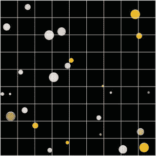
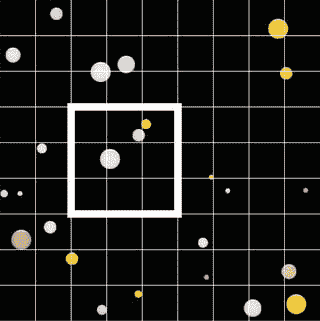
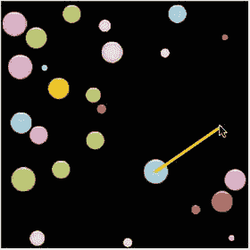
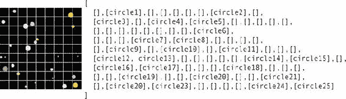

# 宽相位与窄相位碰撞

游戏碰撞检测有两种通用的处理方式，分别称为`宽相位`和`窄相位`碰撞。

- `宽相位碰撞`：检查精灵是否处于碰撞的粗略区域，例如我们在前几章详细讨论过的基于瓦片的碰撞。其优势在于，这是针对大量精灵进行碰撞检测时极具性能效率的方式。因为它仅执行简单的数组查找，无需进行任何复杂的数学运算。
- `窄相位碰撞`：通过检查精灵的精确几何形状来判断它们的轮廓是否重叠。其优势在于，由于精度极高，窄相位碰撞对于物理模拟至关重要，例如检测两个台球之间的碰撞。其劣势在于，由于大量数学运算会加重 CPU 负担，它非常消耗性能。如果你要检测大量精灵之间的碰撞，速度可能会很慢。尽管本书不涉及如何实现窄相位碰撞系统，但你可以在《使用 HTML5 与 JavaScript 进行高级游戏设计》中找到从头构建此类系统所需的一切知识。

这两种碰撞系统构成了所有电子游戏中碰撞检测的基础。你如何决定使用哪一种？选择通常很简单：如果需要物理效果，就用窄相位；否则就用宽相位。但这里存在一个灰色地带！

如果你正在制作一个游戏，其中有数千个圆球需要相互弹跳，该怎么办？你尝试实现一个物理负担沉重的窄相位碰撞系统，但帧率降到了每秒 5 帧。太慢了！于是你实现了一个宽相位碰撞系统，轻松达到了每秒 60 帧。但现在你的圆球在弹开之前明显会相互重叠，看起来极其不精确。你该怎么办？

同时使用宽相位和窄相位碰撞！将你的碰撞系统分解为两个步骤：

1.  `宽相位检查`：首先使用宽相位碰撞来找出你关注的精灵是否彼此处于大致邻近区域，以及在本动画帧中是否可能足够接近并发生接触。
2.  `窄相位检查`：如果宽相位检查确定有可能发生碰撞，则运行一个更精确但更耗费 CPU 的窄相位检查。

实现这种两阶段碰撞策略的方法有很多，但我要向你展示最简单、最有用且通常最具性能效率的一种：`空间网格`。

## 空间网格

要创建空间网格，请将你的游戏世界划分为单元格。这些单元格应该多大？它们的大小应该相当于一个精灵在一个动画帧内可能移动的最大距离。例如，假设你正在创建一个弹珠游戏，并且你确定所有弹珠精灵的移动速度都不会超过每秒 64 像素。这意味着你可以使用一个空间网格，其中每个单元格宽 64 像素、高 64 像素。如果你的游戏屏幕是 512x512 像素，图 7-4 展示了这个网格的样子。



### 图 7-4. 将你的世界划分为单元格

在标准的窄相位碰撞系统中，每个精灵都需要与整个游戏中的其他所有精灵进行碰撞检测。这是很浪费的，因为碰撞检测会在位于屏幕完全相反两侧的精灵之间进行，即便它们绝无可能发生碰撞。但是，如果你使用空间网格，你的碰撞检测就会更有针对性。对于每个精灵，你只需要检测它与其直接相邻单元格中的精灵之间是否发生碰撞。

例如，请看图 7-5。屏幕左中位置有一个大的白色圆圈。那个白色圆圈所在的单元格，以及环绕它的八个单元格，共同构成了该圆圈的`碰撞区域`。这个碰撞区域是屏幕上该精灵有可能与任何其他精灵发生碰撞的唯一区域。



### 图 7-5. 仅检测同一碰撞区域内精灵之间的碰撞

因此，我们不需要检测这个大白色圆圈与屏幕上其他 24 个圆圈之间的碰撞，只需检测它与碰撞区域右上角那两个较小圆圈之间的碰撞。这减少了大约 90%的碰撞检测次数！

原理就这么简单！但是，你如何实际用代码创建这样一个空间网格系统，并在游戏中使用它呢？

## 实现空间网格

运行本章源文件中的 `spatialGrid.html` 文件，可以查看一个可运行的示例。这是一个简单的弹珠弹射游戏。用鼠标选择一个弹珠，拖拽，然后释放。观察弹珠在屏幕上弹跳并与其他弹珠碰撞，如图 7-6 所示。



### 图 7-6. 点击、拖拽并释放，观看弹珠在屏幕上弹跳

有关这个小游戏原型如何工作的详细信息，请查看完整的源代码。就我们的目的而言，我们只对空间网格碰撞系统的工作原理感兴趣。但是，关于我们即将查看的代码，有两点你需要了解：

- 所有代码都在游戏循环内运行，因此每一帧都会更新。
- 所有圆形精灵都引用自一个名为 `marbles.children` 的数组。

好了，明白了吗？现在我们来看看代码！

### 编码空间网格

我们首先需要创建网格。这只是一个二维数组，其中的单元格数量与我们想要的网格行数和列数相匹配。数组首先被初始化为空元素。然后，代码遍历所有精灵，并使用我们熟悉的 `getIndex` 函数，根据每个精灵的 x/y 像素坐标将它们插入到正确的单元格中。我们的代码在一个名为 `spatialGrid` 的函数中完成所有这些操作，该函数允许你指定网格的大小以及每个单元格的大小（以像素为单位）。

```
let spatialGrid = (widthInPixels, heightInPixels, cellSizeInPixels, spritesArray) => {
  //找出我们需要多少个单元格以及网格数组应该有多长
  let width = widthInPixels / cellSizeInPixels,
    height = heightInPixels / cellSizeInPixels,
```

# 空间网格与碰撞检测

```javascript
length = width * height;

//初始化一个空网格
let gridArray = [];

//向元素中添加空的子数组
for (let i = 0; i < length; i++) {
  //向每个元素添加空数组。我们将在这里
  //存储精灵引用
  gridArray.push([]);
}

//将精灵添加到网格
spritesArray.forEach(sprite => {
  //找出精灵当前的映射索引位置
  let index = getIndex(sprite.x, sprite.y, cellSizeInPixels, cellSizeInPixels, width);
  //将精灵添加到该索引位置的数组中
  gridArray[index].push(sprite);
});

//返回数组
return gridArray;
};

//创建空间网格并将大理石精灵添加到其中
let grid = spatialGrid(512, 512, 64, marbles.children);
```

现在我们有了一个名为 `grid` 的二维数组。它包含的每个子数组要么为空，要么以与屏幕上精灵位置相匹配的方式包含对精灵的引用。例如，你可能会得到一个如下所示的数组：

```
[
  [],[circle1],[],[],[],[],[],[circle2],[],
  [circle3],[],[circle4],[circle5],[],[],[],[],[],
  [],[],[],[],[],[],[],[],[circle6],
  [],[],[],[circle7],[circle8],[],[],[],[],
  [],[circle9],[],[circle10],[],[circle11],[],[],[],
  [circle12, circle13],[],[],[],[],[],[circle14],[circle15],[],
  [circle16],[circle17],[],[],[],[circle18],[],[],[],
  [],[],[circle19],[],[],[circle20],[],[],[circle21],
  [],[circle20],[circle23],[],[],[],[],[circle24],[circle25]
]
```

（精灵的实际名称，如 `circle1` 和 `circle2`，仅用于说明目的——这些名称实际上并非由代码生成。）

图 7-7 展示了这个数组如何与相同精灵的屏幕位置进行比较。



### 图 7-7. 精灵在数组中的位置与它们在屏幕上的位置相匹配

在精灵密集分布的游戏里，你可能会有许多单元格包含对多个精灵的引用。

下一步是遍历所有精灵，并找出其碰撞区域内是否有其他精灵。（请记住，碰撞区域是指精灵周围的八个单元格，加上精灵自身所在的单元格。）如果碰撞区域内有任何精灵，代码将使用一个名为 `movingCircleCollision` 的自定义函数执行窄阶段碰撞检查，以使精灵相互弹开（关于 `movingCircleCollision` 如何工作的详细信息，请参阅《Foundation Game Design with HTML5 and JavaScript》（Apress，2012））。最后，当前正在检查的精灵会从网格数组中移除，因为其所有可能的碰撞都已检查完毕，并且我们希望防止其他精灵在循环的后续迭代中重新检查它。

```javascript
//遍历所有精灵
for (let i = 0; i < marbles.children.length; i++) {
  //获取循环中当前精灵的引用
  let sprite = marbles.children[i];
  //找出精灵当前的映射索引位置
  let gridWidthInTiles = 512 / 64;
  let index = getIndex(sprite.x, sprite.y, 64, 64, gridWidthInTiles);
  //找出周围单元格包含的内容，包括那些可能超出网格边界的单元格
  let allSurroundingCells = [
    grid[index - gridWidthInTiles - 1],
    grid[index - gridWidthInTiles],
    grid[index - gridWidthInTiles + 1],
    grid[index - 1],
    grid[index],
    grid[index + 1],
    grid[index + gridWidthInTiles - 1],
    grid[index + gridWidthInTiles],
    grid[index + gridWidthInTiles + 1]
  ];
  //找出所有可能与当前精灵发生碰撞的精灵
  for (let j = 0; j < allSurroundingCells.length; j++) {
    //获取当前周围单元格的引用
    let cell = allSurroundingCells[j];
    //如果该单元格不是 `undefined`（超出网格边界）
    //并且不为空，则检查当前精灵与单元格中的精灵之间是否存在碰撞
    if (cell && cell.length !== 0) {
      //遍历单元格中的所有精灵
      for (let k = 0; k < cell.length; k++) {
        //获取单元格中正在检查的当前精灵的引用
        let surroundingSprite = cell[k];
        //如果单元格中的精灵与主循环中的当前精灵不是同一个，则检查这两个精灵之间是否存在碰撞
        if (surroundingSprite !== sprite) {
          //执行窄阶段碰撞检查，使精灵相互弹开
          g.movingCircleCollision(sprite, surroundingSprite);
        }
      }
    }
  }
  //最后，将当前这个精灵从当前的空间网格单元格中移除，因为涉及该精灵的所有可能碰撞都已被检查完毕
  grid[index] = grid[index].filter(x => x !== sprite);
}
```

这就是全部内容！通过首先执行高效的宽阶段检查，并且仅在有碰撞可能性时才执行性能密集型的窄阶段检查，我们极大地提高了碰撞系统的效率。

为什么这段代码使用老式的 `for` 循环，而不是更简洁现代的 `forEach` 循环？`for` 循环的效率通常稍微高一点。通常，这种差异并不足以让人普遍偏爱 `for` 循环，但由于碰撞检测是游戏中最消耗性能的任务之一，在这种情况下使用 `for` 循环通常能为你带来一点性能提升。

### 其他宽相碰撞策略

空间网格是一种出色的通用宽相碰撞检测系统，是游戏设计师的常用工具。它在简单性、速度和低开销方面很难被超越。然而，还有许多其他宽相碰撞策略，每种策略都对该问题有独特的见解。以下是四种最流行的策略：

- **层级网格**：在本章一直使用的固定尺寸空间网格中，单元格的大小必须与最大物体一样大。但如果你的游戏中包含几个非常大的物体和大量非常小的物体，该怎么办？单元格大小需要足够大以容纳那些大物体，即使它们数量不多。最终会导致每个单元格中充满了许多小物体，彼此之间进行昂贵的距离检查。层级网格通过创建两个或多个不同大小单元格的网格来解决这个潜在问题。它为大型物体创建一个有大单元格的网格，为小型物体创建另一个网格，并可以在两者之间创建任何不同尺寸的网格。小物体之间的碰撞检查在小型单元格网格中进行，大物体之间的碰撞检查在大型单元格网格中进行。如果一个小物体需要检查与一个大物体的碰撞，系统会检查两个网格中对应的单元格。

- **四叉树**：层级网格的一种特定类型。游戏世界被划分为 4 个矩形，每个矩形又被进一步划分为 4 个矩形，总共得到 16 个。这 16 个矩形中的每一个再次被分割成 4 个更小的矩形，这个过程根据你需要的细节程度持续进行。每个更小的矩形都是其更大父矩形的子矩形。四叉树系统根据物体在层级中的级别来决定对哪些物体进行碰撞测试。四叉树的三维版本被称为八叉树。

- **排序与扫描**：根据物体的 `x` 和 `y` 位置对数组中的物体进行排序。检查 `x` 轴和 `y` 轴上的重叠，如果发现重叠，则进行更精确的距离检查。由于物体首先按空间排序，潜在的碰撞候选者会首先出现。

- **BSP 树**：空间以一种与游戏物体几何形状紧密匹配的方式进行划分。它很有用，因为这意味着分区既可以用于碰撞，也可以用于定义环境边界。二叉空间分割（BSP）树与四叉树密切相关，但它们更具通用性。BSP 树广泛用于三维游戏的碰撞检测。

我建议你花一些时间研究这些其他的宽相碰撞策略。你可能会发现其中一种策略对你可能面临的复杂碰撞问题有特别好的解决方案。

关于游戏碰撞的权威参考文本是 Christer Ericson 的经典著作《实时碰撞检测》（摩根·考夫曼出版社，2004 年）。尽管其中的源代码示例是用 `C++`（`JavaScript` 的“近亲”）编写的，但这些算法可以适用于任何编程语言或技术实现。

但请记住：不要在你需要之前就试图过早地优化你的碰撞系统！如果你的游戏在所有目标平台上运行良好，无需使用空间网格或四叉树，那就让它保持原样——这样很好！

## 总结

在本章中，你学习了如何在数组中添加隐藏的游戏信息，并利用这些信息为游戏世界增加丰富性和复杂性。AI 赛车向你展示了如何通过最少的、简单的代码创建一个行为复杂、智能且不可预测的游戏实体。你还学习了如何创建和使用最佳的通用低开销宽相碰撞策略：空间网格。使用空间网格可以极大地减少游戏需要进行的碰撞检查次数，并且很容易根据你的需求进行修改和调整。

并且，我们已经到达了本书的结尾！你现在已经拥有了开始制作各种类型的二维动作游戏所需的所有技能。从关卡设计，到碰撞检测，再到寻路以及基于瓦片架构的惊人效率，你现在已经掌握了所有经典的游戏设计师技术。现在就去制作一些精彩的游戏吧！
