# 1. 入门指南

Rex van der Spuy¹

(1) 加拿大安大略省多伦多

欢迎使用 HTML5 游戏设计师工具包！本书是一本必备指南，涵盖了制作各种 2D 动作游戏所需了解的最有用的技术。它涵盖了经典的开发实践、工具、算法和架构，包括以下内容：

*   如何使用 Tiled 编辑器设计游戏关卡（第 2 章）。
*   使用基于瓦片的技术进行高效碰撞检测（第 3 章）。
*   设计等距游戏地图及等距游戏中的碰撞检测（第 4 章）。
*   为迷宫游戏进行寻路，包括视线和 A* 算法（第 5 章和第 6 章）。
*   基于瓦片游戏的惊人效率，以及你可以用它们做的一些令人惊讶的事情（第 7 章）。

这些都是你需要了解的技术，几乎可以创建任何类型的游戏。

## 你需要了解什么

你是一位游戏设计师！并且，你需要具备相当的 JavaScript 和 HTML5 技术熟练度。如果你正在阅读这本书，说明你已经制作过一些游戏，并且有一套你乐于使用的工具集或游戏引擎。你知道如何制作精灵、运行游戏循环、检测碰撞、编写游戏逻辑以及处理用户输入。你还应该对向量数学有一定了解：如何计算向量、将其归一化，以及从其他向量创建新向量。

### 注意

如果你不了解这些内容，或者需要复习，请阅读《Foundation Game Design with HTML5 and JavaScript》（Apress, 2012）、《Advanced Game Design with HTML5 and JavaScript》（Apress, 2015）和《Learn PixiJS》（Apress, 2015）。这三本书会教你所需的一切知识。

本书对你用于制作游戏的技术完全保持中立。源代码是使用 JavaScript 编写的，并基于一个名为 Hexi 的简单 2D HTML5 游戏引擎。然而，代码示例纯粹旨在作为一种你可以应用于任何其他编程语言或游戏引擎的伪代码。你使用什么游戏引擎或显示列表框架并不重要——你可以将本书中的概念应用于其中任何一个。本书中代码的重点在于算法、高级概念和代码注释——而不一定是实现细节。我会把那些细节留给你，根据你选择的任何技术自行处理。

你只需要确保你使用的技术拥有一个完整的层次化场景图（也称为显示列表）。这意味着你能够制作精灵，并将它们嵌套为父精灵的子级。此外，你的技术需要以某种方式允许你在游戏精灵上引用以下属性（除非另有说明，值单位为像素）：

*   `gx`：精灵的全局水平位置，相对于游戏屏幕的左上角。
*   `gy`：精灵的全局垂直位置，相对于游戏屏幕的左上角。
*   `x`：精灵的局部水平位置，相对于其父级精灵的左上角。
*   `y`：精灵的局部垂直位置，相对于游戏屏幕的左上角。
*   `width`：精灵的宽度。
*   `height`：精灵的高度。
*   `halfWidth`：精灵宽度的一半。
*   `halfHeight`：精灵高度的一半。
*   `scaleX`：精灵的水平缩放比例（作为 0 到 1 之间的归一化值）。
*   `scaleY`：精灵的垂直缩放比例（作为 0 到 1 之间的归一化值）。
*   `centerX`：精灵的中心 x 位置。
*   `centerY`：精灵的中心 y 位置。
*   `rotation`：精灵的旋转角度，以弧度为单位。
*   `alpha`：精灵的透明度（作为 0 到 1 之间的归一化值）。
*   `vx`：精灵的垂直速度。
*   `vy`：精灵的水平速度。
*   `layer`：精灵在显示堆栈中的位置（0 为底层）。

你还需要一些方法来将精灵分组到父容器中，以及一些帮助你管理这些操作的函数：

*   `group`：将精灵分组到一个父容器中。
*   `addChild`：将一个精灵添加为另一个精灵或容器的子级。
*   `removeChild`：从父精灵或容器中移除一个精灵。

这些是你制作任何你能想到的 2D 游戏所需的仅有的精灵属性和函数。虽然名称可能不同，但你使用的任何 2D 游戏开发工具都会以某种方式允许你访问这些属性和函数。只需在你使用的工具中找出它们，你就能利用本书中的代码。


### Hexi 与 Ga

本书中的大部分源代码均使用一款名为 **Hexi** 的极简 2D HTML5 游戏引擎编写而成。该引擎由我亲自设计，旨在让你用最少的代码，开发出尽可能多种类的游戏。你可以在这里找到关于 Hexi 你需要了解的所有信息，包括详细的教程和示例：

```
github.com/kittykatattack/hexi
```

如果你对本书中代码的具体实现有任何疑问，请参考该链接。（本书中的源代码基于 `Hexi` v.0.1 版本）。

Hexi 还有一个“小妹妹”，名叫 Ga。

```
github.com/kittykatattack/ga
```

Ga 的 API 与 Hexi 相同，但其代码库几乎小了 10 倍。这怎么可能呢？因为它使用了一个极其轻量级的、基于 Canvas 的渲染器，而没有使用 WebGL。事实上，Ga 是专门为将其核心压缩到 6.5k 以下而编写的，这使其成为微游戏竞赛（例如一年一度的 JS13K 赛事 `js13kgames.com`）的理想工具。同时，它也是学习底层图形渲染的绝佳途径，无需处理 WebGL 那些常常不必要的复杂性。

如果你想知道 Hexi 或 Ga 的内部工作原理，或者想从头开始构建你自己的自定义游戏引擎，你可以在本书的姊妹篇《*使用 HTML5 和 JavaScript 的高级游戏开发*》中找到你需要知道的一切。Ga 实际上只是该书中开发的代码的一个生产级版本。而 Hexi 则是同一个 API 的实现，其底层运行着一个基于 PixiJS (WebGL) 的渲染器。

#### 源代码

你可以在这里找到本书的所有源代码：

```
github.com/kittykatattack/agdt
```

代码按章节组织。只需克隆该仓库，在根目录下启动一个 Web 服务器，然后在您喜欢的浏览器中打开示例即可。

所有示例代码均使用最新版本的 JavaScript：ES6/7（也称为 JavaScript 2016/17）编写。这些代码在当时撰写时，这些标准还非常新，以至于没有任何浏览器厂商完全实现它们。如果你也遇到同样的情况，我建议你使用 JavaScript ES6 转译器，例如 Babel (`babeljs.io`)，将 ES6 源代码编译成可用于生产环境的 ES5。在所有源代码示例文件中，你会发现一个名为 `src` 的文件夹，其中包含 ES6 源代码，以及一个名为 `bin` 的文件夹，其中包含转译后的 ES5 代码。

© Rex van der Spuy 2017

Rex van der Spuy, *《高级游戏开发者工具包》*, 10.1007/978-1-4842-1097-0_2

## 2. 使用 Tiled Editor

Rex van der Spuy^(1 )

(1)加拿大，安大略省，多伦多

如果说有什么软件是每个游戏开发者都应该学会使用的，那非 Tiled Editor 莫属（`www.mapeditor.org`）。Tiled Editor 是一款行业标准的开源应用程序，它让你能够轻松创建视觉上复杂的布局，然后将该布局导出为 JSON 数据文件，供你构建游戏世界使用。由于 Tiled Editor 仅输出数据，因此它既适用于 JavaScript，也同样适用于使用任何其他技术（如 C#、Java 或 Objective-C）制作游戏。而且它不仅仅适用于游戏——当你需要设计一个用代码难以描述或极其耗时的大型复杂布局时，都可以使用它。

在本章中，我们将详细研究如何使用 Tiled Editor，以便你能够快速将其应用于自己的项目中。你将了解如何：

-   准备你的源图像。
-   配置 Tiled Editor。
-   使用图层和对象。
-   理解 JSON 数据输出。
-   将 JSON 数据导入你的游戏代码，并使用它来创建精灵。
-   创建一个摄像机，使其在大型滚动游戏世界中跟随游戏角色。

学习如何使用 Tiled Editor 并导入其数据所需付出的微小努力，对于它将带给你的巨大生产力提升来说，是完全值得的。

我们将通过制作一个实用的小型 RPG（角色扮演游戏）引擎来学习如何使用 Tiled Editor，如图 2-1 所示。运行本章源文件中的 `fantasy.html` 来试用完成后的原型。使用方向键控制精灵角色在世界中行走，并收集三样物品：一颗心、一个骷髅和一只土拨鼠（有点像一只胖乎乎的、毛茸茸的豚鼠）。

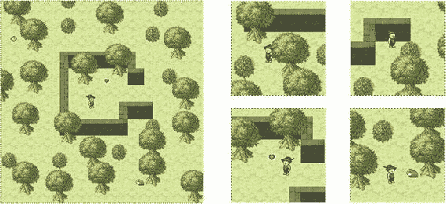

### 图 2-1. 帮助精灵在游戏世界中收集物品

所有游戏对象都具有正确的深度层级，虽然墙壁、树木和灌木丛会阻挡精灵的道路，但他可以像在真实的 3D 空间中一样绕过它们。如果仅使用纯代码来绘制对象的位置和深度，创建如此复杂的布局将相当困难——因此，这是 Tiled Editor 的完美用武之地！

## 选择你的图像

首先要从包含游戏图形的图块集开始。

### 注意
图块集，也称为精灵表，是将所有游戏图像作为子图像包含在单个图像中。

你需要使用图形编辑器（如 Illustrator、Pixelmator、Photoshop、Gimp 或 Piskel）创建游戏图形，然后使用 Shoebox 或 Texture Packer 等工具打包。

整个滚动游戏世界仅使用了图 2-2 中所示的少量图像构建而成。完成的游戏世界看起来很复杂，但使用这个图块集仅用了几分钟就拼凑完成了。大多数精灵图像是 64 x 64 像素，但右上角较小的图像是 32x32 像素。大树是 128x128 像素。你可以混合搭配任意大小的精灵图像，但如果将它们保持在 2 的幂次方大小（`8x8`、`16x16`、`32x32` 等），你的工作会轻松得多。

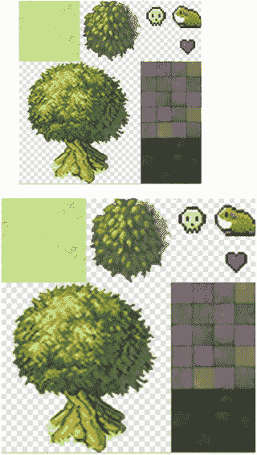

### 图 2-2. 从一个图块集开始

你可以看到，该图块集包含了关卡中除一个角色之外的所有精灵：精灵角色。这是因为我们稍后会直接在游戏代码中添加这个动画精灵。（你将在后续步骤中看到如何操作）。

## 创建地图

**地图** 是 Tiled Editor 对你正在创建的游戏屏幕布局的称呼。它只是一个由单元格组成的矩形网格。我们在本章中创建的游戏地图是一个 24 x 24 的单元网格，每个单元宽高均为 32 像素。这意味着整个地图的宽度和高度为 768 像素。

要在 Tiled Editor 中创建新地图，请从菜单中选择“文件 ➤ 新建”。将出现“新建地图”对话框，让你设置地图属性，如图 2-3 所示。对于平面的 2D 地图，选择**正交**方向。选择 CSV 图层格式，以便地图信息以数组形式输出。同时，保持 Tile 渲染顺序的默认值“右下”。然后，设置地图的宽度和高度（以图块为单位），然后定义每个图块的宽度和高度。如果你的图块集包含不同大小的图像，请将图块高度和宽度设置为*最小*图像的大小。在此示例中，图块集上最小的图像是 32x32 像素。完成后选择“确定”。

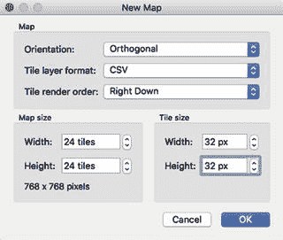

### 图 2-3. 设置地图属性


### 注意

本书使用的是写作时最新的 **Tiled Editor** 版本 0.15.0。你使用的版本可能在组织方式、布局和输出上略有不同，因此请将这些细节视为通用指南，并根据实际情况自行判断如何应用。

接下来，加载你的图块集。点击 Tiled Editor 工作区右侧 `图块集` 面板中的 `新建图块集` 按钮。为你的图块集命名，并将 `类型` 设置为“基于图块集图像”。浏览到图块集所在位置，并定义每个图块的高度和宽度。同样，将此高度和宽度设置为你最小精灵图像的大小。在本示例中，我将图块集命名为“fantasy”，并将图块宽度和高度设置为 32 像素，如图 2-4 所示。如果你的图块集中每个图像周围有间距（内边距），请在此处输入间距数值。（像 Texture Packer 这类软件生成的图块集会在每个子图像周围添加两个像素的默认内边距）。完成后点击 `确定`。

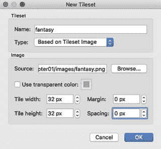

### 图 2-4. 设置图块集

### 注意

如果需要，你可以为每个关卡使用多个图块集，并且图块集可以是任意大小。你也可以选择不使用图块集，而是通过选择 `类型` 选项中的“基于图像集合”来使用单独的图像文件构建游戏。这使得 Tiled Editor 成为一个极其灵活的布局工具。

完成后，你会看到你的图块集加载到 `图块集` 面板中，如图 2-5 所示。

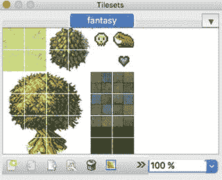

### 图 2-5. 加载你的图块集

## 设置图像属性

你可以为图块集上的每个图像创建并设置属性，并且你可以在游戏代码中访问所有这些属性。在本示例中，我想为骷髅头、心脏和土拨鼠图像分配名称。以下是如何为每个图像分配名称：

1.  点击一个图像，找到 `属性` 面板中的 `自定义属性` 部分。
2.  创建一个名为 `name` 的新属性，并为该图像指定一个名称。

我将这些图像分别命名为“skull”、“marmot”和“heart”，如图 2-6 所示。在本章后面，你将看到如何在游戏代码中将此信息作为对象属性进行访问。

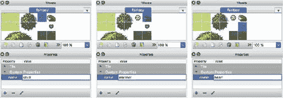

### 图 2-6. 设置可选的图像属性

## 使用图层

现在你可以开始构建地图了！Tiled Editor 允许你创建**图层**，以便在游戏世界的不同元素之间进行组织。在一个简单的地图中，你可能有一个名为 `maze` 的图层，其中包含迷宫的所有墙壁，以及另一个名为 `enemies` 的图层，其中包含游戏中的所有敌人。我们在此示例中构建的地图稍微复杂一些，因为我们使用图层来帮助创建浅 3D 效果。我们的地图使用六个图层，从地面开始，垂直向上，一直到树梢：

*   **ground（地面）**：草地。该图层用于放置精灵脚下的事物。
*   **obstacles（障碍物）**：树木的底部、灌木丛的底部和墙壁的底部。这些是精灵脚以上但头部以下的事物。
*   **items（物品）**：心脏、骷髅头和土拨鼠。这些东西也大约处于中等高度。
*   **objects（对象）**：精灵。它也处于中等高度，但应显示在物品的前面。
*   **wallTops（墙顶）**：墙壁的顶部。这些位于精灵头部上方。
*   **treeTops（树顶）**：树木的顶部。这些位于墙壁顶部上方。

图 2-7 显示了游戏中的一个场景，你可以同时看到所有这些深度图层。你能将每个图层与最终场景中的对应部分匹配起来吗？你是否注意到上层的事物覆盖了下层的事物？

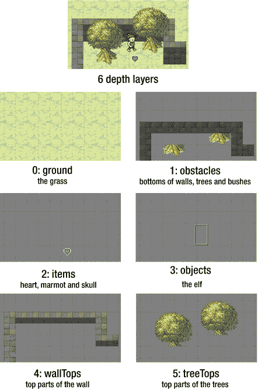

### 图 2-7. 构成此场景的所有精灵已被组织成 6 个深度图层

### 注意

这种伪 3D 效果有时被称为 2.5D。就像你坐在椅子上，俯视着游戏发生的桌面。精灵本身是平面的，像一张张纸，但如果它们靠近屏幕底部，看起来就离我们更近；如果靠近屏幕顶部，看起来就更远。

通过根据从底部到顶部的深度来组织图层，我们可以轻松地创造出深度的错觉。离观察者更近的精灵会遮挡住那些更远的精灵。

通过点击图 2-8 中 `图层` 面板的 `新建图层` 按钮来创建这六个图层。

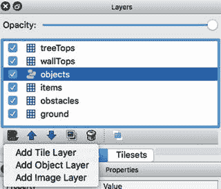

### 图 2-8. 创建一些地图图层

从 `新建图层` 按钮菜单中可以看出，你可以创建三种类型的图层：`Tile`（图块）、`Object`（对象）和 `Image`（图像）图层。

*   **Tile Layer（图块图层）**：使用矩形图块来构成这类图层。这非常适合固定网格布局，大多数 2D 游戏关卡都是这样设计的。图块图层上的任何内容最终都会形成一个图像 ID 代码数组。在本示例中，除了精灵之外的所有内容都是在 `Tile` 图层上创建的。
*   **Object Layer（对象图层）**：用于应该自由放置而不是固定在刚性网格系统中的精灵。它也适用于放置当前图块集中没有的对象，或者稍后由代码生成的对象。你还可以使用对象图层来添加非可视的游戏元素，这些元素可在游戏中提供一些有用的数据。`Object` 图层上的任何内容在最终的 JSON 文件中都将被描述为一个 JavaScript 对象。在本示例中，精灵角色将位于对象图层上。
*   **Image Layer（图像图层）**：用于放置单个图像。使用 `图层属性` 面板中的 `图像` 字段来浏览图像或设置其 URL。当你将地图导出为 JSON 文件时，此信息将生成图像文件的路径及其 `x` 和 `y` 像素坐标。

### 注意

通过使用对象和图像图层，Tiled 成为任何类型游戏（不仅仅是基于图块的游戏）的非常灵活的视觉布局编辑器。关于需要多少层、精灵的大小和形状，或者每种图层类型上应该放置什么类型的事物，没有固定规则。只需使用对你的游戏类型有意义的任何组织系统即可。

我们现在准备开始设计地图。

## 构建地图

我们将从最底层（地面）开始，然后逐层向上。

选择 `ground（地面）` 图层，点击草地图块，然后使用油漆桶工具用草地填充关卡，如图 2-9 所示。

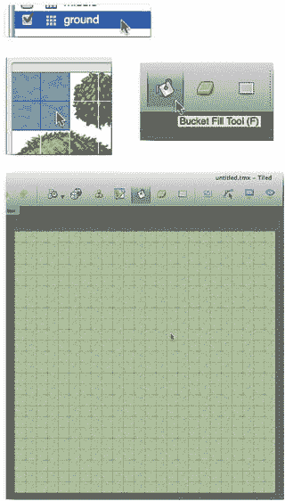

### 图 2-9. 使用油漆桶工具用草地填充关卡

接下来是 `obstacles（障碍物）` 图层。这些是阻止精灵角色移动的事物。你可以将 `obstacles` 图层上的任何事物视为迷宫的墙壁。这包括树干、墙壁底部和灌木丛底部。

按住 `command` 或 `ctrl` 键可同时选择多个图块图像。选择 `图章` 工具，并使用它将精灵图像印到关卡上。使用 `橡皮擦` 工具修正任何错误。参见图 2-10。

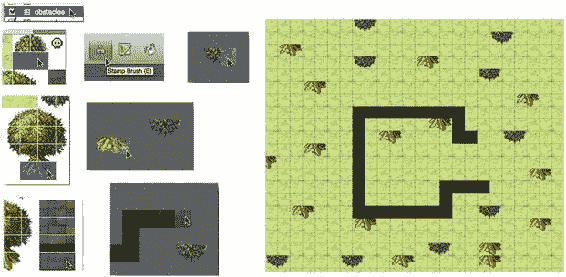


### 图 2-10. 添加障碍物

接下来，添加道具层。这些是精灵能够拾取的东西。我们在道具层只需要三样东西：心形、骷髅头和土拨鼠。使用印章工具将这些添加到图层中，如图 2-11 所示。

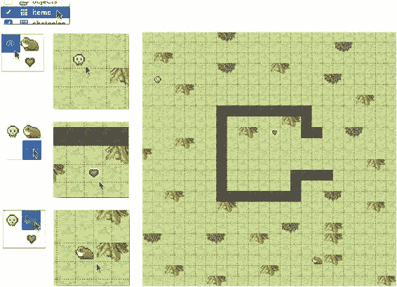

### 图 2-11. 添加可收集物品

接下来是对象层。我们将在这里添加精灵角色——*以数据对象的形式*。精灵没有在瓦片集中用图片表示，因为稍后我们将通过代码将其构建为一个复杂的动画精灵。你可以用一个简单的精灵占位图，并以我添加其他图片相同的方式将其添加到地图中，但我想借此机会向你展示 Tiled Editor 的对象是如何工作的。

从图 2-12 中可以看到，精灵所在的图层类型叫做 `objects`。这是一种特殊的图层，允许你自由放置物品，而无需将它们吸附到网格上。它还允许你为对象指定自定义的宽度和高度。这意味着你可以放置任意大小的对象，并精确指定其屏幕坐标中的 `x` 和 `y` 值。对象图层上的内容在导出的 JSON 文件中将以 JavaScript 对象数组的形式呈现，并且你可以为每个对象赋予一组独一无二的属性。

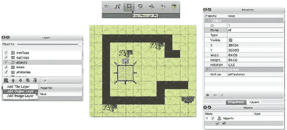

### 图 2-12. 添加一个对象并为其设置属性

要向对象图层添加内容，请使用某个形状工具，然后在希望对象出现的位置绘制形状。上下文相关的“属性”面板将显示你正在创建的新对象的属性。Tiled Editor 的对象有一些默认属性，例如位置和大小，这些属性与我们在本书中使用的精灵对象的属性非常接近。在这个例子中，我将对象名称设置为 `"elf"`，并将其宽度和高度设置为 64 像素。你可以根据需求更改或添加任意数量的其他属性，所有这些属性都将在最终的游戏代码中访问得到。任何你以这种方式创建的对象，都可以从 Tiled Editor 便捷的“对象”面板中访问。

还有两个图层需要添加：`wallTops` 和 `treeTops`，如图 2-13 所示。

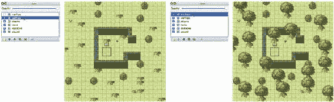

### 图 2-13. 添加墙壁顶部和树冠

现在，大功告成！

## 理解 JSON 地图数据

当你完成地图构建后，请按照以下步骤将地图保存并导出为 JSON 数据：

1.  从主菜单中选择 `文件` ➤ `另存为...`，将文件保存为 Tiled Editor 自有的 TMX 格式。
2.  选择 `地图` ➤ `地图属性...`。在属性面板中找到 `瓦片图层格式` 属性，并选择 `CSV`。CSV（逗号分隔值）选项会将地图图层导出为数字数组，这正是我们需要的。
3.  通过选择 `文件` ➤ `导出为...` 将地图数据导出为 JSON，并选择 `JSON` 作为文件类型。
4.  现在我们有了一个包含潜在有用地图数据的 JSON 文件，但我们该如何使用它呢？

重要的是要记住，地图中的每个图层都以数组形式表示。这意味着 JSON 文件将至少包含六个数组。其中五个数组包含的是瓦片集帧 ID 代码。还有一个数组代表对象图层，它是一个对象数组。JSON 文件还会提供关于地图、瓦片的高度和宽度，以及所有瓦片属性的信息。所有这些额外信息都包含在拥有自己子数组的子对象中。数据量很大，如果你是第一次打开 JSON 数据文件，可能会被眼前的内容搞得不知所措。别让它吓到你！你很快就会发现，它的结构非常合乎逻辑，一旦理解了它，在游戏程序中使用所有这些数据就会变得很容易。

### 注意

Tiled Editor 的数据输出已成为游戏设计行业的事实标准，因此学习其结构以及如何将其整合到你自己的游戏中，是一项值得长期投入的技能。

我们尽量保持简单，先从安全距离审视一下 JSON 文件的总体结构。下面是一个简略版本，展示了最重要的属性。

```
{
 //地图的属性            
 "backgroundcolor": "#ffffff",
 "height": 24,
 "nextobjectid": 2, //仅供 Tiled Editor 内部使用
 "orientation": "orthogonal",
 "properties": {/* 你可能设置的任何自定义属性 */},
 "renderorder": "right-down",
 "tileheight": 32,
 "tilewidth": 32,
 "version": 1,
 "width": 24,

 //`layers` 属性是一个对象数组。每个对象都包含            
 //另一个数组，该数组代表该图层的地图数据。图层            
 //对象还包含图层属性，包括其名称、类型和大小            
 "layers":[
   {"data": [1, 2, 1, 2, 1, 2, ...], //图层属性...},
   {"data": [0, 0, 0, 0, 0, 0, ...], //图层属性...},
   {"data": [0, 0, 0, 0, 0, 0, ...], //图层属性...},
   {"objects": [{"name":"elf", //...更多对象属性...}], //图层属性...},
   {"data": [0, 0, 0, 0, 0, 0, ...] ], //图层属性...},
   {"data": [19, 20, 21, 22, 0, ...], //图层属性...},
 ],

 //`tilesets` 属性是一个对象数组。每个对象            
 //代表地图中使用的一个瓦片集。（本例中我们只用了            
 //一个。）这些对象包含默认的瓦片集            
 //属性，以及自定义属性，比如精灵图像名称            
 "tilesets":[
    { //...瓦片集属性，例如每个瓦片的宽度和高度。
      //我们设置的自定义瓦片名称属性：
      "tileproperties": {
        "11": {"name": "heart"},
        "4": {"name": "skull"},
        "5": {"name": "marmot"}
      },
    }
  ]
}
```

大部分地图数据，即那些实际告诉你地图每个单元格中内容的数据，都位于每个图层对象的 `"data"` 属性中。让我们看看第一个图层对象内部是什么：

```
{
  "data":[
      1,2,1,2,1,2,1,2,1,2,1,2,1,2,1,2,1,2,1,2,1,2,1,2,
      7,8,7,8,7,8,7,8,7,8,7,8,7,8,7,8,7,8,7,8,7,8,7,8,
      1,2,1,2,1,2,1,2,1,2,1,2,1,2,1,2,1,2,1,2,1,2,1,2,
      7,8,7,8,7,8,7,8,7,8,7,8,7,8,7,8,7,8,7,8,7,8,7,8,
      ...等等。
    ],
   "height": 24,
   "name": "ground",
   "opacity": 1,
   "type": "tilelayer",
   "visible": true,
   "width": 24,
   "x": 0,
   "y": 0
},
```

你可以看到，它包含一些有用的属性，比如图层的名称和类型。`data` 数组是一个包含 576 个数字的列表，这些数字代表该图层上的所有瓦片（24x24 瓦片 = 576）。这些数字被称为**网格 ID** 或 **gid**，每个数字都指向瓦片集中的一张图片。Tiled Editor 从左到右对瓦片集中的每张图片进行编号，从 1 开始。图 2-14 显示了前 12 个瓦片集图像的网格 ID。你可以看到，1、2、7 和 8 与草地瓦片相匹配。`data` 数组使用这些数字来表示每个图层的视觉布局。

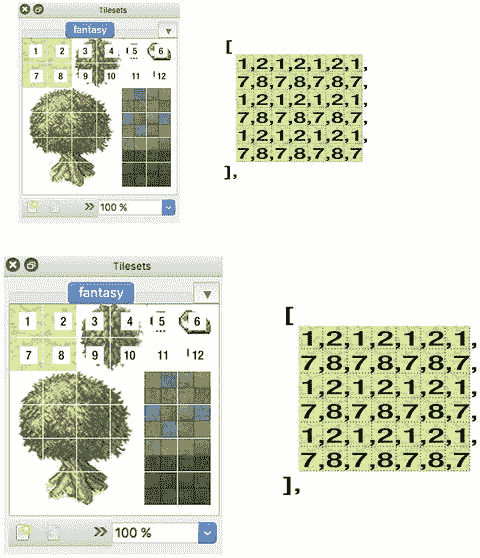


### 图 2-14. 网格编号用于在数组中表示精灵图像

在我们的地图中，创建了五个图块层和一个对象层。对象层包含一个名为 `objects` 的数组，在本例中该数组只包含一个对象：精灵。你可以看到，我们为精灵分配的所有属性（如其名称和尺寸）都可以作为此数组中的一个对象来访问。

```
{
  "draworder": "topdown",
  "height": 24,
  "name": "objects",
  "opacity": 1,
  "type": "objectgroup",
  "visible": true,
  "width": 24,
  "x": 0,
  "y": 0,
  "objects":[
    {
      "height": 64,
      "name": "elf",
      "properties": {/* 任何自定义属性 */},
      "rotation": 0,
      "type": "",
      "visible": true,
      "width": 64,
      "x": 287,
      "y": 350
    }]
}
```

最后，还有一个名为 `tilesets` 的数组，它代表了用于构建此关卡的所有图块集。每个图块集都表示为一个对象，在本示例中我们只使用了一个图块集：

```
"tilesets":[
  {
    "columns": 6,
    "firstgid": 1,
    "image": "../images/fantasy.png",
    "imageheight": 192,
    "imagewidth": 192,
    "margin": 0,
    "name": "fantasy",
    "properties": {/* 任何自定义属性 */},
    "spacing": 0,
    "tilewidth": 32,
    "tileheight": 32,
    "tileproperties": {
      "11": {"name": "heart"},
      "4": {"name": "skull"},
      "5": {"name": "marmot"}
    }
  }
]
```

可以看到，我们为 heart、skull 和 marmot 分配的自定义名称属性位于 `tileproperties` 子对象中。注意，它们的 ID 编号比图块集中的网格编号小 1。

### 注意

这些数字相差 1 是有一定逻辑的，但只有当你使用多个图块集来制作地图时才能体会到这一点。如果你确实使用了多个图块集，请继续阅读！`tileproperties` 中使用的 ID 编号是 Tiled Editor 所称的图块集中图块的“本地”ID。这些本地 ID 从 0 开始编号。数据数组中使用的 ID 则是“全局”图块 ID。这些全局 ID 可以跨越多个图块集。这意味着第一个图块集可能从 1 开始编号，第二个图块集可能从 32 开始，而第三个可能从 96 开始（0 保留给“无图块”）。你可以使用每个本地图块集的 `firstgid` 属性来确定全局 ID 应来自哪个图块集。然后，通过减去 `firstgid`，你可以将其映射为该图块集中的本地 ID。但如果只使用单个图块集，直接减 1 即可，因为这就是第一个图块集的 `firstgid`。有点困惑？别担心！只有当你使用多个图块集创建第一个地图时，这一切才会开始变得有意义。

现在所有这些数据对你来说开始有意义了吗？如果你和我一样，你那小小的程序员之心一定会欣喜若狂！因为你知道这些都是非常有价值的东西。你可以利用所有这些数据，自动生成所有精灵并布局游戏地图。那么，我们该如何深入利用它呢？

## 使用 JSON 数据构建关卡

JSON 数据并不关心我们想用它制作什么样的游戏，也不关心你使用的是什么技术。你可以用同样的数据制作基于 Objective-C、Haxe、Unity 或 Elm 的游戏。这意味着你需要编写一个函数来解释这些数据，并决定应如何使用它来构建游戏关卡。如何处理这些数据完全由你决定。

### 决定如何使用数据

从哪里开始？根据你想制作的游戏类型，制定一系列关于如何解释所有这些数据的规则。对于我想制作的奇幻角色扮演游戏，我提出了以下要求：

*   整个游戏世界将包含在一个名为 `world` 的**容器组**中。“容器组”只是我用来描述包含嵌套子**精灵**的对象的术语。（回忆一下，精灵就是构成游戏世界的交互式图像）。

*   每个图块集层也应该是 `world` 容器内的一个独立组。这里有五个图块集层，这意味着最终会有五个组：`ground`、`obstacles`、`items`、`wallTops` 和 `treeTops`。所有这些层都有一个 `name` 属性，我会将该名称属性分配给层组，以便稍后访问。

*   对象层上的任何内容都应作为一个简单的 JavaScript 对象返回给游戏。之后我可以决定如何使用该对象中的数据。如果需要，我会使用对象的 `name` 属性来访问它。在当前示例中只有一个对象：精灵。

*   层内的所有图像都将被创建为精灵。

*   我需要一种方法来引用我在世界中创建的所有对象。我将添加两个搜索函数，允许我通过名称搜索对象。`world.getObject("name")` 将检索与所查找对象的 name 属性匹配的单个对象。它可以是精灵、层组或数据对象。`world.getObjects("elf", "obstacles", "marmot")` 返回一个对象数组，其名称与参数中的名称相匹配。

*   为了尽可能保持简单，我将限制每个地图只使用一个图块集。

这是我提出的要求列表，但你的要求可能会根据你所制作的游戏类型以及所需的灵活性而有所不同。

##### 游戏代码 API

在我们探讨如何实现这些规则之前，让我们先看看完成后的 API 会是什么样子。我将能够像这样创建一个新的游戏世界：

```
let world = makeTiledWorld(data.json, tileset.png);
```

然后世界将神奇地出现，完全就像我在 Tiled Editor 中设计的那样。如果我想从世界中检索一个层组、精灵或对象，可以这样做：

```
let elf = world.getObject("elf");
```

我可以像这样将一组对象作为一个数组来检索：

```
let items = world.getObjects("heart", "skull", "marmot");
```

如果我有多个精灵共享相同的图块集名称属性，我也可以将它们全部检索到一个数组中。例如，如果我有一个名为 “wall” 的图块集图像，并且在世界中使用了这个图像 20 次，我可以像这样将所有墙精灵检索到一个数组中：

```
let walls = world.getObjects("wall");
```

这是一个简单的 API，对于大多数类型的游戏来说，它足以提供我所需的灵活性。

那么，如何实现这一切呢？

## 编写 `makeTiledWorld` 函数

我可以编写一个名为 `makeTiledWorld` 的函数来完成所有工作。关于代码如何工作的所有细节都包含在注释中，但我将在代码清单之后重点介绍几个重要特性。


### 注意

此代码清单展示了 Hexi 游戏引擎如何实现 `makeTiledWorld`，其中包含一些你应该了解的具体实现细节。`Container` 和 `Sprite` 是 PixiJS 对象。Pixi 的资源加载器用于加载 JSON 文件。（Hexi 使用 PixiJS 作为其底层渲染引擎和资源加载器）。`frame` 函数是 Hexi 引擎内置的一个自定义函数，用于从单个父图像中捕获矩形子图像。你需要在你所使用的任何技术中找到这些细节的等效实现。

```
makeTiledWorld(jsonTiledMap, tileset) {

//获取 JSON 文件的引用            
  let tiledMap = PIXI.loader.resources[jsonTiledMap].data;

//创建一个名为 `world` 的容器组，用于包含来自 `tiledMap` 的所有图层、精灵            
  //和对象。`world` 对象将在 `makeTiledWorld`            
  //函数完成后返回给主游戏程序            
  let world = new Container();

//设置构成地图的每个图块的宽度和高度。            
  //（本例中图块大小为 32x32 像素）            
  world.tileheight = tiledMap.tileheight;
  world.tilewidth = tiledMap.tilewidth;

//计算世界的 `width` 和 `height`，单位为像素            
  world.worldWidth = tiledMap.width * tiledMap.tilewidth;
  world.worldHeight = tiledMap.height * tiledMap.tileheight;

//获取世界（以图块计）的高度和宽度引用，            
  //以备后续使用（你会用到的！）            
  world.widthInTiles = tiledMap.width;
  world.heightInTiles = tiledMap.height;

//创建一个 `objects` 数组，用于存储对地图中任何            
  //命名对象的引用。命名对象都具有            
  //在 Tiled Editor 中分配的 `name` 属性            
  world.objects = [];

//每个图块周围的可选间距（填充）            
  //这部分是为了解决图块周围的间距问题，            
  //该间距在使用纹理图集图块集时很常见。在 Tiled Editor 中创建新地图时设置            
  //`spacing` 属性            
  let spacing = tiledMap.tilesets[0].spacing;

//计算图块集上有多少列。            
  //这等于图像的宽度除以每个图块的宽度，            
  //再加上每个图块周围可能有的可选间距            
  let numberOfTilesetColumns =
    Math.floor(
      tiledMap.tilesets[0].imagewidth
      / (tiledMap.tilewidth + spacing)
    );

//遍历所有地图图层            
  tiledMap.layers.forEach(tiledLayer => {

//为此图层创建一个容器组，并复制            
    //该图层的所有属性到该组上            
    let layerGroup = new Container();

Object.keys(tiledLayer).forEach(key => {

//将图层的所有属性添加到组中，但不包括            
      //宽度和高度（因为容器组会根据其内容自行计算这些值）            
      if (key !== "width" && key !== "height") {
        layerGroup[key] = tiledLayer[key];
      }
    });

//将 Tiled Editor 的 `opacity` 属性转换为 Container 的            
    //等效 `alpha` 属性            
    layerGroup.alpha = tiledLayer.opacity;

//将该组添加到 `world`            
    world.addChild(layerGroup);

//将该组推入 `world` 的 `objects` 数组            
    //以便稍后可以访问它            
    world.objects.push(layerGroup);

//当前图层是 `tilelayer` 吗？            
    if (tiledLayer.type === "tilelayer") {

//遍历该图层的 `data` 数组            
      tiledLayer.data.forEach((gid, index) => {
        let tileSprite, texture, mapX, mapY, tilesetX, tilesetY,
            mapColumn, mapRow, tilesetColumn, tilesetRow;

//如果网格 ID 号（`gid`）不为零，则创建一个精灵            
        if (gid !== 0) {

//计算出我们当前所在的地图列和行号，然后            
          //计算网格单元的 x 和 y 像素位置            
          mapColumn = index % world.widthInTiles;
          mapRow = Math.floor(index / world.widthInTiles);
          mapX = mapColumn * world.tilewidth;
          mapY = mapRow * world.tileheight;

//计算出图块集图像所在的列和行号，            
          //然后使用这些值计算该图像在图块集上的            
          //x 和 y 像素位置            
          tilesetColumn = ((gid - 1) % numberOfTilesetColumns);
          tilesetRow = Math.floor((gid - 1) / numberOfTilesetColumns);
          tilesetX = tilesetColumn * world.tilewidth;
          tilesetY = tilesetRow * world.tileheight;

//补偿图块周围可能存在的任何可选间距（填充），            
          //如果有的话。这段代码会累积从图块集左侧开始的间距偏移量，            
          //并将它们添加到当前图块的位置中            
          if (spacing > 0) {
            tilesetX
              += spacing
              + (spacing * ((gid - 1) % numberOfTilesetColumns));
            tilesetY
              += spacing
              + (spacing * Math.floor((gid - 1) / numberOfTilesetColumns));
          }

//使用上述值从图块集图像创建精灵的图像。            
          //自定义的 `frame` 方法从图块集中捕获正确的图像            
          texture = frame(
            tileset, tilesetX, tilesetY,
            world.tilewidth, world.tileheight
          );

//我已决定任何具有 `name` 属性的图块都很重要            
          //并且应该在 `world.objects` 数组中可访问

let tileproperties = tiledMap.tilesets[0].tileproperties,
              key = String(gid - 1);

//如果 JSON 的 `tileproperties` 对象有一个与当前图块匹配的子对象，            
          //并且该子对象有一个 `name` 属性，            
          //则创建一个精灵并将图块属性赋值给            
          //该精灵            
          if (tileproperties[key] && tileproperties[key].name) {

//创建一个精灵            
            tileSprite = new Sprite(texture);

//将该图块的所有属性复制到精灵上            
            //（包括 `name` 属性）            
            Object.keys(tileproperties[key]).forEach(property => {
              tileSprite[property] = tileproperties[key][property];
            });

//将该精灵推入 `world` 的 `objects` 数组            
            //以便稍后可以通过 `name` 访问它            
            world.objects.push(tileSprite);
          }

//如果图块没有 `name` 属性，则仅用它            
          //创建一个普通精灵（它只需要一个纹理）            
          else {
            tileSprite = new Sprite(texture);
          }

//将精灵放置在地图上            
          tileSprite.x = mapX;
          tileSprite.y = mapY;

//记录该精灵在数组中的索引号            
          //（我们将用它进行碰撞检测，你将在下一章学习）            
          tileSprite.index = index;

//记录该精灵在图块集上的 `gid`。            
          //这对后续的碰撞检测也很有用            
          tileSprite.gid = gid;

//将该精灵添加到当前图层组            
          layerGroup.addChild(tileSprite);
        }
      });
    }

//我们现在已经处理完图块图层，让我们继续！

//这一层是 Tiled Editor 的 `objectgroup` 吗？            
    if (tiledLayer.type === "objectgroup") {
      tiledLayer.objects.forEach(object => {
```


// 我们只是要获取对象的属性  
// 以便后续决定如何处理它  

// 获取对象所在图层组的引用  
`object.group = layerGroup;`

// 将对象推入世界的 `objects` 数组  
`world.objects.push(object);`

// 搜索函数

/*  
`world.getObject` 和 `world.getObjects`（带"s"的版本）用于搜索并返回  
`world.objects` 数组中的任何精灵或对象。  
任何在 Tiled Editor 中具有 `name` 属性的对象都会出现在搜索结果中。  
`getObject` 返回单个对象，`getObjects` 返回对象数组。  
`getObject` 实际返回搜索函数本身，因此你可以  
使用以下格式直接访问单个对象：  
`sprite.x = world.getObject("anySprite").x;`  
`sprite.y = world.getObject("anySprite").y;`  
*/

`world.getObject = objectName => {`  
    `let searchForObject = () => {`  
      `let foundObject;`  
      `world.objects.some(object => {`  
        `if (object.name && object.name === objectName) {`  
          `foundObject = object;`  
          `return true;`  
        `}`  
      `});`  
      `if (foundObject) {`  
        `return foundObject;`  
      `} else {`  
        `throw new Error("没有名称为 " + objectName + " 的对象");`  
      `}`  
    `};`

    // 返回搜索函数
    `return searchForObject();`  
`};`

`world.getObjects = objectNames => {`  
    `let foundObjects = [];`  
    `world.objects.forEach(object => {`  
      `if (object.name && objectNames.indexOf(object.name) !== -1) {`  
        `foundObjects.push(object);`  
      `}`  
    `});`  
    `if (foundObjects.length > 0) {`  
      `return foundObjects;`  
    `} else {`  
      `throw new Error("找不到这些对象");`  
    `}`  
    `return foundObjects;`  
`};`

// 就这样，我们完成了！

// 最后，将 `world` 对象返回给游戏程序
`return world;`
```

(你可以在本章源文件的 Hexi `src` 文件夹的 `tileUtilities` 模块中找到 `makeTiledWorld` 的完整工作代码)。

这段代码通过遍历 JSON 数据中的所有数组，并利用这些信息来创建精灵并将它们放置在 `world` 中。但有一个重要的细节需要指出。每个精灵都创建了两个新属性：`index` 和 `gid`。

```
tileSprite.index = index;
tileSprite.gid = gid;
```

`index` 是精灵在地图数组中的数组位置编号。`gid` 是精灵纹理图像在瓦片集上的网格 ID 编号。这两个属性在后续碰撞检测中会非常有用，你将在第 3 章中找到具体用法。敬请期待！

现在让我们了解如何使用 `makeTiledWorld` 来构建游戏。

## 创建游戏世界

查看本章源文件中的 `fantasy.js` 文件，可以找到我们创建的游戏世界的工作示例。图 2-15 将左侧最终渲染的地图与我们最初在 Tiled Editor 中设计的地图进行了对比。

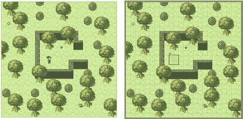

### 图 2-15. 渲染后的游戏世界与我们用 Tiled Editor 设计的地图一致

使用键盘方向键让精灵在游戏世界中行走，你会注意到精灵的深度层次也是正确的。让我们了解 `makeTiledWorld` 函数是如何构建这个场景的。

### 创建精灵

当游戏代码的 `setup` 函数运行时，世界会通过 `makeTiledWorld` 从 JSON 文件和瓦片集图像中创建。

```
world = g.makeTiledWorld(
    "maps/fantasy.json",
    "images/fantasy.png"
  );
```

这会生成地图，并让我们通过一个名为 `world` 的对象访问所有地图数据。

动画精灵角色是使用另一张名为 `walkcycle.png` 的瓦片集图像创建的，该图像包含精灵的所有动画帧，如图 2-16 所示。

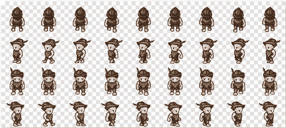

### 图 2-16. 精灵的动画瓦片集

以下是游戏 `setup` 函数中使用该动画瓦片集创建精灵的代码。

```
elf = g.sprite(g.filmstrip("images/walkcycle.png", 64, 64));
```

自定义的 `filmstrip` 函数捕获 `walkcycle` 瓦片集中每个 64x64 像素的帧，并用它来初始化精灵。

你记得我们在 Tiled Editor 中创建了一个占位对象来代表精灵，并用它来设置精灵的 `x` 和 `y` 位置。接下来我们要做的是使用这些值来定位新的精灵。我们添加到 `world` 对象中的 `getObject` 方法能够从地图数据中提取任何具有 `name` 属性的内容。以下是使用 `getObject` 捕获精灵的 `x` 和 `y` 地图数据值，并将其应用于精灵的 `x` 和 `y` 位置属性的方法。

```
elf.x = world.getObject("elf").x;
elf.y = world.getObject("elf").y;
```

这个新的精灵还不是世界的一部分，因此将其添加到世界的对象层。首先获取对象层的引用，然后使用 `addChild` 将精灵添加到其中。

```
let objectsLayer = world.getObject("objects");
objectsLayer.addChild(elf);
```

游戏的其余部分负责移动精灵并使其动画化。它还实现了碰撞检测，你将在下一章全面了解其工作原理。

### 更改精灵的深度层

精灵可以在树木和墙壁后面及前面行走，且无需任何其他深度排序代码即可确保其正确显示。这怎么可能？因为后台运行的 PixiJS 渲染器会按照创建的先后顺序显示精灵——后创建的精灵显示在先创建的精灵之前。大多数 2D 渲染器都以相同方式工作。而且，由于我们是从最底层（地面）开始创建精灵，并逐层向上，因此 Tiled Editor 上层中的精灵会渲染在下层精灵的前面。这一切都是自动发生的，这得益于我们在 Tiled Editor 中设计图层时的精心规划，以及 `makeTiledWorld` 函数中创建精灵的顺序。

但如果在游戏进行过程中想要更改精灵的深度层，该怎么办？例如，也许精灵在某个地方发现了梯子，能够爬到墙壁顶部。如何让精灵显示在墙壁之上但在树冠之下？

获取 `"treeTops"` 图层组的引用，并将精灵添加到其中。

```
world.getObject("treeTops").addChild(elf);
```

图 2-17 显示了结果。

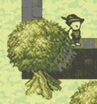

### 图 2-17. 更改精灵的深度层

既然我们有一个广阔的游戏世界可以探索，让我们添加滚动摄像头。


#### 滚动世界摄像机

我们的游戏地图远比显示它的游戏屏幕要大得多。但你会注意到，它会非常自然地滚动，以跟随精灵移动。在本节中，你将学习如何实现这种滚动游戏摄像机，从而运用这些概念为你的游戏构建类似的摄像机。

但在我们了解其制作方法之前，首先快速浏览一下你需要编写的高级游戏代码，以便创建和使用摄像机。首先，像这样在游戏世界中初始化摄像机：

```
camera = g.worldCamera(world, world.worldWidth, world.worldHeight, anyCanvasElement);
```

第一个参数是一个包含`x`、`y`属性的精灵。第二和第三个参数以像素为单位定义游戏世界的宽度和高度。最后一个参数是渲染游戏世界的画布 HTML 元素。

摄像机对象有两个有用的方法可以用来控制它：`centerOver`和`follow`。你可以使用`centerOver`方法让摄像机自身居中于某个精灵之上，像这样：

```
camera.centerOver(sprite);
```

使用以下方法让摄像机在游戏循环中跟随任何精灵，像这样：

```
function gameLoop() {
  camera.follow(sprite);
}
```

摄像机有一个不可见的内部边界，其大小为画布尺寸的一半。你可以在图 2-18 的第一张图片中看到这个不可见的内部边界。精灵可以在这个边界内自由移动，只有当精灵越过边界时，摄像机才会开始移动。当摄像机到达地图边缘时会停止移动，但精灵可以一直走到地图边缘。图 2-18 展示了所有这些特性，从而产生了自然的滚动效果。

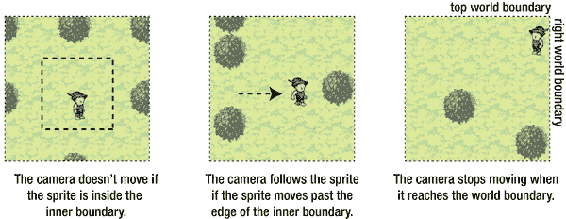

### 图 2-18. 一个让精灵在游戏世界中自由移动的滚动游戏摄像机

- 你可以将摄像机视为一种悬浮在世界上方的不可见精灵。它拥有`x`和`y`位置，以及高度和宽度。摄像机有一个名为`follow`的方法，可以改变摄像机的`x`和`y`坐标，以跟上它所跟随的任何精灵；还有一个名为`centerOver`的方法，可以将摄像机居中于任何精灵之上。它还会根据地图尺寸检查自身位置，以便在到达地图边缘时停止移动。

- 以下是实现所有这些功能的完整`worldCamera`函数。

```
    worldCamera(world, worldWidth, worldHeight, canvas) {

//定义一个具有实用属性的 `camera` 对象                  
      let camera = {
        width: canvas.width,
        height: canvas.height,
        _x: 0,
        _y: 0,

//`x` 和 `y` 的 getter/setter                  
        //当你改变摄像机的位置时，                  
        //它们会向相反方向移动世界的位置                  
        get x() {
          return this._x;
        },
        set x(value) {
          this._x = value;
          world.x = -this._x;
        },
        get y() {
          return this._y;
        },
        set y(value) {
          this._y = value;
          world.y = -this._y;
        },

//摄像机的中心 x 和 y 位置                  
        get centerX() {
          return this.x + (this.width / 2);
        },
        get centerY() {
          return this.y + (this.height / 2);
        },

//边界属性定义了一个矩形区域，其大小为游戏屏幕的一半                  
        //如果摄像机跟随的精灵位于此区域内，摄像机将不会滚动。如果精灵                  
        //越过此边界，后面的 `follow` 函数将改变                  
        //摄像机的 x 和 y 位置，以滚动游戏世界                  
        get rightInnerBoundary() {
          return this.x + (this.width / 2) + (this.width / 4);
        },
        get leftInnerBoundary() {
          return this.x + (this.width / 2) - (this.width / 4);
        },
        get topInnerBoundary() {
          return this.y + (this.height / 2) - (this.height / 4);
        },
        get bottomInnerBoundary() {
          return this.y + (this.height / 2) + (this.height / 4);
        },

//接下来的代码定义了两个摄像机                  
        //方法：`follow` 和 `centerOver`

//使用 `follow` 方法让摄像机跟随一个精灵                  
        follow: function(sprite) {

//检查精灵相对于内部边界的位置。如果精灵                  
          //移出边界，则移动摄像机以跟随精灵                  
          if(sprite.x < this.leftInnerBoundary) {
            this.x = sprite.x - (this.width / 4);
          }
          if(sprite.y < this.topInnerBoundary) {
            this.y = sprite.y - (this.height / 4);
          }
          if(sprite.x + sprite.width > this.rightInnerBoundary) {
            this.x = sprite.x + sprite.width - (this.width / 4 * 3);
          }
          if(sprite.y + sprite.height > this.bottomInnerBoundary) {
            this.y = sprite.y + sprite.height - (this.height / 4 * 3);
          }

//如果摄像机到达地图边缘，则停止其移动                  
          if(this.x < 0) {
            this.x = 0;
          }
          if(this.y < 0) {
            this.y = 0;
          }
          if(this.x + this.width > worldWidth) {
            this.x = worldWidth - this.width;
          }
          if(this.y + this.height > worldHeight) {
            this.y = worldHeight - this.height;
          }
        },

//使用 `centerOver` 方法将摄像机居中于一个精灵之上                  
        centerOver: function(sprite) {

//将摄像机居中于一个精灵之上                  
          this.x = (sprite.x + sprite.halfWidth) - (this.width / 2);
          this.y = (sprite.y + sprite.halfHeight) - (this.height / 2);
        }
      };

//返回 `camera` 对象                  
      return camera;
    };
```

- （你可以在 `hexi/src/modules/gameUtilities/src/gameUtilities.js` 中找到 `worldCamera` 函数）。

- 可以看到，摄像机实际上只是一个数据模型，用于确定世界的哪一部分应该在画布上可见。摄像机将自身的大小和位置与它所跟随的精灵以及世界的边缘进行比较。

- 诀窍在于摄像机实际上从未移动。当你改变它的 `x` 和 `y` 位置时，它实际上是以相反的量移动世界的位置。

```
    set x(value) {
      this._x = value;
      world.x = -this._x;
    },
    set y(value) {
      this._y = value;
      world.y = -this._y;
    },
```

- 这使得摄像机看起来像是在世界中移动，而实际上它是在向相反方向移动世界。

## 总结

平铺地图编辑器是游戏设计者可以学习的最有用的软件工具之一。你已经学会了如何设置游戏地图；导入图块集；以及使用平铺地图编辑器的图层、对象和工具来设计你的游戏世界。你还学会了如何读取平铺地图编辑器的 JSON 地图数据，并使用这些数据构建可重用的代码，以制作各种不同的游戏。此外，你还发现了正确设置游戏对象深度层级，以及添加一个能够跟随游戏角色在世界中移动的摄像机是多么容易。

但是，我们还没结束！你会注意到，在本章的演示游戏中，当精灵角色在世界中行走时，它的路径会被树木、灌木丛和墙壁阻挡。并且，精灵可以拾取世界中的物体。这又是如何实现的呢？你将在下一章中了解，届时我们将详细探讨基于瓦片的游戏的碰撞检测。

© Rex van der Spuy 2017

Rex van der Spuy, 《高级游戏开发者工具包》, 10.1007/978-1-4842-1097-0_3


# 3. 基于瓦片的碰撞检测

Rex van der Spuy¹

(1)加拿大多伦多，安大略省

在游戏中检测碰撞主要有两种方式。第一种是比较屏幕上精灵的 x 和 y 像素位置。如果它们的形状重叠，则发生碰撞。这种碰撞检测策略称为**窄阶段碰撞**。如果你使用过带有类似 `hitTestRectangle` 或 `hitTestCircle` 等碰撞函数的游戏引擎来检查形状是否重叠，那么这些很可能就是窄阶段碰撞函数。它们使用向量数学（线性代数）来判断精灵的形状是否重叠。因此，你可以实现非常精确的像素级碰撞精度，这对于基于物理的动作游戏非常重要。

另一种检测碰撞的方式是使用基于瓦片的方法。**基于瓦片的碰撞**系统不使用几何学来检测碰撞。它所做的只是读取精灵在数组中的索引号。如果某个精灵位于数组地图中已被另一个精灵占据的位置，则发生碰撞。例如，如果一个精灵在地图上的位置与墙壁相同，那么你就知道该精灵碰到了墙壁。然后你可以设置某种碰撞反应，比如阻止精灵移动。

### 注意
基于瓦片的碰撞是一种**宽阶段碰撞**，你将在第 6 章中了解更多相关信息。

基于瓦片碰撞的一大优势是，你不必检查每个对象是否与其他所有对象发生碰撞，也无需进行任何几何计算。相反，你只需要读取一个数组。这使得它在 CPU 效率上远高于窄阶段碰撞测试。更重要的是，你可以为不同类型的事物（如“墙壁”、“敌人”或“物品”）设置少量通用的碰撞检查。即使地图上有数百个这样的元素，每种类型也只需运行一次碰撞检查。这使得基于瓦片的碰撞非常适合可能包含数百个同类元素的巨大游戏地图。并且由于基于瓦片的碰撞通过读取地图数组工作，你可以利用精灵在地图上的位置及其局部环境信息，用于 AI 或其他游戏逻辑。

基于瓦片碰撞的缺点是无法提供像素级精度。但事实证明，对于许多或大多数 2D 动作游戏来说，精确的像素级碰撞并非必要。基于瓦片的碰撞有一种独特“手感”：坚实、可预测，就像在玩一款真正的电子游戏。上世纪 70 和 80 年代整个 8 位和 16 位视频游戏革命都建立在基于瓦片的碰撞之上，它至今仍是你需要了解的最重要的视频游戏碰撞技术。

### 注意
既想要像素级精度，又想要瓦片级效率？你可以先使用基于瓦片的方法检查碰撞，兼得两者之长。然后，如果检测到一般性碰撞，再使用第二次窄阶段测试来获得进一步的像素级精度。你将在第 6 章中找到具体实现方法。

在本章中，你将通过一些经典的迷宫游戏示例，学习基于瓦片碰撞的基础知识。你将有机会了解如何使用瓦片编辑器构建一个平面 2D 视频游戏环境，以及如何使用地图数组分析该环境。我们还将为基于瓦片的游戏构建一个通用碰撞函数。最后，我们将把所有这些新技能应用到第 2 章的幻想 RPG 游戏原型中。

## 理解基于瓦片的碰撞

以下是进行基于瓦片碰撞所需了解的基础知识。在开始之前，你的精灵需要一个新的属性，名为 `index`：

```
playerSprite.index 
```

`index` 只是一个数字，用于指示精灵在地图数组中的位置。

要找到这个数字，你需要将精灵的中心 x 和 y 屏幕位置转换为其对应的数组索引号。下面是一个通用的 `getIndex` 函数，你可以用来完成这项工作：

```
getIndex(x, y, tilewidth, tileheight, mapWidthInTiles) {

  //将像素坐标转换为地图索引坐标            
  let index = {};
  index.x = Math.floor(x / tilewidth);
  index.y = Math.floor(y / tileheight);

  //返回索引号            
  return index.x + (index.y * mapWidthInTiles);
};
```

下一步是找出游戏世界中可能位于同一位置的其他事物。例如，假设你有一个包含敌人位置的地图数组。你可以将其命名为 `enemyMapArray`。

```
enemyMapArray = [0, 0, 0, 5, 0, 0, 5, 0, /*...*/];
```

任何有敌人的位置都用数字“5”表示。任何没有敌人的位置都用“0”表示。这些数字称为**网格索引** ID 号，或简称为 **gid**。

你可以像这样找出 `playerSprite` 所在位置的 gid：

```
gid = enemyMapArray[playerSprite.index];
```

如果这个 gid 值是“5”，那么你就知道 `playerSprite` 与某个敌人位于同一位置。碰撞发生了！

```
if (gid === 5) {

    //碰撞！            
}
```

你现在知道 `playerSprite` 撞上了一个敌人。但具体是哪一个呢？

要弄清楚这一点，你的游戏需要一个数组来存储对所有敌人精灵的引用：

```
enemySprites = [enemySprite1, enemySprite2, enemySprite3, /*...*/ ];
```

这些精灵中的每一个也需要一个 `index` 属性，用于指示它们在 `enemyMapArray` 中的位置：

```
enemySprite1.index = 52;
enemySprite2.index = 3;
enemySprite3.index = 108;
//...
```

要找到玩家位置处的敌人精灵，请遍历 `enemySprites` 数组，找到与 `playerSprite` 具有相同 `index` 编号的那个。那就是 `playerSprite` 正在碰撞的敌人。

```
if (gid === 5) {
  enemySprites.some(enemy => {
    if (playerSprite.index === enemy.index) {

      //你找到了碰撞到的敌人精灵！            
    }
  });
}
```

以上就是基于瓦片碰撞的基础知识，接下来我们将了解如何在游戏中实现它们。

##### 收集物品

让我们看一个非常实际的例子来演示这一点。运行 `simpleCollision.html` 文件，如图 3-1 所示，使用键盘方向键帮助外星人角色收集炸弹。每次外星人收集到一个炸弹，该炸弹就会从地图上消失。消息输出了外星人在屏幕上的 x 和 y 位置，以及其当前的地图索引号。

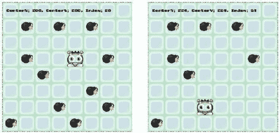

### 图 3-1. 使用基于瓦片碰撞的物品收集

### 设计游戏世界

在第 2 章中，你学习了如何使用瓦片编辑器快速设计游戏世界。本章中的所有示例游戏原型我都使用了相同的方法制作。我使用了三个图层：`backgroundLayer`（背景层）、`bombLayer`（炸弹层）和 `alienLayer`（外星人层），如图 3-2 所示。

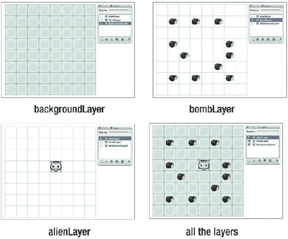

### 图 3-2. 三个地图图层

瓦片集中的外星人和炸弹图片都被赋予了名称属性值：“alien”和“bomb”，如图 3-3 所示。这将使我们稍后能够在游戏代码中轻松地使用 `world.getObject`（针对单个对象）和 `world.getObjects`（针对对象数组）来引用它们，正如你在前一章所学的那样。

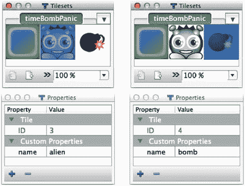

### 图 3-3. 为外星人和炸弹图片命名


### 初始化游戏世界

游戏代码会加载瓦片集图像以及 Tiled Editor 生成的 JSON 文件。`setup` 函数通过 `makeTiledWorld` 来创建世界。

```
world = g.makeTiledWorld(
  "maps/simpleCollision.json",
  "images/timeBombPanic.png"
);
```

这会在画布上绘制精灵和图层。在 Tiled Editor 中，我们为任何对象赋予的 `name` 属性，都可以在 `world.objects` 数组中访问到。我们可以通过 `world.getObject`（用于单个对象）或 `world.getObjects`（带“s”，用于对象数组）按名称获取对这些对象的引用。以下是获取外星人精灵引用的方法。

```
alien = world.getObject("alien");
```

我们的游戏还需要引用炸弹图层，以便访问它的 `data` 数组。

```
bombLayer = world.getObject("bombLayer");
bombMapArray = bombLayer.data;
```

现在，`bombLayer` 是一个容器，包含所有作为子精灵的炸弹。`bombMapArray` 是一个有用的数组，它告诉我们世界中所有炸弹的网格位置。（数组中的炸弹的 `gid` 数字将为 `5`）。

我们还需要一个包含所有炸弹精灵的数组，可以像这样从世界中获取：

```
bombSprites = world.getObjects("bomb");
```

`world.getObjects` 会搜索世界中的 `objects` 数组，并找到任何 `name` 属性为 `"bomb"` 的对象。在这个例子中，`"bomb"` 匹配了世界中的所有 11 个炸弹精灵。`bombSprites` 现在是一个数组，其中包含对每个这些精灵的引用。

现在，让我们了解如何使用炸弹地图数据来检测碰撞。

### 理解炸弹地图

`bombMapArray` 是一个有用的数字数组，与屏幕上炸弹精灵的位置相对应。你可以在图 3-4 中看到这一点。每个 `"5"` 代表一个炸弹，每个 `"0"` 代表一个空单元格。

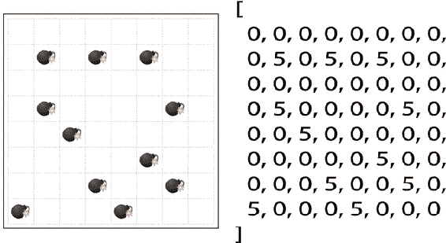

### 图 3-4. 与 Tiled Editor 中炸弹图层匹配的炸弹数组

当创建炸弹精灵时，每个新精灵都会被赋予自己的 `index` 属性。`index` 属性存储了炸弹在这个数组中的初始位置。

我们需要知道外星人角色是否与地图上的某个炸弹位于同一位置。为此，我们必须将外星人的中心 `x` 和 `y` 屏幕坐标转换为其对应的数组索引号。我们可以借助 `getIndex` 函数来完成此操作。

```
alien.index = getIndex(
  alien.centerX, alien.centerY,
  world.tilewidth, world.tileheight, world.widthInTiles
);
```

要判断外星人是否碰到了其中一个炸弹，需检查外星人的索引号是否与炸弹地图中的炸弹 `gid` 数字（`"5"`）匹配。

```
//找出外星人在炸弹数组中的位置是否与炸弹的 gid 数字匹配                  
if (bombMapArray[alien.index] === 5) {

  //如果匹配，则过滤炸弹精灵数组，找到              
  //与外星人位置匹配的那个              
  bombSprites = bombSprites.filter(bomb => {

    //这个炸弹精灵的索引号是否与外星人相同？              
    if (bomb.index === alien.index) {

      //如果相同，则通过将炸弹的 gid 设置为 `0`              
      //从 `bombMapArray` 中移除该炸弹              
      bombMapArray[bomb.index] = 0;

      //从其容器组中移除该炸弹精灵              
      g.remove(bomb);

      //从 `bombSprites` 数组中过滤掉该炸弹              
      return false;
    } else {

      //如果不匹配，则将该炸弹保留在 `bombSprites` 数组中              
      return true;
    }
  });
}
```

可以看到，如果外星人和炸弹共享相同的索引号，则它们一定占据了相同的地图位置。在这种情况下，通过将该位置的 `gid` 数字设置为 0，将炸弹从关卡的炸弹地图中擦除。

```
bombMapArray[bomb.index] = 0;
```

然后，使用一个名为 `remove` 的函数将炸弹精灵从游戏中移除。

```
g.remove(bomb);
```

游戏代码实际上维护着游戏中所有炸弹的实时地图。运行游戏，拾取几个炸弹，然后检查关卡的 `bombMapArray`（你可以在控制台中看到其输出）。你会注意到，每次拾取一个炸弹时，该单元格的 `gid` 值都会被设置为 `"0"`。炸弹已从地图上擦除。图 3-5 显示了在拾取了几个炸弹后，地图的 `bombMapArray` 看起来是什么样的。你可以看到，它与屏幕上炸弹的位置完美匹配。

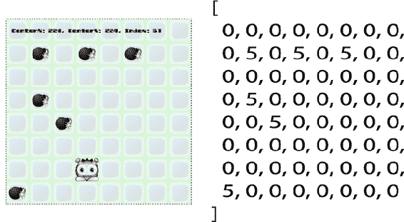

### 图 3-5. 当一个炸弹被拾取时，其在游戏地图中的 gid 数字被设置为零

在数组中拥有这种类型的数据更新，对于执行各种其他游戏逻辑分析非常有用，你将会在后面看到这一点。

### 使外星人沿网格移动

在我们继续讨论基于瓦片的碰撞之前，先快速了解一下外星人角色的移动系统是如何工作的。像许多迷宫游戏角色一样，外星人与地图的网格单元精确对齐地移动。这意味着，当你按下按键改变其方向时，外星人不会朝新方向移动，直到它进入网格的新行或新列。这确保了它能干净利落地过渡到新的行列中。这有助于保持你的碰撞检测系统简单可靠。

如何判断游戏角色是否与地图网格单元精确对齐？通过检查精灵的 `x` 和 `y` 屏幕坐标是否可以被地图瓦片的宽度和高度整除。以下是用于检查此情况的经典代码片段。

```
if(Math.floor(sprite.x) % world.tilewidth === 0
&& Math.floor(sprite.y) % world.tilehieght === 0) {

  //是的，精灵与地图的行和列对齐了              
}
```

你还需要确保精灵的速度可以被 `tilewidth` 和 `tileheight` 整除。这能确保精灵实际拥有的像素位置能使上述检查结果为真。这意味着，如果你的瓦片宽度和高度是 `64`，那么你精灵的速度必须是能整除 `64` 的数：`1`、`2`、`4`、`8`、`16` 或 `32`。如果精灵的速度是 `5`、`7` 或 `11`，它们永远无法整除 `64`，因此精灵将永远不会精确地对齐到地图的行或列。

以下是此示例中的实现方式。`setup` 函数创建了响应方向键按下的键盘按键对象。然后在外星人上创建了一个名为 `direction` 的属性，按键动作会改变该 `direction` 的值。

```
//创建键盘对象                  
leftArrow = g.keyboard(37);
upArrow = g.keyboard(38);
rightArrow = g.keyboard(39);
downArrow = g.keyboard(40);

//在外星人上创建一个 `direction` 属性                  
alien.direction = "";

//分配按键的 `press` 动作，以改变外星人的 `direction`
leftArrow.press = () => alien.direction = "left";
upArrow.press = () => alien.direction = "up";
rightArrow.press = () => alien.direction = "right";
downArrow.press = () => alien.direction = "down";
```

当按下任意方向键时，外星人的 `direction` 会变为：`"up"`、`"down"`、`"left"` 或 `"right"`。游戏循环在每一帧检查此方向，并相应地改变外星人的速度：

```
if(Math.floor(alien.x) % world.tilewidth === 0
&& Math.floor(alien.y) % world.tileheight === 0) {
  switch (alien.direction) {
    case "up":
      alien.vy = -4;
      alien.vx = 0;
      break;
    case "down":
      alien.vy = 4;
      alien.vx = 0;
      break;
    case "left":
      alien.vx = -4;
      alien.vy = 0;
      break;
    case "right":
      alien.vx = 4;
      alien.vy = 0;
      break;
  }
}
```

然后，游戏循环移动外星人，并使用一个名为 `contain` 的自定义函数将其限制在画布边界内。

```
alien.x += alien.vx;
alien.y += alien.vy;
g.contain(alien, g.stage);
```


### 注意

对于任何依赖读取数组索引位置的游戏来说，留意地图边界都尤为重要。这是因为你不希望精灵的 `x`/`y` 坐标计算出的数组索引数字小于或大于数组中的元素数量。如果发生这种情况，你可能会遇到一些神秘的“未定义”错误信息。这些错误很难追踪，尤其是在它们不常发生的情况下。但这还不是最糟糕的情况。最糟糕的是你根本不会收到任何错误信息。相反，你只会注意到各种看似没有明显原因的疯狂随机错误。如果发生这种情况，请检查你的精灵的索引和位置值！

在接下来的示例中，你将看到如何通过保持精灵与网格行和列对齐，来轻松实现带有墙壁的迷宫游戏。

### 与移动精灵的碰撞

如果所有的炸弹都在移动，会发生什么？它们的地图索引数字会不断变化。为了帮助跟踪这一点，请为你的精灵添加另一个名为 `gid` 的新属性。

```javascript
playerSprite.gid
```

`gid` 存储了引用精灵在瓦片集上图像的网格索引数字。如果玩家精灵的瓦片集图像是顶行的第四个，你可以像这样将其 `gid` 设置为 4：

```javascript
playerSprite.gid = 4;
```

你在前一章学到的 `makeTileWorld` 函数在创建游戏世界时会自动为所有精灵添加一个 `gid` 属性。

如果精灵在四处移动，请使用它们的 `gid` 和 `index` 属性来实时更新它们在地图数组中的位置。使用 `updateMap` 函数来帮助你完成此操作。`updateMap` 接受原始数组和你想要更新位置的一个精灵或精灵数组。它还需要知道世界的宽度、高度和 `widthInTiles`。它返回一个包含这些精灵新位置的新数组。

```javascript
mapArray = updateMap(mapArray, bombSprites, world);
```

以下是完成所有工作的完整 `updateMap` 函数。（请注意，此代码使用了你在本章前面学到的 `getIndex` 函数）。

```javascript
function updateMap(mapArray, spritesToUpdate, world) {

  //首先创建一个用零填充的新地图数组。
  //新地图数组的大小将与原始数组完全相同
  let newMapArray = mapArray.map(gid => {
    gid = 0;
    return gid;
  });

  //`spritesToUpdate` 是一个精灵数组吗？
  if (spritesToUpdate instanceof Array) {

    //获取 `spritesToUpdate` 数组中每个精灵的索引数字
    //并将精灵的 `gid` 添加到地图上匹配的索引处
    spritesToUpdate.forEach(sprite => {

      //找到新的索引数字
      sprite.index = getIndex(
        sprite.centerX, sprite.centerY,
        world.tilewidth, world.tileheight, world.widthInTiles
      );

      //将精灵的 `gid` 数字添加到地图上正确的
      //索引处
      newMapArray[sprite.index] = sprite.gid;
    });
  }

  //`spritesToUpdate` 只是一个单独的精灵吗？
  else {
    let sprite = spritesToUpdate;

    //找到新的索引数字
    sprite.index = getIndex(
      sprite.centerX, sprite.centerY,
      world.tilewidth, world.tileheight, world.widthInTiles
    );

    //将精灵的 `gid` 数字添加到地图上正确的
    //索引处
    newMapArray[sprite.index] = sprite.gid;
  }

  //返回新的地图数组以替换之前的地图数组
  return newMapArray;
}
```

（你可以在 `hexi/src/modules/tileUtilities/src/tileUtilities.js` 中找到 `updateMap` 函数。）

`updateMap` 接收一个精灵数组，使用它们的索引位置创建一张新地图，并用新地图替换之前的地图。这是确保所有位置都是最新的最可靠方法，并且允许两个或多个精灵在同一个位置共享一个 `gid` 数字。`updateMap` 应在游戏循环中调用，在精灵的位置被改变之后、检查碰撞之前。

既然你知道了如何实时更新地图，那么如何使用这些信息来检查碰撞呢？

### 通过比较数组位置检查碰撞

如果你的游戏中有大量移动的精灵，你可以使用数组比较技术来检查碰撞。在本章的第一个示例中，我们像这样检查外星人和炸弹之间的碰撞：

```javascript
if (bombArray[alien.index] === 5) //碰撞！
```

这对于检查单个精灵与一组精灵的效果很好。但如果你想要检查一组移动的精灵与另一组移动的精灵之间的碰撞呢？

诀窍是将一张地图叠加到另一张地图上。如果这些地图中的任何内容共享相同的索引数字，就会发生碰撞。

以下是其基本工作原理：

首先，从包含不同种类事物的两张地图开始。`mapOne` 存储“1”，`mapTwo` 存储“2”：

```javascript
mapOne = [0, 0, 1, 0, 1, 0];
mapTwo = [0, 2, 0, 0, 2, 0];
```

你想要找出是否有任何地图位置同时被 1 和 2 占据？有吗？我们可以清楚地看到，确实有。在索引数字 4 处。

但是我们如何用代码检查这个呢？像这样：

```javascript
mapOne.forEach((gid, index) => {
  if (mapTwo[index] === 2 && gid === 1) {
    console.log("在位置 " + index + " 处发生碰撞");
  }
});
```

这会显示：

```
在位置 4 处发生碰撞
```

如果你有大量位置不断变化的精灵，这可能是检查碰撞最有效的方法。

让我们看一个实际示例，演示这些新技术。运行 `movingCollision.html` 文件，查看带有移动炸弹的示例游戏新版本。使用箭头键让外星人追逐并收集炸弹，如图 3-6 所示。

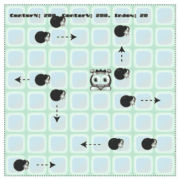

### 图 3-6. 在地图上追逐移动的炸弹

这个新示例使用了相同的三个地图层：“backgroundLayer”、“bombLayer” 和 “alienLayer”。图 3-7 显示了每一层的数据数组。

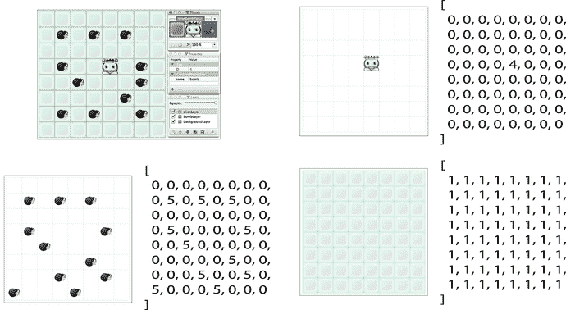


好的，作为一名高级文档工程师和翻译员，我将严格按照您给定的格式和注意事项，将以下英文文本翻译成中文。


### 图 3-7. Tiled Editor 中的三个地图图层

`setup` 函数通过以下方式获取对外星人图层数据数组的引用：

```
alienMapArray = world.getObject("alienLayer").data;
```

然后，在游戏循环中每帧更新外星人的位置后，会调用 `updateMap` 来更新数组中外星人的位置。

```
alienMapArray = updateMap(alienMapArray, alien, world);
```

这意味着 `alienMapArray` 将始终包含外星人的当前位置。

炸弹的位置会在一个 `forEach` 循环中更新。循环结束后，会使用 `updateMap` 函数将每个炸弹的新位置更新到 `bombMapArray` 中。以下是实现此功能的代码：

```
bombSprites.forEach(bomb => {

//`atXEdge` 和 `atYEdge` 会根据精灵是否位于画布边缘返回 `true` 或 `false`                  
let atXEdge = (sprite, container) => {
  return (sprite.x === 0 || sprite.x + sprite.width === container.width)
}
let atYEdge = (sprite, container) => {
  return (sprite.y === 0 || sprite.y + sprite.width === container.height)
}

//如果炸弹位于地图网格的列或行上，则改变其方向                  
if (Math.floor(bomb.x) % world.tilewidth === 0
&& Math.floor(bomb.y) % world.tileheight === 0)
{

  //如果炸弹位于画布边缘，              
  //则反转其速度以使其保持在内部              
  if (atXEdge(bomb, g.canvas)) {
    bomb.vx = -bomb.vx;
  }
  else if (atYEdge(bomb, g.canvas)) {
    bomb.vy = -bomb.vy;
  }

  //如果炸弹位于画布内部，则为其指定一个随机的新方向              
  else {
    changeDirection(bomb);
  }
}

//移动炸弹                  
bomb.x += bomb.vx;
bomb.y += bomb.vy;
});
```

现在，`bombMapArray` 将包含当前帧中炸弹位置的最新记录。您会注意到在上面的代码中，每当炸弹位于网格单元格中心时，就会调用一个名为 `changeDirection` 的函数——接下来我们来看看它是如何工作的。

### 为炸弹指定随机方向

炸弹只有在与网格行或列对齐时才会改变方向。并且，如果炸弹位于画布边缘，则无法改变方向，这可以防止生成无效的数组索引号。以下是 `changeDirection` 函数，它在满足这些条件时被调用。

```
//方向改变辅助函数                  
function changeDirection(sprite) {
  let up = 1,
    down = 2,
    left = 3,
    right = 4,
    direction = g.randomInt(1, 4);

  switch (direction) {
    case right:
      sprite.vx = 2;
      sprite.vy = 0;
      break;

    case left:
      sprite.vx = -2;
      sprite.vy = 0;
      break;

    case up:
      sprite.vx = 0;
      sprite.vy = -2;
      break;

    case down:
      sprite.vx = 0;
      sprite.vy = 2;
      break;
  }
}
```

这只是一个非常简单的 switch 语句，它改变精灵的速度以匹配其随机分配的方向。

### 碰撞检测

如果您在任何时候快照 `alienMapArray` 或 `bombMapArray`，您会发现它们的内容与画布上精灵的位置相匹配，如图 3-8 所示。

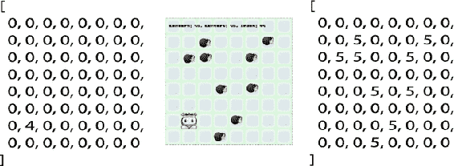

### 图 3-8. 实时更新精灵的地图位置

碰撞是通过比较这两个数组来检测的。代码遍历 `bombMapArray`，检查每个索引位置的 `gid` 是否为 `5`。如果是，并且 `alienMapArray` 在相同索引号处有 `4`，则发生碰撞。然后代码会过滤掉该位置上的任何炸弹精灵。（该位置可能不止一个炸弹）。当找到匹配项时，炸弹会从地图中清除，并且精灵会被移除。

```
bombMapArray.forEach((gid, index) => {

  //外星人是否与炸弹具有相同的索引号？              
  if (alienMapArray[index] === 4 && gid === 5) {

    //是的，因此过滤掉该位置上的所有炸弹精灵              
    //（可能不止一个）              
    bombSprites = bombSprites.filter(bomb => {
      if (bomb.index === index) {

        //从数组中移除炸弹的 gid 编号              
        bombMapArray[bomb.index] = 0;

        //从 `bombLayer` 组中移除炸弹              
        g.remove(bomb);
        return false;
      } else {
        return true;
      }
    });
  }
});
```

到目前为止，所有这些示例都展示了如何使用精灵的中心点来检测碰撞。但对于许多游戏来说，您需要更高的精度。接下来，我们来看看如何使我们的碰撞检测更精确一些。

## 使用角点

我们的碰撞系统到目前为止的一个局限是，我们只使用精灵的中心 x/y 点来确定其地图数组位置。

```
sprite.index = getIndex
  sprite.centerX, sprite.centerY,
  world.tilewidth, world.tileheight, world.widthInTiles
);
```

这意味着，即使精灵部分进入了相邻的单元格，`getIndex` 也不会检测到其位置发生了变化。只有当精灵的中心点穿过单元格边界时，它才会检测到变化。您可以在图 8-9 中看到，即使外星人碰到了炸弹，也只有在外星人的中心进入炸弹所在的单元格时，才会检测到碰撞。见图 3-9。

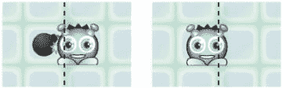

### 图 3-9. 使用精灵的中心点来确定其地图位置

这可能不是问题，事实上，在这个示例中，这种效果看起来非常自然。但对于许多类型的碰撞，您可能希望使用精灵的精确边缘作为碰撞边界。这对于与墙壁等不应有任何重叠的物体，或者与火焰等需要立即反应的物体的碰撞来说非常重要。

那么，如何确定精灵的边缘是否位于新的地图位置呢？不要使用中心点。而是使用精灵的 4 个角点。图 3-10 显示了这四个角点的位置。

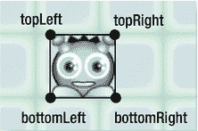

### 图 3-10. 为获得更高精度，请检查精灵的 4 个角的位置

计算这些点很容易。使用 `getPoints` 函数来计算并返回一个包含这四个点 x/y 坐标的对象。`getPoints` 接受一个参数：要查找其角点的精灵。它返回一个对象，该对象有四个子对象属性，分别表示精灵四个角的位置：`topLeft`、`topRight`、`bottomLeft` 和 `bottomRight`。

```
function getPoints(s) {
  return {
    topLeft: {x: s.x, y: s.y},
    topRight: {x: s.x + s.width - 1, y: s.y},
    bottomLeft: {x: s.x, y: s.y + s.height - 1},
    bottomRight: {x: s.x + s.width - 1, y: s.y + s.height - 1}
  };
}
```

（底部和左侧的角点比精灵的宽度和高度小 1 像素，这样这些点就保持在精灵内部，而不是外部）。


### 注意

为什么在 `getCorners` 函数中要使用 `“s”` 而不是 `“sprite”`？虽然我通常建议使用描述性变量名，但通过使用明显的简写，你可以让密集且重复的数学计算更加紧凑和易读。

现在，不再仅仅通过检查精灵的中心点来定位地图位置，而是检查所有四个角点。如果这些角点与你关注的精灵的`gid`具有相同的索引，则说明发生了碰撞。

首先，使用上面的 `getPoints` 函数来获取精灵的四个角点。

```
sprite.collisionPoints = getPoints(sprite);
```

创建一个 `collisionGid` 变量，用于存储你想要检查与精灵是否发生碰撞的单元格的`gid`。

```
let collisionGid = 5;
```

你还需要一个 `mapArray`，其中包含具有上述 `collisionGid` 的精灵。

```
let mapArray = anyMapArray;
```

然后遍历所有四个点，并为每个点调用自定义的 `checkPoints` 函数。

```
let hit = Object.keys(sprite.collisionPoints).some(checkPoints);
```

如果任何一个角点与 `mapArray` 中具有与我们关注的 `collisionGid` 相同的 `gid` 的单元格相交，则 `checkPoints` 函数返回 `true`。

```
function checkPoints(key) {

  //获取当前要检查的点的引用。            
  //(`topLeft`, `topRight`, `bottomLeft` 或 `bottomRight` )            
  let point = sprite.collisionPoints[key];

  //在地图数组中找到该点的索引号            
  let index = getIndex(
    point.x, point.y,
    world.tilewidth, world.tileheight, world.widthInTiles
  );

  //找出该点当前所在地图位置的 gid 值            
  let currentGid = mapArray[index];

  //如果该值与我们所关注的 gid 值匹配，            
  //则说明发生了碰撞            
  if (currentGid === collisionGid) {
    return true;
  } else {
    return false;
  }
}
```

如果*某些*角点（至少一个）与你关注的单元格接触，上述代码将返回`true`。这是因为我们使用了 JavaScript 的 `some` 数组方法：

```
var hit = Object.keys(sprite.collisionPoints).some(checkPoints);
```

一旦找到第一个发生碰撞的角点，循环就会退出，函数返回 `true`。这意味着如果第一个点，即精灵的 `topLeft` 角点发生了碰撞，循环会立即返回`true`，而不再检查其他点。这对于确保对碰撞做出即时反应非常有用。

但是，如果你只想在*每一个*角点都与你关注的单元格接触时才检测到碰撞，该怎么做呢？请使用 JavaScript 的 `every` 数组方法，如下所示：

```
var hit = Object.keys(sprite.collisionPoints).every(checkPoints);
```

在这种情况下，只有当*每一个*角点都参与碰撞时，`hit` 才会变为 `true`。这对于确保精灵完全位于一个单元格内部，或者完全覆盖另一个精灵非常有用。你可以利用这一点来高效地测试精灵的四个角是否都落在迷宫地板上，从而防止精灵穿墙而过。（在后续的示例中，你将看到如何做到这一点）。

现在你已经知道是否发生了碰撞，接下来使用索引号在地图的同一位置找到匹配的精灵。这只是你之前示例中相同代码的一个变体：

```
if (hit) {
  enemySprites.some((enemy) => {
    if (enemy.index === collisionIndex) {

      //这就是你关注的精灵            
    }
  });
}
```

在我们继续深入之前，先来整合所有这些新代码。

### 一个可复用的基于瓦片的碰撞函数

你现在可以看到，基于瓦片的碰撞对于各种不同的游戏场景是多么有用。为了让我们轻松一点，我快速编写了一个通用的 `hitTestTile` 函数，这样你只需一行代码就能实现基于瓦片的碰撞。你可以将它放入任何游戏中，只要游戏中的精灵具有本书一直在使用的相同属性即可。该函数用于检测精灵与任何地图数组上的某个瓦片`gid`编号之间的碰撞。该函数还允许你设置要检测的碰撞类型：中心点、某些角点或每个角点。使用方法如下：

```
let collisionObject = hitTestTile(sprite, mapArray, collisionGid, worldObject, pointsToCheck);
```

`hitTestTile` 返回一个碰撞对象，其中包含以下两个属性：

*   `collision.hit`：一个布尔值，如果发生碰撞则为 true。
*   `collision.index`：一个数字，表示碰撞发生的地图数组位置。

你可以使用这两个属性来决定如何处理碰撞。

第四个参数 `worldObject` 是一个定义基于瓦片的游戏世界的对象。它需要包含以下属性：

```
world.tilewidth
world.tileheight
world.widthInTiles
```

（`widthInTiles` 是一个数字，表示你的瓦片地图的列数）。

我们在最后两章中使用的 `makeTiledWorld` 函数会自动为你返回一个包含这些属性的世界对象。但如果你是通过代码（而非使用 Tiled Editor）生成世界地图，只要你将自己的、包含上述三个相同属性的世界对象传递给它，你仍然可以使用 `hitTestTile`。

最后一个参数 `pointsToCheck` 决定了检查精灵上的哪些点以检测碰撞。你可以使用以下三个字符串选项之一：

```
"every"
"some"
"center"
```

以下是完整的 `hitTestTile` 函数。这里没有新代码，它只是对我们在前面示例中使用的相同技术进行了重新编排。

```
hitTestTile(sprite, mapArray, gidToCheck, world, pointsToCheck) {

  //`checkPoints` 辅助函数遍历精灵的角点，              
  //找出它们是否位于你关注的数组单元格内。              
  //如果是，则返回 `true`。              
  let checkPoints = key => {

    //获取当前要检查的点的引用。              
    //(`topLeft`, `topRight`, `bottomLeft` 或 `bottomRight` )              
    let point = sprite.collisionPoints[key];

    //在地图数组中找到该点的索引号              
    collision.index = this.getIndex(
      point.x, point.y,
      world.tilewidth, world.tileheight, world.widthInTiles
    );

    //找出该点当前所在地图位置的 gid 值              
    collision.gid = mapArray[collision.index];

    //如果该值与我们所关注的 gid 值匹配，              
    //则说明发生了碰撞              
    if (collision.gid === gidToCheck) {
      return true;
    } else {
      return false;
    }
  };

  //将 "some" 设置为 `pointsToCheck` 的默认值              
  pointsToCheck = pointsToCheck || "some";

  //该函数将返回的碰撞对象              
  let collision = {};

  //你想要检查哪些点？              
  //"every"、"some" 还是 "center"?              
  switch (pointsToCheck) {
    case "center":

      //只有中心点接触时，`hit` 才为 true              
      let point = {
        center: {
          x: sprite.centerX,
          y: sprite.centerY
        }
      };
      sprite.collisionPoints = point;
      collision.hit = Object.keys(sprite.collisionPoints).some(checkPoints);
      break;

    case "every":

      //每个角点都接触时，`hit` 才为 true              
      sprite.collisionPoints = this.getPoints(sprite);
      collision.hit = Object.keys(sprite.collisionPoints).every(checkPoints);
      break;

    case "some":
```


// 仅当某些点接触时，`hit` 的值才为 true
`sprite.collisionPoints = this.getPoints(sprite);`
`collision.hit = Object.keys(sprite.collisionPoints).some(checkPoints);`
`break;`

// 返回碰撞对象。
// 若检测到碰撞，`collision.hit` 的值为 true。
// `collision.index` 可告知碰撞发生时所处地图数组的索引编号。
`return collision;`

（你可以在本章的源文件 `hexi/src/modules/tileUtilities/src` 中找到此函数的可用版本）。

运行 `usingCornerPoints.html` 示例，可看到 `hitTestTile` 的实际应用。在此示例中，一旦外星人的任意角点进入包含炸弹的单元格，炸弹就会立即消失。如图 3-11 所示。

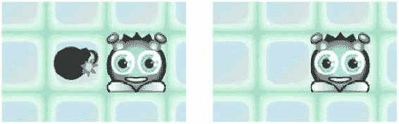

### 图 3-11. 使用部分角点进行即时碰撞检测

这种碰撞反应是否显得过于即时？你可以通过将 `"some"` 改为 `"every"` 来实现完全不同的效果：

```
let alienVsBomb = hitTestTile(alien, bombMapArray, 5, world, "every");
```

现在，只有当每个角点都位于炸弹的单元格内时，才会检测到碰撞。这让外星人必须先完全包裹住炸弹，炸弹才会消失。图 3-12 说明了这一点。

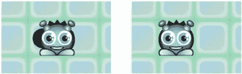

### 图 3-12. 仅当每个角点都位于地图单元格内时才检测碰撞

结果看起来非常自然，而这是一种使用基于几何的碰撞检测系统难以实现的效果。此外，使用每个角点进行碰撞检测还有另一个重要用途：你可以用它来将精灵限制在地图的特定位置。接下来让我们了解如何做到这一点。

## 使用反向碰撞检测来检查障碍物

对于迷宫或角色扮演游戏，你通常需要知道地图的哪些区域是角色可以行走的，哪些是不可以行走的。例如，角色应该能够在草地上行走，但不能穿过墙壁、岩石或树木。这些被称为地图的可行走区域和不可行走区域。通常你会发现，角色只允许在某一种东西上行走，但有很多东西它不能行走。因此，与其检查角色不能行走的三样东西（如墙壁、岩石和树木），不如只测试角色可以行走的那一样东西（例如草地）。如果角色在草地上，它可以行走；但如果它接触到其他任何东西，则不能行走。这是一种*反向*碰撞策略。之所以说它是反向的，是因为你通过检查精灵是否*没有碰到*另一个障碍物，来判断它是否撞上了障碍物。如果它在草地上，你就知道它没有碰到墙壁、岩石或树木。简单！对于某些类型的碰撞来说，这种方法非常高效。

如何知道一个精灵是否完全位于某个特定的地图单元格内？通过检查它的全部四个角点。如果精灵的四个角点都在同一个位置，就可以知道该精灵没有与其他任何单元格重叠。是的，你可能不会惊讶地发现，你可以通过使用 JavaScript 的 `every` 循环来检查这一点！让我们通过经典的迷宫墙壁示例来了解如何操作。

运行 `wallsAndBombs.js` 文件，使用方向键控制外星人在迷宫中穿行并拾取炸弹。外星人可以平滑地穿过走廊和拐角，但墙壁会阻挡其移动，如图 3-13 所示。

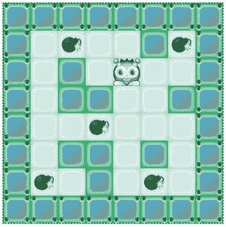

### 图 3-13. 在迷宫中穿行以拾取炸弹

图 3-14 显示了迷宫以及用于创建该迷宫的 `wallArray`。

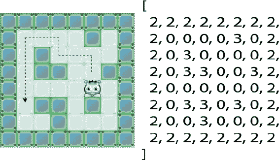

### 图 3-14. 添加墙壁以创建迷宫游戏

你可以看到，任何 gid 编号为 2 或 3 的都是墙壁。但由于我们将进行反向碰撞检查，我们对此不感兴趣。我们只关心任何不是墙壁的东西。也就是地图中用 `"0"` 表示的所有东西。因此，我们的碰撞算法将遵循以下逻辑：*如果外星人没有碰到 `"0"` 单元格，则阻止其移动。*

以下是游戏循环中实现此功能的全部代码。除了几个小细节外，它与前一个示例中的代码非常相似。

```
let alienVsFloor = g.hitTestTile(alien, wallMapArray, 0, world, "every");

if (!alienVsFloor.hit) {

  //阻止外星人移动
  alien.x -= alien.vx;
  alien.y -= alien.vy;
  alien.vx = 0;
  alien.vy = 0;
}
```

可以看到，只有当每个角点都位于一个 `"0"` 单元格内时，`alienVsFloor` 才为真。如果 `alienVsFloor` 变为 false，我们就知道外星人碰到了非 `"0"` 的东西——那东西一定是墙壁。

此示例使用了最简单的碰撞反应代码。如果外星人撞到墙壁，则通过从其位置减去其速度，然后将其速度设为零来阻止其移动。

```
alien.x -= alien.vx;
alien.y -= alien.vy;
alien.vx = 0;
alien.vy = 0;
```

我们可以使用如此简单的碰撞反应系统，是因为外星人的移动与地图的网格行和列对齐，并且我们没有使用任何物理机制来改变其速度。这些约束条件消除了一大类我们无需担心的碰撞问题。

为了了解这段代码在实际环境中的用法，以下是游戏循环中使用 `hitTestTile` 来检查外星人与地面，以及外星人与炸弹之间碰撞的全部代码。

```
//检查外星人与地面之间的碰撞
let alienVsFloor = g.hitTestTile(alien, wallMapArray, 0, world, "every");

//如果外星人没有碰到地砖，则阻止其移动
if (!alienVsFloor.hit) {
  alien.x -= alien.vx;
  alien.y -= alien.vy;
  alien.vx = 0;
  alien.vy = 0;
}

//检查外星人与炸弹之间的碰撞
let alienVsBomb = g.hitTestTile(alien, bombMapArray, 5, world, "every");

//查看外星人在炸弹数组中的位置是否与炸弹的 gid 编号匹配
if (alienVsBomb.hit) {

  //如果匹配，则过滤炸弹精灵并找到
  //与外星人位置相匹配的那个
  bombSprites = bombSprites.filter(function(bomb) {

    //该炸弹精灵的索引号是否与外星人相同？
    if (bomb.index === alienVsBomb.index) {

      //如果相同，则通过将 `bombMapArray` 中的 gid 设为 `0`
      //来从其中移除炸弹
      bombMapArray[bomb.index] = 0;

      //从其容器组中移除炸弹精灵
      g.remove(bomb);

      //从 `bombSprites` 数组中滤除该炸弹
      return false;
    } else {

      //如果不匹配，则将炸弹保留在 `bombSprites` 数组中
      return true;
    }
  });
}
```

现在我们有了一个实用的基于瓦片的碰撞系统，可用于各种基于瓦片的游戏。接下来，让我们了解如何在上一章开始构建的奇幻角色扮演游戏中运用所有这些新技能。


### 基于瓦片碰撞的角色扮演游戏

先试玩一下第 1 章的`fantasy.html`原型示例，重温一下它的运作方式。你会注意到精灵角色可以碰撞两类物体：

-   阻挡行动的障碍物：树桩、墙基和灌木丛底部。
-   可收集的物品：红心、骷髅头和土拨鼠。

图 3-15 展示了这一点。碰撞机制完全基于前几节学到的瓦片碰撞系统。但这里有一些有趣的新细节，这些细节并非边缘情况，而是许多类型游戏中你都需要解决的典型碰撞问题。

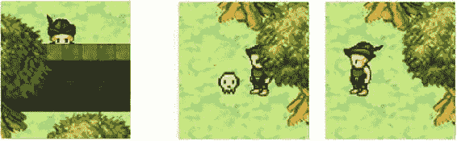

**图 3-15.** 障碍物阻挡行动，物品可被收集

### 定义碰撞区域

游戏地图中的所有瓦片都由整齐填充 32x32 像素方格的精美图形构成。然而，精灵角色并不遵循这一模式。它的精灵尺寸为 64x64 像素，而角色插画的实际尺寸为 28x52 像素。图 3-16 展示了这一点。

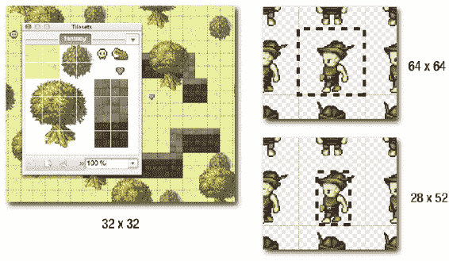

**图 3-16.** 所有尺寸均不相同

在迷宫游戏示例中这不成问题，因为瓦片尺寸、精灵尺寸以及迷宫单元格网格尺寸完全相同：都是 64x64 像素。现在该怎么办？

别担心！只需在精灵上创建一个碰撞区域即可。碰撞区域定义了精灵的哪个部位应对碰撞敏感。在本游戏中，我只希望精灵头部以下的身体区域对碰撞做出反应。这是一个 20x20 像素的方形区域，你可以在图 3-17 中看到它。它相对于精灵顶部向下偏移 44 像素，向左偏移 22 像素。

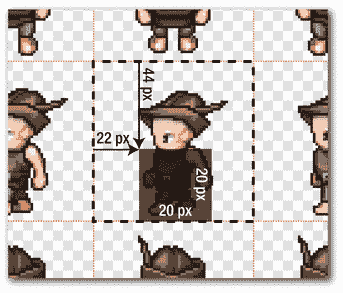

**图 3-17.** 精灵的碰撞区域

这保留了浅 2.5D 景深效果，因为它意味着精灵的头部不会撞到视觉上位于其上方但深度层更低的物体——例如墙壁或树木的顶部。

要在游戏代码中实现这一点，我们只需在精灵上创建一个定义此形状的`collisionArea`对象。以下是游戏设置函数中实现此功能的代码片段。

```
elf.collisionArea = {
  x: 22,
  y: 44,
  width: 20,
  height: 20
};
```

（有关完整上下文，请参考第 1 章的`fantasy.js`源文件）。

现在，不再使用精灵的四个角点，而是使用这个新的`collisionArea`的四个角点进行碰撞检测。为了实现这一点，请使用这个新版本的`getPoints`函数。

```
getPoints(s) {
  let ca = s.collisionArea;
  if (ca !== undefined) {
    return {
      topLeft: {
        x: s.x + ca.x,
        y: s.y + ca.y
      },
      topRight: {
        x: s.x + ca.x + ca.width,
        y: s.y + ca.y
      },
      bottomLeft: {
        x: s.x + ca.x,
        y: s.y + ca.y + ca.height
      },
      bottomRight: {
        x: s.x + ca.x + ca.width,
        y: s.y + ca.y + ca.height
      }
    };
  } else {
    return {
      topLeft: {
        x: s.x,
        y: s.y
      },
      topRight: {
        x: s.x + s.width - 1,
        y: s.y
      },
      bottomLeft: {
        x: s.x,
        y: s.y + s.height - 1
      },
      bottomRight: {
        x: s.x + s.width - 1,
        y: s.y + s.height - 1
      }
    };
  }
}
```

现在你可以为游戏中的任何精灵设置自定义碰撞区域。那么，这个幻想 RPG 游戏示例中的碰撞系统是如何工作的呢？

## 与障碍物的碰撞

你从第 2 章还记得，所有应阻止精灵移动的瓦片都创建在一个名为`obstacles`的地图层上，如图 3-18 所示。

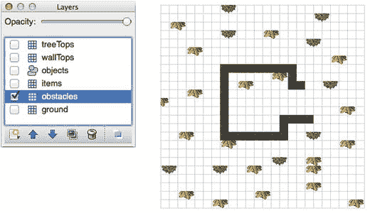

**图 3-18.** 地图的障碍物层

这导出一个漂亮的大数组，其中充满了代表障碍物的`gid`数字。但最重要的是，它也充满了零。数组中的任何`0`都表示“没有障碍物”。这意味着我们可以使用我们的小反证碰撞技巧。我们可以检查精灵碰撞区域的所有四个角是否都接触到了`0`单元格。如果任何一个不是`0`，我们就知道精灵撞到了障碍物。我们最终得到的代码几乎与我们早期迷宫游戏示例中用于检查迷宫墙壁的代码相同。以下是游戏循环中检查精灵是否接触障碍物的代码。如果接触了，代码会阻止精灵移动。

```
let obstaclesMapArray = world.getObject("obstacles").data;
let elfVsGround = g.hitTestTile(elf, obstaclesMapArray, 0, world, "every");

if (!elfVsGround.hit) {
  //阻止精灵移动
  elf.x -= elf.vx;
  elf.y -= elf.vy;
  elf.vx = 0;
  elf.vy = 0;
}
```

如果你想知道精灵撞到了哪种类型的障碍物呢？你可以使用`collision.index`属性在地图数组中查找其`gid`编号。以下是从`obstacleMapArray`中查找`gid`编号的方法：

```
obstaclesMapArray[elfVsGround.index]
```

如果精灵撞到了树的右侧，这将给出`33`。这意味着你现在可以获得关于精灵与环境交互情况的详细信息，并利用这些信息开始构建复杂的游戏逻辑。

### 与物品的碰撞

你还会记得，当我们在 Tiled Editor 中设计游戏地图时，我们给物品瓦片赋予了这些名称属性：`skull`、`heart`和`marmot`。物品也被添加到了它们自己的图层上，如图 3-19 所示。

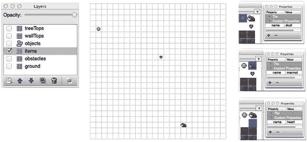

**图 3-19.** 物品瓦片位于它们自己的图层上，并具有名称属性

我们可以在游戏代码中使用这些自定义名称属性来判断精灵正在接触哪些物品。让我们来看看如何实现。

首先，我们需要获取对物品图层的引用。

```
itemsLayer = world.getObject("items");
```

记住`itemsLayer`是一个精灵容器。它包含该图层上的所有精灵；只有三个：红心、骷髅头和土拨鼠。你可以在图层的`children`数组中访问这些精灵。因此下一步是获取对`itemsLayer.children`的引用。

```
items = itemsLayer.children;
```

现在我们有了一个名为`items`的数组，其中包含三个物品精灵。


### 注记

你也可以选择*克隆*数组，而不是创建一个指向原始数组的直接引用指针。你可以像这样克隆数组：

```
items = itemsLayer.children.slice(0);
```

克隆数组的好处是，如果对 `items` 数组进行了修改，原始的 `itemsLayer.children` 数组将保持不变。当你需要将游戏重置为初始状态时，这会非常有用。

精灵与物品之间的碰撞是如何工作的？不出所料！这与本章前面例子中炸弹与外星人之间的碰撞完全相同。唯一新增的是，当碰撞发生时，屏幕上会显示一条持续三秒的消息，告知你精灵收集到的物品名称。

```
let itemsMapArray = world.getObject("items").data;
let elfVsItems = g.hitTestTile(elf, itemsMapArray, 0, world, "some");

if (!elfVsItems.hit) {
items = items.filter(item => {

  //判断当前物品是否与精灵的位置匹配              
  if (item.index === elfVsItems.index) {

    //显示消息              
    message.visible = true;
    message.content = "You found a " + item.name;

    //让消息在三秒后消失              
    g.wait(3000, function() {
      message.visible = false;
    });

    //移除物品              
    itemsMapArray[item.index] = 0;
    g.remove(item);
    return false;
  } else {
    return true;
  }
  });
}
```

图 3-20 展示了收集到物品时屏幕上显示的消息效果。

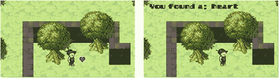

### 图 3-20. 显示物品的名称属性

基于瓦片的碰撞：解决！

## 小结

基于瓦片的碰撞是你能够学到的最有用的游戏设计技术之一。我们在本章中使用的简单系统可以作为你在 2D 动作游戏中进行大部分（或全部）碰撞检测的基础。现在你学会了如何在地图世界中定位对象、检测它与其他对象的碰撞、对这些碰撞做出反应，以及更新游戏世界。你可以使用通用的 `hitTestTile` 函数，配合 `getIndex` 和 `getPoints`，来处理任何类型 2D 视频游戏的碰撞问题。

但是，如果我再次告诉你“我们还没结束！”你会不会感到惊讶？既然你已经理解了如何构建一个交互式基于瓦片的游戏世界，一个全新的游戏设计技术宇宙已向你敞开。在接下来的几章中，我们将深入探讨所有这些新技术：影响地图、宽相位碰撞、寻路、程序化关卡生成，以及下一章中的等距地图。希望你胃口大开！

© Rex van der Spuy 2017

Rex van der Spuy, 《高级游戏开发者工具包》，10.1007/978-1-4842-1097-0_4

# 4. 等距地图

Rex van der Spuy¹

(1)加拿大，安大略省，多伦多

现在你已经了解了制作基于瓦片游戏的基础知识，让我们添加一个很酷的新功能：**等距投影**。等距投影是一种浅层的 3D 效果，游戏世界看起来像是旋转了 45 度，并且从上方以 30 度角观察。图 4-1 显示了一个典型的等距地图布局。

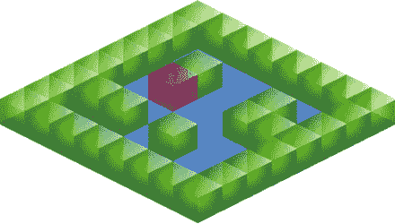

### 图 4-1. 等距投影是一种固定视角的 3D 效果

你的地图由代表立方体的形状组成，而不是正方形，就像从某个角度侧视边缘所见。它看起来是 3D 的，但等距 3D 与真正的 3D 有两个重大区别：

- 等距 3D 具有永久固定的视角。
- 等距 3D 没有地平线，因此游戏世界可以看起来无限延伸到世界的边缘之外。

等距地图是许多类型游戏（例如策略游戏、基于地图的冒险游戏和角色扮演游戏）的标准配置。它们的优势在于，与 2D 地图一样，它们能为玩家提供游戏世界一致的鸟瞰视角，因此很容易规划下一步行动。但与普通 2D 地图通常能提供的相比，3D 视角能带来更强的空间沉浸感。

在本章中，你将学习制作等距游戏地图的所有基础知识，包括如何完成以下操作：

- 在等距世界中移动游戏角色。
- 精确地对精灵进行深度排序。
- 在等距精灵之间进行碰撞检测。
- 使用指针选择等距精灵，并将其屏幕上的位置与地图数组的索引位置匹配。
- 如何使用瓦片编辑器设置和渲染等距游戏世界。

让我们一探究竟！

## 等距基础

你可能会惊讶地发现，制作等距游戏世界所需了解的唯一新知识，只是一点简单的数学运算。请看图 4-2，它以两种方式渲染了同一个游戏地图。

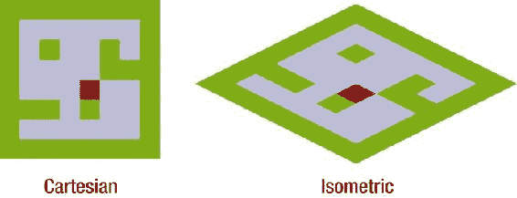

### 图 4-2. 同一地图的笛卡尔坐标渲染与等距渲染

这两个地图都是由相同的地图数组数据创建的。左边的例子使用**笛卡尔坐标**渲染地图。这是我们熟悉的普通 `x` 和 `y` 坐标，它们与轴平面成直角对齐。右边的例子使用**等距坐标**渲染地图。两个地图之间只有一个区别：等距地图中的瓦片只是被拉伸并旋转了 45 度。它们是同一张地图，只是通过不同的视角观察。这意味着，你只需应用一个简单的数学转换，就可以将任何普通的笛卡尔瓦片地图转换为等距瓦片地图。

以下是将平面笛卡尔地图上的 `x` 和 `y` 点转换为 3D 等距地图所需了解的几乎全部数学知识。要将笛卡尔 `x` 和 `y` 点转换为等距点，请使用以下公式：

```
isoX = cartX - cartY;
isoY = (cartX + cartY) / 2;
```

要将等距点转换为笛卡尔点，请使用以下公式：

```
cartX = (2 * isoY + isoX) / 2;
cartY = (2 * isoY - isoX) / 2;
```

就这样！你在本章中将要学习的其余代码，本质上只是为你提供一种使用这些公式在这两种坐标系之间进行转换的简便方法。


### 制作笛卡尔瓦片地图

在开始等距投影的冒险之旅前，让我们先回归基础，学习如何制作图 4-2 所示的笛卡尔瓦片地图。这也是一个精简瓦片地图渲染系统的优秀模型，如果你后续需要，可以将其扩展为功能更完整的系统。以下是本书源代码中 `cartesian.js` 文件的 `setup` 函数内用于生成地图的代码——注释逐步说明了代码的工作原理。

```
//创建定义等距瓦片世界的“world”容器                  
let world = g.group();

//设置每个瓦片的笛卡尔尺寸（像素）                  
world.cartTilewidth = 32;
world.cartTileheight = 32;

//定义世界的宽度和高度（以瓦片为单位）                  
world.widthInTiles = 8;
world.heightInTiles = 8;

//创建世界图层                  
world.layers = [

  //环境层。`2` 代表墙壁，              
  //`1` 代表地板              
  [
    2, 2, 2, 2, 2, 2, 2, 2,
    2, 1, 1, 1, 1, 1, 1, 2,
    2, 1, 2, 1, 1, 2, 1, 2,
    2, 1, 1, 1, 1, 2, 2, 2,
    2, 1, 1, 1, 1, 1, 1, 2,
    2, 2, 2, 1, 2, 1, 1, 2,
    2, 1, 1, 1, 1, 1, 1, 2,
    2, 2, 2, 2, 2, 2, 2, 2
  ],

  //角色层。`3` 代表游戏角色              
  //`0` 代表不包含任何精灵的空单元格              
  [
    0, 0, 0, 0, 0, 0, 0, 0,
    0, 0, 0, 0, 0, 0, 0, 0,
    0, 0, 0, 0, 0, 0, 0, 0,
    0, 0, 0, 0, 0, 0, 0, 0,
    0, 0, 0, 0, 3, 0, 0, 0,
    0, 0, 0, 0, 0, 0, 0, 0,
    0, 0, 0, 0, 0, 0, 0, 0,
    0, 0, 0, 0, 0, 0, 0, 0
  ]
];

//通过逐一遍历每个图层数组来构建游戏世界                  
world.layers.forEach(layer => {

  //遍历每个数组元素              
  layer.forEach((gid, index) => {

    //如果单元格不为空（0），则创建一个精灵              
    if (gid !== 0) {

      //查找精灵所在的列和行，及其与列行位置匹配的 x 和 y 像素值              
      let column, row, x, y;
      column = index % world.widthInTiles;
      row = Math.floor(index / world.widthInTiles);
      x = column * world.cartTilewidth;
      y = row * world.cartTileheight;

      //接下来，根据其 `gid` 编号创建不同的精灵              
      let sprite;
      switch (gid) {

        //地板              
        case 1:
          sprite = g.rectangle(world.cartTilewidth, world.cartTileheight, 0xCCCCFF);
          break;

        //墙壁              
        case 2:
          sprite = g.rectangle(world.cartTilewidth, world.cartTileheight, 0x99CC00);
          break;

        //角色              
        case 3:
          sprite = g.rectangle(world.cartTilewidth, world.cartTileheight, 0xFF0000);
      }

      //使用计算出的 `x` 和 `y` 值定位精灵              
      //这些值对应其在瓦片地图中的列和行              
      sprite.x = x;
      sprite.y = y;

      //将精灵添加到 `world` 容器中              
      world.addChild(sprite);
    }
  });
});
```

> **注意：** 上面代码中的 `rectangle` 函数仅用于显示一个指定宽度、高度和颜色的矩形。

现在，让我们了解如何以等距视图显示同一地图。

### 制作等距瓦片地图

创建新的等距地图需要添加两个要素。第一个是可用来显示每个瓦片的等距方形精灵。第二个是将笛卡尔坐标（常规 `x` 和 `y` 坐标）转换为等距坐标的方法。

#### 等距精灵

等距瓦片精灵就是一个旋转了 45 度并被压缩到一半高度的正方形，如图 4-3 所示。


**图 4-3.** 使用菱形瓦片作为绘制等距地图的基础

下面是一个名为 `isoRectangle` 的函数，用于创建这样的精灵。它使用 PixiJS 渲染系统绘制，但你也可以使用任何允许绘制图形的图形库（包括 Canvas API）实现相同的效果。

```
function isoRectangle(width, height, fillStyle) {

  //计算出 `halfHeight` 值                
  let halfHeight = height / 2;

  //绘制压扁并旋转后的正方形（菱形）                
  let rectangle = new PIXI.Graphics();
  rectangle.beginFill(fillStyle);
  rectangle.moveTo(0, 0);
  rectangle.lineTo(width, halfHeight);
  rectangle.lineTo(0, height);
  rectangle.lineTo(-width, halfHeight);
  rectangle.lineTo(0, 0);
  rectangle.endFill();

  //从矩形生成纹理                
  let texture = rectangle.generateTexture();

  //使用纹理创建精灵                
  let sprite = new PIXI.Sprite(texture);

  //将精灵返回给主程序                
  return sprite;
}
```

现在我们有了生成等距精灵的方法，还需要一种将笛卡尔 `x` 和 `y` 坐标转换为等距坐标的方法。


好的，作为一名高级文档工程师和翻译员，我将严格遵循您的注意事项和示例，将给定的英文文本翻译成中文。


#### 弄清等距坐标

还记得本章开头向大家展示的将笛卡尔坐标 `x` 和 `y` 点转换为等距点的简单转换公式吗？

```
isoX = cartX - cartY;
isoY = (cartX + cartY) / 2;
```

下面是如何使用这个公式为 `isoRectangle` 函数创建的精灵对象添加 `isoX` 和 `isoY` 属性的方法。

```
sprite.isoX = sprite.x – sprite.y;
sprite.isoY = (sprite.x + sprite.y) / 2;
```

但是，为了让我们操作起来更简单，我们创建一个函数，将这两个新的 `isoX` 和 `isoY` 属性添加到*任何*精灵上。与此同时，我们还将精灵的笛卡尔坐标和尺寸捕获为 `cartX`、`cartY`、`cartWidth` 和 `cartHeight`——以备日后需要访问它们（剧透：我们会的！）。下面是实现此功能的 `addIsoProperties` 函数。

```
function addIsoProperties(sprite, x, y, width, height){

//Cartisian (flat 2D) properties                
  sprite.cartX = x;
  sprite.cartY = y;
  sprite.cartWidth = width;
  sprite.cartHeight = height;

//为等距属性添加 getter/setter                
  Object.defineProperties(sprite, {
    isoX: {
      get() {
        return this.cartX - this.cartY;
      },
      enumerable: true,
      configurable: true
    },
    isoY: {
      get() {
        return (this.cartX + this.cartY) / 2;
      },
      enumerable: true,
      configurable: true
    },
  });
}
```

只需向这个函数提供任何具有普通 `x`、`y`、`width` 和 `height` 属性的精灵，它就会自动为你添加 `isoX`、`isoY` 以及额外的笛卡尔属性。

剩下的就简单了！让我们通过将第一个示例中的原始笛卡尔瓦片地图渲染为新的等距地图，来了解它到底有多简单。以下是 `isometric.js` 文件中 `setup` 函数的代码。你会注意到，除了新增了你刚刚了解的 `isoRectangle` 和 `addIsoProperties` 函数之外，它与第一个示例相同。

```
//创建定义了我们基于等距瓦片世界的 `world` 容器                    
world = g.group();

//定义每个瓦片的大小和瓦片地图的大小                    
world.cartTilewidth = 32;
world.cartTileheight = 32;
world.widthInTiles = 8;
world.heightInTiles = 8;

//创建世界层                    
world.layers = [

//环境层。`2` 代表墙壁，                
  //`1` 代表地板                
  [
    2, 2, 2, 2, 2, 2, 2, 2,
    2, 1, 1, 1, 1, 1, 1, 2,
    2, 1, 2, 1, 1, 2, 1, 2,
    2, 1, 1, 1, 1, 2, 2, 2,
    2, 1, 1, 1, 1, 1, 1, 2,
    2, 2, 2, 1, 2, 1, 1, 2,
    2, 1, 1, 1, 1, 1, 1, 2,
    2, 2, 2, 2, 2, 2, 2, 2
  ],

//角色层。`3` 代表游戏角色                
  //`0` 代表空单元格，不包含任何                
  //精灵                
  [
    0, 0, 0, 0, 0, 0, 0, 0,
    0, 0, 0, 0, 0, 0, 0, 0,
    0, 0, 0, 0, 0, 0, 0, 0,
    0, 0, 0, 0, 0, 0, 0, 0,
    0, 0, 0, 0, 3, 0, 0, 0,
    0, 0, 0, 0, 0, 0, 0, 0,
    0, 0, 0, 0, 0, 0, 0, 0,
    0, 0, 0, 0, 0, 0, 0, 0
  ]
];

//通过遍历每个数组来构建游戏世界                    
world.layers.forEach(layer => {

//遍历每个数组元素                
  layer.forEach((gid, index) => {

//如果单元格不为空（0），则创建一个精灵                
    if (gid !== 0) {

//找到精灵所在的列和行，以及                
      //它的 x 和 y 像素值。                
      let column, row, x, y;
      column = index % world.widthInTiles;
      row = Math.floor(index / world.widthInTiles);
      x = column * world.cartTilewidth;
      y = row * world.cartTileheight;

//接下来，根据其 `gid` 编号创建不同的精灵                
      let sprite;
      switch (gid) {

//地板                
        case 1:

//使用等距矩形创建精灵                
          sprite = isoRectangle(world.cartTilewidth, world.cartTileheight, 0xCCCCFF);
          break;

//墙壁                
        case 2:
          sprite = isoRectangle(world.cartTilewidth, world.cartTileheight, 0x99CC00);
          break;

//角色                
        case 3:
          sprite = isoRectangle(world.cartTilewidth, world.cartTileheight, 0xFF0000);
      }

//将这些属性添加到精灵上                
      addIsoProperties(sprite, x, y, world.cartTilewidth, world.cartTileheight);

//根据其等距坐标设置精灵的 `x` 和 `y` 像素位置                
      sprite.x = sprite.isoX;
      sprite.y = sprite.isoY;

//将精灵添加到 `world` 容器中                
      world.addChild(sprite);
    }
  });
});

//在画布内定位世界                    
let canvasOffset = (g.canvas.width / 2) - world.cartTilewidth;
world.x += canvasOffset;
```

最后两行将等距世界在画布中居中。

这应该能向你证明，任何普通的方形瓦片地图都可以重新渲染为等距世界，而无需更改任何底层的基于瓦片的逻辑。

## 使用等距属性

现在，让我们更进一步，学习如何将地图数组索引号转换为等距坐标，以及如何再转换回来。运行本章源文件中的 `pointer.html` 文件，并在等距地图上移动鼠标指针。你会注意到，文本显示会告诉你鼠标指针所在地图的行和列、其对应的数组索引号，以及相应的笛卡尔 `x` 和 `y` 位置，如图 4-4 所示。

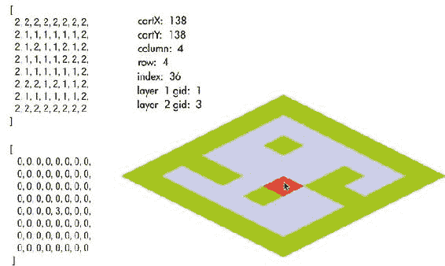

**图 4-4。** 将地图数组索引位置和笛卡尔坐标与等距位置相关联

例如，将指针移到红色方块上，你会看到该位置处两个地图层的 `gid` 编号。你还会看到与瓦片位置匹配的行号和列号。此外，显示内容还会告诉你，如果这是一个普通的 2D 地图，鼠标指针在该位置的笛卡尔 `x` 和 `y` 坐标会是多少。非常有用的信息！

这本质上是你在处理等距地图时的第一个“Hello World”。如果你对这些转换感到得心应手，那么像角色移动和碰撞这样的更高级功能就会自然而然地实现。

这里没有新的内容，只是我们使用了鼠标和指针对象的 `x` 和 `y` 坐标来帮助我们获取这些值。要从等距坐标转换为笛卡尔坐标，代码只是使用了本章开头展示的相同公式：

```
cartX = (2 * isoY + isoX) / 2;
cartY = (2 * isoY - isoX) / 2;
```

我们唯一需要做的额外调整是补偿画布显示区域中等距地图可能存在的 x/y 偏移。以下是实现这一切的代码。

```
pointer.cartX =
  (((2 * pointer.y + pointer.x) - (2 * world.y + world.x)) / 2)
  - (world.cartTilewidth / 2);

pointer.cartY =
  (((2 * pointer.y - pointer.x) - (2 * world.y - world.x)) / 2)
  + (world.cartTileheight / 2);
```


###### Note

任何你可能正在使用的场景图或游戏引擎都会包含某种指针对象，它能提供 x 和 y 值。只需在你所使用的技术中识别出它，然后将这段代码应用到该对象上。

有了这些值，我们现在可以轻松计算图块的行和列位置。

```javascript
column = Math.floor(pointer.cartX / world.cartTilewidth);
row = Math.floor(this.cartY / world.cartTileheight);
```

最后，地图数组索引号：

```javascript
index = column + (row * world.widthInTiles);
```

为了让我们的生活更轻松，让我们使用名为`makeIsoPointer`的函数将这些属性添加到指针对象中。这样，我们就可以在需要时随时从指针中获取这些值。

```javascript
function makeIsoPointer(pointer, world) {
  Object.defineProperties(pointer, {
    //The isometric's world's Cartesian coordinates
    cartX: {
      get() {
        let x =
          (((2 * this.y + this.x) - (2 * world.y + world.x)) / 2)
          - (world.cartTilewidth / 2);
        return x;
      },
      enumerable: true,
      configurable: true
    },
    cartY: {
      get() {
        let y =
          (((2 * this.y - this.x) - (2 * world.y - world.x)) / 2)
          + (world.cartTileheight / 2);
        return y;
      },
      enumerable: true,
      configurable: true,
    },
    //The tile's column and row in the array
    column: {
      get() {
        return Math.floor(this.cartX / world.cartTilewidth);
      },
      enumerable: true,
      configurable: true
    },
    row: {
      get() {
        return Math.floor(this.cartY / world.cartTileheight);
      },
      enumerable: true,
      configurable: true,
    },
    //The tile's index number in the array
    index: {
      get() {
        let index = {};
        //Convert pixel coordinates to map index coordinates
        index.x = Math.floor(this.cartX / world.cartTilewidth);
        index.y = Math.floor(this.cartY / world.cartTileheight);
        //Return the index number
        return index.x + (index.y * world.widthInTiles);
      },
      enumerable: true,
      configurable: true,
    },
  });
}
```

现在你可以像这样将这些属性添加到你的指针中：

```javascript
makeIsoPointer(g.pointer, world);
```

并且你可以像这样在文本字段中显示它们：

```javascript
message.content = `
  cartX: ${Math.floor(g.pointer.cartX)}
  cartY: ${Math.floor(g.pointer.cartY)}
  column: ${g.pointer.column}
  row: ${g.pointer.row}
  index: ${g.pointer.index}
  layer 1 gid: ${world.layers[0][Math.floor(g.pointer.index)]}
  layer 2 gid: ${world.layers[1][Math.floor(g.pointer.index)]}
`;
```

这是本章源代码中`pointer.js`文件里唯一产生图[4-4]输出的新代码，其余代码与我们之前的示例相同。

我们在处理等距地图方面的所有核心技能已经就绪，所以让我们看看如何开始使用它们来制作游戏。

## 在等距世界中移动

接下来，让我们了解如何让游戏角色在这个等距地图上移动。运行本章源文件中的`movement.html`文件，并使用键盘方向键在迷宫中移动红色方块，如图[4-5]所示。一个文本字段会显示红色方块当前所在的地图数组索引号。

**图 4-5.** 使用方向键移动红色方块

别慌——你已经知道如何做到这一点了！所有代码所做的就是将你在前一章学到的基于图块的地图移动技术与我们的新等距技能结合起来。为了向你证明这一点，让我们来看看添加到现有代码库中的新代码。

首先，你需要定义“玩家”角色是什么。在这个例子中，它是一个红色方块。因此，在绘制图块地图的`switch`语句中，将其引用为玩家对象。

```javascript
case 3:
  sprite = isoRectangle(world.cartTilewidth, world.cartTileheight, 0xFF0000);
  player = sprite;
```

在`setup`函数中，我们还需要定义键盘方向键和玩家对象的`direction`属性，以便在地图上移动它。让我们添加代码来实现这一点，这与我们在前一章中用来完成相同任务的代码完全相同。

```javascript
//Create the keyboard objects
leftArrow = g.keyboard(37);
upArrow = g.keyboard(38);
rightArrow = g.keyboard(39);
downArrow = g.keyboard(40);

//Assign the key `press` actions
player.direction = "none";
leftArrow.press = () => player.direction = "left";
upArrow.press = () => player.direction = "up";
rightArrow.press = () => player.direction = "right";
downArrow.press = () => player.direction = "down";
leftArrow.release = () => player.direction = "none";
upArrow.release = () => player.direction = "none";
rightArrow.release = () => player.direction = "none";
downArrow.release = () => player.direction = "none";
```

下一步是向游戏循环中添加代码，以使用键盘输入来移动玩家。这基本上与我们在 2D 地图上移动精灵的代码相同，但有一个重要的变化。代码不是直接操作精灵的屏幕 x 和 y 位置值，而是使用精灵的`cartX`和`cartY`属性。精灵的位置、速度和屏幕边界都通过`cartX`和`cartY`进行更新。仅在最后一步，才使用新计算出的`isoX`和`isoY`属性来设置精灵的屏幕位置。

为什么？因为使用`cartX`和`cartY`进行所有逻辑和定位计算，意味着你可以编写*完全*等同于为普通 2D 基于图块的地图编写的代码。这意味着没有新东西需要学习！以下是游戏循环中执行所有这些操作的代码，额外好处是，它还能告诉你精灵正在占据哪个地图数组索引位置。

```javascript
//Change the player character's velocity if it's centered over a grid cell
if (Math.floor(player.cartX) % world.cartTilewidth === 0
&& Math.floor(player.cartY) % world.cartTileheight === 0) {
  switch (player.direction) {
    case "up":
      player.vy = -2;
      player.vx = 0;
      break;
    case "down":
      player.vy = 2;
      player.vx = 0;
      break;
    case "left":
      player.vx = -2;
      player.vy = 0;
      break;
    case "right":
      player.vx = 2;
      player.vy = 0;
      break;
    case "none":
      player.vx = 0;
      player.vy = 0;
      break;
  }
}

//Update the player's Cartesian position based on its velocity
player.cartY += player.vy;
player.cartX += player.vx;

//Add world boundaries
let top = 0,
    bottom = (world.heightInTiles * world.cartTileheight),
    left = 0,
    right = (world.widthInTiles * world.cartTilewidth);

//Prevent the player from crossing any of the world boundaries
//Top
if (player.cartY < 0) {
  player.cartY = top;
}

//Bottom
if (player.cartY + player.cartHeight > bottom) {
  player.cartY = bottom - player.cartHeight;
}

//Left
if (player.cartX < left) {
  player.cartX = left;
}

//Right
if (player.cartX + player.cartWidth > right) {
  player.cartX = right - player.cartWidth;
}

//Position the sprite's screen `x` and `y` position
//using its isometric coordinates
player.x = player.isoX;
player.y = player.isoY;

//Get the player's index position in the map array
player.index = g.getIndex(
  player.cartX, player.cartY,
  world.cartTilewidth, world.cartTileheight, world.widthInTiles
);

//Display the player's x, y and index values
message.content = `index: ${player.index}`;
```

现在我们已经可以在游戏世界中移动精灵了，下一步是添加碰撞检测。


# 等距碰撞检测

为了让基于瓦片的碰撞检测在等距世界中正常工作，我们需要对上一章学到的 `getPoints` 函数进行一些修改。我们不应使用精灵在屏幕上的常规 `x`、`y`、`width` 和 `height` 值，而应使用其 `cartX`、`cartY`、`cartWidth` 和 `cartHeight` 值。下面是一个名为 `getIsoPoints` 的新函数，它实现了这一点。

```
function getIsoPoints(s) {
  let ca = s.collisionArea;
  if (ca !== undefined) {
    return {
      topLeft: {
        x: s.cartX + ca.x,
        y: s.cartY + ca.y
      },
      topRight: {
        x: s.cartX + ca.x + ca.width,
        y: s.cartY + ca.y
      },
      bottomLeft: {
        x: s.cartX + ca.x,
        y: s.cartY + ca.y + ca.height
      },
      bottomRight: {
        x: s.cartX + ca.x + ca.width,
        y: s.cartY + ca.y + ca.height
      }
    };
  }
  else {
    return {
      topLeft: {
        x: s.cartX,
        y: s.cartY
      },
      topRight: {
        x: s.cartX + s.cartWidth - 1,
        y: s.cartY
      },
      bottomLeft: {
        x: s.cartX,
        y: s.cartY + s.cartHeight - 1
      },
      bottomRight: {
        x: s.cartX + s.cartWidth - 1,
        y: s.cartY + s.cartHeight - 1
      }
    };
  }
}
```

（记住，`ca` 指的是精灵的碰撞区域，你在第 3 章中已经学过。）

现在，我们需要在 `hitTestTile` 函数中将旧的 `getPoints` 替换为 `getIsoPoints`。我们还需要使用精灵的 `cartX` 和 `cartY` 值来计算其中心点。让我们使用一个名为 `hitTestIsoTile` 的新版 `hitTestTile` 函数来实现这一点。下面是 `hitTestIsoTile` 的节选版本，其中突出显示了新更新的代码。

```
function hitTestIsoTile(sprite, mapArray, gidToCheck, world, pointsToCheck) {

  //...

  switch (pointsToCheck) {

    case "center":
      let point = {
        center: {
          x: s.cartX + ca.x + (ca.width / 2),            
          y: s.cartY + ca.y + (ca.height / 2)            
        }
      };
      sprite.collisionPoints = point;
      collision.hit = Object.keys(sprite.collisionPoints).some(checkPoints);
      break;

    case "every":
      sprite.collisionPoints = getIsoPoints(sprite);
      collision.hit = Object.keys(sprite.collisionPoints).every(checkPoints);
      break;

    case "some":
      sprite.collisionPoints = getIsoPoints(sprite);
      collision.hit = Object.keys(sprite.collisionPoints).some(checkPoints);
      break;
  }

  //...

}
```

这些是对我们旧的 `hitTestTile` 函数需要做的唯一更改。你可以在本章的源文件中找到完整的 `hitTestIsoTile` 函数。

我们现在可以在游戏循环中使用 `hitTestIsoTile` 来检查碰撞，如下所示：

```
//获取墙壁地图数组的引用                
wallMapArray = world.layers[0];

//使用 `hitTestIsoTile` 检查碰撞                
let playerVsGround = hitTestIsoTile(player, wallMapArray, 1, world, "every");

//如果发生碰撞，阻止玩家移动。                
//从其位置中减去其速度，然后将其速度设置为零                
if (!playerVsGround.hit) {
  player.cartX -= player.vx;
  player.cartY -= player.vy;
  player.vx = 0;
  player.vy = 0;
}
```

这与我们在第 3 章迷宫游戏原型中用来检查碰撞的核心代码相同。没有新东西需要学习！

## 深度分层

到目前为止，在这些示例中，我们只使用了扁平的菱形精灵来构建我们的等距世界。但在大多数游戏中，你会希望为精灵使用真实的、具有 3D 外观的形状。运行本章源文件中的 `depthLayering.html` 文件，查看这样一个等距世界的实际示例，如图 4-6 所示。

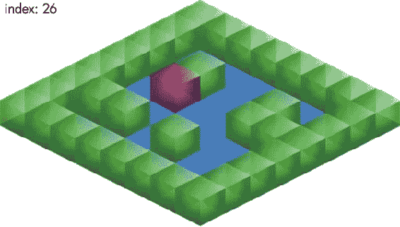

### 图 4-6. 使用 3D 精灵构建等距世界

它使用相同的地图，并沿用前面示例的键盘控制和碰撞逻辑。不同之处在于，这些瓦片由透明的立方体图像制成，并且按深度正确排序。深度排序意味着那些看起来离观察者更近的精灵会显示在更远的精灵前面。

### 按 `z` 属性值对精灵排序

我们需要向代码中添加两个新内容来进行正确的等距深度排序。首先，每个精灵都需要一个名为 `z` 的新属性，它决定了精灵的深度层级。

```
sprite.z = depthLayer;
```

位于较低层级地图层上的精灵应该具有比较高层级地图层上的精灵更低的 `z` 值。你将在代码示例中看到如何找到此值并将其分配给精灵。

接下来，你需要根据这个新的 `z` 值对精灵进行排序。因为大多数显示系统会根据精灵在显示列表中的出现顺序将其绘制到屏幕上，所以你只需更改它们在列表中的顺序就能改变它们的深度层级。显示列表只是一个精灵数组，这意味着你只需要一个自定义的 JavaScript 数组排序方法，根据它们的 `z` 值对该数组中的精灵重新排序。

下面是一个名为 `byDepth` 的自定义排序函数，它正是这样做的。它通过将精灵的笛卡尔 `x` 和 `y` 坐标相加，再乘以其 `z` 值，来计算每个精灵的等距深度。然后，它会根据深度将数组中每一对相邻的精灵移动到更低或更高的索引位置。

```
function byDepth(a, b) {

  //计算 `a` 和 `b` 的深度              
  //（将 `1` 加到 `a.z` 和 `b.z` 上以避免乘以 0）              
  a.depth = (a.cartX + a.cartY) * (a.z + 1);
  b.depth = (b.cartX + b.cartY) * (b.z + 1);

  //将深度较低的精灵移动到数组中更高的位置              
  if (a.depth < b.depth) {

    //将精灵向下移动一个位置              
    return -1;
  } else if (a.depth > b.depth) {

    //将精灵向上移动一个位置              
    return 1;
  } else {

    //将精灵保持在相同位置              
    return 0;
  }
}
```

返回值 `-1` 表示精灵将在数组中向下移动一位，值 `1` 表示它将向上移动一位。值为零表示精灵将保持其当前位置。要使用 `byDepth` 函数，只需将其作为参数提供给代表精灵显示列表的任意数组的 JavaScript `sort` 方法。许多场景图和游戏引擎使用一个名为 `children` 的数组来定义显示列表，因此你可以像这样按深度对 `children` 数组进行排序：

```
world.children.sort(byDepth);
```

现在让我们了解如何在实际中使用它。

### 分层 3D 等距精灵

`depthLayering.js` 示例文件使用了一个由三个立方体图像组成的瓦片集，如图 4-7 所示。

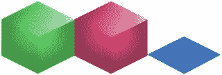


### 图 4-7. 包含 3 个等距精灵图像的图块集

绿色方块代表迷宫墙壁，红色方块代表玩家角色，蓝色图块代表地面。每个精灵都位于独立的地图层中。

```
world.layers = [

//地板层              
  [
    1, 1, 1, 1, 1, 1, 1, 1,
    1, 1, 1, 1, 1, 1, 1, 1,
    1, 1, 1, 1, 1, 1, 1, 1,
    1, 1, 1, 1, 1, 1, 1, 1,
    1, 1, 1, 1, 1, 1, 1, 1,
    1, 1, 1, 1, 1, 1, 1, 1,
    1, 1, 1, 1, 1, 1, 1, 1,
    1, 1, 1, 1, 1, 1, 1, 1
  ],

//墙壁层              
  [
    2, 2, 2, 2, 2, 2, 2, 2,
    2, 0, 0, 0, 0, 0, 0, 2,
    2, 0, 2, 0, 0, 2, 0, 2,
    2, 0, 0, 0, 0, 2, 2, 2,
    2, 0, 0, 0, 0, 0, 0, 2,
    2, 2, 2, 0, 2, 0, 0, 2,
    2, 0, 0, 0, 0, 0, 0, 2,
    2, 2, 2, 2, 2, 2, 2, 2
  ],

//玩家层              
  [
    0, 0, 0, 0, 0, 0, 0, 0,
    0, 0, 0, 0, 0, 0, 0, 0,
    0, 0, 0, 0, 0, 0, 0, 0,
    0, 0, 0, 0, 0, 0, 0, 0,
    0, 0, 0, 0, 3, 0, 0, 0,
    0, 0, 0, 0, 0, 0, 0, 0,
    0, 0, 0, 0, 0, 0, 0, 0,
    0, 0, 0, 0, 0, 0, 0, 0
  ]
];
```

为了帮助绘制此地图，我们需要初始化一个新的`z`值来追踪每个图层的深度。`z`值初始化为零，每新增一个图层就增加 1。每创建一个新精灵后，`z`值被分配给精灵自身的`z`属性，以便在循环结束时能够正确地按深度排序。

```
//`z`索引                  
let z = 0;

//通过遍历每个数组来构建游戏世界                  
world.layers.forEach(layer => {

//遍历每个数组元素              
  layer.forEach((gid, index) => {

//如果单元格不为空(0),则创建一个精灵              
    if (gid !== 0) {

//查找精灵所在的列和行，以及              
      //它的 x 和 y 像素值              
      let column, row, x, y;
      column = index % world.widthInTiles;
      row = Math.floor(index / world.widthInTiles);
      x = column * world.cartTilewidth;
      y = row * world.cartTileheight;

//接下来，根据`gid`编号创建不同的精灵              
      let sprite;
      switch (gid) {

//地板              
        case 1:
          sprite = g.sprite(g.frame("images/isoTileset.png", 128, 0, 64, 64));
          break;

//墙壁              
        case 2:
          sprite = g.sprite(g.frame("images/isoTileset.png", 0, 0, 64, 64));
          break;

//玩家              
        case 3:
          sprite = g.sprite(g.frame("images/isoTileset.png", 64, 0, 64, 64));
          player = sprite;
          break;
      }

//为精灵添加等距属性              
      addIsoProperties(sprite, x, y, world.cartTilewidth, world.cartTileheight);

//根据其等距坐标设置精灵的`x`和`y`像素位置              
      sprite.x = sprite.isoX;
      sprite.y = sprite.isoY;

//为精灵添加新的`z`深度属性              
      sprite.z = z;

//将精灵添加到`world`容器中              
      world.addChild(sprite);
    }
  });

//每新增一个图层，`z`值增加`1`              
  z += 1;
});

//将玩家移动到环境的深度层中                  
player.z = 1;

//按深度对世界进行排序                  
world.children.sort(byDepth);
```

上面代码中的最后两行很重要。循环运行后，地板精灵的`z`值将为 0，墙壁精灵的`z`值将为 1，玩家角色（红色方块）的`z`值将为 2。但是，我们希望玩家角色与墙壁处于同一深度级别，因此我们需要手动将玩家的`z`属性设置为 1。如果我们保持其原始值 2，玩家将会漂浮在墙壁上方的一个图层上。代码最后做的事情是对`world`对象的`children`数组进行深度排序，以便将玩家精灵组织到正确的图层中。

### 更新深度

每当任何精灵改变其位置时，都需要再次进行深度排序。在此示例的游戏循环中，玩家精灵通过键盘在场景中移动。每次移动时，都需要对`world`对象的`children`数组中的所有精灵重新排序。

```
if (player.vx !== 0 || player.vy !== 0) {
  world.children.sort(byDepth);
}
```

对数组排序是一项计算开销很大的操作，因此最好只在确实需要时才进行。这就是为什么上面的代码只在玩家精灵的速度发生变化时才执行排序的原因。

## 使用 Tiled 编辑器制作等距地图

如果你要制作一张庞大而复杂的等距地图，使用 Tiled 编辑器之类的工具来制作比手动编写地图层数组要容易得多。Tiled 编辑器内置了对等距地图的支持，我们可以利用它的输出来轻松生成任何类型的等距世界。我们只需要以正确的方式配置 Tiled 编辑器，并对第 2 章中的`makeTiledWorld`函数做一些小的修改即可。

运行图 4-8 所示的`cubes.html`，查看一个使用 Tiled 编辑器设计的游戏原型示例。它的运行方式与我们之前的示例非常相似，包括键盘移动、碰撞和深度分层。

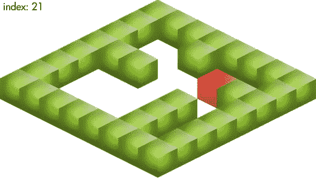

### 图 4-8. 使用 Tiled 编辑器构建的等距游戏原型

接下来，让我们了解如何自己使用 Tiled 编辑器来构建类似的东西。

### 配置和构建地图

在开始创建 Tiled 编辑器地图之前，请准备好包含你想要使用的等距图块的精灵表。并且，非常重要的一点是，记录下精灵的等距尺寸。以下是您需要了解的像素尺寸：

*   `tilewidth`：精灵的宽度，从它的左边缘到右边缘。
*   `tileheight`：图块*基底区域*的高度。这仅仅是定义等距精灵站立基底的压扁菱形的高度。通常，它是`tilewidth`值的一半。

图 4-9 说明了如何找到这些值。

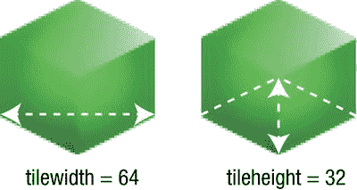

### 图 4-9. `tilewidth`和`tileheight`属性值

这些属性是 Tiled 编辑器使用的属性名称，您将能够在 Tiled 编辑器生成的 JSON 数据文件中访问它们。

> **注：** `tilewidth`和`tileheight`这两个属性名称是 Tiled 编辑器为 JSON 文件使用和生成的。因此，为了一致性，我保留了相同的名称和大小写。

现在，您可以使用这些值在 Tiled 编辑器中创建一个新的等距地图。打开 Tiled 编辑器，从主菜单中选择**文件** ➤ **新建**。在**新建地图**对话框中，选择**等距**作为**方向**，并使用我上面描述的`tilewidth`和`tileheight`值作为**宽度**和**高度**。图 4-10 展示了一个示例。

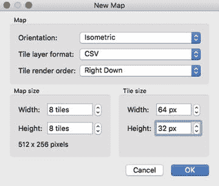

### 图 4-10. 在 Tiled 编辑器中创建新的等距地图

但还没完！我们还需要计算三个值：

*   `tileDepth`：等距精灵的总高度，以像素为单位。图 4-11 说明了这个值。
    
    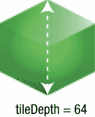
    
    ###### 图 4-11. `tileDepth`属性描述了等距精灵的总高度
    
*   `cartWidth`：每个图块网格单元格的笛卡尔宽度，以像素为单位。
*   `cartHeight`：每个图块网格单元格的笛卡尔高度，以像素为单位。

您需要将这些值作为自定义属性添加到 Tiled 编辑器的**地图属性**面板中。图 4-12 显示了应该是什么样子。

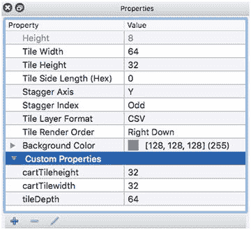


### 图 4-12. 添加自定义地图属性

当 `Tiled Editor` 生成 JSON 地图数据时，你将能够在 `properties` 字段中访问这些值。

```
"properties":
    {
     "cartTileheight":"32",
     "cartTilewidth":"32",
     "tileDepth":"64"
    },
```

在后面的代码示例中，你将看到我们需要如何使用这些值来精确绘制等距地图。

现在你已经设置好了地图属性，请像第 2 章那样使用等距图块集来构建你的世界。图 4-13 展示了你的 `Tiled Editor` 工作区可能的外观。

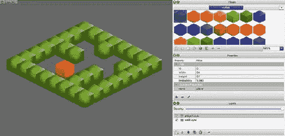

### 图 4-13. 在 Tiled Editor 中设计等距地图

在图 4-13 中，你可以看到我给红色立方体赋予了值为 `"player"` 的自定义名称属性。我还使用两个图层构建了地图：`playerLayer` 仅包含红色立方体，而 `wallLayer` 包含所有迷宫墙壁。

设计完地图后，将其导出为 JSON 文件，现在你就可以用它开始编写游戏代码了。

### `makeIsoTiledWorld` 函数

下一步是修改第 2 章中的 `makeTiledWorld` 函数，使其能够处理等距地图。以下是实现此功能的新版 `makeIsoTiledWorld`。它遵循与原版相同的格式，但应用了本章学到的关于等距地图的所有知识。我在代码中添加了从 A 到 I 的注释，以突出显示新的修改部分。

```
function makeIsoTiledWorld(jsonTiledMap, tileset) {

//创建一个名为 `world` 的组，用于包含 `tiledMap` 中的所有图层、精灵              
  //和对象。`world` 对象将被返回给主游戏程序              
  let tiledMap = PIXI.loader.resources[jsonTiledMap].data;

//A. 你需要向 Tiled Editor 地图添加三个自定义属性：              
  //`cartTilewidth`、`cartTileheight` 和 `tileDepth`。              
  //检查这些自定义属性是否存在              
  if (!tiledMap.properties.cartTilewidth
  && !tiledMap.properties.cartTileheight
  && !tiledMap.properties.tileDepth) {
    throw new Error(
      "请在 Tiled Editor 中设置自定义的 cartTilewidth、cartTileheight 和 tileDepth 地图属性"
    );
  }

//创建 `world` 容器              
  let world = new PIXI.Container();

//B. 将 `tileHeight` 设置为 `tiledMap` 的 `tileDepth` 属性              
  //使其与精灵图块图像的像素高度匹配              
  world.tileheight = parseInt(tiledMap.properties.tileDepth);
  world.tilewidth = tiledMap.tilewidth;

//C. 定义每个图块的笛卡尔维度              
  world.cartTileheight = parseInt(tiledMap.properties.cartTileheight);
  world.cartTilewidth = parseInt(tiledMap.properties.cartTilewidth);

//D. 使用 `world.cartTileHeight` 和 `world.cartTilewidth` 值              
  //计算世界的 `width` 和 `height`（以像素为单位）            
  world.worldWidth = tiledMap.width * world.cartTilewidth;
  world.worldHeight = tiledMap.height * world.cartTileheight;

//获取世界的以图块为单位的宽度和高度引用，              
  //以备后续需要（你会的！）              
  world.widthInTiles = tiledMap.width;
  world.heightInTiles = tiledMap.height;

//创建一个 `objects` 数组，用于存储对地图中任何              
  //命名对象的引用。命名对象都具有在 Tiled Editor 中分配的 `name` 属性              
  world.objects = [];

//每个图块周围的可选间距（内边距）              
  //这是为了考虑图块周围的间距，              
  //常用于纹理图集图块集。在 Tiled Editor 中创建新地图时设置              
  //`spacing` 属性              
  let spacing = tiledMap.tilesets[0].spacing;

//计算图块集上有多少列。              
  //这是图像宽度除以每个图块的宽度，              
  //再加上每个图块周围的可选间距              
  let numberOfTilesetColumns =
    Math.floor(
      tiledMap.tilesets[0].imagewidth / (tiledMap.tilewidth + spacing)
    );

//E. 一个 `z` 属性，用于帮助追踪精灵所在的深度层级              
  let z = 0;

//遍历所有地图图层              
  tiledMap.layers.forEach(tiledLayer => {

//为该图层创建一个组，并复制              
    //该图层的所有属性到该组上              
    let layerGroup = new PIXI.Container();

Object.keys(tiledLayer).forEach(key => {

//将图层的所有属性添加到该组，除了              
      //宽度和高度（因为组会根据其内容自行计算这些值）              
      if (key !== "width" && key !== "height") {
        layerGroup[key] = tiledLayer[key];
      }
    });

//将 `opacity` 转换为 `alpha`              
    layerGroup.alpha = tiledLayer.opacity;
```


```javascript
// 将图层组添加到 `world`（世界）中
world.addChild(layerGroup);

// 将该图层组推入世界的 `objects`（对象）数组
// 以便稍后可以访问它
world.objects.push(layerGroup);

// 当前图层是 `tilelayer`（瓦片图层）吗？
if (tiledLayer.type === "tilelayer") {

  // 遍历该图层的 `data`（数据）数组
  tiledLayer.data.forEach((gid, index) => {
    let tileSprite, texture, mapX, mapY, tilesetX, tilesetY,
      mapColumn, mapRow, tilesetColumn, tilesetRow;

    // 如果网格 id（`gid`）不为零，则创建一个精灵
    if (gid !== 0) {

      // 确定当前所在的图块列和行号，然后
      // 计算网格单元的 x 和 y 像素位置
      mapColumn = index % world.widthInTiles;
      mapRow = Math.floor(index / world.widthInTiles);

      // 使用笛卡尔坐标值来找到
      // `mapX` 和 `mapY` 的值
      mapX = mapColumn * world.cartTilewidth;
      mapY = mapRow * world.cartTileheight;

      // 确定图块集图像所在的列和行号，然后使用这些值计算
      // 图块集上图像的 x 和 y 像素位置
      tilesetColumn = ((gid - 1) % numberOfTilesetColumns);
      tilesetRow = Math.floor((gid - 1) / numberOfTilesetColumns);
      tilesetX = tilesetColumn * world.tilewidth;
      tilesetY = tilesetRow * world.tileheight;

      // 如果存在，补偿图块周围任何可选的间距（内边距）。
      // 这段代码累计图块集左侧的间距偏移量，并将它们添加到当前图块的位置
      if (spacing > 0) {
        tilesetX
          += spacing + (spacing * ((gid - 1) % numberOfTilesetColumns));
        tilesetY
          += spacing + (spacing * Math.floor((gid - 1) / numberOfTilesetColumns));
      }

      // 使用上述值从图块集图像创建精灵的图像
      texture = g.frame(
        tileset, tilesetX, tilesetY,
        world.tilewidth, world.tileheight
      );

      // 我决定任何具有 `name`（名称）属性的图块都是重要的
      // 并且应该在 `world.objects` 数组中可访问

      let tileproperties = tiledMap.tilesets[0].tileproperties,
        key = String(gid - 1);

      // 如果 JSON 的 `tileproperties` 对象有一个与当前图块匹配的子对象，
      // 并且该子对象有一个 `name`（名称）属性，
      // 则创建一个精灵并将图块属性赋值到
      // 该精灵上
      if (tileproperties[key] && tileproperties[key].name) {

        // 创建一个精灵
        tileSprite = new PIXI.Sprite(texture);

        // 将图块的所有属性复制到精灵上
        // （这包括 `name`（名称）属性）
        Object.keys(tileproperties[key]).forEach(property => {

          tileSprite[property] = tileproperties[key][property];
        });

        // 将精灵推入世界的 `objects`（对象）数组
        // 以便稍后可以通过 `name`（名称）访问它
        world.objects.push(tileSprite);
      }

      // 如果图块没有 `name`（名称）属性，则只需用它来
      // 创建一个普通精灵（它只需要一个纹理）
      else {
        tileSprite = new PIXI.Sprite(texture);
      }

      // 为精灵添加等距属性
      addIsoProperties(
        tileSprite, mapX, mapY,
        world.cartTilewidth, world.cartTileheight
      );

      // 使用等距位置将精灵添加到世界中
      tileSprite.x = tileSprite.isoX;
      tileSprite.y = tileSprite.isoY;
      tileSprite.z = z;

      // 记录精灵在数组中的索引号
      // （稍后我们会用它进行碰撞检测）
      tileSprite.index = index;

      // 记录精灵在图块集上的 `gid`。
      // 稍后这对碰撞检测也很有用
      tileSprite.gid = gid;

      // 将精灵添加到当前图层组
      layerGroup.addChild(tileSprite);
    }
  });
}

// 这个图层是 `objectgroup`（对象组）吗？
if (tiledLayer.type === "objectgroup") {
  tiledLayer.objects.forEach(object => {

    // 我们只是要捕获对象的属性
    // 以便稍后决定如何处理它。
    // 获取对象所在的图层组的引用
    object.group = layerGroup;

    // 将对象推入世界的 `objects`（对象）数组
    world.objects.push(object);
  });
}

// z 索引加 1（第一个图层的 z 索引为 `1`）
z += 1;
});

// 搜索函数
world.getObject = (objectName) => {
  let searchForObject = () => {
    let foundObject;
    world.objects.some(object => {
      if (object.name && object.name === objectName) {
        foundObject = object;
        return true;
      }
    });
    if (foundObject) {
      return foundObject;
    } else {
      throw new Error("不存在属性名称为 " + objectName + " 的对象");
    }
  };

  // 返回搜索函数
  return searchForObject();
};

world.getObjects = (objectNames) => {
  let foundObjects = [];
  world.objects.forEach(object => {
    if (object.name && objectNames.indexOf(object.name) !== -1) {
      foundObjects.push(object);
    }
  });
  if (foundObjects.length > 0) {
    return foundObjects;
  } else {
    throw new Error("我找不到这些对象");
  }
  return foundObjects;
};

// 就这样，我们完成了！
// 最后，将 `world` 对象返回给游戏程序
return world;
```

有了这个新的 `makeIsoTiledWorld` 函数，我们就有了一种方法来绘制我们在 Tiled Editor 中创建的地图，并访问它包含的所有精灵。接下来让我们具体了解如何做到这一点。


# 构建游戏世界

使用`makeIsoTiledWorld`函数的方式与原始`makeTiledWorld`函数完全相同，因此无需学习任何新内容。唯一需要注意的是，如果你改变了任何精灵的位置或`z`属性，就需要使用自定义的`byDepth`函数重新对精灵进行深度排序。在本例中，所有精灵都位于每个地图图层容器的`children`数组中，因此你需要像这样进行深度排序：

```
mapLayer.children.sort(byDepth);
```

除此之外，没有其他需要学习的新内容。以下是图 4-8 所展示的`cubes.js`文件的完整应用代码。它加载了在 Tiled Editor 中创建的等距地图，并实现了键盘交互、碰撞检测和精确的深度排序。你在其他上下文中已经见过所有这些代码，注释中详细解释了其功能。

```
//The files we want to load                  
let thingsToLoad = [
  "images/cubes.png",
  "images/cubes.json"
];

//Create a new Hexi instance, and start it                  
let g = hexi(512, 512, setup, thingsToLoad);

//Scale the canvas to the maximum browser dimensions                  
g.scaleToWindow();

//Declare variables used in more than one function                  
let world, leftArrow, upArrow,
  rightArrow, downArrow, message, wallLayer,
  player, wallMapArray;

//Start Hexi                  
g.start();

function setup() {

  //Make the world from the Tiled JSON data              
  world = makeIsoTiledWorld(
    "images/cubes.json",
    "images/cubes.png"
  );

  //Add the world to the `stage`              
  g.stage.addChild(world);

  //Position the world inside the canvas              
  let canvasOffset = (g.canvas.width / 2) - world.tilewidth / 2;
  world.x += canvasOffset;
  world.y = 0;

  //Get the objects we need from the world              
  player = world.getObject("player");
  wallLayer = world.getObject("wallLayer");

  //Add the player to the wall layer and set it at              
  //the same depth level as the walls              
  wallLayer.addChild(player);
  player.z = 0;
  wallLayer.children.sort(byDepth);

  //Initialize the player's velocity to zero              
  player.vx = 0;
  player.vy = 0;

  //Make a text object              
  message = g.text("", "16px Futura", "black");
  message.setPosition(5, 0);

  //Create the keyboard objects              
  leftArrow = g.keyboard(37);
  upArrow = g.keyboard(38);
  rightArrow = g.keyboard(39);
  downArrow = g.keyboard(40);

  //Assign the key `press` actions              
  player.direction = "none";
  leftArrow.press = () => player.direction = "left";
  upArrow.press = () => player.direction = "up";
  rightArrow.press = () => player.direction = "right";
  downArrow.press = () => player.direction = "down";
  leftArrow.release = () => player.direction = "none";
  upArrow.release = () => player.direction = "none";
  rightArrow.release = () => player.direction = "none";
  downArrow.release = () => player.direction = "none";

  //Set the game state to `play`              
  g.state = play;
}

function play() {

  //Change the player character's velocity if it's centered over a grid cell              
  if (Math.floor(player.cartX) % world.cartTilewidth === 0
  && Math.floor(player.cartY) % world.cartTileheight === 0) {
    switch (player.direction) {
      case "up":
        player.vy = -2;
        player.vx = 0;
        break;
      case "down":
        player.vy = 2;
        player.vx = 0;
        break;
      case "left":
        player.vx = -2;
        player.vy = 0;
        break;
      case "right":
        player.vx = 2;
        player.vy = 0;
        break;
      case "none":
        player.vx = 0;
        player.vy = 0;
        break;
    }
  }

  //Update the player's Cartesian position, based on its velocity              
  player.cartY += player.vy;
  player.cartX += player.vx;

  //Wall collision              
  //Get a reference to the wall map array              
  wallMapArray = wallLayer.data;

  //Use `hitTestIsoTile` to check for a collision              
  let playerVsGround = hitTestIsoTile(player, wallMapArray, 0, world, "every");

  //If there's a collision, prevent the player from moving.              
  //Subtract its velocity from its position and then set its velocity to zero              
  if (!playerVsGround.hit) {
    player.cartX -= player.vx;
    player.cartY -= player.vy;
    player.vx = 0;
    player.vy = 0;
  }

  //Add world boundaries              
  let top = 0,
    bottom = (world.heightInTiles * world.cartTileheight),
    left = 0,
    right = (world.widthInTiles * world.cartTilewidth);

  //Prevent the player from crossing any of the world boundaries              
  //Top              
  if (player.cartY < 0) {
    player.cartY = top;
  }

  //Bottom              
  if (player.cartY + player.cartHeight > bottom) {
    player.cartY = bottom - player.cartHeight;
  }

  //Left              
  if (player.cartX < left) {
    player.cartX = left;
  }

  //Right              
  if (player.cartX + player.cartWidth > right) {
    player.cartX = right - player.cartWidth;
  }

  //Position the sprite's screen `x` and `y` position              
  //using its isometric coordinates              
  player.x = player.isoX;
  player.y = player.isoY;

  //Get the player's index position in the map array              
  player.index = g.getIndex(
    player.cartX, player.cartY,
    world.cartTilewidth, world.cartTileheight, world.widthInTiles
  );

  //Depth sort the sprites if the player is moving              
  if (player.vx !== 0 || player.vy !== 0) {
    wallLayer.children.sort(byDepth);
  }

  //Display the player's x, y and index values              
  message.content = `index: ${player.index}`;
}
```

## 总结

不论你的游戏采用笛卡尔投影还是等距投影，处理基于瓦片的游戏的基本逻辑是相同的。正如本章所见，如果你知道如何绘制地图、添加键盘交互以及使用笛卡尔坐标进行碰撞检测，那么你可以将同样的逻辑应用于等距地图，只需添加两个简单的转换公式。你还学会了如何将这些公式应用于指针位置坐标，从而在屏幕上精确地选中等距精灵。此外，你还掌握了如何使用 Tiled Editor 创建和绘制等距地图，并利用`z`值对这些精灵进行精确的深度排序，使它们能够在正确的深度图层上显示。这些都是制作各种等距游戏（从策略游戏到地牢探险游戏）所需具备的基础技能。

既然你已经知道如何创建各种交互式基于瓦片的游戏环境，那么如何制作能够智能地在这些环境中导航的游戏角色呢？这就是下一章的内容：寻路。

© Rex van der Spuy 2017

Rex van der Spuy, 《高级游戏开发者工具包》, 10.1007/978-1-4842-1097-0_5

# 5. 寻路基础

Rex van der Spuy¹

(1) 加拿大安大略省多伦多市

你现在已经知道如何制作基于瓦片的游戏世界，也知道了如何制作一个能够在这个世界中导航的玩家角色。但是，如何创建能够自主游荡和探索世界的精灵呢？花点时间来体验一下本章源文件中名为`tileBasedLineOfSight.html`的示例原型（如图 5-1 所示）。迷宫中有三个怪物，它们会随机游荡，直到发现外星人角色——然后就会穷追不舍。

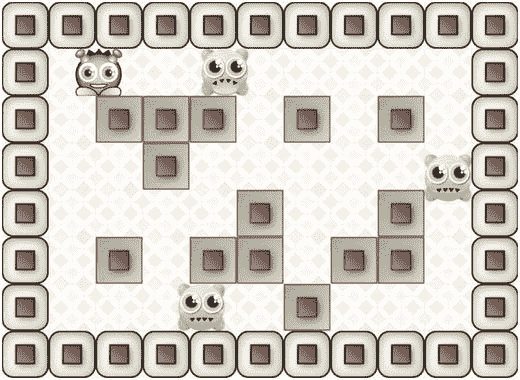


### 图 5-1. 怪物在游戏世界中自主导航并追逐玩家角色

这些怪物似乎拥有某种智能，其行为方式与我们对生物的预期非常吻合。但当然，这仅仅是一种有效的错觉，这要归功于一系列游戏编程技术，它们被统称为**寻路**：如何让精灵能够自主解析并在游戏世界中导航。在本章中，你将学习寻路的所有基础知识，包括：

-   如何分析和理解精灵所处的环境。
-   在迷宫中随机移动。
-   寻找距离目标最近的方向。
-   视线：如何判断一个精灵能否看到另一个精灵。

寻路实际上是人工智能（AI）的一种初级形式，你将能够应用这些技术，不仅适用于各种不同的游戏，也适用于任何需要基于数据在更大数据集中的上下文来解释其含义的编程问题。而且，实现起来相当容易！那么，让我们从一些寻路基础开始，然后深入探讨。

## 在迷宫中随机移动

学习寻路最好的起点是首先创建在迷宫中随机移动的精灵。运行 `randomMovement.html` 文件，你会找到一个与图 5-1 所示的迷宫游戏相同的简化版本。怪物不会主动寻找外星人角色，而是每当它们处于交叉路口时就会随机改变方向。让我们来了解一下这段代码的工作原理，同时学习所有的寻路基础知识。

### 方向与速度

当怪物精灵在游戏的设置函数中被创建时，它们会被初始化两个重要的属性：`direction` 和 `speed`，如下面的精灵创建代码中突出显示的部分所示：

```
monsters = mapMonsters.map(mapMonster => {
  let monster = g.sprite(monsterFrames);
  monster.x = mapMonster.x;
  monster.y = mapMonster.y;
  monster.direction = "none";
  monster.speed = 4;
  monsterLayer.addChild(monster);
  mapMonster.visible = false;
  return monster;
});
```

`direction` 是一个字符串，初始化为 `"none"` —— 你稍后将看到我们如何为其赋予新的字符串值。`speed` 是精灵每帧应移动的像素数，并且这个数字应能整除地图的 `tilewidth` 和 `tileheight` 大小。我们需要使用这些 `direction` 和 `speed` 值来帮助赋予怪物新的随机方向和速度。

### 在游戏循环中移动精灵

实际选择怪物新方向并使其移动的代码运行在游戏循环内。执行此操作的代码需要完成四项重要工作：

1.  判断怪物是否恰好位于一个地图瓦片单元格的正中心。
2.  如果是，则选择一个随机的新方向。
3.  使用怪物的新随机方向和速度来计算其速度向量。
4.  使用新的速度向量来移动怪物。

以下是在游戏循环中完成所有这些操作的代码。

```
monsters.forEach(monster => {

  //1. 怪物是否直接位于一个地图瓦片单元格的中心？
  if (isCenteredOverCell(monster)) {

    //2. 是的，它在中心，因此找出哪些是合法的移动方向。
    //`validDirections` 返回一个数组，其中可以包含
    //以下任何字符串值："up", "right", "down" 或 "left"
    monster.validDirections = validDirections(
      monster, wallMapArray, 0, world
    );

    //3. 怪物能否改变方向？
    if (canChangeDirection(monster.validDirections)) {

      //4. 如果可以，从怪物的合法方向中随机选择一个新方向
      monster.direction = randomDirection(monster, monster.validDirections);
    }

    //5. 根据怪物的方向和速度计算其新的速度向量
    let velocity = directionToVelocity(monster.direction, monster.speed);
    monster.vx = velocity.vx;
    monster.vy = velocity.vy;
  }

  //6. 移动怪物
  monster.x += monster.vx;
  monster.y += monster.vy;
});
```

这是非常高层级的代码。你可以看到，所有重要的功能都封装在五个重要的函数中：`isCenteredOverCell`、`validDirections`、`canChangeDirection`、`randomDirection` 和 `directionToVelocity`。接下来我们将逐一审视这些函数，确切了解它们的工作原理。

### 精灵是否位于瓦片单元格的中心？

正如你在第 3 章所学到的，如果你的精灵只在恰好位于单元格中心时才改变方向，它们在基于瓦片的世界中移动会更加精确和精准。因此，代码做的第一件事就是通过一个名为 `isCenteredOverCell` 的辅助函数来判断这一点。向它传入一个精灵，如果精灵在中心位置，`isCenteredOverCell` 将返回 `true`，否则返回 `false`。

```
function isCenteredOverCell(sprite) {
  return Math.floor(sprite.x) % world.tilewidth === 0
  && Math.floor(sprite.y) % world.tileheight === 0
}
```

这是一段略显古怪的样板代码，它展示了取模运算符 (`%`) 有时是多么出人意料地有用。（提醒一下，取模运算符告诉你除法运算的余数是多少。）上面的代码找出精灵左上角位置的 `x` 和 `y` 坐标，除以瓦片的宽度和高度，看余数是否为零。如果是，那么你就知道精灵所处的 `x`/`y` 位置能够完全整除瓦片的尺寸。而这只能意味着一件事：精灵*正好*对齐在单元格之上。这是一个巧妙的小把戏——谢谢你，取模运算符！

如果精灵在中心位置，下一步就是找出精灵可以选择哪些可能的合法方向。


### 寻找有效方向

`validDirections`函数分析精灵当前所处的地图环境，并返回一个字符串数组，其中包含精灵可以移动的所有有效方向。

```
monster.validDirections = validDirections(
  monster,       //精灵对象            
  wallMapArray,  //瓦片地图数组            
  0,             //代表空瓦片的 gid 值            
  world          //世界对象。它需要以下属性：            
                 //`tilewidth`、`tileheight`和`widthInTiles`            
);
```

`validDirections`返回的数组可以包含以下五个字符串值中的任意几个：`"up"`、`"down"`、`"left"`、`"right"`或`"none"`。其判定方式相当有趣，让我们先看一下整个`validDirections`函数，然后我会逐步讲解它的工作原理。

```
function validDirections(sprite, mapArray, validGid, world) {

  //获取精灵当前在地图数组中的索引位置编号              
  let index = g.getIndex(
    sprite.x,
    sprite.y,
    world.tilewidth,
    world.tileheight,
    world.widthInTiles
  );

  //一个包含精灵上、下、左、右四个方向瓦片单元格索引编号的数组              
  let surroundingCrossCells = (index, widthInTiles) => {
    return [
      index - widthInTiles,  //上方的单元格              
      index - 1,             //左侧的单元格              
      index + 1,             //右侧的单元格              
      index + widthInTiles,  //下方的单元格              
    ];
  };

  //获取精灵上、右、左、下四个方向单元格的索引位置编号              
  let surroundingIndexNumbers = surroundingCrossCells(index, world.widthInTiles);

  //查找与周围索引编号相匹配的所有瓦片 gid 编号              
  let surroundingTileGids = surroundingIndexNumbers.map(index => {
    return mapArray[index];
  });

  //`directionList`是一个包含四个字符串值的数组，这些值可以是              
  //"up"、"left"、"right"、"down"或"none"，具体取决于              
  //对应方向是否存在具有有效 gid 的单元格              
  let directionList = surroundingTileGids.map((gid, i) => {

    //可能的方向              
    let possibleDirections = ["up", "left", "right", "down"];

    //如果方向有效，则选择该方向对应的字符串标识符              
    //否则返回"none"              
    if (gid === validGid) {
      return possibleDirections[i];
    } else {
      return "none";
    }
  });

  //我们不需要方向列表中的"none"，所以              
  //把它过滤掉（它只是一个占位符）              
  let filteredDirectionList = directionList.filter(direction => direction != "none");

  //返回过滤后的有效方向列表              
  return filteredDirectionList;
}
```

现在，让我们深入了解它的实际工作原理！

### 精灵周围的瓦片

`validDirections`函数做的第一件事是找出哪些地图瓦片位于精灵周围。一个名为`surroundingCrossCells`的函数利用精灵在地图数组中的索引编号来解决这个问题。它返回一个包含四个地图索引编号的数组，这些编号分别代表精灵上方、左侧、右侧和下方的单元格。

```
let surroundingCrossCells = (index, widthInTiles) => {
  return [
    index - widthInTiles,  //上方的单元格                
    index - 1,             //左侧的单元格                
    index + 1,             //右侧的单元格                
    index + widthInTiles,  //下方的单元格                
  ];
};

let surroundingIndexNumbers =
  surroundingCrossCells(index, world.widthInTiles);
```

图 5-2 展示了这些单元格相对于精灵的位置，以及它们对应的地图数组索引编号。在此示例中，迷宫的每一行有 11 个单元格，怪物精灵的位置索引编号为 38。精灵周围的地图数组索引编号从顶部开始顺时针方向依次为 27、39、49 和 37。


### 图 5-2. 查找精灵周围的单元格

现在我们有了一个名为`surroundingIndexNumbers`的数组，它告诉我们精灵周围单元格的索引编号。但这还不够；我们还需要知道这些单元格的 gid 值，这样才能了解它们包含哪种类型的瓦片。请记住，我们希望允许精灵移动到空瓦片，但阻止它移动到墙壁瓦片。因此，下一步是利用这些索引编号找出这些位置具体是哪些瓦片精灵。让我们将`surroundingIndexNumbers`映射到一个新数组，该数组告诉我们这些单元格的实际 gid 编号。方法如下：

```
let surroundingTileGids = surroundingIndexNumbers.map(index => {
  return mapArray[index];
});
```

例如，图 5-2 中的索引编号 27、39、49 和 35 现在会被映射到一个包含以下 gid 值的新数组：0、0、2 和 0。数字 0 代表空单元格，数字 2 代表墙壁。图 5-3 说明了这一点。


### 图 5-3. 通过获取周围单元格的 gid 编号来查明其中包含哪些类型的瓦片

### 有效方向

下一步是为精灵可以移动的四个可能方向分别赋予方向名称（字符串形式）。方向名称可以是以下任意一种：`"up"`、`"left"`、`"right"`、`"down"`或`"none"`。以下代码片段将我们的`surroundingTileGids`数组映射到一个名为`directionList`的新数组，其中包含这些方向字符串。

```
let directionList = surroundingTileGids.map((gid, i) => {

  //可能的方向                
  let possibleDirections = ["up", "left", "right", "down"];

  //如果方向有效，则选择该方向对应的字符串标识符                
  //否则返回"none"                
  if (gid === validGid) {
    return possibleDirections[i];
  } else {
    return "none";
  }
});
```

任何无效的 gid 都会被赋予方向名称`"none"`。图 5-4 展示了`directionList`函数生成的最终数组。


### 图 5-4. 查找方向名称

我们实际上不需要`"none"`这个值，所以把它过滤掉（它只是充当占位符）：

```
let filteredDirectionList = directionList.filter(direction => {
  return direction != "none"
});
```

现在，`filteredDirectionList`就是我们的最终数组，其中包含了精灵可以移动的所有有效方向：

```
["up", "left", "right"]
```

（或者，如果精灵四面完全被困住，这个数组将是空的——但我们稍后会讲到这一点！）

这个数组由`validDirections`函数返回，这完成了寻路过程的第一步。

### 怪物能否改变方向？

实际上，地图上只有某些特定位置怪物才应该改变方向。

*   当它们处于通道交叉口时。
*   如果它们处于死胡同（尽头路）时。
*   或者如果它们被四面墙壁困住（这种情况下它们应该完全停止移动）。

图 5-5 中的 X 标记出了我们使用的迷宫中这三种地图条件所在的位置。


### 图 5-5. 查找方向名称

如果怪物不在地图中符合这些条件的位置，它们就会继续沿当前方向移动。

判断怪物当前所处的地图位置类型很容易。如果 `validDirections` 数组中没有元素，就说明该精灵被困住了。

```
let trapped = validDirections.length === 0;
```

如果 `validDirections` 数组中只有一个元素，就说明精灵处于死胡同中。

```
let inCulDeSac = validDirections.length === 1;
```

这些都很简单，但现在我们如何判断精灵是否处于通道交叉口呢？首先，问问自己："什么是通道交叉口？"仔细观察图 5-5，并思考如果精灵位于任何标记有 X 的地图位置，`validDirections` 数组中可能会包含哪些值。有什么想法吗？没错！通道交叉口总是会包含 "left" 或 "right" *以及* "up" 或 "down"。图 5-6 说明了这一点。


### 图 5-6. 通道交叉口总是包含一个左/右值和一个上/下值

以下是如何用代码表达这一点：

```
let up = validDirections.find(x => x === "up"),
    down = validDirections.find(x => x === "down"),
    left = validDirections.find(x => x === "left"),
    right = validDirections.find(x => x === "right"),
    atIntersection = (up || down) && (left || right);
```

如果 `atIntersection` 为 `true`，就说明精灵位于标记有 X 的通道交叉口之一。很简单！

现在我们已经知道如何判断精灵是被困住、处于死胡同还是通道交叉口了。那么，让我们把所有这些代码包装成一个更大的函数，名为 `canChangeDirection`。如果这些条件中的任何一个为真，它将返回 `true`，否则返回 `false`。

```
function canChangeDirection(validDirections = []) {

  // 精灵是否在死胡同中。如果 `validDirections` 数组中只有一个元素，则为 true                
  let inCulDeSac = validDirections.length === 1;

  // 精灵是否被困住。如果 `validDirections` 数组中没有元素，则为 true                
  let trapped = validDirections.length === 0;

  // 精灵是否在通道中。如果精灵位于包含 "left" 或 "right" 以及 "up" 或 "down" 值的位置，则为 true                
  let up = validDirections.find(x => x === "up"),
      down = validDirections.find(x => x === "down"),
      left = validDirections.find(x => x === "left"),
      right = validDirections.find(x => x === "right"),
      atIntersection = (up || down) && (left || right);

  // 如果精灵可以改变方向，则返回 `true`；否则返回 `false`                
  return trapped || atIntersection || inCulDeSac;
}
```

现在我们已经有办法判断精灵是否位于可以改变方向的地图位置，接下来让我们了解如何为其赋予一个新的随机方向。

#### 选择一个随机方向

既然我们已经知道精灵有哪些有效方向，接下来要做的就是随机选择一个。`randomDirection` 函数会从 `validDirections` 数组中随机返回一个字符串："up"、"left"、"right" 或 "down"。如果没有有效方向，则表示精灵四面都被困住了，该函数会返回字符串 "trapped"。以下是实现此功能的 `randomDirection` 函数：

```
function randomDirection(sprite, validDirections = []) {

  // `randomInt` 辅助函数返回一个介于最小值和最大值之间的随机整数                
  let randomInt = (min, max) => {
    return Math.floor(Math.random() * (max - min + 1)) + min;
  };

  // 精灵是否被困住？                
  let trapped = validDirections.length === 0;

  // 如果精灵没有被困住，则随机选择一个有效方向。否则，返回字符串 "trapped"                
  if (!trapped) {
    return validDirections[randomInt(0, validDirections.length - 1)];
  } else {
    return "trapped"
  }
}
```

#### 将方向字符串转换为速度数值

现在我们知道精灵应该朝哪个方向移动了。但是，为了让这个信息能用于移动精灵，我们需要将方向字符串转换为代表精灵速度的数值。一个名为 `directionToVelocity` 的函数负责完成这项工作：它返回一个包含 `vx` 和 `vy` 属性的对象，这两个属性对应精灵应该移动的方向。

```
function directionToVelocity(direction = "", speed = 0) {

  switch (direction) {
    case "up":
      return {
        vy: -speed,
        vx: 0
      }
      break;
    case "down":
      return {
        vy: speed,
        vx: 0
      };
      break;
    case "left":
      return {
        vx: -speed,
        vy: 0
      };
      break;
    case "right":
      return {
        vx: speed,
        vy: 0
      };
      break;
    default:
      return {
        vx: 0,
        vy: 0
      };
  }
};
```

如果怪物的方向是 "trapped"，则会触发默认情况，代表怪物速度的 `vx` 和 `vy` 值将为零。

要使精灵移动，请使用这些值更新精灵的速度：

```
let velocity = directionToVelocity(monster.direction, monster.speed);
monster.vx = velocity.vx;
monster.vy = velocity.vy;
```

然后将它们应用到精灵的当前位置：

```
monster.x += monster.vx;
monster.y += monster.vy;
```

这就是让怪物在迷宫中随机移动的方法！

## 追猎外星人

随机移动的怪物是一个好的开始，但对于更具挑战性的游戏，你可能希望怪物主动寻找并追捕玩家角色。运行本章源文件中的 `closestDirection.html` 文件，查看此类系统的交互式示例，如图 5-7 所示。


### 图 5-7. 怪物总是选择离玩家角色最近的方向

无论它们身在迷宫何处，怪物总是会选择朝更接近玩家角色的方向移动。

### 计算向量

为了实现这一点，你需要知道怪物四个可能方向中哪一个离外星人最近。第一步是在怪物和外星人的中心点之间绘制一条*向量*。向量只是一条不可见的数学线，其众多用途之一就是计算两个精灵之间的距离和角度。向量由两个值 `vx` 和 `vy` 表示，你可以像这样计算两个精灵之间的向量：

```
let vx = spriteTwo.centerX - spriteOne.centerX,
    vy = spriteTwo.centerY - spriteOne.centerY;
```

`vx` 告诉我们对象在 X 轴上的距离。`vy` 告诉我们对象在 Y 轴上的距离。`vx` 和 `vy` 变量共同描述了两个对象之间的向量。

向量只是线的一种数学表示——你实际上不会在屏幕上看到它被显示出来。但是，如果你能看到它，它可能看起来有点像图 5-8 中两个精灵中心之间那条黑色的对角线。


### 图 5-8. 向量可以帮助你计算两个精灵之间的距离和角度

为了让怪物追猎外星人，我们必须让它朝自身与外星人之间*距离最大*的水平或垂直方向移动。这是为什么呢？看看图 5-9。


### 图 5-9. 沿精灵之间距离最大的轴移动怪物

很明显，如果怪物想要靠近玩家，它应该选择沿 X 轴的左方向。然而，X 轴也是两个物体之间距离最大的轴。这反直觉，但确实如此！

现在我们知道了这一点，可以使用一个简单的`if/else`语句来判断哪个方向是距离目标最近的方向：“上”、“下”、“左”或“右”。这里有一个名为`closest`的函数，它封装了所有逻辑并为我们返回正确的值：

```
let closest = () => {

  //绘制 spriteTwo 和 spriteOne 之间的向量              
  let vx = spriteTwo.centerX - spriteOne.centerX,
      vy = spriteTwo.centerY - spriteOne.centerY;

  //如果在 X 轴上的距离更大...              
  if (Math.abs(vx) >= Math.abs(vy)) {

    //尝试左和右              
    if (vx <= 0) {
      return "left";
    } else {
      return "right";
    }
  }

  //如果在 Y 轴上的距离更大...              
  else {

    //尝试上和下              
    if (vy <= 0) {
      return "up"
    } else {
      return "down"
    }
  }
};
```

现在让我们了解如何将其集成到现有代码中。

### 寻找最近方向

打开本章源文件中的`closesestDirection.js`文件，你会在`play`函数（游戏循环）中找到这段代码，它负责移动怪物并选择它们的新方向。除了第 4 步之外，它与我们本章开头使用的代码完全相同。

```
monsters.forEach(monster => {

//1\. 怪物是否正中心对准地图瓦片单元格？              
  if (isCenteredOverCell(monster)) {

//2\. 是的，它正中心对准，因此找出哪些是有效的移动方向。              
  //`validDirections` 返回一个数组，可以包含以下              
  //字符串值："up", "right", "down", "left" 或 "none"              
  monster.validDirections = validDirections(
    monster, wallMapArray, 0, world
  );

//3\. 怪物能否改变方向？              
  if (canChangeDirection(monster.validDirections)) {

//4\. 如果可以，选择距离外星人最近的方向              
    monster.direction = closestDirection(monster, alien, monster.validDirections);
  }

//5\. 使用怪物的方向和速度来找到它的新速度              
  let velocity = directionToVelocity(monster.direction, monster.speed);
  monster.vx = velocity.vx;
  monster.vy = velocity.vy;
}

//6\. 移动怪物                  
monster.x += monster.vx;
monster.y += monster.vy;
```

唯一新增的代码行是这一行：

```
monster.direction = closestDirection(monster, alien, monster.validDirections);
```

一个名为`closestDirection`的新函数负责计算并返回怪物有效方向中距离外星人最近的那一个。如果没有匹配最近方向的有效方向，它会回退到随机选择一个方向。以下是实现所有这些功能的完整`closestDirection`函数：

```
function closestDirection(spriteOne, spriteTwo, validDirections = []) {

//一个辅助函数，用于找到最近方向              
  let closest = () => {

//绘制 spriteTwo 和 spriteOne 之间的向量              
    let vx = spriteTwo.centerX - spriteOne.centerX,
        vy = spriteTwo.centerY - spriteOne.centerY;

//如果在 X 轴上的距离更大...              
    if (Math.abs(vx) >= Math.abs(vy)) {

//尝试左和右              
      if (vx <= 0) {
        return "left";
      } else {
        return "right";
      }
    }

//如果在 Y 轴上的距离更大...              
    else {

//尝试上和下              
      if (vy <= 0) {
        return "up"
      } else {
        return "down"
      }
    }
  };

//既是最近方向也是有效方向的方向              
  let closestValidDirection = validDirections.find(x => x === closest());

//`randomInt` 辅助函数返回一个介于              
  //最小值和最大值之间的随机整数              
  let randomInt = (min, max) => {
    return Math.floor(Math.random() * (max - min + 1)) + min;
  };

//精灵被困住了吗？              
  let trapped = validDirections.length === 0;

//如果精灵没有被困住，从`validDirections`数组中              
  //选择最近的方向。如果没有最近的有效的方向，              
  //则随机选择一个有效方向              
  if (!trapped) {
    if (closestValidDirection) {
      return closestValidDirection;
    } else {
      return validDirections[randomInt(0, validDirections.length - 1)];
    }
  } else {
    return "trapped"
  }
}
```

这个函数的工作原理是：首先绘制两个精灵之间的向量，然后计算出哪一个方向对于`spriteOne`（猎人）来说最接近`spriteTwo`（目标）。代码会检查该方向是否也在`validDirections`数组中。如果是，则选择那个最近的方向；如果不是，则选择一个随机的新方向。

这个系统运行良好，但存在一个小问题：即使怪物的视线被迷宫墙壁阻挡，它们也知道哪个方向最接近外星人。也许怪物是在用声音探测外星人的位置，通过心灵感应交流，或者，不太可能的是，它们只是非常聪明？从美学上看，这个系统是可行的——它看起来正确，并且使游戏具有挑战性。但你可能想要创建一个怪物只有在真正*看到*外星人（且没有被墙壁阻挡）时才会做出反应的游戏。我们可以通过使用一种基本的游戏设计技术来实现这个功能，称为**视线**。

## 视线

如何判断一个精灵能否看到另一个精灵？在两者之间绘制一个向量，然后沿该向量以均匀间隔的点检查障碍物。如果该向量完全没有障碍，那么你就知道两个精灵之间存在直接视线。

运行本章源文件中的`lineOfSight.html`文件，查看交互式示例，如图 5-10 所示。在屏幕周围以各种组合拖放外星人、怪物和墙壁精灵。一条红色的线延伸在怪物和外星人之间，代表视线。如果视线未被遮挡，精灵之间的线会变暗，并且怪物会张开它的嘴。


### 图 5-10. 检查两个精灵之间的视线

其工作原理是：一系列的点被不可见地放置在两个精灵之间的向量（线）上。如果其中任何一点碰到了盒子，那么你就知道视线被挡住了。如果这些点都没有碰到任何盒子，那么精灵之间就有一条清晰的视线。图 5-11 说明了这一点。


### 图 5-11. 沿线绘制点，并检查每个点是否与盒子发生碰撞

让我们逐步讲解你需要编写的代码，以实现这一功能。


### 计算向量

第一步是在两个精灵的中心之间绘制一个向量。

```
let vx = spriteTwo.centerX - spriteOne.centerX,
    vy = spriteTwo.centerY - spriteOne.centerY;
```

接下来，我们需要找出这个向量的长度（以像素为单位）。向量的长度称为其**模长**，你可以通过以下方式计算：

```
let magnitude = Math.sqrt(vx * vx + vy * vy);
```

我们希望沿着这个向量在等间距的位置上绘制点。为了帮助我们实现这一点，我们创建一个名为 `segment` 的变量，用于确定每个点之间的距离。

```
let segment = spriteOne.width;
```

通常，你不希望点之间的间距小于最小精灵的宽度或高度。这是因为如果点之间的间距过大，碰撞检测可能会跳过并错过较小的障碍物精灵。

现在，既然我们知道了两个精灵之间向量的长度，也知道了碰撞点之间每个线段的长度，就可以计算出需要沿这条线使用多少个碰撞点了。

```
let numberOfPoints = magnitude / segment;
```

例如，如果向量的模长是 256 像素，每个线段的长度是 64 像素，那么 `numberOfPoints` 的值就是 4。

### 查找碰撞点的位置

现在我们有足够的信息来计算沿向量分布的碰撞点的 x/y 坐标。我们将借助一个名为 `points()` 的函数来实现这一点，该函数返回一个包含具有 `x` 和 `y` 属性的对象的数组。我们将使用这个点对象数组来测试每个点与障碍物之间是否发生碰撞。以下是创建点对象数组的 `points()` 函数：

```
let points = () => {

  // 初始化一个数组，用于存储所有沿向量分布的点              
  let arrayOfPoints = [];

  // 为向量的每个线段创建一个点对象，并              
  // 将其 x/y 坐标及其在地图数组中的索引编号存储起来              
  for (let i = 1; i <= numberOfPoints; i++) {

    // 计算本次循环迭代中的新模长              
    let newMagnitude = segment * i;

    // 计算单位向量              
    let dx = vx / magnitude,
        dy = vy / magnitude;

    // 使用单位向量和 newMagnitude 计算出本循环迭代中              
    // 下一个点的 x/y 坐标              
    let x = spriteOne.centerX + dx * newMagnitude,
        y = spriteOne.centerY + dy * newMagnitude;

    // 将一个包含 x 和 y 属性的点对象推入 `arrayOfPoints`              
    arrayOfPoints.push({x, y});
  }

  // 返回点对象数组              
  return arrayOfPoints;
};
```

`points()` 函数的核心是一个循环，该循环为 `numberOfPoints` 指定的点数创建点对象。循环首先将循环索引值乘以 `segment` 的值，创建一个 `newMagnitude` 值。

```
let newMagnitude = segment * i;
```

如果有四个点，且每个线段的宽度为 64 像素，那么随着循环的每次迭代，`newMagnitude` 的值将依次为 64、128、192 和 256。

接下来的两行代码计算出单位向量，用变量名 `dx` 和 `dy` 表示。

```
let dx = vx / magnitude,
    dy = vy / magnitude;
```

单位向量（也称为归一化向量）仅仅是精灵之间主向量的一个微小平移缩放版本，其长度小于一个像素。它指向与主向量相同的方向，但由于它是向量可能的最小尺寸，我们可以用它来创建不同长度的新向量。

你可以在本书的配套资料《使用 HTML5 和 JavaScript 进行高级游戏设计》(Apress, 2015) 中找到关于向量数学的完整初学者指南。它通过大量用于游戏开发的实用示例详细解释了所有这些概念。

将单位向量乘以 `newMagnitude`，并将结果加到 `spriteOne` 的位置上，将给出沿向量分布的点的 x/y 坐标。

```
let x = spriteOne.centerX + dx * newMagnitude,
    y = spriteOne.centerY + dy * newMagnitude;
```

图 5-12 展示了如果 `numberOfPoints` 为 4 且线段宽度为 64 像素时，循环每次迭代的结果。


### 图 5-12. 查找沿向量分布的每个点的位置

这些点的 x/y 值存储在一个点对象中，并被推入一个名为 `arrayOfPoints` 的数组。

```
arrayOfPoints.push({x, y});
```

循环结束后，`arrayOfPoints` 将包含一个对象列表，这些对象具有与我们在上一步中计算的 x 和 y 值相匹配的 `x` 和 `y` 属性。`points()` 函数返回这个数组：

```
return arrayOfPoints;
```

现在，我们可以通过像这样调用 `points()` 函数来访问这个数组：

```
points()
```

每当我们在游戏中需要时，这都会动态地重新计算并返回新的点数组。

### 测试点与障碍物的碰撞情况

现在我们需要某种方法来判断这些点中的任何一个是否碰到了某个障碍物。我们可以使用一个名为 `hitTestPoint()` 的基本几何碰撞函数，该函数检查一个带有 x/y 属性的单个点对象是否与一个矩形精灵相交。如果发生碰撞，`hitTestPoint()` 返回 `true`，否则返回 `false`。

```
let hitTestPoint = (point, sprite) => {

  // 判断点的位置是否在由精灵的左侧、右侧、顶部和底部边界定义的区域内              
  let left = point.x > sprite.x,
      right = point.x < (sprite.x + sprite.width),
      top = point.y > sprite.y,
      bottom = point.y < (sprite.y + sprite.height);

  // 如果所有碰撞条件都满足，则说明该点与精灵相交              
  return left && right && top && bottom;
};
```

现在，我们可以使用 `hitTestPoint()` 来检查每个点与可能阻挡视线的每个障碍物精灵之间是否发生碰撞。方法如下：

```
let noObstacles = points().every(point => {
  return obstacles.every(obstacle => {
    return !(hitTestPoint(point, obstacle))
  });
});
```

如果 `noObstacles` 为 `true`，那么我们就知道视线是清晰的。


### `lineOfSight` 函数

让我们把前几节学到的所有技术整合起来，构建一个可复用的 `lineOfSight` 函数。如果两个精灵之间存在清晰的视线，该函数将返回 `true`，否则返回 `false`。你可以这样在你的游戏代码中使用它：

```
monster.lineOfSight = lineOfSight(
  monster, //精灵一
  alien,   //精灵二
  boxes,   //障碍物精灵的数组
  16       //每个碰撞点之间的距离
);
```

第四个参数决定了碰撞点之间的距离。为了获得更好的性能，请将这个值设置得大一些，最大可达你最小精灵的宽度（例如 `64` 或 `32`）。为了获得更高的精度，请使用较小的数值。

你可以使用 `lineOfSight` 的值来决定如何改变游戏中的某些内容。在 `lineOfSight.html` 示例文件中，它被用来张开怪物的嘴巴，并增加两个精灵之间连接线的透明度。

```
if (monster.lineOfSight) {
  monster.show(monster.states.angry)
  line.alpha = 1;
} else {
  monster.show(monster.states.normal)
  line.alpha = 0.3;
}
```

（有关其工作原理的完整细节，请查看 `lineOfSight.js` 文件中的源代码，特别是关于如何初始化怪物不同状态的部分。）

以下是完整的 `lineOfSight` 函数。

```
function lineOfSight(
  spriteOne,    //第一个精灵，具有 `centerX` 和 `centerY` 属性
  spriteTwo,    //第二个精灵，具有 `centerX` 和 `centerY` 属性
  obstacles,    //作为障碍物的精灵数组
  segment = 32  //碰撞点之间的距离
) {

//绘制从 spriteTwo 到 spriteOne 之间的向量
  let vx = spriteTwo.centerX - spriteOne.centerX,
      vy = spriteTwo.centerY - spriteOne.centerY;

//计算向量的模（以像素为单位的长度）
  let magnitude = Math.sqrt(vx * vx + vy * vy);

//需要测试多少个点？
  let numberOfPoints = magnitude / segment;

//创建一个 x/y 点的数组，这些点之间相隔 64 像素，
  //并从 `spriteOne` 延伸到 `spriteTwo`
  let points = () => {

//初始化一个用于存储所有点的数组
    //沿着向量
    let arrayOfPoints = [];

//为向量的每一段创建一个点对象，并
    //存储其在 map 数组中的 x/y 位置以及索引号
    for (let i = 1; i <= numberOfPoints; i++) {

//计算此循环迭代的新模长
      let newMagnitude = segment * i;

//获取单位向量
      let dx = vx / magnitude,
          dy = vy / magnitude;

//使用单位向量和 newMagnitude 计算出此循环迭代中
      //下一个点的 x/y 位置
      let x = spriteOne.centerX + dx * newMagnitude,
          y = spriteOne.centerY + dy * newMagnitude;

//将一个包含 x 和 y 属性的点对象推入 `arrayOfPoints`
      arrayOfPoints.push({x, y});
    }

//返回点对象数组
    return arrayOfPoints;
  };

//测试点与精灵之间是否存在碰撞
  let hitTestPoint = (point, sprite) => {

//判断点的位置是否在由精灵的
    //左、右、上、下边界定义的区域内
    let left = point.x > sprite.x,
        right = point.x < (sprite.x + sprite.width),
        top = point.y > sprite.y,
        bottom = point.y < (sprite.y + sprite.height);

//如果所有碰撞条件都满足，则说明该点
    //与精灵相交
    return left && right && top && bottom;
  };

//如果向量上的所有瓦片索引号都为 `0`，则 `noObstacles` 函数将返回 `true`，
  //这意味着它们不包含任何障碍物。如果其中任何一个不是 `0`，
  //则该函数返回 `false`，表示路径上有障碍物
  let noObstacles = points().every(point => {
    return obstacles.every(obstacle => {
      return !(hitTestPoint(point, obstacle))
    });
  });

//返回碰撞测试的真/假值
  return noObstacles;
}
```

现在你已经知道如何判断两个精灵之间是否存在清晰的视线。同时，你也知道了如何让精灵在迷宫环境中导航。你需要学习的最后一件事是如何将这两种技术结合起来——别担心，这比你想象的要简单得多！

### 基于瓦片的视线

运行本章源文件中的 `tileBasedLineOfSight.html` 文件，可以查看如何在基于瓦片的迷宫环境中实现视线寻路系统的工作示例。在此示例中，怪物只有在沿着通道拥有清晰视线时才会追逐外星人，如图 5-13 所示。


### 图 5-13. 怪物只有看到外星人时才会追逐它

为了使视线系统在基于瓦片的迷宫环境中良好运行，我们将进行以下两项修改：

*   我们将使用基于瓦片的碰撞检测，而不是基于几何碰撞检测，来检查精灵之间向量上的任何点是否与墙壁接触。
*   我们将把精灵之间的向量限制在直角方向上。这意味着我们只允许使用 `0`、`90` 或 `180` 度的角度来测试视线。

让我们了解如何添加这两个新特性，然后用它们构建一个新的 `tileBaseLineOfSight` 函数。


### 基于瓦片的碰撞检测

在迷宫游戏环境中使用基于瓦片的碰撞检测系统，其优势在于效率极高。在大型游戏中，你可以同时进行数百次基于瓦片的碰撞测试，而不会出现任何明显的性能损失。基于几何学（Geometry）的碰撞检测运算量要大得多，因此，尽管它可以非常精确，但你会付出性能上的代价。

在我们早前的视线示例中，我们使用了一个名为 `hitTestPoint` 的基于几何学的碰撞函数，它用来检测一个点是否位于某个矩形区域内。我们如何使用基于瓦片的碰撞来检测一个点与一个精灵（sprite）之间的碰撞呢？我们需要检测一个点的地图数组索引编号是否与我们要检测碰撞的精灵的地图数组索引编号相匹配。这意味着我们需要将每个点的 x/y 位置坐标转换成地图数组索引编号。我们已经知道如何做到这一点，这要使用你在第 3 章中学到的一个名为 `getIndex` 的函数：

```
function getIndex(x, y, tilewidth, tileheight, mapWidthInTiles) {

  //将像素坐标转换为地图索引坐标              
  let index = {};
  index.x = Math.floor(x / tilewidth);
  index.y = Math.floor(y / tileheight);

  //返回索引编号              
  return index.x + (index.y * mapWidthInTiles);
};
```

如果你有一个点数组，其中所有点都具有与其在地图上的位置相对应的索引编号，那么你就知道这些点正在与共享相同索引编号的任何对象发生碰撞。然后，你可以通过使用该点的索引编号来查找该位置单元格的 gid 值，从而准确地找出该点正在与哪个对象发生碰撞。

```
mapArray[point.index]
```

如果该点的 gid 编号与你感兴趣对象的 gid 编号匹配，那么就发生了碰撞。

对于视线碰撞测试，你专门寻找的是与**不包含任何障碍物**的单元格的碰撞。在本书中使用的示例中，所有没有障碍物的空单元格的 gid 编号都是 0。这意味着你可以遍历视线向量中的每一个点，如果所有这些点对应的 gid 值都是 0，那么你就知道没有碰撞发生。

```
let noObstacles = points().every(point => {
  return mapArray[point.index] === 0
});
```

在上面的例子中，如果 `noObstacles` 返回 `true`，那么你就拥有清晰的视线。稍后你将看到这一段简短的代码是如何在我们完整的基于瓦片的碰撞系统中使用的。但首先，我们如何限制我们的视线测试，使其只允许直角方向呢？

### 限制角度

在我们早前的视线示例中，怪物精灵拥有 360 度的完整视野。而在迷宫游戏示例中，怪物的视线被限制在直角方向。这意味着怪物无法看到对角线上的拐角处；它们只能看到正前方的东西。这会让玩家感觉稍微容易一些，同时也能带来更自然的迷宫游戏体验。

在我们找到实现方法之前，先来了解一下如何计算一个向量（一条线）的角度。正如你已经学到的，一个向量由两个值定义：`vx` 和 `vy`。这是我们一直用来绘制两个精灵之间向量的代码：

```
let vx = spriteTwo.centerX - spriteOne.centerX,
    vy = spriteTwo.centerY - spriteOne.centerY;
```

你可以使用以下便捷公式计算出该向量的角度（以度为单位）：

```
let angle = Math.atan2(vy, vx) * 180 / Math.PI;
```

限制视线角度的第一步是创建一个包含所有有效角度的数组。例如，要将角度限制为 90 度，可以使用这些角度：

```
let angles = [90, -90, 0, 180, -180];
```

下一步是创建一个函数，将向量的角度与数组中的角度进行比较。如果它们匹配，函数返回 `true`，如果不匹配，则返回 `false`。下面是一个实现此功能的 `validAngle` 函数：

```
let validAngle = (vx, vy, angles) => {

  //找出两个精灵之间向量的角度              
  let angle = Math.atan2(vy, vx) * 180 / Math.PI;

  //如果角度与某个有效角度匹配，则返回              
  //`true`，否则返回 `false`              
  if (angles.length !== 0) {
    return angles.some(x => x === angle);
  } else {
    return true;
  }
};
```

现在让我们来了解如何使用这些新技术来构建一个可复用的基于瓦片的视线函数。


### `tileBasedLineOfSight` 函数

下面是一个全新的 `tileBasedLineOfSight` 函数，它实现了基于瓦片的碰撞检测，并将角度限制为 90 度。你将在后文学习如何在游戏中使用它。

```javascript
function tileBasedLineOfSight(
  spriteOne,    //第一个精灵，包含 `centerX` 和 `centerY` 属性              
  spriteTwo,    //第二个精灵，包含 `centerX` 和 `centerY` 属性              
  mapArray,     //地图瓦片数组              
  world,        //`world` 对象，包含 `tilewidth`、`tileheight`              
                //和 `widthInTiles` 属性              
  emptyGid = 0, //代表空瓦片的 Gid，通常为 `0`              
  segment = 32, //碰撞点之间的间距              
  angles = []   //你想将视线限制在其中的角度数组              
) {

//计算 spriteTwo 和 spriteOne 之间的向量              
  let vx = spriteTwo.centerX - spriteOne.centerX,
      vy = spriteTwo.centerY - spriteOne.centerY;

//求向量的长度（以像素为单位）              
  let magnitude = Math.sqrt(vx * vx + vy * vy);

//我们需要测试多少个点？              
  let numberOfPoints = magnitude / segment;

//创建一个从 `spriteOne` 延伸到 `spriteTwo` 的 x/y 点数组              
  let points = () => {

//初始化一个数组，用于存储所有沿向量的点              
    let arrayOfPoints = [];

//为向量的每个段创建一个点对象，并存储其 x/y 坐标              
    //以及在地图数组中的索引号              
    for (let i = 1; i <= numberOfPoints; i++) {

//计算本次循环迭代的新长度              
      let newMagnitude = segment * i;

//求单位向量              
      let dx = vx / magnitude,
          dy = vy / magnitude;

//使用单位向量和 newMagnitude 计算本次循环迭代中              
      //下一个点的 x/y 位置              
      let x = spriteOne.centerX + dx * newMagnitude,
          y = spriteOne.centerY + dy * newMagnitude;

//`getIndex` 函数将 x/y 坐标转换为              
      //地图数组的索引位置编号              
      let getIndex = (x, y, tilewidth, tileheight, mapWidthInTiles) => {

//将像素坐标转换为地图索引坐标              
        let index = {};
        index.x = Math.floor(x / tilewidth);
        index.y = Math.floor(y / tileheight);

//返回索引号              
        return index.x + (index.y * mapWidthInTiles);
      };

//找出这个 x 和 y 点对应的地图索引号              
      let index = getIndex(
        x, y,
        world.tilewidth,
        world.tileheight,
        world.widthInTiles
      );

//将该点存入 `arrayOfPoints` 数组              
      arrayOfPoints.push({
        x, y, index
      });
    }

//返回数组              
    return arrayOfPoints;
  };

//基于瓦片的碰撞检测。              
  //如果向量的所有瓦片索引号均为 `0`（表示没有墙壁），              
  //则 `noObstacles` 函数返回 `true`。如果其中任何一个不为 0，              
  //则函数返回 `false`，表示路径中有墙壁阻挡              
  let noObstacles = points().every(point => {
      return mapArray[point.index] === emptyGid
  });

//将视线限制为仅直角方向              
  //（我们不希望使用对角线）              
  let validAngle = () => {

//计算两个精灵之间向量的角度              
    let angle = Math.atan2(vy, vx) * 180 / Math.PI;

//如果角度与有效角度之一匹配，返回 `true`，否则返回 `false`              
    if (angles.length !== 0) {
      return angles.some(x => x === angle);
    } else {
      return true;
    }
  };

//如果没有障碍物且视线角度为 90 度，则返回 `true`              
  if (noObstacles === true && validAngle() === true) {
    return true;
  } else {
    return false;
  }
}
```

搞定！这就是基于瓦片的视线检测。

## 总结

本章涵盖了你开始学习寻路所需的所有基础知识。你已经学会了如何分析和解读精灵所处的环境，并利用这些信息来决定精灵的移动方向——应该选择随机方向，还是最接近目标的方向？你还学会了一项每位游戏开发者都必须掌握的重要技术：如何确定视线。现在，你知道了如何在基于几何和基于瓦片的碰撞环境中使用视线。正如你在后续章节中将要看到的，所有这些技能不仅对寻路有用，也是构建基础 AI 的基础。当然，你完全可以把这些相同的技术应用到你的等距游戏地图中！

本章学到的技能会让你走得很远，但还有一项重要的寻路技能你需要掌握：如何找到两点之间的最短路径。这正是下一章的全部内容！

© Rex van der Spuy 2017

Rex van der Spuy, *高级游戏开发者工具包*, 10.1007/978-1-4842-1097-0_6


# 6. 寻找最短路径

Rex van der Spuy

（1）加拿大安大略省多伦多市

路径查找中还有一个主要领域需要解决：如何穿过迷宫找到最短路径。事实证明，这不仅仅是一个有趣的旁支问题，更是你需要掌握的最重要的游戏设计技能之一。

到目前为止，我们在本书中介绍的所有玩家控制系统，都是通过键盘或鼠标让玩家在屏幕上移动。但游戏通常采用点击式控制系统：将鼠标指向地图上的某个位置并点击，角色便会自动走到那里，并神奇地找到通往目的地的最短路径，同时灵巧地避开所有障碍物。图形冒险游戏、几乎所有策略类游戏和回合制游戏都使用这种控制系统。它是如何运作的？这正是你将在本章中探索的内容！

让角色沿着最短路径移动实际上分为两步：

1.  **找到最短路径**：这需要测试起点与终点之间所有最可能的瓦片。你需要判断哪些瓦片能让你更快到达目的地，哪些包含需要避开的障碍物。测试结束后，你会得到一个指示最短路径的瓦片数组。
2.  **沿着路径中的瓦片移动**：你最终得到的瓦片数组就像面包屑一样，可供游戏角色跟随。指示角色从起始位置跟随这些面包屑到达目的地。

如果第一步看起来相当复杂，没错，确实如此！但好消息是，已经有非常出色的解决方案。这意味着你无需费心自己设计解决方案——只需选择一个现成的方案并在游戏中实现即可。

你可以使用多种不同的路径查找算法，包括最佳优先、广度优先以及迪杰斯特拉算法。它们都能较好地解决问题。但公认最好的算法是 A*（A 星）。A* 算法总体性能最优，且极其灵活。如果只学一种路径查找算法，那就是 A*。

A* 算法由彼得·哈特、尼尔斯·尼尔森和伯特伦·拉斐尔于 20 世纪 60 年代提出。它是对迪杰斯特拉算法的改进，后者由计算机科学先驱艾兹格·迪杰斯特拉于 20 世纪 50 年代提出。

在向你展示如何在游戏中运用 A* 算法之前，我们先来详细了解它的工作原理。

## 理解 A* 算法

我们可以为我们的进化祖先感到自豪。得益于出色的路径查找能力，他们成功避开了更大的原生生物，躲过了恐龙锋利的牙齿，并且没有沦为斯泰克方丹洞穴底部的化石遗骸。路径查找能力，对于像亚马逊树蛙一样生存至关重要，也如同早上赶公交车一样不可或缺。这是一种生存技能，让你能自动找出从 A 点到 B 点的最短路径，而不被吃掉、不饿死、也不上班迟到。看一眼图 6-1，你就能立刻看出 A 点与 B 点之间的最短路径。路径查找已经刻在我们的 DNA 里。


### 图 6-1. A 点和 B 点之间的最短路径是什么？对我们人类来说显而易见，但如何向计算机解释清楚？

另一方面，计算机就像被娇生惯养、获奖无数的波斯猫。它们整天无所事事，在互联网上花费大量时间，还总是睡觉。它们可不像我们一样，在原始汤中经过无数纪元的拼搏磨练出技能。我们需要用最直白的方式告诉它们：“这条路径好！”或者“这条路径不好！”，几乎得像挥舞着粗糙棍棒那样威胁它们。

但什么是“好路径”？在寻找最短路径时，好路径就是能让你更快到达目的地的路径。问题在于计算机无法看清全局。它们一次只能看到一小步。因此，告诉计算机如何找到最短路径的策略大致如下：

- 将整个路径分解成许多小步。
- 对于每一步，判断下一步该走哪一步。
- 走下一步，重复该过程，直到到达目标位置。

但计算机仍然必须能区分好路径和坏路径。我们来看看如何帮助它解决这个问题。

### 计算成本

猜个谜语：

每天早上报纸都送到你家门口。捡起它的最便宜的方式是什么？

A. 打开前门。

B. 走出后门，跳过花园篱笆，跑过小巷，叫辆出租车，绕街区一圈到前门？

选项 A 免费，但选项 B 花了你大约 4.75 美元的出租车费。这意味着选项 B 更贵。

`昂贵`是 A* 算法用来描述两点之间移动所需工作量的术语。A* 通过为路径上每个可能的步骤分配一个成本，来找出通往目的地最便宜的路线。成本最低的步骤就是更优的选择。A* 通过寻找成本最低的移动和价格最低的路径来工作。

A* 有一套自己的术语和词汇。`成本`和`费用`就是其中两个术语，你会看到，它们是描述其核心概念的便捷方式。稍后我还会介绍其他几个特定的 A* 术语。请特别留意即将出现的术语`节点`和`启发式`！

图 6-2 解释了我所说的成本的含义。想象一下，你是一个培养皿中的细菌，自由漂浮，在 A 点自顾自地活动。突然，一个巨大、饥饿的单细胞变形虫的阴影笼罩了你，它的唯一目标就是吞噬你的细胞质。你知道如果不立即躲起来，你就麻烦了。只有两个地方可以躲：B 点或 C 点。你必须在瞬间决定哪个最近。


### 图 6-2. 离 A 点最近的是 B 点还是 C 点？

在图 6-2 的例子中，前往 B 点的时间比前往 C 点的时间多出约三分之一。实际上，从 A 点到 B 点所需的时间恰好是到 C 点的 1.41 倍。这意味着 C 点才是你为了躲避变形虫需要游过去的地方。1.41 这个数值就是对角线移动的成本。

在基于矩形网格的游戏世界中，只有两种移动选择，每种都有对应的成本：

- **对角线移动**：成本为 14。
- **直向移动**：水平或垂直移动，成本为 10。

这些成本具体是多少并不重要，只要它们能按比例代表在这些方向上移动所需的时间即可。因此，14 对 10 的比例与 1.4 对 1 相同，我们很方便地无需处理小数。如果你愿意，当然也可以在代码中使用 1.4 和 1。图 6-3 显示了单元格间移动的成本。


### 图 6-3. 穿过单元格的成本

现在我们有了向计算机描述什么是好路径的方法：成本最低的路径。

图 6-4 展示了从 A 到 B 的两条可能路径。你不仅能清楚地看到路径 1 是最短的，而且它恰好也是成本最低的。


### 图 6-4. 最短路径也是成本最低的路径

之前我提到过，计算机在路径规划时，每次只能看到一步。从图 6-3 中可以看出，每一步都是到达 B 点所能选择的最低成本步骤。但这只有在你知道路径结果后才会变得显而易见。计算机在开始构建路径之前并不知道这一点。那么，它如何知道从 A 点出发，下一步该走哪一步呢？

### 寻找第二步

在 A*算法的术语中，路径上的每一步都称为一个节点。就我们而言，节点就是二维数组或网格中的单元格。不过，从现在开始我将称它们为节点，只是为了让你熟悉这个术语。你会在其他文献中关于寻路的讨论中广泛看到它的使用。A*算法使用“节点”这个术语，是因为你没有理由不能以矩形网格之外的其他方式来划分空间，比如使用六边形或圆形。但就我们的目的而言，当你听到我谈论节点时，只需知道我说的是网格单元格即可。

A*算法从 A 点开始搜索最短路径。A 点就是父节点。父节点是路径上一个确定无疑的步骤。显然，我们知道 A 点将是第一步，因此它会自动成为第一个父节点。

如果我们知道了第一步是什么，那么如何找到第二步呢？A*算法必须检查父节点周围的所有八个单元格，以找出哪一个是最有可能的候选节点。图 6-5 展示了 A 点作为父节点，以及需要检查的所有周围节点。（如果这些节点中有任何是墙壁或不可通行的物体，则会忽略它们。）


### 图 6-5. 检查父节点周围的所有节点，看看哪一个可能是路径上下一步最有可能的选择

这些周围的每个单元格都将当前的父节点声明为其父节点。A*算法中执行此操作的代码大致如下：

```
surroundingNode.parent = currentParent;
```

这一点很重要，因为它意味着 A*算法可以通过追踪父节点的链条来找到通往目的地的最佳路径。现在不必过多担心这个问题，你将在接下来的页面中看到它的工作原理。只需记住每个节点都有一个`parent`属性，用于跟踪路径中与之相连的节点。

然后，A*算法需要找出从父节点到周围子节点的移动成本是多少。事实证明，这恰好是一个重要的数字，因此 A*算法将这个成本称为`G`。图 6-6 显示了所有周围节点的`G`成本。


### 图 6-6. 每个周围节点都被赋予一个成本，在 A*算法的术语中称为`G`

然后 A*算法会计算出哪个周围节点更接近目的地 B 点。它会计算从 B 点到每个周围节点的移动成本。（目前，将挡在路上的墙壁视为不存在，但正如你将看到的，这会在后续测试中得到补偿。）图 6-7 展示了从第一个周围节点到 B 点的路径。你可以看到，它计算出从该节点到 B 点的测试路径成本为 54。


### 图 6-7. 计算从每个周围节点到 B 点的每条路径的成本

这种距离测试被称为启发式算法。启发式算法简单地意味着通过试错来找出答案。（它源自希腊词*heuriskein*，意思是“发现”。）然而，启发式算法并不是随机的试错。它是在一组可能产生我们寻求答案的逻辑规则内进行试错。A*算法并不知道哪个周围的子节点最终能得到成本最低的路径，所以它只是尝试所有八个节点。每条启发式路径的成本也恰好非常重要，因此 A*算法将这个成本称为`H`。

实际上，有三种常用的计算启发式路径的方法：曼哈顿距离、欧几里得距离和对角线距离。我们将在本章后面的“理解启发式算法”部分详细探讨每一种方法。现在，只需知道这些是计算从周围测试节点到目的地点的距离的特定方法即可。

A*算法会计算出每个周围子节点的`H`成本。如果你将`H`和`G`成本结合起来，就会得到第三个最终成本，称为`F`。图 6-8 显示了每个节点的所有`G`、`H`和`F`成本。


### 图 6-8. 通过将`G`和`H`成本相加，找出每个节点的最终`F`成本

胜出者是`F`成本最低的节点。你能看到它吗？它就是父节点正右方的那个节点，如图 6-9 所示。


### 图 6-9. `F`成本最低的节点就成为路径上最有可能的下一步

这个节点现在成为一个潜在的新父节点。A*算法尚不确定这是否是最好的第二步，但就目前所能判断的，这是一个继续检查的相当不错的位置。（事实上，这并不是最好的第二步，但 A*算法很快就会发现问题所在，你将会看到。）

从图 6-9 中可以看出，每个父节点都代表了通往 B 点的路径上的一个潜在步骤。我使用“潜在”这个词是因为 A*算法在进行更多检查之前，并不确定任何给定的父节点是否是最佳步骤。你已经在图 6-9 中看到了一个问题的出现。新的父节点*并非*最佳的下一步。更好的做法是从 A 点沿对角线向上移动。图 6-10 说明了这一点。


### 图 6-10. 显而易见的第一选择并不总是最好的。A*算法将如何发现从起点沿对角线向上移动更好？

幸运的是，A*算法有一套交叉检查节点并剔除此类低效情况的系统。A*算法通过维护两个列表来追踪路径上可能的最佳父节点：

*   **封闭列表**：这是一个无需再检查的节点列表。每当找到一个新的父节点时，它就会被添加到这个列表中。
*   **开放列表**：这是一个包含每个父节点周围所有节点的列表。这些是需要检查的节点。

当一个潜在的新父节点检查其周围的所有节点时，它会查看开放列表中每个节点之前的`G`成本。图 6-11 显示，其正上方节点的先前`G`成本是 14。


### 图 6-11. 旧的`G`成本是 14。它的新成本会比这更多还是更少？

为了找到新的`G`成本，A*算法会取当前父节点的`G`值，再加上 10，这是向上移动一个节点的成本。这样新的`G`成本总和就变成了 20。图 6-12 说明了这一点。


### 图 6-12：将父节点的 G 成本（10）加上向上移动一个节点的成本（10），得到新的 G 成本（20）

如果发现新成本更低，A* 会将节点的父节点更改为当前父节点：

```
if (newG < oldG) {
  surroundingNode.parent = currentParent;
} else {
  don't change the surrounding node's parent
}
```

但如果新的 G 成本更高，则节点的父节点不会改变。本例正是这种情况。它将保留第一步中分配的父节点，即起始节点。我们正在检查的当前父节点将遭到冷落。

这一点非常重要，因为 A* 通过将节点与其父节点链接在一起形成路径，就像一条链条。

A* 会对所有其他相邻节点执行同样的检查，并根据它们是否需要经过新的父节点来计算新的 G 成本，如图 6-13 所示。


### 图 6-13：检查通过当前父节点路由路径是否会降低其他节点的 G 成本。结果显示不会

从图 6-13 可以看出，所有节点经过当前父节点的 G 成本都会更高。这意味着没有一个节点会将其父节点改为当前父节点。当前父节点彻底出局了！它没有子节点，因此肯定不会成为最短路径的一部分。

但 A* 仍然需要确定接下来测试哪个节点。它会忽略墙壁节点和上一个父节点。它会选择 F 成本最低的下一个节点作为新的父节点，如图 6-14 所示。


### 图 6-14：F 成本最低的相邻节点成为新的父节点

但如果某些节点成本相同会怎样？从图 6-13 可以看出，父节点正上方和正下方的节点并列第一，两者的低分都是 54。在这种情况下，A* 会选择在循环中首先被检查到的节点。如果碰巧选错了，后续的检查会进行纠正。但纯属偶然，这次第一个具有最低分数的节点恰好也是更好的选择。它被选为新的父节点，A* 继续进行检查。

也很可能不止一条最短路径。A* 构建的路径取决于它如何选择成本相同的节点。

我们已经测试了两个节点，并选定了第三个节点，如图 6-15 所示。


### 图 6-15：三个节点是路径上的候选节点，但谁会最终入选？

但其中只有两个节点属于路径。我们怎么知道的？因为右上角的节点将起始节点指定为其父节点。这种关系将两个节点链接在一起，如图 6-16 所示。它构成了路径中的前两个步骤。


### 图 6-16：起始节点是右上角节点的父节点。这种关系将节点链接在一起

### 通过父节点链接节点

接着，A* 会继续遵循同样的逻辑，直到到达目标节点 B 点。在一个非常大的游戏世界中，这可能需要检查数百个节点。

当 A* 最终构建出路径时，它会从父节点到父节点进行追踪，以将起点和终点连接起来。如图 6-17 所示。


### 图 6-17：最终路径中的每个节点都引用其父节点

当 A* 到达目的地 B 点时，它会停止检查。然后 A* 只需要从 B 点开始，顺着父节点逆向工作，即可构建出路径。A* 算法会生成一个数组，告诉你从 A 点到 B 点需要经过哪些节点才能找到最短路径。

现在你已理解其原理，让我们来看看实际的 JavaScript 代码。

## 代码中的 A*

到现在应该相当明显了，节点在 A* 的世界里是相当重要的东西。每个节点需要存储相当多的信息：

- 它的位置（在网格中的行和列）。
- 它的 G、H 和 F 成本。
- 它的父节点。

因此，创建一个节点对象来存储这些信息是合情合理的。

### 创建节点图

处理节点的第一步是创建一个所谓的**节点图**。节点图是一个二维数组，与游戏的地图迷宫完全匹配。然而，节点图的每个单元格都包含一个节点对象。这些节点对象将存储我们需要的重要节点属性和值。

下面是一个名为 `nodes` 的简单函数，它为地图数组中的每个单元格返回一个节点对象数组。

```
let nodes = (mapArray, mapWidthInTiles) => {
  return mapArray.map((cell, index) => {

    //计算此单元格的行和列
    let column = index % mapWidthInTiles;
    let row = Math.floor(index / mapWidthInTiles);

    //节点对象
    return node = {
      f: 0,
      g: 0,
      h: 0,
      parent: null,
      column: column,
      row: row,
      index: index
    };
  });
};
```

每个节点对象都包含成本属性、对其父节点的引用，以及行列和索引信息，这些信息使我们能够轻松地将节点与其在地图数组中的位置对应起来。你将看到这在 `shortestPath` 函数中是如何使用的，我们接下来将介绍该函数。


### `shortestPath`函数

我们 A*代码的核心是`shortestPath`函数。它返回一个数组，包含从点 A 到点 B 的最短路径。以下是调用它的示例，包括要使用的参数。

```
let path = shortestPath(
  getIndex(alien.x, alien.y, 64, 64, 13),          // 起始地图索引            
  getIndex(g.pointer.x, g.pointer.y, 64, 64, 13)), // 目标索引            
  wallMapArray,                                    // 地图数组            
  13,                                              // 地图宽度（以瓦片为单位）            
  [2, 3],                                          // 障碍物 gid 数组            
  "manhattan"                                      // 要使用的启发式函数            
);
```

如你所见，这些参数与我们之前讨论的信息类型相匹配。我们尚未讨论的一项内容是所使用的启发式函数类型。我将在“理解启发式函数”部分解释启发式函数选项及其工作原理。

以下是完整的`shortestPath`函数。除了需要确保所有数据有效的少量额外检查外，它完全按照我之前对 A*算法工作原理描述的方式进行路径查找。请通读所有注释，并尝试将代码与之前的描述对应起来。

```
function shortestPath(
  startIndex,
  destinationIndex,
  mapArray,
  mapWidthInTiles,
  obstacleGids = [],
  heuristic = "manhattan"
) {

// `nodes`函数创建节点对象数组              
  let nodes = (mapArray, mapWidthInTiles) => {
    return mapArray.map((cell, index) => {

// 计算此单元格的行和列              
      let column = index % mapWidthInTiles;
      let row = Math.floor(index / mapWidthInTiles);

// 节点对象              
      return node = {
        f: 0,
        g: 0,
        h: 0,
        parent: null,
        column: column,
        row: row,
        index: index
      };
    });
  };

// 初始化 shortestPath 数组              
  let shortestPath = [];

// 初始化节点映射              
  let nodeMap = nodes(mapArray, mapWidthInTiles);

// 初始化关闭列表和开放列表数组              
  let closedList = [];
  let openList = [];

// 声明直线或斜线移动的“代价”              
  let straightCost = 10;
  let diagonalCost = 14;

// 获取起始节点              
  let startNode = nodeMap[startIndex];

// 获取当前中心节点。第一个节点将              
  // 与路径的起始位置匹配              
  let centerNode = startNode;

// 将`centerNode`推入`openList`，因为              
  // 它是我们将要检查的第一个节点              
  openList.push(centerNode)

// 获取当前目标节点。第一个节点将              
  // 与路径的结束位置匹配              
  let destinationNode = nodeMap[destinationIndex];

// 所有包围当前地图索引号的节点              
  let surroundingNodes = (index, mapArray, mapWidthInTiles) => {

// 找出所有周围的节点（包括那些可能              
    // 超出地图边界的节点——我们将在              
    // `validSurroundingNodes`函数中过滤掉它们）              
    let allSurroundingNodes = [
      nodeMap[index - mapWidthInTiles - 1],
      nodeMap[index - mapWidthInTiles],
      nodeMap[index - mapWidthInTiles + 1],
      nodeMap[index - 1],
      nodeMap[index + 1],
      nodeMap[index + mapWidthInTiles - 1],
      nodeMap[index + mapWidthInTiles],
      nodeMap[index + mapWidthInTiles + 1]
    ];

// 可选地排除对角线节点，这通常更适合              
    // 2D 迷宫游戏              
    let crossSurroundingNodes = [
      nodeMap[index - mapWidthInTiles],
      nodeMap[index - 1],
      nodeMap[index + 1],
      nodeMap[index + mapWidthInTiles],
    ];
```


```markdown

// 寻找所有有效的周围节点，即地图边界内且不包含障碍物的节点。
// 可选择将 `allSurroundingNodes` 替换为 `crossSurroundingNodes`，
// 以防止路径在节点间选择对角线方向。
let validSurroundingNodes = allSurroundingNodes.filter(node => {

  // 若节点为 `undefined`，则表示其超出了地图的顶部和底部边缘。
  let nodeIsWithinTopAndBottomBounds = node !== undefined;

  // 仅返回位于地图顶部和底部边界之间的节点。
  if (nodeIsWithinTopAndBottomBounds) {

    // 以下布尔值用于判断当前地图索引是否位于地图左边界或右边界，
    // 以及该索引周围的节点是否延伸至左右边界之外。
    let indexIsOnLeftBorder = index % mapWidthInTiles === 0;
    let indexIsOnRightBorder = (index + 1) % mapWidthInTiles === 0;
    let nodeIsBeyondLeftBorder
      = node.column % (mapWidthInTiles - 1) === 0
      && node.column !== 0;
    let nodeIsBeyondRightBorder = node.column % mapWidthInTiles === 0;

    // 通过遍历障碍物 GID 来判断节点是否包含障碍物。
    // 若在该节点位置找到任何障碍物，则返回 `true`。
    let nodeContainsAnObstacle = obstacleGids.some(obstacle => {
      return mapArray[node.index] === obstacle;
    });

    // 如果索引位于左边界，且任何周围节点超出左边界，则不返回该节点。
    if (indexIsOnLeftBorder) {
      return !nodeIsBeyondLeftBorder;
    }

    // 如果索引位于右边界，且任何周围节点超出右边界，则不返回该节点。
    else if (indexIsOnRightBorder) {
      return !nodeIsBeyondRightBorder;
    }

    // 如果节点包含障碍物，则返回 `false`。
    else if (nodeContainsAnObstacle) {
      return false;
    }

    // 如果通过了上述检查，则说明索引一定位于左右边界定义的区域内。
    // 因此返回该节点。
    else {
      return true;
    }
  }
});

// 返回 `validSurroundingNodes` 数组。
return validSurroundingNodes;
};

// 启发式方法
// 1. 曼哈顿距离
let manhattan = (testNode, destinationNode) => {
  let h
    = Math.abs(testNode.row - destinationNode.row)
    * straightCost + Math.abs(testNode.column - destinationNode.column)
    * straightCost;
  return h;
};

// 2. 欧几里得距离
let euclidean = (testNode, destinationNode) => {
  let vx = destinationNode.column - testNode.column,
    vy = destinationNode.row - testNode.row,
    h = Math.floor(Math.sqrt(vx * vx + vy * vy) * straightCost);
  return h;
};

// 3. 对角线距离
let diagonal = (testNode, destinationNode) => {
  let vx = Math.abs(destinationNode.column - testNode.column),
    vy = Math.abs(destinationNode.row - testNode.row),
    h = 0;

  if (vx > vy) {
    h = Math.floor(diagonalCost * vy + straightCost * (vx - vy));
  } else {
    h = Math.floor(diagonalCost * vx + straightCost * (vy - vx));
  }
  return h;
};

// 遍历所有节点，直到当前的 `centerNode` 与 `destinationNode` 匹配。
// 当两者相同时，说明我们已经到达路径终点。
while (centerNode !== destinationNode) {

  // 查找当前 `centerNode` 周围的所有节点。
  let surroundingTestNodes = surroundingNodes(centerNode.index, mapArray, mapWidthInTiles);

```


// 使用经典的 `for` 循环遍历所有 `surroundingTestNodes` 节点  
//（`for` 循环能带来边际性能提升。A* 算法对性能要求极高，  
// 因此每次循环迭代中即使微小的性能提升，  
// 也可能累积成显著的总体提升）  
for (let i = 0; i < surroundingTestNodes.length; i++) {

  // 获取当前测试节点的引用  
  let testNode = surroundingTestNodes[i];

  // 判断该节点位于直线轴还是对角线轴，并分配相应的成本

  // A. 声明成本变量  
  let cost = 0;

  // B. 它们是否位于同一行或同一列？  
  if (centerNode.row === testNode.row || centerNode.column === testNode.column) {

    // 如果是，则分配成本为 "10"  
    cost = straightCost;
  } else {

    // 否则，分配成本为 "14"  
    cost = diagonalCost;
  }

  // C. 计算成本（g、h 和 f）  
  // 当前节点的成本  
  let g = centerNode.g + cost;

  // 从该节点到目标节点的成本（启发式函数）  
  let h;
  switch (heuristic) {
    case "manhattan":
      h = manhattan(testNode, destinationNode);
      break;

    case "euclidean":
      h = euclidean(testNode, destinationNode);
      break;

    case "diagonal":
      h = diagonal(testNode, destinationNode);
      break;

    default:
      throw new Error("哎呀！看起来你拼错了启发式函数的名称");
  }

  // 最终成本  
  let f = g + h;

  // 判断 testNode 是否在 openList 或 closedList 数组中  
  let isOnOpenList = openList.some(node => testNode === node);
  let isOnClosedList = closedList.some(node => testNode === node);

  // 如果它在任一列表中，我们可以检查  
  // 这条路径是否为先前成本计算的更低成本替代方案。  
  // 新的 G 成本会影响最终的 F 成本  
  if (isOnOpenList || isOnClosedList) {
    if (testNode.f > f) {
      testNode.f = f;
      testNode.g = g;
      testNode.h = h;

      // 仅在新成本更低时才更改父节点  
      testNode.parent = centerNode;
    }
  }

  // 否则，将 testNode 添加到 openList  
  else {
    testNode.f = f;
    testNode.g = g;
    testNode.h = h;
    testNode.parent = centerNode;
    openList.push(testNode);
  }

  // `for` 循环在此结束  
}

// 将当前 centerNode 推入 closedList  
closedList.push(centerNode);

// 如果 openList 为空，则退出循环。  
// 这表示没有通往目标节点的路径，或者目标节点无效（例如墙壁图块）  
if (openList.length === 0) {
  return shortestPath;
}

// 根据最终成本对 openList 进行排序  
openList = openList.sort((a, b) => a.f - b.f);

// 将最终成本最低的节点设为新的 centerNode  
centerNode = openList.shift();

// `while` 循环在此结束  

// 现在我们有了所有候选节点，让我们找到最短路径！  
if (openList.length !== 0) {

  // 从目标节点开始  
  let testNode = destinationNode;
  shortestPath.push(testNode);

  // 通过父节点反向追溯，  
  // 直到找到起始节点  
  while (testNode !== startNode) {

    // 逐步遍历每个节点的父节点，  
    // 从目标节点开始，到起始节点结束  
    testNode = testNode.parent;

    // 将节点添加到数组的开头  
    shortestPath.unshift(testNode);

    // ...然后再次循环到下一个节点的父节点，直到  
    // 到达路径的终点  
  }
}

// 返回一个由节点组成的数组，这些节点相互连接形成  
// 最短路径  
return shortestPath;

### 使用 `shortestPath` 函数

在本章的源文件中，你会找到一个名为 `shortestPath.html` 的文件夹。运行该程序，你会看到一个外星角色坐在一个简单的迷宫环境中。用鼠标点击任意位置，程序将绘制从外星角色位置到鼠标点击位置的最短路径，如图 6-18 所示。


### 图 6-18：点击任意位置绘制最短路径

该程序通过计算外星精灵与鼠标位置之间的最短路径来工作。如你所知，`shortestPath` 函数会返回一个节点数组。每个节点都包含 `row`（行）和 `column`（列）属性，我们可以利用这些信息，为数组中的每个节点在屏幕上显示一个黑色方块精灵。

以下是程序中负责此功能的 `setup` 函数的相关代码。每次释放鼠标指针时，一个名为 `currentPathSprites` 的数组就会被填充上与最短路径节点匹配的黑色方块精灵。

```
// 用于存储显示最短路径的精灵的数组                  
currentPathSprites = [];

// 鼠标指针的 `release` 函数，运行计算最短路径并绘制代表路径精灵的代码                  
g.pointer.release = () => {

  // 计算最短路径              
  let path = shortestPath(
    getIndex(alien.x, alien.y, 64, 64, 13),         // 起始地图索引              
    getIndex(g.pointer.x, g.pointer.y, 64, 64, 13), // 结束索引              
    wallMapArray,                                   // 地图数组              
    13,                                             // 地图宽度              
    [2, 3],                                         // 障碍物 gid              
    "manhattan"                                     // 启发式算法              
  );

  // 使用 Hexi 的 `remove` 方法移除 `currentPathSprites` 数组中任何可能存在的精灵              
  g.remove(currentPathSprites);

  // 显示最短路径              
  path.forEach(node => {

    // 通过将节点的 `column` 和 `row` 乘以每个方格的像素高度 (64)              
    // 来计算路径中每个方格的 x 和 y 位置              
    let x = node.column * 64,
        y = node.row * 64;

    // 创建方块精灵并将其设置为我们上面计算出的 x 和 y 位置              
    let square = g.rectangle(64, 64, "black");
    square.x = x;
    square.y = y;

    // 将精灵推入 `currentPath` 数组，              
    // 以便下次鼠标点击时能够轻松移除它们              
    currentPathSprites.push(square);
  });
};
```

为完整起见，你会注意到上面的代码使用了一个名为 `remove` 的便捷函数，该函数内置于渲染引擎中。它的作用是从渲染器中移除单个精灵或精灵数组中的任何精灵。以下是执行此工作的 `remove` 函数，以防你在自己的程序中需要实现类似功能：

```
function remove(...sprites) {

  // 移除不在数组中的精灵              
  if (!(sprites[0] instanceof Array)) {
    if (sprites.length > 1) {
      sprites.forEach(sprite  => {
        sprite.parent.removeChild(sprite);
      });
    } else {
      sprites[0].parent.removeChild(sprites[0]);
    }
  }

  // 移除精灵数组中的精灵              
  else {
    let spritesArray = sprites[0];
    if (spritesArray.length > 0) {
      for (let i = spritesArray.length - 1; i >= 0; i--) {
        let sprite = spritesArray[i];
        sprite.parent.removeChild(sprite);
        spritesArray.splice(spritesArray.indexOf(sprite), 1);
      }
    }
  }
}
```

你可以看到，只要你拥有 `shortestPath` 数组，就可以通过多种方式使用它。在接下来的示例中，我将向你展示如何利用它让游戏角色穿越迷宫。但首先，让我们看一个我一直策略性回避的话题：启发式算法。

## 理解启发式算法

通常，到达目的地存在不止一条最短路径，如图 6-19 所示。


### 图 6-19。三条路径长度相同，但选择的路线不同

没有哪条路径绝对优于或劣于其他路径，它们都具有相同的代价。但每条路径都有其独特的风格。这种风格取决于 A* 算法在计算路径时使用的启发式算法。

**启发式算法** 是一种微型算法，其任务是基于一个简单公式来计算距离。有三种著名的启发式算法常用于 A* 算法：曼哈顿距离、欧几里得距离和对角线距离。图 6-20 展示了 `shortestPath` 函数中每种启发式算法所产生的不同路径。你更喜欢哪一种？


### 图 6-20。不同的启发式算法产生不同的路径

`shortestPath` 函数根据传递给它的最后一个参数来选择使用哪种启发式算法。

```
let path = shortestPath(
  getIndex(alien.x, alien.y, 64, 64, 13),
  getIndex(g.pointer.x, g.pointer.y, 64, 64, 13),
  wallMapArray,
  13,
  [2, 3],
  "manhattan"          
);
```

在 `while` 循环中的一个 `switch` 语句通过将工作委托给指定的启发式方法来查找 `H` 的值。

```
let h;
switch (heuristic) {
  case "manhattan":
    h = manhattan(testNode, destinationNode);
    break;

  case "euclidean":
    h = euclidean(testNode, destinationNode);
    break;

  case "diagonal":
    h = diagonal(testNode, destinationNode);
    break;

  default:
    throw new Error("哎呀！看起来你拼错了启发式算法的名字");
}
```

每种启发式方法都以不同的方式计算起点和终点之间的距离。曼哈顿方法最为简单。它只是将行数和列数相加，然后将总和乘以代价。它忽略了任何可能的对角线捷径。

```
let manhattan = (testNode, destinationNode) => {
  let h
    = Math.abs(testNode.row - destinationNode.row)
    * straightCost + Math.abs(testNode.column - destinationNode.column)
    * straightCost;
  return h;
};
```

它之所以被称为曼哈顿，是因为如果你走在纽约市（曼哈顿岛）的街道上，你将无法对角线地穿过任何城市街区抄近路。

忽略可能的对角线路径使得曼哈顿启发式算法的处理速度很快。这很重要，因为 A* 是一个极其消耗 CPU 的算法。如果你需要为每帧中的大量游戏角色进行寻路，曼哈顿算法将有助于减少性能影响。然而，由于它没有考虑对角线路径，可能无法始终保证找到绝对最短的路径。

欧几里得方法使用勾股定理来计算距离。

```
let euclidean = (testNode, destinationNode) => {
  let vx = destinationNode.column - testNode.column,
    vy = destinationNode.row - testNode.row,
    h = Math.floor(Math.sqrt(vx * vx + vy * vy) * straightCost);
  return h;
};
```

欧几里得方法确实考虑了对角线，因此它可以生成一条看起来非常自然的路径。然而，由于使用了那个消耗资源的 `Math.sqrt` 方法，其处理速度比曼哈顿方法稍慢。

对角线方法补偿了直线移动和对角线移动的代价，因此最终能得到非常准确的成本估算。这意味着 A* 算法可能需要更少的搜索，产生更快的结果，并且肯定能得出可能的最短路径。

```
let diagonal = (testNode, destinationNode) => {
  let vx = Math.abs(destinationNode.column - testNode.column),
    vy = Math.abs(destinationNode.row - testNode.row),
    h = 0;

  if (vx > vy) {
    h = Math.floor(diagonalCost * vy + straightCost * (vx - vy));
  } else {
    h = Math.floor(diagonalCost * vx + straightCost * (vy - vx));
  }
  return h;
};
```

没有唯一正确的启发式算法。你只需要决定哪种算法能为你正在制作的游戏生成看起来最自然的路径。


## 圆角寻路

我们当前使用的 A*算法存在一个潜在问题：它通过单元格间的对角捷径来计算最短路径。虽然精确，但对迷宫游戏会产生困扰。在大多数迷宫游戏中，角色应沿墙壁边缘行走，对角切角会显得不自然。图 6-21 展示了这一矛盾。


### 图 6-21 迷宫游戏路径通常不应切角寻径

防止路径对角切角的方案很简单：只需不检测与当前中心测试节点呈对角相邻的节点即可。在示例 A*实现的`surroundingNodes`函数中，当前会检测中心节点周围所有八个节点：

```
let allSurroundingNodes = [
  nodeMap[index - mapWidthInTiles - 1],
  nodeMap[index - mapWidthInTiles],
  nodeMap[index - mapWidthInTiles + 1],
  nodeMap[index - 1],
  nodeMap[index + 1],
  nodeMap[index + mapWidthInTiles - 1],
  nodeMap[index + mapWidthInTiles],
  nodeMap[index + mapWidthInTiles + 1]
];

let validSurroundingNodes = allSurroundingNodes.filter(node => {/*...*/});
```

要禁止对角移动，只需检测中心节点的正上、正下、正左和正右节点：

```
let crossSurroundingNodes = [
  nodeMap[index - mapWidthInTiles],
  nodeMap[index - 1],
  nodeMap[index + 1],
  nodeMap[index + mapWidthInTiles],
];

let validSurroundingNodes = crossSurroundingNodes.filter(node => {/*...*/});
```

就这么简单！

## 沿路径行走

知道如何寻径后，需要教会游戏角色如何沿路径行走。你可以在`walkPath.html`程序中找到可运行的示例。点击迷宫任意位置，外星精灵就会沿最短路径到达该点。A*算法使用了我们刚讨论的改进方法让路径实现圆角效果，如图 6-22 所示。


### 图 6-22 点击地图任意位置，游戏角色就会行走过去

其实现原理是：通过`shortestPath`函数生成一个包含 x/y 坐标对的二维数组。这些坐标点被称为**路径点**。每个路径点代表路径中每个节点的 x/y 位置。然后利用这些坐标点指导精灵的移动方向。让我们看看实现这些功能的代码。

首先，`setup`函数定义了指针的`release`方法。它将指针的 x 和 y 位置存入两个新变量`destinationX`和`destinationY`，并将布尔变量`calculateNewPath`设为`true`，标记需要在下个时机计算新路径。`setup`函数还定义了`wayPoints2DArray`变量，用于后续存储 x/y 路径点对。

```
//该数组将用于存储 x/y 位置值对的子数组
//我们将用这些值改变外星精灵的速度
wayPoints2DArray = [];

//布尔变量，指针点击时设为 true
//计算新路径后设为 false
calculateNewPath = false;

//指针的`release`方法，在释放鼠标左键或触摸点时调用
g.pointer.release = () => {

  //将新路径的目标点设为指针当前的 x 和 y 位置
  destinationX = g.pointer.x;
  destinationY = g.pointer.y;

  //将`calculateNewPath`设为 true
  calculateNewPath = true;
};
```

其余重要代码位于游戏循环中——按照本书一直使用的实现方式，它位于名为`play`的函数中。以下是完整代码，附带注释说明各部分工作原理。（该代码使用了前几章学过的`isCenteredOverCell`和`getIndex`辅助函数。）

```
function play() {

  //判断外星精灵是否位于瓦片单元格中心
  if (isCenteredOverCell(alien)) {

    //如果指针已将`calculateNewPath`设为 true，
    //计算精灵与指针位置（`destinationX`和`destinationY`）之间的最短路径
    if (calculateNewPath) {

      //计算最短路径
      let path = shortestPath(
        getIndex(alien.centerX, alien.centerY, 64, 64, 13), //起始索引
        getIndex(destinationX, destinationY, 64, 64, 13),   //结束索引
        wallMapArray,                                       //地图数组
        13,                                                 //地图宽度
        [2, 3],                                             //GID 数组
        "manhattan"                                         //启发函数
      );

      //移除`path`数组的第一个节点。因为不需要它：
      //外星精灵当前位置与`path`数组的第一个节点位置相同。
      //后续代码将指引外星精灵从当前位置移动到路径中的第一个新节点。
      path.shift();

      //如果路径不为空，用 x/y 位置值对的子数组填充`wayPoints2DArray`
      if (path.length !== 0) {

        //获取 x/y 坐标点的二维数组
        wayPoints2DArray = path.map(node => {

          //计算路径中每个方格的 x 和 y 位置
          //通过将节点的`column`和`row`乘以每个单元格的高度（像素）：
          //64 像素
          let x = node.column * 64,
              y = node.row * 64;
```


```javascript
// 返回一个包含每个节点 x 和 y 坐标的子数组
return [x, y];
});
}

// 将 `calculateNewPath` 设为 `false`，这样这段代码
// 就不会在游戏循环中再次运行。（可以通过点击指针
// 再次将其设为 `true`。）
calculateNewPath = false;
}

// 根据外星人相对于当前、下一个路径点的 x/y 位置
// 设置外星人的新速度。
// 因为我们每次设置新速度后都会
// 移除一个路径点元素，所以 `wayPoints2DArray`
// 中的第一个元素始终指向外星人精灵要移动到的
// 下一个路径点。
if (wayPoints2DArray.length !== 0) {

// 向左
if (wayPoints2DArray[0][0] < alien.x) {
alien.vx = -4;
alien.vy = 0;

// 向右
} else if (wayPoints2DArray[0][0] > alien.x) {
alien.vx = 4;
alien.vy = 0;

// 向上
} else if (wayPoints2DArray[0][1] < alien.y) {
alien.vx = 0;
alien.vy = -4;

// 向下
} else if (wayPoints2DArray[0][1] > alien.y) {
alien.vx = 0;
alien.vy = 4;
}

// 移除当前路径点，这样下一次
// `wayPoints2DArray` 中的第一个元素就能正确指向
// 外星人精灵要移动到的下一个路径点。
wayPoints2DArray.shift();

// 如果没有剩余的路径点了，
// 则将外星人的速度设为 0
} else {
alien.vx = 0;
alien.vy = 0;
}
}

// 根据新速度移动外星人精灵
alien.x += alien.vx;
alien.y += alien.vy;
}
```

在这个例子中，每当用户点击鼠标时就会计算一条新路径，但在你自己的游戏中，你可以修改这一点，使得每当发生任何导致精灵改变方向的重大事件时，就重新计算路径。

## 扩展与自定义 A* 算法

你肯定需要投入一些时间来熟悉 A* 算法并理解其所有细微之处。但这绝对值得，因为它是游戏设计的基础技术，应用于大多数游戏类型的所有平台。

A* 算法的一大吸引力在于其灵活性。如你所见，只需切换启发函数，就能生成不同类型的路径。但让 A* 算法如此灵活的不仅仅是启发函数。让我们看看 A* 算法提供的其他一些可能性。

### 可变地形

在本章的示例中，我们只有一种障碍物：墙壁。然而，你的游戏中可能有不同类型的障碍物，并非所有障碍物都无法穿越。

如果你的游戏中有一个泥潭会怎样？角色仍然可以穿过泥潭，但移动速度会减慢。你可以修改 A* 算法，让包含泥潭的节点具有高成本。例如，当 A* 算法遇到泥潭节点时，给 G 成本额外增加 20 或 30 点。这样 A* 算法就会计算是绕过泥潭更快，还是直接穿过泥潭走捷径更优。

策略游戏一直在使用这种技术。部队需要考虑是坚持在平原上快速行军，还是花时间翻山越岭。这种分析完全由 A* 算法对不同类型移动的成本分析来完成。

### 影响地图

另一个可以用 A* 算法解决的有趣问题。想象一下，你的敌方 AI 角色正在使用 A* 算法寻找通往地牢的最佳出口。唯一的问题是，你发现你可以轻松地通过躲在该出口附近，并在每个敌人盲目摸索过来时将其击倒来获得高分。这些敌人无法警告他们的同伴，尽管这可能是最短的路线，但也极其危险。

你可以通过使用所谓的**影响地图**来解决这个问题。如果游戏世界的某个区域变得特别危险，那么将这些节点的成本设得非常高。当 A* 算法搜索路径时，它就会避开这些代价高昂的危险区域。

你还可以扩展这个概念来解决多个敌人沿同一条路径移动的问题。在许多游戏中，如果所有敌人都选择同一条最短路径，会显得非常不自然。你可以通过追踪每个敌人选择的路径，并为这些节点分配高成本，来迫使敌人选择不同的路径。这样 A* 算法就会避开已被其他敌人选中的节点和路径。

### 迪杰斯特拉算法

之前，我提到 A* 算法是迪杰斯特拉算法的一种改进。有一个很好的理由让你选择使用迪杰斯特拉算法而非 A* 算法：即当你不知道路径的最终目的地时。

A* 算法和迪杰斯特拉算法的唯一区别在于，A* 算法增加了启发函数。在迪杰斯特拉算法中，H 值始终为零。这意味着当迪杰斯特拉算法开始寻找路径时，它不知道应该从哪个方向开始寻找。它需要比 A* 算法进行更多的搜索才能找到目标。

但是，如果你的游戏中不确定角色的最终目的地会是哪里呢？想象你正在设计一款策略或资源管理游戏，你的村民需要去收集草莓。小镇周围有四个草莓丛，但你不确定哪一个最近。如果你使用迪杰斯特拉算法，它会向所有方向向外搜索，直到找到第一个目标。如果你使用 A* 算法，你需要计算到每个草莓丛的四条不同路径，并选择最短的一条。迪杰斯特拉算法可以帮你省去这一步麻烦，因此在这种情况下是更好的选择。

如果你想使用迪杰斯特拉算法而不是 A* 算法，只需将所有 H 成本设为 0。A* 算法的其余代码保持不变。

不要重复造轮子！本章旨在让你完全理解 A* 算法的工作原理，旨在帮助你根据需求对其进行定制、重写和修改。不过，JavaScript 中有许多高质量的 A* 算法开源实现，可能在性能、灵活性或易于实现方面更适合你的用例。`Easystar.js` 和 `Pathfinding.js` 是不错的起点。

## 本章小结

本章简要介绍了寻路算法，希望能启发你思考如何在自己的游戏中使用这些技术。冒险游戏、策略游戏以及任何需要复杂 AI 的游戏都将从这些技术中受益。你已经学会了从零实现你自己的 A* 寻路算法所需的一切知识，以及如何使用它来让你基于瓦片的游戏世界中的精灵进行移动。

但这绝不意味着我们对基于瓦片的游戏的探讨就此结束！在下一章中，你将学到更多基于瓦片的游戏设计秘诀：如何使用瓦片轻松创建出人意料地复杂的自主 AI 实体，以及如何实现高效的宽相位碰撞检测系统。

© 雷克斯·范德斯普伊 2017

雷克斯·范德斯普伊，《高级游戏开发者工具包》，10.1007/978-1-4842-1097-0_7


# 7. 基于瓦片的游戏：更多乐趣

Rex van der Spuy¹

(1)加拿大安大略省多伦多

本书大部分内容都在探讨基于瓦片的游戏设计方法如何帮助你轻松高效地解决一些复杂问题。它可以帮助你改进和简化从关卡设计、碰撞、游戏逻辑、人工智能到寻路等所有方面。但如果不探讨另外两种你一定会经常在游戏中用到的基于瓦片的设计策略，这本书就不算完整：

- **隐藏游戏数据**：你可以在地图单元格中隐藏关于游戏的特殊信息，用于创建复杂的人工智能实体。在本章中，你将通过为一个简单的赛车游戏原型创建一辆自动驾驶汽车来了解这一点。
- **宽阶段碰撞检测**：通过只检测可能发生碰撞的对象之间的碰撞，来提升计算密集型物理游戏的性能。你将通过实现一个名为**空间网格**的通用且轻量级的碰撞系统来学习这一点。

所以，系好安全带，发动引擎——我们准备上路了！

## 为人工智能系统使用额外的游戏数据

本章我们将首先探讨如何为赛车驾驶游戏创建一个电脑控制的汽车。但在那之前，我们先来看看如何创建一辆可以由键盘控制、在赛道上行驶的人力控制赛车。运行本章源文件中的`drivingGame.html`文件查看工作原型，如图 7-1 所示。使用键盘驾驶汽车在赛道上行驶。


### 图 7-1. 使用键盘驾驶汽车在赛道上行驶，但注意不要陷在草地上

这个小原型还实现了驾驶游戏中最烦人但又最不可或缺的功能之一：如果你驶离赛道，你的车就会陷入草地并减速。得益于我们基于瓦片的设计系统的优雅之处，这个功能实现起来非常简单，你将在接下来的章节中详细了解。但首先，让我们快速了解一下这个小原型是如何构建的。

下面你会找到使这个游戏运行的全部 JavaScript 文件。大部分代码你都会非常熟悉，所以可以把它看作是对基于瓦片的游戏世界构建基础的快速回顾。新的部分是玩家汽车的控制系统。代码会监听键盘方向键的按下：如果按下了上箭头，`moveForward`布尔值会被设为`true`；如果按下了右箭头和左箭头键，汽车的`rotationSpeed`会被设置。这些值随后会在游戏循环（`play`函数）中被用来旋转和移动汽车。以下是完整的代码清单，并带有解释一切工作原理的注释。

```
//加载本游戏中使用的所有资源                
let thingsToLoad = [
  "images/tileSet.png",
];

//创建一个新的 Hexi 实例并启动它                
let g = hexi(640, 512, setup, thingsToLoad);

//将画布缩放到最大浏览器尺寸                
g.scaleToWindow();

//启动游戏引擎                
g.start();

//初始化变量                
let car, world;

function setup() {

//创建定义我们基于瓦片世界的`world`容器            
  world = g.group();

//设置每个瓦片的`tileWidth`和`tileHeight`（像素单位）            
  world.tileWidth = 64;
  world.tileHeight = 64;

//定义世界的宽度和高度（以瓦片为单位）            
  world.widthInTiles = 10;
  world.heightInTiles = 8;

//创建世界层级            
  world.layers = [

//环境层。`1`代表草地，            
    //`2`代表赛道            
    [
      1, 1, 1, 1, 1, 1, 1, 1, 1, 1,
      1, 2, 2, 2, 2, 2, 2, 2, 2, 1,
      1, 2, 2, 2, 2, 2, 2, 2, 2, 1,
      1, 2, 2, 1, 1, 1, 1, 2, 2, 1,
      1, 2, 2, 1, 1, 1, 1, 2, 2, 1,
      1, 2, 2, 2, 2, 2, 2, 2, 2, 1,
      1, 2, 2, 2, 2, 2, 2, 2, 2, 1,
      1, 1, 1, 1, 1, 1, 1, 1, 1, 1
    ],

//角色层。`3`代表汽车            
    //`0`代表不包含任何精灵的空单元格            
    [
      0, 0, 0, 0, 0, 0, 0, 0, 0, 0,
      0, 0, 3, 0, 0, 0, 0, 0, 0, 0,
      0, 0, 0, 0, 0, 0, 0, 0, 0, 0,
      0, 0, 0, 0, 0, 0, 0, 0, 0, 0,
      0, 0, 0, 0, 0, 0, 0, 0, 0, 0,
      0, 0, 0, 0, 0, 0, 0, 0, 0, 0,
      0, 0, 0, 0, 0, 0, 0, 0, 0, 0,
      0, 0, 0, 0, 0, 0, 0, 0, 0, 0
    ]
  ];

//通过逐一循环每个层级数组来构建游戏世界            
  world.layers.forEach(layer => {

//遍历每个数组元素            
    layer.forEach((gid, index) => {

//如果单元格不为空(0)，则创建一个精灵            
      if (gid !== 0) {

//查找精灵所在的列和行，以及与该列和行位置匹配的 x 和 y 像素值            
        let column, row, x, y;
        column = index % world.widthInTiles;
        row = Math.floor(index / world.widthInTiles);
        x = column * world.tileWidth;
        y = row * world.tileHeight;

//接下来，根据其`gid`数字创建不同的精灵            
        let sprite;
        switch (gid) {

//赛道            
          case 1:
            sprite = g.sprite(g.frame("images/tileSet.png", 192, 64, 64, 64));
            break;

//草地            
          case 2:
            sprite = g.sprite(g.frame("images/tileSet.png", 192, 0, 64, 64));
            break;
```


```c
// 汽车
case 3:
  sprite = g.sprite(g.frame("images/tileSet.png", 192, 192, 48, 48));
  car = sprite;
}

// 使用计算出的 `x` 和 `y` 值定位精灵
// 这些值与其在瓦片地图中的列和行相对应
sprite.x = x;
sprite.y = y;

// 将精灵添加到 `world` 容器中
world.addChild(sprite);
      }
    });
  });

// 为汽车添加一些物理属性
car.vx = 0;
car.vy = 0;
car.accelerationX = 0.2;
car.accelerationY = 0.2;
car.rotationSpeed = 0;
car.friction = 0.96;
car.speed = 0;

// 将汽车的中心旋转点设置到精灵的中间位置
car.setPivot(0.5, 0.5);

// 汽车是否应该向前移动
car.moveForward = false;

// 定义方向键来控制汽车
let leftArrow = g.keyboard(37),
  upArrow = g.keyboard(38),
  rightArrow = g.keyboard(39),
  downArrow = g.keyboard(40);

// 如果按下了左箭头键，将汽车的 `rotationSpeed` 设置为 -0.1（向左旋转）
leftArrow.press = () => {
  car.rotationSpeed = -0.05;
};

// 如果释放了左箭头键且右箭头键未被按下，则将 `rotationSpeed` 设置为 0
leftArrow.release = () => {
  if (!rightArrow.isDown) car.rotationSpeed = 0;
};

// 对右箭头键执行相同操作，但将 `rotationSpeed` 设置为 0.1（向右旋转）
rightArrow.press = () => {
  car.rotationSpeed = 0.05;
};

rightArrow.release = () => {
  if (!leftArrow.isDown) car.rotationSpeed = 0;
};

// 如果按下了上箭头键，将 `car.moveForward` 设置为 `true`；释放时设置为 `false`
upArrow.press = () => {
  car.moveForward = true;
};
upArrow.release = () => {
  car.moveForward = false;
};

// 通过将游戏状态设置为 `play` 来启动游戏循环
g.state = play;
}

// 游戏循环
function play() {

  // 使用 `rotationSpeed` 来设置汽车的旋转角度
  car.rotation += car.rotationSpeed;

  // 如果 `car.moveForward` 为 `true`，则增加速度
  if (car.moveForward) {
    car.speed += 0.05;
  }

  // 如果 `car.moveForward` 为 `false`，则使用摩擦力使汽车减速
  else {
    car.speed *= car.friction;
  }

  // 使用 `speed` 值计算汽车旋转方向上的加速度
  car.accelerationX = car.speed * Math.cos(car.rotation);
  car.accelerationY = car.speed * Math.sin(car.rotation);

  // 将加速度和摩擦力应用于汽车的速度
  car.vx = car.accelerationX
  car.vy = car.accelerationY
  car.vx *= car.friction;
  car.vy *= car.friction

  // 将汽车的速度应用于其位置，使其移动
  car.x += car.vx;
  car.y += car.vy;

  // 如果汽车陷入草地，则减速

  // 首先找到汽车的地图索引位置（使用 `getIndex` 辅助函数）
  let carIndex = getIndex(car.x, car.y, 64, 64, 10);

  // 获取赛道地图的引用
  let trackMap = world.layers[0];

  // 如果汽车在草地瓦片（gid 1）上，则将汽车的摩擦力设置为 0.25 以使其变得迟钝
  if (trackMap[carIndex] === 1) {
    car.friction = 0.25;
  }

  // 如果汽车不在草地瓦片上，则恢复其原始摩擦力值
  else {
    car.friction = 0.96;
  }
}
```

上面最后几行代码的作用是当汽车驶入草地时使其减速。该代码比较汽车在地图上的索引位置。如果它在草地瓦片上（gid 为 1），则通过将摩擦力系数设置为 0.25 来增加汽车的摩擦力。否则，汽车必定在赛道上，因此将摩擦力系数设置为正常值 0.96。

## 在数组中存储隐藏的游戏数据

下一步是添加一辆能够自主导航赛道的 AI 控制汽车。为此，我们将创建一个新的地图数组，存储关于 AI 汽车应该根据其在赛道上的位置向哪个方向转弯的信息。这些数据是“隐藏”的，因为游戏玩家并不知道它的存在——它仅由游戏的 AI 系统用于做出决策。

你已经看到地图数组不仅用于绘制瓦片，还用于帮助解释游戏世界。在我们刚刚看的驾驶游戏示例中，数组中的草地数据不仅帮助在屏幕上绘制草地瓦片，还在游戏逻辑中发挥了关键作用。基于瓦片的游戏的优势在于地图数组数据包含有意义的信息，这些信息可用于游戏中从显示到 AI 系统的各个方面。

你可以更进一步。如果你在数组中存储更多关于游戏世界的信息，而不仅仅是屏幕上可见的内容，会怎么样呢？

想象一下你正在创建一个奇幻角色扮演游戏，玩家可以施放影响部分游戏世界的法术。吟游诗人角色施放了一个“不和谐噪音”法术，使得所有敌人从施法区域的游戏地图中逃离。你将如何向游戏描述这些信息？

你可以创建一个与游戏世界大小匹配的“法术地图”。你可以用某种代码（例如 1）标记所有受不和谐噪音影响的游戏世界区域。

```
let spellMap = [
  0,0,0,0,0,0,0,0,0,0,
  0,0,0,0,0,0,0,0,0,0,
  0,0,0,0,1,0,0,0,0,0,
  0,0,0,1,1,1,0,0,0,0,
  0,0,0,1,1,1,0,0,0,0,
  0,0,0,0,1,0,0,0,0,0,
  0,0,0,0,0,0,0,0,0,0,
  0,0,0,0,0,0,0,0,0,0
];
```

然后，敌人可以利用这些信息来决定是否要冒险进入这些瓦片，以遭受耳膜破裂的风险。

这些信息不是视觉上的；它仅用于游戏逻辑。当你开始习惯于以基于瓦片的方式思考你的游戏时，你会发现许多原本复杂的问题可以通过这样的游戏数据数组轻松解决。

那么，我们如何添加一些类似的隐藏游戏数据来帮助我们创建一辆 AI 控制的赛车呢？

## 添加 AI 控制的汽车

运行 `aiDrivingGame.html` 程序，如图 7-2 所示。现在你有了一个对手：一辆 AI 控制的机器人汽车，它会尽全力在赛道上与你比赛。


这辆 AI 汽车并非遵循预先编写的动画，也没有专用的 AI 控制器。相反，它读取一个数字数组，该数组告诉它根据当前所在的地图单元应该以何种角度定位自己。它遵循一张不可见的“角度地图”。角度地图是游戏的第三个地图层，它为地图中的每个单元定义了以度为单位的角度。

```
[
  45,   45,  45,  45,  45,  45,  45,  45, 135, 135,
  315,   0,   0,   0,   0,   0,   0,  90, 135, 135,
  315,   0,   0,   0,   0,   0,   0,  90, 135, 135,
  315, 315, 270, 315, 315, 315, 315,  90,  90, 135,
  315, 315, 270, 135, 135, 135, 135,  90,  90, 135,
  315, 315, 270, 180, 180, 180, 180, 180, 225, 135,
  315, 315, 270, 180, 180, 180, 180, 180, 225, 135,
  315, 270, 270, 225, 225, 225, 225, 225, 225, 225
]
```

这些角度告诉 AI 汽车根据它所在的单元格，尝试以哪个角度进行自我定位。（0 度指向正右方，即 3 点钟方向。）你可以将这些角度值视为指向 AI 汽车需要行进方向的小箭头，如图 7-3 所示。


### 图 7-3：一组角度数组决定了 AI 汽车应尝试朝向的方向

AI 汽车要在赛道上行驶，只需将其自身旋转到当前所在单元格的最佳角度即可。而且，为了增加趣味性，代码会在这些角度上添加一些随机变化，范围在正负 20 度以内。这种随机性使得 AI 汽车的驾驶看起来更加自然，就像一个不完美的真人驾驶员。接下来，我们来详细讲解实现这一效果的新代码。

代码首先声明了三个新的全局变量：`aiCar`、`previousMapAngle` 和 `targetAngle`。

```
let car, world, aiCar, previousMapAngle, targetAngle;
```

然后，`setup` 函数创建了游戏所需的新数据。AI 汽车被添加到世界对象的第二层地图图层中，该图层用数字 4 表示。

```
[
  0, 0, 0, 0, 0, 0, 0, 0, 0, 0,
  0, 0, 3, 0, 0, 0, 0, 0, 0, 0,
  0, 0, 4, 0, 0, 0, 0, 0, 0, 0,
  0, 0, 0, 0, 0, 0, 0, 0, 0, 0,
  0, 0, 0, 0, 0, 0, 0, 0, 0, 0,
  0, 0, 0, 0, 0, 0, 0, 0, 0, 0,
  0, 0, 0, 0, 0, 0, 0, 0, 0, 0,
  0, 0, 0, 0, 0, 0, 0, 0, 0, 0
],
```

接着，角度数组作为世界对象的第三层地图图层被添加进来。

```
[
   45,  45,  45,  45,  45,  45,  45,  45, 135, 135,
  315,   0,   0,   0,   0,   0,   0,  90, 135, 135,
  315,   0,   0,   0,   0,   0,   0,  90, 135, 135,
  315, 315, 270, 315, 315, 315, 315,  90,  90, 135,
  315, 315, 270, 135, 135, 135, 135,  90,  90, 135,
  315, 315, 270, 180, 180, 180, 180, 180, 180, 135,
  315, 315, 270, 180, 180, 180, 180, 180, 180, 135,
  315, 270, 270, 225, 225, 225, 225, 225, 225, 225
]
```

用于构建世界的 `switch` 语句会这样创建新的 `aiCar` 精灵。

```
case 4:
  sprite = g.sprite(g.frame("images/tileSet.png", 192, 128, 48, 48));
  aiCar = sprite;
```

接着，两个汽车精灵的属性被初始化。

```
//一个为汽车添加物理属性的函数                  
let addCarProperties = carSprite => {
  carSprite.vx = 0;
  carSprite.vy = 0;
  carSprite.accelerationX = 0.2;
  carSprite.accelerationY = 0.2;
  carSprite.rotationSpeed = 0;
  carSprite.friction = 0.96;
  carSprite.speed = 0;

//居中旋转点              
  carSprite.setPivot(0.5, 0.5);

//汽车是否应该向前移动              
  carSprite.moveForward = false;
};

//为玩家汽车添加物理属性                  
addCarProperties(car);

//为 AI 汽车添加物理属性，并设置为在游戏开始时向前移动                  
addCarProperties(aiCar);
aiCar.moveForward = true;
```

其余的新代码位于 `play` 函数中。它计算出 AI 汽车的新目标角度应该是什么，尝试将汽车旋转到该角度，添加一些随机变化，并利用其物理属性移动汽车。这段代码如何工作的所有细节都在注释中。

```
//如果 `aICar.moveForward` 为 `true`，在速度低于最大速度限制 3 时增加速度                  
if (aiCar.moveForward && aiCar.speed <= 3) {
  aiCar.speed += 0.08;
}

//查找 AI 汽车的当前角度（以度为单位）                  
let currentAngle = aiCar.rotation * (180 / Math.PI);

//将计算出的角度限制在 0 到 360 之间                  
currentAngle = currentAngle + Math.ceil(-currentAngle / 360) * 360;

//找出其在地图上的索引位置                  
let aiCarIndex = getIndex(aiCar.x, aiCar.y, 64, 64, 10);

//找出该地图位置对应的目标角度                  
let angleMap = world.layers[2];
let mapAngle = angleMap[aiCarIndex];

//每次 AI 汽车遇到新的地图角度时，添加一个可选的 ±20 度随机变化                  
if (mapAngle !== previousMapAngle) {
  targetAngle = mapAngle + randomInt(-20, 20);
  previousMapAngle = mapAngle;
}

//如果不想在 AI 汽车的角度中添加任何随机变化                  
//请用以下代码替换上面的 if 语句：                  
//targetAngle = mapAngle;

//计算当前角度与目标角度之间的差值                  
let difference = currentAngle - targetAngle;

//判断是向左还是向右转动汽车                  
if (difference > 0 && difference < 180) {

//向左转              
  aiCar.rotationSpeed = -0.03;
} else {

//向右转              
  aiCar.rotationSpeed = 0.03;
}

//使用 `rotationSpeed` 设置汽车的旋转角度                  
aiCar.rotation += aiCar.rotationSpeed;

//使用 `speed` 值来计算沿着 AI 汽车旋转方向的加速度                  
aiCar.accelerationX = aiCar.speed * Math.cos(aiCar.rotation);
aiCar.accelerationY = aiCar.speed * Math.sin(aiCar.rotation);

//将加速度和摩擦力应用于 AI 汽车的速度                  
aiCar.vx = aiCar.accelerationX
aiCar.vy = aiCar.accelerationY
aiCar.vx *= aiCar.friction;
aiCar.vy *= aiCar.friction;

//将 AI 汽车的速度应用于其位置，使 AI 汽车移动                  
aiCar.x += aiCar.vx;
aiCar.y += aiCar.vy;
```

但还有一件事！为了游戏的公平性，如果 AI 汽车驶入草地，我们也需要让它减速。下面这段靠近 `play` 函数末尾的代码就是负责这个的。

```
//获取赛道地图的引用                  
let trackMap = world.layers[0];

//如果 AI 汽车在草地瓦片（gid 为 1）上，则通过将其摩擦力设置为 0.25 来使其减速，以模拟陷入泥泞                  
if (trackMap[aiCarIndex] === 1) {
  aiCar.friction = 0.25;

//如果汽车不在草地瓦片上，则恢复其原始摩擦力值              
} else {
  aiCar.friction = 0.96;
}
```

运行示例文件，你会发现看着 AI 汽车驶入草地并挣扎着脱身是相当有趣的。

这个基本原型囊括了构建一个带有 AI 对手的完整赛车游戏所需了解的所有基本技术。以下是一些可以进一步发挥这些想法的建议：

*   通过改变或随机化 `rotationSpeed` 数值，创建不同技能水平的多种 AI 汽车。
*   让不同的 AI 汽车使用不同的角度地图来改变难度，让人类玩家无法预测。
*   分析每场比赛后人类玩家的表现，调整游戏难度以保持挑战性。
*   为 AI 汽车配备防碰撞系统，使它们在与其他汽车距离过近时能够转向避开。你可以在本书的姊妹篇《使用 HTML5 和 JavaScript 进行高级游戏设计》(Apress, 2015) 中找到构建此类系统所需的一切知识。

一旦你开始思考如何使用你在本章学到的知识来存储和利用游戏数据，你一定会发现更多解决棘手问题的方案。


# 宽相位与窄相位碰撞

游戏碰撞检测有两种通用的处理方式，分别称为**宽相位**和**窄相位**碰撞。

- **宽相位碰撞**：检查精灵是否处于碰撞的粗略区域，例如我们在前几章详细讨论过的基于瓦片的碰撞。其优势在于，这是针对大量精灵进行碰撞检测时极具性能效率的方式。因为它仅执行简单的数组查找，无需进行任何复杂的数学运算。
- **窄相位碰撞**：通过检查精灵的精确几何形状来判断它们的轮廓是否重叠。其优势在于，由于精度极高，窄相位碰撞对于物理模拟至关重要，例如检测两个台球之间的碰撞。其劣势在于，由于大量数学运算会加重 CPU 负担，它非常消耗性能。如果你要检测大量精灵之间的碰撞，速度可能会很慢。尽管本书不涉及如何实现窄相位碰撞系统，但你可以在*《使用 HTML5 与 JavaScript 进行高级游戏设计》*中找到从头构建此类系统所需的一切知识。

这两种碰撞系统构成了所有电子游戏中碰撞检测的基础。你如何决定使用哪一种？选择通常很简单：如果需要物理效果，就用窄相位；否则就用宽相位。但这里存在一个灰色地带！

如果你正在制作一个游戏，其中有数千个圆球需要相互弹跳，该怎么办？你尝试实现一个物理负担沉重的窄相位碰撞系统，但帧率降到了每秒 5 帧。太慢了！于是你实现了一个宽相位碰撞系统，轻松达到了每秒 60 帧。但现在你的圆球在弹开之前明显会相互重叠，看起来极其不精确。你该怎么办？

同时使用宽相位*和*窄相位碰撞！将你的碰撞系统分解为两个步骤：

1.  **宽相位检查**：首先使用宽相位碰撞来找出你关注的精灵是否彼此处于大致邻近区域，以及在本动画帧中是否可能足够接近并发生接触。
2.  **窄相位检查**：如果宽相位检查确定有可能发生碰撞，则运行一个更精确但更耗费 CPU 的窄相位检查。

实现这种两阶段碰撞策略的方法有很多，但我要向你展示最简单、最有用且通常最具性能效率的一种：**空间网格**。

## 空间网格

要创建空间网格，请将你的游戏世界划分为单元格。这些单元格应该多大？它们的大小应该相当于一个精灵在一个动画帧内可能移动的最大距离。例如，假设你正在创建一个弹珠游戏，并且你确定所有弹珠精灵的移动速度都不会超过每秒 64 像素。这意味着你可以使用一个空间网格，其中每个单元格宽 64 像素、高 64 像素。如果你的游戏屏幕是 512x512 像素，图 7-4 展示了这个网格的样子。


### 图 7-4. 将你的世界划分为单元格

在标准的窄相位碰撞系统中，每个精灵都需要与整个游戏中的其他所有精灵进行碰撞检测。这是很浪费的，因为碰撞检测会在位于屏幕完全相反两侧的精灵之间进行，即便它们绝无可能发生碰撞。但是，如果你使用空间网格，你的碰撞检测就会更有针对性。对于每个精灵，你只需要检测它与其直接相邻单元格中的精灵之间是否发生碰撞。

例如，请看图 7-5。屏幕左中位置有一个大的白色圆圈。那个白色圆圈所在的单元格，以及环绕它的八个单元格，共同构成了该圆圈的**碰撞区域**。这个碰撞区域是屏幕上该精灵有可能与任何其他精灵发生碰撞的唯一区域。


### 图 7-5. 仅检测同一碰撞区域内精灵之间的碰撞

因此，我们不需要检测这个大白色圆圈与屏幕上其他 24 个圆圈之间的碰撞，只需检测它与碰撞区域右上角那两个较小圆圈之间的碰撞。这减少了大约 90%的碰撞检测次数！

原理就这么简单！但是，你如何实际用代码创建这样一个空间网格系统，并在游戏中使用它呢？

## 实现空间网格

运行本章源文件中的 `spatialGrid.html` 文件，可以查看一个可运行的示例。这是一个简单的弹珠弹射游戏。用鼠标选择一个弹珠，拖拽，然后释放。观察弹珠在屏幕上弹跳并与其他弹珠碰撞，如图 7-6 所示。


### 图 7-6. 点击、拖拽并释放，观看弹珠在屏幕上弹跳

有关这个小游戏原型如何工作的详细信息，请查看完整的源代码。就我们的目的而言，我们只对空间网格碰撞系统的工作原理感兴趣。但是，关于我们即将查看的代码，有两点你需要了解：

- 所有代码都在游戏循环内运行，因此每一帧都会更新。
- 所有圆形精灵都引用自一个名为 `marbles.children` 的数组。

好了，明白了吗？现在我们来看看代码！


### 编码空间网格

我们首先需要创建网格。这只是一个二维数组，其中的单元格数量与我们想要的网格行数和列数相匹配。数组首先被初始化为空元素。然后，代码遍历所有精灵，并使用我们熟悉的 `getIndex` 函数，根据每个精灵的 x/y 像素坐标将它们插入到正确的单元格中。我们的代码在一个名为 `spatialGrid` 的函数中完成所有这些操作，该函数允许你指定网格的大小以及每个单元格的大小（以像素为单位）。

```
let spatialGrid = (widthInPixels, heightInPixels, cellSizeInPixels, spritesArray) => {

  //找出我们需要多少个单元格以及网格数组应该有多长              
  let width = widthInPixels / cellSizeInPixels,
    height = heightInPixels / cellSizeInPixels,
    length = width * height;

  //初始化一个空网格              
  let gridArray = [];

  //向元素中添加空的子数组              
  for (let i = 0; i < length; i++) {

    //向每个元素添加空数组。我们将在这里              
    //存储精灵引用              
    gridArray.push([]);
  }

  //将精灵添加到网格              
  spritesArray.forEach(sprite => {

    //找出精灵当前的映射索引位置              
    let index = getIndex(sprite.x, sprite.y, cellSizeInPixels, cellSizeInPixels, width);

    //将精灵添加到该索引位置的数组中              
    gridArray[index].push(sprite);
  });

  //返回数组              
  return gridArray;
};

//创建空间网格并将大理石精灵添加到其中                  
let grid = spatialGrid(512, 512, 64, marbles.children);
```

现在我们有了一个名为 `grid` 的二维数组。它包含的每个子数组要么为空，要么以与屏幕上精灵位置相匹配的方式包含对精灵的引用。例如，你可能会得到一个如下所示的数组：

```
[
  [],[circle1],[],[],[],[],[],[circle2],[],
  [circle3],[],[circle4],[circle5],[],[],[],[],[],
  [],[],[],[],[],[],[],[],[circle6],
  [],[],[],[circle7],[circle8],[],[],[],[],
  [],[circle9],[],[circle10],[],[circle11],[],[],[],
  [circle12, circle13],[],[],[],[],[],[circle14],[circle15],[],
  [circle16],[circle17],[],[],[],[circle18],[],[],[],
  [],[],[circle19],[],[],[circle20],[],[],[circle21],
  [],[circle20],[circle23],[],[],[],[],[circle24],[circle25]
]
```

（精灵的实际名称，如 `circle1` 和 `circle2`，仅用于说明目的——这些名称实际上并非由代码生成。）

图 7-7 展示了这个数组如何与相同精灵的屏幕位置进行比较。


### 图 7-7. 精灵在数组中的位置与它们在屏幕上的位置相匹配

在精灵密集分布的游戏里，你可能会有许多单元格包含对多个精灵的引用。

下一步是遍历所有精灵，并找出其碰撞区域内是否有其他精灵。（请记住，碰撞区域是指精灵周围的八个单元格，加上精灵自身所在的单元格。）如果碰撞区域内有任何精灵，代码将使用一个名为 `movingCircleCollision` 的自定义函数执行窄阶段碰撞检查，以使精灵相互弹开（关于 `movingCircleCollision` 如何工作的详细信息，请参阅《Foundation Game Design with HTML5 and JavaScript》（Apress，2012））。最后，当前正在检查的精灵会从网格数组中移除，因为其所有可能的碰撞都已检查完毕，并且我们希望防止其他精灵在循环的后续迭代中重新检查它。

```
//遍历所有精灵                  
for (let i = 0; i < marbles.children.length; i++) {

  //获取循环中当前精灵的引用              
  let sprite = marbles.children[i];

  //找出精灵当前的映射索引位置              
  let gridWidthInTiles = 512 / 64;
  let index = getIndex(sprite.x, sprite.y, 64, 64, gridWidthInTiles);

  //找出周围单元格包含的内容，包括那些可能超出网格边界的单元格              
  let allSurroundingCells = [
    grid[index - gridWidthInTiles - 1],
    grid[index - gridWidthInTiles],
    grid[index - gridWidthInTiles + 1],
    grid[index - 1],
    grid[index],
    grid[index + 1],
    grid[index + gridWidthInTiles - 1],
    grid[index + gridWidthInTiles],
    grid[index + gridWidthInTiles + 1]
  ];

  //找出所有可能与当前精灵发生碰撞的精灵              
  for (let j = 0; j < allSurroundingCells.length; j++) {

    //获取当前周围单元格的引用              
    let cell = allSurroundingCells[j];

    //如果该单元格不是 `undefined`（超出网格边界）              
    //并且不为空，则检查当前精灵与单元格中的精灵之间是否存在碰撞              
    if (cell && cell.length !== 0) {

      //遍历单元格中的所有精灵              
      for (let k = 0; k < cell.length; k++) {

        //获取单元格中正在检查的当前精灵的引用              
        let surroundingSprite = cell[k];

        //如果单元格中的精灵与主循环中的当前精灵不是同一个，则检查这两个精灵之间是否存在碰撞              
        if (surroundingSprite !== sprite) {

          //执行窄阶段碰撞检查，使精灵相互弹开              
          g.movingCircleCollision(sprite, surroundingSprite);
        }
      }
    }
  }

  //最后，将当前这个精灵从当前的空间网格单元格中移除，因为涉及该精灵的所有可能碰撞都已被检查完毕              
  grid[index] = grid[index].filter(x => x !== sprite);
}
```

这就是全部内容！通过首先执行高效的宽阶段检查，并且仅在有碰撞可能性时才执行性能密集型的窄阶段检查，我们极大地提高了碰撞系统的效率。

为什么这段代码使用老式的 `for` 循环，而不是更简洁现代的 `forEach` 循环？`for` 循环的效率通常稍微高一点。通常，这种差异并不足以让人普遍偏爱 `for` 循环，但由于碰撞检测是游戏中最消耗性能的任务之一，在这种情况下使用 `for` 循环通常能为你带来一点性能提升。


### 其他宽相碰撞策略

空间网格是一种出色的通用宽相碰撞检测系统，是游戏设计师的常用工具。它在简单性、速度和低开销方面很难被超越。然而，还有许多其他宽相碰撞策略，每种策略都对该问题有独特的见解。以下是四种最流行的策略：

- **层级网格**：在本章一直使用的固定尺寸空间网格中，单元格的大小必须与最大物体一样大。但如果你的游戏中包含几个非常大的物体和大量非常小的物体，该怎么办？单元格大小需要足够大以容纳那些大物体，即使它们数量不多。最终会导致每个单元格中充满了许多小物体，彼此之间进行昂贵的距离检查。层级网格通过创建两个或多个不同大小单元格的网格来解决这个潜在问题。它为大型物体创建一个有大单元格的网格，为小型物体创建另一个网格，并可以在两者之间创建任何不同尺寸的网格。小物体之间的碰撞检查在小型单元格网格中进行，大物体之间的碰撞检查在大型单元格网格中进行。如果一个小物体需要检查与一个大物体的碰撞，系统会检查两个网格中对应的单元格。

- **四叉树**：层级网格的一种特定类型。游戏世界被划分为 4 个矩形，每个矩形又被进一步划分为 4 个矩形，总共得到 16 个。这 16 个矩形中的每一个再次被分割成 4 个更小的矩形，这个过程根据你需要的细节程度持续进行。每个更小的矩形都是其更大父矩形的子矩形。四叉树系统根据物体在层级中的级别来决定对哪些物体进行碰撞测试。四叉树的三维版本被称为八叉树。

- **排序与扫描**：根据物体的`x`和`y`位置对数组中的物体进行排序。检查`x`轴和`y`轴上的重叠，如果发现重叠，则进行更精确的距离检查。由于物体首先按空间排序，潜在的碰撞候选者会首先出现。

- **BSP 树**：空间以一种与游戏物体几何形状紧密匹配的方式进行划分。它很有用，因为这意味着分区既可以用于碰撞，也可以用于定义环境边界。二叉空间分割（BSP）树与四叉树密切相关，但它们更具通用性。BSP 树广泛用于三维游戏的碰撞检测。

我建议你花一些时间研究这些其他的宽相碰撞策略。你可能会发现其中一种策略对你可能面临的复杂碰撞问题有特别好的解决方案。

关于游戏碰撞的权威参考文本是 Christer Ericson 的经典著作《实时碰撞检测》（摩根·考夫曼出版社，2004 年）。尽管其中的源代码示例是用`C++`（`JavaScript`的“近亲”）编写的，但这些算法可以适用于任何编程语言或技术实现。

但请记住：不要在你需要之前就试图过早地优化你的碰撞系统！如果你的游戏在所有目标平台上运行良好，无需使用空间网格或四叉树，那就让它保持原样——这样很好！

## 总结

在本章中，你学习了如何在数组中添加隐藏的游戏信息，并利用这些信息为游戏世界增加丰富性和复杂性。AI 赛车向你展示了如何通过最少的、简单的代码创建一个行为复杂、智能且不可预测的游戏实体。你还学习了如何创建和使用最佳的通用低开销宽相碰撞策略：空间网格。使用空间网格可以极大地减少游戏需要进行的碰撞检查次数，并且很容易根据你的需求进行修改和调整。

并且，我们已经到达了本书的结尾！你现在已经拥有了开始制作各种类型的二维动作游戏所需的所有技能。从关卡设计，到碰撞检测，再到寻路以及基于瓦片架构的惊人效率，你现在已经掌握了所有经典的游戏设计师技术。现在就去制作一些精彩的游戏吧！

#### 索引

## A

1.  `A*`（A 星算法）
    1.  代码
        1.  节点地图
        2.  `shortestPath`函数
        3.  源文件
        4.  宇宙
    2.  成本计算
    3.  交叉检查节点
    4.  Dijkstra 算法
    5.  启发式
    6.  影响地图
    7.  链接节点
    8.  节点
    9.  寻路
    10. 第二步
    11. 策略
    12. 二维数组/网格
    13. 可变地形

## B

1.  二叉空间分割（BSP）树
2.  宽相碰撞

## C

1.  笛卡尔坐标 *vs.* 等距渲染
2.  碰撞检测，等距

## D

1.  对角线法
2.  Dijkstra 算法

## E、F

1.  欧几里得法

## G

1.  Ga（索引条目）
2.  游戏设计
    1.  AI 系统
        1.  数组
        2.  受控机器人车
        3.  键盘
    2.  宽相和窄相碰撞
        1.  宽相碰撞策略
        2.  BSP 树
        3.  层级网格
        4.  实现
        5.  四叉树
        6.  排序与扫描
        7.  源代码
        8.  空间网格
        9.  步骤
    3.  宽相碰撞检测
    4.  空间网格

## H

1.  启发式方法
2.  Hexi
    1.  游戏精灵
    2.  源代码

## I、J、K

1.  逆碰撞检测
    1.  `alienVsFloor`
    2.  游戏循环
    3.  迷宫墙壁
    4.  障碍物
    5.  墙壁
2.  等距投影
    1.  方向键
    2.  *vs.* 笛卡尔坐标
    3.  笛卡尔瓦片地图
    4.  碰撞检测
    5.  坐标
    6.  菱形瓦片
    7.  深度分层
        1.  3 个等距精灵图像
        2.  更新
        3.  z 属性值
    8.  差异
    9.  固定视角三维效果
    10. 公式
    11. 游戏角色移动
    12. 游戏地图
    13.  `isoRectangle`函数
    14. 地图数组索引
    15. 属性
    16. 精灵
    17. Tiled 编辑器
        1.  配置
        2.  游戏原型
        3.  游戏世界
        4.  `makeIsoTiledWorld`函数

## L

1.  视线
    1.  `arrayOfPoints`
    2.  碰撞点
    3.  `lineOfSight`函数
    4.  归一化向量
    5.  障碍物
    6.  绘制点
    7.  精灵
    8.  单位向量
    9.  向量

## M

1.  `makeTiledWorld`函数

## N、O

1.  窄相碰撞

## P、Q、R

1.  寻路
    1.  `A*`算法
    2.  外星人狩猎
        1.  最近的方向
        2.  向量计算
    3.  基础
    4.  视线
        1.  `arrayOfPoints`
        2.  碰撞点
        3.  `lineOfSight`函数
        4.  归一化向量
        5.  障碍物
        6.  绘制点
        7.  精灵
        8.  单位向量
        9.  向量
    5.  怪物导航
    6.  随机移动
        1.  方向和速度
        2.  游戏循环
        3.  `isCenteredOverCell`函数
        4.  有效方向
    7.  基于瓦片的迷宫环境
        1.  角度
        2.  碰撞
        3.  修改
        4.  `tileBasedLineOfSight`函数
2.  勾股定理

## S

1.  最短路径
    - 参见 `A*`（A 星算法）
    1.  启发式
    2.  曼哈顿法
    3.  `remove`函数
    4.  圆角处理
    5.  两步过程
    6.  路径点
    7.  `wayPoints2DArray`
2.  `shortestPath`函数
3.  精灵表（参见瓦片集）
4.  `surroundingNodes`函数


## T, U

### 基于瓦片的碰撞

#### 优势

#### 角点

##### checkPoints 函数

##### getPoints 函数

##### hitTestTile 函数

##### 局限

#### makeTiledWorld 函数

##### mapArray

##### pointsToCheck

##### 碰撞的复用

#### 劣势

#### enemyMapArray

#### getIndex 函数

#### gid 编号

#### 索引

#### 反向碰撞检测

##### alienVsFloor

##### 游戏循环

##### 迷宫墙壁

##### 障碍物

##### 墙壁

#### 物品收集

##### alienMapArray/bombMapArray

##### 数组比较技术

##### 炸弹地图

##### 炸弹

##### changeDirection 函数

##### 检测

##### 游戏世界设计

##### 网格单元

##### 地图图层

##### setup 函数

##### 精灵（gid）

##### 障碍物

##### 物品

##### 地图图层

##### obstacleMapArray

#### 寻路

##### 角度

##### 碰撞

##### 修改

##### tileBasedLineOfSight 函数

#### playerSprite

#### 角色扮演游戏

##### 区域定义

##### collisionArea 函数

##### getPoints 函数

##### 障碍物阻挡移动

### Tiled 编辑器

#### 精灵收集物品

#### 游戏世界匹配

##### 创建

##### 深度排序代码

##### 精灵的动画瓦片集

##### 精灵

#### 图片属性

#### 等距投影

##### 创建

##### 游戏原型

##### 游戏世界

##### makeIsoTiledWorld 函数

##### 地图设计

##### tileDepth 属性

##### tilewidth 和 tileheight 属性

#### JSON

##### 游戏代码 API

##### 地图数据

##### 使用

#### 图层

##### 创建

##### 深度

#### 地图

##### 迷宫

##### 对象

##### 障碍物

##### 单张图片

##### 瓦片

#### makeTiledWorld 函数

#### 地图

##### 收集物品

##### 游戏屏幕布局

##### 障碍物

##### 正交方向

##### 油漆桶工具

##### 面板设置

##### 属性

## 瓦片集

##### wallTops 和 treeTops

#### 滚动世界摄像机

## 瓦片集

## 瓦片集

## V, W, X, Y, Z

### validDirections 函数

#### 相邻单元格

#### directionList

#### directionToVelocity 函数

#### 通道交叉口

#### 随机方向

#### 源代码
