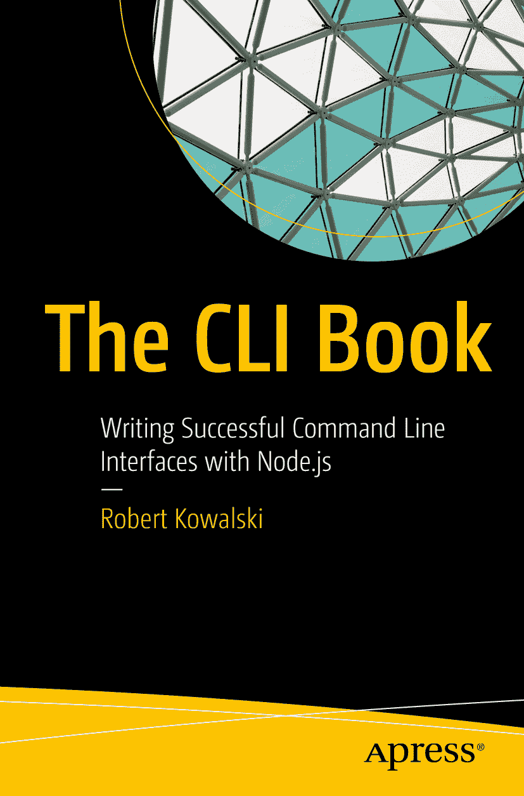

# CLI 编程之道

## 使用 Node.js 编写成功的命令行界面

**罗伯特·科瓦尔斯基**

作者在本书中引用的任何源代码或其他补充材料，读者均可通过本书在 GitHub 上的产品页面获取，网址为 [www.apress.com/9781484231760](http://www.apress.com/9781484231760)。如需更多详细信息，请访问 [www.apress.com/source-code](http://www.apress.com/source-code)。

ISBN 978-1-4842-3176-0
电子书 ISBN 978-1-4842-3177-7
[`doi.org/10.1007/978-1-4842-3177-7`](https://doi.org/10.1007/978-1-4842-3177-7)

美国国会图书馆控制编号：2017962012

© 罗伯特·科瓦尔斯基 2017

本作品受版权保护。出版商保留所有权利，无论涉及全部或部分材料，具体包括翻译、重印、重用插图、朗诵、广播、以缩微胶卷或任何其他物理方式复制、传输或信息存储与检索、电子改编、计算机软件，或目前已知或未来开发的任何类似或不同方法的权利。

本书中可能出现商标名称、标识和图像。我们并非在每次出现商标名称、标识或图像时都使用商标符号，而是仅以编辑方式使用这些名称、标识和图像，以维护商标所有者的利益，无意侵犯任何商标。

本出版物中使用商品名称、商标、服务标记及类似术语，即使未被明确标识，也不应被视为对其是否受专有权利保护的立场表达。

尽管本书中的建议和信息在出版时被认为是真实准确的，但作者、编辑和出版商均不对可能存在的任何错误或遗漏承担法律责任。出版商对本书所含内容不作任何明示或暗示的保证。

印刷在无酸纸上

本书通过 Springer Science + Business Media New York 向全球图书贸易发行，地址：233 Spring Street, 6th Floor, New York, NY 10013。电话：1-800-SPRINGER，传真：(201) 348-4505，电子邮件：`orders-ny@springer-sbm.com`，或访问 `www.springeronline.com`。Apress Media, LLC 是一家加州有限责任公司，其唯一成员（所有者）是 Springer Science + Business Media Finance Inc (SSBM Finance Inc)。SSBM Finance Inc 是一家特拉华州公司。
