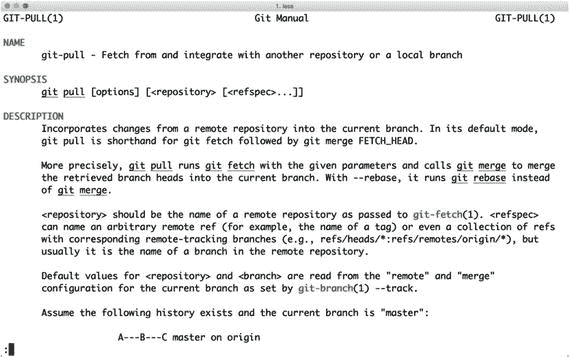
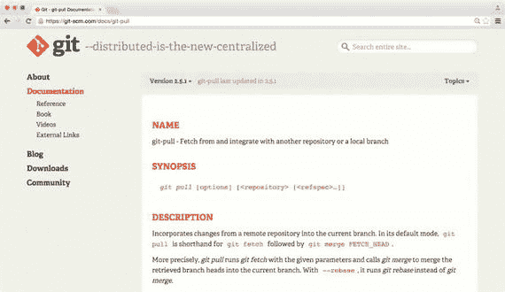
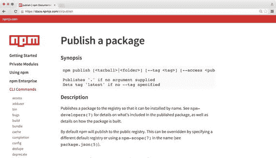
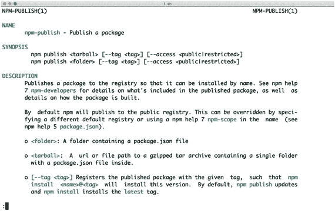

# 1. 什么是好的 CLI？

在本章中，你将审视那些成功的命令行客户端以及它们的出色之处。这将帮助你理解用户面临的问题，从而帮助你在本书后续内容中，用 Node.js 构建更好的命令行客户端。

## CLI 基础

首先，我们来看看用户通常如何使用命令行界面。大多数时候，用户坐在键盘前，与终端交互。你应该为 CLI 使用简单且易于识别的命令。但遗憾的是，仅仅使用易于识别的命令还远远不够。

如果你看一个糟糕的 CLI 示例，问题会更容易理解：

```
$ my-example-cli -A -a 16 r foo.html
error: undefined is not a function
```

在这个例子中，你必须输入晦涩难懂的命令，然后收到一条同样晦涩的错误信息。你可能会问：“`-A -a 16 r` 是什么意思？”，“为什么我收到了错误信息，是我用错了吗？”以及“这个错误信息是什么意思，我怎样才能完成我的任务？”

那么，是什么造就了一个好的 CLI？简而言之，一个成功的 CLI 就是能让用户成功且满意。

让我们尝试使用以下三个原则来创建一个 CLI：

* 你永远不会在 CLI 中卡住。
* 它既简单又支持高级用户。
* 你可以用它做很多事情。

## 永不卡壳

没人喜欢堵在路上，卡在车流里，每分钟只能挪动几英尺。我们总想以最快、最舒适的方式到达目的地。这同样适用于你的用户：当工具成为他们前进的阻碍时，他们会非常不高兴。他们只想完成自己的任务。

“永不卡壳”意味着你应该始终为用户提供解决任务的方法。一个命令绝不应该是一条死胡同。此外，你应该避免命令行工具中任何可能引起摩擦的地方。

为了更好地说明这一点，让我们来看看 Git 和 npm——两个非常成功的命令行工具。

下面的例子使用了 Git：

```
$ git poll
git: 'poll' 不是一个 git 命令。参见 'git --help'。
你是不是想输入：
pull
```

在这个例子中，我输错了命令，将 `pull` 输成了 `poll`。幸运的是，Git 提供了一种让我继续工作并完成任务的途径。

Git 基本上在说：“嘿，Robert，看起来你输错了命令，但如果你输入 `git --help`，你可以看到所有现有命令的列表。而且，嘿，看起来你输入了 `git poll`；你是不是想输入 `git pull`？”

npm，另一个成功的 CLI 客户端，也提供了相同的理念：

```
$ npm ragrragr
用法: npm <command>
其中 <command> 可以是以下之一：
access, add-user, adduser, apihelp, author, bin, bugs, c,
cache, completion, config, ddp, dedupe, deprecate, dist-tag,
dist-tags, docs, edit, explore, faq, find, find-dupes, get,
help, help-search, home, i, info, init, install, issues, la,
link, list, ll, ln, login, logout, ls, outdated, owner,
pack, prefix, prune, publish, r, rb, rebuild, remove, repo,
restart, rm, root, run-script, s, se, search, set, show,
shrinkwrap, star, stars, start, stop, t, tag, test, tst, un,
uninstall, unlink, unpublish, unstar, up, update, upgrade,
v, verison, version, view, whoami

npm -h     获取 <command> 的快速帮助
npm -l     显示完整用法信息
npm faq    常见问题解答
npm help <term>  搜索关于 <term> 的帮助
npm help npm     概览

配置以 ini 格式文件指定：
/Users/robert/.npmrc
或在命令行通过以下方式指定：npm <command> —key value
配置信息可通过以下方式查看：npm help config

npm@5.5.1 /Users/robert/.nvm/versions/node/v9.1.0/lib/node_modules/npm
```

在这个例子中，我试图向 npm 输入垃圾信息，因此 npm 提供了一些友好的帮助：“嘿，Robert，我不知道那个命令，但这里列出了所有可用的命令。你可以像这样使用它们，并通过输入 `npm help <command>` 来获取关于它们的帮助。”

像 Git 一样，npm 立即提供帮助，让我能够完成任务，即使我完全不知道如何使用 npm。


### 还是不知所措？手册页来帮忙

如果还是需要帮助怎么办？也许我想在尝试任何命令之前先获取帮助。事实证明，在 Unix 或 Linux 上查找文档有一种可靠的方法：手册页，也称为 man 页，如图 1-1 所示。



图 1-1

`git pull` 的手册页

手册页相当不错，因为你无需联网就能打开它们。你也可以停留在同一个终端窗口中阅读，无需切换到另一个窗口（比如浏览器）。

但有些用户不知道手册页，或者不喜欢使用它们。其他人则可能使用 Windows，它本身无法处理手册页，因此 Git 和 `npm` 将其文档以网页形式提供，如图 1-2 所示。



图 1-2

Git 项目的文档网站

Git 和 `npm` 都使用了一个技巧：它们一次性编写文档（例如，使用 Markdown 或 AsciiDoc），并将此初始源码作为基础。然后，它们将这些基础文档转换成不同的格式（例如，转换成 HTML）。

如果你查看 Git 和 `npm` 的在线手册页，你会注意到它们的网站用页眉和侧边栏将内容框起来。图 1-3 和图 1-4 用 `npm publish` 命令的不同版本说明了这一点。



图 1-4

`npm publish` 的文档网站



图 1-3

`npm publish` 的手册页

## 错误处理

有时事情会出大错。让我们再看看我之前那个糟糕 CLI 的例子：

```
$ my-example-cli -A -a 16 r foo.py
events.js:85
throw er; // Unhandled 'error' event
^
Error: ENOENT, open 'cli.js'
at Error (native)
```

在这种情况中，你得到的只是一个没什么上下文的堆栈跟踪。对大多数人来说，这些堆栈跟踪看起来很晦涩，尤其是对于那些不是每天编写 Node.js 的人来说。

而且情况更糟：你根本无法判断你是遇到了 CLI 的 bug 还是用错了方式。想象一下你的用户处于这种境地。看着那个小小的终端，完全不知道该怎么办，他们会感到极其挫败。

`nmo` 支持的一个特性是使用错误。以下是它的表现：

```
$ nmo cluster dsf
ERR! 用法:
nmo cluster get [], []
nmo cluster add , , 
nmo cluster join 
```

如果用户尝试以错误方式使用命令，`nmo` 会立即指示如何正确使用该命令以完成任务。无需打开文档。

如果 `nmo` 崩溃，它也会向用户显示堆栈跟踪：

```
$ nmo cluster join anemone
ERR! df is not defined
ERR! ReferenceError: df is not defined
ERR!     at /Users/robert/apache/nmo/lib/cluster.js:84:5
ERR!     at cli (/Users/robert/apache/nmo/lib/cluster.js:68:27)
ERR!     at /Users/robert/apache/nmo/bin/nmo-cli.js:32:6
ERR!
ERR! nmo: 1.0.1 node: v9.1.0
ERR! 请在此日志在 https://github.com/robertkowalski/nmo/issues 上创建一个 issue
```

和 `npm` 一样，`nmo` 会将当前的 `nmo` 和 Node.js 版本添加到堆栈跟踪中。我们还要求用户复制堆栈跟踪，并创建一个包含该堆栈跟踪的 issue。

这些报告使得团队能通过查看堆栈跟踪轻松地识别 bug，解决它，并发布新版本的 `nmo`。

再次强调，用户不会卡住。用户会得到帮助来完成任务，在最坏的情况下，你也可以通过 issue 跟踪器帮助用户。

## 支持高级用户

高级用户对你的 CLI 很重要。他们是会谈论你的 CLI 并通过口口相传提高其整体采用率的用户。以下小节介绍了改善与高级用户交互的方法。

### 快捷方式

大多数高级用户每天会多次使用你的 CLI。支持他们的一种简单方法是提供快捷方式。

`npm` 有很多快捷方式。例如，`npm i` 是 `npm install` 的简写。Git 允许你在 `.gitconfig` 文件中定义自己的快捷方式。例如，我使用 `git co` 作为 `git checkout` 的快捷方式。

### 脚本化

在某个时候，你的命令行客户端会变得非常成功；人们会喜欢它，并开始创造性地使用它。CLI 会突然在 Jenkins 上运行，作为 Chef 或 Puppet 运行中部署的一部分，或者你的用户会以你从未想象过的方式使用你的 CLI！

自动化进程迟早也会使用你的 CLI。为了使你的 CLI 更加成功，支持脚本化是个好主意。

#### 退出码

操作系统使用退出码来指示命令是否成功。如果你最近执行的命令成功，你将得到一个 `0`。得到 `1` 则表示一般性错误。

退出码对于那些想将你的命令行客户端包装在 bash 脚本中的用户很有用。

以下是一个示例：

```
$ git poll
git: 'poll' is not a git command. See 'git --help'.
Did you mean this?
pull
$ echo $?
```

Git 通知你出了问题；你得到返回的退出码是 `1`。有了正确的退出码，每个 bash 脚本的编写者都可以处理不成功的命令。

#### JSON 输出

在 `nmo` 中，每个返回信息的命令都支持 JSON 格式的输出：

```
$ nmo cluster get --json
{ anemone:
{ node1: 'http://node1.local',
node2: 'http://node2.local',
node3: 'http://node3.local' } }
```

支持 JSON 使用户能够轻松地使用他们选择的编程语言处理数据，因为大多数语言都支持 JSON。用户可以在语言 x 中生成一个子进程，并监听 `stdout` 以获取输出。他们也可以直接将输出通过管道输送给 shell 上的消费者：

```
$ nmo cluster get --json | consumer.py
```

JSON 输出给用户带来了很大的灵活性。

#### 命令行客户端中的 API

另一个概念可以使脚本化变得更容易。我称之为命令行客户端中的 API：

```javascript
const nmo = require('nmo');
nmo.load({}).then(() => {
nmo.commands.cluster
.get('testcluster', 'node1@127.0.01')
.then((res) => {
console.log(res);
});
});
```

在 `nmo` 中，每个命令都暴露在 `nmo.commands` 上。如果用户想将 `nmo` 作为其 Node.js 脚本的一部分使用，他们可以引入它。JavaScript API 的文档与 CLI 的文档类似。

JavaScript API 使用户能够将 `nmo` 嵌入到他们的 Node.js 脚本中，以处理复杂流程。他们甚至可以派生 `nmo` 并将其嵌入到自己的命令行客户端中。

## 配置

高级用户喜欢配置。因为他们经常使用命令行客户端，可能一天好几次，所以他们希望某些功能默认启用也就不足为奇了。但在少数情况下，他们不想要默认设置。

`npm` 在命令行上支持选项参数：

```
$ npm i hapi --registry=https://reg.example.org
/Users/robert
└── hapi@9.0.4
```

此命令从 `https://reg.example.org` 的私有注册表下载包 `hapi`。

但我也可以将此私有注册表设置为新的默认注册表：

```
$ npm config set registry https://reg.example.org
```

`npm` 将新的注册表写入配置：

```
$ cat ~/.npmrc
loglevel=http
registry=https://reg.example.org
```

下次我尝试安装包时，`npm` 将使用我的新默认注册表 `https://reg.example.org`：

```
$ npm i hapi
```

如果我不想使用这个新的默认注册表，我可以向 CLI 传递一个参数，它就会仅针对此次调用使用备用注册表：

```
$ npm i hapi --registry=https://registry.npmjs.org
/Users/robert
└── hapi@9.0.4
```

这意味着我们在 `npm` 中可以在默认配置和命令行参数之间进行选择，这种组合非常强大。


## 你可以用它做这么多事情！

让我们来看最后一条原则：**你**可以用 CLI 做很多事情。每当我需要多次执行某项任务，并且该任务属于命令行客户端的领域时，我就会把它添加为一个新命令。这种习惯会变成双赢的局面：你减少了无聊的任务，用户也很高兴，因为他们获得了新功能，同样也减少了重复劳动。这会让你的命令行客户端更加成功。

让我们以`npm`为例。在`npm`早期，它没有列出过时包的命令。你必须对所有包进行完整更新，然后检查哪些包更新了，哪些没有。这个命令的添加解决了其作者的一个痛点，同时也解决了所有`npm`用户的痛点。遗憾的是，发现常见的痛点可能相当困难，尤其是当你有多个团队或与很多人合作时。此外，在长期研究同一个主题后，我们大多数人都容易产生组织性盲点。但如果你能识别出一项可以为你和用户自动化的任务，你将获得巨大的回报！

## 总结

命令行界面的大多数问题都与技术问题无关。你的用户应该始终清楚下一步该怎么做，尤其是在出现问题的时候。观察首次使用你 CLI 的人，可以帮助你获得新的改进思路。拥有一个坚实的基础对于吸引第一批用户至关重要。

一旦有了可靠的用户体验，快捷方式等新增功能会让你的 CLI 更有趣。尤其是高级用户，他们会非常喜欢这些功能。

