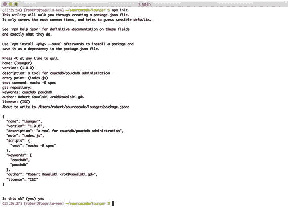

# 2. 使用 Node.js 编写数据库管理工具

在本章中，我们将编写一个名为`lounger`的数据库管理工具，并遵循构建优秀 CLI 的原则。每个章节的代码都可以在 [`github.com/theclibook/theclibook/tree/1.0/sourcecode`](https://github.com/theclibook/theclibook/tree/1.0/sourcecode) 获取，你可以通过每章末尾的链接访问。主仓库地址是 [`github.com/theclibook/theclibook`](https://github.com/theclibook/theclibook)。如果你想运行代码，别忘了在你想要测试的章节文件夹中运行`npm install`。代码还包含一个测试套件，你可以使用`npm test`运行。

我们将从开发环境的设置开始。我们将安装并启动一个小的 PouchDB 实例。然后我们将创建第一个命令。为了使命令行工具可扩展，我们还将添加一个引导部分。通过正确的引导，我们将加载随时间添加的每个命令和配置。本章将以该工具的第一个可运行版本结束，届时我们可以在命令行上执行它。

## 为什么选择 Node.js？

有时会有人问我为什么用 Node.js 编写命令行客户端。对我来说，主要原因如下：

*   拥有各种类型模块的庞大生态系统

*   快速的开发速度

*   编写 JavaScript 很有趣！

对我来说，这些原因使得 Node.js 成为编写命令行客户端的完美平台。

## 设置数据库服务器

我们的第一步是搞定数据库服务器。这涉及到设置过程、PouchDB 安装以及一些故障排除。

### 环境设置

我们将使用 ES6/7 编写命令行客户端，这为 JavaScript 带来了许多改进。为了使用它，我们需要从 [`nodejs.org`](https://nodejs.org) 安装 Node 8.x。如果你想支持更老的 Node.js 版本，我建议使用 Babel 转译器将代码转译为 ES5 兼容的代码。你可以从 [`babeljs.io/`](https://babeljs.io/) 获取 Babel。

我们要编写的工具将是一个用于 CouchDB/PouchDB 的小型数据库管理工具。有多种方法可以启动并运行一个开发数据库服务器。

一种方法是为你的操作系统安装 Erlang 和 CouchDB。你可以从 [`couchdb.apache.org`](http://couchdb.apache.org) 下载官方包，并且许多 Linux 发行版的软件仓库中也包含了 CouchDB。

我认为最简单的方法是使用本书源代码中提供的 PouchDB 服务器，或者在 [`cloudant.com`](https://cloudant.com) 获取一个 CouchDB 实例，该服务在你达到限制之前是免费的。

### 使用 PouchDB 数据库服务器

PouchDB 数据库服务器位于`sourcecode/database`目录下。要使用它，我们必须安装所需的依赖项：

```
$ cd sourcecode/database
$ npm install
```

要启动数据库，只需运行以下命令：

```
$ npm run start
```

现在，我们可以通过 HTTP 与数据库服务器交互，因为 CouchDB 和 PouchDB 都是具有 HTTP API 的数据库。如果你不知道如何获取`curl`，请查看下面的“故障排除”部分。

```
$ curl -XGET http://127.0.0.1:5984/
{"express-pouchdb":"Welcome!","version":"1.0.1","vendor":{"name":"PouchDB authors","version":"1.0.1"},"uuid":"4fad2c01-ba32-4249-8278-8786e877c397"}
```

让我们创建一个名为`people`的数据库：

```
$ curl -XPUT http://127.0.0.1:5984/people
{"ok":true}
```

现在我们可以向`people`数据库插入文档了：

```
$ curl -XPOST http://127.0.0.1:5984/people -d '{"name": "Rocko Artischocko", \
"likes": ["Burritos", "Node.js", "Music"] }' -H 'Content-Type: application/json'
{"ok":true,"id":"21b5ad83-0ad6-47c7-86f8d9636113160a","rev":"1-411894affa038a6fd7a164e1bfd84146"}
```

使用这个 ID，我们可以从数据库中检索文档：

```
$ curl -XGET http://127.0.0.1:5984/people/21b5ad83-0ad6-47c7-86f8-d9636113160a
{"name":"Rocko Artischocko","likes":["Burritos","Node.js","Music"],"_id":"21b5ad83-0ad6-47c7-86f8-d9636113160a","_rev":"1-411894affa038a6fd7a164e1bfd84146"}
```

太好了！你的数据库应该已经启动并运行了！如果遇到问题，下一节会帮助你。

### 故障排除

有时数据库服务器的安装并不像我们期望的那样顺利。对于 Windows 和 Mac 用户，本节将介绍如何获取缺失的`curl`程序。对于 Linux 用户，本节将解决 Linux 系统上与文件监视器相关的一个典型错误。

#### 获取 curl

`curl`是一个用于 HTTP 请求的命令行客户端。它适用于所有主流操作系统。macOS 用户可以使用`brew`安装它。对于 Windows，可以在 [`curl.haxx.se/download.html`](http://curl.haxx.se/download.html) 获取构建版本。

### 解决文件监听器错误

在 Linux 系统上，我遇到了一个错误，原因是我的用户已监听了过多文件：

```
$ npm run start
> theclibook-database@1.0.0 start /home/rocko/clibook/sourcecode/database
> pouchdb-server --in-memory
fs.js:1236
throw error;
^
Error: watch ./log.txt ENOSPC
at exports._errnoException (util.js:874:11)
at FSWatcher.start (fs.js:1234:19)
at Object.fs.watch (fs.js:1262:11)
at Tail.watch (/home/rocko/clibook/sourcecode/database/node_modules/pouchdb-server/node_modules/tail/tail.js:83:32)
at new Tail (/home/rocko/clibook/sourcecode/database/node_modules/pouchdb-server/node_modules/tail/tail.js:72:10)
at /home/rocko/clibook/sourcecode/database/node_modules/pouchdb-server/lib/logging.js:69:20
at FSReqWrap.cb [as oncomplete] (fs.js:212:19)
npm ERR! Linux 3.13.0-71-generic
npm ERR! argv "/home/rocko/.nvm/versions/node/v4.2.3/bin/node" "/home/rocko/.nvm/versions/node/v4.2.3/bin/npm" "run" "start"
npm ERR! node v4.2.3
npm ERR! npm  v3.5.1
npm ERR! code ELIFECYCLE
npm ERR! theclibook-database@1.0.0 start: `pouchdb-server --in-memory`
npm ERR! Exit status 1
npm ERR!
npm ERR! Failed at the theclibook-database@1.0.0 start script 'pouchdb-server --in-memory'.
npm ERR! Make sure you have the latest version of node.js and npm installed.
npm ERR! If you do, this is most likely a problem with the theclibook-database package,
npm ERR! not with npm itself.
npm ERR! Tell the author that this fails on your system:
npm ERR!     pouchdb-server --in-memory
npm ERR! You can get information on how to open an issue for this project with:
npm ERR!     npm bugs theclibook-database
npm ERR! Or if that isn't available, you can get their info via:
npm ERR!     npm owner ls theclibook-database
npm ERR! There is likely additional logging output above.
npm ERR! Please include the following file with any support request:
npm ERR!     /home/rocko/clibook/sourcecode/database/npm-debug.log
```

我通过以下命令提高文件限制解决了这个问题：

```
$ echo fs.inotify.max_user_watches=524288 | sudo tee -a /etc/sysctl.conf && sudo sysctl -p
```

希望现在你的数据库服务器能正常运行了。下一节我们将重点开发命令行工具。

## 执行简单的状态检查

我们的第一个命令将检查数据库是否已启动并正在运行。用户可以使用此命令查看数据库服务器是否在运行，而我们可以在需要运行数据库的命令内部使用此命令。

检查数据库服务器是否在线的命令如下所示：

```
$ lounger isonline http://192.168.0.1:5984
http://192.168.0.1:5984 is up and running
```

其 API 如下所示：

```
$ lounger.commands.isonline('http://example.com')
```

将计划执行的命令写下来通常有助于形成直观感受。确定命令名称和签名后，便可开始开发。在这种情况下，我们必须从头开始创建工具。

### 从零开始

首先，我们必须创建一个 `package.json` 文件。幸运的是，`npm` 提供了一个便捷助手来创建这些文件。你可以在图 2-1 中看到完成的流程。



图 2-1

使用`npm init`助手创建`package.json`文件

```
$ npm init
```

然后我们只需回答 `npm` 提出的问题。

此外，我们还需创建三个文件夹：`test`、`lib` 和 `bin`。`test` 文件夹将包含我们的单元测试和集成测试，`lib` 文件夹将包含命令行客户端的核心代码，而 `bin` 文件夹将包含一个小型包装器，用于启动客户端的核心。

当我们访问 `http://localhost:5984` 的根 URL 时，`CouchDB` 和 `PouchDB` 都会返回一条欢迎消息。

```
$ curl localhost:5984
```

`CouchDB` 返回以下内容：

```
{"couchdb":"Welcome","uuid":"17ed4b2d8923975cf658e20e219faf95","version":"1.5.0","vendor":{"version":"14.04","name":"Ubuntu"}}
```

`PouchDB` 返回以下内容：

```
{"express-pouchdb":"Welcome!","version":"1.0.1","vendor":{"name":"PouchDB authors","version":"1.0.1"},"uuid":"4fad2c01-ba32-4249-8278-8786e877c397"}
```

我们将利用此行为来检查数据库是否在线。

### 强大的生态系统

如前所述，Node.js 拥有强大的生态系统。它有许多久经考验的模块可以帮助我们完成任务。

对于状态检查，我们将使用 `request` 模块来处理 HTTP 请求。`mocha` 将运行我们的测试套件，而 `nock` 将帮助我们模拟 HTTP 响应，而无需为测试套件启动数据库实例。

`--save` 和 `--save-dev` 参数会将包分别添加到 `package.json` 文件的 `dependencies` 和 `devDependencies` 部分。开发依赖仅在开发时需要，在生产环境中运行包时不需要：

```
$ npm i --save request
$ npm i --save-dev mocha nock
```

运行这些命令后，我们应该拥有目前所需的一切。

**选择你喜欢的工具**

Node.js 有许多优秀的测试运行器。`mocha` 的一些替代方案包括 npm 模块 `tap`、`tape` 或 `lab`。

我的 `package.json` 文件现在看起来像这样：

```
{
"name": "lounger",
"version": "1.0.0",
"description": "a tool for couchdb/pouchdb administration",
"main": "lib/lounger.js",
"directories": {
"test": "test"
},
"dependencies": {
"request": "².67.0"
},
"devDependencies": {
"mocha": "².3.4",
"nock": "⁵.2.1"
},
"scripts": {
"test": "mocha -R spec"
},
"keywords": [
"couchdb",
"pouchdb"
],
"author": "Robert Kowalski "
}
```

# 测试驱动开发与 `isonline` 命令实现

测试驱动开发等各种开发技术超出了本书的范围。但如果你真的热衷于 TDD，可以在实现实际代码之前，使用 `mocha` 编写会失败的测试。一些建议：

* 检测数据库是否在线。
* 检测离线数据库。
* 检测某个服务是否在线，但并非 `CouchDB`/`PouchDB` 数据库。
* 确保只接受有效的 URL。

使用 `mocha` 和 ES6 编写，我们在 `test/isonline.js` 中得到了一些会失败的测试：

```javascript
'use strict';
const assert = require('assert');
const nock = require('nock');
describe('isonline', () => {
it('detects if the database is online', () => {
assert.equal('foo', 'to implement');
});
it('detects offline databases', () => {
assert.equal('foo', 'to implement');
});
it('detects if something is online, but not a CouchDB/PouchDB', () => {
assert.equal('foo', 'to implement');
});
it('just accepts valid urls', () => {
assert.equal('foo', 'to implement');
});
});
```

要运行测试套件，我们必须在终端中输入 `npm test` 或 `npm t`。

**注意**

本节代码位于 `sourcecode/client-boilerplate`。

## `isonline` 命令的内部原理

让我们创建并编辑 `lib/isonline.js` 文件。该文件名非常重要，因为在之后的客户端启动引导过程中会用到它。第一步，我们需要引入依赖项 `request`：

```javascript
'use strict';
const request = require('request');
```

为了发起请求，我们创建 `isOnline` 函数，该函数将接收一个 URL 并发送请求：

```javascript
function isOnline (url) {
return new Promise((resolve, reject) => {
request({
uri: url,
json: true
}, (err, res, body) => {
```

如果在指定 URL 上根本没有监听的 HTTP 服务，我们用一个包含该 URL 作为键、`false` 作为值的对象来 resolve 这个 promise：

```javascript
if (err && (err.code === 'ECONNREFUSED' || err.code === 'ENOTFOUND')) {
return resolve({[url]: false});
}
```

对于其他所有错误，我们 reject 这个 promise：

```javascript
// 任何其他错误
if (err) {
return reject(err);
}
```

如果我们从 CouchDB 或 PouchDB 收到 `Welcome` 响应，就可以安全地假定数据库服务器是在线的：

```javascript
// 也许我们收到了 CouchDB / PouchDB 的欢迎信息
const isDatabase = (body.couchdb === 'Welcome' ||
body['express-pouchdb'] === 'Welcome!');
return resolve({[url]: isDatabase});
```

最后一步，我们需要导出该函数：

```javascript
exports.api = isOnline;
```

以下是完整的函数代码：

```javascript
function isOnline (url) {
return new Promise((resolve, reject) => {
request({
uri: url,
json: true
}, (err, res, body) => {
// 数据库宕机
if (err && (err.code === 'ECONNREFUSED' || err.code === 'ENOTFOUND')) {
return resolve({[url]: false});
}
// 任何其他错误
if (err) {
return reject(err);
}
// 也许我们收到了 CouchDB / PouchDB 的欢迎信息
const isDatabase = (body.couchdb === 'Welcome' ||
body['express-pouchdb'] === 'Welcome!');
return resolve({[url]: isDatabase});
});
});
}
exports.api = isOnline;
```

我们可以在 Node.js REPL 上测试这个函数：

```bash
$ node
> const isonline = require('./lib/isonline.js').api;
undefined
> isonline('http://example.com').then(console.log);
Promise {  }
> { 'http://example.com': false }
> isonline('http://doesnotexist.example.com').then(console.log);
Promise {  }
> { 'http://doesnotexist.example.com': false }
> isonline('http://localhost:5984').then(console.log);
Promise {  }
> { 'http://localhost:5984': true }
```

恭喜！我们刚刚完成了第一部分，也就是新命令的 API！

### CLI 部分

如果这就是最终用户必须使用的命令行界面，那将会令人沮丧。输出不易阅读，功能也不易理解。API 函数不会向控制台打印内容，这对于 API 来说非常完美，但对于 CLI 来说并不理想。运行 API 函数甚至需要一些 Node.js 知识。所以，让我们为 `isonline.js` 文件添加一个漂亮的 CLI 函数，并将其导出为 `cli`：

```javascript
function cli (url) {
return new Promise((resolve, reject) => {
});
}
exports.cli = cli;
```

像我们的其他函数一样，这个函数返回一个 promise。然后我们调用 `isOnline`，并将结果打印到 `stdout`，供在终端上使用命令行客户端的用户查看：

```javascript
isOnline(url).then((res) => {
Object.keys(results).forEach((entry) => {
let msg = 'seems to be offline';
if (results[entry]) {
msg = 'seems to be online';
}
// 为终端用户打印到 stdout
console.log(entry, msg);
resolve(results);
});
});
```

完整代码：

```javascript
function cli (url) {
return new Promise((resolve, reject) => {
isOnline(url).then((res) => {
Object.keys(results).forEach((entry) => {
let msg = 'seems to be offline';
if (results[entry]) {
msg = 'seems to be online';
}
// 为终端用户打印到 stdout
console.log(entry, msg);
resolve(results);
});
});
});
}
exports.cli = cli;
```

需要注意的是，我们将 API 的命令导出为 `exports.api`，而将 CLI 命令导出在 `cli` 属性下。

**注意：** 本节代码可在 `sourcecode/the-status-check` 中找到。

## 启动工具

Lounger 仍然需要使其能够在命令行上使用的代码。它还缺少一种方便的方式来运行我们的 API 命令。目前，我们只有一个命令，但很快我们会添加更多。为了让所有命令易于使用，我们必须将所有可用的命令加载到一个命名空间中。`lib/lounger.js` 文件将负责处理这件事。

# `lounger.js` 文件详解

`lounger.js` 文件是我们命令行客户端的核心。我们引入 `fs` 模块，因为需要列出可能包含命令的文件：

```javascript
'use strict';
const fs = require('fs');
```

我们还引入了 `package.json`，并将模块的当前版本作为 `lounger` 对象的一个属性公开，这在以后会派上用场：

```javascript
const pkg = require('../package.json');
```

## 确保 Lounger 已加载

确保 `lounger` 已正确引导是合理的做法，尤其是在编程环境中使用时。为追踪异步引导状态，我们将 `lounger.loaded` 设置为 `false`：

```javascript
const lounger = { loaded: false };
```

同时，我们还存储了模块的当前版本：

```javascript
lounger.version = pkg.version;
```

我们需要一个位置来存储 API 和 CLI 命令。由于引导过程是异步的，如果有人试图在引导完成前访问已暴露的函数，我们将抛出错误：

```javascript
const api = {}, cli = {};
Object.defineProperty(lounger, 'commands', {
  get: () => {
    if (lounger.loaded === false) {
      throw new Error('请先运行 lounger.load');
    }
    return api;
  }
});
Object.defineProperty(lounger, 'cli', {
  get: () => {
    if (lounger.loaded === false) {
      throw new Error('请先运行 lounger.load');
    }
    return cli;
  }
});
```

当 `lounger.loaded` 为 `false`，并且我们尝试访问 `lounger.cli` 和 `lounger.api` 上的属性时，`Object.defineProperty` 的自定义 getter 会抛出错误。该机制同样适用于 Node.js REPL 中的自动补全功能（当你按下 Tab 键尝试补全时）。试试看吧！

文件的最后部分是实际的引导过程，在此过程中，我们获取 `lib` 文件夹中的所有文件，如果它们是 JavaScript 文件且不是当前正在操作的文件 `lounger.js`，则对其执行 `require` 操作。

引导 `lounger` 的函数名为 `lounger.load`。此处我们使用了具名函数。在应用程序崩溃时，具名函数在堆栈跟踪中会很有帮助：

```javascript
lounger.load = function load () {
  return new Promise((resolve, reject) => {
  });
};
```

`fs.readdir` 函数将列出目录中的所有文件。我们遍历 `fs.readdir` 返回的文件列表：

```javascript
lounger.load = function load () {
  return new Promise((resolve, reject) => {
    fs.readdir(__dirname, (err, files) => {
      files.forEach((file) => {
      });
    });
  });
};
```

如果文件不是 JS 文件，或者就是 `lounger.js` 本身，我们通过提前返回来忽略它：

```javascript
if (!/\.js$/.test(file) || file === 'lounger.js') {
  return;
}
```

在其他所有情况下，我们假设找到了一条适用于 `lounger` 的命令。我们从文件名的 `.js` 之前提取所有内容，并将其保存为 `cmd`：

```javascript
const cmd = file.match(/(.*)\.js$/)[1];
```

我们 `require` 该文件：

```javascript
const mod = require('./' + file);
```

如果文件将 API 命令导出为 `api` 属性，我们将其暴露在 `lounger.commands` 上。所有 CLI 命令都可在 `lounger.cli` 上获取：

```javascript
if (mod.cli) {
  cli[cmd] = mod.cli;
}
if (mod.api) {
  api[cmd] = mod.api;
}
```

在 `forEach` 循环完成且所有命令都加载完毕后，我们可以将 `lounger.loaded` 设置为 `true`。这将阻止我们之前添加的检查抛出错误：

```javascript
lounger.loaded = true;
```

最后一步，我们 `resolve` 这个 promise：

```javascript
resolve(lounger);
```

完整的 `lounger.load` 函数如下所示：

```javascript
lounger.load = function load () {
  return new Promise((resolve, reject) => {
    fs.readdir(__dirname, (err, files) => {
      files.forEach((file) => {
        if (!/\.js$/.test(file) || file === 'lounger.js') {
          return;
        }
        const cmd = file.match(/(.*)\.js$/)[1];
        const mod = require('./' + file);
        if (mod.cli) {
          cli[cmd] = mod.cli;
        }
        if (mod.api) {
          api[cmd] = mod.api;
        }
      });
      lounger.loaded = true;
      resolve(lounger);
    });
  });
};
```

我们差点忘记导出 `lounger`，因此在文件末尾添加了 `module.exports`：

```javascript
module.exports = lounger;
```

我们现在就可以使用这段代码了：

```bash
$ node
> const lounger = require('./lib/lounger.js'); lounger.load().then(console.log);
Promise {  }
> { loaded: true, version: '1.0.0', load: [Function: load] }
> lounger.commands
{ isonline: [Function: isOnline] }
> lounger.cli
{ isonline: [Function: cli] }
> lounger.commands.isonline('http://localhost:5984').then(console.log);
Promise {  }
> { 'http://localhost:5984': true }
```

本节的最后一步是让 `lounger` 能在终端本身上使用。为此，我们已经创建了 `bin` 文件夹。现在是将名为 `lounger-cli.js` 的文件放入 `bin` 的时候了！

## 一种从命令行交互的优雅方式

npm 有一个很好的特性：如果我们把一个 JavaScript 文件添加到模块的 `package.json` 文件中名为 `bin` 的属性里，当我们全局安装这个包时（使用 `npm install -g lounger`），npm 会将其添加到我们的 `PATH` 环境变量中。

如果我们定义了 `bin` 属性并且 `lounger` 已全局安装，它将以 `lounger`（即我们的包名）的形式在终端上可用——非常方便！为了通知用户某个包是设计为全局安装的，我们可以在 `package.json` 中添加 `preferGlobal: true`（参见 [`docs.npmjs.com/files/package.json#preferglobal`](https://docs.npmjs.com/files/package.json#preferglobal)）。

为了启用这两个特性，我们在 `package.json` 中添加以下两行：

```json
"bin": "./bin/lounger-cli",
"preferGlobal": true,
```

此外，如果我们在 Linux 或 macOS 上运行，还必须使 `bin/lounger-cli` 文件具有可执行权限：

```bash
$ chmod +x bin/lounger-cli
```

我们的 `lounger-cli` 文件的第一行将是一个 shebang 行。这告诉 Linux/Unix shell 用户，必须使用 Node.js 来运行我们的文件：

```javascript
#!/usr/bin/env node
```

之后，我们加载 `lib/lounger.js`，这是我们的命令行工具的核心：

```javascript
const lounger = require('../lib/lounger.js');
```

下一步是解析我们的命令行参数。在这个案例中，我们使用 `nopt` 模块来实现这一目的（使用 `npm i --save nopt` 安装它）。我们也可以自己解析参数，但像 `nopt` 这样久经考验的模块提供了更多功能，并且更易于使用。我们通过访问 `parsed.argv.remain` 来获取传入的命令：

```
const nopt = require('nopt');
const parsed = nopt({}, {}, process.argv, 2);
const cmd = parsed.argv.remain.shift();
```

下一步是通过调用 `lounger.load` 来启动客户端，这将引导客户端并填充 `lounger.commands` 和 `lounger.cli`。在 promise 被 resolve 之后，我们调用在命令行上传入的命令：

```
lounger.load().then(() => {
lounger.cli[cmd]
.apply(null, parsed.argv.remain)
.catch((err) => {
console.error(err);
});
}).catch((err) => {
console.error(err);
});
```

由于每个命令都返回一个 promise，我们使用 `catch` 来捕获错误，然后将它们打印到控制台。

我们现在可以在命令行上测试这个极简的命令行客户端了：

```
$ npm install -g .
$ lounger isonline http://test.example.com
http://test.example.com 似乎离线或没有数据库
```

假设我们的 PouchDB/CouchDB 服务器正在运行：

```
$ lounger isonline http://localhost:5984
http://localhost:5984 似乎在线
```

与其每次修改代码后都运行 `npm install -g .`，不如在模块目录中运行 `npm link`。这会将全局安装链接到当前目录，这意味着只要目录不变，每次更改都会立即可用。

### 注意

本节的代码可以在 `sourcecode/client-bootstrap` 中找到。

### 选择你喜欢的风格

npm 上有无数优秀的参数解析库。`nopt` 的一些替代品包括 `commander`、`optimist` 和 `yargs`。

## 总结

在本章中，我们为命令行客户端创建了第一个基础构建块。现在，我们为开发一个可扩展的命令行客户端打下了坚实的基础。我们还添加了第一个命令。然而，距离打造出一个用户喜爱并愿意推广的产品，我们还有很长的路要走。我们的 CLI 仍然有些粗糙，并且缺少许多成功 CLI 所具备的功能。我们将在下一章中解决这些问题，届时我们将重点关注可用性和可访问性。
