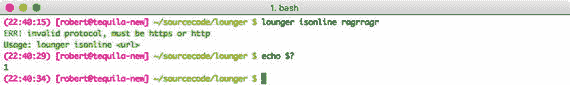
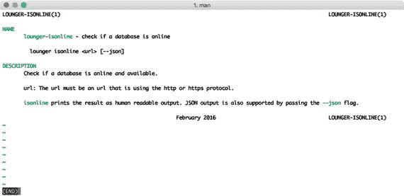
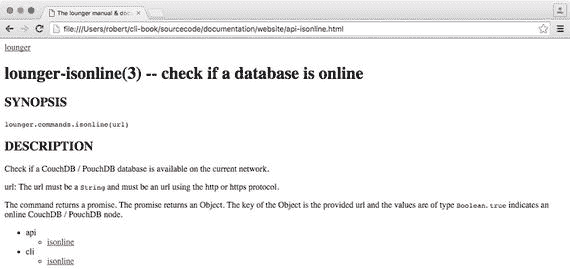

# 3. 让我们的 CLI 工具更易上手

在上一章中，我们为命令行工具打下了坚实基础。我们加载了第一个命令，整个程序已可在命令行中执行。现在我们将专注于可用性与易用性。我们将探讨如何改进错误处理，如何在程序崩溃时为用户提供引导。通过支持 JSON 格式和简写命令，我们将让高级用户感到满意。我们还将为文档创建不同的输出格式。在首次生产环境发布前，我们将添加一个灵活的配置管理系统。

## 错误处理

您已经知道，没有用户喜欢晦涩难懂的错误信息和堆栈跟踪。遗憾的是，我们的 `lounger` 应用目前正是如此。提升应用的易用性应该是我们的首要任务。

目前，`lounger` 对 `isonline` 命令的错误输入没有任何反应：

```
$ lounger isonline ragrragr
$
```

另一个需要考虑的问题是：我们是否正确处理了错误，以便用户可以在 bash 脚本中使用命令行客户端？

```
$ lounger isonline ragrragr
$ echo $?
```

让用户无需查阅文档就能立刻获得程序正确用法的提示，这样不是更好吗？没有人喜欢坐在黑漆漆的终端前，完全不知道下一步该做什么。趁此机会，我们还可以修复错误的退出码——目前它显示的是程序成功执行。

为什么我们在 `bin/lounger-cli` 中的 `console.error` 调用没有输出任何内容？原来我们引入了一个细微的 bug：我们忘记了为 `lib/isonline.js` 中返回 Promise 的调用添加 `.catch`。由于 API 函数 `isOnline` 会拒绝（reject）Promise，我们在 `cli` 函数中没有任何处理器来捕获它。没问题——我们马上添加 `.catch`：

```
function cli (url) {
return new Promise((resolve, reject) => {
isOnline(url).then((results) => {
// 在终端用户的标准输出上打印
Object.keys(results).forEach((entry) => {
let msg = '似乎离线或没有数据库服务器';
if (results[entry]) {
msg = '似乎在线';
}
console.log(entry, msg);
resolve(results);
});
}).catch(reject);  // 添加缺失的 catch
});
}
exports.cli = cli;
```

再次尝试，结果略有改善：

```
$ lounger isonline ragrragr
[Error: Invalid URI "ragrragr"]
```

不确定你是否满意？我是不满意的！试想一个从未使用过 Node.js 或终端的用户，甚至可能是个电脑新手。“无效 URI”这条消息很难帮助他们完成任务。二十年前，他们可能需要去图书馆借书才能弄明白 URI 是什么，而今天他们得去谷歌搜索。他们本可以使用我们的 CLI 愉快地完成任务！在下一节中，我们将探讨如何改进由错误输入引发的错误信息。

### 处理使用错误

使用错误包括所有与接口误用相关的问题。通常，错误的输入是导致问题的根源。参数顺序也常常被意外调换。幸运的是，我们可以通过在 `isonline.js` 中添加参数验证来修复此问题。

如果用户没有向 CLI 提供 URL，我们将生成一个新的错误，其消息为 `Usage: lounger isonline <url>`，用于描述用户应如何使用该命令。我们将错误类型设置为 `EUSAGE`，这将在后续变得重要。在 `lounger` 中，所有因用户提供错误输入而抛出的错误都会获得类型 `EUSAGE`。其他与 bug 相关的情况则不会获得此类型：

```
function cli (url) {
return new Promise((resolve, reject) => {
if (!url) {
const err = new Error('Usage: lounger isonline ');
err.type = 'EUSAGE';
return reject(err);
}
```

`url` 周围的尖括号表示它是必填参数，而非可选。代码块中的最后一条命令会拒绝（reject）Promise 并返回，从而阻止后续代码的执行。

**提示**

尽早返回有助于降低圈复杂度。圈复杂度是衡量代码复杂度的指标。例如，当 `if` 和 `else` 代码块嵌套时，代码会显得更复杂，因为这些嵌套代码块使人脑更难理清程序的执行流程。

此外，我们还需要检查 URL 是否有效：

```
if (!/^(http:|https:)/.test(url)) {
const err = new Error([
'无效协议，必须是 https 或 http',
'Usage: lounger isonline '
].join('\n'));
err.type = 'EUSAGE';
return reject(err);
}
```

在此例中，我们再次将错误类型设置为 `EUSAGE` 并拒绝 Promise。同时，我们告知用户，我们期望一个包含可用协议的有效 URL。

再次尝试，我们会得到略微更好的结果：

```
$ ./bin/lounger-cli isonline dsf
{ [Error: 无效协议，必须是 https 或 http
Usage: lounger isonline ] type: 'EUSAGE' }
```

由于我们拒绝了 Promise，添加到 `bin/lounger-cli` 中的 `console.error` 会打印错误对象。通过添加几行代码，我们可以将其格式化，以便人类更易阅读。为此，我们将安装 `npmlog` 日志记录器（提示：`npm i` 是 `npm install` 的简写）：

```
$ npm i --save npmlog
```

我们在 `bin/lounger-cli` 文件（即捕获被拒绝 Promise 的文件）的顶部引入该日志记录器：

```
const log = require('npmlog');
```

接下来，我们在 `bin/lounger-cli` 中添加 `errorHandler` 函数。如果错误是使用错误（类型为 `EUSAGE`），我们会记录消息并以错误码 `1` 退出。所有其他错误暂时使用 `log.error(err)` 记录：

```
function errorHandler (err) {
if (!err) {
process.exit(1);
}
if (err.type === 'EUSAGE') {
err.message && log.error(err.message);
process.exit(1);
}
log.error(err);
process.exit(1);
}
```

现在我们需要将旧的 `console.error` 调用替换为新的错误处理函数：

```
lounger.load().then(() => {
lounger.cli[cmd]
.apply(null, parsed.argv.remain)
.catch(errorHandler);
}).catch(errorHandler);
```

太棒了——让我们看看它是否有效：

```
$ lounger isonline
ERR! Usage: lounger isonline 
$ echo $?
```

图 3-1 展示了结果。看起来好多了！



**图 3-1** 由于向 CLI 提供错误输入而产生的使用错误

### 提供进一步的指引

我们尚未处理其他错误：来自所使用依赖项的错误，或者潜入的恶意 bug（如引用错误）。为了模拟此类错误，我们可以在 `cli` 函数中调用一个不存在的函数：

```
function cli (url) {
return new Promise((resolve, reject) => {
doesNotExist();
```

如果现在运行命令行客户端，会得到如下结果：

```
$ lounger isonline http://example.com
ERR! ReferenceError: doesNotExist is not defined
```

假如我刚刚下载了这个命令行客户端并尝试使用它，我会感到十分困惑。假设我刚开始一份新工作，尝试使用同事们在用的同一个工具，但下载了一个带有 bug 的较新版本。我会陷入困境，不知如何继续下去。说实话，如果我没有多年的 JavaScript 编程经验，这个堆栈追踪信息真的会让我摸不着头脑！

大多数人会直接停止使用我们的程序，转而选择其他替代方案。极少有人会费心去查找在哪里提交问题，甚至编写 PR。通常，计算机本身就让人受挫，人们不愿意花好几个小时，仅凭一条晦涩的信息去寻找他人帮助。那么，我们何不尽可能简化这一过程，在力所能及之处减少阻碍呢？

# 错误处理与功能扩展

`npm` 自身支持在 `package.json` 中使用 `bugs` 属性。如果我们将其添加到 `lounger` 的 `package.json` 文件中，运行 `npm bugs` 就会在浏览器中为我们打开 [`http://example.com/louner/issues`](http://example.com/lounger/issues)：

```json
"bugs": {
  "url": "http://example.com/lounger/issues"
},
```

很棒——我们有了一个集中存放问题追踪器 URL 的地方。我们还可以将 URL 添加到堆栈追踪信息中，以便用户更容易地提交 bug。我们只需在打印错误的文件 `bin/lounger-cli` 中引入 `package.json` 即可：

```javascript
const pkg = require('./package.json');
```

通过修改 `errorHandler`，我们让它打印完整的堆栈追踪信息。此外，我们要求用户提交一个 issue，因为现在很明显，这个错误并非我们校验后捕获的使用错误：

```javascript
function errorHandler (err) {
  if (!err) {
    process.exit(1);
  }
  if (err.type === 'EUSAGE') {
    err.message && log.error(err.message);
    process.exit(1);
  }
  err.message && log.error(err.message);
  if (err.stack) {
    log.error('', err.stack);
    log.error('', '');
    log.error('', '');
    log.error('', 'lounger:', pkg.version, 'node:', process.version);
    log.error('', 'please open an issue including this log on ' + pkg.bugs.url);
  }
  process.exit(1);
}
```

好的，再次尝试：

```
$ lounger isonline http://example.com
ERR! doesNotExist is not defined
ERR! ReferenceError: doesNotExist is not defined
ERR!     at /home/rocko/clibook/sourcecode/error-handling/lib/isonline.js:35:7
ERR!     at cli (/home/rocko/clibook/sourcecode/error-handling/lib/isonline.js:34:10)
ERR!     at /home/rocko/clibook/sourcecode/error-handling/bin/lounger-cli:15:6
ERR!
ERR!
ERR! lounger: 1.0.0 node: v9.1.0
ERR! please open an issue including this log on http://example.com/lounger/issues
```

太棒了！带有行号的堆栈追踪信息对我们非常有用。程序当前版本和 Node.js 环境信息也同样有帮助。当命令行客户端真的遇到问题卡住时，我们能获得大量信息来进行调试。更重要的是：用户获得了创建 issue 所需的所有信息。通过直接指向问题追踪器并提供描述 bug 所需的全部信息（无需反复询问当前 Node 版本或缺少日志文件），我们极大地减少了过程中的阻碍。

**注意**

本节代码可在 `sourcecode/error-handling` 中找到。

## JSON 支持与简写命令

JSON 支持对于所有希望从 CLI 获取输出，并使用自有工具以编程方式处理这些输出的用户都很有用。通过为我们的 `isonline` 命令添加一个 `--json` 标志，只需几行代码就能增加这个实用功能。我们必须告知参数解析器这一点；在这里，我们告诉 `nopt`，我们希望将 `--json` 视为一个布尔值，处理在 `bin/lounger-cli` 中：

```javascript
const parsed = nopt({
  'json': [Boolean]
}, {'j': '--json'}, process.argv, 2);
```

基于 `Boolean` 类型，`nopt` 会自动为我们添加 `--no-json` 选项，这在之后我们通过文件添加额外配置时会很方便。此外，我们为高级用户注册了一个简写选项：他们可以使用 `-j` 代替 `--json`。

然后，我们将解析结果 `parsed` 传递给 `lounger.load`：

```javascript
const parsed = nopt({
  'json': [Boolean]
}, {'j': '--json'}, process.argv, 2);
const cmd = parsed.argv.remain.shift();
lounger.load(parsed).then(() => {
  lounger.cli[cmd]
    .apply(null, parsed.argv.remain)
    .catch(errorHandler);
}).catch(errorHandler);
```

`lounger.load` 添加了一个 `lounger.config.get` 命令，并将其作为引导程序的一部分供我们使用：

```javascript
lounger.load = function load (opts) {
  return new Promise((resolve, reject) => {
    lounger.config = {
      get: (key) => {
        return opts[key];
      }
    };
    fs.readdir(__dirname, (err, files) => {
```

我们在 `isonline.js` 文件中引入 `lounger.js`：

```javascript
const lounger = require('./lounger.js');
```

最后一步，在 `cli` 函数中获取结果后，检查 `json` 标志：

```javascript
isOnline(url).then((results) => {
  if (lounger.config.get('json')) {
    console.log(results);
    resolve(results);
    return;
  }
```

这样就完成了！我们可以测试一下命令：

```
$ lounger isonline http://example.com
http://example.com seems to be offline or no database server
$ lounger isonline http://example.com --json
{ 'http://example.com': false }
$ lounger isonline http://example.com -j
{ 'http://example.com': false }
```

现在，我们的用户可以将终端上的输出通过管道传输给其他消费者，并处理结果。我们还为 `lounger` 添加了第一个命令行标志，用于修改命令的执行方式。太棒了！

**注意**

本节的代码和测试位于 `sourcecode/json-flags` 中。

## 文档

完成 `isonline` 命令的最后一步是添加合适的文档。我们将用 Markdown 编写这份文档。我们需要为 API 和 CLI 命令编写文档。API 文档将位于 `doc/api` 目录，CLI 命令文档将位于 `doc/cli` 目录。我知道大多数程序员讨厌编写文档，但这能给我们带来很多好处：新用户能够更快地上手使用，我们也不会在用户有机会享受产品之前就失去他们。此外，通过一次性记录功能，我们能让自己的工作更轻松，这样人们就不必提交 issue 或在聊天中询问如何使用某个命令了。这是一个双赢的局面。我们从 `doc/api/lounger-isonline.md` 开始，它描述了位于 `lounger.commands` 的 API：

```
lounger-isonline(3) -- 检查数据库是否在线
===========================================
```

标题将我们的命令描述为 `lounger-isonline(3)`，然后添加了对该命令的简短说明。括号中的数字表示章节的类型。对于 man 手册页，库函数用 `3` 表示，用户命令用 `1` 表示（剧透：我们的 CLI 命令就是一个用户命令）。

下一部分描述了用户如何使用该命令：

```
### 概要
lounger.commands.isonline(url)
```

最后一部分是对命令工作原理的详细描述：

### 描述
检查 CouchDB / PouchDB 数据库在当前网络上是否可用。
`url`：
`url` 必须是字符串，并且必须是使用 `http` 或 `https` 协议的 `url`。
该命令返回一个 `promise`。该 `promise` 返回一个对象。对象的键是提供的 `url`，值是布尔类型。
`true` 表示在线 CouchDB / PouchDB 节点。

API 部分就这些了。现在我们可以为 `doc/cli/lounger-isonline.md` 添加文本内容：

```
lounger-isonline(1) -- 检查数据库是否在线
===========================================
lounger isonline  [--json]
### 描述
：
检查数据库节点当前是否在线或可用。
isonline 以人类可读的格式输出结果。通过传入 --json 标志，也支持 JSON 格式输出。
```

通过 `lounger-isonline(1)` 中的小 `1`，我们表明这个帮助章节解释的是一个用户命令。`<url>` 中的尖括号向用户表明 `url` 是一个必需参数；没有它，命令就无法工作。`[--json]` 的方括号表示 `--json` 标志是一个可选参数。准备好我们的第一批文档页面后，我们可以进入下一部分，将其渲染为各种输出格式。

### 渲染文档

现在我们有了文档的源文件，可以开始使用 `marked` 和 `marked-man` 从源文件构建文档：

```
$ npm i --save-dev marked marked-man
```

`Makefile` 非常适合从源文件生成文档。遗憾的是，很难让 `Makefile` 在 Windows 上工作，所以我们将用 JavaScript 编写构建步骤。在 `lounger` 的根目录中，我们创建 `build.js` 文件。此外，我们还需要安装 `mkdirp` 和 `rimraf`；`mkdirp` 以跨平台的方式提供了我们熟悉的 Linux 命令 `mkdir -p` 的功能：它可以递归地创建目录和子目录。`rimraf` 模块则为 Node.js 平台带来了相当于 `rm -rf` 的功能：递归删除目录。我们还将使用 `glob` 模块来匹配文档构建所需的所有文件：

```
$ npm i --save-dev mkdirp rimraf glob
```

我们的第一个函数将是一个用于清理一个全新的文件夹结构的函数，我们可以在其中保存 `man` 手册页：

```javascript
'use strict';
const mkdirp = require('mkdirp');
const rimraf = require('rimraf');
const glob = require('glob');
const path = require('path');
function cleanUpMan () {
rimraf.sync(__dirname + '/man/');
// 重新创建目标目录
mkdirp.sync(__dirname + '/man/');
}
```

我们需要找出哪些 Markdown 文件可用于编译。我们的文档源文件位于 `doc/api` 或 `doc/cli`。此外，我们在 `doc/website` 中还有一些专门用于网站的内容（`index.html` 的内容）。

`getSources` 函数帮助我们获取每种源文件类型（`api`、`doc`、`website`）对应的 Markdown 文件的完整路径。它返回匹配的 `glob` 的相对路径，然后使用 `path.resolve` 函数以跨平台的方式获取完整路径。

```javascript
function getSources (type) {
const files = glob.sync('doc/' + type + '/*.md');
return files.map(file => path.resolve(file));
}
```

`sources` 对象为每种类型存储了找到的文件数组：

```javascript
const sources = {
api: getSources('api'),
cli: getSources('cli'),
websiteIndex: getSources('website'),
};
```

现在我们可以清理目标目录，并获取要转换的文件名列表。我们仍然需要找出转换后文件的目标路径和文件名。`Man` 手册页根据其描述的功能类型有不同的文件后缀。我们的 CLI 手册页将获得后缀 `.1`（用户命令），API 函数将获得后缀 `.3`（库函数）。我们还必须将文件路径中的 `doc/cli/` 和 `doc/api/` 替换为我们的目标目录 `man/`。我们需要特别注意路径分隔符。在 Windows 上，分隔符是 `\\` 而不是 `/`。这意味着路径 `doc/api` 在 Windows 上会变成 `doc\\api`。好消息是，我们可以通过 Node.js 中的 `path.sep` 来访问当前平台的路径分隔符（该分隔符由核心模块 `path` 提供）：

```javascript
function getTargetForManpages (currentFile, type) {
let target;
// 在 Unix 系统上设置 man 手册页的正确章节
if (type === 'cli') {
target = currentFile.replace(/\.md$/, '.1');
}
if (type === 'api') {
target = currentFile.replace(/\.md$/, '.3');
}
// 将源目录替换为目标目录
// 分别处理 Windows 路径（doc\\api）和 Unix 路径（doc/api）
target = target
.replace(['doc', 'cli'].join(path.sep), 'man')
.replace(['doc', 'api'].join(path.sep), 'man');
return target;
}
```

目前，我们只想从 `api` 和 `cli` 文件夹中的文档创建 `man` 手册页。

基于这些构建块，我们可以创建最终的 `buildMan` 函数，该函数将最终构建我们的 `man` 手册页。它将使用我们刚刚创建的函数，并生成一个子进程，该子进程通过使用 `marked-man` 来编译 Markdown 文件。我们将使用 Node 核心的 `spawnSync` 函数来生成进程。由于我们要将结果写入文件系统，我们也需要引入 `fs` 模块。

```javascript
const fs = require('fs');
const spawnSync = require('child_process').spawnSync;
```

首要任务是进行清理，以创建一个不包含先前构建任何文件的全新目标目录。然后我们遍历源码，为需要生成的新文件确定目标路径。接着，通过 `fs.writeFileSync` 将文件写入硬盘。我们会停止网站索引的执行，因为目前我们并不想将其用于手册页面。在下一次迭代中，我们完全可以为 `lounger` 手册页面添加一个主页：

```javascript
function buildMan () {
cleanUpMan();
Object.keys(sources).forEach(type => {
sources[type].forEach(currentFile => {
if (type === 'websiteIndex') {
return;
}
// 将 Markdown 转换为手册页面
const out = spawnSync('node', [
'./node_modules/marked-man/bin/marked-man',
currentFile
]);
const target = getTargetForManpages(currentFile, type);
// 将输出写入目标文件
fs.writeFileSync(target, out.stdout, 'utf8');
})
});
}
buildMan();
```

通过最后一行代码中的 `buildMan()` `;`，我们每次用 Node 运行该脚本时都会启动构建流程。对 `package.json` 稍作修改，就可以将其变为一个 `npm` 脚本，并在发布前运行构建，这样用户在安装时就不必自行编译任何内容了。这能确保每位用户都获得完全相同的包内容，并加快安装速度。

在 `package.json` 中，我们修改 `scripts` 部分，并添加 `build` 和 `prepublishOnly` 条目。`prepublishOnly` 条目是 `npm` 的一个特殊钩子。每次我们将包发布到注册表之前，它都会运行：

```json
"scripts": {
"test": "mocha -R spec",
"docs": "node ./build",
"prepublishOnly": "npm run docs"
},
```

自从 npm 5 版本起，`prepublish` 已被弃用。它仍然可以工作，但对于构建步骤，建议使用 `prepublishOnly` 或 `prepare` 代替。

npm 还为手册页面提供了一个很棒的功能：npm 可以为用户安装它们，这样 Linux/Unix 用户就可以通过 `man <command>` 在终端中查看。要做到这一点，我们必须在 `package.json` 中添加另一个条目，即在 `directories` 部分添加 `man` 条目：

```json
"directories": {
  "man": "./man"
},
```

该条目指向本地的手册页面目录。如果你使用的是 Unix/Linux 系统，可以看看手册页面现在是否生效：

```
$ npm run docs
> lounger@1.0.0 docs /home/rocko/clibook/sourcecode/documentation
> node ./build
$ npm install -g .
> lounger@1.0.0 prepublish /home/rocko/clibook/sourcecode/documentation
> npm run docs
> lounger@1.0.0 docs /home/rocko/clibook/sourcecode/documentation
> node ./build
/home/rocko/.nvm/versions/node/v9.1.0/bin/lounger -> /home/rocko/.nvm/versions/node/v9.1.0/lib/node_modules/lounger/bin/lounger-cli
/home/rocko/.nvm/versions/node/v9.1.0/lib
└── lounger@1.0.0
```

现在我们可以输入命令来显示手册页面，该页面将显示在屏幕上（图 3-2）：



**图 3-2** 我们的命令行客户端 `lounger` 的手册页面

```
$ man lounger-isonline
```

也可以选择特定的段落：

```
$ man 3 lounger-isonline
$ man 1 lounger-isonline
```

手册页面准备就绪后，我们就可以专注于 HTML 输出了。

### 提供 HTML 输出

对于基于 HTML 的文档，我们现在需要添加 HTML 特定的部分。我们将在模块的 `doc` 文件夹中创建一个名为 `website` 的文件夹。它将包含用于“框定”文档输出的网站模板。

在 `website` 文件夹中，我们放置一个包含基本标记的 `template.html` 文件，最重要的是占位符：

```html
<!DOCTYPE html>
<html>
  <head>
    <title>The lounger manual & documentation</title>
  </head>
  <body>
    <h1>lounger</h1>
    <div id="content">__CONTENT__</div>
    <div id="toc">__TOC__</div>
  </body>
</html>
```

我们需要为网站根目录创建一些内容来欢迎用户。我会提供一个非常简短的示例。通常，登录页面应该让用户了解命令行客户端是做什么的，或许还可以演示一下。录屏是展示一些核心功能的绝佳方式。关于在网站上放些什么内容的灵感，欢迎访问 [`apache.github.io/couchdb-nmo`](http://apache.github.io/couchdb-nmo) ，这是我编写的命令行客户端的页面。除了 `doc/website` 中的模板，我们还将自定义的索引页面添加为 `index.md`：

```markdown
# 欢迎使用 Lounger
Lounger 是 CouchDB 和 PouchDB 的友好管理工具。

## 你需要 Node.js > 8 才能使用 lounger
npm install -g lounger
你可以用 lounger 做的事情：

## 检查 CouchDB / PouchDB 实例是否在线
lounger isonline http://example.com
```

这个页面很简约，但简要概述了 `lounger` 的功能。它还展示了访客如何安装，并提示他们需要 Node.js——并非所有人都安装了 Node.js，有些人可能从未听说过 npm。请记住：我们的目标是尽可能让新用户轻松上手，以免他们卡住。在下一节中，我们将实现渲染 Markdown 所需的功能。

### 扩展构建脚本

为了构建网站，我们必须在 `build.js` 中添加代码。首先，为网站文件添加另一个清理函数，这样每次都能从空白状态开始：

```
function cleanUpWebsite () {
  rimraf.sync(__dirname + '/website/');
  mkdirp.sync(__dirname + '/website/');
}
```

我们的网站与手册页有不同的目标。我们添加一个新函数 `getTargetForWebsite`。目前，我们的 Markdown 文件都以 `lounger-` 作为前缀，这对手册页很方便，但对我们的网站用处不大。相反，我们希望用其类型作为文件前缀；例如，API 文档的前缀将是 `api-`。这样，我们可以将 API 页面放在 CLI 页面旁边，便于链接。`getTargetForWebsite` 函数的前几行将处理此任务，并用特定类型的前缀替换 `lounger-` 前缀。替换前缀后，我们将文件后缀从 `.md` 改为 `.html`。我们编译结果的最终目标文件夹是 `./website`，因此我们必须确保目录设置正确。与 `getTargetForManpages` 的不同之处在于，我们使用 `website` 文件夹而不是 `man`，并且我们还处理了 `doc/website/index.md` 文件的路径：

```
function getTargetForWebsite (currentFile, type) {
  let target = currentFile;
  // 为我们的 html 文件稍微修改文件名：
  // 用 cli- 前缀替换所有 cli 函数的 lounger- 前缀
  // 用 api- 前缀替换所有 api 函数的 lounger- 前缀
  if (type === 'cli') {
    target = currentFile.replace(/lounger-/, 'cli-');
  }
  if (type === 'api') {
    target = currentFile.replace(/lounger-/, 'api-');
  }
  // 将文件后缀设置为 html
  target = target.replace(/\.md$/, '.html');
  // 将源目录替换为目标目录
  target = target
    .replace(['doc', 'cli'].join(path.sep), 'website')
    .replace(['doc', 'api'].join(path.sep), 'website')
    .replace(['doc', 'website'].join(path.sep), 'website');
  return target;
}
```

我们的网站还缺少一个类似目录的东西。`getTocForWebsite` 将创建我们 API 和 CLI 函数的列表。稍后，我们会将目录插入到模板的 `TOC` 占位符中。

目录本身包含一个我们编译的文件的嵌套列表。将来，用 `Handlebars`、`Jade` 或 `Nunjucks` 这样的模板引擎替换整个系统可能是有意义的。我绝对可以再写一本关于静态网站生成及其众多可能工具链的书，但我目前尽量保持简单，只使用纯 ES6 模板。

在开始一个无序列表 `<ul>` 后，我们再次遍历源的类型。我们不需要 `websiteIndex` 类型的文件，对于这些类型我们提前返回。对于其他所有类型，我们获取每个部分的类型并将其用作第一个列表元素。它显示每个部分（API 或 CLI）的类型，并充当标题。

获得标题后，我们遍历当前部分的每个文件。由于链接文本与实际超链接略有不同，我们创建了一个名为 `file` 的常量和一个额外的 `linktext` 常量。对于两者，我们都必须去掉 `lounger-` 前缀。为了创建用作 `href` 的引用，我们必须将 `.md` 后缀改为 `.html`。链接文本不应包含任何文件后缀，因此我们移除其 `.md` 后缀：

## 构建网站函数

现在，我们可以利用创建的小函数，从中构建主要构建函数 `buildWebsite`。`templateFile` 常量描述了我们在开始时创建的模板文件 `template.html` 的位置：

```javascript
const templateFile = __dirname + '/doc/website/template.html';
```

下一步是用生成的目录以及每个 API 或 CLI 方法的不同内容来替换模板中的占位符。

在 `buildWebsite` 中，我们首先调用 `cleanUpWebsite` 来删除任何过时的文件。我们使用 `fs.readFileSync` 读取模板，并获取目录。然后我们遍历源。这一次，我们不会使用 `marked-man` 生成子进程；我们只使用 `marked`，它输出 HTML。在获取网站当前文件的目标后，我们用其替换 `CONTENT` 占位符。`TOC` 被替换为目录，该目录保存在主函数顶部的 `toc` 中。将模板的读取操作和 TOC 的创建移出循环，可以提高构建的性能，因为我们不必为每个新文件都调用它们。最后，使用 `fs.writeFileSync` 将渲染后的内容写入磁盘。代码片段中的最后一行最终调用 `buildWebsite`，以便在我们运行 `build.js` 时构建网站：

```javascript
function buildWebsite () {
  cleanUpWebsite();
  const template = fs.readFileSync(templateFile, 'utf8');
  const toc = getTocForWebsite();
  Object.keys(sources).forEach(type => {
    sources[type].forEach(currentFile => {
      // 将 markdown 转换为网站内容
      const out = spawnSync('node', [
        './node_modules/marked/bin/marked',
        currentFile
      ]);
      const target = getTargetForWebsite(currentFile, type);
      const rendered = template
        .replace('__CONTENT__', out.stdout)
        .replace('__TOC__', toc);
      // 将输出写入目标文件
      fs.writeFileSync(target, rendered, 'utf8');
    });
  });
}
buildWebsite();
```

现在我们可以再次运行构建，并查看出现在 `website` 文件夹中的网站，如图 3-3 所示：



**图 3-3** 由我们的 Markdown 生成的 lounger 最小化网站

```bash
$ npm run docs
```

该网站仍然缺少一些内容以及一个漂亮的样式表。正如我已经提到的，构建网站是一个可以写一整本书的话题，我目前就打算保持这样。欢迎随意为网站添加更多内容和样式。尽管如此，我们刚刚创建了一些可以部署到 GitHub Pages 或任何其他托管服务的东西。最好的一点是，我们可以将其与命令行客户端一起发布，作为那些无法使用或不喜欢手册页的人的额外文档。在下一节中，当我们创建帮助系统时，我们将使用这两种文档类型。

> **注意**
> 本节代码可在 `sourcecode/documentation` 找到。

## 帮助系统

我们已经有一些文档，但 lounger 仍然有些粗糙。如果用户尝试访问一个不存在的命令，他们不会得到任何如何继续的建议：

```bash
$ lounger foobar
```

一个不带任何参数调用 lounger 的用户也得不到支持：

```bash
$ lounger
```

缺少的是一个解释用户如何完成任务的帮助页面。如果他们能直接从终端打开我们的文档（网页或手册页），那就太棒了。我们的用户不应关心手册页，也不必找出我们托管网站的地址。lounger 的预期行为如下：

1. 如果 CLI 在未带命令或传递的命令不存在时被调用，它会打印一条通用帮助信息。这条信息提示用户如何进一步操作来完成任务。
2. 可以轻松获得某个命令的额外帮助。

这样，我们在用户需要的地方提供帮助。无需切换到 Google 搜索帮助。在接下来的两节中，我们将为 lounger 添加所需的功能。

### 命令列表的通用帮助

要添加通用帮助界面，我们首先创建一个新的库函数 `lib/help.js`。第一个函数将向用户输出一些友好的帮助文本。帮助文本将在辅助函数中构建。

我们可以通过调用 `Object.keys(lounger.cli)` 获取所有可用的命令，然后链式调用 `.join(', ')` 方法，在每个命令之间用逗号和空格分隔：

```javascript
const lounger = require('./lounger.js');
function getGeneralHelpMessage () {
  const commands = Object.keys(lounger.cli).join(', ');
```

接下来是一个模板字符串，用于解释如何使用 `lounger`。我们添加所有在命令行界面上公开的可用命令。同时，我们说明，如果用户毫无头绪，可以运行 `lounger help` 加上他们感兴趣的命令，以获取该命令的详细帮助。我们还提供了一个如何调用帮助的示例。

最后一行显示用户当前运行的 `lounger` 版本，这在各种情况下都非常实用。通常，人们会忘记自己安装的软件包版本。想象一下，一位用户刚刚读到一篇关于 `lounger` 2.3 版本的博客文章，其中有一个很棒的新功能可以尝试。用户很早以前就安装了 `lounger`，但遗憾的是，该命令仅从 2.3 版本（三天前发布）才开始可用。在这种情况下，用户可以立即收到反馈，提示当前运行的是旧版本。

以下是完整的 `getGeneralHelpMessage` 函数：

```javascript
function getGeneralHelpMessage () {
  const commands = Object.keys(lounger.cli).join(', ');
  const message = `Usage: lounger 
The available commands for lounger are:
${commands}
You can get more help on each command with: lounger help 
Example:
lounger help isonline
lounger v${lounger.version} on Node.js ${process.version}`;
  return message;
}
```

通用帮助信息就这些内容了。接下来，我们将进一步扩展帮助系统。

### 每个命令的帮助

在我们的命令行客户端中，为每个命令提供一个简单的帮助访问系统是非常有价值的。我们将要构建的下一个函数会尝试打开手册页（如果可能的话）。对于 Windows 用户，它将回退到网站版本。

# 配置

要求用户每次使用 `lounger` 时都手动添加他们喜欢的设置作为标志可能很繁琐。配置文件可以让用户保存他们每天需要的设置。如果能够支持这个功能，让我们的高级用户更满意，那就太好了。

## 创建配置文件

通常的做法是将命令行工具的配置文件放在用户的主目录中。每个操作系统的主目录都不同，但 `osenv` 模块可以帮助我们找到当前的主目录：

```
$ npm install --save osenv
```

我们需要检查主目录中是否存在 `loungerrc` 配置文件，如果不存在，则创建一个空文件。我们在 `lounger-cli` 中执行此操作，以保持 API 函数没有副作用。这是修改后的 `lounger-cli` 文件，我们在其中添加了对 `osenv` 的 `require` 调用，并在参数解析后立即创建了一个配置文件。我们还将配置文件的路径添加到了解析后的参数中：

```
#!/usr/bin/env node
const lounger = require('../lib/lounger.js');
const pkg = require('../package.json');
const log = require('npmlog');
const nopt = require('nopt');
const help = require('../lib/help.js');
const osenv = require('osenv');
const fs = require('fs');
const parsed = nopt({
  'json': [Boolean]
}, {'j': '--json'}, process.argv, 2);
const home = osenv.home();
parsed.loungerconf = home + '/' + '.loungerrc';
if (!fs.existsSync(parsed.loungerconf)) {
  fs.writeFileSync(parsed.loungerconf, '');
}
```

## 配置系统的核心

配置系统本身将使用 ini 格式的配置文件来存储和读取设置。`config-chain` 模块会根据我们加载配置的顺序为不同配置项设定优先级。它还支持 ini 格式的文件。

让我们创建一个 `lib/config.js` 文件并引入 `config-chain`：

```
$ npm i --save config-chain
'use strict';
const cc = require('config-chain');
```

`config-chain` 能够管理多个配置项。它会根据加载配置的顺序来覆盖配置设置。

在我们的用例中，我们希望命令行参数中提供的选项拥有最高优先级。它们应该能够覆盖配置文件中的选项。由于文件加载是异步完成的，我们必须监听 `config-chain` 加载完成后发出的 `load` 事件。对于通过 `lounger.load` 和 API 函数进行的程序化使用，不需要基于文件的配置。在这些情况下，我们不会尝试加载文件。如果出现任何错误，我们会拒绝 Promise 并传递错误对象：

```
exports.loadConfig = loadConfig;
function loadConfig (nopts) {
return new Promise((resolve, reject) => {
let cfg;
if (!nopts.loungerconf) {
cfg = cc(nopts)
.on('load', () => {
resolve(cfg);
}).on('error', reject);
} else {
cfg = cc(nopts)
.addFile(nopts.loungerconf, 'ini', 'config')
.on('load', () => {
resolve(cfg);
}).on('error', reject);
}
});
};
```

`config-chain` 返回的配置对象具有方便的 `get` 和 `set` 方法。我们甚至可以在修改配置后使用 `save` 方法将配置保存回配置文件。现在，我们必须将 `loadConfig` 集成到 lounger 的启动过程中。还记得上一章 `lounger.js` 中的 `config.get` 方法吗？我们将用 `load` 函数返回的配置对象替换它。

首先，我们必须在 `lounger.js` 中加载配置：

```
const config = require('./config.js');
```

在 `lounger.load` 中，我们将加载配置：

```
lounger.load = function load (opts) {
return new Promise((resolve, reject) => {
config
.loadConfig(opts)
.then((cfg) => {
});
```

## 配置管理与命令行工具

`lounger.load`的其他内容，包括`fs.readdir`调用，被移到链式`then`函数的回调中：

```javascript
lounger.load = function load (opts) {
return new Promise((resolve, reject) => {
config.loadConfig(opts)
.then((cfg) => {
lounger.config = cfg;
fs.readdir(__dirname, (err, files) => {
files.forEach((file) => {
if (!/\.js$/.test(file) || file === 'lounger.js') {
return;
}
const cmd = file.match(/(.*)\.js$/)[1];
const mod = require('./' + file);
if (mod.cli) {
cli[cmd] = mod.cli;
}
if (mod.api) {
api[cmd] = mod.api;
}
});
lounger.loaded = true;
resolve(lounger);
});
}).catch(reject);
});
};
```

如果我们现在运行`lounger`，它将在我们的主目录中创建一个配置文件。在macOS上，我的配置位于`~/.loungerrc`。

创建文件后（别忘了至少运行一次`lounger`），我们可以在`~/.loungerrc`中将JSON输出设置为`true`：

```
json = true
```

只需尝试运行`lounger isonline http://example.com`，`lounger`现在就会打印JSON格式的输出。我们仍然可以在命令行上覆盖配置：

```
$ lounger isonline --no-json
```

### 一个编辑配置的辅助工具

因为手动编辑`~/.loungerrc`对用户不太友好，所以我们将构建一个`lounger config`命令。这个命令应该用于显示配置及其值，以及设置配置值。

以下是提议的CLI界面：

```
$ lounger config set json true
$ lounger config get json
```

相应的API可能如下所示：

```javascript
lounger.commands.set('json', true)
lounger.commands.get('json')
```

`config-chain`将加载的配置文件中提供的数据作为`.sources.config.data`提供。对于JSON格式的输出，如果没有提供键，我们将返回整个配置：

```javascript
const data = lounger.config.sources.config.data;
if (lounger.config.get('json') && !key) {
resolve(data);
return;
}
```

如果提供了键，我们将构建一个仅包含该键对应值的JSON对象：

```javascript
if (lounger.config.get('json') && key) {
resolve({[key]: data[key]});
return;
}
```

如果我们不希望输出JSON格式并且提供了键，则返回值：

```javascript
if (key) {
resolve(lounger.config.sources.config.data[key]);
return;
}
```

在最后一种情况下，当`json`设置为`false`且未提供键时，我们将直接读取未经解析的ini文件：

```javascript
resolve(fs.readFileSync(lounger.config.sources));
```

以下是完整的`get`函数：

```javascript
function get (key) {
return new Promise((resolve, reject) => {
const data = lounger.config.sources.config.data;
if (lounger.config.get('json') && !key) {
resolve(data);
return;
}
if (lounger.config.get('json') && key) {
resolve({[key]: data[key]});
return;
}
if (key) {
resolve(lounger.config.sources.config.data[key]);
return;
}
resolve(fs.readFileSync(lounger.config.sources));
});
}
```

修改配置通过`set`函数完成。它接受一个键和一个值，在`config-chain`对象上调用`set`，并在值写入磁盘后解析Promise：

```javascript
function set (key, value) {
return new Promise((resolve, reject) => {
if (!key && !value) {
reject(new Error('key and value required'));
return;
}
lounger.config.set(key, value, 'config');
lounger.config.on('save', () => {
resolve();
});
lounger.config.save('config');
});
}
```

作为最后一步，我们必须暴露这两个命令：

```javascript
exports.api = {
get: get,
set: set
};
```

我们在API函数的基础上构建CLI功能。API函数和CLI函数的主要区别在于，CLI函数对于`get`命令有副作用：它会将结果打印到控制台。我们还添加了一些友好的错误消息，以便用户更容易使用。如果用户使用不当，他们会得到如何运行命令的说明：

```javascript
exports.cli = cli;
function cli (cmd, key, value) {
return new Promise((resolve, reject) => {
function getUsageError () {
const err = new Error([
'Usage:',
'',
'lounger config get []',
'lounger config set  ',
].join('\n'));
err.type = 'EUSAGE';
return err;
}
if (!cmd || (cmd !== 'get' && cmd !== 'set')) {
const err = getUsageError();
return reject(err);
}
if (cmd === 'get') {
return get(key).then((result) => {
console.log(result);
}).catch(reject);
}
if (cmd === 'set') {
if (!key && !value) {
const err = getUsageError();
return reject(err);
}
return set(key, value).catch(reject);
}
});
}
```

太棒了！我们现在就有了一个配置命令！以下是我们的配置命令实际运行的效果：

```
$ lounger config set json true
$ lounger config set foo bar
$ lounger config get
{ json: true, foo: 'bar' }
$ lounger config get json
{ json: true }
```

我们已经满足了所有要点，可以准备进行初始发布了！

**注意**

本节代码位于`sourcecode/config`目录下。