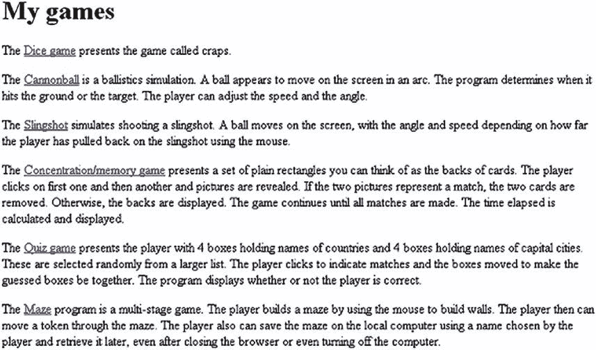
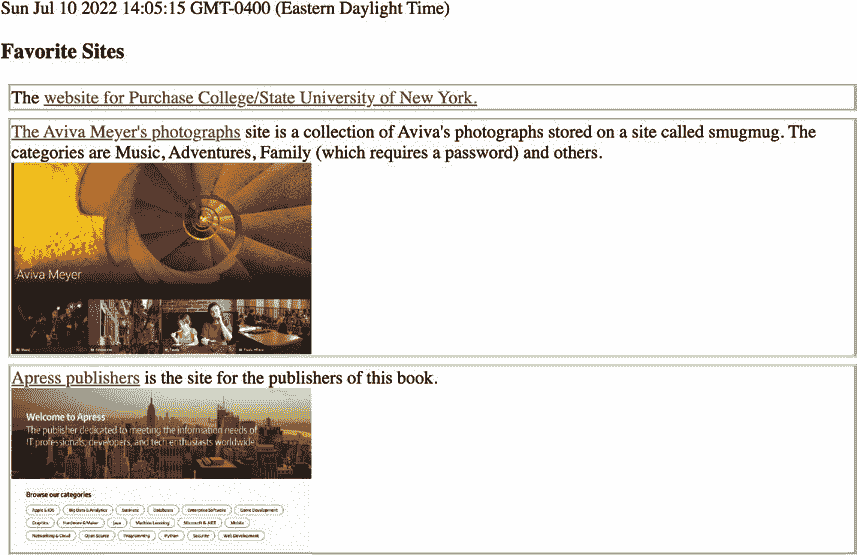
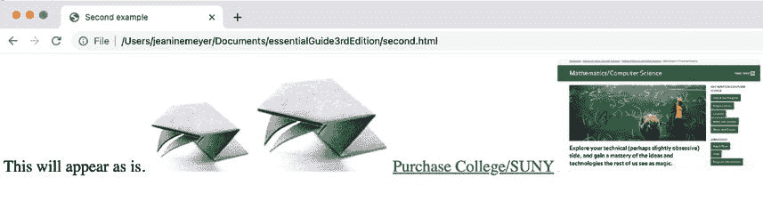
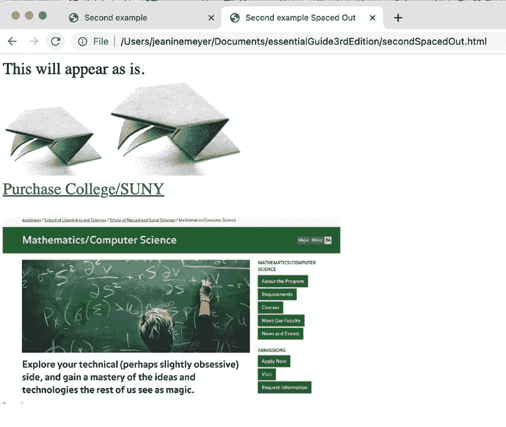

# 样式表（CSS）与使用 JavaScript 语言编写的交云程序

浏览器（如 Firefox 和 Chrome）会解析 HTML 以及附带的 CSS 和 JavaScript，最终呈现我们访问网站时所看到的内容。HTML 承载网站的内容，通过标签提供关于内容性质与结构的信息，以及对图片和其他媒体资源的引用。CSS 则负责设定格式。相同的内容可以用不同的方式排版。JavaScript 是一种用于让网站具有动态交互功能的编程语言。在稍具规模的工作组中，负责 HTML、CSS 和 JavaScript 的可能不是同一个人，但了解这些工具如何协同工作的基本知识始终是一个好主意。如果你已经熟悉 HTML 的基础知识，并且了解如何添加 CSS 和 JavaScript，可以跳过本章直接进入下一章。不过，在开始学习第一个核心示例之前，还是有必要浏览一下本章内容，以确保你对所有知识都已熟练掌握。

最新版本的 HTML（及其相关的 CSS 和 JavaScript）是 **HTML5**。它因具备许多令人兴奋的特性而备受关注，例如用于显示图片和动画的画布（canvas）、对视频和音频的支持，以及用于定义常见文档元素（如页眉、区块和页脚）的标签。你可以使用 HTML5 创建复杂且高度交互的网站。在撰写本文时，并非所有浏览器都支持全部特性，但你现在就可以开始学习 HTML5、CSS 和 JavaScript。学习 JavaScript 将让你接触到通用的编程概念，这对你日后学习其他编程语言，或在团队中与程序员合作都将大有裨益。

本书采用的方法是在具体示例的背景下解释 HTML5、CSS 和 JavaScript 的概念，其中大部分示例将是大家熟悉的游戏。在此过程中，我会使用一些小示例来演示特定的功能。理想情况下，这既能帮助你理解自己想做什么，也能让你学会如何去做。在我解释概念和细节时，你将清楚地知道我们前行的方向。

本章的任务是构建一个包含指向其他网站链接的网页。通过这个例子，你将基本了解 HTML 文档的结构，其中会涉及少量的 CSS 代码和 JavaScript 代码。对于这个以及其他示例，请思考如何让项目对你产生意义。这个页面可以是你自己项目的列表、你喜爱的网站，或者关于某个特定主题的网站集合。对于每个网站，你都会看到文本和一个超链接。第二个示例包含一些额外的格式，例如文本周围的边框、图片以及当天的日期和时间。图 1-1 和图 1-2 展示了我创建的例子。





**图 1-1.** 一个带注释的游戏列表

**图 1-2.** 喜爱的网站，包含额外格式

当你重新加载“喜爱的网站”页面时，日期和时间将根据你的计算机更新为当前的日期和时间。

#### 关键需求

这个链接列表应用的需求，是构建一个包含文本、链接和图片的网页最基本的需求。在图 1-1 所示的示例中，每个条目显示为一段。相比之下，在图 1-2 所示的示例中，每个条目周围都有一个边框。第二个示例还包含了图片以及获取当前星期、日期和时间的方法。后续的应用将需要更多讨论，但对于这个，我们将直接讲解如何使用 HTML、CSS 和 JavaScript 来实现它。

#### HTML5、CSS 和 JavaScript 特性

正如我提到的，HTML 文档是文本，那么我们如何指定链接、图片、格式和代码呢？答案在于标记，也就是标签。除了定义内容的 HTML，你通常还会看到 CSS 样式，它们既可以在 HTML 文档内部指定，也可以在外部文档中指定。你还可以加入用于交互的 JavaScript，同样可以在 HTML 文档内部或外部文档中指定。我们首先来看看如何构建简单的 HTML 标签，以及如何在同一个文档中添加内联的 CSS 和 JavaScript。

#### 基本的 HTML 结构和标签

一个 HTML 元素以开始标签开头，接着是元素内容，最后是结束标签。结束标签包含一个 `/` 符号，后跟元素类型，例如 `/head`。元素可以嵌套在其他元素内部。一个标准的 HTML 文档如下所示：

```html
<html>
<head>
<title>非常简单的示例
</title>
</head>
<body>
这段内容将原样显示。
</body>
</html>
```

请注意，我在这里缩进了嵌套的标签，使其更明显，但 HTML 本身会忽略这种缩进（即所谓的空白），你也不必在自己的文件中添加它。实际上，在本书的大部分示例中，我都不会缩进我的代码。

这个文档由 `html` 元素构成，以开始标签 `<html>` 开始，并以闭合标签 `</html>` 结束。

HTML 文档通常包含 `head` 和 `body` 元素，这个例子也是如此。这里的 `head` 元素包含一个 `title` 元素。HTML 标题在不同浏览器的不同位置显示。图 1-3 显示了 Chrome 浏览器标签页上的标题“非常简单的示例”。

**图 1-3.** Chrome 浏览器标签页上的 HTML 标题

在大多数情况下，你会在网页的 `body` 中创建一些你认为的标题，但那不会是 HTML 标题！图 1-3 也显示了网页的 `body`：一小段文本。注意，*html*、*head*、*title* 和 *body* 这些词并没有出现。标签“告诉”了浏览器如何显示这个 HTML 文档。

我们可以对文本做更多处理，但接下来让我们看看如何让图片显示出来。这需要用到 `img` 元素。与使用开始和结束标签的 `html`、`head` 和 `body` 元素不同，`img` 元素只使用一个标签，它被称为*单例*标签。它的元素类型是 `img`（而不是 `image`），你通过所谓的*属性*将所有信息放在标签内部。需要什么信息呢？最重要的是存放图片的文件名。标签

```html

```

告诉浏览器查找一个名为 *frog*、文件类型为 `.jpg` 的文件。在这种情况下，浏览器会在与 HTML 文件相同的目录或文件夹中查找。你也可以引用其他位置的图片文件，我将在后面演示。`src` 代表源（source），它被称为元素的一个属性。`>` 之前的斜杠表明这是一个单例标签。不同的元素类型有常见的属性，但大多数元素类型还有额外的属性。`img` 元素的另一个属性是 `width` 属性。

```html

```

这指定了图片应显示为 200 像素宽。高度则会根据原始宽高比自动调整。如果你想要指定的宽度和高度，即使这可能会扭曲图片，也可以同时指定 `width` 和 `height` 属性。

**提示** 你可能会看到一些示例（甚至可能是我写的），其中结尾的斜杠缺失了，但它们依然工作正常。不过，实践上通常建议包含它。同样，你也会看到一些示例中文件名周围没有引号。


#### HTML 基础

`HTML` 在语法（标点符号）方面比其他大多数编程系统更宽容。最后，你会看到一些以 `<!DOCTYPE>` 标签开头、并且 `<html>` 标签包含其他信息的 `HTML` 文档。目前我们不需要这些，所以我将尽可能保持简单（但引用爱因斯坦的话说，不能再简化了）。

##### 创建超链接

创建超链接类似于创建图像。超链接的元素类型是 `<a>`，关键属性是 `href`。

```html
<a href=http://www.purchase.edu>Purchase College website</a>
```

如你所见，这个元素有开始标签和结束标签。元素的内容（即两个标签之间的内容——本例中是 `Purchase College website`）会以蓝色显示并带有下划线。开始标签以 `<a>` 开头。记住这一点的一种方法是将其视为 `HTML` 中最重要的元素，因此它使用字母表的第一个字母。你也可以将其理解为锚点（anchor），这是 `<a>` 实际代表的含义，但对我来说这不太直观。`href` 属性（可理解为超文本引用）指定了单击超链接时浏览器跳转到的网站地址。注意，这是一个完整的网址（简称为统一资源定位符，即 URL）。

##### 绝对地址与相对地址

网址可以是绝对地址或相对地址。绝对地址以 `http://` 开头。相对地址是相对于 `HTML` 文件所在位置的地址。使用相对地址可以更轻松地将项目移动到不同的网站，并且你可以通过在引用开头使用 `../` 来指示上一级文件夹。

在收藏夹示例中，`avivasmugmug.png` 文件和 `apressshot.png` 文件位于与 `HTML` 文件相同的文件夹中。它们在那里是因为我把它放在那里了！对于大型项目，许多人将所有图像放在名为 `images` 的子文件夹中，并将地址写为 `images/postcard.gif`。文件管理是创建网页的重要组成部分。

##### 嵌套元素

我们可以将超链接元素与 `` 元素结合使用，以生成用户可点击的图像。请记住，元素可以嵌套在其他元素中。不要在起始的 `<a>` 标签后面放置文本，而是放入一个 `` 标签：

```html
<a href="http://apress.com">
  
</a>
```

让我们将这些概念应用于另一个示例：

```html
<html>
<head>
  <title>Second example</title>
</head>
<body>
  This will appear as is.
  
  
  <a href=http://faculty.purchase.edu/jeanine.meyer>Jeanine Meyer's Academic Activities</a>
  <a href=http://faculty.purchase.edu/jeanine.meyer></a>
</body>
</html>
```



我创建了 `HTML` 文件，将其保存为 `second.html`，然后在 Chrome 浏览器中打开。图 1-4 显示了显示效果。

**图 1-4.** 包含图像和超链接的示例

这会生成文本；原始宽度和高度的图像；宽度固定为 200 像素、高度成比例的图像；一个将带你进入 Purchase College 网站的超链接；以及另一个使用图像的超链接，该链接将带你进入 Purchase College 网站数学/计算机科学系的网页。然而，这并不完全符合我的设想。我希望这些元素在页面上垂直排列。

这演示了需要记住的一点：`HTML` 会忽略换行符和其他空白。如果你需要换行，必须显式指定。一种方法是使用 `<br/>` 单标签。稍后我将展示其他方法。请查看以下修改后的代码。

请注意，`<br/>` 标签不需要单独一行。

```html
<html>
<head>
  <title>Second example Spaced Out</title>
</head>
<body>
  This will appear as is. <br/>
  
   <br/>
  <a href="Error! Hyperlink reference not valid.">College/SUNY</a><br/> <br/>
  <a href=https://www.purchase.edu/academics/mathematics-computer-science/>
    
  </a>
</body>
</html>
```




