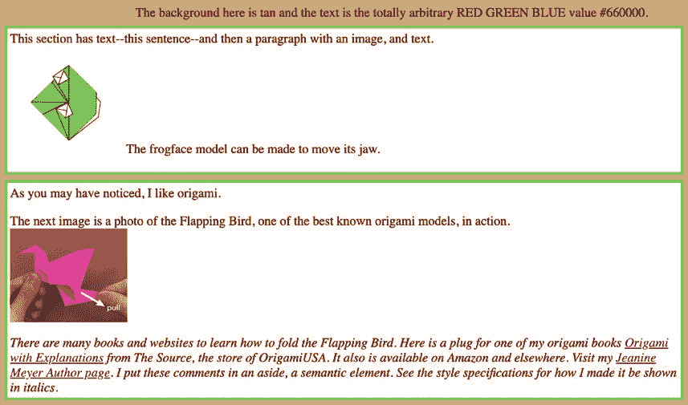
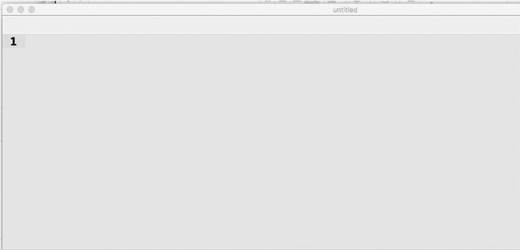

# 第 1 章 基础知识

`图 1-5`展示了这段代码生成的效果。请注意我更改了标题。我还决定将折纸青蛙图片保留在一起，并在指向 Purchase College/SUNY 的链接后添加了两个`<br/>`标签。

**图 1-5.** 带有换行的文本、图片和链接

HTML 元素类型有很多：`h1`到`h6`标题元素可生成不同大小的文本；列表和表格有各种元素，表单也有对应的元素。

正如我们稍后将看到的，CSS 也用于格式化。你可以选择不同的字体、背景颜色和文本颜色，并控制文档的布局。通常认为，将格式化内容放在 CSS 中，用 JavaScript 创建交互性，而 HTML 则只保留内容，这是一种良好的实践。HTML5 提供了新的结构元素——例如`article`、`section`、`footer`和`header`——将格式化内容放入`style`元素，并利用这些被称为*语义*标签的新元素，以便于与他人协作。然而，即使只有你一个人在工作，分离内容、格式化和行为也能让你轻松地更改格式和交互方式。

格式化（包括文档布局）是一个庞大的主题。在本书中，我将只讲解基础知识。

## 使用层叠样式表

CSS 是一种专门用于格式化的特殊语言。样式本质上是一条规则，用于指定特定元素将如何被格式化。这意味着你可以将样式信息放在多个位置：一个单独的文件、位于`head`元素中的`style`元素，或者 HTML 文档中的样式（可能放在你想以特定方式格式化的那个元素内）。样式信息会层叠（即向下传递），除非指定了不同的样式。换句话说，离元素最近的样式就是被使用的样式。例如，你可能会使用`head`元素中样式部分给出的公司官方字体，使其应用于大部分文本，但在局部元素内包含一个规范，用于对某一段特定文本进行样式设置。由于该样式离元素最近，因此它会被使用。

基本格式包括一个要被格式化的元素指示符，后跟一个或多个指令。在本章的示例中，我将指定`section`类型元素的格式，即每个项目周围的边框或方框、边距、内边距、对齐方式以及白色背景。`清单 1-1`中的完整 HTML 文档是各种功能的大杂烩（有人会说是一团糟！）。`body`和`p`（段落）元素是 HTML 原始版本的一部分。`section`元素是 HTML5 中新增的元素类型之一。与`body`和`p`不同（它们具有默认格式，每个`body`和`p`元素都会在新的一行开始），`section`元素确实需要格式化。

CSS 可以修改旧元素和新元素类型的格式。请注意，`section`内文本的背景颜色与`section`外文本的背景颜色不同。

在`清单 1-1`的代码中，我为`body`元素（只有一个）和`section`元素指定了样式。如果我有多个`section`元素，该样式将应用于每个元素。`body`的样式指定了背景颜色和文本颜色。

最初，浏览器只接受按名称定义的 16 种颜色，包括`black`、`white`、`red`、`blue`、`green`、`cyan`和`pink`。然而，现在的浏览器按名称接受 140 种颜色。

请参阅 `https://www.w3schools.com/colors/colors_names.asp`。

你也可以使用 RGB（红、绿、蓝）十六进制代码来指定颜色，但你需要使用图形程序——例如 Adobe Photoshop、Corel Paint Shop Pro 或 Adobe Flash Professional——来确定 RGB 值，或者你也可以自行尝试。我使用 Paint Shop Pro 确定了青蛙头部图片中绿色的 RGB 值，并将其同样用于边框。

## CSS 与 JavaScript 基础

`text-align` 指令顾名思义：它们指示内容是居中还是左对齐。`font-size` 设置文本的像素大小。

边框的处理比较棘手，且在不同浏览器中似乎不一致。这里我指定了一个 4 像素宽的纯绿色边框。`section` 元素的 `width` 规范指示浏览器应使用窗口宽度的 85%，无论窗口实际尺寸如何。`p` 元素的规范将段落宽度设置为 250 像素。`padding` 指的是文本与 `section` 边框之间的间距。`margin` 指的是 `section` 与其周围环境之间的间距。

**清单 1-1.** 一份带有样式的完整 HTML 文档

```
<html>
<head>
<title>CSS 示例</title>
<style>
body {
  background-color:tan;
  color: #660000;
  text-align:center;
  font-size:22px;
}
section {
  width:85%;
  border:4px #00FF63 solid;
  text-align:left;
  padding:5px;
  margin:10px;
  background-color: white;
}
p {
  width: 75%;
}
aside {
  font-style: italic;
}
</style>
</head>
<body>
这里的背景是棕褐色，文本是极为随意的红绿蓝 (RGB) 值 #660000。<br/>
<section>
此 section 包含文本——本句——以及一个包含图片和文本的段落。
<p>
 青蛙脸模型可以活动它的下巴。
</p>
</section>
<section>
你可能已经注意到，我喜欢折纸。<p> 下一张图片是著名折纸模型“拍动鸟”的动态照片。
<br/>
 </p>
<aside>有很多书籍和网站可以学习如何折叠拍动鸟。这里顺便推荐一本我的折纸书 <a href="https://origamiusa.org/catalog/products/origami-explanations">《折纸详解》</a>，来自 OrigamiUSA 的商店 The Source。亚马逊等平台也有售。欢迎访问我的 <a href="https://www.amazon.com/Jeanine-Meyer/e/B001JPA5SC%3Fref=dbs_a_mng_rwt_scns_share">Jeanine Meyer 作者页面</a>。我将这些评论放在了 aside（一个语义元素）中。请参阅我如何通过样式规范使其以斜体显示。</aside>
</aside>
</section>
</body>
</html>
```



这会产生如图 1-6 所示的屏幕显示效果。

**图 1-6.** CSS 样式使用示例

**提示** 如果你不能立刻理解所有内容，不必担心。修改这些示例，并自己动手创建。你可以在网上找到大量帮助。特别是，请参阅 HTML 5 的官方来源 `http://dev.w3.org/html5/spec/Overview.html`。

CSS 能做到的事情非常多。你可以像这里展示的那样，用它来指定各类元素的格式；可以指定元素属于某个类；还可以使用 `id` 属性来标识单个元素。在第 6 章中，我们将创建一个测验，届时我会使用 CSS 来定位窗口中的特定元素，然后用 JavaScript 来移动它们。

### JavaScript 编程

JavaScript 是一种编程语言，具有访问 HTML 文档各部分（包括 CSS 元素中的样式）的内置功能。它被称为*脚本语言*，以区别于诸如 C++ 之类的编译语言。编译语言在使用前会被一次性整体翻译，而脚本语言则由浏览器逐行解释执行。本书假设读者没有编程经验或 JavaScript 知识基础，但参考其他书籍可能会有帮助，例如 Terry McNavage 所著的 *Getting Started with JavaScript*（friends of ED，2010 年），或诸如 `http://en.wikipedia.org/wiki/JavaScript` 等在线资源。

每个浏览器都拥有其自己的 JavaScript 版本。

HTML 文档将 JavaScript 存放在位于 `head` 元素内的 `script` 元素中。为了显示如图 1-2 所示的日期和时间信息，我将以下内容放在了 HTML 文档的 `head` 元素中：

```
<script>
document.write(Date());
</script>
```

JavaScript 与其他编程语言一样，由各种类型的语句组成。在后续章节中，我将向你展示赋值语句、复合语句（如 `if`、`switch` 和 `for` 语句），以及创建所谓*程序员自定义函数*的语句。函数是一个或多个语句的集合，它们在一个代码块中协同工作，并且可以在需要相应功能时随时调用。函数避免了重复编写相同的代码。JavaScript 提供了许多内置函数。某些函数与对象相关联（稍后详述），被称为*方法*。

代码 `document.write("hello");` 是一条 JavaScript 语句，它调用 `document` 对象的 `write` 方法，并传入参数 `"hello"`。参数是传递给函数或方法的附加信息。语句以分号结尾。这段代码将输出字符串字面量 `h`、`e`、`l`、`l`、`o`，作为 HTML 文档的一部分。

`document.write` 方法会输出括号内的任何内容。由于我希望输出的信息能随时间和日期的变化而更新，我需要一种方法来获取当前的日期和时间，所以我使用了 JavaScript 内置的 `Date` 函数。

这个函数会产生一个包含日期和时间的对象。稍后，你将看到如何使用 `Date` 对象来计算玩家完成游戏所需的时间。目前，我只想展示当前的日期和时间信息，而这正是这段代码所做的：

```
document.write(Date());
```

用正式的编程语言来说：这段代码调用（触发）了 `document` 对象（一段内置代码）的 `write` 方法。点号 (`.`) 表示要调用的 `write` 是与 HTML 文件生成的文档相关联的一个方法。所以，会有内容被写入 HTML 文档的一部分。写入的是什么呢？是左括号和右括号之间的内容。那又是什么呢？是调用内置函数 `Date` 的结果。`Date` 函数获取本地计算机维护的信息，并将其传递给 `write` 方法。

`Date` 函数本身也需要使用括号，这就是为什么你会看到这么多括号。`write` 方法将日期和时间信息显示为 HTML 文档的一部分，如图 1-2 所示。这些结构组合在一起的方式是编程语言的典型特征。语句以分号结尾。为什么不用句号？句号在 JavaScript 中有其他用途，例如指示方法或用作数字的小数点。

像英语这样的自然语言与编程语言有很多共同之处——不同类型的语句；使用特定符号的标点；以及元素正确放置的语法。在编程中，我们使用术语 `符号`（notation）来代替标点（punctuation），使用 `语法`（syntax）来代替语法（grammar）。编程语言和自然语言都允许你使用不同的部分构建非常复杂的语句。然而，有一个根本的区别：正如我告诉学生的，我在课堂上说的话很可能并非都符合语法，但他们仍然能理解我。但是，当你通过编程语言与计算机“交谈”时，你的代码必须完全符合该语言的语法规则才能达到目的。好消息是，与人类听众不同，计算机不会表现出不耐烦或任何其他人类情绪，所以你可以花必要的时间把代码写正确。也有一些坏消息，可能需要你花点时间才能体会。如果你在 HTML、CSS 或 JavaScript 中犯了语法错误（称为 `语法错误`），浏览器仍然会尝试显示一些内容。当你没有得到想要的工作结果时，就得靠你自己去弄清楚问题出在哪里以及是什么问题。



## 使用文本编辑器