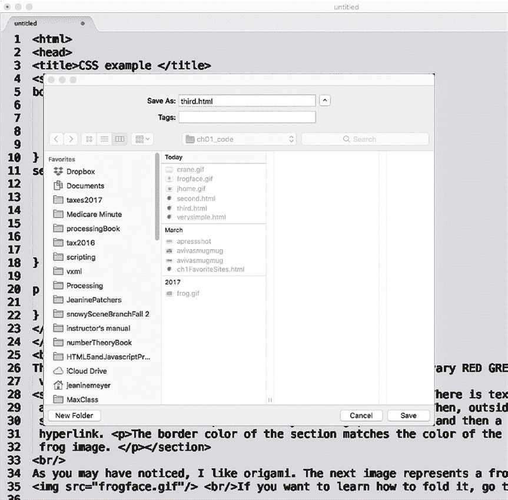
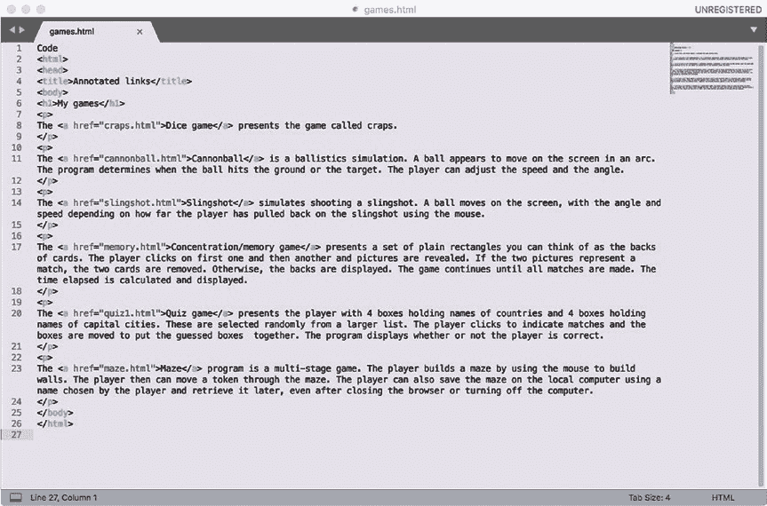

# 第 1 章：基础知识

你需要使用文本编辑器编写 HTML 文档，并通过浏览器查看/测试/运行文档。虽然你可以使用任何文本编辑器编写 HTML，但我建议在 PC 上使用 `TextPad`，在 Mac 上使用 `Sublime`。这些是共享软件，因此价格相对较低。建议你考虑捐赠！不要使用文字处理程序，因为它可能会插入非文字字符。`Notepad` 也可以使用，不过其他工具具有颜色编码等优势，稍后我会演示。使用编辑器时，打开它并输入代码即可。图 1-7 展示了 `Sublime` 屏幕的样式。

***图 1-7.** 在 Sublime 中开始编写代码*

你需要频繁保存工作，最重要的是，将文件保存为 `.html` 类型。从一开始就这样做，就能获得颜色编码的好处。在 `Sublime` 中，选择**文件** ➤ **另存为**，然后输入带有 `.html` 扩展名的文件名，如图 1-8 所示。

***图 1-8.** 将文件保存为 HTML 类型*

请注意，我为文件指定了名称和扩展名，并且还指定了文件存放的文件夹。保存文件后，窗口会如图 1-9 所示，带有颜色编码。

***图 1-9.** 保存为 HTML 后的文件*

颜色编码仅在文件保存为 HTML 后可见，用于指示标签和引号字符串。这对于捕捉许多错误非常有价值。`Sublime` 和其他编辑器确实提供了更改颜色方案的选项。假设你使用的是图中所示方案，如果看到大段黄色（引号字符串的颜色），很可能意味着缺少右引号。顺便说一下，你可以使用单引号或双引号，但不能混用。此外，如果你从 Word 或 PowerPoint 中复制粘贴所谓“智能”引号（弯曲的引号），这会导致问题。

#### 构建应用程序

HTML 文档的源代码通常包含一个 HTML 文档和其他文件。

- `simple.html` 文件本身是完整的，如图 1-3 所示。
- `second.html` 应用程序如图 1-4 所示，而 `secondspacedout.html` 如图 1-5 所示。其中引用了两个图像文件：`frog.gif` 两次和 `jhome.gif` 一次。
- 带有花哨颜色的 `third.html` 文件引用了两个图像文件：`frogface.gif` 和 `flappingbird.png`。
- `games.html` 文件本身是完整的，因为它没有引用任何图像文件。如果 `<a>` 标签的 `href` 属性中提到的文件不存在，则单击超链接时会显示错误消息。
- `FavoriteSites.html` 文件引用了两个图像文件：`avivasmugmug.jpeg` 和 `apressshot.jpeg`。

跟踪文件是构建 HTML 应用程序的关键部分。

现在让我们逐条深入分析 HTML 编码语句，首先是描述游戏的注释链接列表，然后是收藏站点。代码使用了上一节中描述的功能。表 1-1 显示了生成图 1-1 所示界面的完整代码：包含指向同一文件夹中不同文件的链接的文本段落。

***表 1-1.** “我的游戏”注释链接代码*

| **代码** | **解释** |
|----------|-----------------|
| `<html>` | 开头的 `<html>` 标签。 |
| `<head>` | 开头的 `<head>` 标签。 |
| `<title>注释链接</title>` | 开头的 `<title>` 标签、标题文本和结尾的 `</title>` 标签。 |
| `</head>` `<body>` | 开头的 `<body>` 标签。 |
| `<h1>我的游戏</h1>` | 开头的 `<h1>` 标签、文本和结尾的 `</h1>` 标签。这将使“我的游戏”以大字显示。实际字体为默认字体。 |
| `
` | 段落标签 `
` 的开始。 |
| `指向 <a href="craps.html">骰子游戏</a> 的链接呈现了该游戏` | 带有 `<a>` 元素的文本。开头的 `<a>` 标签具有 |

