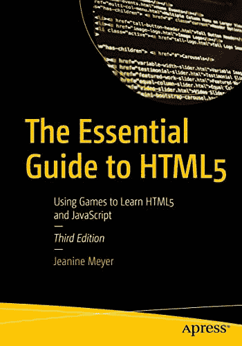

# HTML5 全面指南

## 通过游戏学习 HTML5 与 JavaScript

### 第三版

**珍妮·迈耶**

*HTML5 全面指南：通过游戏学习 HTML5 与 JavaScript*

珍妮·迈耶

美国纽约州普切斯

ISBN-13（平装）：978-1-4842-8721-7
ISBN-13（电子版）：978-1-4842-8722-4

[`doi.org/10.1007/978-1-4842-8722-4`](https://doi.org/10.1007/978-1-4842-8722-4)

版权所有 © 2023 珍妮·迈耶

本作品受版权保护。出版商保留所有权利，无论涉及全部或部分材料，具体包括翻译、重印、插图再利用、朗诵、广播、微缩胶片复制或任何其他物理形式复制，以及电子改编、计算机软件，或通过目前已知或未来开发的任何类似或不同方法进行的信息存储与检索。

书中可能出现商标名称、徽标和图片。对于每次出现的商标名称、徽标和图片，我们并非都使用商标符号，而是仅以编辑方式使用这些名称、徽标和图片，以维护商标所有者的利益，且无意侵犯商标权。

本出版物中对商品名称、商标、服务标志及类似术语的使用，即使未明确标识，也不应被视作对其是否受专有权利保护的表达意见。

尽管本书中的建议和信息在出版时被认为是真实和准确的，但作者、编辑和出版商均不对可能出现的任何错误或遗漏承担法律责任。出版商对本书所包含的材料不作任何明示或暗示的保证。

Apress Media LLC 总经理：Welmoed Spahr
收购编辑：Divya Modi
开发编辑：James Markham
协调编辑：Divya Modi
文字编辑：Kim Wimpsett
封面设计：eStudioCalamar
封面图片设计：Freepik (`www.freepik.com`)

本书通过 Springer Science+Business Media New York 在全球图书贸易中发行，地址：233 Spring Street, 6th Floor, New York, NY 10013。电话：1-800-SPRINGER，传真：(201) 348-4505，电子邮件：`orders-ny@springersbm.com`，或访问 `www.springeronline.com`。Apress Media, LLC 是加利福尼亚州有限责任公司，其唯一成员（所有者）是 Springer Science + Business Media Finance Inc (SSBM Finance Inc)。SSBM Finance Inc 是特拉华州的一家公司。

如需了解翻译相关信息，请发送电子邮件至 `booktranslations@springernature.com`；如需重印、平装版或音频版权，请发送电子邮件至 `bookpermissions@springernature.com`。

Apress 图书可批量购买用于学术、企业或促销用途。大多数图书也提供电子书版本和许可证。有关更多信息，请参阅我们的印刷版和电子版批量销售网页：`www.apress.com/bulk-sales`。

作者在本书中引用的任何源代码或其他补充材料，读者可通过 GitHub 在本书的产品页面上获取，地址为 [`github.com/Apress/The-Essential-Guide-to-HTML5-3rd-Edition-by-Jeanine-Meyer`](https://github.com/Apress/The-Essential-Guide-to-HTML5-3rd-Edition-by-Jeanine-Meyer)。如需更详细信息，请访问 [`www.apress.com/source-code`](http://www.apress.com/source-code)。

采用无酸纸印刷

*献给 Annika、Daniel、Aviva 和 Anne，以及仍在陪伴我们的 Esther 和 Joseph。*

## 目录

关于作者 xi
关于技术审校 xiii
致谢 xv
引言 xvii
第 1 章：[基础](https://doi.org/10.1007/978-1-4842-8722-4_1) 1
[关键词](https://doi.org/10.1007/978-1-4842-8722-4_1#Sec1) 1
[引言](https://doi.org/10.1007/978-1-4842-8722-4_1#Sec2) 1
[关键需求](https://doi.org/10.1007/978-1-4842-8722-4_1#Sec3) 4
[HTML5、CSS 和 JavaScript 特性](https://doi.org/10.1007/978-1-4842-8722-4_1#Sec4) 4
[基本 HTML 结构与标签](https://doi.org/10.1007/978-1-4842-8722-4_1#Sec5) 4
[使用层叠样式表](https://doi.org/10.1007/978-1-4842-8722-4_1#Sec6) 10
[JavaScript 编程](https://doi.org/10.1007/978-1-4842-8722-4_1#Sec7) 14
[使用文本编辑器](https://doi.org/10.1007/978-1-4842-8722-4_1#Sec8) 16
[构建应用程序](https://doi.org/10.1007/978-1-4842-8722-4_1#Sec9) 19

## 目录

- [测试与上传应用程序](https://doi.org/10.1007/978-1-4842-8722-4_1#Sec10) 25
- [总结](https://doi.org/10.1007/978-1-4842-8722-4_1#Sec11) 26

## 第 2 章：骰子游戏

- [引言](https://doi.org/10.1007/978-1-4842-8722-4_2#Sec1) 27
- [关键需求](https://doi.org/10.1007/978-1-4842-8722-4_2#Sec2) 30
- [HTML5、CSS 和 JavaScript 特性](https://doi.org/10.1007/978-1-4842-8722-4_2#Sec3) 31
- [伪随机处理与数学表达式](https://doi.org/10.1007/978-1-4842-8722-4_2#Sec4) 32
- [变量与赋值语句](https://doi.org/10.1007/978-1-4842-8722-4_2#Sec5) 33
- [程序员定义的函数](https://doi.org/10.1007/978-1-4842-8722-4_2#Sec6) 35
- [条件语句：`if` 和 `switch`](https://doi.org/10.1007/978-1-4842-8722-4_2#Sec7) 37
- [在画布上绘图](https://doi.org/10.1007/978-1-4842-8722-4_2#Sec8) 40
- [使用表单显示文本输出](https://doi.org/10.1007/978-1-4842-8722-4_2#Sec9) 51
- [构建应用程序并使其独具特色](https://doi.org/10.1007/978-1-4842-8722-4_2#Sec10) 52
- [投掷一个骰子](https://doi.org/10.1007/978-1-4842-8722-4_2#Sec11) 54
- [投掷两个骰子](https://doi.org/10.1007/978-1-4842-8722-4_2#Sec12) 61
- [完整的“双骰”游戏](https://doi.org/10.1007/978-1-4842-8722-4_2#Sec13) 68
- [打造个性化应用](https://doi.org/10.1007/978-1-4842-8722-4_2#Sec14) 76
- [测试与上传应用程序](https://doi.org/10.1007/978-1-4842-8722-4_2#Sec15) 78
- [总结](https://doi.org/10.1007/978-1-4842-8722-4_2#Sec16) 79

## 第 3 章：弹跳球

- [引言](https://doi.org/10.1007/978-1-4842-8722-4_3#Sec1) 81
- [关键要求](https://doi.org/10.1007/978-1-4842-8722-4_3#Sec2) 86
- [HTML5、CSS 和 JavaScript 特性](https://doi.org/10.1007/978-1-4842-8722-4_3#Sec3) 87
- [绘制球体或图像](https://doi.org/10.1007/978-1-4842-8722-4_3#Sec4) 88
- [渐变色与数组简析](https://doi.org/10.1007/978-1-4842-8722-4_3#Sec5) 91
- [设置定时事件](https://doi.org/10.1007/978-1-4842-8722-4_3#Sec6) 96
- [计算新位置与碰撞检测](https://doi.org/10.1007/978-1-4842-8722-4_3#Sec7) 98
- [使用匿名函数启动、定位和重启视频](https://doi.org/10.1007/978-1-4842-8722-4_3#Sec1000) 102
- [验证](https://doi.org/10.1007/978-1-4842-8722-4_3#Sec8) 102
- [由按钮触发的动画暂停与恢复](https://doi.org/10.1007/978-1-4842-8722-4_3#Sec9) 104
- [HTML 页面重新加载](https://doi.org/10.1007/978-1-4842-8722-4_3#Sec10) 105
- [预加载图像](https://doi.org/10.1007/978-1-4842-8722-4_3#Sec11) 105
- [构建应用程序并使其独具特色](https://doi.org/10.1007/978-1-4842-8722-4_3#Sec12) 106
- [测试与上传应用程序](https://doi.org/10.1007/978-1-4842-8722-4_3#Sec13) 129
- [总结](https://doi.org/10.1007/978-1-4842-8722-4_3#Sec14) 130

## 第 4 章：炮弹与弹弓

- [引言](https://doi.org/10.1007/978-1-4842-8722-4_4#Sec1) 131
- [关键要求](https://doi.org/10.1007/978-1-4842-8722-4_4#Sec2) 135
- [HTML5、CSS 和 JavaScript 特性](https://doi.org/10.1007/978-1-4842-8722-4_4#Sec3) 136
- [数组与程序员自定义对象](https://doi.org/10.1007/978-1-4842-8722-4_4#Sec4) 137
- [用于绘图的旋转与平移](https://doi.org/10.1007/978-1-4842-8722-4_4#Sec5) 139
- [绘制线段](https://doi.org/10.1007/978-1-4842-8722-4_4#Sec6) 145
- [用于拉动弹弓的鼠标事件](https://doi.org/10.1007/978-1-4842-8722-4_4#Sec7) 147
- [使用数组拼接更改显示的项目列表](https://doi.org/10.1007/978-1-4842-8722-4_4#Sec8) 149
- [点之间的距离](https://doi.org/10.1007/978-1-4842-8722-4_4#Sec9) 150
- [构建应用程序并使其独具特色](https://doi.org/10.1007/978-1-4842-8722-4_4#Sec10) 151
- [炮弹：结合加农炮、角度与速度](https://doi.org/10.1007/978-1-4842-8722-4_4#Sec11) 158

## 第 4 章：弹弓

- [弹弓：使用鼠标设定飞行参数](https://doi.org/10.1007/978-1-4842-8722-4_4#Sec12) 168
- [测试与上传应用程序](https://doi.org/10.1007/978-1-4842-8722-4_4#Sec13) 179
- [总结](https://doi.org/10.1007/978-1-4842-8722-4_4#Sec14) 180

## 第 5 章：记忆（又称“配对”）游戏

- [引言](https://doi.org/10.1007/978-1-4842-8722-4_5#Sec1) 181
- [关键需求](https://doi.org/10.1007/978-1-4842-8722-4_5#Sec2) 188
- [HTML5、CSS、JavaScript 功能](https://doi.org/10.1007/978-1-4842-8722-4_5#Sec3) 189
- [表示卡牌](https://doi.org/10.1007/978-1-4842-8722-4_5#Sec4) 190
- [使用 `Date` 进行计时](https://doi.org/10.1007/978-1-4842-8722-4_5#Sec5) 191
- [提供暂停功能](https://doi.org/10.1007/978-1-4842-8722-4_5#Sec6) 192
- [绘制文本](https://doi.org/10.1007/978-1-4842-8722-4_5#Sec7) 193
- [绘制多边形](https://doi.org/10.1007/978-1-4842-8722-4_5#Sec8) 196
- [洗牌](https://doi.org/10.1007/978-1-4842-8722-4_5#Sec9) 198
- [实现卡牌点击](https://doi.org/10.1007/978-1-4842-8722-4_5#Sec10) 199
- [防止特定类型的作弊](https://doi.org/10.1007/978-1-4842-8722-4_5#Sec11) 200
- [构建应用并使其成为你自己的](https://doi.org/10.1007/978-1-4842-8722-4_5#Sec12) 201
- [测试与上传应用](https://doi.org/10.1007/978-1-4842-8722-4_5#Sec13) 223
- [总结](https://doi.org/10.1007/978-1-4842-8722-4_5#Sec14) 224

## 第 6 章：测验

- [引言](https://doi.org/10.1007/978-1-4842-8722-4_6#Sec1) 225
- [测验游戏的关键需求](https://doi.org/10.1007/978-1-4842-8722-4_6#Sec2) 230
- [HTML5、CSS 与 JavaScript 功能](https://doi.org/10.1007/978-1-4842-8722-4_6#Sec3) 231
- [在数组中存储与检索信息](https://doi.org/10.1007/978-1-4842-8722-4_6#Sec4) 231
- [程序执行期间创建 HTML](https://doi.org/10.1007/978-1-4842-8722-4_6#Sec5) 234
- [在 `Style` 元素中使用 CSS](https://doi.org/10.1007/978-1-4842-8722-4_6#Sec6) 236
- [响应玩家操作](https://doi.org/10.1007/978-1-4842-8722-4_6#Sec7) 237
- [呈现音频与视频](https://doi.org/10.1007/978-1-4842-8722-4_6#Sec8) 238
- [检查玩家答案](https://doi.org/10.1007/978-1-4842-8722-4_6#Sec9) 240
- [构建应用并使其成为你自己的](https://doi.org/10.1007/978-1-4842-8722-4_6#Sec10) 241
- [测试与上传应用](https://doi.org/10.1007/978-1-4842-8722-4_6#Sec11) 252
- [总结](https://doi.org/10.1007/978-1-4842-8722-4_6#Sec12) 253

## 第 7 章：迷宫

- [关键词](https://doi.org/10.1007/978-1-4842-8722-4_7#Sec1) 255
- [引言](https://doi.org/10.1007/978-1-4842-8722-4_7#Sec2) 255
- [关键需求](https://doi.org/10.1007/978-1-4842-8722-4_7#Sec3) 263
- [HTML5、CSS 与 JavaScript 功能](https://doi.org/10.1007/978-1-4842-8722-4_7#Sec4) 264
- [墙壁与标记的表示](https://doi.org/10.1007/978-1-4842-8722-4_7#Sec5) 264
- [用于建造与定位墙壁的鼠标事件](https://doi.org/10.1007/978-1-4842-8722-4_7#Sec6) 265
- [检测方向键](https://doi.org/10.1007/978-1-4842-8722-4_7#Sec7) 266
- [碰撞检测：标记与任意墙壁](https://doi.org/10.1007/978-1-4842-8722-4_7#Sec8) 268
- [使用本地存储](https://doi.org/10.1007/978-1-4842-8722-4_7#Sec9) 271
- [为本地存储编码数据](https://doi.org/10.1007/978-1-4842-8722-4_7#Sec10) 279
- [单选按钮](https://doi.org/10.1007/978-1-4842-8722-4_7#Sec11) 281
- [构建应用并使其成为你自己的](https://doi.org/10.1007/978-1-4842-8722-4_7#Sec12) 282
- [创建旅行迷宫应用](https://doi.org/10.1007/978-1-4842-8722-4_7#Sec13) 295
- [测试与上传应用](https://doi.org/10.1007/978-1-4842-8722-4_7#Sec14) 306
- [总结](https://doi.org/10.1007/978-1-4842-8722-4_7#Sec15) 307

## 第 8 章：石头、剪刀、布

- 引言
- 关键需求
- HTML5、CSS 和 JavaScript 特性
- 为玩家提供图形按钮
- 生成电脑的移动
- 使用动画显示结果
- 音频与 DOM 处理
- 开始上手
- 构建应用并加入个人特色
- 测试与上传应用
- 总结

## 第 9 章：猜单词

- 引言
- 关键需求
- HTML5、CSS 和 JavaScript 特性
- 将单词列表存储为外部脚本文件中定义的数组
- 生成并定位 HTML 标记，然后将标记改为按钮，再禁用按钮
- 创建关于剩余错误字母的反馈
- 维护游戏状态并判定胜负
- 通过设置 `textContent` 检查猜测结果并揭示秘密单词中的字母
- 构建应用并加入个人特色
- 测试与上传应用
- 总结

## 第 10 章：二十一点

- 引言
- 关键需求
- HTML5、CSS 和 JavaScript 特性
- 牌面图片的来源与图像对象的设置
- 为纸牌创建程序员自定义对象
- 开始一局游戏
- 发牌
- 洗牌
- 捕获按键输入
- 使用 `<header>` 和 `<footer>` 元素类型
- 构建应用并加入个人特色
- 测试与上传应用
- 总结

## 附录：更多绘图技巧

- 圆形与箭头
- 概述
- 实现细节
- 学到的内容
- 跨线（越栏）绘制

# 文档排版

## 使用标量矢量图形

### 使用 SVG 绘制 HTML5 徽标

**概述**

**实现细节**

### 使用 SVG 绘制并修改卡通图形

**概述**

**实现细节**

## 索引

## 关于作者

`珍妮·迈耶`（Jeanine Meyer）是纽约州立大学帕切斯学院的荣誉教授，曾任数学/计算机科学学科委员会协调员。在帕切斯学院任教之前，她曾在佩斯大学执教，更早时则作为研究人员和管理人员在 IBM 研究院从事机器人及制造研究，并担任 IBM 教育资助计划的顾问。她是十本书籍的作者或合著者，主题涵盖多媒体的教育应用、编程（其中三本由 Apress/Springer 出版）、数据库、数论以及折纸艺术。

她于纽约大学库朗研究所获得计算机科学博士学位，于哥伦比亚大学获得数学硕士学位，并于芝加哥大学获得数学学士学位（该校使用拉丁文形式 SB）。她是美国大学优等生荣誉协会（Phi Beta Kappa）、科学研究荣誉学会（Sigma Xi）、美国女性科学协会（Association for Women in Science）以及美国计算机协会（Association for Computing Machinery）的成员，并曾担任《ACM 计算评论》的特约审稿人。

对珍妮而言，编程既是爱好也是职业。她每天都会在线玩电脑解谜游戏（包括《与朋友一起玩单词》、各种单人纸牌游戏，以及被她视为游戏的西班牙语学习应用 Duolingo）。她还参与《达夫经》（Daf Yomi），一项为期七年半的塔木德研究，其中确实包含解谜元素。她经常尝试《纽约时报》的填字游戏，但在迷你填字、KenKen 和 Two Not Touch 上的表现更佳，有时还会与孩子们一较高下。她享受烹饪、烘焙、美食、园艺、旅行以及适度的散步。她怀念自己的母亲——她激励了许多家庭成员学习钢琴——以及父亲——他赋予了珍妮对谜题的热爱。她也是一位积极为进步事业和候选人提供志愿服务的志愿者。

## 关于技术审校

`瓦迪姆·阿塔马年科`（Vadim Atamanenko）是一位拥有超过 20 年经验的软件开发人员。他曾在国际黑客马拉松中担任评委和导师，并且是哈佛广场商业协会的成员。

他在多个业务领域开发了许多复杂的解决方案，帮助成千上万人实现了手动流程的自动化。

目前，他是 Freedom Holding Corp. 的首席信息官，但仍会抽时间定期参加国际 IT 会议。

他喜欢结识新朋友并分享知识。如果您有问题请教他，请访问 [`www.linkedin.com/in/vadim-atamanenko/`](https://www.linkedin.com/in/vadim-atamanenko/)。

## 致谢

衷心感谢我在纽约州立大学帕切斯学院的学生和同事们，感谢他们的启发、激励和支持；也感谢我的家人和朋友们，他们包容我在课程和书籍中大量使用家庭照片和视频片段。

感谢 Apress 和 Springer 团队的所有付出。

## 引言

HTML5 首次发布时，其新功能引起了巨大的热情，甚至有人提出仅凭这一技术就足以创建动态、引人入胜的交互式网站，无需其他技术或产品。这种兴奋感并未消退，新特性至今仍然令人振奋。HTML 即是 HTML5。现在，仅使用 HTML、层叠样式表（CSS）和 JavaScript，就可以在屏幕上绘制线条、弧线、圆形和椭圆形，并指定事件及事件处理程序，从而实现动画效果和响应用户操作。您可以在网站上嵌入带标准控件的视频和音频，并能在应用程序中精确控制其出现的时间和位置。您可以创建能够验证输入并为用户提供即时反馈的表单。您可以使用类似 Cookie 的功能在客户端计算机上存储信息。此外，您还可以使用页眉、页脚等新元素来帮助组织文档结构。HTML、CSS 和 JavaScript 协同工作。您可以使用 JavaScript 创建新的 HTML 元素，而 CSS 的功能则为此提供了便利。

本书基于我的教学实践和过往著作。深入探究一项技术的特性或通用的编程概念，最好是在有需求、有情境的条件下进行。游戏，尤其是那些熟悉且简单的，正好提供了这种情境，从而也提供了学习动机和大量解释说明。在学习一门新编程语言时，我的第一步往往是编写一个“双骰子赌戏”（craps）游戏。此外，如果我能构建一个包含动画效果的弹道模拟，比如弹弓游戏，并在特定条件触发时播放一段视频或音频片段，我就会感到非常开心。如果我能构建自己的墙壁迷宫，设计视觉和文本双重反馈方式，并在玩家电脑上存储信息，那我简直欣喜若狂。这正是我们将在本书中要做的事情。

在学会如何构建这些简单游戏的过程中，你的专业技能也会一并提升。我希望你能继续创作出更多令人兴奋、引人入胜的应用程序。

本书的写作目标，是在 Apress 工作人员和技术审校的大力帮助下，向您介绍编程，并以实现交互式网站与他人分享为动力。

- 在本书更新之际，浏览器对 HTML5 功能的支持已接近全面。这些应用程序已使用 Chrome 和 Safari 浏览器进行测试。不过，务必牢记浏览器是会发生变化的。

- 我的重点是纯 HTML 和 JavaScript，因为我的经验表明，掌握基础知识和经验是最好的入门方式。各种框架和库已经存在，并持续被开发和优化，在某个阶段，研究这些工具是合适的。如果你在采用特定工具的组织中工作，这一点尤其重要。在熟悉了基础知识之后，你可以再转向这些主题。请注意，我已经更新了我的《HTML5 and JavaScript Projects》一书，其复杂度相比本书更进了一步。

## 本书适合谁？

本书适合那些想了解 HTML、JavaScript 和层叠样式表如何用于构建动态、令人兴奋的网站的人。如果你对编程有一定了解，并想了解当前版本的 HTML 和 JavaScript 提供了什么，那么本书适合你。如果你完全没有编程经验，本书同样适合你。也许你是一位网页设计师或网站所有者，你想了解如何在幕后实现功能，或者如何向程序员提出功能需求。

通过本书，我们希望展示 HTML5 的（较）新特性，并揭开其神秘面纱。

# 编程的艺术

编程是一门艺术，创作吸引人的游戏和其他应用程序需要天赋，也需要关注受众。然而，如果你能够将词语组合成句子，再将句子组合成段落，那么你就能够编程。

## 本书结构

本书包含十个章节和一个附录，每个章节都围绕一个熟悉的游戏或类似应用程序展开。各章节之间存在大量重复内容，因此你可以按需跳跃阅读，不过随着书籍推进，游戏会变得越来越复杂。

每个章节首先描述应用程序，并列出将要涉及的技术特性和编程概念。我们首先从宏观角度审视关键需求：实现该应用程序所需的条件，这独立于任何具体技术。接着，我们聚焦于满足这些需求的 HTML5、JavaScript、层叠样式表以及通用编程方法论的特征。最后，我们详细审视每个应用程序的实现过程。我以表格形式逐行解析代码，并在每行旁附有注释。在描述某个游戏有多个版本的情况下，可能只详细解释新增的代码行。这并非为了剥夺你的信息，而是鼓励你观察哪些是相同点、哪些是不同点，并演示如何分阶段构建应用程序。根据需要查阅附有注释的程序是完全可以的。每个章节都包含如何将应用程序个性化、如何测试以及如何将应用程序上传到网站的建议。每章末尾的总结部分会突出你学到的内容以及后续章节的看点。

本版新增的附录提供了更高级的示例，演示如何使用代数与几何以及标量矢量图形图像来创建和操作屏幕上的图形。

## 本书使用的约定

本书中的应用程序均为 HTML 文档。JavaScript 代码位于 `head` 元素内的 `script` 元素中，CSS 位于 `head` 元素内的 `style` 元素中。`body` 元素包含静态 HTML，包括任何 `canvas` 元素。有几个示例依赖于外部图像文件，一个示例需要外部视频文件和音频文件，另一个示例需要外部音频文件。

### 排版约定

为尽可能保持本书清晰易读，全书使用了以下文本约定：

- 代码以等宽字体呈现。
- 每个应用程序的完整代码以表格形式呈现，每条语句都附有注释进行解释。
- 伪代码以斜体等宽字体书写。
- 有时代码在一行内无法完全展示。这种情况下，我会使用箭头（`↪`）表示换行。

好了，客套话说完，让我们开始吧。
