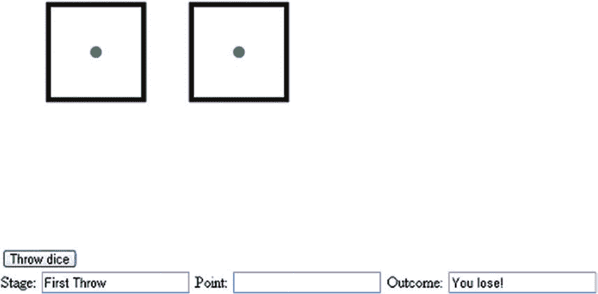
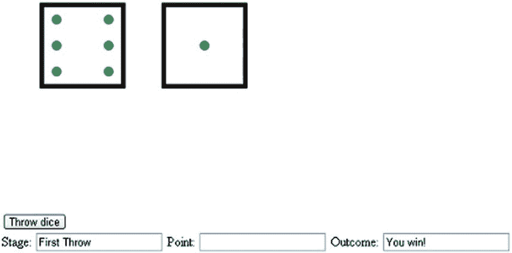
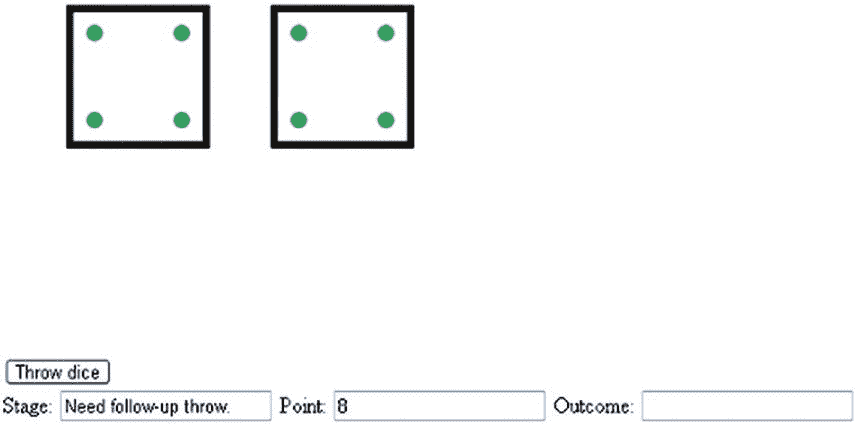
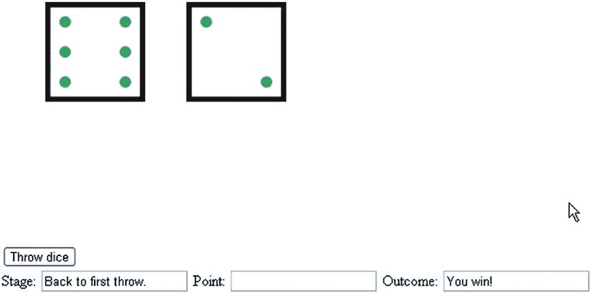

# 骰子游戏

在本章中，我们将介绍以下内容：

- 在画布上绘图
- 随机处理
- 游戏逻辑
- 表单输出

## 引言

HTML5 中最重要的新特性之一是`canvas`元素。该元素为开发者提供了一种以完全自由形式进行线条绘制、包含图像和定位文本的方式，这是对旧版 HTML 的重大改进。尽管在早期版本中可以做一些花哨的格式化，但布局往往显得呆板，页面也不够动态。如何在画布上绘图？您需要使用脚本语言，通常是 JavaScript。我将向您展示如何在画布上绘图，并解释我们构建名为“双骰子”骰子游戏实现所需的重要 JavaScript 特性：如何定义函数、如何调用伪随机行为、如何实现该特定游戏的逻辑，以及如何向玩家显示信息。

不过，在进一步讨论之前，您需要了解游戏的基本规则。

双骰子游戏的规则如下：

*玩家掷出一对骰子。两个顶面数字之和是决定因素，因此 1 和 3 与 2 和 2 相同。两个 6 面骰子之和可以是 2 到 12 之间的任何数字。如果玩家在第一次投掷中掷出 7 或 11，则玩家获胜。如果玩家掷出 2、3 或 12，则玩家失败。对于任何其他结果（4、5、6、8、9、10），该结果将被记录为所谓的玩家点数，并且需要进行后续投掷。在后续投掷中，掷出 7 则失败，掷出玩家点数则获胜。对于其他任何情况，游戏将继续按照后续投掷规则进行。*

© Jeanine Meyer 2023

J. Meyer, *The Essential Guide to HTML5*, https://doi.org/10.1007/978-1-4842-8722-4_2

第 2 章 骰子游戏

让我们看看我们的游戏玩法可能会是什么样子。图 2-1 显示了游戏开始时掷出两个一点的结果。

***图 2-1.** 第一次投掷，导致玩家失败*

这里并不明显，但我们的骰子游戏应用程序每次使用`canvas`标签绘制骰子面。这意味着无需下载单个骰子面的图像。

掷出两个 1 点意味着玩家失败，因为规则规定第一次投掷出 2、3 或 12 为失败。下一个示例显示玩家获胜，即第一次投掷出 7 点，如图 2-2 所示。

第 2 章 骰子游戏

***图 2-2.** 第一次投掷出 7 点意味着玩家获胜*

图 2-3 显示了下一次投掷——8 点。这既不是获胜也不是失败，但意味着必须进行后续投掷。

***图 2-3.** 8 点意味着需要进行后续投掷，玩家点数为 8* 29

第 2 章 骰子游戏

假设玩家最终再次掷出 8 点，如图 2-4 所示。

***图 2-4.** 再次掷出 8 点（即点数），因此玩家获胜* 如前所述，唯一重要的是骰子面上的数值之和。点数是通过两个 4 点设定的，但游戏是通过掷出 2 点和 6 点获胜的。

规则表明，一局游戏并不总是需要相同次数的投掷。玩家可以在第一次投掷中获胜或失败，也可能有任意次数的后续投掷。游戏构建者的任务是构建一个*有效*的游戏——有效意味着遵循规则，即使这意味着游戏会持续进行。我的学生有时会表现得好像他们的游戏只有在他们获胜时才有效。在游戏的正确实现中，玩家既会赢也会输。

## 关键需求

构建骰子游戏的需求始于模拟随机掷骰子。起初，这似乎是不可能的，因为编程意味着精确指定计算机将要执行的操作。幸运的是，JavaScript 与大多数其他编程语言一样，具有内置功能，可以产生看似随机的结果。有时，语言会使用代表时间的非常长的位串（1 和 0）的中间位（毫秒级）。确切的方法对我们来说并不重要。我们将假设浏览器提供的 JavaScript 在这方面做得不错，这称为*伪随机处理*。

现在假设我们可以随机获得 1 到 6 之间的任意数字（对于两个骰子面各执行一次），我们需要实现游戏规则。这意味着我们需要一种方法来跟踪我们是处于第一次投掷还是后续投掷。其正式名称为*应用程序状态*，意指当前的状态，这在游戏和其他类型的应用程序中都很重要。然后，我们需要使用基于条件做出决策的构造。诸如`if`和`switch`的条件构造是编程语言的标准组成部分，您很快就会理解为什么像我这样从未进过赌场或小巷的计算机科学老师如此喜欢双骰子游戏。

我们需要给玩家提供一种掷骰子的方式，因此我们将在屏幕上实现一个用于点击的按钮。然后，我们需要向玩家反馈发生的情况。对于这个应用程序，我通过在屏幕上绘制骰子面来提供图形反馈，并以文本形式显示信息，指示游戏阶段、点数值和结果。与用户交互的旧术语是*输入输出（I/O）*，当时这种交互主要涉及文本。现在通常使用术语*图形用户界面（GUI）*来表示用户与计算机系统交互的多种方式。这些包括使用鼠标点击屏幕上的特定点，或将点击与拖动结合以模拟移动对象的效果（参见[第 4 章](http://dx.doi.org/10.1007/978-1-4842-4155-4_4)的弹弓游戏）。在屏幕上绘图需要使用坐标系来指定点。大多数编程语言以类似的方式实现计算机屏幕的坐标系，我将很快解释这一点。

## HTML5、CSS 和 JavaScript 特性

现在让我们看看 HTML5、CSS 和 JavaScript 中为实施双骰子游戏提供所需功能的特定特性。

第 2 章 骰子游戏

### 伪随机处理与数学表达式