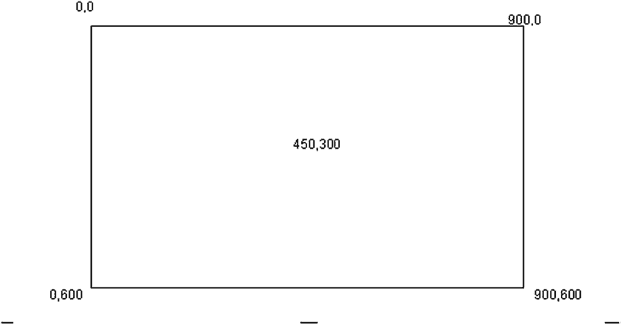

# JavaScript 中的伪随机处理

JavaScript 中的伪随机处理是通过一个名为 `Math.random` 的内置方法执行的。形式上，`random` 是 `Math` *类*的一个*方法*。调用 `Math.random()` 会生成一个从 0 到 1（不包括 1）的数字，结果是一个小数，例如 0.253012。这看起来可能对我们没有立竿见影的用处，但实际上，将这个数字转换为我们可用的数字是一个非常简单的过程。我们将它（无论它是什么数字）乘以 6，得到一个从 0 到 6（不包括 6）的数字。例如，如果我们将 0.253012 乘以 6，得到 1.518072。这已经接近我们需要的，但还不完全对。下一步是去掉小数部分，保留整数部分。

为此，我们使用另一个 `Math` 方法，`Math.floor`。该方法在移除任何小数部分后生成一个整数。顾名思义，`floor` 方法会向下取整。在我们的特定例子中，我们从 0.253012 开始，接着得到 1.518072，然后调用 `Math.floor(1.58072)`，结果就是整数 1。

一般来说，当我们将随机数乘以 6 并对其取整时，我们会得到一个从 0 到 5 的数字。最后一步是加上 1，因为我们的目标是反复得到一个从 1 到 6 的数字，且没有任何特定模式。

你可以使用类似的方法来获取任意范围内的整数。例如，如果你想要得到 1 到 13 的数字，你可以将随机数乘以 13，然后再加上 1。

这对于纸牌游戏可能很有用。你会在本书中看到类似的例子。

我们可以将所有步骤组合成一个所谓的*表达式*。

表达式是常量、方法、函数调用以及我们稍后将探讨的一些东西的组合。我们使用运算符（例如用于加法的 `+` 和用于乘法的 `*`）将这些元素组合在一起。

还记得[第 1 章](http://dx.doi.org/10.1007/978-1-4842-4155-4_1)中标签是如何组合的吗——将一个标签嵌套在另一个标签中——以及我们在“喜欢的网站”应用程序中使用的那行 JavaScript 代码：`document.write(Date())`。

我们可以在这里使用类似的过程。我们不必将 `random` 调用和 `floor` 方法写成单独的语句，而是可以将 `random` 调用作为参数传递给 `floor` 方法。请看这段代码片段：

```
1+Math.floor(Math.random()*6)
```

## 第 2 章 骰子游戏

这个*表达式*将生成一个从 1 到 6 的数字。我称它为代码片段，因为它不完全是一条语句。运算符 `+` 和 `*` 指代算术运算，与你通常在数学中使用的一样。运算顺序从内向外展开。

1.  调用 `Math.random()` 获取一个从 0 到 1（但不包括 1）之间的小数。
2.  将结果乘以 6。
3.  使用 `Math.floor` 去掉小数部分，保留整数部分。
4.  加 1。

在我们的最终代码中，你会看到包含此表达式的一条语句，但我们需要先介绍其他一些内容。

##### 变量与赋值语句

与其他编程语言一样，JavaScript 有一种称为*变量*的结构，它本质上是一个存放值（例如数字）的地方。它是一种将名称与值关联起来的方法。你可以通过引用该名称来稍后使用该值。一个类比是政府职位。在美国，我们会说“总统”。2010 年，当我撰写本书第一版时，总统是巴拉克·奥巴马。而现在，2022 年 7 月，总统是约瑟夫·拜登。“总统”这个术语所持有的值是变化的。在编程中，变量的值也可以变化，这正是其名称的由来。

术语 `var` 用于*声明*一个变量。

变量和函数（将在下一节描述）的名称由程序员决定。有一些规则，包括名称中不能有空格，不能使用句点，并且名称必须以字母字符开头。名称长度有限制，但我们倾向于使用短名称以避免打字。但是，我建议你不要让名称短到忘记它代表什么。你需要保持一致性，但不必遵守英语拼写规则。例如，如果你想设置一个变量来保存数值的总和，并且你认为 sum 拼写为 *som*，那也没问题。

只要确保你一直使用 *som* 即可。但如果你想引用 JavaScript 的一部分，例如 `function`、`document` 或 `random`，你需要使用 JavaScript 所期望的拼写。

### 第 2 章 骰子游戏

你应避免使用 JavaScript 内置结构（例如 `random` 或 `floor`）的名称作为你的变量名。尽量使名称唯一，但同时又易于理解。一种常见的编写变量名的方法是使用所谓的*小驼峰式命名法*。这包括以小写字母开头命名变量，然后使用大写字母来表示新单词的开始，例如 `numberOfTurns` 或 `userFirstThrow`。你可以看到它为什么被称为驼峰式命名——大写字母在单词中形成了“驼峰”。你不必使用这种命名方法，但这是许多程序员遵循的一种惯例。

保存上一节解释的伪随机表达式的代码行是一种特定类型的语句，称为*赋值*语句。例如，

```
var ch = 1+Math.floor(Math.random()*6);
```

将名为 `ch` 的变量设置为等号右侧表达式运算得出的值。当在 `var` 语句中使用时，它也被称为*初始化*语句。`=` 符号用于为此类情况下的变量设置初始值，也用于接下来将要描述的赋值语句。我选择使用名称 `ch` 作为 choice 的简写。这对我来说很有意义。不过，总的来说，如果你需要在短名称和更容易记住的长名称之间做出选择，请选择长名称！注意，语句以分号结尾。你可能会问，为什么不是句点？答案是句点用于另外两种情况：作为小数点以及用于访问对象的方法和属性，例如 `document.write`。

赋值语句是编程中最常见的语句类型。下面是一个针对已定义的变量的赋值语句示例：

```
bookName = "The Essential Guide to HTML5";
```

等号的使用可能会引起混淆。可以将其理解为使左侧等于右侧产生的结果。在本书中，你将遇到许多其他变量以及运算符和赋值语句的其他用法。

**注意** 定义变量的 `var` 语句称为*声明语句*。

与许多其他语言不同，JavaScript 允许程序员省略声明语句而直接开始使用变量。我尽量避免这样做，但你在许多在线示例中会看到这种情况。

### 第 2 章 骰子游戏

对于掷骰子游戏，我们需要定义游戏状态的变量，即，它是第一次投掷还是后续投掷，以及玩家的点数是多少（请记住，点数指的是前一次投掷的值）。在我们的实现中，这些值将由所谓的*全局变量*保存，这些变量在任何函数定义之外使用 `var` 语句定义，以便保留其值（在函数内部声明的变量的值在函数停止执行时会消失）。


##### 变量并非必需

你并不总是需要使用变量。例如，我们创建的第一个应用程序设置了变量来保存骰子的水平与垂直位置。我本可以在代码中直接使用字面量数值，因为这些数值不会改变，但由于在多个地方引用了这些值，将数值存储在变量中意味着：如果我想修改其中一个或两个数值，只需在一个地方进行更改即可。

##### 程序员自定义函数

JavaScript 拥有许多内置函数和方法，但它未必能涵盖你需要的所有功能。例如，据我所知，它并没有专门用于模拟掷骰子的函数。因此，JavaScript 允许我们定义并使用自己的函数。

这些函数可以接受*参数*，就像 `Math.floor` 方法一样，其中的参数（例如调用 `Math.floor(rawScore)` 时的变量 `rawScore`）用于计算不大于 `rawScore` 当前值的最大整数。语句

```
score = Math.floor(rawScore);
```

将根据可能包含小数部分的 `rawScore` 值，将整数值赋给变量 `score`。我在这里展示了驼峰命名法的运用。请务必记住，正是我的编码（且仅是我的编码）建立了这种关联。

参数是可能传递给函数的值。你可以将它们视为额外的信息。

函数定义的格式是：关键字 `function`，后跟你想要给函数起的名称，再后跟包含参数名称的括号，接着是一个左花括号、一些代码，最后是一个右花括号。正如我在前几节中指出的，名称由程序员选择。以下是一个函数定义的示例，它返回两个参数的乘积。顾名思义，你可以用它来计算矩形的面积。我在函数头中使用的参数名称是：`wd` 和 `ln`。它们分别代表宽度和长度。

```
function areaOfRectangle(wd, ln) {
   return wd * ln;
}
```

在函数定义中，请注意 `return` 关键字。这告诉 JavaScript 将函数的结果返回给我们。在我们的示例中，这让我们可以编写如下代码：

```
rect1 = areaOfRectangle(5, 10);
```

这将把值 50（5 × 10）赋给我们的 `rect1` 变量。函数定义应作为代码编写在 `script` 元素中。在现实中定义这个函数或许意义不大，因为在代码中直接写乘法非常简单，但它确实是一个程序员自定义函数的有用示例。一旦这个定义被执行（很可能是在 HTML 文件加载时），其他代码就可以通过调用函数名来使用它，例如 `areaOfRectangle(100, 200)` 或 `areaOfRectangle(x2 - x1, y2 - y1)`。

第二个表达式假设 `x1`、`x2`、`y1`、`y2` 指的是在其他地方定义的坐标值。

函数也可以通过设置某些标签属性来调用。例如，`body` 标签可以包含 `onLoad` 属性的设置：

```
<body onLoad="init();">
```

我的 JavaScript 代码中包含了一个我称之为 `init` 的函数定义。将其放入 `body` 元素意味着：当浏览器首次加载 HTML 文档或玩家点击重新加载/刷新按钮时，JavaScript 将调用我的 `init` 函数。

类似地，利用 HTML5 的新特性之一，我可以包含以下 `button` 元素：

```
<button onClick="throwdice();">Throw dice</button>
```

这将创建一个包含文本 "Throw dice" 的按钮。当玩家点击它时，JavaScript 会调用我在 `script` 元素中定义的 `throwdice` 函数。

稍后介绍的 `form` 元素也能以类似方式调用函数。

##### 条件语句：*if* 和 *switch*

双骰子游戏有一套规则。总结这些规则的一种方式是：如果是第一次投掷的情况，我们检查骰子投掷的某些值；如果不是第一次投掷，我们检查骰子投掷的其他值。JavaScript 为此提供了 `if` 和 `switch` 语句。

`if` 语句基于*条件*，这些条件可以是比较或相等性检查——例如，名为 `temp` 的变量是否大于 85，或者名为 `course` 的变量是否包含值 `"Programming Games"`？比较产生两个可能的逻辑值——`true` 或 `false`。到目前为止，你见过数字值和字符串值。逻辑值是另一种数据类型。它们也被称为*布尔*值，以数学家乔治·布尔的名字命名。我提到的条件和检查在代码中应写为

```
temp > 85
```

和

```
course == "Programming Games"
```

将第一个表达式理解为：变量 `temp` 的当前值是否大于 85？第二个表达式理解为：变量 `course` 的当前值是否与字符串 `"Programming Games"` 相同？

比较示例很容易理解；我们使用 `>` 检查一个值是否大于另一个值，使用 `<` 检查相反情况。表达式的值将是两个逻辑值 `true` 或 `false` 之一。

第二个表达式可能有点令人困惑。你可能对两个等号以及引号感到疑惑。在 JavaScript（以及其他几种编程语言）中，用于检查相等性的比较运算符是这两个等号的组合。我们需要两个等号，因为单个等号用于赋值语句，不能身兼二职。如果我们写了 `course = "Programming Games"`，那就意味着将值 `"Programming Games"` 赋给变量 `course`，而不是比较这两项。引号定义了一个字符串，从 *P* 开始，包含空格，到 *s* 结束。

现在我们可以看看如何编写仅在条件为真时执行某些操作的代码。

```
if (condition) {
   code
}
```

如果我们希望代码在条件为真时执行一种操作，在条件**不**为真时执行另一种操作，格式如下：

```
if (condition) {
   if true code
}
else {
   if not true code
}
```

请注意，我这里使用了斜体，因为这就是所谓的*伪代码*，而不是我们将在 HTML 文档中包含的真正 JavaScript。

以下是一些真实的代码示例。它们使用了 `alert`，这是一个内置函数，它会在浏览器中弹出一个包含括号内参数所指消息的小窗口。用户必须点击“确定”才能继续。

```
if (temp > 85) {
   alert("It is hot!");
}

if (age >= 21) {
   alert("You are old enough to buy a drink.");
}
else {
   alert("You are too young to be served in a bar.");
}
```

我们可以仅使用 `if` 语句来编写双骰子应用程序。然而，JavaScript 提供了另一种使事物更易于理解的结构——`switch` 语句。其通用格式如下：

```
switch(x) {
   case a:
      codea;
   case b:
      codeb;
   default:
      codec;
}
```

JavaScript 会评估 `switch` 语句第一行中 `x` 的值，并将其与各个 `case` 中指示的值进行比较。一旦匹配成功（即确定 `x` 等于 `a` 或 `b`），就会执行 `case` 标签后面的代码。如果没有匹配项，则执行 `default` 后面的代码。`default` 选项不是必需的。如果不加干预，即使找到了匹配的 `case` 语句，计算机也会继续执行 `switch` 语句中的其余部分。如果你希望在找到匹配项时停止，需要包含一个 `break` 语句来跳出 `switch` 结构。

你可能已经看到 `if` 和 `switch` 将如何实现我们在骰子游戏中所需的功能。你将在下一节中了解具体做法。首先，让我们看一个例子，该例子用于确定由变量 `mon`（包含三个字母的缩写，例如 `"Jan"`、`"Feb"` 等）所指示月份的天数。


```javascript
switch(mon) {
  case "Sep":
  case "Apr":
  case "Jun":
  case "Nov":
    alert("该月有 30 天。");
    break;
  case "Feb":
    alert("该月有 28 或 29 天。");
    break;
  default:
    alert("该月有 31 天。");
}
```

如果变量 `mon` 的值等于 `"Sep"`、`"Apr"`、`"Jun"` 或 `"Nov"`，控制流将进入第一个 `alert` 语句，然后由于 `break` 的作用退出 `switch` 语句。如果变量 `mon` 的值等于 `"Feb"`，将执行提示 28 或 29 天的 `alert` 语句，然后控制流退出 `switch`。如果 `mon` 的值是其他任何内容（顺便提一下，包括无效的三字母缩写），将执行提示 31 天的 `alert` 语句。

## 第 2 章 骰子游戏

正如 HTML 会忽略换行和其他空白字符一样，JavaScript 并不要求这些语句使用特定的布局。如果你愿意，甚至可以把所有内容都写在一行里。不过，为了方便自己，还是建议使用多行并缩进。

##### 在画布上绘图

现在我们来看 HTML5 中最强大的新特性之一——`canvas` 元素。我将解释涉及 `canvas` 的应用程序所需的代码片段，然后展示一些简单的例子，最后回到我们的目标——在 `canvas` 上绘制骰子面。回顾一下，HTML 文档的结构如下：

```html
<html>
  <head>
    <title>...</title>
    <style>...</style>
    <script>...</script>
  </head>
  <body>
    ...这里是初始静态内容的位置...
  </body>
</html>
```

**注意** 你不必非得包含 `title`、`style` 或 `script` 元素，而且它们的顺序可以任意。第 1 章的收藏夹示例使用了 `style` 元素，但骰子示例不会用到。

要使用 `canvas`，我们需在 HTML 文档的 `body` 元素中放入 `canvas` 标签，并在 `script` 元素中放入 JavaScript。我先介绍一种编写 `canvas` 元素的标准方式。

```html
<canvas id="canvas" width="400" height="300">
  您的浏览器不支持 HTML5 元素的 canvas。
</canvas>
```

如果包含这段代码的 HTML 文件被一个不支持 `canvas` 的浏览器打开，屏幕上会显示"您的浏览器不支持 HTML5 元素的 canvas。"这条消息。如果你正准备为所有常见浏览器制作网页，可以选择将访问者引导到其他网站，或尝试其他策略。在本书中，我只专注于 HTML5。

HTML 的 `canvas` 标签定义该元素的 `id` 为 `canvas`。这个 id 可以是任何值，但使用 `canvas` 也没什么坏处。不过，你可以有多个 `canvas`，在这种情况下，你需要为每个 id 使用不同的值。但我们的应用程序不会这么做，所以不用担心这个问题。`width` 和 `height` 属性用于指定该 `canvas` 元素的尺寸。

现在我们已经看到了 `body` 中的 `canvas`，接下来看看 JavaScript。在 `canvas` 上绘制的第一步是在 JavaScript 代码中定义相应的对象。为此，我需要一个变量，于是在任何函数定义之外用下面这行代码设置了一个名为 `ctx` 的变量。

```javascript
var ctx;
```

这使其成为一个全局变量，可以从任何函数中访问或设置。`ctx` 变量是所有绘图所需的东西。我选择将变量命名为 `ctx`，是"context"（上下文）的缩写，这借鉴了我见过的许多在线示例。我本来也可以选择其他任何名字。

在后面的代码中（你会在接下来的示例中看到所有代码，也可以下载源代码），我编写了设置 `ctx` 值的代码。

```javascript
ctx = document.getElementById('canvas').getContext('2d');
```

设置 `ctx` 的语句位于我定义的一个名为 `init` 的函数中，该函数在 `body` 标签中被引用。

```html
<body onload="init();">
```

将这条语句放在 `init` 函数中意味着该语句会在 `body` 中的所有内容下载*之后*、在任何其他函数被调用*之前*被调用。

设置 `ctx` 的赋值语句首先获取文档中 id 为 `canvas` 的元素，然后提取出所谓的 `2d` 上下文。我们都可以预见，未来可能还会出现其他上下文！目前，我们使用的是 `2d` 上下文。

在 JavaScript 编程中，你可以在 `canvas` 上绘制矩形、创建包含线段和弧线的路径，以及定位图像文件。你还可以填充矩形和路径。不过，在此之前，我们需要先了解坐标系和弧度度量。

正如全球定位系统（GPS）使用纬度和经度在地图上定义你的位置一样，我们也需要一种方法来指定屏幕上的点。这些点被称为*像素*，我们在上一章已经使用过它们来指定图像的宽度和边框的粗细。如果你做实验就会发现，像素是一个相当小的度量单位。然而，仅仅在线性单位上达成一致还不够。我们还需要统一测量的起点，就像 GPS 系统使用本初子午线和赤道一样。对于作为画布的二维矩形，这个起点被称为*原点*或*注册点*。原点位于 `canvas` 元素的左上角。请注意，在第 6 章中，当我们通过在 HTML 文档中（而非 `canvas` 元素中）创建并定位元素来描述问答节目时，坐标系是类似的。原点仍然是窗口的左上角。

这与你可能从解析几何或制作图表时回忆起的坐标不同。水平坐标值从左到右递增。垂直坐标值则沿屏幕*向下*递增。标准的坐标表示方法是先写水平坐标值，再写垂直坐标值。在某些情况下，水平坐标值被称为 *x* 值，垂直坐标值被称为 *y* 值。在其他情况下，水平坐标值代表左（可以理解为距离左侧的距离），垂直坐标值代表顶（可以理解为距离顶部的距离）。

图 2-5 展示了一个宽 900 像素、高 600 像素的浏览器窗口布局。数字表示各角和中点的坐标值。



**图 2-5.** 浏览器窗口的坐标系

现在我们来学习几个绘制语句，然后将它们组合起来绘制简单图形（见图 2-6 至图 2-10）。之后，我们再学习如何绘制点状和矩形来表现骰子的面。

以下是绘制矩形的 HTML5 JavaScript 代码：

```javascript
ctx.strokeRect(100, 50, 200, 300);
```

这将绘制一个空心矩形，其左上角距离左侧 100 像素，距离顶部 50 像素。矩形的宽度为 200，高度为 300。此语句将使用当前设置的线宽和颜色。

接下来的代码演示了将线宽设置为 5，并将描边颜色（即轮廓）设置为指定的 RGB 值（即红色）。矩形使用变量 `x`、`y`、`w` 和 `h` 中的值绘制。

```javascript
ctx.lineWidth = 5;
ctx.strokeStyle = "rgb(255, 0, 0)";
ctx.strokeRect(x, y, w, h);
```

这段代码片段

```javascript
ctx.fillStyle = "rgb(0, 0, 255)";
ctx.fillRect(x, y, w, h);
```

在指定的位置和尺寸绘制一个实心蓝色矩形。如果你想绘制一个带有红色轮廓的蓝色矩形，需要使用两行代码。

```javascript
ctx.fillRect(x, y, w, h);
ctx.strokeRect(x, y, w, h);
```

HTML5 允许你绘制由弧线和线段组成的所谓路径。


线段是通过组合使用 `ctx.moveTo` 和 `ctx.lineTo` 绘制的。我将在多个章节中介绍它们：第 4 章中的弹弓游戏，第 5 章中使用多边形的记忆游戏，以及第 9 章中的猜词游戏。在第 4 章的炮弹游戏中，我还会向你展示如何倾斜一个矩形，而第 9 章的猜词游戏则演示了如何绘制椭圆。在本章中，我将重点介绍弧线。

你可以通过以下方式开始一条路径：

`ctx.beginPath();`

并使用以下任一方式结束它（同时绘制该路径）：

`ctx.closePath();`
`ctx.stroke();`

或者：

`ctx.closePath();`
`ctx.fill();`

在某些情况下，你也可以省略对 `closePath` 的调用。

弧线可以是一个完整的圆，也可以是圆的一部分。在骰子应用中，我们只绘制完整的圆来代表每个骰子面上的点数，但我将解释弧线通常是如何工作的，以使代码不那么神秘。绘制弧线的方法具有以下格式：

`ctx.arc(cx, cy, radius, start_angle, end_angle, direction);`

其中 `cx`、`cy` 和 `radius` 分别是圆心的水平坐标、垂直坐标和圆的半径。解释接下来的两个参数需要讨论测量角度的方法。你熟悉角度的度单位：我们说转 180 度，意思是 U 形转弯，90 度角由两条垂直线形成。但是大多数计算机编程语言使用另一种称为*弧度*的系统。这里有一种可视化弧度的方法——想象取圆的半径并将其放置在圆本身上。你可以深入回忆一下，你会意识到它不会完美贴合，因为围绕一个圆有 `2 * PI` 个弧度，略大于 6。

所以，如果我们想绘制一个完整圆的弧线，我们指定起始角度为 `0`，结束角度为 `2 * PI`。幸运的是，`Math` 类提供了一个常量 `Math.PI`，它是 PI 的值（精度和必要的小数位数都足够），所以在代码中，我们写成 `2 * Math.PI`。如果我们想指定一个半圆的弧线，我们使用 `Math.PI`，而一个直角（90 度）将是 `.5 * Math.PI`。

`arc` 方法还需要一个参数，`direction`。我们如何绘制这些弧线？想象一下钟表指针的运动。在 HTML 5 中，顺时针是 `false` 方向，逆时针是 `true` 方向。（别问为什么。HTML5 就是这样规定的。）我使用内置的 JavaScript 值 `true` 和 `false`。当我们需要绘制非完整圆的弧线时，这一点就很重要。如果需要绘制非完整圆的弧线，特定问题的性质决定了你如何定义角度。

以下是一些示例，包含完整代码，供你创建（使用 TextPad 或 TextWrangler），然后修改以测试你的理解程度。第一个示例绘制了一条弧线，代表一个微笑。

```
<html>
<head>
<title>微笑</title>
<script>
function init() {
    var ctx = document.getElementById("canvas").getContext('2d');
    ctx.beginPath();
    ctx.strokeStyle = "rgb(200,0,0)";
    ctx.arc(200, 200, 50, 0, Math.PI, false);
    ctx.stroke();
}
</script>
</head>
<body onLoad="init();">
<canvas id="canvas" width="400" height="300">
    你的浏览器不支持 HTML5 元素 canvas。
</canvas>
</body>
</html>
```

图 2-6 显示了此代码生成的弧线在屏幕上的部分截图。

***图 2-6.** 由表达式 `ctx.arc(200,200,50,0,Math.PI, false);` 产生的“微笑”*

你可以向前查看图 2-11、2-12 和 2-13，在这些图中我捕捉了更多屏幕内容，以查看绘图的定位。请在你的示例中修改这些数字，以便理解坐标系是如何工作的，以及一个像素实际有多大。

在继续看哭脸之前，尝试让弧线更宽或更高，或者改变颜色。然后尝试将整个弧线上、下、左、右移动。提示：你需要修改下面这行：

`ctx.arc(200, 200, 50, 0, Math.PI, false);`

改变 `200,200` 来重置圆心，改变 `50` 来修改半径。

现在，让我们继续看其他变体。一定要逐个尝试并进行实验。

将 `arc` 方法的最后一个参数改为 `true`：

`ctx.arc(200, 200, 50, 0, Math.PI, true);`

这使得弧线沿逆时针方向绘制。完整代码如下：

```
<html>
<head>
<title>哭脸</title>
<script type="text/javascript">
function init() {
    var ctx = document.getElementById("canvas").getContext('2d');
    ctx.beginPath();
    ctx.strokeStyle = "rgb(200,0,0)";
    ctx.arc(200, 200, 50, 0, Math.PI, true);
    ctx.stroke();
}
</script>
</head>
<body onLoad="init();">
<canvas id="canvas" width="400" height="300">
    你的浏览器不支持 HTML5 元素 canvas。
</canvas>
</body>
</html>
```

注意，我也改变了标题。标题会显示在浏览器标签页上。你的用户/观众确实会注意到标题。我发现我在调试时会使用标题来追踪不同的版本。此代码产生的屏幕截图如图 2-7 所示。

***图 2-7.** 由表达式 `ctx.arc(200,200,50,0,Math.PI, true);` 产生的“哭脸”*

在描边之前加入闭合路径的语句（针对哭脸示例），将会“收尾”该弧线。

`ctx.closePath();`
`ctx.stroke();`

完整代码如下：

```
<html>
<head>
<title>哭脸</title>
<script type="text/javascript">
function init() {
    var ctx = document.getElementById("canvas").getContext('2d');
    ctx.beginPath();
    ctx.strokeStyle = "rgb(200,0,0)";
    ctx.arc(200, 200, 50, 0, Math.PI, true);
    ctx.closePath();
    ctx.stroke();
}
</script>
</head>
<body onLoad="init();">
<canvas id="canvas" width="400" height="300">
    你的浏览器不支持 HTML5 元素 canvas。
</canvas>
</body>
</html>
```

这产生的屏幕截图如图 2-8 所示。

***图 2-8.** 通过在 `ctx.stroke();` 前添加 `ctx.closePath();`，哭脸变为半圆*

`closePath` 命令并非总是必需的，但包含它是一个好习惯。你会注意到我稍后才会调用 `closePath` 并填充多个点的语句。在此处进行实验，并向前查看第 5 章中弹弓的绘制和第 9 章中吊死鬼图形的绘制。如果你想填充路径，可以使用 `ctx.fill()` 代替 `ctx.stroke()`，这会产生一个黑色的填充形状，如图 2-9 所示。完整代码如下：

```
<html>
<head>
<title>微笑</title>
<script type="text/javascript">
function init() {
    var ctx = document.getElementById("canvas").getContext('2d');
    ctx.beginPath();
    ctx.strokeStyle = "rgb(200,0,0)";
    ctx.arc(200, 200, 50, 0, Math.PI, false);
    ctx.closePath();
    ctx.fill();
}
</script>
</head>
<body onLoad="init();">
<canvas id="canvas" width="400" height="300">
    你的浏览器不支持 HTML5 元素 canvas。
</canvas>
</body>
</html>
```

黑色是默认颜色。

***图 2-9.** 使用 `ctx.fill()` 填充半圆*


