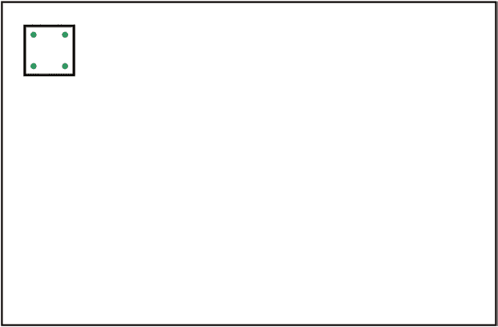

# 第 2 章 掷骰子游戏

#### 使用表单显示文本输出

我们可以在 canvas 上书写文本（参见第 [5](http://dx.doi.org/10.1007/978-1-4842-4155-4_5) 章），但对于掷骰子游戏应用，我选择使用表单，这是 HTML 新旧版本中都包含的元素。我并非使用表单来接收玩家的输入，而是用它来输出关于骰子投掷结果的信息。HTML5 规范指出了设置表单的新方法，包括检查或*验证*输入的类型和范围。下一章的应用将演示验证功能。

我使用以下 HTML 代码为掷骰子游戏创建表单：

```
<form name="f">

Stage: <input name="stage" value="First Throw"/>

Point: <input name="pv" value=" "/>

Outcome: <input name="outcome" value=" "/>

</form>
```

表单以 `name` 属性开头。文本 `Stage:`、`Point:` 和 `Outcome:` 会出现在输入字段旁边。请注意，这些 input 标签是单例标签，它们同时具有 `name` 和 `value` 字段。这些名称将被 JavaScript 代码使用。你可以在表单中放置任何 HTML 内容，也可以在任意 HTML 中放置表单。

由于掷骰子游戏使用了新的按钮元素，我仅添加了包含用于向玩家显示信息的字段的表单元素，而没有包含类型为 `submit` 的 input 元素。或者，我也可以使用带有 `submit` 输入字段的标准表单（从而无需使用新的按钮元素），代码如下：

```
<form name="f" onSubmit="throwDice();">
```


阶段：`<input type="text" name="stage" value="First Throw"/>` 点数：`<input type="text" name="pv" value=" "/>` 结果：`<input type="text" name="outcome" value=" "/>`

`<input type="submit" value="THROW DICE"/>`

`</form>`

类型为 `submit` 的 input 元素会在屏幕上生成一个按钮。这些就是我们构建掷骰子游戏所需的所有概念。现在我们可以开始编写代码了。



