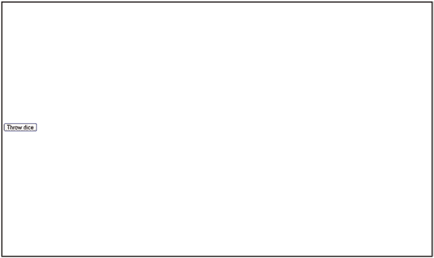
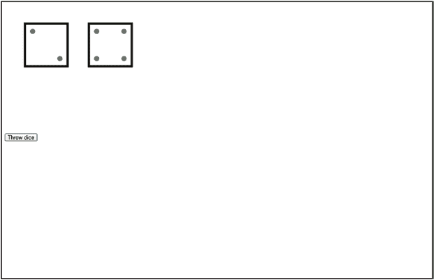

# 第 2 章 骰子游戏

## 构建应用并使之成为你的作品

你可能已经在小例子中尝试过本章介绍的 HTML5、CSS 和 JavaScript 结构。提示：请务必尝试。学习唯一的方法就是自己动手做例子。作为构建掷骰子游戏的铺垫，我们接下来会看到这三个应用：

- 投掷一个骰子并通过重新加载再次投掷
- 使用按钮投掷两个骰子
- 完整的掷骰子游戏

图 2-11 展示了第一个应用可能的起始画面。我说“可能”是因为它不会总是显示 4。我特意截取了这张几乎覆盖整个窗口的截图，以便你能看到图形在屏幕上的位置。

**图 2-11.** `单个骰子应用`

图 2-12 展示了投掷一对骰子应用的起始界面。屏幕上只显示一个按钮。





**图 2-12.** `一对骰子应用的起始界面`

最后，图 2-13 展示了玩家点击按钮后的界面。

**图 2-13.** `点击按钮投掷一对骰子`

采用增量步骤构建应用是一种良好的技术。这些应用是使用文本编辑器（如 TextPad 或 TextWrangler）构建的。请记得将文件保存为 `.html` 类型——并且要尽早且经常保存。你无需完成所有内容才保存。当你完成第一个应用并保存测试后，可以用新名称再次保存，然后在这个新副本上进行修改，使其成为第二个应用。第三个应用也如法炮制。

### 投掷一个骰子

这第一个应用的目的是在画布上随机显示一个骰子面，圆点按标准方式排列。

对于任何应用，通常都有多种可行的方法。我意识到可以从某些代码中获得双重用途，因为 3 点骰子面的图案可以通过组合 2 点和 1 点的图案得到。类似地，5 点的图案是 4 点和 1 点的组合。4 点的图案是 2 点的图案加上一些独特元素的组合。6 点的图案是 4 点的图案加上一些独特元素的组合。我本来可以把所有代码都放在 `init` 函数里，或者使用单个 `drawFace` 函数。无论如何，这种方法对我来说是合理的，并且我相当快地编写和调试了它。表 2-1 列出了所有函数并说明了谁调用了谁。表 2-2 展示了完整代码，并解释了每一行的作用。

**表 2-1.** `单个骰子投掷应用中的函数`

| **函数** | **被调用者/调用源** | **调用函数** |
| --- | --- | --- |
| `init` | 由 `<body>` 标签中的 `onLoad` 动作调用 | `drawFace` |
| `drawFace` | 由 `init` 调用 | `draw1`、`draw2`、`draw4`、`draw2mid` |
| `draw1` | 在 `drawFace` 中的三个位置被调用来处理 1、3 和 5 点 | |
| `draw2` | 在 `drawFace` 中的三个位置被调用来处理 2、3 和 4 点 | |
| `draw4` | 在 `drawFace` 中的三个位置被调用来处理 4、5 和 6 点 | `draw2` |
| `draw2mid` | 在 `drawFace` 中的一个位置被调用来处理 6 点 | |

**表 2-2.** `投掷单个骰子应用的完整代码`

| **代码** | **解释** |
| --- | --- |
| `<html>` | 开始 html 标签。 |
| `<head>` | 开始 head 标签。 |
| `<title>Throwing 1 die</title>` | 完整的 title 元素。 |
| `<script>` | 开始 script 标签。 |
| `var cwidth = 400;` | 保存画布宽度的变量；也用于清除画布以准备重绘。 |
| `var cheight = 300;` | 保存画布高度的变量；也用于清除画布以准备重绘。 |
| `var dicex = 50;` | `dicex`：存放单个骰子水平位置的变量。 |
| `var dicey = 50;` | `dicey`：存放单个骰子垂直位置的变量。 |
| `var diceWidth = 100;` | `diceWidth`：存放骰子面宽度的变量。 |
| `var diceHeight = 100;` | `diceHeight`：存放骰子面高度的变量。 |
| `var dotDadius = 6;` | `dotDadius`：存放点半径的变量。 |
| `var ctx;` | `ctx`：存放画布上下文的变量，用于所有绘图命令。 |
| `function init() {` | `init()`函数定义的开始，该函数在文档加载时被调用。 |
| `var ch = 1+Math.floor(Math.random()*6);` | 声明并设置`ch`变量的值为随机数 1、2、3、4、5 或 6。 |
| `drawFace(ch);` | 调用`drawFace()`函数，参数为`ch`。 |
| `}` | 函数定义结束。 |
| `function drawFace(n) {` | `drawFace()`函数定义的开始，其参数为点的个数。 |
| `ctx = document.getElementById('canvas').getContext('2d');` | 获取用于在画布上绘制的对象。 |
| `ctx.lineWidth = 5;` | 将线宽设置为 5。 |
| `ctx.clearRect(dicex, dicey, diceWidth, diceHeight);` | 清除可能绘制了骰子面的空间，第一次调用时无效果。 |
| `ctx.strokeRect(dicex, dicey, diceWidth, diceHeight);` | 绘制骰子面的轮廓。 |
| `ctx.fillStyle = "#009966";` | 设置圆圈的颜色。我使用图形程序确定了这个值。你可以自行选择或进行实验。 |
| `switch(n) {` | 使用表示点数的变量`n`开始`switch`语句。 |
| `case 1:` | 如果`n`为 1。 |
| `draw1();` | 调用`draw1()`函数。 |
| `break;` | 跳出`switch`。 |
| `case 2:` | 如果`n`为 2。 |
| `draw2();` | 调用`draw2()`函数。 |
| `break;` | 跳出`switch`。 |
| `case 3:` | 如果`n`为 3。 |
| `draw2();` | 先调用`draw2()`，然后。 |
| `draw1();` | 调用`draw1()`。 |
| `break;` | 跳出`switch`。 |
| `case 4:` | 如果`n`为 4。 |
| `draw4();` | 调用`draw4()`函数。 |
| `break;` | 跳出`switch`。 |
| `case 5:` | 如果`n`为 5。 |
| `draw4();` | 调用`draw4()`函数，然后。 |
| `draw1();` | 调用`draw1()`函数。 |
| `break;` | 跳出`switch`。 |
| `case 6:` | 如果`n`为 6。 |
| `draw4();` | 调用`draw4()`函数，然后。 |
| `draw2mid();` | 调用`draw2mid()`函数。 |
| `break;` | 跳出`switch`（非必须）。 |
| `}` | 关闭`switch`语句。 |
| `}` | 关闭`drawFace()`函数。 |
| `function draw1() {` | `draw1()`定义的开始。 |
| `var dotx;` | 用于绘制单个点的水平位置变量。 |
| `var doty;` | 用于绘制单个点的垂直位置变量。 |
| `ctx.beginPath();` | 开始一条路径。 |

# 投掷两个骰子

```javascript
dotx = dicex + .5*diceWidth;
```

将该点中心水平设置为骰子面的中心。

```javascript
doty = dicey + .5*diceHeight;
```

将该点中心垂直设置为骰子面的中心。

```javascript
ctx.arc(dotx, doty, dotrad, 0, Math.PI*2, true);
```

构造一个圆（通过`fill`命令绘制）。

```javascript
ctx.closePath();
```

关闭路径。

```javascript
ctx.fill();
```

绘制路径，即填充圆。

```javascript
}
```

关闭`draw1()`。

```javascript
function draw2() {
```

`draw2()`函数的开始。

```javascript
var dotx;
```

用于绘制两个点的水平位置变量。

```javascript
var doty;
```

用于绘制两个点的垂直位置变量。

```javascript
ctx.beginPath();
```

开始一条路径。

```javascript
dotx = dicex + 3*dotrad;
```

将该点中心水平设置为距骰子面左上角三个半径长度的位置。

```javascript
doty = dicey + 3*dotrad;
```

将该点中心垂直设置为距骰子面左上角三个半径长度的位置。

```javascript
ctx.arc(dotx, doty, dotrad, 0, Math.PI*2, true);
```

构造第一个点。

```javascript
dotx = dicex+dicewidth-3*dotrad;
```

将该点中心水平设置为距骰子面右下角三个半径长度的位置。

```javascript
doty = dicey+diceheight-3*dotrad;
```

将该点中心垂直设置为距骰子面右下角三个半径长度的位置。

```javascript
ctx.arc(dotx, doty, dotrad, 0, Math.PI*2, true);
```

构造第二个点。

```javascript
ctx.closePath();
```

关闭路径。

```javascript
ctx.fill();
```

绘制两个点。

```javascript
}
```

关闭`draw2()`。

```javascript
function draw4() {
```

`draw4()`函数的开始。

```javascript
draw2();
```

绘制两个点。

```javascript
var dotx;
```

用于绘制点的水平位置变量。

```javascript
var doty;
```

用于绘制点的垂直位置变量。

```javascript
ctx.beginPath();
```

开始路径。

```javascript
dotx = dicex + 3*dotrad;
```

将该点水平放置在左下角内部。

```javascript
doty = dicey + diceheight-3*dotrad;
```

将该点垂直放置在左下角内部。

```javascript
ctx.arc(dotx, doty, dotrad, 0, Math.PI*2, true);
```

构造圆。

```javascript
dotx = dicex+dicewidth-3*dotrad;
```

将该点水平放置在右上角内部。

```javascript
doty = dicey+3*dotrad;
```

将该点垂直放置在右上角内部。

```javascript
ctx.arc(dotx, doty, dotrad, 0, Math.PI*2, true);
```

构造圆。

```javascript
ctx.closePath();
```

关闭路径。

```javascript
ctx.fill();
```

绘制两个点。

```javascript
}
```

关闭`draw4()`函数。

```javascript
function draw2mid() {
```

`draw2mid()`函数的开始，该函数在中间绘制两个点。

```javascript
var dotx;
```

用于绘制两个点的水平位置变量。

```javascript
var doty;
```

用于绘制两个点的垂直位置变量。

```javascript
ctx.beginPath();
```

开始一条路径。

```javascript
dotx = dicex + 3*dotrad;
```

将该点水平放置在内部。

```javascript
doty = dicey + .5*diceHeight;
```

将该点垂直放置在中部。

```javascript
ctx.arc(dotx, doty, dotrad, 0, Math.PI*2, true);
```

构造一个圆。

```javascript
dotx = dicex+diceWidth-3*dotrad;
```

将该点水平放置在紧贴右侧边界内部。

```javascript
doty = dicey + .5*diceHeight;
```

垂直位置设置为`y`中部。

```javascript
ctx.arc(dotx, doty, dotrad, 0, Math.PI*2, true);
```

构造一个圆。

```javascript
ctx.closePath();
```

关闭路径。

```javascript
ctx.fill();
```

绘制点。

```javascript
}
```

关闭`draw2mid()`函数。

```javascript
</script>
```

关闭`script`元素。

```html
</head>
```

关闭`head`元素。

```html
<body onLoad="init();">
```

开始`body`标签，`onLoad`属性设置为调用`init()`函数。

```html
<canvas id="canvas" width="400" height="300">
Your browser doesn't support the HTML5 element canvas.
</canvas>
```

设置画布，如果浏览器不接受`canvas`元素则提供提示。

```html
</body>
```

关闭`body`并关闭`html`元素。

```html
</html>
```

你应该在代码中添加注释。注释是浏览器忽略的文本，用于提醒你以及可能查看此程序的其他人当前代码的作用。一种注释形式以双斜杠开头，该行中斜杠右侧的所有内容都被忽略。对于较长的注释，使用斜杠加星号开始注释，星号加斜杠结束注释。

```javascript
/*
This is a comment.
*/
```

这是“按我说的做，别按我做的做”的情况。因为我使用表格对每一行进行解释，并且你可以将整个章节视为注释，所以我在代码中没有包含太多注释。我重申：你应该添加注释！

**提示** 当我开发这段代码（以及任何涉及随机效果的代码）时，我不想在初始测试中处理随机编码。因此，在`var ch = 1+Math.floor(Math.random()*6);`这一行之后，我立即添加一行`ch = 1;`进行测试，然后将其改为`ch = 2;`，以此类推。完成此测试阶段后，我移除了这行代码（或使用`//`将其注释掉）。这遵循了一条通用建议：在开发过程中，尽量避免在游戏完全复杂的状态下进行测试。

下一个应用使用一个按钮来让玩家进行交互（而不仅仅是重新加载网页），并且模拟了一对骰子的投掷。在查看代码之前，思考一下可以从第一个应用中复用哪些内容。总体答案是：大部分内容。这种“复用”节省了编写和测试代码的工作量。