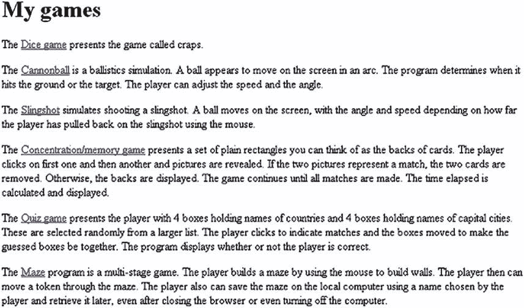
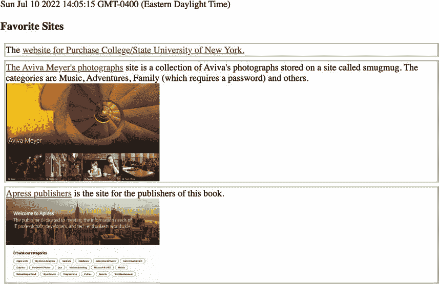
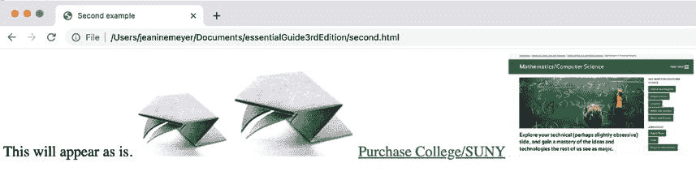
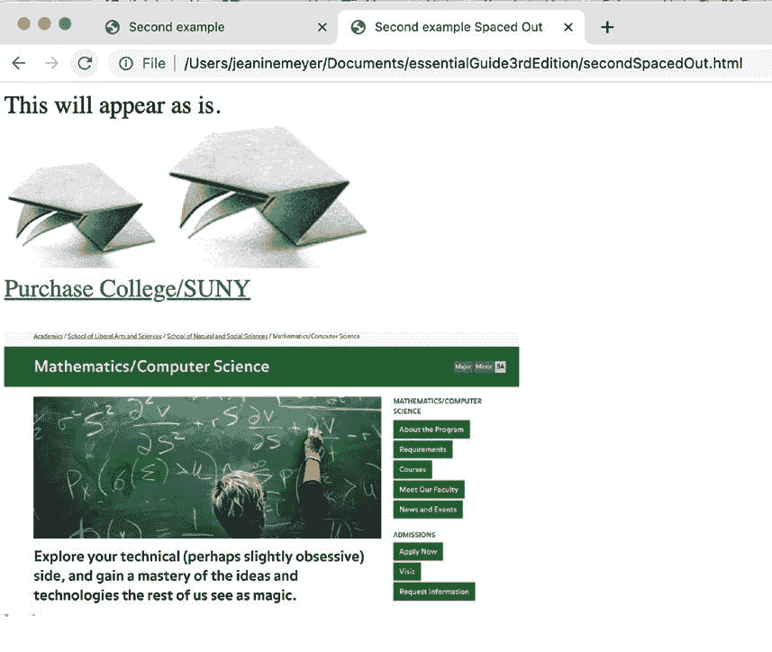
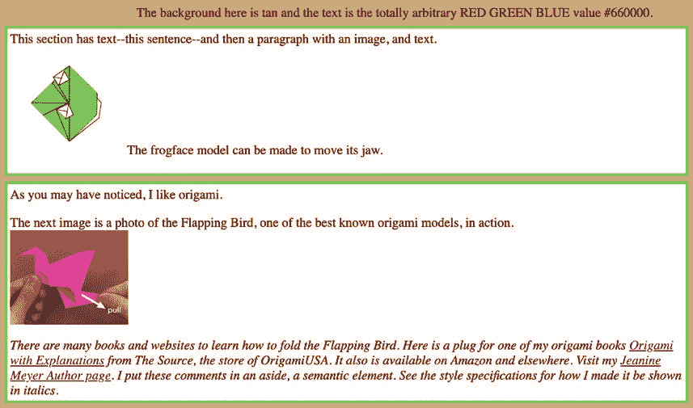
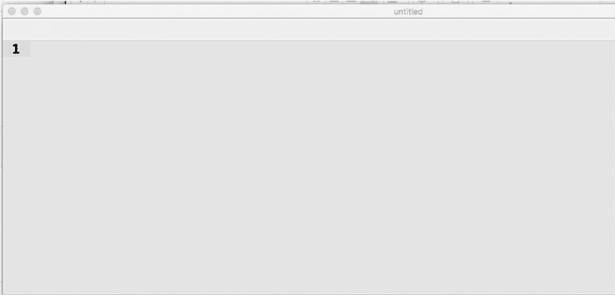
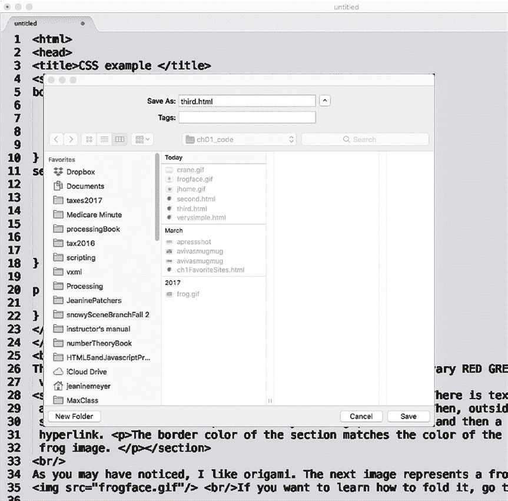
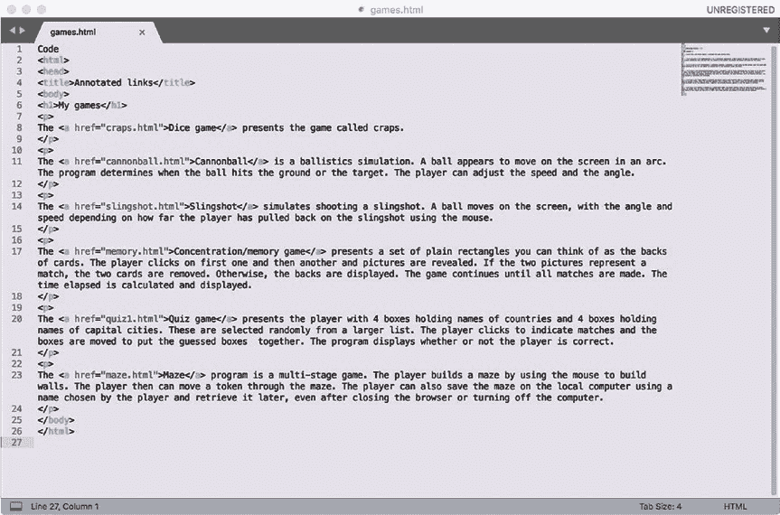

## 第 1 章：基础

**关键词**

`HTML 文档`；`HTML 结构`；`超文本标记语言`（`HTML`）；`HTML 文件`；`层叠样式表`（`CSS`）。

本章将涵盖以下内容：

- HTML 文档的基本结构
- `html`、`head`、`title`、`script`、`style`、`body`、`img` 和 `a` 元素
- 一个层叠样式表（CSS）示例
- 一个 JavaScript 代码示例，使用 `Date` 和 `document.write`

### 引言

超文本标记语言（HTML）是在 Web 上传递内容的语言。HTML 不为任何个人所拥有，而是来自许多国家和许多组织的人们共同定义该语言特征的结果。HTML 文档是一个文本文件，你可以使用任何文本编辑器创建它。HTML 文档包含由标签包围的元素——即以 `<` 符号开头、以 `>` 符号结尾的文本。标签的一个例子是 ``。这个特定标签将显示文件 `home.gif` 中保存的图像。这些标签就是*标记*。正是通过使用标签，超链接、图像和其他媒体才得以被包含在网页中。

基础的 HTML 可以包含一种名为“层叠样式表”（Cascading Style Sheets，CSS）的语言中的格式指令。

# 样式表（CSS）与使用 JavaScript 语言编写的交互程序

浏览器（如 Firefox 和 Chrome）会解析 HTML 以及附带的 CSS 和 JavaScript，最终呈现我们访问网站时所看到的内容。HTML 承载网站的内容，通过标签提供关于内容性质与结构的信息，以及对图片和其他媒体资源的引用。CSS 则负责设定格式。相同的内容可以用不同的方式排版。JavaScript 是一种用于让网站具有动态交互功能的编程语言。在稍具规模的工作组中，负责 HTML、CSS 和 JavaScript 的可能不是同一个人，但了解这些工具如何协同工作的基本知识始终是一个好主意。如果你已经熟悉 HTML 的基础知识，并且了解如何添加 CSS 和 JavaScript，可以跳过本章直接进入下一章。不过，在开始学习第一个核心示例之前，还是有必要浏览一下本章内容，以确保你对所有知识都已熟练掌握。

最新版本的 HTML（及其相关的 CSS 和 JavaScript）是 **HTML5**。它因具备许多令人兴奋的特性而备受关注，例如用于显示图片和动画的画布（`canvas`）、对视频和音频的支持，以及用于定义常见文档元素（如页眉、区块和页脚）的标签。你可以使用 HTML5 创建复杂且高度交互的网站。在撰写本文时，并非所有浏览器都支持全部特性，但你现在就可以开始学习 HTML5、CSS 和 JavaScript。学习 JavaScript 将让你接触到通用的编程概念，这对你日后学习其他编程语言，或在团队中与程序员合作都将大有裨益。

本书采用的方法是在具体示例的背景下解释 HTML5、CSS 和 JavaScript 的概念，其中大部分示例将是大家熟悉的游戏。在此过程中，我会使用一些小示例来演示特定的功能。理想情况下，这既能帮助你理解自己想做什么，也能让你学会如何去做。在我解释概念和细节时，你将清楚地知道我们前行的方向。

本章的任务是构建一个包含指向其他网站链接的网页。通过这个例子，你将基本了解 HTML 文档的结构，其中会涉及少量的 CSS 代码和 JavaScript 代码。对于这个以及其他示例，请思考如何让项目对你产生意义。这个页面可以是你自己项目的列表、你喜爱的网站，或者关于某个特定主题的网站集合。对于每个网站，你都会看到文本和一个超链接。第二个示例包含一些额外的格式，例如文本周围的边框、图片以及当天的日期和时间。图 1-1 和图 1-2 展示了我创建的例子。





**图 1-1.** 一个带注释的游戏列表

**图 1-2.** 喜爱的网站，包含额外格式

当你重新加载“喜爱的网站”页面时，日期和时间将根据你的计算机更新为当前的日期和时间。

## 关键需求

这个链接列表应用的需求，是构建一个包含文本、链接和图片的网页最基本的需求。在图 1-1 所示的示例中，每个条目显示为一段。相比之下，在图 1-2 所示的示例中，每个条目周围都有一个边框。第二个示例还包含了图片以及获取当前星期、日期和时间的方法。后续的应用将需要更多讨论，但对于这个，我们将直接讲解如何使用 HTML、CSS 和 JavaScript 来实现它。

## HTML5、CSS 和 JavaScript 特性

正如我提到的，HTML 文档是文本，那么我们如何指定链接、图片、格式和代码呢？答案在于标记，也就是标签。除了定义内容的 HTML，你通常还会看到 CSS 样式，它们既可以在 HTML 文档内部指定，也可以在外部文档中指定。你还可以加入用于交互的 JavaScript，同样可以在 HTML 文档内部或外部文档中指定。我们首先来看看如何构建简单的 HTML 标签，以及如何在同一个文档中添加内联的 CSS 和 JavaScript。

## 基本的 HTML 结构和标签

一个 HTML 元素以开始标签开头，接着是元素内容，最后是结束标签。结束标签包含一个 `/` 符号，后跟元素类型，例如 `</head>`。元素可以嵌套在其他元素内部。一个标准的 HTML 文档如下所示：

```html
<html>
<head>
<title>非常简单的示例
</title>
</head>
<body>
这段内容将原样显示。
</body>
</html>
```

请注意，我在这里缩进了嵌套的标签，使其更明显，但 HTML 本身会忽略这种缩进（即所谓的空白），你也不必在自己的文件中添加它。实际上，在本书的大部分示例中，我都不会缩进我的代码。

这个文档由 `html` 元素构成，以开始标签 `<html>` 开始，并以闭合标签 `</html>` 结束。

HTML 文档通常包含 `head` 和 `body` 元素，这个例子也是如此。这里的 `head` 元素包含一个 `title` 元素。HTML 标题在不同浏览器的不同位置显示。图 1-3 显示了 Chrome 浏览器标签页上的标题“非常简单的示例”。

**图 1-3.** Chrome 浏览器标签页上的 HTML 标题

在大多数情况下，你会在网页的 `body` 中创建一些你认为的标题，但那不会是 HTML 标题！图 1-3 也显示了网页的 `body`：一小段文本。注意，`html`、`head`、`title` 和 `body` 这些词并没有出现。标签“告诉”了浏览器如何显示这个 HTML 文档。

我们可以对文本做更多处理，但接下来让我们看看如何让图片显示出来。这需要用到 `img` 元素。与使用开始和结束标签的 `html`、`head` 和 `body` 元素不同，`img` 元素只使用一个标签，它被称为*单例*标签。它的元素类型是 `img`（而不是 `image`），你通过所谓的*属性*将所有信息放在标签内部。需要什么信息呢？最重要的是存放图片的文件名。标签

```html

```

告诉浏览器查找一个名为 `frog`、文件类型为 `.jpg` 的文件。在这种情况下，浏览器会在与 HTML 文件相同的目录或文件夹中查找。你也可以引用其他位置的图片文件，我将在后面演示。`src` 代表源（`source`），它被称为元素的一个属性。`>` 之前的斜杠表明这是一个单例标签。不同的元素类型有常见的属性，但大多数元素类型还有额外的属性。`img` 元素的另一个属性是 `width` 属性。

```html

```

这指定了图片应显示为 200 像素宽。高度则会根据原始宽高比自动调整。如果你想要指定的宽度和高度，即使这可能会扭曲图片，也可以同时指定 `width` 和 `height` 属性。

**提示** 你可能会看到一些示例（甚至可能是我写的），其中结尾的斜杠缺失了，但它们依然工作正常。不过，实践上通常建议包含它。同样，你也会看到一些示例中文件名周围没有引号。

## HTML 基础

`HTML` 在语法（标点符号）方面比其他大多数编程系统更宽容。最后，你会看到一些以 `<!DOCTYPE>` 标签开头、并且 `<html>` 标签包含其他信息的 `HTML` 文档。目前我们不需要这些，所以我将尽可能保持简单（但引用爱因斯坦的话说，不能再简化了）。

### 创建超链接

创建超链接类似于创建图像。超链接的元素类型是 `<a>`，关键属性是 `href`。

```html
<a href=http://www.purchase.edu>Purchase College website</a>
```

如你所见，这个元素有开始标签和结束标签。元素的内容（即两个标签之间的内容——本例中是 `Purchase College website`）会以蓝色显示并带有下划线。开始标签以 `<a>` 开头。记住这一点的一种方法是将其视为 `HTML` 中最重要的元素，因此它使用字母表的第一个字母。你也可以将其理解为锚点（anchor），这是 `<a>` 实际代表的含义，但对我来说这不太直观。`href` 属性（可理解为超文本引用）指定了单击超链接时浏览器跳转到的网站地址。注意，这是一个完整的网址（简称为统一资源定位符，即 URL）。

### 绝对地址与相对地址

网址可以是绝对地址或相对地址。绝对地址以 `http://` 开头。相对地址是相对于 `HTML` 文件所在位置的地址。使用相对地址可以更轻松地将项目移动到不同的网站，并且你可以通过在引用开头使用 `../` 来指示上一级文件夹。

在收藏夹示例中，`avivasmugmug.png` 文件和 `apressshot.png` 文件位于与 `HTML` 文件相同的文件夹中。它们在那里是因为我把它放在那里了！对于大型项目，许多人将所有图像放在名为 `images` 的子文件夹中，并将地址写为 `images/postcard.gif`。文件管理是创建网页的重要组成部分。

### 嵌套元素

我们可以将超链接元素与 `` 元素结合使用，以生成用户可点击的图像。请记住，元素可以嵌套在其他元素中。不要在起始的 `<a>` 标签后面放置文本，而是放入一个 `` 标签：

# HTML 基础示例

```html
<a href="http://apress.com">
  
</a>
```

## 应用概念

让我们将这些概念应用于另一个示例：

```html
<html>
<head>
  <title>Second example</title>
</head>
<body>
  This will appear as is.
  
  
  <a href=http://faculty.purchase.edu/jeanine.meyer>Jeanine Meyer's Academic Activities</a>
  <a href=http://faculty.purchase.edu/jeanine.meyer></a>
</body>
</html>
```



我创建了 `HTML` 文件，将其保存为 `second.html`，然后在 Chrome 浏览器中打开。图 1-4 显示了显示效果。

**图 1-4.** 包含图像和超链接的示例

这会生成文本；原始宽度和高度的图像；宽度固定为 200 像素、高度成比例的图像；一个将带你进入 Purchase College 网站的超链接；以及另一个使用图像的超链接，该链接将带你进入 Purchase College 网站数学/计算机科学系的网页。然而，这并不完全符合我的设想。我希望这些元素在页面上垂直排列。

这演示了需要记住的一点：`HTML` 会忽略换行符和其他空白。如果你需要换行，必须显式指定。一种方法是使用 `<br/>` 单标签。稍后我将展示其他方法。请查看以下修改后的代码。

### 关于 `<br/>` 标签

请注意，`<br/>` 标签不需要单独一行。

```html
<html>
<head>
  <title>Second example Spaced Out</title>
</head>
<body>
  This will appear as is. <br/>
  
   <br/>
  <a href="Error! Hyperlink reference not valid.">College/SUNY</a><br/> <br/>
  <a href=https://www.purchase.edu/academics/mathematics-computer-science/>
    
  </a>
</body>
</html>
```



# 第 1 章 基础知识

`图 1-5`展示了这段代码生成的效果。请注意我更改了标题。我还决定将折纸青蛙图片保留在一起，并在指向 Purchase College/SUNY 的链接后添加了两个`<br/>`标签。

**图 1-5.** 带有换行的文本、图片和链接

HTML 元素类型有很多：`h1`到`h6`标题元素可生成不同大小的文本；列表和表格有各种元素，表单也有对应的元素。

正如我们稍后将看到的，CSS 也用于格式化。你可以选择不同的字体、背景颜色和文本颜色，并控制文档的布局。通常认为，将格式化内容放在 CSS 中，用 JavaScript 创建交互性，而 HTML 则只保留内容，这是一种良好的实践。HTML5 提供了新的结构元素——例如`article`、`section`、`footer`和`header`——将格式化内容放入`style`元素，并利用这些被称为*语义*标签的新元素，以便于与他人协作。然而，即使只有你一个人在工作，分离内容、格式化和行为也能让你轻松地更改格式和交互方式。

格式化（包括文档布局）是一个庞大的主题。在本书中，我将只讲解基础知识。

## 使用层叠样式表

CSS 是一种专门用于格式化的特殊语言。样式本质上是一条规则，用于指定特定元素将如何被格式化。这意味着你可以将样式信息放在多个位置：一个单独的文件、位于`head`元素中的`style`元素，或者 HTML 文档中的样式（可能放在你想以特定方式格式化的那个元素内）。样式信息会层叠（即向下传递），除非指定了不同的样式。换句话说，离元素最近的样式就是被使用的样式。例如，你可能会使用`head`元素中样式部分给出的公司官方字体，使其应用于大部分文本，但在局部元素内包含一个规范，用于对某一段特定文本进行样式设置。由于该样式离元素最近，因此它会被使用。

基本格式包括一个要被格式化的元素指示符，后跟一个或多个指令。在本章的示例中，我将指定`section`类型元素的格式，即每个项目周围的边框或方框、边距、内边距、对齐方式以及白色背景。`清单 1-1`中的完整 HTML 文档是各种功能的大杂烩（有人会说是一团糟！）。`body`和`p`（段落）元素是 HTML 原始版本的一部分。`section`元素是 HTML5 中新增的元素类型之一。与`body`和`p`不同（它们具有默认格式，每个`body`和`p`元素都会在新的一行开始），`section`元素确实需要格式化。

CSS 可以修改旧元素和新元素类型的格式。请注意，`section`内文本的背景颜色与`section`外文本的背景颜色不同。

在`清单 1-1`的代码中，我为`body`元素（只有一个）和`section`元素指定了样式。如果我有多个`section`元素，该样式将应用于每个元素。`body`的样式指定了背景颜色和文本颜色。

最初，浏览器只接受按名称定义的 16 种颜色，包括`black`、`white`、`red`、`blue`、`green`、`cyan`和`pink`。然而，现在的浏览器按名称接受 140 种颜色。

请参阅 `https://www.w3schools.com/colors/colors_names.asp`。

你也可以使用 RGB（红、绿、蓝）十六进制代码来指定颜色，但你需要使用图形程序——例如 Adobe Photoshop、Corel Paint Shop Pro 或 Adobe Flash Professional——来确定 RGB 值，或者你也可以自行尝试。我使用 Paint Shop Pro 确定了青蛙头部图片中绿色的 RGB 值，并将其同样用于边框。

## CSS 与 JavaScript 基础

`text-align` 指令顾名思义：它们指示内容是居中还是左对齐。`font-size` 设置文本的像素大小。

边框的处理比较棘手，且在不同浏览器中似乎不一致。这里我指定了一个 4 像素宽的纯绿色边框。`section` 元素的 `width` 规范指示浏览器应使用窗口宽度的 85%，无论窗口实际尺寸如何。`p` 元素的规范将段落宽度设置为 250 像素。`padding` 指的是文本与 `section` 边框之间的间距。`margin` 指的是 `section` 与其周围环境之间的间距。

**清单 1-1.** 一份带有样式的完整 HTML 文档

```
<html>
<head>
<title>CSS 示例</title>
<style>
body {
  background-color:tan;
  color: #660000;
  text-align:center;
  font-size:22px;
}
section {
  width:85%;
  border:4px #00FF63 solid;
  text-align:left;
  padding:5px;
  margin:10px;
  background-color: white;
}
p {
  width: 75%;
}
aside {
  font-style: italic;
}
</style>
</head>
<body>
这里的背景是棕褐色，文本是极为随意的红绿蓝 (RGB) 值 #660000。<br/>
<section>
此 section 包含文本——本句——以及一个包含图片和文本的段落。
<p>
 青蛙脸模型可以活动它的下巴。
</p>
</section>
<section>
你可能已经注意到，我喜欢折纸。<p> 下一张图片是著名折纸模型“拍动鸟”的动态照片。
<br/>
 </p>
<aside>有很多书籍和网站可以学习如何折叠拍动鸟。这里顺便推荐一本我的折纸书 <a href="https://origamiusa.org/catalog/products/origami-explanations">《折纸详解》</a>，来自 OrigamiUSA 的商店 The Source。亚马逊等平台也有售。欢迎访问我的 <a href="https://www.amazon.com/Jeanine-Meyer/e/B001JPA5SC%3Fref=dbs_a_mng_rwt_scns_share">Jeanine Meyer 作者页面</a>。我将这些评论放在了 aside（一个语义元素）中。请参阅我如何通过样式规范使其以斜体显示。</aside>
</aside>
</section>
</body>
</html>
```



这会产生如图 1-6 所示的屏幕显示效果。

**图 1-6.** CSS 样式使用示例

**提示** 如果你不能立刻理解所有内容，不必担心。修改这些示例，并自己动手创建。你可以在网上找到大量帮助。特别是，请参阅 HTML 5 的官方来源 `http://dev.w3.org/html5/spec/Overview.html`。

CSS 能做到的事情非常多。你可以像这里展示的那样，用它来指定各类元素的格式；可以指定元素属于某个类；还可以使用 `id` 属性来标识单个元素。在第 6 章中，我们将创建一个测验，届时我会使用 CSS 来定位窗口中的特定元素，然后用 JavaScript 来移动它们。

### JavaScript 编程

JavaScript 是一种编程语言，具有访问 HTML 文档各部分（包括 CSS 元素中的样式）的内置功能。它被称为*脚本语言*，以区别于诸如 C++ 之类的编译语言。编译语言在使用前会被一次性整体翻译，而脚本语言则由浏览器逐行解释执行。本书假设读者没有编程经验或 JavaScript 知识基础，但参考其他书籍可能会有帮助，例如 Terry McNavage 所著的 *Getting Started with JavaScript*（friends of ED，2010 年），或诸如 `http://en.wikipedia.org/wiki/JavaScript` 等在线资源。

每个浏览器都拥有其自己的 JavaScript 版本。

HTML 文档将 JavaScript 存放在位于 `head` 元素内的 `script` 元素中。为了显示如图 1-2 所示的日期和时间信息，我将以下内容放在了 HTML 文档的 `head` 元素中：

```
<script>
document.write(Date());
</script>
```

JavaScript 与其他编程语言一样，由各种类型的语句组成。在后续章节中，我将向你展示赋值语句、复合语句（如 `if`、`switch` 和 `for` 语句），以及创建所谓*程序员自定义函数*的语句。函数是一个或多个语句的集合，它们在一个代码块中协同工作，并且可以在需要相应功能时随时调用。函数避免了重复编写相同的代码。JavaScript 提供了许多内置函数。某些函数与对象相关联（稍后详述），被称为*方法*。

代码 `document.write("hello");` 是一条 JavaScript 语句，它调用 `document` 对象的 `write` 方法，并传入参数 `"hello"`。参数是传递给函数或方法的附加信息。语句以分号结尾。这段代码将输出字符串字面量 `h`、`e`、`l`、`l`、`o`，作为 HTML 文档的一部分。

`document.write` 方法会输出括号内的任何内容。由于我希望输出的信息能随时间和日期的变化而更新，我需要一种方法来获取当前的日期和时间，所以我使用了 JavaScript 内置的 `Date` 函数。

这个函数会产生一个包含日期和时间的对象。稍后，你将看到如何使用 `Date` 对象来计算玩家完成游戏所需的时间。目前，我只想展示当前的日期和时间信息，而这正是这段代码所做的：

```
document.write(Date());
```

用正式的编程语言来说：这段代码调用（触发）了 `document` 对象（一段内置代码）的 `write` 方法。点号 (`.`) 表示要调用的 `write` 是与 HTML 文件生成的文档相关联的一个方法。所以，会有内容被写入 HTML 文档的一部分。写入的是什么呢？是左括号和右括号之间的内容。那又是什么呢？是调用内置函数 `Date` 的结果。`Date` 函数获取本地计算机维护的信息，并将其传递给 `write` 方法。

`Date` 函数本身也需要使用括号，这就是为什么你会看到这么多括号。`write` 方法将日期和时间信息显示为 HTML 文档的一部分，如图 1-2 所示。这些结构组合在一起的方式是编程语言的典型特征。语句以分号结尾。为什么不用句号？句号在 JavaScript 中有其他用途，例如指示方法或用作数字的小数点。

像英语这样的自然语言与编程语言有很多共同之处——不同类型的语句；使用特定符号的标点；以及元素正确放置的语法。在编程中，我们使用术语 `符号`（notation）来代替标点（punctuation），使用 `语法`（syntax）来代替语法（grammar）。编程语言和自然语言都允许你使用不同的部分构建非常复杂的语句。然而，有一个根本的区别：正如我告诉学生的，我在课堂上说的话很可能并非都符合语法，但他们仍然能理解我。但是，当你通过编程语言与计算机“交谈”时，你的代码必须完全符合该语言的语法规则才能达到目的。好消息是，与人类听众不同，计算机不会表现出不耐烦或任何其他人类情绪，所以你可以花必要的时间把代码写正确。也有一些坏消息，可能需要你花点时间才能体会。如果你在 HTML、CSS 或 JavaScript 中犯了语法错误（称为 `语法错误`），浏览器仍然会尝试显示一些内容。当你没有得到想要的工作结果时，就得靠你自己去弄清楚问题出在哪里以及是什么问题。



## 使用文本编辑器

# 第 1 章：基础知识

你需要使用文本编辑器编写 HTML 文档，并通过浏览器查看/测试/运行文档。虽然你可以使用任何文本编辑器编写 HTML，但我建议在 PC 上使用 `TextPad`，在 Mac 上使用 `Sublime`。这些是共享软件，因此价格相对较低。建议你考虑捐赠！不要使用文字处理程序，因为它可能会插入非文字字符。`Notepad` 也可以使用，不过其他工具具有颜色编码等优势，稍后我会演示。使用编辑器时，打开它并输入代码即可。图 1-7 展示了 `Sublime` 屏幕的样式。

`图 1-7. 在 Sublime 中开始编写代码`

你需要频繁保存工作，最重要的是，将文件保存为 `.html` 类型。从一开始就这样做，就能获得颜色编码的好处。在 `Sublime` 中，选择`文件` ➤ `另存为`，然后输入带有 `.html` 扩展名的文件名，如图 1-8 所示。



`图 1-8. 将文件保存为 HTML 类型`

请注意，我为文件指定了名称和扩展名，并且还指定了文件存放的文件夹。保存文件后，窗口会如图 1-9 所示，带有颜色编码。



`图 1-9. 保存为 HTML 后的文件`

颜色编码仅在文件保存为 `HTML` 后可见，用于指示标签和引号字符串。这对于捕捉许多错误非常有价值。`Sublime` 和其他编辑器确实提供了更改颜色方案的选项。假设你使用的是图中所示方案，如果看到大段黄色（引号字符串的颜色），很可能意味着缺少右引号。顺便说一下，你可以使用单引号或双引号，但不能混用。此外，如果你从 `Word` 或 `PowerPoint` 中复制粘贴所谓“智能”引号（弯曲的引号），这会导致问题。

## 构建应用程序

`HTML` 文档的源代码通常包含一个 `HTML` 文档和其他文件。

- `simple.html` 文件本身是完整的，如图 1-3 所示。
- `second.html` 应用程序如图 1-4 所示，而 `secondspacedout.html` 如图 1-5 所示。其中引用了两个图像文件：`frog.gif` 两次和 `jhome.gif` 一次。
- 带有花哨颜色的 `third.html` 文件引用了两个图像文件：`frogface.gif` 和 `flappingbird.png`。
- `games.html` 文件本身是完整的，因为它没有引用任何图像文件。如果 `<a>` 标签的 `href` 属性中提到的文件不存在，则单击超链接时会显示错误消息。
- `FavoriteSites.html` 文件引用了两个图像文件：`avivasmugmug.jpeg` 和 `apressshot.jpeg`。

跟踪文件是构建 `HTML` 应用程序的关键部分。

现在让我们逐条深入分析 `HTML` 编码语句，首先是描述游戏的注释链接列表，然后是收藏站点。代码使用了上一节中描述的功能。表 1-1 显示了生成图 1-1 所示界面的完整代码：包含指向同一文件夹中不同文件的链接的文本段落。

`表 1-1. “我的游戏”注释链接代码`

| **代码** | **解释** |
|----------|-----------------|
| `<html>` | 开头的 `<html>` 标签。 |
| `<head>` | 开头的 `<head>` 标签。 |
| `<title>注释链接</title>` | 开头的 `<title>` 标签、标题文本和结尾的 `</title>` 标签。 |
| `</head>` `<body>` | 开头的 `<body>` 标签。 |
| `<h1>我的游戏</h1>` | 开头的 `<h1>` 标签、文本和结尾的 `</h1>` 标签。这将使“我的游戏”以大字显示。实际字体为默认字体。 |
| `<p>` | 段落标签 `<p>` 的开始。 |
| `指向 <a href="craps.html">骰子游戏</a> 的链接呈现了该游戏` | 带有 `<a>` 元素的文本。开头的 `<a>` 标签具有 |

# 第 1 章 基础

## 表 1-1. (续)

| `代码` | `解释` |
|--------|--------|
| `属性 href 被设置为值 craps` | 称为 `craps`。 |
| `html，假设这是与此 HTML 文件位于同一文件夹中的文件。a 元素的内容——即 <a> 和 </a> 之间的内容——将显示为，初始为蓝色，点击后变为紫红色，并带有下划线。` | 闭合 `p` 标签。 |
| `<p>` | 开启 `p` 标签。 |
| `The <a href="cannonball.html">Cannonball</a> is a ballistics` | 参见前例。此处的 `a` 元素指向 `cannonball.html` 文件及模拟程序。屏幕上出现一个沿弧线移动的球体。程序会判断球何时击中地面或目标。玩家可以调整速度和角度。 |
| `</p>` | 闭合 `p` 标签。 |
| `<p>` | 开启 `p` 标签。 |
| `The <a href="slingshot.html">Slingshot</a> simulates shooting a slingshot.` | 参见前例。本段落包含指向 `slingshot.html` 的超链接。屏幕上有一个球体移动，其角度和速度取决于玩家使用鼠标向后拉弹弓的距离。 |
| `</p>` | 闭合 `p` 标签。 |
| `<p>` | 开启 `p` 标签。 |
| `The <a href="memory.html">Concentration/memory game</a> presents a set of plain rectangles you can think of as the backs of cards.` | 参见前例。本段落包含指向 `memory.html` 的超链接。玩家依次点击两个矩形，图片随即显示。如果两张图片匹配，则两张卡片被移除；否则，显示卡片背面。游戏持续进行直到所有配对完成。程序会计算并显示所经过的时间。 |
| `</p>` | 闭合 `p` 标签。 |
| `<p>` | 开启 `p` 标签。 |
| `The <a href="quiz1.html">Quiz game</a> presents the player with 4 boxes holding names of countries and 4 boxes holding names of capital cities.` | 参见前例。本段落包含指向 `quiz1.html` 的超链接。这些选项从更大的列表中随机选取。玩家点击以指示匹配，程序会将匹配的方框移动到一起，并显示玩家是否正确。 |
| `</p>` | 闭合 `p` 标签。 |
| `<p>` | 开启 `p` 标签。 |
| `The <a href="maze.html">Maze</a> program is a multi-stage game.` | 参见前例。本段落包含指向 `maze.html` 的超链接。玩家通过鼠标建造墙壁来搭建迷宫，然后可以移动一个标记穿过迷宫。玩家还可以用自定义名称将迷宫保存在本地计算机上，之后即使关闭浏览器或关机，也能重新加载。 |
| `</p>` | 闭合 `p` 标签。 |
| `</body>` | 闭合 `body` 标签。 |
| `</html>` | 闭合 `html` 标签。 |

一旦您创建了几个自己的 HTML 应用程序，就可以编写类似本文档的内容，作为您自己的带注释列表。如果您使用了文件夹，`href` 链接需要根据 HTML 文档的位置进行相应调整。

“最爱站点”代码具备带注释列表的功能，并额外添加了格式：每个项目周围有一个绿色方框，三个项目中的两个带有图片。见表 1-2。

# 第 1 章 基础

## 表 1-2. 最爱站点代码

| 代码 | 解释 |
|------|------|
| `<html>` | 开启 `html` 标签。 |
| `<head>` | 开启 `head` 标签。 |
| `<title>Annotated links</title>` | 完整的 `title` 元素：包含开启和闭合标签，以及中间的“Annotated links”。 |
| `<style>` | 开启 `style` 标签，这意味着我们将开始使用 CSS。 |
| `article {` | 样式开始。被修饰的元素是所有的 `article` 元素。样式随后有一个花括号 `{`。开启和闭合花括号包围着我们创建的样式规则，类似于 HTML 中的开启和闭合标签。 |
| `width:60%;` | 宽度设置为包含元素宽度的 60%。请注意，每条指令都以分号 `;` 结束。 |
| `text-align:left;` | 文本左对齐。 |
| `margin:10px;` | 外边距为 10 像素。 |
| `border:2px green double;` | 边框为 2 像素宽的绿色双实线。 |
| `padding:2px;` | 文本与边框之间的内边距为 2 像素。 |
| `display:block;` | `article` 是一个块级元素，意味着其前后会有换行。 |
| `}` | 闭合 `article` 的样式。 |

```html
img {display:block;}
```

`style` 将 `img` 元素设置为块级样式：前后换行。

```html
</style>
```

闭合 `style` 标签。

```html
<script>
```

打开 `script` 标签。我们现在编写 JavaScript 代码。

```javascript
document.write(Date());
```

一行代码：输出 `Date()` 调用产生的结果。

（*续*）

## 表 1-2. （*续*）

**代码**

**说明**

```html
</script>
```

闭合 `script` 标签。

```html
</head>
```

```html
<body>
```

打开 `body` 标签。

### 最喜欢的网站

被 `h3` 和 `/h3` 标签包围的 `text`。这使得文本看起来比常规稍微大一些。

```html
<article>
```

打开 `article` 标签。

```html
<a href="http://www.purchase.edu"> The website for Purchase</a>
```

此文本将应用指定的样式。它包含一个 `a` 元素。纽约州立大学帕切斯学院。

```html
</article>
```

闭合 `article` 标签。

```html
<article>
```

打开 `article` 标签。

```html
<a href="https://avivameyer.smugmug.com/">Aviva Meyer's photographs</a>
```

此文章与前一个类似，包含一个 `a` 元素和一些文本。网站是 Aviva 照片的集合，存储在一个名为 `smugmug` 的网站上。分类包括音乐、冒险和家庭（需要密码）。

```html

```

一个 `img` 标签。图片来源是文件 `avivasmugmug.jpeg`。如果文件扩展名是 `.jpg`，则无法生效。宽度设置为 300 像素。由于 `style` 区域中的样式指令，前后有换行。

```html
</article>
```

闭合 `article` 标签。

（*续*）

## 表 1-2. （*续*）

**代码**

**说明**

```html
<article>
```

打开 `article` 标签。

```html
<a href="http://apress.com">Apress publishers</a>
```

这与前一个文章类似：一个 `a` 元素是本书出版商的网站。

```html
<br/>
```

```html

```

一个 `img` 元素。图片来源是 `apressshot.jpeg`。宽度设置为 300 像素。

```html
</article>
```

闭合 `article` 标签。

```html
</body>
```

闭合 `body` 标签。

```html
</html>
```

闭合 `html` 标签。

让这个应用为你所用是非常直接的：使用你自己最喜欢的网站！在大多数浏览器中，如果你希望使用网站徽标作为超链接，可以下载并保存图像文件，或者你也可以包含其他图片。据我所知，列出网站并添加评论，以及包含徽标等图片，属于“合理使用”的范畴，但我不是律师。通常来说，人们喜欢别人链接到他们的网站。这并不影响法律问题，不过你也可以选择将 `img` 标签中的 `src` 设置为图片所在网站的网址，如果你不想先将某个图片文件下载到本地再上传到你的网站。

你也可以通过更改格式来个性化这个应用。样式可用于指定字体，包括特定的字体、字体系列和字号。这样你可以选择一种喜欢的字体，并指定如果用户计算机上没有首选字体时使用何种字体。你可以指定外边距和内边距，或者分别独立设置 `margin-top`、`margin-left`、`padding-top` 等。

#### 测试和上传应用

你需要将所有文件（本例中是一个 HTML 文件加上所有图片文件）放在同一个文件夹中，除非你使用的是完整网址。要使链接生效，你需要为所有 `href` 属性提供正确的地址。我的示例展示了如何为同一文件夹中的 HTML 文件或 Web 上其他位置的 HTML 文件进行此操作。

即使应用尚未完全完成，你也可以开始测试你的工作。例如，你可以先放入一个 `img` 元素或一个 `a` 元素。打开浏览器，如 Firefox、Chrome 或 Safari。在 Firefox 中，点击“文件”，然后选择“打开文件”，浏览到你的 HTML 文件。在 Chrome 中，在 PC 上按 Ctrl（Mac 上按 Cmd），然后浏览到文件并点击“确定”以打开它。你应该能看到类似我示例中的内容。

# 点击超链接访问其他站点。使用浏览器的重新加载图标重新加载页面，并观察不同的时间。如果您没有看到预期的结果（类似我的示例），则需要检查代码。以下是常见错误：

- 缺少或不匹配的开始和结束标签。

- 图像文件或 HTML 文件的名称错误，或图像文件的文件扩展名错误。您可以使用 JPG、GIF 或 PNG 类型的图像文件，但标签中指定的文件扩展名必须与图像的实际文件类型匹配。

- 缺少引号。编辑器中提供的颜色编码可以帮助您识别此问题。

## 总结

在本章中，您学习了如何使用文本、图像和超链接编写 HTML 文档。这包括以下内容：

- 基本标签，包括`html`、`head`、`title`、`style`、`script`和`body`

- 两个语义元素标签：`section`和`aside`

- 用于显示图像的`img`元素

- 用于超链接的`a`元素

- 使用遵循层叠样式表（CSS）规则的`style`元素进行简单格式化

- 提供日期和时间信息的单行 JavaScript 代码

本章仅仅是一个开始，尽管使用基本 HTML（带或不带层叠样式表）可能产生美观且信息丰富的网页。在下一章中，您将学习如何在应用程序中加入随机性和交互性，以及如何使用`canvas`元素（HTML5 的关键特性）。
