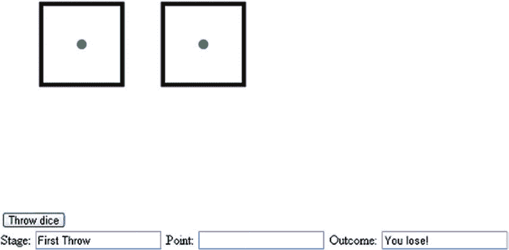
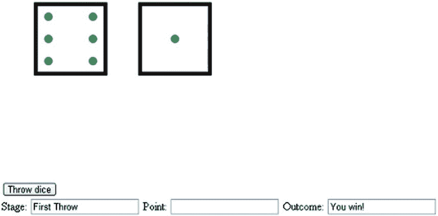
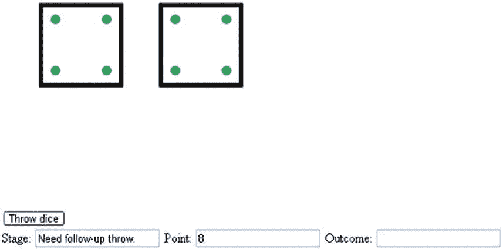
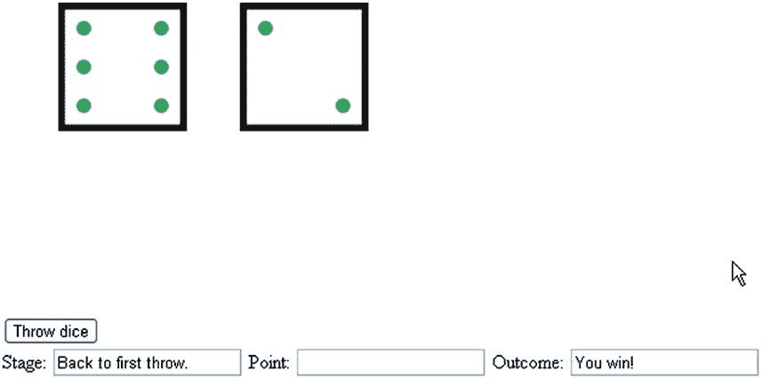
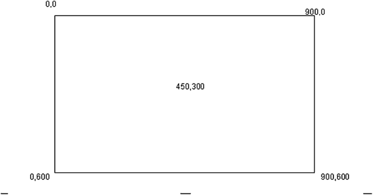
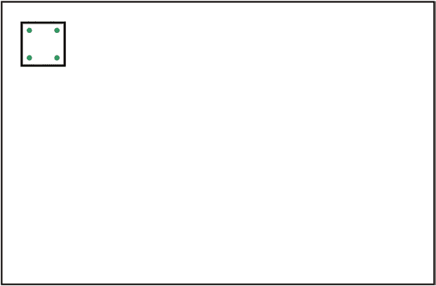
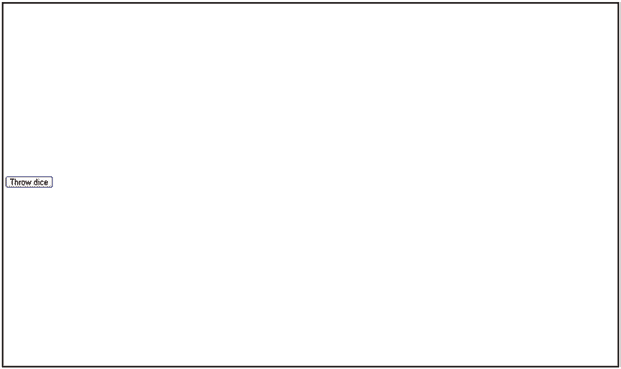
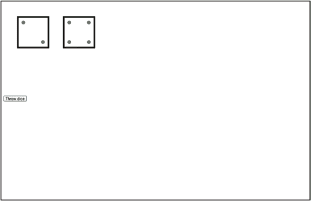

# 第 2 章

# 骰子游戏

在本章中，我们将介绍以下内容：

- 在画布上绘图
- 随机处理
- 游戏逻辑
- 表单输出

## 引言

HTML5 中最重要的新特性之一是`canvas`元素。该元素为开发者提供了一种以完全自由形式进行线条绘制、包含图像和定位文本的方式，这是对旧版 HTML 的重大改进。尽管在早期版本中可以做一些花哨的格式化，但布局往往显得呆板，页面也不够动态。如何在画布上绘图？您需要使用脚本语言，通常是 JavaScript。我将向您展示如何在画布上绘图，并解释我们构建名为“双骰子”骰子游戏实现所需的重要 JavaScript 特性：如何定义函数、如何调用伪随机行为、如何实现该特定游戏的逻辑，以及如何向玩家显示信息。

不过，在进一步讨论之前，您需要了解游戏的基本规则。

双骰子游戏的规则如下：

*玩家掷出一对骰子。两个顶面数字之和是决定因素，因此 1 和 3 与 2 和 2 相同。两个 6 面骰子之和可以是 2 到 12 之间的任何数字。如果玩家在第一次投掷中掷出 7 或 11，则玩家获胜。如果玩家掷出 2、3 或 12，则玩家失败。对于任何其他结果（4、5、6、8、9、10），该结果将被记录为所谓的玩家点数，并且需要进行后续投掷。在后续投掷中，掷出 7 则失败，掷出玩家点数则获胜。对于其他任何情况，游戏将继续按照后续投掷规则进行。*

© Jeanine Meyer 2023

J. Meyer, *The Essential Guide to HTML5*, https://doi.org/10.1007/978-1-4842-8722-4_2



第 2 章 骰子游戏

让我们看看我们的游戏玩法可能会是什么样子。图 2-1 显示了游戏开始时掷出两个一点的结果。

***图 2-1.** 第一次投掷，导致玩家失败*

这里并不明显，但我们的骰子游戏应用程序每次使用`canvas`标签绘制骰子面。这意味着无需下载单个骰子面的图像。

掷出两个 1 点意味着玩家失败，因为规则规定第一次投掷出 2、3 或 12 为失败。下一个示例显示玩家获胜，即第一次投掷出 7 点，如图 2-2 所示。





第 2 章 骰子游戏

***图 2-2.** 第一次投掷出 7 点意味着玩家获胜*

图 2-3 显示了下一次投掷——8 点。这既不是获胜也不是失败，但意味着必须进行后续投掷。

***图 2-3.** 8 点意味着需要进行后续投掷，玩家点数为 8* 29



第 2 章 骰子游戏

假设玩家最终再次掷出 8 点，如图 2-4 所示。

***图 2-4.** 再次掷出 8 点（即点数），因此玩家获胜* 如前所述，唯一重要的是骰子面上的数值之和。点数是通过两个 4 点设定的，但游戏是通过掷出 2 点和 6 点获胜的。

规则表明，一局游戏并不总是需要相同次数的投掷。玩家可以在第一次投掷中获胜或失败，也可能有任意次数的后续投掷。游戏构建者的任务是构建一个*有效*的游戏——有效意味着遵循规则，即使这意味着游戏会持续进行。我的学生有时会表现得好像他们的游戏只有在他们获胜时才有效。在游戏的正确实现中，玩家既会赢也会输。

## 关键需求

构建骰子游戏的需求始于模拟随机掷骰子。起初，这似乎是不可能的，因为编程意味着精确指定计算机将要执行的操作。幸运的是，JavaScript 与大多数其他编程语言一样，具有内置功能，可以产生看似随机的结果。有时，语言会使用代表时间的非常长的位串（1 和 0）的中间位（毫秒级）。确切的方法对我们来说并不重要。我们将假设浏览器提供的 JavaScript 在这方面做得不错，这称为*伪随机处理*。

现在假设我们可以随机获得 1 到 6 之间的任意数字（对于两个骰子面各执行一次），我们需要实现游戏规则。这意味着我们需要一种方法来跟踪我们是处于第一次投掷还是后续投掷。其正式名称为*应用程序状态*，意指当前的状态，这在游戏和其他类型的应用程序中都很重要。然后，我们需要使用基于条件做出决策的构造。诸如`if`和`switch`的条件构造是编程语言的标准组成部分，您很快就会理解为什么像我这样从未进过赌场或小巷的计算机科学老师如此喜欢双骰子游戏。

我们需要给玩家提供一种掷骰子的方式，因此我们将在屏幕上实现一个用于点击的按钮。然后，我们需要向玩家反馈发生的情况。对于这个应用程序，我通过在屏幕上绘制骰子面来提供图形反馈，并以文本形式显示信息，指示游戏阶段、点数值和结果。与用户交互的旧术语是*输入输出（I/O）*，当时这种交互主要涉及文本。现在通常使用术语*图形用户界面（GUI）*来表示用户与计算机系统交互的多种方式。这些包括使用鼠标点击屏幕上的特定点，或将点击与拖动结合以模拟移动对象的效果（参见[第 4 章](http://dx.doi.org/10.1007/978-1-4842-4155-4_4)的弹弓游戏）。在屏幕上绘图需要使用坐标系来指定点。大多数编程语言以类似的方式实现计算机屏幕的坐标系，我将很快解释这一点。

## HTML5、CSS 和 JavaScript 特性

现在让我们看看 HTML5、CSS 和 JavaScript 中为实施双骰子游戏提供所需功能的特定特性。

第 2 章 骰子游戏

### 伪随机处理与数学表达式

# JavaScript 中的伪随机处理

JavaScript 中的伪随机处理是通过一个名为 `Math.random` 的内置方法执行的。形式上，`random` 是 `Math` 类的一个方法。调用 `Math.random()` 会生成一个从 0 到 1（不包括 1）的数字，结果是一个小数，例如 0.253012。这看起来可能对我们没有立竿见影的用处，但实际上，将这个数字转换为我们可用的数字是一个非常简单的过程。我们将它（无论它是什么数字）乘以 6，得到一个从 0 到 6（不包括 6）的数字。例如，如果我们将 0.253012 乘以 6，得到 1.518072。这已经接近我们需要的，但还不完全对。下一步是去掉小数部分，保留整数部分。

为此，我们使用另一个 `Math` 方法，`Math.floor`。该方法在移除任何小数部分后生成一个整数。顾名思义，`floor` 方法会向下取整。在我们的特定例子中，我们从 0.253012 开始，接着得到 1.518072，然后调用 `Math.floor(1.58072)`，结果就是整数 1。

一般来说，当我们将随机数乘以 6 并对其取整时，我们会得到一个从 0 到 5 的数字。最后一步是加上 1，因为我们的目标是反复得到一个从 1 到 6 的数字，且没有任何特定模式。

你可以使用类似的方法来获取任意范围内的整数。例如，如果你想要得到 1 到 13 的数字，你可以将随机数乘以 13，然后再加上 1。

这对于纸牌游戏可能很有用。你会在本书中看到类似的例子。

我们可以将所有步骤组合成一个所谓的表达式。

表达式是常量、方法、函数调用以及我们稍后将探讨的一些东西的组合。我们使用运算符（例如用于加法的 `+` 和用于乘法的 `*`）将这些元素组合在一起。

还记得[第 1 章](http://dx.doi.org/10.1007/978-1-4842-4155-4_1)中标签是如何组合的吗——将一个标签嵌套在另一个标签中——以及我们在“喜欢的网站”应用程序中使用的那行 JavaScript 代码：`document.write(Date())`。

我们可以在这里使用类似的过程。我们不必将 `random` 调用和 `floor` 方法写成单独的语句，而是可以将 `random` 调用作为参数传递给 `floor` 方法。请看这段代码片段：

```
1+Math.floor(Math.random()*6)
```

## 第 2 章 骰子游戏

这个表达式将生成一个从 1 到 6 的数字。我称它为代码片段，因为它不完全是一条语句。运算符 `+` 和 `*` 指代算术运算，与你通常在数学中使用的一样。运算顺序从内向外展开。

1.  调用 `Math.random()` 获取一个从 0 到 1（但不包括 1）之间的小数。

2.  将结果乘以 6。

3.  使用 `Math.floor` 去掉小数部分，保留整数部分。

4.  加 1。

在我们的最终代码中，你会看到包含此表达式的一条语句，但我们需要先介绍其他一些内容。

### 变量与赋值语句

与其他编程语言一样，JavaScript 有一种称为变量的结构，它本质上是一个存放值（例如数字）的地方。它是一种将名称与值关联起来的方法。你可以通过引用该名称来稍后使用该值。一个类比是政府职位。在美国，我们会说“总统”。2010 年，当我撰写本书第一版时，总统是巴拉克·奥巴马。而现在，2022 年 7 月，总统是约瑟夫·拜登。“总统”这个术语所持有的值是变化的。在编程中，变量的值也可以变化，这正是其名称的由来。

术语 `var` 用于声明一个变量。

变量和函数（将在下一节描述）的名称由程序员决定。有一些规则，包括名称中不能有空格，不能使用句点，并且名称必须以字母字符开头。名称长度有限制，但我们倾向于使用短名称以避免打字。但是，我建议你不要让名称短到忘记它代表什么。你需要保持一致性，但不必遵守英语拼写规则。例如，如果你想设置一个变量来保存数值的总和，并且你认为 sum 拼写为 *som*，那也没问题。

只要确保你一直使用 *som* 即可。但如果你想引用 JavaScript 的一部分，例如 `function`、`document` 或 `random`，你需要使用 JavaScript 所期望的拼写。

### 第 2 章 骰子游戏

你应避免使用 JavaScript 内置结构（例如 `random` 或 `floor`）的名称作为你的变量名。尽量使名称唯一，但同时又易于理解。一种常见的编写变量名的方法是使用所谓的“小驼峰式命名法”。这包括以小写字母开头命名变量，然后使用大写字母来表示新单词的开始，例如 `numberOfTurns` 或 `userFirstThrow`。你可以看到它为什么被称为驼峰式命名——大写字母在单词中形成了“驼峰”。你不必使用这种命名方法，但这是许多程序员遵循的一种惯例。

保存上一节解释的伪随机表达式的代码行是一种特定类型的语句，称为赋值语句。例如，

```
var ch = 1+Math.floor(Math.random()*6);
```

将名为 `ch` 的变量设置为等号右侧表达式运算得出的值。当在 `var` 语句中使用时，它也被称为初始化语句。`=` 符号用于为此类情况下的变量设置初始值，也用于接下来将要描述的赋值语句。我选择使用名称 `ch` 作为 choice 的简写。这对我来说很有意义。不过，总的来说，如果你需要在短名称和更容易记住的长名称之间做出选择，请选择长名称！注意，语句以分号结尾。你可能会问，为什么不是句点？答案是句点用于另外两种情况：作为小数点以及用于访问对象的方法和属性，例如 `document.write`。

赋值语句是编程中最常见的语句类型。下面是一个针对已定义的变量的赋值语句示例：

```
bookName = "The Essential Guide to HTML5";
```

等号的使用可能会引起混淆。可以将其理解为使左侧等于右侧产生的结果。在本书中，你将遇到许多其他变量以及运算符和赋值语句的其他用法。

**注意** 定义变量的 `var` 语句称为声明语句。

与许多其他语言不同，JavaScript 允许程序员省略声明语句而直接开始使用变量。我尽量避免这样做，但你在许多在线示例中会看到这种情况。

### 第 2 章 骰子游戏

对于掷骰子游戏，我们需要定义游戏状态的变量，即，它是第一次投掷还是后续投掷，以及玩家的点数是多少（请记住，点数指的是前一次投掷的值）。在我们的实现中，这些值将由所谓的全局变量保存，这些变量在任何函数定义之外使用 `var` 语句定义，以便保留其值（在函数内部声明的变量的值在函数停止执行时会消失）。

### 变量并非必需

你并不总是需要使用变量。例如，我们创建的第一个应用程序设置了变量来保存骰子的水平与垂直位置。我本可以在代码中直接使用字面量数值，因为这些数值不会改变，但由于在多个地方引用了这些值，将数值存储在变量中意味着：如果我想修改其中一个或两个数值，只需在一个地方进行更改即可。

### 程序员自定义函数

JavaScript 拥有许多内置函数和方法，但它未必能涵盖你需要的所有功能。例如，据我所知，它并没有专门用于模拟掷骰子的函数。因此，JavaScript 允许我们定义并使用自己的函数。

这些函数可以接受参数，就像 `Math.floor` 方法一样，其中的参数（例如调用 `Math.floor(rawScore)` 时的变量 `rawScore`）用于计算不大于 `rawScore` 当前值的最大整数。语句

```
score = Math.floor(rawScore);
```

将根据可能包含小数部分的 `rawScore` 值，将整数值赋给变量 `score`。我在这里展示了驼峰命名法的运用。请务必记住，正是我的编码（且仅是我的编码）建立了这种关联。

参数是可能传递给函数的值。你可以将它们视为额外的信息。

函数定义的格式是：关键字 `function`，后跟你想要给函数起的名称，再后跟包含参数名称的括号，接着是一个左花括号、一些代码，最后是一个右花括号。正如我在前几节中指出的，名称由程序员选择。以下是一个函数定义的示例，它返回两个参数的乘积。顾名思义，你可以用它来计算矩形的面积。我在函数头中使用的参数名称是：`wd` 和 `ln`。它们分别代表宽度和长度。

```
function areaOfRectangle(wd, ln) {
   return wd * ln;
}
```

在函数定义中，请注意 `return` 关键字。这告诉 JavaScript 将函数的结果返回给我们。在我们的示例中，这让我们可以编写如下代码：

```
rect1 = areaOfRectangle(5, 10);
```

这将把值 50（5 × 10）赋给我们的 `rect1` 变量。函数定义应作为代码编写在 `script` 元素中。在现实中定义这个函数或许意义不大，因为在代码中直接写乘法非常简单，但它确实是一个程序员自定义函数的有用示例。一旦这个定义被执行（很可能是在 HTML 文件加载时），其他代码就可以通过调用函数名来使用它，例如 `areaOfRectangle(100, 200)` 或 `areaOfRectangle(x2 - x1, y2 - y1)`。

第二个表达式假设 `x1`、`x2`、`y1`、`y2` 指的是在其他地方定义的坐标值。

函数也可以通过设置某些标签属性来调用。例如，`body` 标签可以包含 `onLoad` 属性的设置：

```
<body onLoad="init();">
```

我的 JavaScript 代码中包含了一个我称之为 `init` 的函数定义。将其放入 `body` 元素意味着：当浏览器首次加载 HTML 文档或玩家点击重新加载/刷新按钮时，JavaScript 将调用我的 `init` 函数。

类似地，利用 HTML5 的新特性之一，我可以包含以下 `button` 元素：

```
<button onClick="throwdice();">Throw dice</button>
```

这将创建一个包含文本 "Throw dice" 的按钮。当玩家点击它时，JavaScript 会调用我在 `script` 元素中定义的 `throwdice` 函数。

稍后介绍的 `form` 元素也能以类似方式调用函数。

### 条件语句：`if` 和 `switch`

双骰子游戏有一套规则。总结这些规则的一种方式是：如果是第一次投掷的情况，我们检查骰子投掷的某些值；如果不是第一次投掷，我们检查骰子投掷的其他值。JavaScript 为此提供了 `if` 和 `switch` 语句。

`if` 语句基于条件，这些条件可以是比较或相等性检查——例如，名为 `temp` 的变量是否大于 85，或者名为 `course` 的变量是否包含值 `"Programming Games"`？比较产生两个可能的逻辑值——`true` 或 `false`。到目前为止，你见过数字值和字符串值。逻辑值是另一种数据类型。它们也被称为布尔值，以数学家乔治·布尔的名字命名。我提到的条件和检查在代码中应写为

```
temp > 85
```

和

```
course == "Programming Games"
```

将第一个表达式理解为：变量 `temp` 的当前值是否大于 85？第二个表达式理解为：变量 `course` 的当前值是否与字符串 `"Programming Games"` 相同？

比较示例很容易理解；我们使用 `>` 检查一个值是否大于另一个值，使用 `<` 检查相反情况。表达式的值将是两个逻辑值 `true` 或 `false` 之一。

第二个表达式可能有点令人困惑。你可能对两个等号以及引号感到疑惑。在 JavaScript（以及其他几种编程语言）中，用于检查相等性的比较运算符是这两个等号的组合。我们需要两个等号，因为单个等号用于赋值语句，不能身兼二职。如果我们写了 `course = "Programming Games"`，那就意味着将值 `"Programming Games"` 赋给变量 `course`，而不是比较这两项。引号定义了一个字符串，从 *P* 开始，包含空格，到 *s* 结束。

现在我们可以看看如何编写仅在条件为真时执行某些操作的代码。

```
if (condition) {
   code
}
```

如果我们希望代码在条件为真时执行一种操作，在条件**不**为真时执行另一种操作，格式如下：

```
if (condition) {
   if true code
}
else {
   if not true code
}
```

请注意，我这里使用了斜体，因为这就是所谓的伪代码，而不是我们将在 HTML 文档中包含的真正 JavaScript。

以下是一些真实的代码示例。它们使用了 `alert`，这是一个内置函数，它会在浏览器中弹出一个包含括号内参数所指消息的小窗口。用户必须点击“确定”才能继续。

```
if (temp > 85) {
   alert("It is hot!");
}

if (age >= 21) {
   alert("You are old enough to buy a drink.");
}
else {
   alert("You are too young to be served in a bar.");
}
```

我们可以仅使用 `if` 语句来编写双骰子应用程序。然而，JavaScript 提供了另一种使事物更易于理解的结构——`switch` 语句。其通用格式如下：

```
switch(x) {
   case a:
      codea;
   case b:
      codeb;
   default:
      codec;
}
```

JavaScript 会评估 `switch` 语句第一行中 `x` 的值，并将其与各个 `case` 中指示的值进行比较。一旦匹配成功（即确定 `x` 等于 `a` 或 `b`），就会执行 `case` 标签后面的代码。如果没有匹配项，则执行 `default` 后面的代码。`default` 选项不是必需的。如果不加干预，即使找到了匹配的 `case` 语句，计算机也会继续执行 `switch` 语句中的其余部分。如果你希望在找到匹配项时停止，需要包含一个 `break` 语句来跳出 `switch` 结构。

你可能已经看到 `if` 和 `switch` 将如何实现我们在骰子游戏中所需的功能。你将在下一节中了解具体做法。首先，让我们看一个例子，该例子用于确定由变量 `mon`（包含三个字母的缩写，例如 `"Jan"`、`"Feb"` 等）所指示月份的天数。

```javascript
switch(mon) {
  case "Sep":
  case "Apr":
  case "Jun":
  case "Nov":
    alert("该月有 30 天。");
    break;
  case "Feb":
    alert("该月有 28 或 29 天。");
    break;
  default:
    alert("该月有 31 天。");
}
```

如果变量 `mon` 的值等于 `"Sep"`、`"Apr"`、`"Jun"` 或 `"Nov"`，控制流将进入第一个 `alert` 语句，然后由于 `break` 的作用退出 `switch` 语句。如果变量 `mon` 的值等于 `"Feb"`，将执行提示 28 或 29 天的 `alert` 语句，然后控制流退出 `switch`。如果 `mon` 的值是其他任何内容（顺便提一下，包括无效的三字母缩写），将执行提示 31 天的 `alert` 语句。

## 第 2 章 骰子游戏

正如 HTML 会忽略换行和其他空白字符一样，JavaScript 并不要求这些语句使用特定的布局。如果你愿意，甚至可以把所有内容都写在一行里。不过，为了方便自己，还是建议使用多行并缩进。

### 在画布上绘图

现在我们来看 HTML5 中最强大的新特性之一——`canvas` 元素。我将解释涉及 `canvas` 的应用程序所需的代码片段，然后展示一些简单的例子，最后回到我们的目标——在 `canvas` 上绘制骰子面。回顾一下，HTML 文档的结构如下：

```html
<html>
  <head>
    <title>...</title>
    <style>...</style>
    <script>...</script>
  </head>
  <body>
    ...这里是初始静态内容的位置...
  </body>
</html>
```

**注意** 你不必非得包含 `title`、`style` 或 `script` 元素，而且它们的顺序可以任意。第 1 章的收藏夹示例使用了 `style` 元素，但骰子示例不会用到。

要使用 `canvas`，我们需在 HTML 文档的 `body` 元素中放入 `canvas` 标签，并在 `script` 元素中放入 JavaScript。我先介绍一种编写 `canvas` 元素的标准方式。

```html
<canvas id="canvas" width="400" height="300">
  您的浏览器不支持 HTML5 元素的 canvas。
</canvas>
```

如果包含这段代码的 HTML 文件被一个不支持 `canvas` 的浏览器打开，屏幕上会显示"您的浏览器不支持 HTML5 元素的 canvas。"这条消息。如果你正准备为所有常见浏览器制作网页，可以选择将访问者引导到其他网站，或尝试其他策略。在本书中，我只专注于 HTML5。

# HTML Canvas 基础

HTML 的 `canvas` 标签定义该元素的 `id` 为 `canvas`。这个 `id` 可以是任何值，但使用 `canvas` 也没什么坏处。不过，你可以有多个 `canvas`，在这种情况下，你需要为每个 `id` 使用不同的值。但我们的应用程序不会这么做，所以不用担心这个问题。`width` 和 `height` 属性用于指定该 `canvas` 元素的尺寸。

## JavaScript 中的 Canvas 对象

现在我们已经看到了 `body` 中的 `canvas`，接下来看看 JavaScript。在 `canvas` 上绘制的第一步是在 JavaScript 代码中定义相应的对象。为此，我需要一个变量，于是在任何函数定义之外用下面这行代码设置了一个名为 `ctx` 的变量。

```javascript
var ctx;
```

这使其成为一个全局变量，可以从任何函数中访问或设置。`ctx` 变量是所有绘图所需的东西。我选择将变量命名为 `ctx`，是“context”（上下文）的缩写，这借鉴了我见过的许多在线示例。我本来也可以选择其他任何名字。

在后面的代码中（你会在接下来的示例中看到所有代码，也可以下载源代码），我编写了设置 `ctx` 值的代码。

```javascript
ctx = document.getElementById('canvas').getContext('2d');
```

设置 `ctx` 的语句位于我定义的一个名为 `init` 的函数中，该函数在 `body` 标签中被引用。

```html
<body onload="init();">
```

将这条语句放在 `init` 函数中意味着该语句会在 `body` 中的所有内容下载*之后*、在任何其他函数被调用*之前*被调用。

设置 `ctx` 的赋值语句首先获取文档中 `id` 为 `canvas` 的元素，然后提取出所谓的 `2d` 上下文。我们都可以预见，未来可能还会出现其他上下文！目前，我们使用的是 `2d` 上下文。

在 JavaScript 编程中，你可以在 `canvas` 上绘制矩形、创建包含线段和弧线的路径，以及定位图像文件。你还可以填充矩形和路径。不过，在此之前，我们需要先了解坐标系和弧度度量。

## 坐标系与像素

正如全球定位系统（GPS）使用纬度和经度在地图上定义你的位置一样，我们也需要一种方法来指定屏幕上的点。这些点被称为*像素*，我们在上一章已经使用过它们来指定图像的宽度和边框的粗细。如果你做实验就会发现，像素是一个相当小的度量单位。然而，仅仅在线性单位上达成一致还不够。我们还需要统一测量的起点，就像 GPS 系统使用本初子午线和赤道一样。对于作为画布的二维矩形，这个起点被称为*原点*或*注册点*。原点位于 `canvas` 元素的左上角。请注意，在第 6 章中，当我们通过在 HTML 文档中（而非 `canvas` 元素中）创建并定位元素来描述问答节目时，坐标系是类似的。原点仍然是窗口的左上角。

这与你可能从解析几何或制作图表时回忆起的坐标不同。水平坐标值从左到右递增。垂直坐标值则沿屏幕*向下*递增。标准的坐标表示方法是先写水平坐标值，再写垂直坐标值。在某些情况下，水平坐标值被称为 *x* 值，垂直坐标值被称为 *y* 值。在其他情况下，水平坐标值代表左（可以理解为距离左侧的距离），垂直坐标值代表顶（可以理解为距离顶部的距离）。

图 2-5 展示了一个宽 900 像素、高 600 像素的浏览器窗口布局。数字表示各角和中点的坐标值。



**图 2-5.** 浏览器窗口的坐标系

## 绘制语句与示例

现在我们来学习几个绘制语句，然后将它们组合起来绘制简单图形（见图 2-6 至图 2-10）。之后，我们再学习如何绘制点状和矩形来表现骰子的面。

以下是绘制矩形的 HTML5 JavaScript 代码：

```javascript
ctx.strokeRect(100, 50, 200, 300);
```

这将绘制一个空心矩形，其左上角距离左侧 100 像素，距离顶部 50 像素。矩形的宽度为 200，高度为 300。此语句将使用当前设置的线宽和颜色。

接下来的代码演示了将线宽设置为 5，并将描边颜色（即轮廓）设置为指定的 RGB 值（即红色）。矩形使用变量 `x`、`y`、`w` 和 `h` 中的值绘制。

```javascript
ctx.lineWidth = 5;
ctx.strokeStyle = "rgb(255, 0, 0)";
ctx.strokeRect(x, y, w, h);
```

这段代码片段

```javascript
ctx.fillStyle = "rgb(0, 0, 255)";
ctx.fillRect(x, y, w, h);
```

在指定的位置和尺寸绘制一个实心蓝色矩形。如果你想绘制一个带有红色轮廓的蓝色矩形，需要使用两行代码。

```javascript
ctx.fillRect(x, y, w, h);
ctx.strokeRect(x, y, w, h);
```

HTML5 允许你绘制由弧线和线段组成的所谓路径。

线段是通过组合使用 `ctx.moveTo` 和 `ctx.lineTo` 绘制的。我将在多个章节中介绍它们：第 4 章中的弹弓游戏，第 5 章中使用多边形的记忆游戏，以及第 9 章中的猜词游戏。在第 4 章的炮弹游戏中，我还会向你展示如何倾斜一个矩形，而第 9 章的猜词游戏则演示了如何绘制椭圆。在本章中，我将重点介绍弧线。

你可以通过以下方式开始一条路径：

```javascript
ctx.beginPath();
```

并使用以下任一方式结束它（同时绘制该路径）：

```javascript
ctx.closePath();
ctx.stroke();
```

或者：

```javascript
ctx.closePath();
ctx.fill();
```

在某些情况下，你也可以省略对 `closePath` 的调用。

弧线可以是一个完整的圆，也可以是圆的一部分。在骰子应用中，我们只绘制完整的圆来代表每个骰子面上的点数，但我将解释弧线通常是如何工作的，以使代码不那么神秘。绘制弧线的方法具有以下格式：

```javascript
ctx.arc(cx, cy, radius, start_angle, end_angle, direction);
```

其中 `cx`、`cy` 和 `radius` 分别是圆心的水平坐标、垂直坐标和圆的半径。解释接下来的两个参数需要讨论测量角度的方法。你熟悉角度的度单位：我们说转 180 度，意思是 U 形转弯，90 度角由两条垂直线形成。但是大多数计算机编程语言使用另一种称为*弧度*的系统。这里有一种可视化弧度的方法——想象取圆的半径并将其放置在圆本身上。你可以深入回忆一下，你会意识到它不会完美贴合，因为围绕一个圆有 `2 * PI` 个弧度，略大于 6。

所以，如果我们想绘制一个完整圆的弧线，我们指定起始角度为 `0`，结束角度为 `2 * Math.PI`。幸运的是，`Math` 类提供了一个常量 `Math.PI`，它是 PI 的值（精度和必要的小数位数都足够），所以在代码中，我们写成 `2 * Math.PI`。如果我们想指定一个半圆的弧线，我们使用 `Math.PI`，而一个直角（90 度）将是 `.5 * Math.PI`。

`arc` 方法还需要一个参数，`direction`。我们如何绘制这些弧线？想象一下钟表指针的运动。在 HTML 5 中，顺时针是 `false` 方向，逆时针是 `true` 方向。（别问为什么。HTML5 就是这样规定的。）我使用内置的 JavaScript 值 `true` 和 `false`。当我们需要绘制非完整圆的弧线时，这一点就很重要。如果需要绘制非完整圆的弧线，特定问题的性质决定了你如何定义角度。

以下是一些示例，包含完整代码，供你创建（使用 TextPad 或 TextWrangler），然后修改以测试你的理解程度。第一个示例绘制了一条弧线，代表一个微笑。

```html
<html>
<head>
<title>微笑</title>
<script>
function init() {
    var ctx = document.getElementById("canvas").getContext('2d');
    ctx.beginPath();
    ctx.strokeStyle = "rgb(200,0,0)";
    ctx.arc(200, 200, 50, 0, Math.PI, false);
    ctx.stroke();
}
</script>
</head>
<body onLoad="init();">
<canvas id="canvas" width="400" height="300">
    你的浏览器不支持 HTML5 元素 canvas。
</canvas>
</body>
</html>
```

图 2-6 显示了此代码生成的弧线在屏幕上的部分截图。

**图 2-6.** 由表达式 `ctx.arc(200,200,50,0,Math.PI, false);` 产生的“微笑”

你可以向前查看图 2-11、2-12 和 2-13，在这些图中我捕捉了更多屏幕内容，以查看绘图的定位。请在你的示例中修改这些数字，以便理解坐标系是如何工作的，以及一个像素实际有多大。

在继续看哭脸之前，尝试让弧线更宽或更高，或者改变颜色。然后尝试将整个弧线上、下、左、右移动。提示：你需要修改下面这行：

`ctx.arc(200, 200, 50, 0, Math.PI, false);`

改变 `200,200` 来重置圆心，改变 `50` 来修改半径。

现在，让我们继续看其他变体。一定要逐个尝试并进行实验。

将 `arc` 方法的最后一个参数改为 `true`：

`ctx.arc(200, 200, 50, 0, Math.PI, true);`

这使得弧线沿逆时针方向绘制。完整代码如下：

```html
<html>
<head>
<title>哭脸</title>
<script type="text/javascript">
function init() {
    var ctx = document.getElementById("canvas").getContext('2d');
    ctx.beginPath();
    ctx.strokeStyle = "rgb(200,0,0)";
    ctx.arc(200, 200, 50, 0, Math.PI, true);
    ctx.stroke();
}
</script>
</head>
<body onLoad="init();">
<canvas id="canvas" width="400" height="300">
    你的浏览器不支持 HTML5 元素 canvas。
</canvas>
</body>
</html>
```

注意，我也改变了标题。标题会显示在浏览器标签页上。你的用户/观众确实会注意到标题。我发现我在调试时会使用标题来追踪不同的版本。此代码产生的屏幕截图如图 2-7 所示。

`图 2-7.` 由表达式 `ctx.arc(200,200,50,0,Math.PI, true);` 产生的“哭脸”

在描边之前加入闭合路径的语句（针对哭脸示例），将会“收尾”该弧线。

`ctx.closePath();`

`ctx.stroke();`

完整代码如下：

```html
<html>
<head>
<title>哭脸</title>
<script type="text/javascript">
function init() {
    var ctx = document.getElementById("canvas").getContext('2d');
    ctx.beginPath();
    ctx.strokeStyle = "rgb(200,0,0)";
    ctx.arc(200, 200, 50, 0, Math.PI, true);
    ctx.closePath();
    ctx.stroke();
}
</script>
</head>
<body onLoad="init();">
<canvas id="canvas" width="400" height="300">
    你的浏览器不支持 HTML5 元素 canvas。
</canvas>
</body>
</html>
```

这产生的屏幕截图如图 2-8 所示。

`图 2-8.` 通过在 `ctx.stroke();` 前添加 `ctx.closePath();`，哭脸变为半圆

`closePath` 命令并非总是必需的，但包含它是一个好习惯。你会注意到我稍后才会调用 `closePath` 并填充多个点的语句。在此处进行实验，并向前查看第 5 章中弹弓的绘制和第 9 章中吊死鬼图形的绘制。如果你想填充路径，可以使用 `ctx.fill()` 代替 `ctx.stroke()`，这会产生一个黑色的填充形状，如图 2-9 所示。完整代码如下：

```html
<html>
<head>
<title>微笑</title>
<script type="text/javascript">
function init() {
    var ctx = document.getElementById("canvas").getContext('2d');
    ctx.beginPath();
    ctx.strokeStyle = "rgb(200,0,0)";
    ctx.arc(200, 200, 50, 0, Math.PI, false);
    ctx.closePath();
    ctx.fill();
}
</script>
</head>
<body onLoad="init();">
<canvas id="canvas" width="400" height="300">
    你的浏览器不支持 HTML5 元素 canvas。
</canvas>
</body>
</html>
```

黑色是默认颜色。

`图 2-9.` 使用 `ctx.fill()` 填充半圆

# 排版后的内容

如果你希望形状既有填充色又有清晰的轮廓线，就需要同时使用 `fill` 和 `stroke` 命令，并通过 `fillStyle` 和 `strokeStyle` 属性指定不同的颜色。配色方案基于第 [1](http://dx.doi.org/10.1007/978-1-4842-4155-4_1) 章中介绍的相同红/绿/蓝编码。你可以自行尝试，或使用 Photoshop 等工具以及在线照片编辑器 [pixlr.com](http://pixlr.com) 来获取所需的颜色。以下是完整代码：

```html
<html>
<head>
<title>Smile</title>
<script type="text/javascript">
function init() {
    var ctx = document.getElementById("canvas").getContext('2d');
    ctx.beginPath();
    ctx.strokeStyle = "rgb(200,0,0)";
    ctx.arc(200, 200, 50, 0, Math.PI, false);
    ctx.fillStyle = "rgb(200,0,200)";
    ctx.closePath();
    ctx.fill();
    ctx.strokeStyle = "rgb(255,0,0)";
    ctx.lineWidth = 5;
    ctx.stroke();
}
</script>
</head>
<body onLoad="init();">
<canvas id="canvas" width="400" height="300"> Your browser doesn't support the HTML5 element canvas.
</canvas>
</body>
</html>
```


这段代码绘制了一个用紫色（红色和蓝色的组合）填充的半圆形，并带有一条纯红色的轮廓线（即描边），如图 2-10 所示。编码过程是先指定路径，然后以填充方式绘制路径，再以描边方式绘制路径。

*图 2-10. 使用不同颜色进行填充和描边*

通过多种不同的命令可以绘制出完整的圆形，包括以下命令：

```
ctx.arc(200,200,50,0, 2*Math.PI, true);
ctx.arc(200,200,50, 0, 2*Math.PI, false);
ctx.arc(200,200,50, .5*Math.PI, 2.5*Math.PI, false);
```

你完全可以坚持使用第一个命令——它和其他命令一样好用。请注意，我仍然使用了 `closePath` 命令。从几何学角度讲，圆形是一个闭合图形，但在 JavaScript 中这一点并不重要。

如果你将 `canvas` 元素想象成一块画布，在上面涂抹墨水或颜料，那么要绘制新内容时，就需要擦除画布或画布上的相应部分。为此，HTML5 提供了以下命令：

```
ctx.clearRect(x,y,width,height);
```

后续示例将展示如何绘制弹弓（第 [4](http://dx.doi.org/10.1007/978-1-4842-4155-4_4) 章）、记忆/配对游戏的多边形（第 [5](http://dx.doi.org/10.1007/978-1-4842-4155-4_5) 章）、迷宫墙壁（第 [7](http://dx.doi.org/10.1007/978-1-4842-4155-4_7) 章）以及吊死鬼游戏中的火柴人（第 [9](http://dx.doi.org/10.1007/978-1-4842-4155-4_9) 章）。现在，让我们回到掷骰子游戏所需的内容上。

# 第 2 章 掷骰子游戏

## 使用表单显示文本输出

我们可以在 canvas 上书写文本（参见第 [5](http://dx.doi.org/10.1007/978-1-4842-4155-4_5) 章），但对于掷骰子游戏应用，我选择使用表单，这是 HTML 新旧版本中都包含的元素。我并非使用表单来接收玩家的输入，而是用它来输出关于骰子投掷结果的信息。HTML5 规范指出了设置表单的新方法，包括检查或*验证*输入的类型和范围。下一章的应用将演示验证功能。

我使用以下 HTML 代码为掷骰子游戏创建表单：

```
<form name="f">

Stage: <input name="stage" value="First Throw"/>

Point: <input name="pv" value=" "/>

Outcome: <input name="outcome" value=" "/>

</form>
```

表单以 `name` 属性开头。文本 `Stage:`、`Point:` 和 `Outcome:` 会出现在输入字段旁边。请注意，这些 `input` 标签是单例标签，它们同时具有 `name` 和 `value` 字段。这些名称将被 JavaScript 代码使用。你可以在表单中放置任何 HTML 内容，也可以在任意 HTML 中放置表单。

由于掷骰子游戏使用了新的按钮元素，我仅添加了包含用于向玩家显示信息的字段的表单元素，而没有包含类型为 `submit` 的 `input` 元素。或者，我也可以使用带有 `submit` 输入字段的标准表单（从而无需使用新的按钮元素），代码如下：

```html
<form name="f" onSubmit="throwDice();">
阶段：<input type="text" name="stage" value="First Throw"/>
点数：<input type="text" name="pv" value=" "/>
结果：<input type="text" name="outcome" value=" "/>
<input type="submit" value="THROW DICE"/>
</form>
```

类型为 `submit` 的 `input` 元素会在屏幕上生成一个按钮。这些就是我们构建掷骰子游戏所需的所有概念。现在我们可以开始编写代码了。



# 第 2 章 骰子游戏

## 构建应用并使之成为你的作品

你可能已经在小例子中尝试过本章介绍的 HTML5、CSS 和 JavaScript 结构。提示：请务必尝试。学习唯一的方法就是自己动手做例子。作为构建掷骰子游戏的铺垫，我们接下来会看到这三个应用：

- 投掷一个骰子并通过重新加载再次投掷
- 使用按钮投掷两个骰子
- 完整的掷骰子游戏

图 2-11 展示了第一个应用可能的起始画面。我说“可能”是因为它不会总是显示 4。我特意截取了这张几乎覆盖整个窗口的截图，以便你能看到图形在屏幕上的位置。

**图 2-11.** `单个骰子应用`

图 2-12 展示了投掷一对骰子应用的起始界面。屏幕上只显示一个按钮。





**图 2-12.** `一对骰子应用的起始界面`

最后，图 2-13 展示了玩家点击按钮后的界面。

**图 2-13.** `点击按钮投掷一对骰子`

采用增量步骤构建应用是一种良好的技术。这些应用是使用文本编辑器（如 TextPad 或 TextWrangler）构建的。请记得将文件保存为 `.html` 类型——并且要尽早且经常保存。你无需完成所有内容才保存。当你完成第一个应用并保存测试后，可以用新名称再次保存，然后在这个新副本上进行修改，使其成为第二个应用。第三个应用也如法炮制。

### 投掷一个骰子

这第一个应用的目的是在画布上随机显示一个骰子面，圆点按标准方式排列。

对于任何应用，通常都有多种可行的方法。我意识到可以从某些代码中获得双重用途，因为 3 点骰子面的图案可以通过组合 2 点和 1 点的图案得到。类似地，5 点的图案是 4 点和 1 点的组合。4 点的图案是 2 点的图案加上一些独特元素的组合。6 点的图案是 4 点的图案加上一些独特元素的组合。我本来可以把所有代码都放在 `init` 函数里，或者使用单个 `drawFace` 函数。无论如何，这种方法对我来说是合理的，并且我相当快地编写和调试了它。表 2-1 列出了所有函数并说明了谁调用了谁。表 2-2 展示了完整代码，并解释了每一行的作用。

**表 2-1.** `单个骰子投掷应用中的函数`

| **函数** | **被调用者/调用源** | **调用函数** |
| --- | --- | --- |
| `init` | 由 `<body>` 标签中的 `onLoad` 动作调用 | `drawFace` |
| `drawFace` | 由 `init` 调用 | `draw1`、`draw2`、`draw4`、`draw2mid` |
| `draw1` | 在 `drawFace` 中的三个位置被调用来处理 1、3 和 5 点 | |
| `draw2` | 在 `drawFace` 中的三个位置被调用来处理 2、3 和 4 点 | |
| `draw4` | 在 `drawFace` 中的三个位置被调用来处理 4、5 和 6 点 | `draw2` |
| `draw2mid` | 在 `drawFace` 中的一个位置被调用来处理 6 点 | |

**表 2-2.** `投掷单个骰子应用的完整代码`

| **代码** | **解释** |
| --- | --- |
| `<html>` | 开始 html 标签。 |
| `<head>` | 开始 head 标签。 |
| `<title>Throwing 1 die</title>` | 完整的 title 元素。 |
| `<script>` | 开始 script 标签。 |
| `var cwidth = 400;` | 保存画布宽度的变量；也用于清除画布以准备重绘。 |
| `var cheight = 300;` | 保存画布高度的变量；也用于清除画布以准备重绘。 |
| `var dicex = 50;` | `dicex`：存放单个骰子水平位置的变量。 |
| `var dicey = 50;` | `dicey`：存放单个骰子垂直位置的变量。 |
| `var diceWidth = 100;` | `diceWidth`：存放骰子面宽度的变量。 |
| `var diceHeight = 100;` | `diceHeight`：存放骰子面高度的变量。 |
| `var dotDadius = 6;` | `dotDadius`：存放点半径的变量。 |
| `var ctx;` | `ctx`：存放画布上下文的变量，用于所有绘图命令。 |
| `function init() {` | `init()`函数定义的开始，该函数在文档加载时被调用。 |
| `var ch = 1+Math.floor(Math.random()*6);` | 声明并设置`ch`变量的值为随机数 1、2、3、4、5 或 6。 |
| `drawFace(ch);` | 调用`drawFace()`函数，参数为`ch`。 |
| `}` | 函数定义结束。 |
| `function drawFace(n) {` | `drawFace()`函数定义的开始，其参数为点的个数。 |
| `ctx = document.getElementById('canvas').getContext('2d');` | 获取用于在画布上绘制的对象。 |
| `ctx.lineWidth = 5;` | 将线宽设置为 5。 |
| `ctx.clearRect(dicex, dicey, diceWidth, diceHeight);` | 清除可能绘制了骰子面的空间，第一次调用时无效果。 |
| `ctx.strokeRect(dicex, dicey, diceWidth, diceHeight);` | 绘制骰子面的轮廓。 |
| `ctx.fillStyle = "#009966";` | 设置圆圈的颜色。我使用图形程序确定了这个值。你可以自行选择或进行实验。 |
| `switch(n) {` | 使用表示点数的变量`n`开始`switch`语句。 |
| `case 1:` | 如果`n`为 1。 |
| `draw1();` | 调用`draw1()`函数。 |
| `break;` | 跳出`switch`。 |
| `case 2:` | 如果`n`为 2。 |
| `draw2();` | 调用`draw2()`函数。 |
| `break;` | 跳出`switch`。 |
| `case 3:` | 如果`n`为 3。 |
| `draw2();` | 先调用`draw2()`，然后。 |
| `draw1();` | 调用`draw1()`。 |
| `break;` | 跳出`switch`。 |
| `case 4:` | 如果`n`为 4。 |
| `draw4();` | 调用`draw4()`函数。 |
| `break;` | 跳出`switch`。 |
| `case 5:` | 如果`n`为 5。 |
| `draw4();` | 调用`draw4()`函数，然后。 |
| `draw1();` | 调用`draw1()`函数。 |
| `break;` | 跳出`switch`。 |
| `case 6:` | 如果`n`为 6。 |
| `draw4();` | 调用`draw4()`函数，然后。 |
| `draw2mid();` | 调用`draw2mid()`函数。 |
| `break;` | 跳出`switch`（非必须）。 |
| `}` | 关闭`switch`语句。 |
| `}` | 关闭`drawFace()`函数。 |
| `function draw1() {` | `draw1()`定义的开始。 |
| `var dotx;` | 用于绘制单个点的水平位置变量。 |
| `var doty;` | 用于绘制单个点的垂直位置变量。 |
| `ctx.beginPath();` | 开始一条路径。 |

# 投掷两个骰子

```javascript
dotx = dicex + .5*diceWidth;
```

将该点中心水平设置为骰子面的中心。

```javascript
doty = dicey + .5*diceHeight;
```

将该点中心垂直设置为骰子面的中心。

```javascript
ctx.arc(dotx, doty, dotrad, 0, Math.PI*2, true);
```

构造一个圆（通过`fill`命令绘制）。

```javascript
ctx.closePath();
```

关闭路径。

```javascript
ctx.fill();
```

绘制路径，即填充圆。

```javascript
}
```

关闭`draw1()`。

```javascript
function draw2() {
```

`draw2()`函数的开始。

```javascript
var dotx;
```

用于绘制两个点的水平位置变量。

```javascript
var doty;
```

用于绘制两个点的垂直位置变量。

```javascript
ctx.beginPath();
```

开始一条路径。

```javascript
dotx = dicex + 3*dotrad;
```

将该点中心水平设置为距骰子面左上角三个半径长度的位置。

```javascript
doty = dicey + 3*dotrad;
```

将该点中心垂直设置为距骰子面左上角三个半径长度的位置。

```javascript
ctx.arc(dotx, doty, dotrad, 0, Math.PI*2, true);
```

构造第一个点。

```javascript
dotx = dicex+dicewidth-3*dotrad;
```

将该点中心水平设置为距骰子面右下角三个半径长度的位置。

```javascript
doty = dicey+diceheight-3*dotrad;
```

将该点中心垂直设置为距骰子面右下角三个半径长度的位置。

```javascript
ctx.arc(dotx, doty, dotrad, 0, Math.PI*2, true);
```

构造第二个点。

```javascript
ctx.closePath();
```

关闭路径。

```javascript
ctx.fill();
```

绘制两个点。

```javascript
}
```

关闭`draw2()`。

```javascript
function draw4() {
```

`draw4()`函数的开始。

```javascript
draw2();
```

绘制两个点。

```javascript
var dotx;
```

用于绘制点的水平位置变量。

```javascript
var doty;
```

用于绘制点的垂直位置变量。

```javascript
ctx.beginPath();
```

开始路径。

```javascript
dotx = dicex + 3*dotrad;
```

将该点水平放置在左下角内部。

```javascript
doty = dicey + diceheight-3*dotrad;
```

将该点垂直放置在左下角内部。

```javascript
ctx.arc(dotx, doty, dotrad, 0, Math.PI*2, true);
```

构造圆。

```javascript
dotx = dicex+dicewidth-3*dotrad;
```

将该点水平放置在右上角内部。

```javascript
doty = dicey+3*dotrad;
```

将该点垂直放置在右上角内部。

```javascript
ctx.arc(dotx, doty, dotrad, 0, Math.PI*2, true);
```

构造圆。

```javascript
ctx.closePath();
```

关闭路径。

```javascript
ctx.fill();
```

绘制两个点。

```javascript
}
```

关闭`draw4()`函数。

```javascript
function draw2mid() {
```

`draw2mid()`函数的开始，该函数在中间绘制两个点。

```javascript
var dotx;
```

用于绘制两个点的水平位置变量。

```javascript
var doty;
```

用于绘制两个点的垂直位置变量。

```javascript
ctx.beginPath();
```

开始一条路径。

```javascript
dotx = dicex + 3*dotrad;
```

将该点水平放置在内部。

```javascript
doty = dicey + .5*diceHeight;
```

将该点垂直放置在中部。

```javascript
ctx.arc(dotx, doty, dotrad, 0, Math.PI*2, true);
```

构造一个圆。

```javascript
dotx = dicex+diceWidth-3*dotrad;
```

将该点水平放置在紧贴右侧边界内部。

```javascript
doty = dicey + .5*diceHeight;
```

垂直位置设置为`y`中部。

```javascript
ctx.arc(dotx, doty, dotrad, 0, Math.PI*2, true);
```

构造一个圆。

```javascript
ctx.closePath();
```

关闭路径。

```javascript
ctx.fill();
```

绘制点。

```javascript
}
```

关闭`draw2mid()`函数。

```javascript
</script>
```

关闭`script`元素。

```html
</head>
```

关闭`head`元素。

```html
<body onLoad="init();">
```

开始`body`标签，`onLoad`属性设置为调用`init()`函数。

```html
<canvas id="canvas" width="400" height="300">
Your browser doesn't support the HTML5 element canvas.
</canvas>
```

设置画布，如果浏览器不接受`canvas`元素则提供提示。

```html
</body>
```

关闭`body`并关闭`html`元素。

```html
</html>
```

你应该在代码中添加注释。注释是浏览器忽略的文本，用于提醒你以及可能查看此程序的其他人当前代码的作用。一种注释形式以双斜杠开头，该行中斜杠右侧的所有内容都被忽略。对于较长的注释，使用斜杠加星号开始注释，星号加斜杠结束注释。

```javascript
/*
This is a comment.
*/
```

这是“按我说的做，别按我做的做”的情况。因为我使用表格对每一行进行解释，并且你可以将整个章节视为注释，所以我在代码中没有包含太多注释。我重申：你应该添加注释！

**提示** 当我开发这段代码（以及任何涉及随机效果的代码）时，我不想在初始测试中处理随机编码。因此，在`var ch = 1+Math.floor(Math.random()*6);`这一行之后，我立即添加一行`ch = 1;`进行测试，然后将其改为`ch = 2;`，以此类推。完成此测试阶段后，我移除了这行代码（或使用`//`将其注释掉）。这遵循了一条通用建议：在开发过程中，尽量避免在游戏完全复杂的状态下进行测试。

下一个应用使用一个按钮来让玩家进行交互（而不仅仅是重新加载网页），并且模拟了一对骰子的投掷。在查看代码之前，思考一下可以从第一个应用中复用哪些内容。总体答案是：大部分内容。这种“复用”节省了编写和测试代码的工作量。

# 第 2 章 骰子游戏

第二个应用需要处理两个骰子面的位置，为此将使用两个额外的变量：`dx` 和 `dy`。它还需要重复使用 `Math.random` 的代码，并两次调用 `drawFace` 来生成每个骰子面。并且，触发投掷的方式也需要改变。表 2-3 描述了被调用和调用其他函数的函数，其结构与表 2-1 基本相同，只是现在增加了一个名为 `throwDice` 的函数，该函数由 `<button>` 标签的 `onClick` 属性设置的动作调用。表 2-4 包含了投掷两个骰子应用的完整 HTML 文档。

## 表 2-3. 双骰子应用中的函数

| 函数 | 被谁调用/由谁调用 | 调用谁 |
|---|---|---|
| `throwDice` | 由 `<button>` 标签中的 `onClick` 动作调用 | `drawFace` |
| `drawFace` | 由 `throwDice` 调用 | `draw1`, `draw2`, `draw4`, `draw2mid` |
| `draw1` | 由 `drawFace` 在表示 1、3 和 5 的三个位置调用 | |
| `draw2` | 由 `drawFace` 在表示 2、3 和 4 的两个位置调用 | |
| `draw4` | 由 `drawFace` 在表示 4、5 和 6 的三个位置调用 | `draw2` |
| `draw2mid` | 由 `drawFace` 在表示 6 的一个位置调用 | |

## 表 2-4. 完整的双骰子应用

| 代码 | 说明 |
|---|---|
| `<html>` | HTML 开标签。 |
| `<head>` | head 开标签。 |
| `<title>Throwing dice</title>` | 完整的标题元素。 |
| `<script>` | script 开标签。 |
| `var cwidth = 400;` | 存放画布宽度的变量。 |
| `var cheight = 300;` | 存放画布高度的变量；也用于清除画布以准备重绘。 |
| `var dicex = 50;` | 存放单个骰子水平位置的变量；也用于清除画布以准备重绘。 |
| `var dicey = 50;` | 存放单个骰子垂直位置的变量。 |
| `var diceWidth = 100;` | 存放骰子面宽度的变量。 |
| `var diceHeight = 100;` | 存放骰子面高度的变量。 |
| `var dotrad = 6;` | 存放圆点半径的变量。 |
| `var ctx;` | 存放画布上下文对象的变量，用于所有绘图命令。 |
| `var dx;` | 用于水平定位的变量，会针对两个骰子面分别修改。 |
| `var dy;` | 用于垂直定位的变量。两个骰子面使用相同的值。 |
| `function throwDice() {` | `throwDice` 函数的开始。 |
| `var ch = 1+Math.floor(Math.random()*6);` | 声明变量 `ch` 并用随机值为其赋值。 |
| `dx = dicex;` | 为第一个骰子面设置 `dx`。 |
| `dy = dicey;` | 为第一个和第二个骰子面设置 `dy`。 |
| `drawFace(ch);` | 调用 `drawFace`，并将 `ch` 作为点数传入。 |
| `dx = dicex + 150;` | 为第二个骰子面调整 `dx`。 |
| `ch = 1 + Math.floor(Math.random()*6);` | 用随机值重新设置 `ch`。 |
| `drawFace(ch);` | 调用 `drawFace`，并将 `ch` 作为点数传入。 |
| `}` | 关闭 `throwDice` 函数。 |
| `function drawFace(n) {` | `drawFace` 函数定义的开始，其参数是点数。 |
| `ctx = document.getElementById('canvas').getContext('2d');` | 获取用于在画布上绘图的对象。 |
| `ctx.lineWidth = 5;` | 将线宽设置为 5。 |
| `ctx.clearRect(dx,dy,diceWidth,diceHeight);` | 清除可能已绘制过骰子面的区域。首次调用时无效果。 |
| `ctx.strokeRect(dx,dy,diceWidth,diceHeight);` | 绘制骰子面的轮廓。 |
| `var dotx;` | 存放水平位置的变量。 |
| `var doty;` | 存放垂直位置的变量。 |
| `ctx.fillStyle = "#009966";` | 设置颜色。 |
| `switch(n) {` | 开始 switch 语句，根据点数进行分支。 |
| `case 1:` | 如果点数为 1。 |
| `draw1();` | 调用 `draw1` 函数。 |
| `break;` | 跳出 switch 语句。 |
| `case 2:` | 如果点数为 2。 |
| `draw2();` | 调用 `draw2` 函数。 |
| `break;` | 跳出 switch 语句。 |
| `case 3:` | 如果点数为 3。 |
| `draw2();` | 先调用 `draw2`，然后。 |
| `draw1();` | 调用 `draw1`。 |
| `break;` | 跳出 switch 语句。 |
| `case 4:` | 如果点数为 4。 |
| `draw4();` | 调用 `draw4` 函数。 |
| `break;` | 跳出 switch 语句。 |
| `case 5:` | 如果点数为 5。 |
| `draw4();` | 调用 `draw4` 函数，然后。 |
| `draw1();` | 调用 `draw1` 函数。 |
| `break;` | 跳出 switch 语句。 |
| `case 6:` | 如果点数为 6。 |
| `draw4();` | |

# 第 2 章 骰子游戏

## 表 2-4（续）

| 代码 | 说明 |
|------|------|
| `Call the draw4 function and then.` | 调用`draw4`函数，然后执行。 |
| `draw2mid();` | 调用`draw2mid`函数。 |
| `break;` | 跳出`switch`语句（并非严格必要）。 |
| `}` | 关闭`switch`语句。 |
| `}` | 关闭`drawface`函数。 |
| `function draw1() {` | 开始定义`draw1`。 |
| *(续)* | |
| `var dotx;` | 用于绘制单个圆点的水平位置的变量。 |
| `var doty;` | 用于绘制单个圆点的垂直位置的变量。 |
| `ctx.beginPath();` | 开始一条路径。 |
| `dotx = dx + .5*diceWidth;` | 将该圆点中心设在骰子面的水平中心（使用`dx`）... |
| `doty = dy + .5*diceHeight;` | ……以及垂直中心（使用`dy`）。 |
| `ctx.arc(dotx, doty, dotrad, 0, Math.PI*2, true);` | 构造一个圆形（通过`fill`命令绘制）。 |
| `ctx.closePath();` | 关闭路径。 |
| `ctx.fill();` | 绘制路径，即圆形。 |
| `}` | 关闭`draw1`。 |
| `function draw2() {` | 开始定义`draw2`函数。 |
| `var dotx;` | 用于绘制两个圆点的水平位置的变量。 |
| `var doty;` | 用于绘制两个圆点的垂直位置的变量。 |
| `ctx.beginPath();` | 开始一条路径。 |
| `dotx = dx + 3*dotrad;` | 在骰子面左上角向内水平方向，将圆点圆心设在 3 倍半径处…… |
| `doty = dy + 3*dotrad;` | ……以及垂直方向。 |
| `ctx.arc(dotx, doty, dotrad, 0, Math.PI*2, true);` | 构造第一个圆点。 |
| *(续)* | |
| `dotx = dx+diceWidth-3*dotrad;` | 在骰子面右下角向内水平方向，将圆点圆心设在 3 倍半径处…… |
| `doty = dy+diceHeight-3*dotrad;` | ……以及垂直方向。 |
| `ctx.arc(dotx, doty, dotrad, 0, Math.PI*2, true);` | 构造第二个圆点。 |
| `ctx.closePath();` | 关闭路径。 |
| `ctx.fill();` | 绘制两个圆点。 |
| `}` | 关闭`draw2`。 |
| `function draw4() {` | 开始定义`draw4`函数。 |
| `draw2();` | 调用`draw2`函数。 |
| `var dotx;` | 用于绘制圆点的水平位置的变量。 |
| `var doty;` | 用于绘制圆点的垂直位置的变量。 |
| `ctx.beginPath();` | 开始路径。 |
| `dotx = dx + 3*dotrad;` | 将该圆点置于左下角内侧，水平方向…… |
| `doty = dy + diceHeight-3*dotrad;` | ……以及垂直方向。 |
| `ctx.arc(dotx, doty, dotrad, 0, Math.PI*2, true);` | 构造圆形。 |
| `dotx = dx+diceWidth-3*dotrad;` | 将该圆点置于右上角内侧，水平方向…… |
| `doty = dy+3*dotrad;` | ……以及垂直方向。 |
| *(续)* | |
| `ctx.arc(dotx, doty, dotrad, 0, Math.PI*2, true);` | 构造圆形。 |
| `ctx.closePath();` | 关闭路径。 |
| `ctx.fill();` | 绘制两个圆点。 |
| `}` | 关闭`draw4`函数。 |
| `function draw2mid() {` | 开始定义`draw2mid`函数。 |
| `var dotx;` | 用于绘制两个圆点的水平位置的变量。 |
| `var doty;` | 用于绘制两个圆点的垂直位置的变量。 |
| `ctx.beginPath();` | 开始路径。 |
| `dotx = dx + 3*dotrad;` | 将圆点置于水平方向内侧…… |
| `doty = dy + .5*diceHeight;` | ……以及垂直方向中点。 |
| `ctx.arc(dotx, doty, dotrad, 0, Math.PI*2, true);` | 构造圆形。 |
| `dotx = dx+diceWidth-3*dotrad;` | 将该圆点置于右边界内侧。 |
| `doty = dy + .5*diceHeight;` | y 坐标设在中点（不变）。 |
| `ctx.arc(dotx, doty, dotrad, 0, Math.PI*2, true);` | 构造一个圆形。 |
| `ctx.closePath();` | 关闭路径。 |
| `ctx.fill();` | 绘制圆点。 |
| `}` | 关闭`draw2mid`函数。 |
| `</script>` | 关闭`script`元素。 |
| `</head>` | 关闭`head`元素。 |
| `<body>` | body 标签开始。 |
| *(续)* | |
| `<canvas id="canvas" width="400" height="300">` | Canvas 标签开始。 |
| `Your browser doesn't support the HTML5 element canvas.` | 设置一个画布，若浏览器不支持`canvas`元素则提供提示信息。 |
| `</canvas>` | 关闭`canvas`标签。 |
| `<br/>` | 换行。 |
| `<button onClick="throwDice();">Throw dice</button>` | 按钮元素（注意`onClick`属性设置为调用`throwDice`）。 |
| `</body>` | 关闭`body`标签。 |
| `</html>` | 关闭`html`标签。 |

## 完整的 Craps 游戏

# 第 2 章 骰子游戏

第三个应用是完整的双骰子游戏。同样，我们可以大量沿用前一个应用的代码。但现在，我们需要加入游戏规则。

除此之外，这意味着要使用条件语句 `if` 和 `switch`，以及全局变量（即定义在任何函数之外的变量），来记录当前是否是第一次投掷（`firstTurn`）以及玩家的点数（`point`）。

这两个变量保存了双骰子游戏的应用状态。正是这种相对简单的应用状态，以及全局变量和局部变量的使用、条件语句和随机处理，使得双骰子游戏成为编程教师们钟爱的教学主题。

函数表格与第二个应用给出的表格相同（见表 2-3），因此这里不再重复。表 2-5 包含了本应用的代码。新的操作全部在 `throwDice` 函数中。我将对新增的代码行进行注释。

**表 2-5.** 完整的双骰子游戏应用

| 代码 | 说明 |
| :--- | :--- |
| `<html>` | |
| `<head>` | |
| `<title>双骰子游戏</title>` | |
| `<script>` | |
| `var cwidth = 400;` | |
| `var cheight = 300;` | |
| `var dicex = 50;` | |
| `var dicey = 50;` | |
| `var diceWidth = 100;` | |
| `var diceHeight = 100;` | |
| `var dotrad = 6;` | |
| `var ctx;` | |
| `var dx;` | |
| `var dy;` | |
| `var firstturn = true;` | 全局变量，初始化为值 `true`。 |
| `var point;` | 全局变量，无需初始化，因为会在使用前被赋值。 |
| `function throwDice() {` | `throwDice` 函数开始。 |
| `var sum;` | 用于存放两个骰子点数之和的变量。 |
| `var ch = 1+Math.floor(Math.random()*6);` | 用第一个随机值设置 `ch`。 |
| `sum = ch;` | 将此值赋给 `sum`。 |
| `dx = dicex;` | 设置 `dx`。 |
| `dy = dicey;` | 设置 `dy`。 |
| `drawFace(ch);` | 绘制第一个骰子面。 |
| `dx = dicex + 150;` | 调整水平位置。 |
| `ch=1 + Math.floor(Math.random()*6);` | 用随机值设置 `ch`。这是第二个骰子的值。 |
| `sum += ch;` | 将 `ch` 加到已有的 `sum` 中。 |
| `drawFace(ch);` | 绘制第二个骰子。 |
| `if (firstTurn) {` | 现在开始实现规则。这是第一次投掷吗？ |
| `switch(sum) {` | 如果是，则以 `sum` 为条件开始一个 `switch` 语句。 |
| `case 7:` | 对于 7… |
| `case 11:` | …或 11。 |
| `document.f.outcome.value="你赢了！";` | 显示“你赢了！”。 |
| `break;` | 退出 `switch` 语句。 |
| `case 2:` | 对于 2… |
| `case 3:` | …或 3… |
| `case 12:` | …或 12。 |
| `document.f.outcome.value="你输了！";` | 显示“你输了！”。 |
| `break;` | 退出 `switch` 语句。 |
| `default:` | 对于其他任何情况。 |
| `point = sum;` | 将点数之和保存在变量 `point` 中。 |
| `document.f.pv.value=point;` | 显示点数。 |
| `firstTurn = false;` | 将 `firstTurn` 设置为 `false`。 |
| `document.f.stage.value="需要继续投掷。";` | 显示“需要继续投掷。”。 |
| `document.f.outcome.value=" ";` | 擦除（清除）结果输入框。 |
| `}` | 结束 `switch` 语句。 |
| `}` | 结束 `if` 为真时的子句。 |
| `else {` | 否则（不是第一次投掷）。 |
| `switch(sum) {` | 开始 `switch` 语句，再次使用 `sum`。 |
| `case point:` | 如果 `sum` 等于 `point` 中的值。 |
| `document.f.outcome.value="你赢了！";` | 显示“你赢了！”。 |
| `document.f.stage.value="回到第一次投掷。";` | 显示“回到第一次投掷。”。 |
| `document.f.pv.value=" ";` | 清除点数。 |
| `firstTurn = true;` | 重置 `firstTurn` 使其再次为 `true`。 |
| `break;` | 退出 `switch` 语句。 |
| `case 7:` | 如果点数之和等于 7。 |
| `document.f.outcome.value="你输了！";` | 显示“你输了！”。 |
| `document.f.stage.value="回到第一次投掷。";` | 显示“回到第一次投掷。”。 |
| `document.f.pv.value=" ";` | 清除点数。 |
| `firstTurn = true;` | 重置 `firstTurn` 使其再次为 `true`。 |
| `}` | 结束 `switch` 语句。 |
| `}` | 结束 `else` 子句。 |
| `}` | 结束 `throwDice` 函数。 |
| `function drawFace(n) {` | |
| `ctx = document.getElementById('canvas').getContext('2d');` | |
| `ctx.lineWidth = 5;` | |
| `ctx.clearRect(dx,dy,diceWidth,diceHeight);` | |
| `ctx.strokeRect(dx,dy,diceWidth,diceHeight);` | |
| `ctx.fillStyle = "#009966";` | |
| `switch(n) {` | |
| `case 1:` | |
| `draw1();` | |
| `break;` | |
| `case 2:` | |
| `draw2();` | |
| `break;` | |
| `case 3:` | |
| `draw2();` | |
| `draw1();` | |
| `break;` | |
| `case 4:` | |
| `draw4();` | |
| `break;` | |
| `case 5:` | |
| `draw4();` | |
| *(续)* | |

# 第 2 章 骰子游戏

**表 2-5.** （*续*）

**代码**

**说明**

```javascript
draw1();
break;
case 6:
draw4();
draw2mid();
break;
}

function draw1() {
var dotx;
var doty;
ctx.beginPath();
dotx = dx + .5*dicewidth;
doty = dy + .5*diceheight;
ctx.arc(dotx,doty,dotrad,0,
Math.PI*2,true);
ctx.closePath();
ctx.fill();
}

function draw2() {
var dotx ;
var doty;
ctx.beginPath();
dotx = dx + 3*dotrad;
doty = dy + 3*dotrad;
ctx.arc(dotx,doty,dotrad,0,Math.
PI*2,true);
dotx = dx+dicewidth-3*dotrad;
doty = dy+diceheight-3*dotrad ;
ctx.arc(dotx,doty,dotrad,0,Math.
PI*2,true);
ctx.closePath();
ctx.fill();
}

function draw4() {
draw2();
var dotx;
var doty;
ctx.beginPath();
dotx = dx + 3*dotrad;
doty = dy + diceheight-3*dotrad;
ctx.arc(dotx,doty,dotrad,0,Math.
PI*2,true);
dotx = dx+dicewidth-3*dotrad;
doty = dy+ 3*dotrad;
ctx.arc(dotx,doty,dotrad,0,Math.
PI*2,true);
ctx.closePath();
ctx.fill() ;
}

function draw2mid() {
var dotx;
var doty ;
ctx.beginPath();
dotx = dx + 3*dotrad;
doty = dy + .5*diceheight;
ctx.arc(dotx,doty,dotrad,0,Math.
PI*2,true);
dotx = dx+dicewidth-3*dotrad;
doty = dy + .5*diceheight;
ctx.arc(dotx,doty,dotrad,0,Math.
PI*2,true);
ctx.closePath();
ctx.fill();
}
```

```html
<script>
</head>
<body>
<canvas id="canvas" width="400" height="300">
Your browser doesn't support the HTML5 element canvas.
</canvas>
<br/>
<button onClick="throwdice();">Throw dice</button>
<form name="f">
Start a form named f.
Stage: <input name="stage" value="First Throw"/>
With the text Stage: right before it, set up an input field named stage.
Point: <input name="pv" value=" "/>
With the text Point: right before it, set up an input field named pv.
Outcome: <input name="outcome" value=" "/>
With the text Outcome: right before it, set up an input field named outcome.
</form>
Close the form.
</body>
Close body.
</html>
Close html.
```

#### 让应用程序个性化

让这个应用程序个性化并不像收藏站点应用程序那样直接，因为花旗骰的规则就是规则本身。如果你不想改变规则，仍然有很多事情可以做。使用`fillRect`并设置`fillStyle`为不同颜色，改变骰子面的大小和颜色。改变整个画布的颜色和大小。将结果文本改为更生动的描述。你也可以使用标准或特制的骰子实现其他游戏。

你可以提前阅读下一章，学习如何在画布上绘制图像，而不是使用弧线和矩形来绘制每个骰子面。HTML5 提供了一种引入外部图像文件的方法。这种方法的缺点是你必须管理这些单独的文件。

你可以开发计分代码。对于赌博游戏，你可以让玩家以固定金额开始，比如 100 个货币单位，每玩一局扣除一些金额，比如 10 个，并且仅在玩家获胜时增加一些金额，比如 20 个。你可以将此赌注信息作为`<form>`元素的一部分添加到`<body>`中。

## 第 2 章 骰子游戏

```html
<form name="f" id="f">
Stage: <input name="stage" value="First Throw"/>
Point: <input name="pv" value=" "/>
Outcome: <input name="outcome" value=" "/>
Bank roll: <input name="bank" value="100"/>
</form>
```

JavaScript（以及其他编程语言）区分数字和表示数字的字符串。也就是说，值`"100"`是一个字符串，由字符 1、0 和 0 组成；而值`100`是一个数字。无论哪种情况，变量的值都存储为 1 和 0 的序列。对于数字，这将是表示为二进制数的数字。对于字符串，每个字符将使用标准编码系统（如 ASCII 或 Unicode）表示。在某些情况下，JavaScript 会自动从一种数据类型转换为另一种，但不要依赖这种行为。我建议的编码方式使用内置函数`String`和`Number`来进行这些转换。

在`throwDice`函数中，在`if(firstTurn)`语句之前，添加表 2-6（或类似内容）中的代码。

**表 2-6.** 为玩家添加赌注

**代码**

**说明**

```javascript
var bank = Number(document.f.bank.value);
```

设置一个新变量`bank`，其值为`bank`输入字段中表示的数字。

```javascript
if (bank<10) {
```

将`bank`与 10 进行比较。

```javascript
alert("You ran out of money! Add some more and try again.");
```

如果`bank`小于 10，则弹出一个警告。

```javascript
return;
```

退出函数，不执行任何操作。

```javascript
}
```

关闭`if`真分支。

```javascript
bank = bank – 10;
```

将`bank`减少 10。仅当`bank`大于 10 时才会执行这一行。

```javascript
document.f.bank.value = String(bank);
```

将该值的字符串表示放入`bank`字段。

## 第 2 章 骰子游戏

然后，在玩家获胜的每个位置（首次投掷中 7 点和 11 点之后的`switch`语句，或者后续投掷中，点数情况之后的`switch`语句），添加表 2-7 中的代码。

**表 2-7.** 增加赌注的值

**代码**

**说明**

```javascript
bank = Number(document.f.bank.value);
```

将`bank`设置为`bank`输入字段中表示的数字。再次设置`bank`允许玩家在游戏过程中重置赌注金额。

```javascript
bank +=20;
```

使用`+=`运算符将`bank`的值增加 20。

```javascript
document.f.bank.value = String(bank);
```

将赌注金额的字符串表示放入`bank`字段。

当玩家输掉游戏或处于后续轮次时，不需要添加任何代码。每次新游戏开始前，赌注值会减少。

#### 测试和上传应用程序

这些应用程序完整地包含在 HTML 文件中。没有使用其他文件（如图像文件）。相反，骰子面是在画布上绘制的。（作为参考，我使用较旧 HTML 编写的骰子游戏版本使用了一个或两个``元素。为了使这些固定的``元素显示不同的图像，我编写了更改`src`属性为不同外部图像文件的代码。当我上传应用程序时，我必须上传所有图像文件。）

在浏览器中打开 HTML 文件。第一个应用程序需要重新加载才能获得新的（单个）骰子。第二个和第三个应用程序（第三个是花旗骰游戏）使用一个按钮来掷骰子。

我重复我之前写的内容。要测试这个程序，你确实需要检查多种情况。当你（作为玩家）获胜时，并不代表测试完成。典型的问题包括：

- 缺失或不匹配的开始和结束标签。

- 不匹配的开花括号和闭花括号（`{`和`}`），它们包围函数、`switch`语句和`if`子句。

- 缺少引号。使用`TextPad`和其他一些编辑器时，可用的颜色编码可以帮助解决这个问题，因为它会高亮识别出的关键字。

- 变量和函数的命名和使用不一致。这些名称可以是任意选择的，但必须保持一致。函数`draw2mid`不会被`drawmid2()`调用。

除了最后一点，这些都是语法错误，类似于语法和标点错误。语义错误（即含义错误）可能更难检测。如果你编写第二个`switch`语句，使其在掷出 7 点时获胜，而在掷出点数时失败，你可能编写了正确的`JavaScript`代码，但这不再是花旗骰游戏了。

## 第 2 章 骰子游戏

### 总结

在本章中，你学习到了如何

- 声明变量并使用全局变量来表示应用程序状态

- 编写代码执行算术运算

- 定义并使用程序员自定义函数

- 使用`JavaScript`的几个内置功能，包括`Math.random`和`Math.floor`方法

- 使用`if`和`switch`语句

- 使用`HTML`元素创建画布

- 绘制矩形和圆形

### 第 2 章：骰子游戏

本章介绍了`HTML5`的一个关键特性——画布，以及随机性和交互性的概念。同时还介绍了许多你将在本书后续示例中使用的编程特性。特别是**分阶段构建应用程序**的技术非常实用。下一章将展示一个在盒子中弹跳的球的动画——为第[4](http://dx.doi.org/10.1007/978-1-4842-4155-4_4)章真正的游戏做准备——包括名为“炮弹”和“弹弓”的弹道模拟。
