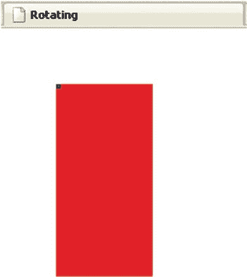
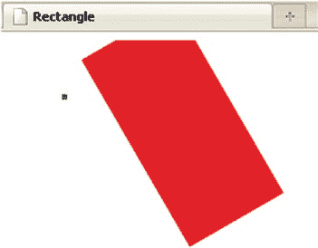
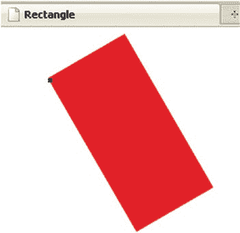
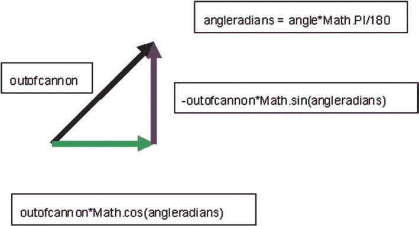
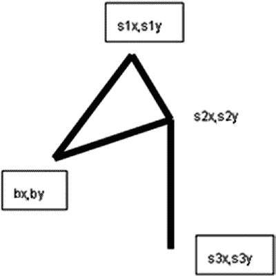

# 排版结果

下一个语句声明了变量`cball`，通过使用运算符`new`和函数`Ball`构建了一个新的`Ball`类型对象。函数的参数基于为加农炮设置的数值，因为我希望球在开始时出现在加农炮的炮口位置。

```javascript
var cball = new Ball(cannonx+cannonlength,cannony+cannonht*.5,ballrad, "rgb(250,0,0)");
```

`Picture`、`myRectangle`和`Sling`函数类似，稍后将解释。它们各自指定了一个`draw`方法。对于这个应用程序，我只对`cball`使用了`moveit`，但我为其他对象也定义了`moveit`，以防以后我想在此基础上构建应用程序。变量`cannon`和`ground`将被设置为保存一个新的`myRectangle`，而变量`target`和`htarget`将被设置为保存一个新的`Picture`。

**提示**：程序员自定义的名称是任意的，但最好在拼写和大小写上保持一致。`HTML5`似乎忽略大小写，这与名为`XHTML`的 HTML 版本形成对比。许多语言将大写和小写视为不同的字母。我通常使用小写，但我将`Ball`、`Picture`、`Slingshot`和`myRectangle`的首字母大写，因为惯例是用于构造对象的函数应以大写字母开头。

每个变量都将使用数组方法`push`添加到`everything`数组中，该方法将新元素添加到数组的末尾。

##### 绘图中的旋转和平移

HTML5 允许我们平移和旋转图形。正如你在第 2 章和第 3 章中所见，图形是依据坐标系进行绘制和定位的，图像等对象也是如此。

坐标系的一个重要方面是其原点，即`0,0`位置。HTML5 提供了一种改变坐标系的方法。*平移*操作会改变原点。我们大多数人熟悉的一种情况是在车中使用 GPS 系统。

方向是根据我们所在的位置给出的。你可以将其视为重置原点。*旋转*操作会围绕原点进行旋转！接下来的几段将带你了解一些示例。请花时间研究这些示例并修改以观察结果。

请看以下代码。我强烈建议你创建这个示例并进行实验，以提高你的理解。该代码在画布上绘制了一个大型红色矩形，其左上角位于`(50,50)`，并在其上方绘制了一个微小的蓝色正方形。

```html
<html>
<head>
<title>Rectangle</title>
<script type="text/javascript">
var ctx;
function init(){
  ctx = document.getElementById('canvas').getContext('2d');
  ctx.fillStyle = "rgb(250,0,0)";
  ctx.fillRect(50,50,100,200);
  ctx.fillStyle = "rgb(0,0,250)";
  ctx.fillRect(50,50,5,5);
}
</script>
</head>
<body onLoad="init();">
<canvas id="canvas" width="400" height="300"> Your browser doesn't support the HTML5 element canvas.
</canvas>
</body>
</html>
```

结果如图 4-6 所示。



**图 4-6.** 矩形（无旋转）

在本练习中，目标是旋转大矩形，以左上角（蓝色小正方形所在位置）为轴心。我希望旋转方向为逆时针。

一个大多数编程语言中都存在的轻微复杂问题是：旋转以及三角函数输入的角必须是*弧度*，而不是度。

弧度在第 2 章中已经解释过，但这里提醒一下。一个完整圆周不是 360 度，而是基于数学常数π乘以 2 的弧度。幸运的是，我们可以使用 JavaScript 的内置特性`Math.PI`。一个π弧度等于 180 度，而π除以 2 等于直角（90 度）。要指定 30 度的旋转，我们使用π除以 6，或者在编码中写为`Math.PI/6`。为了修改之前给出的`init`函数以进行旋转，我放入了一个负π除以 6（相当于逆时针 30 度）的旋转，绘制红色矩形，然后反向旋转以撤销旋转，以便绘制蓝色正方形：

```javascript
function init(){
  ctx = document.getElementById('canvas').getContext('2d');
  ctx.fillStyle = "rgb(250,0,0)";
  ctx.rotate(-Math.PI/6);
  ctx.fillRect(50,50,100,200);
  ctx.rotate(Math.PI/6);
  ctx.fillStyle = "rgb(0,0,250)";
  ctx.fillRect(50,50,5,5);
}
```



不幸的是，图 4-7 中的图形不是我想要的。

**图 4-7.** 绘制并旋转矩形

问题在于旋转点在原点`(0,0)`，而不是在红色矩形的角上。因此，我需要编写代码来执行平移以重置原点，然后进行旋转，然后再平移回来，以便在正确的位置绘制下一个项目。

我可以使用 HTML5 的特性来实现这一点。画布上的所有绘图都是根据坐标系进行的，我可以使用`save`和`restore`操作来保存当前坐标系（轴的位置和方向），然后恢复它以进行后续绘图。

```javascript
function init(){
  ctx = document.getElementById('canvas').getContext('2d');
  ctx.fillStyle = "rgb(250,0,0)";
  ctx.save();
  ctx.translate(50,50); //移动原点
  ctx.rotate(-Math.PI/6); //进行旋转
  ctx.translate(-50,-50); // 将原点移回
  ctx.fillRect(50,50,100,200); //绘制矩形
  ctx.restore(); //撤销所有变换
  ctx.fillStyle = "rgb(0,0,250)";
  ctx.fillRect(50,50,5,5); //绘制小的蓝色正方形
}
```

`rotate`方法期望角度使用弧度单位，顺时针为正方向。因此我的代码在逆时针旋转 30 度，产生了我的预期效果，如图 4-8 所示。



**图 4-8.** 保存、平移、旋转、平移、恢复

再次强调，我强烈建议你修改这个示例，以帮助你理解变换和弧度。一次只修改一条语句，进行小的改动。

顺便提一下，我们不能期望玩家使用弧度来输入角度。他们和我们一样习惯使用度（90 度是直角，180 度是掉头时的弧等）。程序必须完成这项工作。从度到弧度的转换是乘以`π/180`。

**注意**：大多数编程语言在三角函数以及旋转操作中使用弧度。

有了这个背景，我在`everything`数组中添加了指示信息，标明是否有旋转，如果有，则标明所需的平移点。这是我的想法。它与 HTML5 或 JavaScript 无关，也可以采用不同的方式实现。底层任务是在模拟场景中创建和维护对象的信息。HTML5 的画布特性提供了绘制图形和显示图像的方法，但它不会保留对象的信息！

第二个和第三个应用程序中`everything`数组的项目本身也是数组。第一个（第 0 个索引）值指向对象。第二个（第 1 个索引）值为`true`或`false`。`true`值表示后面跟随一个旋转角度值以及用于平移的`x`和`y`值。在实践中，这意味着内层数组要么有两个值（最后一个为`false`），要么有五个值。



**注意**：在这一点上，你可能在想：她建立了一个通用系统只是为了旋转加农炮。为什么不专门为加农炮做点什么？答案是：我们可以，但通用系统确实有效，而专门为加农炮做的东西可能也需要同样多的编码。

第一个应用程序使用水平和垂直位移值选取。


根据表单输入，玩家必须设想两个独立的值。在第二个应用中，玩家再次输入两个值，但类型不同：一个是炮弹出膛速度，另一个是炮管角度。其余计算由程序完成。初始且恒定的水平位移与初始垂直位移，均根据玩家输入的出膛速度与角度计算得出，其计算基于标准三角学。幸运的是，JavaScript 在 `Math` 内置方法类中提供了三角函数。

图 4-9 展示了根据玩家指定的出膛速度与角度值计算位移量的过程。垂直方向上的负号是由于 JavaScript 屏幕坐标系的 `y` 值在屏幕向下方向递增所致。

**图 4-9.** 计算水平和垂直位移

此时，你可能想跳转阅读炮弹应用的实现。之后可以再回来阅读弹弓应用所需的内容。



## 第 4 章 炮弹与弹弓

##### 绘制线段

对于弹弓应用，我通过定义两个函数 `Sling` 和 `drawSling` 新增了一个对象类型。我理想化的弹弓由四个位置点表示，如图 4-10 所示。请理解，我们本可以用多种不同方式实现。

**图 4-10.** 理想化的弹弓

`Sling` 函数与其他构造函数（例如 `Ball`）类似。

```
function Sling(bx,by,s1x,s1y,s2x,s2y,s3x,s3y,styleString) {
  this.bx = bx;
  this.by = by;
  this.s1x = s1x;
  this.s1y = s1y;
  this.s2x = s2x;
  this.s2y = s2y;
  this.s3x = s3x;
  this.s3y = s3y;
  this.strokeStyle = styleString;
  this.draw = drawSling;
  this.moveit = moveSling;
}
```

`Sling` 函数将 `drawSling` 设置为当 `draw` 与 `Sling` 对象关联时调用的函数。虽然在当前应用中并未发生，但如果你或我在该应用基础上扩展以移动弹弓位置，则会调用 `moveSling`。

绘制弹弓的过程包括基于四个点绘制四条线段。`bx`、`by` 点会如我下一节所述发生变化。HTML5 允许我们将线段绘制为路径的一部分。我们之前已使用路径来绘制圆形。你可以将路径绘制为描边或填充。对于圆形，我们使用了 `fill` 方法，但对于弹弓，我只需要线条。绘制线条可能涉及两个步骤：移动到线条的一端，然后绘制它。HTML5 提供了 `moveTo` 和 `lineTo` 方法。只有在调用 `stroke` 或 `fill` 方法后，路径才会被绘制。`drawSling` 函数是线段绘制的一个很好的示例。

```
function drawSling() {
  ctx.strokeStyle = this.strokeStyle;
  ctx.lineWidth = 4;
  ctx.beginPath();
  ctx.moveTo(this.bx,this.by);
  ctx.lineTo(this.s1x,this.s1y);
  ctx.moveTo(this.bx,this.by);
  ctx.lineTo(this.s2x,this.s2y);
  ctx.moveTo(this.s1x,this.s1y);
  ctx.lineTo(this.s2x,this.s2y);
  ctx.lineTo(this.s3x,this.s3y);
  ctx.stroke();
}
```

它执行以下操作：

- 向路径添加一条从 `bx`、`by` 到 `s1x`、`s1y` 的线段
- 向路径添加一条从 `bx`、`by` 到 `s2x`、`s2y` 的线段
- 向路径添加一条从 `s1x`、`s1y` 到 `s2x`、`s2y` 的线段
- 向路径添加一条从 `s2x`、`s2y` 到 `s3x`、`s3y` 的线段

一如既往，学习的方法是结合自己的设计进行实验。如果没有调用 `moveTo`，则下一个 `lineTo` 将从上一个 `lineTo` 的终点开始绘制。想象一下手中握笔，要么在纸上移动，要么抬起笔移动而不画任何东西。你也可以连接弧线。第 5 章将演示多边形的绘制。

##### 用于拉动弹弓的鼠标事件

弹弓应用用鼠标拖放操作取代了表单输入。这之所以吸引人，是因为它更接近于物理上向后拉弹弓的动作。


当玩家按下鼠标按钮时，这是程序需要管理的一系列事件中的第一个。以下是需要完成的操作的伪代码。

- 当玩家按下鼠标按钮时，检查鼠标是否位于球的上方。如果不是，则不做任何操作。如果是，则设置一个名为`inMotion`的变量。
- 如果鼠标正在移动，检查`inMotion`。如果它被设置，则移动球和弹弓的绳子。持续执行此操作直到鼠标按钮被释放。
- 当玩家释放鼠标按钮时，将`inMotion`重置为`false`。计算球的角度和初始速度，并据此计算水平速度和初始垂直速度。让球开始移动。

你可以使用 HTML5 和 JavaScript 来设置按下标准（左）鼠标按钮、移动鼠标和释放鼠标按钮的事件处理。代码直接基于`canvas`元素使用一种方法，而不是所谓的上下文。

以下是代码，位于`init`函数中：

```
canvas1 = document.getElementById('canvas');
canvas1.addEventListener('mousedown',findball,false);
canvas1.addEventListener('mousemove',moveit,false);
canvas1.addEventListener('mouseup',finish,false);
```

现在，因为这个事件是针对整个画布的，`findBall`函数必须判断鼠标是否在球的上方。第一个任务是获取鼠标的`x`和`y`坐标。当我最初编写这段代码时，不同的浏览器以不同的方式实现鼠标事件。以下代码适用于 Safari 和 Chrome：

```
mx = ev.pageX;
my = ev.pageY;
```

