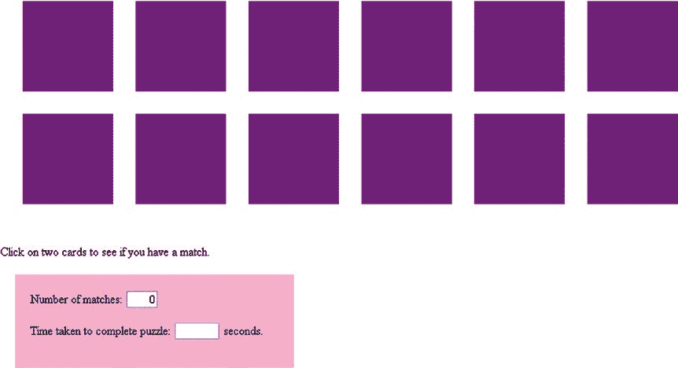
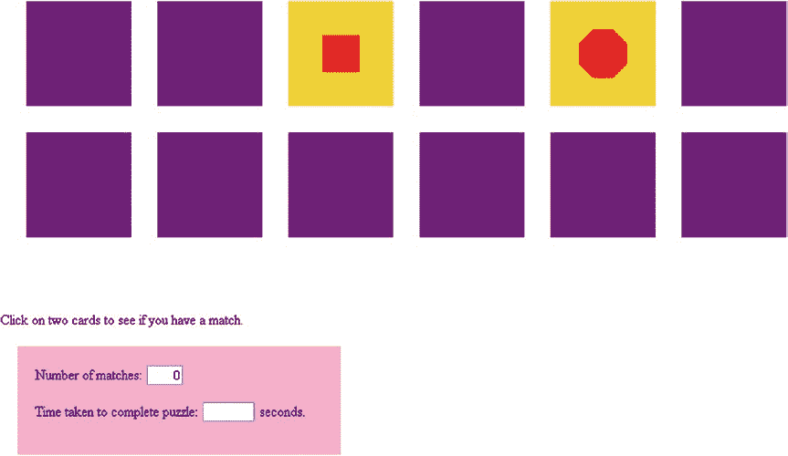
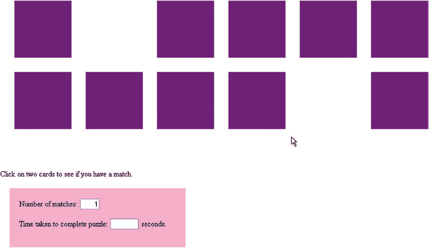
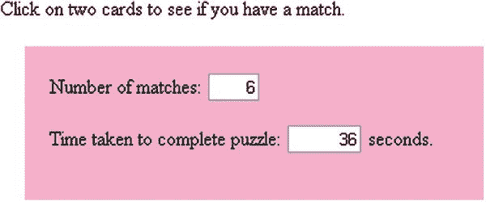
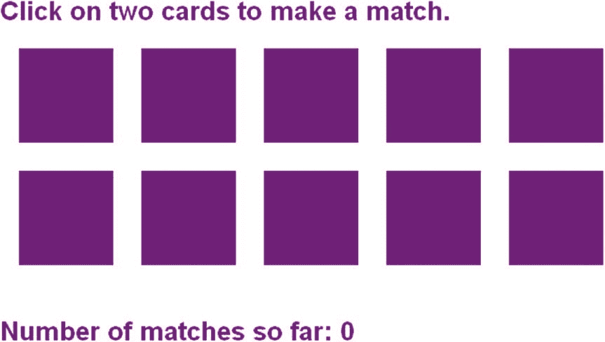
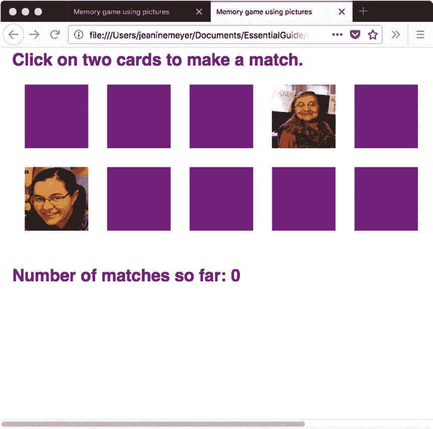
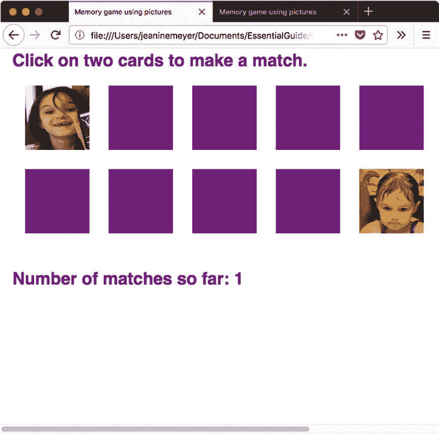
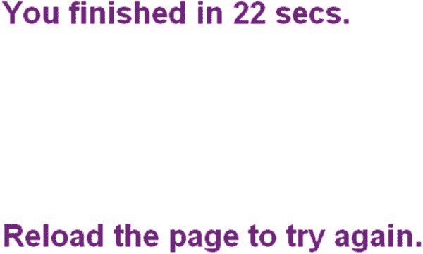

# J. Meyer，《HTML5 入门指南》，[`doi.org/10.1007/978-1-4842-8722-4_5`](https://doi.org/10.1007/978-1-4842-8722-4_5#DOI)



## 第 5 章：记忆（又称配对）游戏

图 5-1 显示了第一版的初始画面。当玩家完成游戏时，记录配对的表格也会显示已用时间。

***图 5-1.** 记忆游戏第一版的初始画面*

图 5-2 显示了玩家点击两张牌（紫色方块）后的结果。图中显示的多边形不匹配，因此在短暂停顿后，程序会用牌背图像替换它们，使牌看起来像是被翻了过去。



***图 5-2.** 两张牌面：不匹配*

当两张牌匹配时，应用程序会移除它们并在表单中记录这次配对（见图 5-3）。




***图 5-3.** 应用程序已移除配对的两张牌*

如图 5-4 所示，游戏在玩家完成时显示结果——本例中，在 36 秒内完成了 6 次配对。

***图 5-4.** 玩家完成游戏后的第一版*



在游戏的第二版中，牌面显示的是人物照片，而非多边形。请注意，虽然许多记忆游戏认为只有完全相同的图像才视为匹配，但这个游戏类似于一副扑克牌中红桃 2 匹配方块 2。为了说明一个编程要点，我们将匹配定义为同一个人，即使照片不同。这需要一种方法来编码我们用于确定匹配状态的信息。游戏第二版还演示了如何在画布上书写文本，如图 5-5 所示，它描绘了初始画面。

***图 5-5.** 记忆游戏第二版初始画面*

要查看在我们新游戏中点击两张牌可能产生的结果，请看图 5-6。



***图 5-6.** 不匹配的照片*

由于结果显示的是两个不同的人——在暂停让玩家查看两张照片后——应用程序会将牌翻回去，让玩家再试一次。

图 5-7 显示了一次成功的选取——同一人的两张图像（尽管照片不同）。



***图 5-7.** 匹配成功（场景不同，但是同一个人）*

应用程序会将匹配的图像从面板上移除。当所有牌都被移除时，完成游戏所用的时间会与如何重新游戏的说明一同显示，如图 5-8 所示。



***图 5-8.** 游戏结束画面（照片版）；所有图像已匹配，因此没有显示任何牌*

你可以使用随源代码提供的照片来玩这个游戏，但使用你自己的照片会更有趣。你可以从小规模开始——比如两到三对图像——然后逐步增加到全家、全班或整个俱乐部的照片。对于游戏的第一版，你可以用自己设计的图案替换多边形。

#### 关键需求

游戏的数字版本需要能够表示牌背（所有牌背相同）以及具有各自独特多边形或照片的牌面。应用程序还必须能够判断哪些牌相互匹配，以及牌在面板上的位置。此外，玩家需要获得反馈。在实体游戏中，参与者会翻开两张牌寻找配对（这需要一点时间）。如果没有配对，他们会将牌再次翻转为牌背朝上。

计算机程序必须显示所选牌的牌面，并在揭示第二张牌后暂停，以便玩家有时间看清两张牌面。这个暂停是计算机实现所需的一个例子，而在人们进行实体游戏时则是自然发生的。应用程序还应该显示当前已找到的配对数，并在游戏结束时，显示参与者找到所有配对所用的时间。多边形版和照片版程序使用不同的方法来完成这些任务。

以下是两个游戏版本必须执行的操作的总结：
-   绘制牌背。
-   在玩家进行初始选择前洗牌，这样每次出现的排列不会相同。
-   检测玩家何时点击了一张牌，并区分是第一次点击还是第二次点击。
-   检测到点击时，通过绘制多边形（游戏第一版）或显示正确的照片（游戏第二版）来显示相应的牌面。
-   移除成功配对的牌对。
-   即使那些讨厌的玩家做出意料之外的操作，例如双击同一张牌或点击一张牌之前占据的空位，程序也要能正常运行。

#### HTML5、CSS 与 JavaScript 特性

我们来详细讨论一下实现游戏所需的特定 HTML5 和 JavaScript 特性。我们将建立在之前涉及的内容之上：HTML 文档的通用结构；如何在 `canvas` 元素上绘制矩形、图片以及由线段组成的路径；程序员定义的函数和内置函数；程序员对象；`form` 元素；以及数组。

新的 HTML5 和 JavaScript 特性包括超时事件、使用 `Date` 对象计算已用时间、在画布上书写和绘制文本，以及一些有用的编程技巧，这些将在未来的应用程序中很有价值。

与前几章一样，本节将概述这些 HTML5 特性和编程技巧。你可以在“构建应用程序”部分看到上下文中的所有代码。如果愿意，你可以跳到那一节查看代码，然后再回到这里了解这些特性如何工作的解释。

#### 表示牌

当我们手里拿着一张实体牌时，我们可以看到它是什么。它有牌面和牌背，且所有牌背都是相同的。我们可以清楚地确定牌在游戏板上的位置，以及当前显示的是牌面还是牌背。要实现计算机游戏，我们必须表示——*编码*——所有这些信息。编码是创建许多计算机应用程序（不仅仅是游戏）的基本部分。

在本章（以及全书）中，我描述了一种完成任务的方法。但请记住，实现应用程序的功能通常不止一种方法。尽管如此，构建应用程序的不同策略可能共享一些共同的技巧。

我们处理牌的方法将采用一个程序员定义的对象。在 JavaScript 中创建程序员定义的对象涉及编写构造函数；在本例中，我们将其命名为 `Card`。使用程序员定义对象的优点是，JavaScript 提供了访问公共类型对象的信息和代码所需的点表示法。我们在第 4 章的炮弹和弹弓游戏中就是这样做的。

我们将为 `Card` 对象赋予以下属性：一个用于保存牌的位置（`sx` 和 `sy`）和尺寸（`sWidth` 和 `sHeight`）的属性、一个指向绘制牌背的函数的指针，以及针对每种情况指定相应牌面的信息（`info`）。


在多边形卡片的情况下，`info`的值将指示要绘制的边数（稍后会讨论绘制它的代码）。对于照片卡牌面，该值将是一个对已创建的`Image`对象的引用`img`。该对象将保存一个特定的图像文件，同时带有一个将匹配图片关联起来的数字（`info`）。为了绘制文件中的图像，我们将使用内置的`drawImage`方法。

不用说，这些卡片并非像有两面的实体存在。应用程序在玩家期望看到的位置，在画布上绘制卡片的正面或背面。

`flipBack`函数绘制卡片的背面。为了营造卡片被移除的视觉效果，`flipBack`通过绘制一个与棋盘颜色相同的矩形来有效地擦除卡片。

两个应用程序都使用一个名为`makeDeck`的函数来准备牌堆，这个过程包括创建`Card`对象。对于游戏的多边形版本，我们将边数（从 3 到 8）存储在`Card`对象中。不过，应用程序在设置期间不会绘制任何多边形。照片版本则设置一个名为`pairs`的数组，列出照片的图像文件名。您可以按照此示例创建自己的家庭或团体记忆游戏。

**第 5 章 记忆（又名“连连看”）游戏**

**提示：** 如果您使用在线代码玩游戏，如前所述，您可以下载图像文件。若想让游戏成为您自己的，您需要上传图片，然后更改代码以引用您的文件。代码会指明哪些部分需要更改。

`makeDeck`函数创建`Image`对象，并使用`pairs`数组将`src`属性设置为图像对象。当代码创建`Card`对象时，它会放入控制`pairs`数组的索引值，以便匹配的照片具有相同的值。与多边形版本一样，应用程序在牌堆创建期间不会在画布上绘制任何图像。在屏幕上，所有卡片看起来都一样；不过，其内部信息是不同的。

这些卡片位于固定位置——洗牌是之后的事情。

代码对`Card`和`Polygon`的位置信息（`sx`和`sy`属性）做出了不同的解释。对于第一种情况，该信息指的是左上角。对于第二种情况，该值标识了多边形的中心。不过，您可以根据其中一个计算出另一个。

**使用`Date`进行计时**

我们需要一种方法来确定玩家完成所有匹配所花费的时间。JavaScript 提供了一种测量已用时间的方法。您可以在“构建应用程序”部分查看上下文中的代码。在此，我将说明如何确定正在运行的程序中两个不同事件之间的秒数。

调用`Date()`会生成一个包含日期和时间信息的对象。

以下两行代码：

```
startTime = new Date();
startTime = Number(startTime.getTime());
```

将自 1970 年初以来的毫秒数（千分之一秒）存储在变量`startTime`中（JavaScript 使用 1970 的原因不重要）。您可以对`Date`对象进行算术运算，但我选择提取毫秒值。

当我们的两个记忆游戏程序中的任何一个确定游戏结束时，它会再次调用`Date()`，如下所示：

```
var now = new Date();
var nt = Number(now.getTime());
var seconds = Math.floor(.5+(nt-startTime)/1000);
```

这段代码：

1.  创建一个新的`Date`对象并将其存储在变量`now`中。
2.  使用`getTime`提取时间，将其转换为`Number`，并赋值给变量`nt`。这意味着`nt`保存了从 1970 年初到代码调用`Date`时点的毫秒数。然后程序将保存的起始时间`startTime`从当前时间`nt`中减去。
3.  除以 1000 得到秒数。
4.  加上 0.5 并调用`Math.floor`将结果向上或向下取整到整秒。我们希望小数部分等于或大于 0.5 的数字向上取整，小于 0.5 的数字向下取整。


如果秒级的精度不够用，可以省略或修改最后一步。

当需要在程序中计算两个事件之间的时间差时，你可以使用这段代码。

**提供暂停功能**

当我们用实体卡片玩记忆游戏时，翻到不匹配的牌后，并不会刻意停一下再把牌面朝下扣回去。但如前所述，我们的计算机实现必须提供暂停功能，以便玩家有时间看清两张不同的牌。你可能还记得第 [3](http://dx.doi.org/10.1007/978-1-4842-4155-4_3) 章和第 [4](http://dx.doi.org/10.1007/978-1-4842-4155-4_4) 章中的动画应用——弹跳球、炮弹和弹弓——都使用了 JavaScript 函数 `setInterval` 来设置固定时间间隔的事件。我们可以在记忆游戏中使用一个相关的函数 `setTimeout`。（如需查看完整代码的上下文，请跳转到“构建应用程序”部分。）下面我们来看看如何设置该事件，以及暂停时间结束时会发生什么。

`setTimeout` 函数用于设置单个事件，我们可以利用它来施加暂停。

当玩家点击画布时，会调用 `choose` 函数，该函数首先检查 `firstPick` 变量，以确定玩家是第一次选择还是第二次选择。无论哪种情况，程序都会在画布上与牌背相同的位置绘制牌面。如果点击是第二次选择，且两张牌匹配，代码会将变量 `matched` 设为 `true` 或 `false`，具体取决于牌是否匹配。如果应用程序判断游戏尚未结束，代码将调用：

```
setTimeout(flipback,1000);
```

这会导致在 1000 毫秒（1 秒）后调用 `flipBack` 函数。然后，`flipBack` 函数会使用 `matched` 变量来决定是重新绘制牌背，还是通过使用桌面背景颜色在相应牌的位置绘制矩形来擦除牌面。

你可以使用 `setTimeout` 来设置任何单个的定时事件。你需要指定时间间隔以及间隔结束时想要调用的函数。请记住，时间单位是毫秒。

**绘制文本**

HTML5 包含一种在画布上放置文本的机制。这提供了一种比之前版本更加动态、灵活的文本呈现方式。通过将文本放置与我们已展示的矩形、线条、弧线和图像绘制相结合，你可以创造出一些不错的效果。在本节中，我们概述了在 canvas 元素中放置文本的步骤，并包含了一个可供尝试的简短示例。如果你愿意，可以跳到“构建应用程序”部分，查看生成记忆游戏照片版中图 5-5 到图 5-8 所示效果的完整代码描述。

要在画布上放置文本，我们编写设置字体的代码，然后使用 `fillText` 从指定的 x-y 坐标开始绘制一串字符。以下示例使用了多种字体来创建文字（请留意本节后面的注意事项）：

```
<html>
<head>
<title>字体</title>
<script type="text/javascript">
var ctx;
function init(){
  ctx = document.getElementById('canvas').getContext('2d');
  ctx.font="15px Lucida Handwriting";
  ctx.fillText("this is Lucida Handwriting", 10, 20);
  ctx.font="italic 30px HarlemNights";
  ctx.fillText("italic HarlemNights",40,80);
  ctx.font="bold 40px HarlemNights";
  ctx.fillText("HarlemNights",100,200);
  ctx.font="30px Accent";
  ctx.fillText("Accent", 200,300);
}
</script>
</head>
<body onLoad="init();">
<canvas id="canvas" width="900" height="400"> 你的浏览器不支持 HTML5 的 canvas 元素。
</canvas>
</body>
</html>
```

这个 HTML 文档生成了图 5-9 所示的截图。

***图 5-9.** 使用 `font` 和 `fillText` 函数在画布上绘制的不同字体文本*


**警告** 请确保你选择的字体在全体玩家的电脑上都存在。第 10 章将介绍如何使用名为`font-family`的 CSS 特性，它能系统地指定主字体和备用字体。

请注意，虽然你看到的内容似乎是文字，但实际上你正在查看画布上的墨迹——即文字的位图图像，而非可原位修改的文本框。

这意味着要改变文字，我们需要编写代码完全擦除当前图像。具体做法是将`fillStyle`设置为我们先前存入变量`tableColor`的值，并使用`fillRect`在适当的位置和尺寸下执行操作。

创建文字图像后，下一步是将`fillStyle`设置为不同于`tableColor`的颜色。我们将使用为牌背选定的颜色。对于照片记忆游戏的开始画面显示，以下是设置所有文字字体的代码：`ctx.font="bold 20pt sans-serif";`

使用`sans-serif`字体是合理的，因为它是任何电脑上都存在的标准字体。

综合我们目前完成的操作，以下是游戏特定时刻显示匹配次数的代码：

```
ctx.fillStyle= tableColor;
ctx.fillRect(10,340,900,100);
ctx.fillStyle=backColor;
ctx.fillText("Number of matches so far: "+String(count),10,360);
```

前两条语句擦除当前计数，后两条写入更新后的结果。表达式`"Number of matches so far: "+String(count)`值得更多解释。它完成两项任务：

-   获取数字类型的变量`count`，并将其转换为字符串。
-   将常量字符串`"Number of matches so far: "`与`String(count)`的结果进行拼接。

这个拼接操作展示了加号在 JavaScript 中的两种含义。

如果操作数是数字，该符号表示加法。如果操作数是字符串，则表示两个字符串应拼接在一起。一个符号具有多种含义的华丽说法是**运算符重载**。

如果一个操作数是字符串而另一个是数字，JavaScript 会怎么做？答案取决于哪个操作数是哪种数据类型。你会看到一些代码示例，程序员没有添加将文本转换为数字或反之的命令，但语句之所以能工作，是因为操作符的特定顺序。

不过，我建议不要冒险。相反，试着记住支配加号解释的规则。如果你发现程序将数字从 1 增加到 11 再到 111，而期望的是 1、2、3，那么你的代码是在拼接字符串而非递增数字，此时需要将字符串转换为数字。

#### 绘制多边形

创建多边形能很好地展示 HTML5 的绘图功能。要理解这里用于绘制多边形的代码开发过程，可以将几何图形想象成一个轮子形状，从中心到每个顶点都有辐条。辐条不会出现在绘图中，但能帮助你（就像它们帮助我一样）理解如何绘制多边形。图 5-10 以三角形为例说明了这一点。

**图 5-10.** 将三角形表示为几何图形有助于理清绘制多边形的代码开发思路；箭头表示绘图路径中的第一个点

要确定辐条之间的角度测量值，我们将`2*Math.PI`（代表完整圆周）除以多边形的边数。我们使用该角度值和`moveTo`方法来绘制路径的点。源代码中有一个绘制三角形的简单 HTML 程序；即，变量`n`被设置为 3。你可以通过修改声明和初始化`n`的语句来绘制其他正多边形。

该程序将多边形绘制为填充路径，从由`angle`值的一半指定的点（如图 5-10 箭头所示）开始。要到达该点，我们使用`moveTo`方法，配合半径、`Math.sin`和`Math.cos`。然后，我们对剩余 n-1 个点使用`lineTo`方法，按顺时针方向进行。对于三角形，n-1 是另外两个点。对于八边形，则会是另外七个点。在用`lineTo`点运行完`for`循环后，我们调用`fill`方法生成填充形状。以下是绘制三角形的关键代码：

```
var ctx;
var rad = 50;
var centerX = 200;
var centerY = 200;
var n = 3;
var angle = (2*Math.PI)/n;

function init(){
    ctx = document.getElementById('canvas').getContext('2d');
    ctx.fillStyle="rgb(255,0,0)";
    var i;
    ctx.beginPath();
    ctx.moveTo(centerX+rad*Math.cos(-.5*angle),centerY+rad*Math.sin(-.5*angle));
    for (i=1;i<n;i++) {
        ctx.lineTo(centerX+rad*Math.cos((i-.5)*angle),
                   centerY+rad*Math.sin((i-.5)*angle));
    }
    ctx.closePath();
    ctx.fill();
}
```

注意，`n`是一个可以设置不同值的变量。在记忆游戏中使用多边形的程序中，你会看到类似的情况。

**注意** 绘制和重绘多边形需要时间，但这不会给本应用带来问题。如果程序包含大量复杂设计，预先将它们作为图片准备可能更有意义。然而，这种方法要求用户下载文件，这可能相当耗时。你需要通过实验来确定哪种方法整体效果更好。

#### 洗牌

如前所述，记忆游戏要求程序在每轮开始前洗牌，因为我们不希望牌一次又一次地出现在相同位置。随机排列数值集合的最佳方式是广泛研究的课题。

在第 10 章描述二十一点纸牌游戏时，你会找到一篇描述所谓最有效洗牌技术的文章作为参考。

对于记忆/专注游戏，让我们实现我小时候玩游戏的方式。我和其他人会摊开所有牌，然后拿起并交换成对。当我们认为已经交换了足够次数时，就开始游戏。在本节中，我们将探讨这种方法背后的更多概念。（要查看洗牌函数，你可以跳到“构建应用”部分。）

为了编写洗牌交换方法的 JavaScript 代码，我们首先需要定义“足够次数”。让我们将其设为牌组中牌数的三倍，我们在数组变量`deck`中表示了这些牌。但由于没有实体牌，只有代表牌的数据，我们交换的是什么？答案是唯一标识每张牌的信息。对于多边形记忆游戏，这是属性`info`。对于图片游戏，则是`info`和`img`。

要获取随机牌，我们使用表达式`Math.floor(Math.random()*dl)`，其中`dl`（代表牌组长度）保存牌组中的牌数。我们这样做两次来获取要（虚拟）交换的一对牌。这可能会产生相同的数字，意味着牌与自身交换，但这并不是真正的问题。如果发生这种情况，此步骤过程不会产生任何影响。代码规定了大量的交换次数，因此一次交换没做任何事是可以接受的。

执行交换是下一个挑战，需要一些临时存储。对于多边形版本游戏，我们将使用一个变量`holder`；对于图片案例，则使用两个变量`holderImg`和`holderInfo`。

#### 实现点击牌


下一步我们将解释如何实现玩家的移动，即玩家点击卡牌的操作。在 HTML5 中，我们可以采用与处理`mouseDown`事件（详见第 4 章）基本相同的方式来处理点击事件。我们将使用`addEventListener`方法。

```
canvas1 = document.getElementById('canvas');
canvas1.addEventListener('click',choose,false);
```

这段代码出现在`init`函数中。`choose`函数必须包含用于确定我们选择哪张卡牌进行洗牌的代码。程序还必须返回玩家点击画布时鼠标的坐标。获取鼠标坐标的方法与第 4 章所述相同。

正如我之前在上一版中写到的，我曾使用更复杂的代码来获取鼠标坐标。不过，浏览器方面的情况似乎有所简化。以下代码在 Chrome 和 Safari 中均可工作：

```
mx = ev.pageX;
my = ev.pageY;
```

由于卡牌是矩形，利用鼠标光标坐标（`mx`，`my`）、每张卡牌左上角的位置以及卡牌的宽度和高度，遍历牌组并进行比较操作相对容易。下面是我们构建`if`条件的方式：

```
if ((mx>card.sx)&&(mx<card.sx+card.sWidth)&&(my>card.sy)&&(my<card.sy+card.sHeight))
```

**注意：** 下一章将介绍如何在运行时创建 HTML 标记，并展示如何为屏幕上特定元素（而非整个 canvas 元素）设置事件处理。

### 第 5 章：记忆（又称“配对”）游戏

我们清空变量`firstPick`并将其初始化为`true`，这表示这是玩家进行的两步选择中的第一步。程序在第一次选择后将其值改为`false`，并在第二次选择后改回`true`。这种在两个值之间来回切换的变量被称为*标志位*或*开关变量*。

#### 防止某些类型的作弊行为

请注意，本节的具体内容仅适用于这类记忆游戏，但其中的通用经验对于构建任何交互式应用程序都适用。玩家至少有两种方式可以破坏游戏规则。一种是点击同一张卡牌两次；另一种是点击已经移除卡牌的区域（即该区域已被重新绘制过）。

针对第一种情况，在判断鼠标是否悬停在某张卡牌上的`if true`子句之后，插入以下`if`语句：

```
if ((firstPick) || (i!=firstCard)) break;
```

这行代码的作用是：当索引值（`i`）满足条件时（即要么是第一次选择，要么不是第一次选择且`i`不是第一次选中的卡牌），触发从`for`语句中退出。

解决第二个问题——点击“幽灵”卡牌——则需要更多工作。当应用程序从棋盘上移除卡牌时，除了在该画布区域覆盖绘制外，我们还可以给`sx`属性赋予一个值（比如-1）。这将标记该卡牌已被移除。这是`flipBack`函数的一部分。`choose`函数中包含检查`sx`属性并进行判断的代码（仅当`sx` >= 0 时）。该函数通过以下`for`循环整合了两种作弊检测：

```
for (i=0;i<deck.length;i++){
    var card = deck[i];
    if (card.sx >=0)
        if ((mx>card.sx)&&(mx<card.sx+card.sWidth)&&(my>card.sy)&&(my<card.sy+card.sHeight)) {
            if ((firstPick)|| (i!=firstCard)) break;
        }
}
```

### 第 5 章：记忆（又称“配对”）游戏

在这三个`if`语句中，第二个语句是第一个语句的整个子句。第三个语句包含单个语句`break`，它使控制流跳出`for`循环。通常，我建议在`if true`和`else`子句中使用花括号（例如：`{`和`}`），但这里我为了展示简洁格式，并且因为这样看起来足够清晰，所以对单条语句使用了简化格式。

现在，让我们继续构建我们的两款记忆游戏。

#### 构建应用程序并使其个性化


