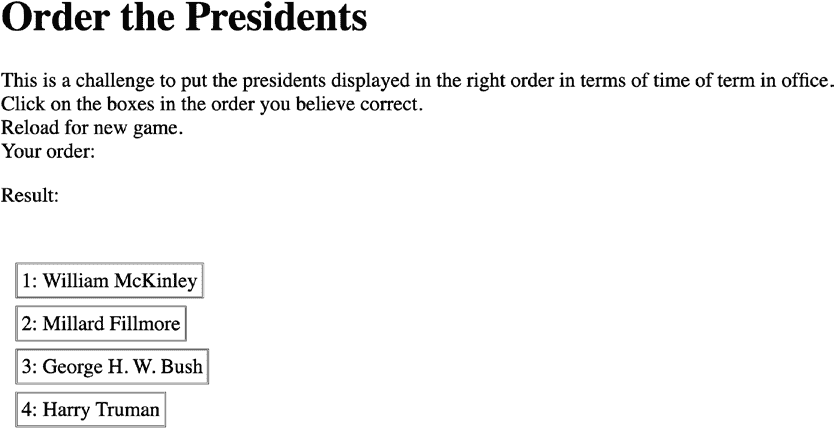

# 这是一款单人游戏

你可以设法将其改造成双人游戏。可能需要假设玩家们能正确轮流操作，但程序可以为每位参与者分别记录分数。

有些人喜欢设置带有难度等级的游戏。为此，你可以增加卡牌数量、缩短暂停时间，和/或采取其他措施。

通过使用你自己的图片，可以让这个应用变得个性化。当然，你可以使用家人和朋友的照片，但也可以创建一款教育游戏，使用代表项目或概念的图片，例如音符名称和符号、国家与首都、县区地图和名称等。你还可以调整配对数量。代码中引用了各个数组的长度，因此你无需遍历代码修改牌堆中的卡牌数量。不过，你可能需要调整`cardWidth`和`cardHeight`变量的值，以便在屏幕上排列卡牌。

当然，另一种可能性是使用一副标准的 52 张扑克牌（或加上大小王共 54 张）。

关于使用扑克牌的示例，请直接跳转到[第 10 章](http://dx.doi.org/10.1007/978-1-4842-4155-4_10)，该章节将引导你创建一款二十一点游戏。对于任何配对游戏，你都需要开发一种方法来定义哪些卡牌相互匹配的信息。

玩家可能会试图作弊。我相信我的代码能防止点击已被消除的卡牌；但可能未能阻止其他作弊行为。

#### 测试与上传应用

当我们开发人员检查程序时，往往每次都会重复相同的操作。然而，用户、玩家和客户经常做出奇怪的操作。这就是为什么让其他人测试我们的应用是个好主意。所以，请朋友们来测试你的游戏。你应该始终邀请那些没有参与构建应用的人来测试它。你可能会发现一些自己未曾识别出的问题。

## 第 5 章：记忆（又名配对）游戏

多边形版本记忆游戏的 HTML 文档包含了完整的游戏，因为程序会动态绘制和重绘多边形。图片版本的游戏则需要你上传所有图像。你可以通过使用来自网络（你自己的网页之外）的图像文件来改变这个游戏。请尊重知识产权。使用自己的照片确实更有趣。请注意，`pairs`数组需要包含正确的地址。

#### 总结

在这个示例中，你学会了如何利用编程技术和 HTML5 功能实现名为“记忆”或“配对”游戏的两种版本。其中包括：

• 程序员定义的函数和对象的示例
• 如何使用`moveTo`、`lineTo`以及`Math`三角函数在画布上绘制多边形
• 关于如何使用表单向玩家展示信息的指导
• 在画布上使用指定字体绘制文本的方法
• 如何在画布上绘制图像的说明
• 使用`setTimeout`强制暂停
• 使用`Date`对象计算经过的时间

这些应用演示了如何表示信息，以实现一个常见游戏的两种版本。下一章将暂时离开画布的使用，转而演示 HTML 元素的动态创建和定位。此外，还将重点介绍 HTML5 视频元素的使用。

### 第 6 章：测验

本章将涵盖以下内容：

• 通过代码创建 HTML 元素
• 响应鼠标在特定元素上的点击以及停止响应鼠标在特定元素上的点击
• 创建和访问数组
• 播放音频和视频片段
• 检查玩家响应并防止不良行为

#### 引言

本章演示了如何动态创建 HTML 元素并将其定位在屏幕上。这不仅是与在画布元素上绘图形成对比，也与使用 HTML 标记创建或多或少静态网页的旧方法不同。

我们的目标是制作一个测验，让玩家将一组美国总统按时间顺序排列。这组总统是从完整的总统列表中随机选取的。正确排序将获得奖励：播放一个视频片段和一个音频片段。使用 HTML5 直接（也称为*原生*）显示视频和音频的能力，相比旧系统（需要在玩家电脑上使用`<object>`元素和第三方插件）是一个巨大的进步。在我们的游戏中，视频和音频只扮演次要角色，但开发者和设计师能够在应用运行的特定时刻使用 HTML5 和 JavaScript 生成特定视频，这一事实非常重要。

自动播放是指无需用户操作即可播放的视频片段。自 2018 年 4 月起，Chrome 浏览器采纳了自动播放视频的政策（详情请参见[`developers.google.com/web/updates/2017/09/autoplay-policy-changes`](https://developers.google.com/web/updates/2017/09/autoplay-policy-changes)）。

© Jeanine Meyer 2023  
J. Meyer, *《HTML5 权威指南》*, [`doi.org/10.1007/978-1-4842-8722-4_6`](https://doi.org/10.1007/978-1-4842-8722-4_6#DOI)

第 6 章 测验

这项政策旨在在许多情况下禁止自动播放。理由是视频自动播放可能会让用户产生数据费用，并可能使网络过载。视频广告可能会令人厌烦。我接受这个理由；然而，我希望玩家成功完成游戏后能立即获得奖励。Chrome 浏览器有一种确定他们所谓的*用户参与度*的方法。我为玩家成功编程的奖励包括一个静音视频与一个音频片段同时播放。这似乎通过了 Chrome 对用户参与度的测试，媒体确实被播放了。尽管如此，自动播放政策是你需要了解并在未来持续关注的问题。

测验的基本信息由一个数组的数组组成，内部数组保存总统的姓名和一个用于确保随机过程不会选中同一姓名两次的第二项。程序会随机选择四位总统的名字，并创建包含这些名字和编号的框的 HTML 标记。程序将这些框定位在窗口中。图 6-1 显示了一个初始屏幕。

***图 6-1.** 测验的初始屏幕*

这让我有机会对这个特定游戏发表评论。我能按顺序背诵总统名单，因此可以很好地玩这个游戏。这种情况存在问题，因为我需要确保当玩家给出错误答案或以我稍后解释的其他方式“捣乱”时，测验仍能正常工作。本章的目的是介绍 HTML、CSS 和 JavaScript 特性以及通用技术，您可以使用它们来构建自己的测验，并自行选择主题。请记住，你很可能不是为自己构建这个游戏。

顺便提一下，对于美国总统，我需要提供某种方式来处理格罗弗·克利夫兰的问题，他是唯一一位担任过两届不连续任期总统的人。我选择在列表中加入*Grover Cleveland (1)*和*Grover Cleveland (2)*这两个名字。也许你需要为你的主题采取类似的步骤。

玩家依次点击选择。我已经开始了一个新游戏。图 6-2 显示了玩家选择她认为（知道）是该组中最早总统后的屏幕。请注意，“Your Order”下方出现了数字 2，并且 Fillmore 的框变成了金色。

***图 6-2.** 玩家选择她认为这 4 位总统中年代最早的一位*

