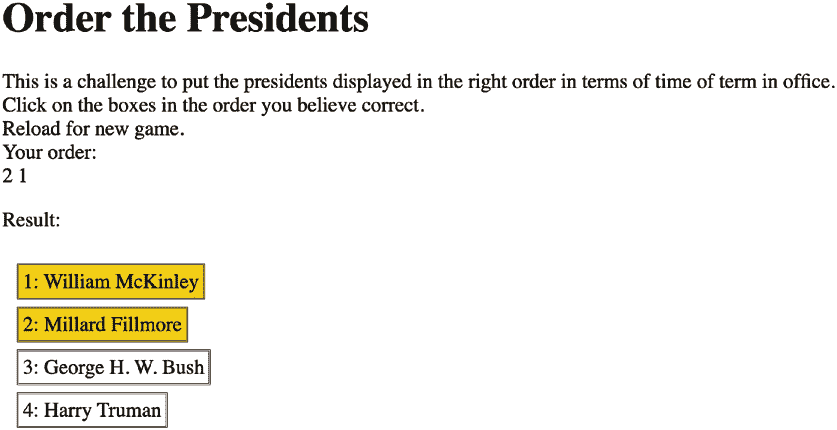
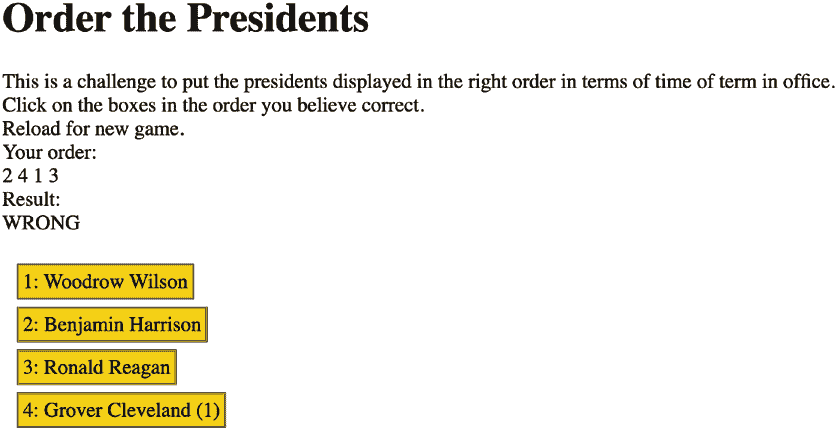

# 第 6 章 测验

## 无论答案正确与否，点击任何方框都会变成金色。我不会试图制造任何错误。

图 6-3 展示了两个选项以及“您选择的顺序”下方出现的数字 2 1。

**图 6-3.** 玩家已点击 Fillmore，然后点击 McKinley

我完成了测验。图 6-4 展示了结果。此时显示的是视频片段的一帧和一个音频文件的控件。我有一段自由女神像附近烟花的视频剪辑。该视频的配套音轨是《纽约，纽约》。我决定找一个免费版本的《拉弗尔斯与花饰》（也称为《向元首致敬》）。稍后您会读到，为了将视频和音频合并，我需要采取的一些小步骤。

**图 6-4.** 成功排列总统集合后

让我调用一个新游戏，现在输入一个不正确的顺序。图 6-5 显示了顺序错误的结果。玩家的排列顺序被显示出来，并出现了“WRONG”（错误）信息。这是一个棘手的问题。我在准备图片时出现了这组总统，其中确实有格罗弗·克利夫兰（第 1 任）。这一任期是在本杰明·哈里森之前。

**图 6-5.** 玩家排列顺序错误

## 测验游戏的关键要求

测验需要一种存储信息的方式，或者说，用一个更专业的术语，需要一个知识库。我们需要一种随机选择特定问题来提问的方式，这样玩家每次都会看到不同的挑战。由于我们存储的是名称，我们可以使用一种简单的技术。

接下来，我们需要向玩家呈现问题，并对玩家的操作提供反馈。我们可以决定反馈的程度。在我的游戏中，一旦点击某个方框，其颜色就会改变，并且顺序会显示在“您选择的顺序”标题下。我决定等到玩家完成全部排列后再检查顺序。我的技术审阅者指出，在游戏的早期版本中，我的代码允许玩家两次点击同一个方框。我决定通过忽略多余的点击来处理这个问题。您可以决定这是否是您想要采用的方法。普遍问题是，您需要预料到玩家/客户/用户可能会做出奇怪的操作。有时您可能需要告诉他们这是错误的，有时您（即您的代码）应该简单地忽略该操作。

我决定，正确的排列应该获得奖励：播放一段爱国视频剪辑。正如我将要解释的，这涉及到获取一段视频剪辑和一段独立的音频剪辑。

### HTML5、CSS 和 JavaScript 特性

现在让我们深入研究 HTML5、CSS 和 JavaScript 的具体特性，它们为我们实现测验提供了所需的支持。我再次基于之前解释过的内容进行构建，并加入了一些重复内容，以防您跳着阅读。

#### 在数组中存储和检索信息

您可能记得，数组是一系列值的集合，并且变量可以设置为数组。数组的单个组件可以是任何数据类型——甚至包括其他数组！回想一下在第 5 章的配对游戏中，我们使用了一个名为 `pairs` 的数组变量，其中每个元素本身就是一个包含两个元素的数组，即匹配的照片图像文件。

在测验应用程序中，我们将再次使用数组的数组。对于测验游戏，我们设置了一个名为 `facts` 的变量作为数组来保存总统的姓名。关键信息是数组中项目的顺序。`facts` 数组的每个元素本身就是一个数组。我在创建这个应用程序时的最初想法是，它会是一个简单的 `String` 对象数组，每个 `String` 按顺序保存一位总统的姓名。然而，我随后决定，我需要一个数组的数组，其中第二个元素保存一个 `Boolean`（真/假）值，用于防止在一次游戏中两次选中同一个姓名。

数组的单个组件可以使用方括号进行访问或设置。

JavaScript 中的数组索引从零开始，到数组元素总数减一结束。记住索引从零开始的一个技巧是，想象所有数组元素排成一排。第一个元素在起始位置；第二个元素距离起点 1 个单位；第三个元素距离起点 2 个单位；以此类推。

数组的长度保存在一个名为 `length` 的数组属性中。要访问 `facts` 数组中的第一项，您使用 `facts[0]`；访问第二个元素，使用 `facts[1]`；依此类推。您将在代码中看到这一点。

对数组中的每个元素执行操作的一种常见方法是使用循环。（另请参阅第 3 章中关于在边界框的墙壁上设置渐变的解释。）假设您有一个名为 `prices` 的数组，您的任务是编写代码将每个价格提高 15%。此外，即使 1 美元超过 15%的涨幅，每个价格也必须至少提高 1 美元。您可以使用表 6-1 中的结构来执行此任务。正如您在“说明”一列中看到的，`for` 循环对数组的每个组件执行相同的操作，在此示例中使用索引变量 `i`。此示例还展示了 `Math.max` 方法的使用。

**表 6-1.** 使用 `for` 循环增加数组中的价格

| 代码 | 说明 |
|------|-------------|
| `for (var i=0; i<prices.length; i++) {` | 执行花括号内的语句，更改 `i` 的值，从 0 开始，每次增加 1（这就是 `i++` 的作用），直到该值不小于 `prices.length`（即数组中的元素个数）。 |
| `prices[i] += Math.max(prices[i]*.15, 1);` | 记住要从内到外解释此语句。计算 `.15` 乘以数组 `prices` 的第 `i` 个元素。比较此值与 1 哪个更大。如果此值更大，则 `Math.max` 返回此值。如果 1 更大（如果 1 大于 `prices[i]*.15`），则使用 1。将此值加到 `prices[i]` 的当前值上。这就是 `+=` 的作用。 |
| `}` | 关闭 `for` 循环。 |

请注意，代码没有明确说明 `prices` 数组的大小。相反，它是用表达式 `prices.length` 表示的。这很好，因为这意味着如果您向数组添加元素，`length` 的值会自动更改。当然，在我们的示例中，我们知道数量是 46，即总统的数量。这个数字确实会变化，我们为新版更改了它，所以保持灵活性更好。

这个应用程序可以作为任何数量事实的测验模型，其中事实就是一条信息，而顺序很重要。

JavaScript 仅支持一维数组。`facts` 数组是一维的。但是，数组中的项目本身也是数组：`facts[0]` 元素本身就是一个数组，依此类推。

**注意：** 如果知识库更加复杂，或者我要共享信息或从其他地方访问信息，我可能需要使用数组的数组之外的其他方法。我也可以将知识库与 HTML 文档分开存储，例如使用可扩展标记语言（XML）文件。