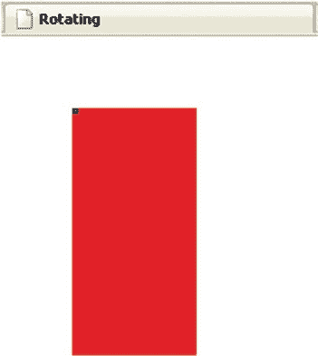
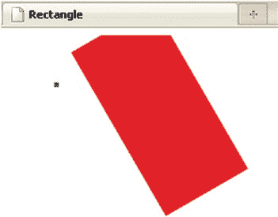
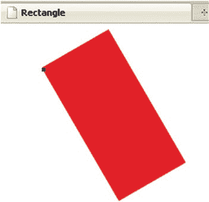
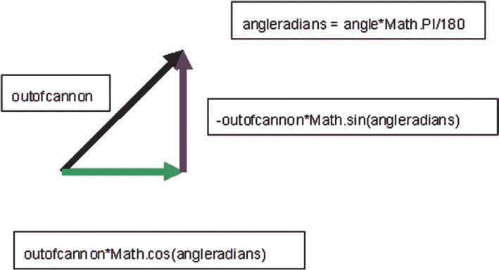
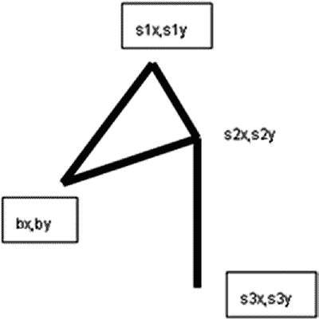

# 第 4 章：炮弹与弹弓

在本章中，我们将介绍以下内容：

- 维护要在屏幕上绘制的对象列表
- 旋转屏幕上绘制的对象
- 鼠标拖放操作
- 模拟弹道运动（重力影响）和碰撞的计算

## 引言

本章展示了动画的另一个示例，本次是弹道模拟，也称为*抛体运动*。一个球或类球物体保持恒定的水平（x）位移，而垂直位移则因重力作用而变化。由此产生的运动轨迹是一条弧线。当球（虚拟地）撞到地面或目标时停止。你将看到的代码使用与盒子中弹跳球相同的技术来生成动画。代码在固定的时间间隔内重新定位球并重绘场景。我们将研究三个示例。

- 一个非常简单的弹道模拟。我们将看到一个球起飞，并在击中目标或地面之前沿弧线飞行。飞行的参数是水平速度和初始垂直速度，由玩家通过表单输入字段设置。当球击中目标或地面时，它将直接停止。
- 一个改进的炮弹，用一个代表大炮的矩形以一定角度倾斜。飞行的参数是出膛速度和炮管角度。同样，这些由玩家通过表单输入字段设置。程序计算初始水平位移和垂直位移值。

© Jeanine Meyer 2023

J. Meyer, *《HTML5 终极指南》*, [`doi.org/10.1007/978-1-4842-8722-4_4`](https://doi.org/10.1007/978-1-4842-8722-4_4#DOI)

- 一个弹弓。飞行的参数由玩家通过拖动并释放一个系在弹弓棍子模型上的球体来确定。速度由球到弹弓上某一点的距离决定。角度则是弹弓该部分与水平方向的夹角。

**图 4-1** 显示了简单的（无大炮）应用程序。

***图 4-1.** 球落在地面上*

**图 4-2** 显示了第二个应用程序的起始界面。目标是一个图像，代表大炮的矩形可以旋转。注意，控制选项涉及角度和初始速度。

***图 4-2.** 旋转大炮，以图像为目标*

**图 4-3** 显示成功命中后的场景。注意，大炮已旋转，目标的原始图像已被新图像取代。

***图 4-3.** 开炮并击中目标后*

**图 4-4** 显示了弹弓应用程序的起始界面。该应用程序与炮弹类似，但飞行参数是由玩家使用鼠标拖动球（代表弹弓中的石块）来设置的，目标现在是一只鸡。

***图 4-4.** 弹弓应用程序的起始界面*

对于弹弓，我决定让球一直运动直到击中地面。但是，如果鸡被击中，我希望它被羽毛取代，如图**图 4-5**所示。注意，弹弓的弦会停留在鼠标按钮释放、球起飞时的位置。我发现我需要更多时间观察弦的位置来计划下一次射击。如果你愿意，可以修改游戏，使弦弹回原位，或者创建一个“新游戏”按钮。在我的示例中，通过重新加载 HTML 文件来重新开始游戏。

***图 4-5.** 球击中鸡后落在地面，只留下羽毛*

这些应用程序的编程使用了与弹跳球应用程序相同的大量技术。球在飞行中的重新定位只是根据需要进行了细微调整，以模拟因重力导致的垂直位移变化。弹弓应用程序提供了一种新的玩家与应用程序交互的方式，即使用鼠标进行拖放操作。

包含大炮的炮弹和弹弓应用程序使用绘图功能绘制大炮和弹弓，并使用外部图像文件作为原始目标和命中目标。如果你想更改目标，需要找到图像文件并将其与应用程序一起上传。

## 关键需求

### 弹道模拟应用开发指南

#### 第一部分：重力模拟与基础动画

我们的第一个需求是通过设置固定时间间隔的事件来生成动画，然后定义一个函数来处理该事件：重新定位球并检测碰撞。我们在上一章的弹跳球应用中已经涵盖了这部分内容。这里的新内容是模拟重力的计算。一个简单物理模型所指示的计算方法是：基于垂直位移的恒定变化量来计算新的垂直位移，然后计算新旧位移的平均值以确定新位置。

- 水平位移（由变量`dx`表示）是水平速度（`horvelocity`），且保持不变。在代码中表示为`dx = horvelocity;`。
- 时间间隔开始时的垂直速度为`verticalvel1`。
- 时间间隔结束时的垂直速度为`verticalvel1`加上加速度（重力）。在代码中表示为`verticalvel2 = verticalvel1 + gravity;`。
- 该时间间隔内的垂直位移（`dy`）是`verticalvel1`和`verticalvel2`的平均值。在代码中表示为`dy = (verticalvel1 + verticalvel2) * 0.5;`。

这是模拟重力或其他任何恒定加速度的标准方法。

**注意：** 我为重力设定了一个自定义值，以产生一个悦目的抛物线轨迹。您可以使用标准值，但需要自行研究，为大炮口出速和弹弓的初速分配真实的物理值。您还需要确定像素与距离之间的映射关系。这个换算因子对炮弹和弹弓来说是不同的。

#### 第二部分：大炮旋转与用户交互

程序的第二个版本必须能够根据初始值或玩家输入的大炮口出速和炮管角度来旋转大炮，并基于这些值计算水平和垂直方向的分量值。

#### 第三部分：弹弓交互与图像替换

程序的第三个版本（弹弓）必须允许玩家按住鼠标按钮，拖动球（连同弹弓的绳子），然后松开鼠标按钮释放球。运动参数是根据球与弹弓顶部的角度和距离计算得出的。

第二和第三版程序都需要一种将目标图像替换为另一张图像的方法。

---

## HTML5、CSS 和 JavaScript 特性

现在，让我们看看实现弹道模拟应用所需的 HTML5 和 JavaScript 的具体特性。幸运的是，我们可以建立在前面章节介绍的基础上，特别是 HTML 文档的通用结构、`canvas`元素的使用、自定义函数和内置函数、`form`元素以及变量。让我们从自定义对象和数组的使用开始。

### 数组与自定义对象

HTML5 允许您在画布上绘图，但一旦绘制完成，就像涂上了颜料或墨水；所绘制的对象不会保留其独立的身份。HTML5 不像真正的 3D 建模系统那样，对象可以放置在舞台上并单独移动和旋转。不过，我们仍然可以实现相同的效果，包括单个对象的旋转。在后面的章节中，我们会在浏览器窗口中移动对象。

由于这些应用程序的显示较为复杂，我决定开发一种更系统的方法来在画布上绘制和重绘不同的内容。为此，我创建了一个名为`everything`的数组，用于存储需要在画布上绘制的对象列表。可以将数组视为一个集合，或者更准确地说，是一个有序的条目序列。在前面的章节中，我们讨论了用于存储数值或字符串等值的变量。数组是另一种类型的值。我的`everything`数组将作为一个待办事项列表，列出需要在画布上绘制的内容。我的方法确实会按照特定顺序绘制项目，这意味着在弹弓程序中，地面会覆盖在鸡脚的上面。我的代码还使用`targetIndex`和`cannonIndex`变量，确定了`everything`数组中某些对象的位置。

我在这里使用的术语“对象”（*objects*）既有英语中的一般含义，也有编程上的专业含义。在编程术语中，一个对象由*属性*（*properties*）和*方法*（*methods*）组成，即数据与编码或行为。在第一章的带注释链接示例中，我演示了`document`对象的`write`方法。我使用了变量`ctx`（它是`canvas`对象的 2D 上下文类型）、诸如`fillRect`等方法和诸如`fillStyle`等属性。这些都是内置的；也就是说，它们是 HTML5 中 JavaScript 已经定义好的对象。对于弹道应用，我定义了自己的对象，具体包括`Ball`、`Picture`、`myRectangle`和`Sling`。这些不同的对象都包含一个`draw`方法的定义，以及指示位置和大小的属性。我这样做是为了能够绘制列表中的每一个对象。相应的`draw`方法会访问这些属性来确定绘制什么以及在哪里绘制。我还提供了一种旋转单个对象的方法。

定义对象很简单：我只需定义一个名为*构造函数*的函数，用于`Ball`、`Picture`、`myRectangle`和`Sling`，然后使用`new`运算符将这些函数赋值给变量。有一个约定：构造函数名称以大写字母开头。然后，我可以使用熟悉的点符号来访问或设置属性，并调用我在构造函数中设置的方法。以下是`Ball`对象的构造函数：

# JavaScript 对象与函数示例

## `this` 关键字与对象属性

```javascript
function Ball(sx,sy,rad,styleString) {
    this.sx = sx;
    this.sy = sy;
    this.rad = rad;
    this.draw = drawball;
    this.moveit = moveball;
    this.fillstyle = styleString;
}
```

术语`this`指的是当此函数与关键字`new`一起使用时创建的对象。从代码中无法直观地看出`this.draw`和`this.moveit`被赋值为函数名，但事实确实如此。接下来是这两个函数的定义。请注意，它们都使用`this`来获取绘制和移动对象所需的属性。

## 绘制与移动函数

```javascript
function drawball() {
    ctx.fillStyle = this.fillstyle;
    ctx.beginPath();
    ctx.arc(this.sx, this.sy, this.rad, 0, Math.PI * 2, true);
    ctx.fill();
}
```

**注意：** JavaScript 已经开始增加对类和对象的支持，尽管它仍然不包含完整的继承。相关内容可参考以下网站：`https://developer.mozilla.org/en-US/docs/Web/JavaScript/Reference/Classes`

`drawball`函数在画布上绘制一个实心圆（一个完整的圆弧）。圆的颜色是在创建此`Ball`对象时设置的颜色。

`moveBall`函数不会立即移动任何东西。从抽象的角度来看，`moveBall`改变了应用程序定位对象的位置。该函数会更改对象的`sx`和`sy`属性的值，当对象下次显示时，将使用这些新值进行绘制。

```javascript
function moveBall(dx, dy) {
    this.sx += dx;
    this.sy += dy;
}
```

# 排版结果

下一个语句声明了变量`cball`，通过使用运算符`new`和函数`Ball`构建了一个新的`Ball`类型对象。函数的参数基于为加农炮设置的数值，因为我希望球在开始时出现在加农炮的炮口位置。

```javascript
var cball = new Ball(cannonx+cannonlength,cannony+cannonht*.5,ballrad, "rgb(250,0,0)");
```

`Picture`、`myRectangle`和`Sling`函数类似，稍后将解释。它们各自指定了一个`draw`方法。对于这个应用程序，我只对`cball`使用了`moveit`，但我为其他对象也定义了`moveit`，以防以后我想在此基础上构建应用程序。变量`cannon`和`ground`将被设置为保存一个新的`myRectangle`，而变量`target`和`htarget`将被设置为保存一个新的`Picture`。

**提示**：程序员自定义的名称是任意的，但最好在拼写和大小写上保持一致。`HTML5`似乎忽略大小写，这与名为`XHTML`的 HTML 版本形成对比。许多语言将大写和小写视为不同的字母。我通常使用小写，但我将`Ball`、`Picture`、`Slingshot`和`myRectangle`的首字母大写，因为惯例是用于构造对象的函数应以大写字母开头。

每个变量都将使用数组方法`push`添加到`everything`数组中，该方法将新元素添加到数组的末尾。

## 绘图中的旋转和平移

HTML5 允许我们平移和旋转图形。正如你在第 2 章和第 3 章中所见，图形是依据坐标系进行绘制和定位的，图像等对象也是如此。

坐标系的一个重要方面是其原点，即`0,0`位置。HTML5 提供了一种改变坐标系的方法。*平移*操作会改变原点。我们大多数人熟悉的一种情况是在车中使用 GPS 系统。

方向是根据我们所在的位置给出的。你可以将其视为重置原点。*旋转*操作会围绕原点进行旋转！接下来的几段将带你了解一些示例。请花时间研究这些示例并修改以观察结果。

请看以下代码。我强烈建议你创建这个示例并进行实验，以提高你的理解。该代码在画布上绘制了一个大型红色矩形，其左上角位于`(50,50)`，并在其上方绘制了一个微小的蓝色正方形。

```html
<html>
<head>
<title>Rectangle</title>
<script type="text/javascript">
var ctx;
function init(){
  ctx = document.getElementById('canvas').getContext('2d');
  ctx.fillStyle = "rgb(250,0,0)";
  ctx.fillRect(50,50,100,200);
  ctx.fillStyle = "rgb(0,0,250)";
  ctx.fillRect(50,50,5,5);
}
</script>
</head>
<body onLoad="init();">
<canvas id="canvas" width="400" height="300"> Your browser doesn't support the HTML5 element canvas.
</canvas>
</body>
</html>
```

结果如图 4-6 所示。



**图 4-6.** 矩形（无旋转）

在本练习中，目标是旋转大矩形，以左上角（蓝色小正方形所在位置）为轴心。我希望旋转方向为逆时针。

一个大多数编程语言中都存在的轻微复杂问题是：旋转以及三角函数输入的角必须是*弧度*，而不是度。

弧度在第 2 章中已经解释过，但这里提醒一下。一个完整圆周不是 360 度，而是基于数学常数π乘以 2 的弧度。幸运的是，我们可以使用 JavaScript 的内置特性`Math.PI`。一个π弧度等于 180 度，而π除以 2 等于直角（90 度）。要指定 30 度的旋转，我们使用π除以 6，或者在编码中写为`Math.PI/6`。为了修改之前给出的`init`函数以进行旋转，我放入了一个负π除以 6（相当于逆时针 30 度）的旋转，绘制红色矩形，然后反向旋转以撤销旋转，以便绘制蓝色正方形：

```javascript
function init(){
  ctx = document.getElementById('canvas').getContext('2d');
  ctx.fillStyle = "rgb(250,0,0)";
  ctx.rotate(-Math.PI/6);
  ctx.fillRect(50,50,100,200);
  ctx.rotate(Math.PI/6);
  ctx.fillStyle = "rgb(0,0,250)";
  ctx.fillRect(50,50,5,5);
}
```



不幸的是，图 4-7 中的图形不是我想要的。

**图 4-7.** 绘制并旋转矩形

问题在于旋转点在原点`(0,0)`，而不是在红色矩形的角上。因此，我需要编写代码来执行平移以重置原点，然后进行旋转，然后再平移回来，以便在正确的位置绘制下一个项目。

我可以使用 HTML5 的特性来实现这一点。画布上的所有绘图都是根据坐标系进行的，我可以使用`save`和`restore`操作来保存当前坐标系（轴的位置和方向），然后恢复它以进行后续绘图。

```javascript
function init(){
  ctx = document.getElementById('canvas').getContext('2d');
  ctx.fillStyle = "rgb(250,0,0)";
  ctx.save();
  ctx.translate(50,50); //移动原点
  ctx.rotate(-Math.PI/6); //进行旋转
  ctx.translate(-50,-50); // 将原点移回
  ctx.fillRect(50,50,100,200); //绘制矩形
  ctx.restore(); //撤销所有变换
  ctx.fillStyle = "rgb(0,0,250)";
  ctx.fillRect(50,50,5,5); //绘制小的蓝色正方形
}
```

`rotate`方法期望角度使用弧度单位，顺时针为正方向。因此我的代码在逆时针旋转 30 度，产生了我的预期效果，如图 4-8 所示。



**图 4-8.** 保存、平移、旋转、平移、恢复

再次强调，我强烈建议你修改这个示例，以帮助你理解变换和弧度。一次只修改一条语句，进行小的改动。

顺便提一下，我们不能期望玩家使用弧度来输入角度。他们和我们一样习惯使用度（90 度是直角，180 度是掉头时的弧等）。程序必须完成这项工作。从度到弧度的转换是乘以`π/180`。

**注意**：大多数编程语言在三角函数以及旋转操作中使用弧度。

有了这个背景，我在`everything`数组中添加了指示信息，标明是否有旋转，如果有，则标明所需的平移点。这是我的想法。它与 HTML5 或 JavaScript 无关，也可以采用不同的方式实现。底层任务是在模拟场景中创建和维护对象的信息。HTML5 的画布特性提供了绘制图形和显示图像的方法，但它不会保留对象的信息！

第二个和第三个应用程序中`everything`数组的项目本身也是数组。第一个（第 0 个索引）值指向对象。第二个（第 1 个索引）值为`true`或`false`。`true`值表示后面跟随一个旋转角度值以及用于平移的`x`和`y`值。在实践中，这意味着内层数组要么有两个值（最后一个为`false`），要么有五个值。



**注意**：在这一点上，你可能在想：她建立了一个通用系统只是为了旋转加农炮。为什么不专门为加农炮做点什么？答案是：我们可以，但通用系统确实有效，而专门为加农炮做的东西可能也需要同样多的编码。

第一个应用程序使用水平和垂直位移值选取。

根据表单输入，玩家必须设想两个独立的值。在第二个应用中，玩家再次输入两个值，但类型不同：一个是炮弹出膛速度，另一个是炮管角度。其余计算由程序完成。初始且恒定的水平位移与初始垂直位移，均根据玩家输入的出膛速度与角度计算得出，其计算基于标准三角学。幸运的是，JavaScript 在 `Math` 内置方法类中提供了三角函数。

图 4-9 展示了根据玩家指定的出膛速度与角度值计算位移量的过程。垂直方向上的负号是由于 JavaScript 屏幕坐标系的 `y` 值在屏幕向下方向递增所致。

**图 4-9.** 计算水平和垂直位移

此时，你可能想跳转阅读炮弹应用的实现。之后可以再回来阅读弹弓应用所需的内容。



## 第 4 章 炮弹与弹弓

### 绘制线段

对于弹弓应用，我通过定义两个函数 `Sling` 和 `drawSling` 新增了一个对象类型。我理想化的弹弓由四个位置点表示，如图 4-10 所示。请理解，我们本可以用多种不同方式实现。

**图 4-10.** 理想化的弹弓

`Sling` 函数与其他构造函数（例如 `Ball`）类似。

```javascript
function Sling(bx,by,s1x,s1y,s2x,s2y,s3x,s3y,styleString) {
  this.bx = bx;
  this.by = by;
  this.s1x = s1x;
  this.s1y = s1y;
  this.s2x = s2x;
  this.s2y = s2y;
  this.s3x = s3x;
  this.s3y = s3y;
  this.strokeStyle = styleString;
  this.draw = drawSling;
  this.moveit = moveSling;
}
```

`Sling` 函数将 `drawSling` 设置为当 `draw` 与 `Sling` 对象关联时调用的函数。虽然在当前应用中并未发生，但如果你或我在该应用基础上扩展以移动弹弓位置，则会调用 `moveSling`。

绘制弹弓的过程包括基于四个点绘制四条线段。`bx`、`by` 点会如我下一节所述发生变化。HTML5 允许我们将线段绘制为路径的一部分。我们之前已使用路径来绘制圆形。你可以将路径绘制为描边或填充。对于圆形，我们使用了 `fill` 方法，但对于弹弓，我只需要线条。绘制线条可能涉及两个步骤：移动到线条的一端，然后绘制它。HTML5 提供了 `moveTo` 和 `lineTo` 方法。只有在调用 `stroke` 或 `fill` 方法后，路径才会被绘制。`drawSling` 函数是线段绘制的一个很好的示例。

```javascript
function drawSling() {
  ctx.strokeStyle = this.strokeStyle;
  ctx.lineWidth = 4;
  ctx.beginPath();
  ctx.moveTo(this.bx,this.by);
  ctx.lineTo(this.s1x,this.s1y);
  ctx.moveTo(this.bx,this.by);
  ctx.lineTo(this.s2x,this.s2y);
  ctx.moveTo(this.s1x,this.s1y);
  ctx.lineTo(this.s2x,this.s2y);
  ctx.lineTo(this.s3x,this.s3y);
  ctx.stroke();
}
```

它执行以下操作：
- 向路径添加一条从 `bx`、`by` 到 `s1x`、`s1y` 的线段
- 向路径添加一条从 `bx`、`by` 到 `s2x`、`s2y` 的线段
- 向路径添加一条从 `s1x`、`s1y` 到 `s2x`、`s2y` 的线段
- 向路径添加一条从 `s2x`、`s2y` 到 `s3x`、`s3y` 的线段

一如既往，学习的方法是结合自己的设计进行实验。如果没有调用 `moveTo`，则下一个 `lineTo` 将从上一个 `lineTo` 的终点开始绘制。想象一下手中握笔，要么在纸上移动，要么抬起笔移动而不画任何东西。你也可以连接弧线。第 5 章将演示多边形的绘制。

### 用于拉动弹弓的鼠标事件

弹弓应用用鼠标拖放操作取代了表单输入。这之所以吸引人，是因为它更接近于物理上向后拉弹弓的动作。

当玩家按下鼠标按钮时，这是程序需要管理的一系列事件中的第一个。以下是需要完成的操作的伪代码。
- 当玩家按下鼠标按钮时，检查鼠标是否位于球的上方。如果不是，则不做任何操作。如果是，则设置一个名为 `inMotion` 的变量。
- 如果鼠标正在移动，检查 `inMotion`。如果它被设置，则移动球和弹弓的绳子。持续执行此操作直到鼠标按钮被释放。
- 当玩家释放鼠标按钮时，将 `inMotion` 重置为 `false`。计算球的角度和初始速度，并据此计算水平速度和初始垂直速度。让球开始移动。

你可以使用 HTML5 和 JavaScript 来设置按下标准（左）鼠标按钮、移动鼠标和释放鼠标按钮的事件处理。代码直接基于 `canvas` 元素使用一种方法，而不是所谓的上下文。

以下是代码，位于 `init` 函数中：

```javascript
canvas1 = document.getElementById('canvas');
canvas1.addEventListener('mousedown',findball,false);
canvas1.addEventListener('mousemove',moveit,false);
canvas1.addEventListener('mouseup',finish,false);
```

现在，因为这个事件是针对整个画布的，`findBall` 函数必须判断鼠标是否在球的上方。第一个任务是获取鼠标的 `x` 和 `y` 坐标。当我最初编写这段代码时，不同的浏览器以不同的方式实现鼠标事件。以下代码适用于 Safari 和 Chrome：

```javascript
mx = ev.pageX;
my = ev.pageY;
```

# 第 4 章 炮弹与弹弓

现在，下一步是判断点`(mx，my)`是否位于球上。我重复一遍，但重要的是要理解，球现在等同于画布上的墨水或颜料，如果不确定点`(mx，my)`是否在球的上方，我们就无法继续。我们该怎么做？我们可以计算`(mx，my)`到球心的距离，并检查它是否小于球的半径。有一个计算平面上距离的标准公式。我的代码是这个思路的一个小变体。它通过计算距离的平方并将其与球半径的平方进行比较来做出判断。我这样做是为了避免计算平方根。

**注意**：在附录中，我包含了一个移动由箭头连接的圆的程序。因为我将圆创建为由 HTML 标记定义的元素，所以我可以使用每个圆的事件处理，并且不需要编写代码来检查鼠标是否在圆上。

如果鼠标点击在球上（即在距离球心一个半径的范围内），这个函数会将全局变量`inMotion`设置为`true`。`findBall`函数以调用`drawAll()`结束。

每当鼠标移动时，就会调用`moveit`函数，我们在此检查`inMotion`是否为`true`。如果不是，则不执行任何操作。如果是，则使用与之前相同的代码来获取鼠标坐标和球心，并将弹弓的`bx`、`by`值设置为鼠标坐标。这会产生拖动球并拉伸弹弓绳的效果。

当鼠标按钮被释放时，我们调用`finish`函数，如果`inMotion`不为`true`，该函数不执行任何操作。这种情况何时会发生？当玩家在球外移动鼠标并按下和释放按钮时。

如果`inMotion`为`true`，该函数立即将其设置为`false`，并进行计算以确定球的飞行轨迹，生成信息（这些信息在之前的炮弹应用程序中是由玩家通过表单输入的）。这些信息包括岩石初始路径与水平线的夹角，以及球到弹弓直线部分的距离。这是由`(bx，by)`到`(s1x, s1y)`以及一条水平线形成的角度，以及从`(bx，by)`到`(s1x, s1y)`的距离，更准确地说，是距离的平方。

# 第 4 章 炮弹与弹弓

我使用`Math.atan2`来进行这些计算：根据`x`和`y`的变化量计算角度。这是反正切函数的一个变体。

我使用`distsq`函数来计算从`(bx，by)`到`(s1x, s1y)`的距离的平方。我想让速度依赖于这个值。将绳子拉得更远意味着更快的飞行速度。我做了一些实验，并决定使用平方值再除以`700`可以产生一个漂亮的弧线。

最后一步是首先调用`drawAll()`，然后调用`setInterval`来设置定时事件。同样，`finish`执行的任务类似于炮弹应用程序中的`fire`。在第一个应用程序中，玩家输入了水平和初始垂直速度的值。在第二个应用程序中，玩家输入了一个角度（以度为单位）和炮弹离开炮口的速度，程序完成了其余工作。在弹弓程序中，我们取消了表单和数字，为玩家提供了一种拉回（或虚拟拉回）弹弓的方式。程序在响应鼠标事件和计算方面需要做更多的工作。

请注意，我没有考虑玩家将球瞄准远离小鸡的方向、将球垂直瞄准或把球拉到地面以下等愚蠢行为。在后一种情况下，球会向上移动并停在地面。请进行实验，并决定你希望包含哪些检查和提示信息。

## 使用数组的 Splice 方法更改显示的项列表

最后要解释的任务是用另一张图片替换目标图像。由于我想要两种不同的效果，我使用了不同的方法。对于第二个应用程序，我希望球和原始目标一起消失，并显示我在变量`htarget`中设置的内容。我所做的是记录原始目标在`everything`数组中的位置，将其移除并替换为`htarget`。类似地，我将球从`everything`数组中移除。对于弹弓操作，我不会移除目标，而是将其`img`属性更改为`feathers`。请注意，在代码中，`chicken`和`feathers`是`Image`对象。每个对象都有一个指向文件的`src`属性。

```
var chicken = new Image();
chicken.src = "chicken.jpg";
var feathers = new Image();
feathers.src = "feathers.gif";
```

# 第 4 章 炮弹与弹弓

对于这两种操作，我都使用了数组方法`splice`。它有两种形式：你可以只移除任意数量的元素，或者你可以先移除再插入元素。

`splice`的一般形式是：

`arrayname.splice(index where splice is to occur, number of items to be removed, new item(s) to be added)`

如果要添加多个项，则需要更多的参数。在我的代码中，我添加了一个单项，它本身就是一个数组。我在`everything`数组中用数组来表示每个对象。数组的第二个参数指示是否有任何旋转。

以下两行代码完成了我的需求：移除目标，插入没有旋转的`htarget`，然后移除球。

```
everything.splice(targetindex,1,[htarget,false]);
everything.splice(ballindex,1);
```

顺便说一句，如果我只需要移除数组中的最后一个元素，我可以使用`pop`方法。然而，在这种情况下，目标可能位于`everything`数组的中间某处，所以我需要编写代码来跟踪其索引值。

## 点之间的距离

在弹弓程序中，有两个地方我使用了点之间的距离，或者更准确地说，是距离的平方。我需要判断鼠标光标是否在球的上方，并且我想让初始速度（相当于炮弹离开炮口的速度）取决于弹弓的拉伸程度，也就是`(bx, by)`到`(s1x, s1y)`的距离。两点`(x1, y1)`和`(x2, y2)`之间的距离公式是`(x1 - x2)`和`(y1 - y2)`的平方和的平方根。我决定只计算平方和，以避免进行平方根的计算。

# 第四章 炮弹与弹弓

**构建应用，让其成为你的专属之作**

以下代码提供了检测鼠标光标是否位于球体上方的相同测试方法。对于另一项任务，我决定使用距离的平方来计算初始速度是可以接受的。我尝试了一些数值，正如我之前提到的，700 这个值似乎效果不错。

现在，让我们来看看基于水平初速度和垂直初速度发射炮弹（无炮管）的基础代码；基于炮管角度和初速度发射炮弹的代码；以及基于鼠标位置确定角度和初速度的弹弓代码。与之前章节类似，我将为每个应用展示其函数以及它们调用或被调用的关系。在本例中，三个应用的表格虽然不完全相同，但结构相似。与之前的示例相比，调用的方式更加多样化，有些情况下函数被调用是因为它们被命名为程序员定义对象的方法，或是作为`var`声明语句的一部分。这是**面向对象、事件驱动编程**的一个特点。我还会将每个应用的完整代码放在其对应的表格中，并附上每行代码的说明。表 4-1 展示了基础炮弹应用的函数。

***表 4-1：最简炮弹应用中的函数***

| **函数** | **被谁调用/由谁调用** | **调用谁** |
|---|---|---|
| `init` | body 标签中 `onLoad` 的动作 | `drawall` |
| `drawall` | 由 `init`、`fire`、`change` 直接调用 | 调用 `everything` 数组中所有对象的 `draw` 方法；这些对象对应于函数 `drawBall`、`drawRects` |
| `fire` | 表单中 `onSubmit` 属性的动作触发 | `drawAll` |
| `change` | 由 `fire` 中调用的 `setInterval` 函数触发 | `drawall`，调用 `cBall` 的 `moveit` 方法，即 `moveBall` |
| `Ball` | 由 `var` 语句中的代码直接调用 | |
| `MyRectangle` | 由 `var` 语句中的代码直接调用 | |
| `drawBall` | 通过调用唯一 `Ball` 对象的 `draw` 方法触发 | |
| `drawRects` | 通过调用 `target` 对象的 `draw` 方法触发 | |
| `moveBall` | 通过调用唯一 `Ball` 对象的 `moveit` 方法触发 | |

表 4-2 展示了最简应用的完整代码，其中球体沿弧线运动，且没有实际的炮管。

***表 4-2：第一个炮弹应用***

| **代码** | **说明** |
|---|---|
| `<html>` | 开始 html 标签。 |
| `<head>` | 开始 head 标签。 |
| `<title>Cannonball</title>` | 完整的 title 元素。 |
| `<style>` | 开始 style 标签。 |
| `form {` | 表单的样式。 |
| `width:330px;` | 宽度。 |
| `margin:20px;` | 外边距。 |
| `background-color:brown;` | 设置表单的背景颜色。 |
| `padding:20px;` | 内边距。 |
| `}` | 关闭此样式。 |
| `</style>` | 关闭 style 元素。 |
| `<script>` | 开始 script 标签。 |
| `var cwidth = 600;` | 设置画布的宽度值；用于清除操作。 |
| `var cheight = 400;` | 设置画布的高度值；用于清除操作。 |
| `var ctx;` | 用于存储画布上下文的变量。 |
| `var everything = [];` | 用于存储所有待绘制对象的数组。初始化为空数组。 |
| `var tid;` | 用于存储定时事件标识符的变量。 |
| `var horVelocity;` | 用于存储水平速度（即水平位移）的变量。 |
| `var verticalVel1;` | 用于存储间隔开始时垂直位移的变量。 |
| `var verticalVel2;` | 用于存储间隔结束时，受重力影响后垂直位移的变量。 |
| `var gravity = 2;` | 垂直位移的变化量。该值为随意设定，能形成一条不错的弧线。 |
| `var iballx = 20;` | 球的初始水平坐标。 |
| `var ibally = 300;` | 球的初始垂直坐标。 |
| `function Ball(sx,sy,rad, styleString) {` | 定义 `Ball` 对象的函数开始。使用参数设置属性。 |
| `this.sx = sx;` | 设置 `this` 对象的 `sx` 属性。 |
| `this.sy = sy;` | 设置 `this` 对象的 `sy` 属性。 |
| `this.rad = rad;` | 设置 `this` 对象的 `rad` 属性。 |
| `this.draw = drawBall;` | 设置 `this` 对象的 `draw` 属性。由于 `drawball` 是一个函数名，这使得 `draw` 成为一个可以被调用的方法。 |
| `this.moveit = moveBall;` | 将 `moveit` 属性设置为 `moveBall` 函数。 |
| `this.fillStyle = styleString;` | 将 `fillStyle` 设置为 `styleString` 的值。 |
| `}` | 关闭 `Ball` 函数。 |
| `function drawBall() {` | `drawBall` 函数的头部。 |
| `ctx.fillStyle=this.fillstyle;` | 使用 `this` 对象的 `fillStyle` 属性来设置 `fillStyle`。 |
| `ctx.beginPath();` | 开始一条路径。 |
| `ctx.arc(this.sx,this.sy,this.rad,0,Math.PI*2,true);` | 设置绘制一个圆形。 |
| `ctx.fill();` | 将路径绘制为填充路径。 |
| `}` | 关闭函数。 |
| `function moveBall(dx,dy) {` | `moveBall` 函数的头部。 |
| `this.sx +=dx;` | 将 `sx` 属性增加 `dx`。 |
| `this.sy +=dy;` | 将 `sy` 属性增加 `dy`。 |
| `}` | 关闭函数。 |
| `var cball = new Ball(iballx,ibally,10,"rgb(250,0,0)");` | 在指定的位置、半径和颜色下创建一个新的 `Ball` 对象。将其赋值给变量 `cball`。注意，此时并没有绘制任何东西，这些信息只是为后续使用而设置。 |
| `function myRectangle(sx,sy,swidth,sheight,stylestring) {` | 用于构造 `myRectangle` 对象的函数头部。 |
| `this.sx = sx;` | 设置 `this` 对象的 `sx` 属性。 |
| `this.sy = sy;` | 设置 `sy` 属性。 |
| `this.swidth = swidth;` | 设置 `swidth` 属性。 |
| `this.sheight = sheight;` | 设置 `sheight` 属性。 |
| `this.fillstyle = styleString;` | 设置 `fillStyle` 属性（原文笔误，应为 `fillstyle`）。 |
| `this.draw = drawRects;` | 设置 `draw` 属性。这创建了一个可以被调用的方法。 |
| `this.moveit = moveBall;` | 设置 `moveit` 属性。这创建了一个可以被调用的方法。该程序未使用它。 |
| `}` | 关闭 `myRectangle` 函数。 |
| `function drawRects() {` | `drawRects` 函数的头部。 |
| `ctx.fillStyle = this.fillStyle;` | 设置 `fillStyle`。 |
| `ctx.fillRect(this.sx,this.sy,this.swidth,this.sheight);` | 使用对象的属性绘制矩形。 |
| `}` | 关闭函数。 |
| `var target = new myRectangle(300,100,80,200,"rgb(0,5,90)");` | 构建一个 `myRectangle` 对象并将其赋值给 `target`。 |

# JavaScript游戏编程示例

## 初始化与全局变量

```javascript
var ground = new myRectangle(0,300,600,30,"rgb(10,250,0)");
```
构建一个`myRectangle`对象并将其赋值给`ground`。

```javascript
everything.push(target);
```
这些语句位于任何函数之外，但可以正常工作。将`target`添加到`everything`数组中。

```javascript
everything.push(ground);
```
添加`ground`。

```javascript
everything.push(cball);
```
添加`cball`（它将被最后绘制，因此位于所有其他对象之上）。

## init函数

```javascript
function init(){
```
`init`函数的头部。

```javascript
ctx = document.getElementById('canvas').getContext('2d');
```
设置`ctx`以在画布上绘制。

```javascript
drawall();
```
绘制所有内容。

```javascript
}
```
关闭`init`函数。

## fire函数

```javascript
function fire() {
```
`fire`函数的头部。

```javascript
cball.sx = iballx;
```
重置`cball`的x坐标。

```javascript
cball.sy = ibally;
```
重置`cball`的y坐标。

```javascript
horvelocity = Number(document.f.hv.value);
```
从表单中设置水平速度，并将其转换为数字。

```javascript
verticalvel1 = Number(document.f.vv.value);
```
从表单中设置初始垂直速度。

```javascript
drawall();
```
绘制所有内容。

```javascript
tid = setInterval(change,100);
```
启动定时事件。

```javascript
return false;
```
返回`false`以阻止HTML页面刷新。

```javascript
}
```
关闭函数。

## drawall函数

```javascript
function drawall() {
```
`drawall`函数的头部。

```javascript
ctx.clearRect(0,0,cwidth,cheight);
```
擦除画布。

```javascript
var i;
```
为`for`循环声明变量`i`。

```javascript
for (i=0;i<everything.length;i++) { everything[i].draw();}
```
对于`everything`数组中的每一项，调用该对象的`draw`方法。关闭`for`循环。

```javascript
}
```
关闭函数。

## change函数

```javascript
function change() {
```
`change`函数的头部。

```javascript
var dx = horvelocity;
```
将`dx`设置为`horvelocity`。

```javascript
verticalvel2 = verticalvel1 + gravity;
```
计算新的垂直速度（增加重力）。

```javascript
var dy = (verticalvel1 + verticalvel2)*.5;
```
计算时间间隔内的平均速度。

```javascript
verticalvel1 = verticalvel2;
```
将旧值设置为新值。

```javascript
cball.moveit(dx,dy);
```
移动`cball`指定的量。

```javascript
var bx = cball.sx;
```
设置`bx`以简化`if`语句。

```javascript
var by = cball.sy;
```
设置`by`。

```javascript
if ((bx>=target.
```
球是否在目标的水平范围内……

# 第 4 章 炮弹与弹弓

`sx)&&(bx<=(target.sx+target.swidth))&&(by>=target.sy)&&(by<=(target.sy+target.sheight))) {`

`clearInterval(tid);`

……那么垂直方向呢？

若如此，则停止运动。

`}`

关闭 if 真条件子句。

`if (by>=ground.sy) {`

球是否超出地面？

`clearInterval(tid);`

若如此，则停止运动。

（*续*）

#### 表 4-2.（*续*）

| 代码 | 说明 |
|------|------|
| `}` | 关闭 if 真条件子句。 |
| `drawAll();` | 绘制所有内容。 |
| `}` | 关闭 `change` 函数。 |
| `</script>` | 关闭 `script` 元素。 |
| `</head>` | 关闭 `head` 元素。 |
| `<body onLoad="init();">` | 打开 `body` 并设置对 `init` 的调用。 |
| `<canvas id="canvas" width="600" height="400">` | 定义 `canvas` 元素。 |
| 您的浏览器不支持 HTML5 的 canvas 元素。 | 向不兼容的浏览器用户发出警告。 |
| `</canvas>` | 关闭 `canvas` 元素。 |
| `<br/>` | 换行。 |
| `<form name="f" id="f" onSubmit="return fire();">` | 起始 `form` 标签，包含 `name` 和 `id`。设置对 `fire` 的调用。 |
| 设置速度并发射炮弹。 | 标签与换行。 |
| `<br/>` | 换行。 |
| 水平位移 `<input name="hv" id="hv" value="10" type="number" min="-100" max="100" />` | 输入字段的标签与规格。 |
| `<br>` | 换行。 |
| 初始垂直位移 `<input name="vv" id="vv" value="-25" type="number" min="-100" max="100" />` | 输入字段的标签与规格。 |
| `<input type="submit" value="发射"/>` | 提交输入元素。 |
| `</form>` | 关闭 `form` 元素。 |
| `</body>` | 关闭 `body` 元素。 |
| `</html>` | 关闭 `html` 元素。 |

---

你当然可以改进这个应用程序，但更合理的做法是首先确保你按原样理解了它，然后再继续下一步。

## 炮弹：带大炮、角度和速度

我们下一个应用程序添加了一个矩形来表示大炮，用一张图片表示原始目标（取代第一个应用程序中使用的简单矩形），以及另一张图片表示被击中的目标。大炮会根据表单输入进行旋转。我将 `everything` 数组改成了数组的数组，因为我需要一种方法来添加旋转和平移信息。我还决定让炮弹击中目标时的效果更加戏剧化。这意味着 `change` 函数中用于检测碰撞的代码是相同的，但 if 真子句中的代码会移除旧目标，放入被击中的目标，并移除球。综上所述，大部分代码是相同的。表 4-3 展示了这些函数，其中增加了 `Picture` 和 `drawAnImage` 两行。

#### 表 4-3. 第二个炮弹应用程序中的函数

| 函数 | 调用方 | 调用对象 |
|----------|----------------------|-------|
| `init` | `body` 标签中 `onLoad` 的动作 | `drawall` |
| `drawall` | 由 `init`、`fire`、`change` 直接调用 | 调用 `everything` 数组中所有对象的 `draw` 方法；这些对象是函数 `drawball` 和 `drawrects` |
| `fire` | 由表单中 `onSubmit` 属性的动作调用 | `drawall` |
| `change` | 由 `fire` 中调用的 `setInterval` 函数的动作调用 | `drawall`，调用 `cball` 的 `moveit` 方法，即 `moveBall` |
| `Ball` | 由 `var` 语句中的代码直接调用 | |
| `myRectangle` | 由 `var` 语句中的代码直接调用 | |
| `drawBall` | 通过调用 `Ball` 对象的 `draw` 方法调用 | |
| `drawRects` | 通过调用目标对象的 `draw` 方法调用 | |
| `moveBall` | 通过调用 `Ball` 对象的 `moveit` 方法调用 | |
| `Picture` | 由 `var` 语句中的代码直接调用 | |
| `drawAnImage` | 通过调用 `Picture` 对象的 `draw` 方法调用 | |

表 4-4 展示了第二个应用程序的完整代码，但仅在修改过的行添加了注释。

#### 表 4-4. 第二个炮弹应用程序

| 代码 | 说明 |
|------|------|
| `<html>` | |
| `<head>` | |
| `<title>炮弹</title>` | |
| `<style>` | |
| `form { width:330px; margin:20px; background-color:brown; padding:20px; }` | |
| `</style>` | |
| `<script type="text/javascript">` | |
| `var cwidth = 600;` | |
| `var cheight = 400;` | |
| `var ctx;` | |
| `var everything = [];` | |
| `var tid;` | |
| `var horvelocity;` | |
| `var verticalvel1;` | |
| `var verticalvel2;` | |
| `var gravity = 2;` | |
| `var cannonx = 10;` | 大炮的 x 坐标。 |
| `var cannony = 280;` | 大炮的 y 坐标。 |

#### 代码与解释

`var cannonLength = 200;`

炮管长度（即宽度）。

`var cannonht = 20;`

炮管高度。

（*续*）

## 第 4 章 炮弹与弹弓

***表 4-4.*** （*续*）

**代码**

**解释**

`var ballrad = 10;`

`var targetx = 500;`

目标的 x 坐标。

`var targety = 50;`

目标的 y 坐标。

`var targetw = 85;`

目标的宽度。

`var targeth = 280;`

目标的高度。

`var htargetx = 450;`

已击中目标的 x 坐标。

`var htargety = 220;`

已击中目标的 y 坐标。

`var htargetw = 355;`

已击中目标的宽度。

`var htargeth = 96;`

已击中目标的高度。

```
function Ball(sx,sy,rad,styleString) {
	this.sx = sx;
	this.sy = sy;
	this.rad = rad;
	this.draw = drawBall;
	this.moveit = moveBall;
	this.fillstyle = styleString;
}
```

```
function drawBall() {
	ctx.fillStyle=this.fillStyle;
	ctx.beginPath();
	//ctx.fillStyle= rgb(0,0,0);
	ctx.arc(this.sx,this.sy,this.rad,0,Math.
PI*2,true);
	ctx.fill();
}
```

（*续*）

## 第 4 章 炮弹与弹弓

***表 4-4.*** （*续*）

**代码**

**解释**

```
function moveBall(dx,dy) {
	this.sx +=dx;
	this.sy +=dy;
}
```

`var cball = new Ball(cannonx+cannonLength, cannony+cannonht*.5, ballrad, "rgb(250,0,0)");`

# 第 4 章 炮弹与弹弓

```javascript
function myRectangle(sx,sy,swidth,sheight,stylestring) {
	this.sx = sx;
	this.sy = sy;
	this.swidth = swidth;
	this.sheight = sheight;
	this.fillstyle = stylestring;
	this.draw = drawrects;
	this.moveit = moveball;
}
```

```javascript
function drawRects() {
	ctx.fillStyle = this.fillStyle;
	ctx.fillRect(this.sx,this.sy,this.
swidth,this.sheight);
}
```

```javascript
function Picture (sx,sy,swidth,sheight,filen) {
```

用于设置`Picture`对象的函数头。

`var imga = new Image();`

创建一个`Image`对象。

`imga.src=filen;`

设置文件名。

`this.sx = sx;`

设置`sx`属性。

（*续*）

## 表 4-4. （*续*）

**代码**

**解释**

`this.sy = sy;`

设置`sy`属性。

`this.img = imga;`

将`img`属性设置为`imga`。

`this.swidth = swidth;`

设置`swidth`属性。

`this.sheight = sheight;`

设置`sheight`属性。

`this.draw = drawAnImage;`

设置`draw`属性。这将是此类对象的绘制方法。

`this.moveit = moveBall;`

这将是`moveit`方法。未被使用。

`}`

关闭`Picture`函数。

```javascript
function drawAnImage() {
```

`drawAnImage`函数的头部。

```javascript
ctx.drawImage(this.img,this.sx,this.sy,this.swidth,this.sheight);
```

使用当前对象的属性绘制图像。

`}`

关闭该函数。

`var target = new Picture(targetx,targety, targetw,targeth,"hill.jpg");`

创建一个新的`Picture`对象，并将其赋值给变量`target`。

`var htarget = new Picture(htargetx, htargety, htargetw, htargeth, "plateau.jpg");`

创建一个新的`Picture`对象，并将其赋值给变量`htarget`。

`var ground = new myRectangle(0,300, 600,30,"rgb(10,250,0)");`

创建一个新的`myRectangle`对象，并将其赋值给`ground`。

`var cannon = new myRectangle(cannonx, cannony, cannonlength,cannonht,"rgb(40,40,0)");`

创建一个新的`myRectangle`对象，并将其赋值给`cannon`。

`var targetindex = everything.length;`

保存`target`将要使用的索引。

`everything.push([target,false]);`

将`target`添加到`everything`。

`everything.push([ground,false]);`

将`ground`添加到`everything`。

（*续*）

## 表 4-4. （*续*）

**代码**

**解释**

`var ballindex = everything.length;`

保存`cball`将要使用的索引。

`everything.push([cball,false]);`

将`cball`添加到`everything`。

`var cannonIndex = everything.length;`

保存`cannon`将要使用的索引。

`everything.push([cannon,true,0, cannonx, cannony+cannonht*.5]);`

将`cannon`添加到`everything`；为旋转预留空间。

```javascript
function init(){
	ctx = document.getElementById
('canvas').getContext('2d');
	drawall();
}
```

```javascript
function fire() {
	var angle = Number(document.f.ang.value);
```

从表单中提取角度；转换为数字。

```javascript
	var outOfCannon = Number(document.f.vo.value);
```

从表单中提取出膛速度；转换为数字。

`var angleRadians = angle*Math.PI/180;`

转换为弧度。

`horvelocity = outOfCannon*Math.cos(angleradians);`

计算水平速度。

`verticalvel1 = - outOfCannon*Math.sin(angleradians);`

计算初始垂直速度。

`everything[cannonIndex][2]= - angleRadians;`

设置旋转炮管所需的信息。

# 第 4 章 炮弹与弹弓

`cball.sx = cannonx + cannonLength * Math.cos(angleRadians);`

为即将旋转的炮口处的 `cball` 设置 x 坐标。

`cball.sy = cannony + cannonHt * .5 - cannonLength * Math.sin(angleRadians);`

为即将旋转的炮口处的 `cball` 设置 y 坐标。

*(续)*

## 表 4-4. *(续)*

| 代码 | 说明 |
|------|------|
| `drawAll();` | |
| `tid = setInterval(change, 100);` | |
| `return false;` | |
| `}` | |
| `function drawAll() {` | |
| `ctx.clearRect(0,0,cwidth,cheight);` | |
| `var i;` | |
| `for (i=0;i<everything.length;i++) {` | |
| `var ob = everything[i];` | 从数组中提取对象。 |
| `if (ob[1]) {` | 需要平移和旋转吗？ |
| `ctx.save();` | 保存原始坐标轴。 |
| `ctx.translate(ob[3],ob[4]);` | 执行指定的平移。 |
| `ctx.rotate(ob[2]);` | 执行指定的旋转。 |
| `ctx.translate(-ob[3],-ob[4]);` | 平移回原位。 |
| `ob[0].draw();` | 绘制对象。 |
| `ctx.restore(); }` | 恢复坐标轴。 |
| `else {` | 否则（无旋转）。 |
| `ob[0].draw();}` | 执行绘制。 |
| `}` | 关闭 `for` 循环。 |
| `}` | 关闭函数。 |
| `function change() {` | |
| `var dx = horVelocity;` | |
| `verticalVel2 = verticalVel1 + gravity;` | |
| `var dy = (verticalVel1 + verticalVel2) * .5;` | |
| `verticalVel1 = verticalVel2;` | |
| *(续)* | |

## 表 4-4. *(续)*

| 代码 | 说明 |
|------|------|
| `cball.moveit(dx,dy);` | |
| `var bx = cball.sx;` | |
| `var by = cball.sy;` | |
| `if ((bx>=target.sx)&&(bx<=(target.sx+target.swidth))&& (by>=target.sy)&&(by<=(target.sy+target.sheight))) {` | |
| `clearInterval(tid);` | |
| `everything.splice(targetindex,1,[htarget, false]);` | 移除目标并插入 `htarget`。 |
| `everything.splice(ballindex,1);` | 移除炮弹。 |
| `drawAll();` | |
| `}` | |
| `if (by>=ground.sy) {` | |
| `clearInterval(tid);` | |
| `}` | |
| `drawAll();` | |
| `}` | |

## HTML 代码

```
</script>
</head>
<body onLoad="init();">
<canvas id="canvas" width="600" height="400"> 您的浏览器不支持 HTML5 的 canvas 元素。</canvas>
<br/>
```

*(续)*

## 表 4-4. *(续)*

| 代码 | 说明 |
|------|------|
| `<form name="f" id="f" onSubmit="return fire();">` | 设置速度、角度并发射炮弹。 |
| `<br/>` | |
| `炮弹出口速度 <input name="vo" id="vo" value="10" type="number" min="-100" max="100" />` | 标签，表示此为炮弹从炮口射出的速度。 |
| `<br>` | |
| `角度 <input name="ang" id="ang" value="0" type="number" min="0" max="80"/>` | 标签，表示此为火炮的角度。 |
| `<input type="submit" value="发射"/>` | |
| `</form>` | |
| `</body>` | |
| `</html>` | |

该应用程序为您提供了许多个性化定制的可能性。您可以更改火炮、炮弹、地面和目标。如果您不想使用图片，也可以使用绘图来表现目标和被击中的目标。您还可以在 `canvas` 上绘制其他内容。只需确保炮弹（或您设定的任何抛射体）位于最上层或您想要的位置即可。例如，您可以让地面遮盖住炮弹。您可以为任何 `Image` 对象（包括 `htarget`）使用动画 GIF。您也可以使用图片来表示火炮和炮弹。一种可能性是使用动画 GIF 文件来表现旋转的炮弹。请记住，代码中引用的所有图像文件都必须与上传的 HTML 文件位于同一文件夹中。如果它们位于网络上的其他位置，请确保引用正确。

HTML5 对音频和视频的支持因浏览器而异。您可以先了解第 [6](http://dx.doi.org/10.1007/978-1-4842-4155-4_6) 章中作为完成测验奖励的视频展示，以及第 [8](http://dx.doi.org/10.1007/978-1-4842-4155-4_8) 章中作为石头剪刀布游戏一部分的音频展示。如果您想处理这个问题，那么当炮弹击中目标时播放音效，并显示目标爆炸的视频片段，将会非常棒。

# 第 4 章 炮弹与弹弓

抛开游戏的外观不谈，您可以设计一套计分系统，例如记录尝试次数与命中次数的对比。

## 弹弓：使用鼠标设置飞行参数

弹弓应用程序建立在炮弹应用程序的基础之上。两者存在差异，但也有许多共同之处。回顾并理解更复杂的部分如何运作，是掌握要点的关键。

# 应用构建于更简单的基础之上，这将帮助你创建自己的作品。

创建弹弓应用涉及设计弹弓、实现鼠标事件来移动球和弹弓部件，然后发射球。由于玩家的动作只是鼠标操作，因此没有表单。此外，我在处理目标被击中时采用了稍微不同的方法。我检查球是否与目标内 40 像素的区域相交。也就是说，我要求球击中鸡的中间！当击中时，我将`target.src`值更改为另一个`Image`元素，从鸡的图片变为羽毛的图片。而且，我没有停止动画，因此球只在击中地面时才会停止。正如我之前提到的，我没有让弹弓臂恢复到原始位置，因为我想观察位置以计划下一次尝试。

表 4-5 显示了在弹弓应用中调用和被调用的函数。此表与炮弹应用的表格非常相似。

## 第 4 章 炮弹与弹弓

**表 4-5.** 弹弓应用中的函数

| 函数 | 被谁调用/调用者 | 调用谁 |
| :--- | :--- | :--- |
| `init` | `body`标签中`onLoad`的动作 | `drawall` |
| `drawall` | 由`init`直接调用 | 调用`everything`数组中所有对象的`draw`方法；这些是函数`drawBall`、`drawRects`、`drawSling`和`drawAnImage` |
| `findball` | 由`drawall`和`distsq`中`addEventListener`的动作调用 | `init`用于`mousedown`事件 |
| `distsq` | 由`findBall`调用 | |
| `moveit` | 由`drawAll`中`addEventListener`的动作调用 | `init`用于`mouseMove`事件 |
| `finish` | 由`drawAll`和`distsq`中`addEventListener`的动作调用 | `init`用于`mouseup`事件 |
| `change` | 由`setInterval`的动作调用 | `drawAll`，调用`cball`的方法`moveit` |
| 在`finish`中调用的函数 | | `cball`的`moveBall` |
| `Ball` | 由`var`语句中的代码直接调用 | |
| `Myrectangle` | 由`var`语句中的代码直接调用 | |
| `drawball` | 通过调用一个`Ball`对象的`draw`方法来调用 | |
| `drawrects` | 通过调用目标对象的`draw`方法来调用 | |
| `moveball` | 通过调用一个`Ball`对象的`moveit`方法来调用 | |
| `Picture` | 由`var`语句中的代码直接调用 | |
| `drawAnImage` | 通过调用一个`Picture`对象的`draw`方法来调用 | |
| `Sling` | 由`var`语句中的代码直接调用 | |
| `drawsling` | 通过调用`mysling`的`draw`方法来调用 | |

表 4-6 显示了弹弓应用的代码，其中大多数行都带有注释，即使是早期程序中相同的行也是如此。请注意，`body`元素中没有表单。在查看代码之前，请尝试确定哪些部分与炮弹应用相同，哪些部分会不同。

**表 4-6.** 弹弓应用

| 代码 | 解释 |
| :--- | :--- |
| `<html>` | |
| `<head>` | |
| `<title>Slingshot pulling back</title>` | |
| `<script type="text/javascript">` | |
| `var cwidth = 1200;` | |
| `var cheight = 600;` | |
| `var ctx;` | |
| `var canvas1;` | |
| `var everything = [];` | |
| `var tid;` | |
| `var startrockx = 100;` | 起始位置 x。 |
| `var startrocky = 240;` | 起始位置 y。 |
| `var ballx = startrockx;` | 设置`ballx`。 |
| `var bally = startrocky;` | 设置`bally`。 |
| `var ballrad = 10;` | |
| `var ballradsq = ballrad*ballrad;` | 保存此值。 |
| `var inmotion = false;` | 用于检查石头是否在移动的标志变量。 |
| `var horvelocity;` | 用于水平速度。 |
| `var verticalvel1;` | 用于一个时间间隔开始时的垂直速度。 |
| ( *续*) | |

**表 4-6.** ( *续*)

| 代码 | 解释 |
| :--- | :--- |
| `var verticalvel2;` | 用于一个时间间隔结束时的垂直速度。 |
| `var gravity = 2;` | 重力值。请参见我的评论。 |
| `var chicken = new Image();` | 原始目标的名称。 |
| `chicken.src = "chicken.jpg";` | 设置图像文件。 |
| `var feathers = new Image();` | 被击中目标的名称。 |
| `feathers.src = "feathers.gif";` | 设置图像文件。 |
| `function Sling(bx,by,s1x,s1y,s2x,s2y,` | 基于四个点加一种颜色定义弹弓的函数。 |
| `s3x,s3y,stylestring) {` | |
| `this.bx = bx;` | 设置`bx`属性。 |
| `this.by = by;` | ...`by`。 |
| `this.s1x = s1x;` | |
```javascript
this.s1x = s1x;
this.s1y = s1y;
this.s2x = s2x;
this.s2y = s2y;
this.s3x = s3x;
this.s3y = s3y;
this.strokeStyle = stylestring;
this.draw = drawsling;
this.moveit = movesling;
```
设置`draw`方法，设置`move`方法（未使用）。
```javascript
}
```
关闭函数。
```javascript
function drawSling() {
```
函数`drawSling()`头。
```javascript
ctx.strokeStyle = this.strokeStyle;
```
设置样式。
```javascript
ctx.lineWidth = 4;
```
设置线宽。
```javascript
ctx.beginPath();
```
开始路径。
（续）

**第 4 章 炮弹与弹弓**

**表 4-6.**（续）

| 代码 | 说明 |
|------|------|
| `ctx.moveTo(this.bx,this.by);` | 移动到`bx,by` |
| `ctx.lineTo(this.s1x,this.s1y);` | 设置绘制到`s1x,s1y` |
| `ctx.moveTo(this.bx,this.by);` | 移动到`bx,by` |
| `ctx.lineTo(this.s2x,this.s2y);` | 设置绘制到`s2x,s2y` |
| `ctx.moveTo(this.s1x,this.s1y);` | 移动到`s1x,s1y` |
| `ctx.lineTo(this.s2x,this.s2y);` | 设置绘制到`s2x,s2y` |
| `ctx.lineTo(this.s3x,this.s3y);` | 绘制到`s3x,s3y` |
| `ctx.stroke();` | 现在绘制路径 |
```javascript
}
```
关闭函数。
```javascript
function moveSling(dx,dy) {
```
函数`moveSling()`头。
```javascript
this.bx += dx;
```
将`dx`加到`bx`。
```javascript
this.by += dy;
```
将`dy`加到`by`。
```javascript
this.s1x += dx;
```
将`dx`加到`s1x`。
```javascript
this.s1y += dy;
```
将`dy`加到`s1y`。
```javascript
this.s2x += dx;
```
将`dx`加到`s2x`。
```javascript
this.s2y += dy;
```

## 第 4 章 炮弹与弹弓

### 表 4-6.（续）

将`dy`加到`s2y`。

```javascript
this.s3x += dx;
```

将`dx`加到`s3x`。

```javascript
this.s3y += dy;
```

将`dy`加到`s3y`。

```javascript
}
```

关闭函数。

```javascript
var mySling = new Sling(startrockx,startrocky,
                        startrockx+80,startrocky-10,
                        startrockx+80,
                        startrocky+10,
                        startrockx+70,
                        startrocky+180,
                        "rgb(120,20,10)");
```

构建新的`Sling`对象并赋值给`mySling`变量。

```javascript
function Ball(sx,sy,rad,stylestring) {
```

函数`Ball()`头。

```javascript
this.sx = sx;
```

设置属性`sx`。

```javascript
this.sy = sy;
```

设置属性`sy`。

（续）

| 代码 | 说明 |
|------|------|
| `this.rad = rad;` | 设置属性`rad` |
| `this.draw = drawball;` | 设置属性`draw` |
| `this.moveit = moveball;` | 设置属性`moveit` |
| `this.fillstyle = stylestring;` | 设置属性`fillstyle` |

```javascript
}
```

关闭`Ball`函数。

```javascript
function drawBall() {
```

函数`drawBall()`头。

```javascript
ctx.fillStyle = this.fillstyle;
```

从属性设置`fillStyle`。

```javascript
ctx.beginPath();
```

开始路径。

```javascript
ctx.arc(this.sx,this.sy,this.rad,0,Math.PI*2,true);
```

绘制圆弧。

```javascript
ctx.fill();
```

填充。

```javascript
}
```

关闭`drawBall`。

```javascript
function moveBall(dx,dy) {
```

函数`moveBall()`头，参数为位置变化量。

```javascript
this.sx += dx;
```

增加`sx`。

```javascript
this.sy += dy;
```

增加`sy`。

```javascript
}
```

关闭`moveit`。

```javascript
var cball = new Ball(startrockx,startrocky,ballrad,"rgb(250,0,0)");
```

设置`cBall`为新的`Ball`对象。

```javascript
function myRectangle(sx,sy,swidth,sheight,stylestring) {
```

函数`myRectangle()`头。

```javascript
this.sx = sx;
```

设置属性`sx`。

```javascript
this.sy = sy;
```

设置属性`sy`。

```javascript
this.swidth = swidth;
```

设置属性`swidth`。

```javascript
this.sheight = sheight;
```

设置属性`sheight`。

```javascript
this.fillstyle = stylestring;
```

设置属性`fillStyle`。

（续）

### 表 4-6.（续）

| 代码 | 说明 |
|------|------|
| `this.draw = drawrects;` | 设置属性`draw` |
| `this.moveit = moveball;` | 设置属性`moveit` |

```javascript
}
```

关闭`myRectangle`。

```javascript
function drawRects() {
```

函数`drawRects()`头。

```javascript
ctx.fillStyle = this.fillstyle;
```

从属性设置`fillStyle`。

```javascript
ctx.fillRect(this.sx,this.sy,this.swidth,this.sheight);
```

绘制矩形。

```javascript
}
```

关闭`drawRects`。

```javascript
function Picture(sx,sy,swidth,sheight,imga) {
```

函数`Picture()`头。

```javascript
this.sx = sx;
```

设置属性`sx`。

```javascript
this.sy = sy;
```

设置属性`sy`。

```javascript
this.img = imga;
```

设置属性`img`。

```javascript
this.swidth = swidth;
```

设置属性`swidth`。

```javascript
this.sheight = sheight;
```

设置属性`sheight`。

```javascript
this.draw = drawAnImage;
```

设置属性`drawAnImage`。

```javascript
this.moveit = moveball;
```

设置属性`moveit`。

```javascript
}
```

关闭`Picture`。

```javascript
function drawAnImage() {
```

函数`drawAnImage()`头。

```javascript
ctx.drawImage(this.img,this.sx,this.sy,this.swidth,this.sheight);
```

使用`drawImage`。

```javascript
}
```

关闭`drawAnImage`。

```javascript
var target = new Picture(700,210,209,179,chicken);
```

构建新的`Picture`对象并赋值给`target`。注意`chicken`是`Image`数据类型的变量。

```javascript
var ground = new myRectangle(0,370,1200,30,"rgb(10,250,0)");
```

创建作为地面的矩形。

```javascript
function init() {
```

函数`init()`头。

```javascript
ctx = document.getElementById('canvas').getContext('2d');
```

为画布上下文设置`ctx`。

```javascript
canvas1 = document.getElementById('canvas');
```

将`canvas1`设为保存画布元素的变量。

```javascript
canvas1.addEventListener('mousedown',findball,false);
```

为`mousedown`事件设置事件处理。

```javascript
canvas1.addEventListener('mousemove',
```

# 为

`moveit(false);`

为`mousemove`事件设置事件处理。

```
canvas1.addEventListener('mouseup', finish, false);
```

# 为 `mouseup` 事件设置事件处理

```javascript
everything.push(target);
```

**注意：** 我已经将这几行移到了 `init` 函数内部。

将目标对象添加到列表中。

```javascript
everything.push(ground);
```

将地面放在小鸡脚的上方。

```javascript
everything.push(mysling);
```

添加 `mysling`。

```javascript
everything.push(cball);
```

添加 `cball`。

```javascript
drawAll();
```

绘制所有内容。

}

关闭 `init`。

```javascript
function findBall(ev) {
```

`mousedown` 事件的函数头。

```javascript
var mx;
```

用于存储鼠标 x 坐标的变量。

```javascript
var my;
```

用于存储鼠标 y 坐标的变量。

```javascript
mx = ev.pageX;
```

设置 `mx`。

```javascript
my = ev.pageY;
```

设置 `my`。

```javascript
if (distsq(mx, my, cball.sx, cball.sy) < ballradsq) {
```

鼠标是否在球上？

```javascript
    inmotion = true;
```

设置 `inmotion`。

```javascript
    drawall();
```

绘制所有内容。

}

关闭 `if` 判断（关于球）。

}

关闭函数。

```javascript
function distsq(x1, y1, x2, y2) {
```

`distsq` 的函数头。

```javascript
    return (x1 - x2) * (x1 - x2) + (y1 - y2) * (y1 - y2);
```

返回距离的平方。

}

关闭函数。

```javascript
function moveit(ev) {
```

`mousemove` 事件的函数头。

```javascript
var mx;
```

用于鼠标 x 坐标。

```javascript
var my;
```

用于鼠标 y 坐标。

```javascript
if (inMotion) {
```

正在移动中？

```javascript
    mx = ev.pageX;
```

用于设置 `mx`。

```javascript
    my = ev.pageY;
```

使用 `offsetY` 来设置 `my`。

```javascript
    cball.sx = mx;
```

设置球的 x 坐标。

```javascript
    cball.sy = my;
```

……和 y 坐标。

```javascript
    mysling.bx = mx;
```

设置弹弓的 `bx`。

```javascript
    mysling.by = my;
```

……和 `by`。

```javascript
    drawall();
```

绘制所有内容。

}

关闭 `if` 判断（正在移动中）。

}

关闭函数。

```javascript
function finish(ev) {
```

`mouseup` 事件的函数。

```javascript
if (inMotion) {
```

正在移动中？

```javascript
    inMotion = false;
```

重置 `inmotion`。

```javascript
    var outOfCannon = distsq(mysling.bx, mysling.by, mysling.s1x, mysling.s1y) / 700;
```

使 `outOfCannon` 与 `bx`、`by` 到 `s1x`、`s1y` 的距离平方成正比。

```javascript
    var angleRadians = -Math.atan2(mysling.s1y - mysling.by, mysling.s1x - mysling.bx);
```

计算角度。

```javascript
    horVelocity = outOfCannon * Math.cos(angleRadians);
```

计算水平速度。

```javascript
    verticalvel1 = -outOfCannon * Math.sin(angleRadians);
```

计算垂直速度。

```javascript
    drawAll();
```

绘制所有内容。

```javascript
    tid = setInterval(change, 100);
```

启动动画。

}

关闭 `inmotion` 文本。

}

关闭 `finish`。

```javascript
function drawAll() {
```

`drawall` 的函数头。

```javascript
    ctx.clearRect(0, 0, cwidth, cheight);
```

清除画布。

```javascript
    var i;
```

用于遍历 `everything`。

```javascript
    for (i = 0; i < everything.length; i++) {
```

For 循环。

```javascript
        everything[i].draw();
```

绘制 `everything` 数组中的每个对象。

}

关闭循环。

}

关闭 `drawall`。

```javascript
function change() {
```

`change` 的函数头。

```javascript
    var dx = horVelocity;
```

设置为 `horvelocity`。此值不会改变。

```javascript
    verticalVel2 = verticalVel1 + gravity;
```

设置该时间间隔结束时的垂直速度。

```javascript
    var dy = (verticalVel1 + verticalVel2) * 0.5;
```

计算平均垂直速度。

```javascript
    verticalVel1 = verticalVel2;
```

现在为下一次迭代设置 `verticalVel1`。

```javascript
    cball.moveit(dx, dy);
```

按计算出的量移动球。

```javascript
    var bx = cball.sx;
```

为下一次计算访问 `bx`。

```javascript
    var by = cball.sy;
```

……和 `by`。

```javascript
    if ((bx >= target.sx + 40) && (bx <= (target.sx + target.swidth - 40)) && (by >= target.sy + 40) && (by <= (target.sy + target.sheight - 40))) {
```

检查是否在目标内部（40 像素范围）。

```javascript
        target.img = feathers;
```

更改 `target` 的 img 值。

}

关闭 `if` 子句（如果命中）。

```javascript
    if (by >= ground.sy) {
```

检查球是否超出（低于）地面。

```javascript
        clearInterval(tid);
```

如果是，则停止动画。

}

关闭 `if` 子句（地面检测）。

```javascript
    drawAll();
```

绘制所有内容。

}

关闭 `change`。

```javascript
</script>
```

脚本结束。

```html
</head>
```

头部结束。

```html
<body onLoad="init();">
```

Body 标签。设置对 `init` 的调用。

```html
<canvas id="canvas" width="1200" height="600">
```

Canvas 头部。

```html
Your browser doesn't support the HTML5 element canvas.
```

针对旧版浏览器的提示信息。

```html
</canvas>
```

Canvas 结束。

```html
<br/>
```

换行。

按住鼠标左键并拖动小球。释放鼠标按钮将发射弹弓。弹弓将保持在最后的位置。重新加载页面可再次尝试。

```html
</body>
```

Body 结束。

```html
</html>
```

HTML 结束。

#### 测试与上传应用程序

# 这些应用程序的“观感”相当简陋，这应该能激励你去改进它们！

使用图片来作为原始目标和命中目标虽然有趣，但你必须记住在上传项目时包含这些文件，并确保文件名和扩展名正确无误。我曾遇到过一个系统，它会自动将`JPG`文件重命名为`JPEG`，这需要纠正。你可以选择自己的目标。也许你对小鸡情有独钟！

你需要测试程序在三种情况下是否正确运行：当球落在目标左侧时、当球击中目标时、以及当球越过目标时。请注意，我调整了数值，使得小鸡必须被击中身体中部，因此球碰到头部或尾部不会触发羽毛特效。

你可以通过更改变量（例如`startRockx`）来调整大炮及其目标、命中目标的位置，以及弹弓、小鸡和羽毛的位置，还可以修改重力变量。如果你将弹弓放得离目标更近，就会有更多方式击中小鸡：向左拉得更远进行直线射击，或者向下拉进行高抛射击。祝玩得愉快！
