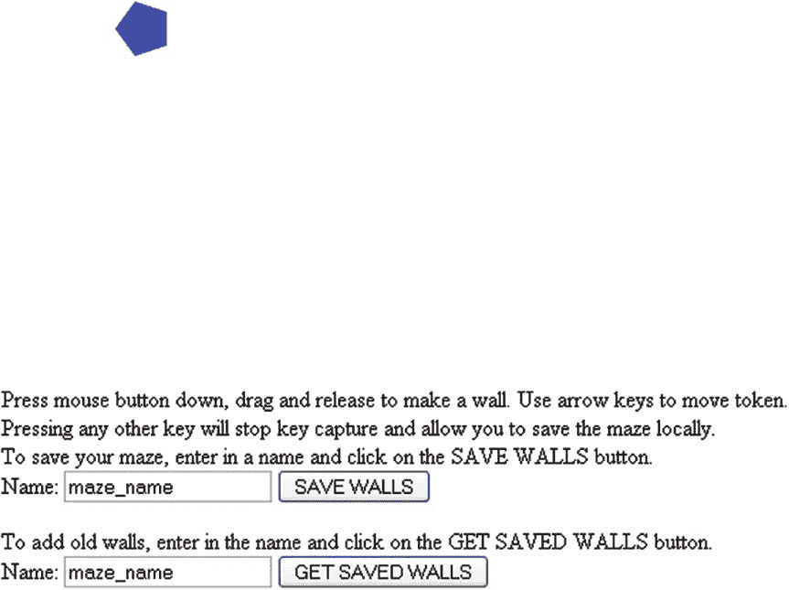
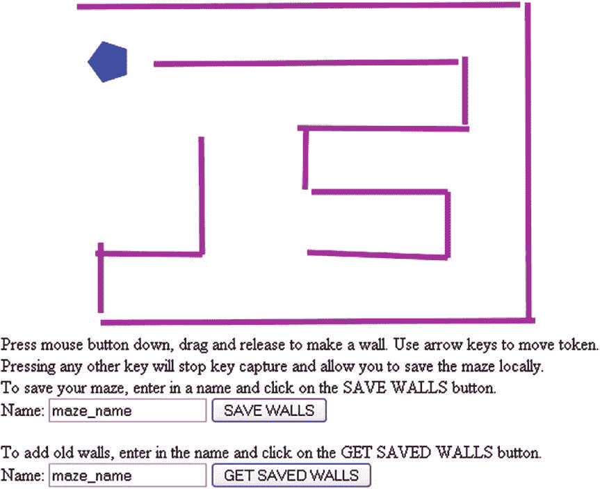
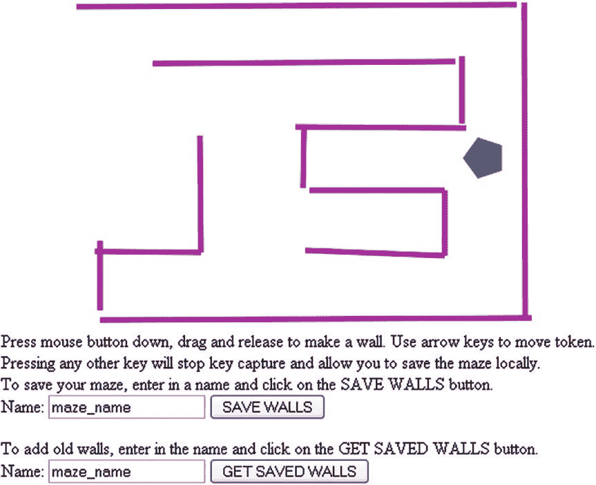
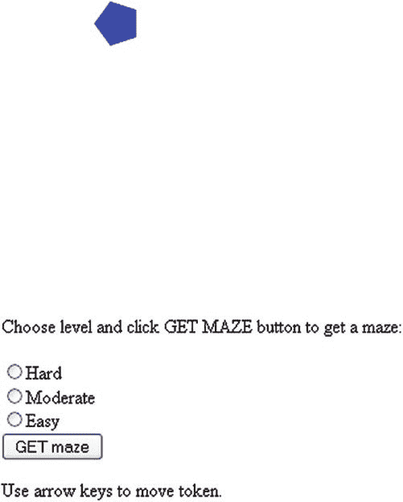
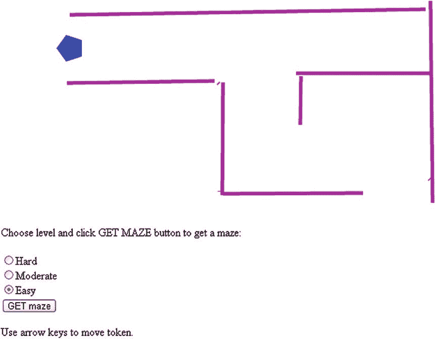
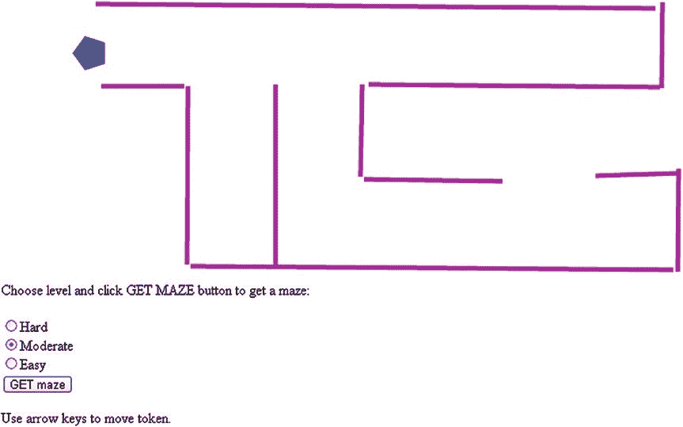
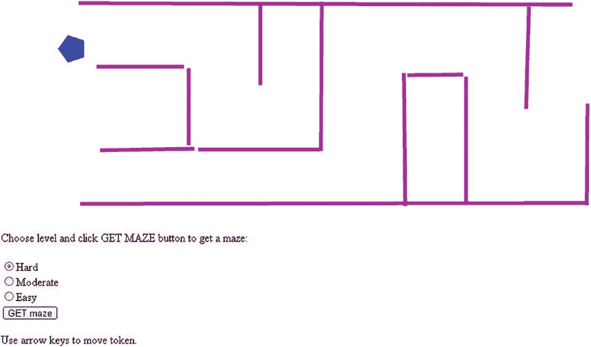

# J. Meyer，《HTML5 入门指南》，[`doi.org/10.1007/978-1-4842-8722-4_7`](https://doi.org/10.1007/978-1-4842-8722-4_7#DOI)

## 第 7 章 迷宫

通用的编程技术包括使用数组来存储所有需要在画布上绘制的内容，并使用一个独立的数组来存储迷宫中的墙壁集合。游戏开始前墙壁的数量未知，因此需要一种灵活的方法。

一旦迷宫构建完成，我们将学习如何响应箭头键的按下操作，以及如何检测游戏棋子（一个五边形标记）与墙壁之间的碰撞。借助 HTML5，我们可以处理鼠标事件，使玩家能够按下鼠标按钮，然后拖动并释放按钮来定义迷宫的每一面墙壁；响应箭头键来移动棋子；以及在本地计算机上保存和读取墙壁的布局。像往常一样，我们将构建不止一个版本的应用程序。

在第一个版本中，所有内容都包含在一个 HTML 文件中。也就是说，玩家可以构建一个迷宫，在其中穿行，并且可以选择将其保存到本地计算机，或者恢复之前保存的一组墙壁。在第二个版本中，一个程序用于创建迷宫，另一个文件则使用单选按钮为玩家提供选择特定迷宫进行穿行的选项。也许一个人可以在某台计算机上构建迷宫，然后请朋友尝试穿行这些迷宫。

HTML5 的本地存储功能只接受字符串，因此我们将研究如何使用 JavaScript 将迷宫信息编码成一个字符串，然后再将其解码回来，以重建迷宫的墙壁。即使计算机关闭，保存的信息仍会保留在计算机上。

我们将在本章中讨论的各项功能——构建结构、使用箭头键移动游戏棋子、检查碰撞，以及在用户计算机上编码、保存和恢复数据——都可以在各种游戏和设计应用程序中重复使用。

**注意：** HTML 文件通常被称为*脚本*，而*程序*一词通常专用于 Java 或 C 等语言。这是因为 JavaScript 是一种解释型语言：语句在执行时逐条翻译。相比之下，Java 和 C 程序是编译型的，即一次性完全翻译，并将结果存储起来供以后使用。我们中的一些人并没有那么严格，会将带有 JavaScript 的 HTML 文档称为*脚本*、*程序*、*应用程序*，或者简称为*文件*或*文档*。

`图 7-1` 显示了用于构建、穿行、保存和读取迷宫的开始界面。

`图 7-1.` 迷宫游戏的开始界面

`图 7-2` 显示了在画布上放置了一些相当马虎的墙壁后的屏幕。

`图 7-2.` 迷宫的墙壁

`图 7-3` 显示了玩家使用箭头键将棋子移入迷宫后的屏幕。

`图 7-3.` 在迷宫内移动棋子

如果玩家想保存一组墙壁，他或她输入一个名称并点击按钮。要读取墙壁（这些墙壁会被添加到画布上当前已有的内容中），玩家输入一个名称并按下`GET SAVED WALLS`按钮。如果该名称下没有保存任何内容，则不会发生任何操作。

第二个脚本为玩家提供了一个选择。`图 7-4` 显示了开始界面。重复说明：`travelmaze`程序假定您已使用相同的浏览器在您的计算机上构建并保存了名称为`easymaze`、`moderatemaze`和`hardmaze`的迷宫。您可以更改和/或添加这些名称。

`图 7-4.` `travelmaze` 脚本的开始界面

我这样做是为了演示 HTML5 的本地存储功能，它类似于 cookie——一种供 Web 应用程序开发者存储用户信息的方式。

**注意：** Cookie 以及现在的 HTML5 `localStorage`，是所谓的*行为营销*的基础。它们为我们带来了便利——我们无需记住某些信息项，如密码——但它们也是一种被追踪和成为销售目标的方式。我在此不持立场，只是提一下这个功能。

`图 7-5` 显示了一个简单的迷宫。

`图 7-5.` 一个简单的迷宫

`图 7-6` 显示了一个稍微复杂的迷宫。

`图 7-6.` 一个中等难度的迷宫

`图 7-7` 显示了一个更难的迷宫，其难度更高主要是因为玩家需要从第一个入口点移向迷宫底部才能通过。当然，设计迷宫是玩家/创建者自己的事情。

`图 7-7.` 一个更难的迷宫

一个重要的特性是，在双脚本应用程序中，点击`GET maze`按钮会强制清除当前迷宫并绘制新选择的迷宫。这与`buildmaze`程序中将旧墙壁添加到现有内容中的行为不同。与其他示例一样，这些只是程序的雏形，旨在演示 HTML5 特性和编程技术。有很大改进空间，让这些项目成为您自己的作品。

### 关键需求

迷宫应用程序需要显示一个不断更新的游戏面板，因为新的墙壁会被竖立起来，棋子也会被移动。

迷宫构建任务需要响应鼠标事件，以收集构建墙壁所需的信息。应用程序会显示正在构建的墙壁。

迷宫穿行任务需要响应箭头键来移动棋子。

游戏不能允许棋子穿过任何墙壁。

保存和读取操作要求程序对墙壁信息进行编码，将其保存在本地计算机上，然后读取它并用它来创建和显示保存的墙壁。迷宫是中等复杂结构：一个由若干墙壁组成的集合，每面墙壁由起点和终点坐标定义，即代表画布上`x,y`位置的一对数字。为了使用本地存储功能，这些信息必须转换成一个单一的字符串。

双文档版本使用单选按钮来选择迷宫。

### HTML5、CSS 和 JavaScript 特性

现在，让我们来看看实现迷宫应用程序所需的 HTML5 和 JavaScript 的具体特性。这建立在之前章节所涵盖内容的基础上：HTML 文档的通用结构；使用程序员定义的函数，包括程序员定义的对象；在画布元素上绘制由线段组成的路径；程序员对象和数组。之前的章节已经介绍了画布上的鼠标事件（第 4 章的炮弹和弹弓游戏以及第 5 章的记忆游戏）以及 HTML 元素上的鼠标事件（第 6 章的问答游戏）。我们将涵盖的新特性包括一种不同类型的事件：从玩家按下箭头键获取输入，称为*按键捕获*；以及使用本地存储在本地计算机上保存信息，即使在关闭浏览器和计算机之后也能保留。请记住，您可以跳到“构建应用程序”部分，查看带注释的所有代码，然后再回到本节阅读各个特性和技术的解释。

#### 墙壁和棋子的表示