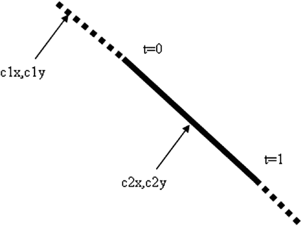
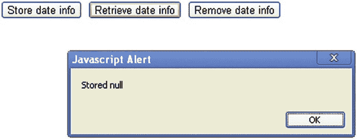
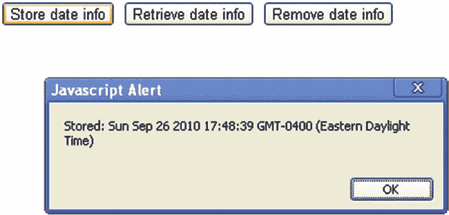
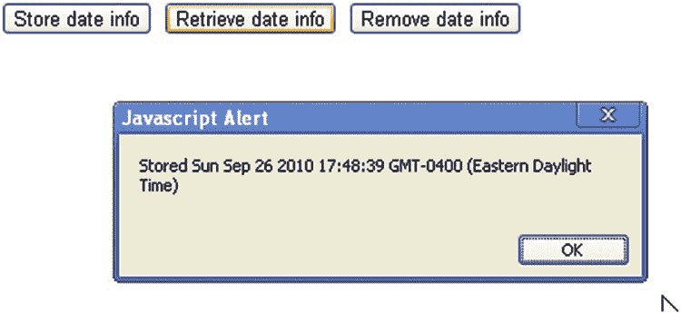
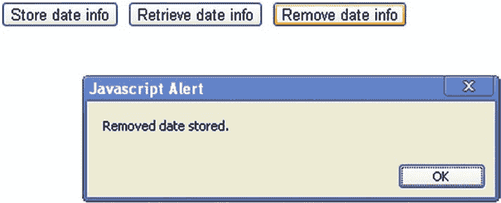
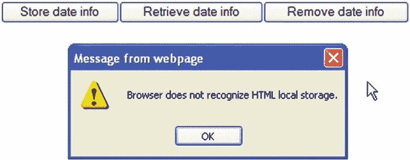
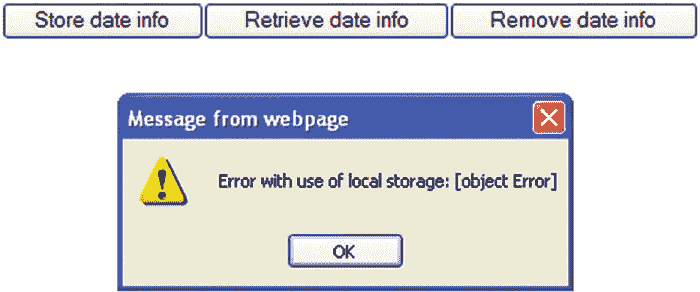

# 我如何知道左箭头键的键码是 37？

你可以在网上查找键码（例如[www.w3.org/2002/09/tests/keys.html](http://www.w3.org/2002/09/tests/keys.html)），或者编写一段弹出提示信息的代码。

`alert("您刚刚按下的键码是 "+keyCode);`

在我们的迷宫应用中，当按下的键不是四个方向键之一时，默认操作会停止按键事件处理。这里的假设是，玩家想要输入一个名称，以便将墙壁信息保存到本地存储或从中读取。在许多应用程序中，合适的做法是显示一条消息（可能使用`alert`），告知用户哪些按键是预期的。

## 碰撞检测：标记与任意墙壁

要穿越迷宫，玩家不能将标记移动到任何墙壁之上。我们将通过编写一个名为`intersect`的函数来强制执行此限制，该函数在给定圆心和半径的圆与线段相交时返回`true`。为此，我们需要在表述上精确：线段是直线的一部分，从`sx`、`sy`延伸到`fx`、`fy`。每堵墙对应一条有限的线段。直线本身是无限的。`intersect`函数会针对`walls`数组中的每堵墙被调用。



提示：我对碰撞计算中数学原理的解释相当简短，但如果你有一段时间没接触数学，可能会觉得有些困难。如果你不想深入研究，可以随意跳过，直接接受现有代码即可。

`intersect`函数基于参数化直线的概念。具体来说，直线的参数化形式使用数学公式表示如下（与代码不同，这实际上是一种混合格式，因为我确实使用了`*`表示乘法）：

*方程 a：* `x = sx + t*(fx-sx);`

*方程 b：* `y = sy + t*(fy-sy);`

`(sx,sy)` 和 `(fx,fy)` 代表线段的端点。我将直接使用`sx`、`sy`等作为变量名，而不改用`startX`之类的名称，因为这样更容易理解。

当参数`t`从 0 变化到 1 时，`x`和`y`会取到线段上对应的`x`、`y`值。目标是确定一个圆心为`cx`、`cy`、半径为`rad`的圆是否与线段重叠。一种方法是确定直线上距离`(cx, cy)`最近的点，然后检查该点到圆心的距离是否小于`rad`。在图 7-8 中，你看到了一条直线的一部分的示意图，其中线段用实线描绘，而展示出的直线其余部分用点表示。一端的`t`值为 0，另一端为 1。有两个点`c1x`、`c1y`和`c2x`、`c2y`。`(c1x, c1y)`点距离直线最近，但位于关键线段之外。`(c2x, c2y)`点则在线段中间的某处最近。其`t`值应在 0 到 1 之间。

*图 7-8. 一条线段和两个点*

两点`(x,y)`和`(cx,cy)`之间的距离公式为：

`距离 = 平方根(((cx-x)*(cx-x)+(cy-y)*(cy-y)))`

使用方程 a 和 b 替换`x`和`y`，我们得到一个距离公式。

*方程 c：* `距离 = 平方根(((cx-sx+t*(fx-sx))*(cx- sx + t*(fx- sx))+(cy- sy + t*(fy-sy))*(cy- sy + t*(fy-sy))))`

我们的目标是确定距离取最小值时的`t`值。根据微积分知识以及在这种情况下对最小值与最大值的推理，我们首先知道可以使用距离的平方来代替距离，从而避免求平方根。此外，当导数（关于`t`）为零时，该值取最小值。求导并将该表达式设为零，即可得到`(cx, cy)`离直线最近时的`t`值。在代码中，我们定义了两个额外的变量`dx`和`dy`，以使表达式更简洁。

`dx = fx-sx`

`dy = fy-sy;`

`t= 0.0 –((sx-cx)*dx+(xy-cy)*dy)/((dx*dx)+(dy*dy))`

这将产生一个`t`值。使用`0.0`是为了强制将计算作为浮点数（即带有小数部分的数字，不限于整数）进行。

我们使用方程 a 和 b 来获取与`t`值对应的`(x, y)`点。这是距离`(cx, cy)`最近的`(x, y)`点。如果`t`值小于 0，我们检查`t = 0`时的值；如果大于 1，则检查`t = 1`时的值。这意味着最近的点不在线段上，因此我们将检查线段上最接近该点的相应端点。

从`(cx, cy)`到最近点的距离是否足够近，以至于可以称为碰撞？我们再次使用距离平方而非距离。我们计算从`(cx, cy)`到计算出的`(x, y)`的距离平方。如果它小于半径的平方，则圆与线段相交。否则，不相交。使用距离平方不会产生影响：如果平方值存在最小值，那么原值也存在最小值。

现在，好消息是大部分方程并不需要写入代码中。我预先完成了求导表达式的工作。`intersect`函数如下，并附有注释：

```javascript
function intersect(sx,sy,fx,fy,cx,cy,rad) {
  var dx;
  var dy;
  var t;
  var rt;
  dx = fx-sx;
  dy = fy-sy;
  t =0.0-((sx-cx)*dx+(sy-cy)*dy)/((dx*dx)+(dy*dy)); //最近的 t 值
  if (t<0.0) { //最近点在线段起点之外
    t=0.0; 
  }
  else if (t>1.0) { //最近点在线段终点之外
    t = 1.0;
  }
  dx = (sx+t*(fx-sx))-cx; // 使用 t 定义 x 坐标
  dy = (sy +t*(fy-sy))-cy; // 使用 t 定义 y 坐标
  rt = (dx*dx) +(dy*dy); //距离的平方
  if (rt<(rad*rad)) { // 小于半径的平方？
    return true; 
  } // 相交
  else {
    return false;
  } // 不相交
}
```

在我们的应用中，玩家按下一个方向键，然后根据该键计算出标记的下一个位置。我们调用`intersect`函数来检查标记（近似为一个圆）是否会与某堵墙相交。如果`intersect`返回`true`，则标记不会移动。一旦检测到相交，检查就会停止。这是一种常见的碰撞检测技术。

## 使用本地存储

Web 最初的设计目的是将文件从服务器下载到本地（即所谓的客户端计算机）进行查看，而本地计算机上没有永久存储。随着时间的推移，构建网站的人们和组织发现某种形式的本地存储将是有利的。于是，有人提出了使用称为*cookies*的小文件来追踪信息的想法，例如存储用户 ID，以便为用户和网站所有者提供便利。随着商业 Web 的发展，Cookie 以及其他编程语言中的类似技术，以及现在的 HTML5 本地存储，其使用量已大幅增长。与此处展示的应用不同，用户通常不知道信息正在被存储、被谁存储，以及信息被访问的目的。




HTML5 的`localStorage`功能是特定于浏览器的。也就是说，使用 Chrome 保存的迷宫，在 Safari 中是无法访问的。

让我们通过研究一个保存日期和时间信息的小应用，来更仔细地了解如何使用本地存储。本地存储以及第 1 章中介绍的`Date`函数，提供了一种存储日期/时间信息的方法。可以将本地存储视为一个数据库，其中存储着字符串，每个字符串都对应一个特定的名称。这个名称称为*键*，字符串本身称为*值*，这个系统称为*键-值对*。本地存储仅能存储字符串这一限制，但下一节将展示如何解决这一问题。

图 7-9 显示了一个简单的日期保存应用的初始屏幕。

*图 7-9. 一个简单的日期保存应用*

用户有三个选项：存储当前日期和时间的信息、检索上次保存的信息以及删除日期信息。图 7-10 展示了首次使用此应用程序点击“检索日期信息”时发生的情况（或者在删除日期之后）。

图 7-10. 数据未保存或已删除





我们的应用程序使用 JavaScript 警报框来显示消息。用户需要点击“确定”按钮才能将警报框从屏幕上移除。

图 7-11 展示了用户点击“存储日期信息”按钮后的消息。

图 7-11. 存储日期信息后

如果用户稍后点击“检索日期信息”按钮，他们将看到类似于图 7-12 的消息。

图 7-12. 检索存储的日期信息

你可以为玩家提供一种通过“删除日期信息”按钮来删除存储信息的方法。图 7-13 展示了结果。



图 7-13. 删除存储信息后

HTML5 允许你使用内置对象 `localStorage` 的方法来保存、获取和删除键值对。

命令 `localStorage.setItem("lastdate",oldDate)` 设置一个新的键值对，或者替换任何之前键为 `lastdate` 的键值对。语句 `last = localStorage.getItem("lastdate");` 将获取的值赋值给变量 `last`。在我们这个简单示例的代码中，我们只是显示结果。你也可以检查某个值是否为 `null` 并提供更友好的消息。

命令 `localStorage.removeItem("lastdate")` 删除键为 `lastdate` 的键值对。

对于我们的简单日期应用程序，我们将每个按钮对象的 `onClick` 属性设置为一些 JavaScript 代码。例如：`<button onClick="javascript:store();">Store date info. </button>` 会在按钮被点击时调用 `store()`。

你可能想知道是否任何人都可以读取本地存储中保存的任何信息。答案是，对 `localStorage`（以及其他类型的 cookie）中每个键值对的访问仅限于存储该信息的网站。这是一个安全特性。

Chrome 浏览器允许使用存储在本地计算机上的 HTML5 脚本测试本地存储。在撰写第一版时，Firefox 不支持此功能，而是需要将文件上传到服务器才能使用本地存储。尽管现在所有浏览器似乎都支持 `localStorage`，但我提及这一点是为了让你做好应对不同浏览器的准备。



# 第七章 迷宫（MazeS）

由于可能存在其他问题，例如超出用户为本地存储和 cookie 设置的限制，因此包含一些错误检查是一个好习惯。你可以使用 JavaScript 函数 `typeof` 来检查浏览器是否支持 `localStorage`：`if (typeof(localStorage)=="undefined")`

图 7-14 显示了在旧版 Internet Explorer 中加载日期应用程序并点击“存储日期信息”按钮的结果。（在你阅读本书时，最新版本的 IE 可能已经发布，这将不再是一个问题。）

**图 7-14.** 浏览器无法识别 `localStorage`

JavaScript 还提供了一种通用机制来避免显示错误。复合语句 `try` 和 `catch` 会尝试执行一些代码，如果执行失败，则会转到 `catch` 子句。

```
try {
    oldDate = new Date();
    localStorage.setItem("lastdate", oldDate);
    alert("Stored: " + oldDate);
}
catch(e) {
    alert("Error with use of local storage: " + e);
}
```

如果你移除了 `if (typeof(localStorage)` 测试并在旧版 IE 中尝试该代码，你将看到图 7-15 中显示的消息。



**图 7-15.** 浏览器错误，被 `try/catch` 捕获