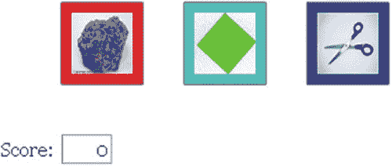

# 石头、剪刀、布

在本章中，我们将涵盖以下内容：

- 与计算机对战
- 创建作为按钮的图形
- 用于游戏规则的数组的数组
- `font-family` 属性
- 继承的样式设置
- 音频

## 引言

本章将编程技术与 HTML5 JavaScript 特性相结合，以实现我们熟知的石头剪刀布游戏。在校园版的此游戏中，每位玩家用手势表示三种可能性之一：石头、布或剪刀。术语是玩家`出手`三种选项之一。游戏规则陈述如下：

- 石头砸剪刀
- 布包石头
- 剪刀剪布

因此，每种符号击败另一种符号：石头胜剪刀；布胜石头；剪刀胜布。如果两位玩家出手相同，则为平局。

由于这是一个双人游戏，而我们的玩家将与计算机对战，因此我们必须创建计算机的招数。我们将生成随机招数，玩家需要相信程序是在这样做，而不是根据玩家出的招数来出招。演示必须强化这种信任感。

© Jeanine Meyer 2023

J. Meyer, *The Essential Guide to HTML5*, [`doi.org/10.1007/978-1-4842-8722-4_8`](https://doi.org/10.1007/978-1-4842-8722-4_8#DOI)

