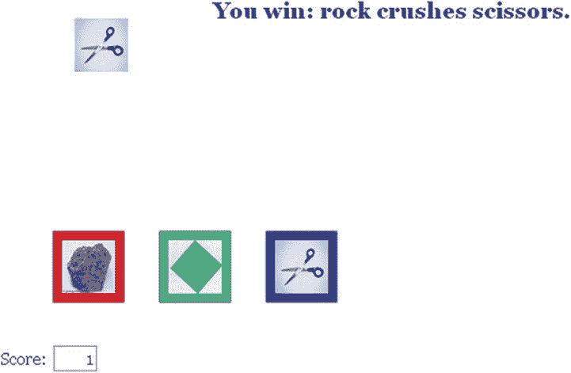
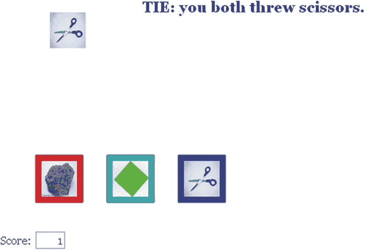
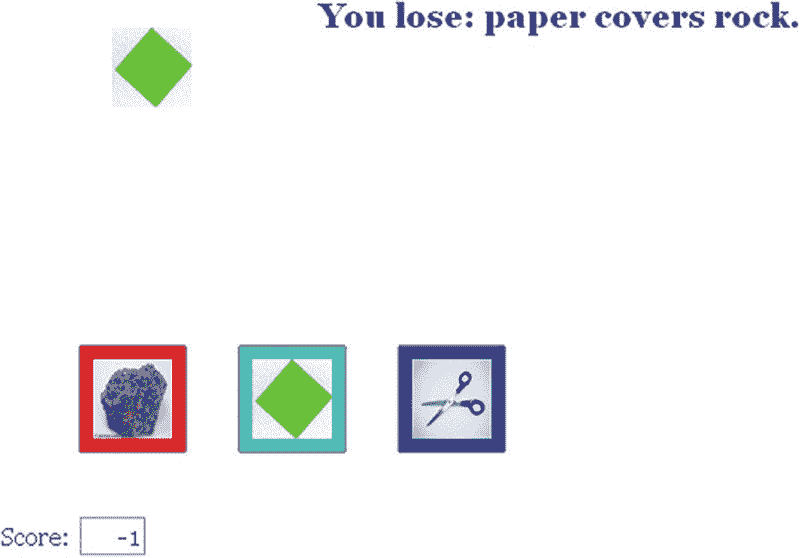

# 第 8 章 石头、剪刀、布

我们游戏的第一版仅使用您将在此处看到的视觉元素。第二版增加了音频：四个不同的音频片段分别对应三种获胜事件以及平局选项。您可以使用源代码附带的音频文件，也可以使用自己的音效。请注意，您需要更改代码中的文件名以匹配您使用的新音效文件。

在这种情况下，我们希望为玩家的招数使用特殊的图形。图 8-1 显示了应用的初始界面，包含三个作为按钮的图形，以及一个标有字符串 `"Score:"` 的字段，其初始值为零。


***图 8-1.** 石头-剪刀-布的开始画面*

玩家通过点击其中一个符号来进行出招。我们来看一个玩家点击石头图标的示例。假设电脑选择了剪刀。经过一段动画序列（剪刀符号从屏幕上的小图逐渐变大）后，会出现一条文本消息，如图 8-2 所示。在加入音频的版本中，音频片段会播放对应石头砸碎剪刀的声音效果。请注意分数现在是 1 分。





第 8 章 石头、剪刀、布

***图 8-2.** 玩家出了石头，电脑出了剪刀*

在游戏中，接下来会出现玩家和电脑平局的情况，如图 8-3 所示。出现平局时分数不变，因此仍然是 1 分。

***图 8-3.** 平局*



第 8 章 石头、剪刀、布

随后，游戏进入了胶着状态，但玩家失利，分数落到负 1 分，表示玩家落後，如图 8-4 所示。

***图 8-4.** 游戏后期的一次失利*

这个应用与本书中的所有示例一样，仅仅是一个开始。普通版和音频版都记录了玩家的连续分数，输一局分数就减一。

另一种方法是分别为玩家和电脑各自记分，只计算各自的胜场数。你还可以单独显示已玩局数。

如果你不想显示负数，这种方式更为可取。你还可以使用 `localStorage` 保存玩家分数，正如第[7](http://dx.doi.org/10.1007/978-1-4842-4155-4_7)章迷宫游戏中所描述的那样。

更复杂的增强功能可能包含视频剪辑（回顾第[6](http://dx.doi.org/10.1007/978-1-4842-4155-4_6)章）或动态 GIF，演示石头砸碎剪刀、纸包住石头和剪刀剪开纸的情景。你也可以将此视为多种不同游戏的模型。在所有情况下，你需要确定如何捕捉玩家的出招以及如何生成电脑的出招；你需要呈现并实现游戏规则；你还需要维护游戏状态并向玩家显示。石头-剪刀-布游戏除了连续分数之外，没有其他状态信息。换句话说，一局游戏只包含一轮。这与第[2](http://dx.doi.org/10.1007/978-1-4842-4155-4_2)章描述的骰子游戏截然不同——后者一局可以包含一次到任意多次投掷，也不同于第[5](http://dx.doi.org/10.1007/978-1-4842-4155-4_5)章描述的配对记忆游戏——后者一轮包含两次翻牌，一局游戏完成的轮次不限，最少为牌数的一半。

**注意** 存在石头-剪刀-布比赛的竞技活动，也有电脑根据玩家历史出招记录出招的电脑系统。甚至还有电脑对电脑的比赛。

**关键需求**

石头-剪刀-布的实现使用了之前章节演示过的许多 HTML5 和 JavaScript 构造，但在此以不同方式组合运用。编程与写作类似，就是将想法的表示形式按照某种逻辑顺序组织起来，就像把单词组合成句子、再把句子组合成段落一样。

在阅读本章时，请回顾你学到的在画布上绘制矩形、图像和文本，检测玩家点击鼠标的位置，使用 `setInterval` 设置定时事件以产生动画，以及使用数组存储信息。这些就是构建石头-剪刀-布应用的基础模块。

在规划这个应用时，我知道我希望玩家能点击按钮，每个按钮对应游戏中的一种出招类型。玩家出招后，我希望程序能自动做出自己的招数——即随机选择——并在屏幕上显示对应招数的图片。然后程序会应用游戏规则来展示结果。同时播放对应的音效，涵盖三种一物克一物的情况，以及平局时的叹气声。

这个应用最初呈现的是屏幕上的按钮或图标。这些是玩家可以点击出招的图片。还有一个用于显示分数的方框。

应用必须随机生成电脑的出招，并以一种似乎电脑与玩家同时出招的方式显示出来。我的想法是让对应的符号在屏幕上从小到大，仿佛从屏幕中浮现出来，就像电脑朝着玩家出招一样。这个动作在玩家点击三种可能的出招之一后立即开始，但又足够快速，给人一种两者同时发生的印象。

游戏规则必须严格遵守！这包括哪种招数克哪种招数，以及用于解释的通俗提示信息——“石头砸碎剪刀”、“纸包住石头”和“剪刀剪开纸”。显示的分数会根据本轮输赢或平局，分别加一分、减一分或保持不变。

含音频加强版的游戏必须根据情况播放四个音频片段之一。

**HTML5、CSS 和 JavaScript 特性**

现在让我们看看 HTML5、CSS 和 JavaScript 中提供了哪些具体特性来实现游戏。除了一些基本的 HTML 标签、函数和变量之外，此处给出的解释是完整的。如果你已经阅读了其他章节，会注意到本章许多内容是对先前解释的重述。

我们当然可以使用其他章节演示过的按钮类型，但我希望这些按钮看起来像它们所代表的招数。如你所见，我们实现按钮的方式建立在先前章节演示的概念之上。并且，我们再次使用 JavaScript 伪随机处理来定义电脑的出招，并使用 `setInterval` 来动画化电脑出招的显示过程。

我们的石头-剪刀-布游戏将演示 HTML5 的原生音频功能。这意味着浏览器仅使用 HTML5 和 JavaScript 的特性即可支持音频。我们将整合音频编码与游戏规则的应用。

**为玩家提供图形按钮**

在屏幕上生成可点击的按钮或图标涉及两个方面：在画布上绘制图形，以及检测玩家何时将鼠标移动到按钮上并点击主鼠标按钮。

我们将生成的按钮或图标包括：矩形的轮廓（描边）、一个实心矩形，以及在矩形上方以一定垂直和水平边距放置的图像。由于三个按钮的操作类似，我们可以使用第[4](http://dx.doi.org/10.1007/978-1-4842-4155-4_4)章炮弹和弹弓游戏中首次介绍的方法。我们将通过编写一个名为 `Throw` 的函数来建立一个程序员自定义的对象类。

回想一下，对象由数据代码组合而成。这个被称为*构造函数*的函数将与 `new` 运算符一起使用，以创建 `Throw` 类型的新对象。函数内部使用 `this` 来设置每个对象关联的值。

```javascript
function Throw(sx,sy, sMargin,sWidth,sHeight,rectColor,picture) {
  this.sx = sx;
  this.sy = sy;
  this.sWidth = sWidth;
  this.bWidth = sWidth + 2*sMargin;
  this.bHeight = sHeight + 2*sMargin;
  this.sHeight = sHeight;
  this.fillStyle = rectColor;
  this.draw = drawThrow;
  this.img = new Image();
```


`this.img.src = picture;`

`this.sMargin = sMargin;`

`}`

函数参数包含了所有信息。通过一个简单的修改——在变量名前加上表示“存储”的`s`，就可以避免使用内置术语，从而选择`sx`、`sy`这样的名称。按钮的位置位于`sx`、`sy`。矩形的颜色由`rectColor`表示。图片的文件名由`picture`保存。我们可以视为内外宽度和内外高度的值，是基于输入`sMargin`、`sHeight`和`sWidth`计算得出的。`bHeight`和`bWidth`中的`b`代表大（big）。`s`代表小且已存储（small and stored）。不必过分纠结于合适的名称——其实并没有这种东西。命名由你决定，只要一个名字能让你记住，它就是有效的。（一个对你有意义的名称比长度更重要：不要为了少打字而把函数和变量名弄得很短。）

`Throw`对象的`img`属性是一个`Image`对象。该`Image`对象的`src`指向通过`picture`参数传递给函数的文件名。

请注意，`this.draw`属性被设置为`drawThrow`。这设置了`drawThrow`函数作为所有`Throw`类型对象的`draw`方法。这段代码的通用性超出了实际需要：这三个图形具有相同的边距、宽度和高度。不过，让代码具有通用性并无坏处，而且如果你想在此基础上构建一个表示玩家选择的更复杂对象的应用程序，这段代码大部分都能直接使用。

