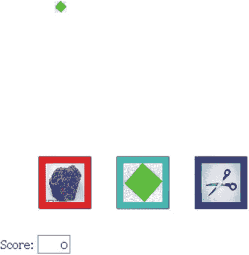
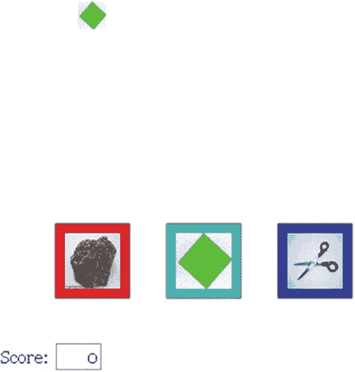
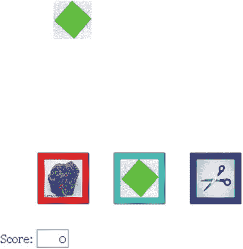
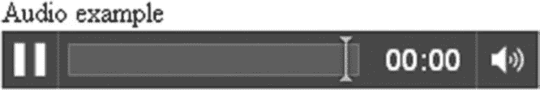

# 第八章 石头、剪刀、布

与我们之前的应用类似，我们声明一个名为`everything`的数组并将其初始化为空数组。我们将所有三个变量都推入`everything`数组，以便对它们进行统一处理。

```
everything.push(rockb);
everything.push(paperb);
everything.push(scib);
```


例如，要绘制所有按钮，我们使用一个名为`drawAll`的函数，它遍历`everything`数组中的元素。

```
function drawAll() {
    ctx.clearRect(0, 0, cWidth, cHeight);
    var i;
    for (i = 0; i < everything.length; i++) {
        everything[i].draw();
    }
}
```

同样，这比实际需求更通用，但它非常有用，尤其是在面向对象编程中，尽可能保持通用性是一个好做法。

但如何让这些图形作为可点击的按钮呢？由于这些图形是绘制在画布上的，代码需要为整个画布设置点击事件处理，然后通过编程来检查哪个按钮（如果有）被点击了。

在本书第[4 章](http://dx.doi.org/10.1007/978-1-4842-4155-4_4)描述的弹弓游戏中，你看到处理整个画布`mousedown`事件的函数会进行计算，以判断鼠标光标是否在球上。在第[6 章](http://dx.doi.org/10.1007/978-1-4842-4155-4_6)的问答节目中，我们为每个国家和首都块设置了事件处理。JavaScript 的内置机制会指示哪个对象接收了点击事件。而本应用则类似于弹弓游戏。

我们在`init`函数中设置事件处理，下一节将详细解释。任务是让 JavaScript 监听鼠标点击事件，并在点击发生时执行我们指定的操作。我们希望调用`choose`函数。以下两行代码实现了这一任务：

```
canvas1 = document.getElementById('canvas');
canvas1.addEventListener('click', choose, false);
```

**提示**：我们的代码需要区分`id`为`canvas`的元素与通过`getContext('2d')`返回的该元素的属性。这正是 HTML5 团队所决定的方式，这不是你自己能推导出来的。

`choose`函数负责确定玩家选择了哪种出拳类型、生成电脑的出拳并设置其显示，以及应用游戏规则。现在，我们只看用于确定哪个按钮被点击的代码。

在我的实现中，我没有考虑玩家在电脑出拳逐渐显现在屏幕上的过程中点击某个选项的情况。我那位懂得如何扮演熊孩子玩家的第一技术审校提出了解决方案：我们使用一个全局变量`inMotion`，并将其初始化为`false`。

```
var inMotion = false;
```

如果`inMotion`为`true`，`choose`函数将不做任何操作。该变量在`flyin`函数中被设为`true`，并在动画结束时被设回`false`。

代码首先从保存事件信息的`ev`变量中获取鼠标坐标。你在之前的章节中已经见过这种写法：

```
function choose(ev) {
    if (!inMotion) {
        var mx;
        var my;
        mx = ev.pageX;
        my = ev.pageY;
```

下一段代码遍历`everything`数组中的元素（共有三个元素，但并未明确提及），以判断光标是否在任何一个矩形上。变量`ch`保存了对一个`Throw`对象的引用，因此所有`Throw`的属性（即`sx`、`sy`、`bWidth`和`bHeight`）都可用于比较语句中。这是`everything`数组中所有出拳选项的简写形式。

```
var i;
for (i = 0; i < everything.length; i++) {
    var ch = everything[i];
    if ((mx > ch.sx) && (mx < ch.sx + ch.bWidth) &&
        (my > ch.sy) && (my < ch.sy + ch.bHeight)) {
        ...
        break;
    }
}
```

`<...>` 表示稍后解释的代码。复合条件将点`(mx, my)`与代表玩家可能出拳的三个对象中每个对象的外矩形的左、右、上、下边界进行比较。这四个条件必须全部为真，点才在矩形内。这通过`&&`运算符表示。虽然语句较长，但这是检查点是否在矩形内的标准方法，你会逐渐习惯使用它。

这就是图形如何绘制在画布上以及它们如何充当按钮的原理。请注意，如果玩家点击了按钮之外的区域，则不会发生任何事情。有些人可能建议此时应向玩家提供反馈，例如弹出一个提示框，显示如下内容：

请点击石头、布或剪刀来完成你的出拳！

另一些人则会建议你避免屏幕杂乱，并假设玩家能自己摸索出操作方法。

**生成电脑的出拳**

生成电脑的出拳类似于我们在第[2 章](http://dx.doi.org/10.1007/978-1-4842-4155-4_2)的掷骰子游戏中生成骰子点数。在石头剪刀布游戏中，我们需要从三种可能的出拳中随机选择，而不是从六种骰子面中选。我们通过下面这行代码得到这个数字：

```
var compch = Math.floor(Math.random() * 3);
```

调用内置方法`Math.random()`会生成一个从 0（含）到 1（不含）的数字。将其乘以 3 会得到一个从 0（含）到 3（不含）的数字。应用`Math.floor`会得到一个不大于其参数的整数。它会向下取整，舍弃超过最高整数下限的任何小数部分。因此，右侧表达式会生成 0、1 或 2，这正是我们需要的值。

该值被赋值给`compch`，它被声明为一个变量。

代码将电脑的出拳（一个由涉及`random`函数的计算选出的数字 0、1 或 2）用作`choices`数组的索引：`var choices = ["rock.jpg", "paper.gif", "scissors.jpg"];` 这三个元素引用了按钮中使用的三张相同图片。

此时，为了让你放心，石头、布、剪刀的顺序是任意的。我们需要保持一致性，但顺序并不重要。如果每次都把顺序定为布、剪刀、石头，一切也仍然能正常工作。玩家永远不会看到 0 代表石头、1 代表布、2 代表剪刀的编码。

`choose` 函数中的下一行代码提取一个文件名，并将其赋值给一个`Image`变量`compimg`的`src`属性。

```
var compchn = choices[compch];
compimg.src = compchn;
```

局部变量`compchn`代表电脑出拳名称。`compimg`变量是一个全局变量，持有一个`Image`对象。代码将其`src`属性设置为相应图片文件的名称，该文件将用于显示电脑的出拳。

为了实现游戏规则，我设置了两个数组：

```
var beats = [
    ["TIE: you both threw rock.", "You win: paper covers rock.",
     "You lose: rock crushes scissors."],
    ["You lose: paper covers rock.", "TIE: you both threw paper.",
     "You win: scissors cuts paper."],
    ["You win: rock crushes scissors.", "You lose: scissors cuts paper.",
     "TIE: you both threw scissors"]
];
```

以及：

```
var points = [
    [0, 1, -1],
    [-1, 0, 1],
    [1, -1, 0]
];
```

这两个都是数组的数组。这两个数组一起被称为*并行结构*，意味着其中的元素相互对应。当我解释如何添加音效时，我会描述另一个并行结构，即第三个数组的数组。`beats`数组保存了所有消息，而`points`数组保存了要加到玩家分数上的数值。加 1 会增加玩家的分数。加-1 会减少玩家 1 分，这是当玩家输掉一局时的预期效果。加 0 则分数保持不变。现在，你可能会认为在平局的情况下什么都不做比加零更容易，但就编码而言，统一处理这种方式更简单，而且加 0 实际可能比执行一个`if`测试来判断是否为平局花费的时间更少。


每个数组的第一个索引来自电脑的出招 `compch`，第二个索引 `i` 表示内部数组的元素，来自玩家的出招。`beats` 数组和 `points` 数组被称为并行结构。`beats` 数组用于文本消息，`points` 数组用于计分。

让我们通过选取一个电脑出招来验证信息是否正确，例如剪刀，对应的索引值为 `2`；再选取一个玩家出招，例如石头，对应的索引值为 `0`。在 `beats` 数组中，电脑出招对应的值告诉我们要访问索引值为 `2` 的数组。（我避免说“第二个数组”，因为数组的索引从 `0` 开始，而不是从 `1` 开始。索引 `2` 指向的是数组的第三个元素。）该元素如下：

```
["你赢了：石头砸碎剪刀。","你输了：剪刀剪破布。",
"平局：你们都出了剪刀"];
```

现在用玩家出招的索引值 `0` 来访问这个数组。结果为 `"你赢了：石头砸碎剪刀。"`，这正是我们想要的。对 `points` 数组执行同样的操作，索引为 `2` 的元素如下：

```
[1,-1,0]
```

再用索引 `0` 访问这个数组，得到值 `1`，也完全符合预期：玩家的分数将增加 `1`。

```
result = beats[compch][i];
...
newScore += points[compch][i];
```

回顾一下，语句

```
a += b;
```

中的运算符 `+=` 解释如下：

* 获取变量 `a` 的值
* 将该值与表达式 `b` 的值进行 `+` 运算
* 将结果重新赋值给变量 `a`

第二步的表述比较通用，因为这里的 `+` 既可以解释为数字加法，也可以解释为字符串拼接。在此特定场景下，第二步的具体含义是：

* 将 `a` 和 `b` 相加

该结果会重新赋值给变量 `a`。

`result` 和 `newScore` 这两个变量是全局变量。这意味着它们可以被其他函数访问，这也是我们使用它们的方式：在一个函数中设置，然后在另一个函数中引用。

分数通过 HTML 文档 body 元素内的一个表单元素来展示。

```html
<form name="f">
分数：<input name="score" value="0" size="3"/>
</form>
```

为了展示这类操作的具体实现，我们将为分数输入框应用样式。我们设置了两种样式，一种用于 `form`，另一种用于 `input` 字段。

```css
form {
  color: blue;
  font-family: Georgia, "Times New Roman", Times, serif;
  font-size:16px;
}
input {
  text-align:right;
  font:inherit;
  color:inherit;
}
```

我们将表单中文字的颜色设置为蓝色，并通过 `font-family` 属性指定了字体。这是一种指定特定字体，并在客户端电脑没有该字体时提供后备字体的方法。这是一个强大的功能，因为这意味着你可以根据需要精确指定字体，并且通过努力，仍能确保所有人都能阅读内容。

**提示** 你可以在网上搜索网页安全字体，了解哪些字体被广泛支持。然后你可以选择最喜欢的字体作为首选，在第二选择中选一个网页安全字体，并将最后一个选择设为 `serif` 或 `sans-serif`。

如果你愿意，甚至可以指定超过三种选择。可以查阅 [`en.wikipedia.org/wiki/Web_typography`](http://en.wikipedia.org/wiki/Web_typography) 获取灵感。另一种方案是获取一种字体，将字体文件放在服务器上，然后使用 CSS 的 `@font-face` 规则，让字体随其他文件一起下载（参见 [`www.w3schools.com/css/css3_fonts.asp`](https://www.w3schools.com/css/css3_fonts.asp)）。

在此样式中，我们依次指定了字体 Georgia，然后是 "Times New Roman"，然后是 Times，最后是计算机上的标准衬线字体。衬线是指字母上那些微小的装饰线。`"Times New Roman"` 两侧必须使用引号，因为该名称包含多个单词。其他字体名称加引号也不算错，但并非必要。我们还指定了字体大小为 16 像素。


输入字段会继承其父元素（表单元素）的字体（包括字号和颜色）。但由于分数是数字，我们使用 `text-align` 属性将字段内容设置为右对齐。标签“分数”位于表单元素中，而实际分数位于输入元素中。对输入样式属性使用 `inherit` 设置，可使两者以相同的字体、字号和颜色显示。

输入字段中的值将依据其名称 `score` 被提取和设置。

例如，

```
newScore = Number(document.f.score.value);
```

此处需要 `Number` 来生成字段中文本所代表的数字，即 `0` 而非 `“0”`（字符）。如果我们将值保留为字符串，并且代码使用加号将 `1` 添加到字符串中，那么这将不是加法，而是字符串的拼接。（顺便一提，这被称为*运算符重载*：加号根据操作数的数据类型表示不同的运算。）将 `“1”` 拼接到 `“0”` 上会得到 `“01”`。你可能觉得这还行，但下一次，我们会得到 `“011”`、`“010”` 或 `“01-1”`。呃。我们不希望这样，因此我们编写代码确保该值被转换为数字。

要将调整后的新分数放回字段中，代码如下：

```
document.f.score.value = String(newScore);
```

现在，正如我经常对学生说的那样，我不得不告诉你真相。实际上，这里可能不需要 `String`。JavaScript 有时会自动执行这些转换（也称为*类型转换*）。然而，有时它不会这样做，因此明确写出是一种好习惯。

字段的尺寸是容纳三个字符所需的最大尺寸。Georgia 字体不是等宽字体——所有字符的宽度并不相同——因此这是可能需要的最大空间。你可能会注意到，根据字段中的文本不同，剩余的空间量也不同。

**注意**：JavaScript 使用圆括号、花括号和方括号。它们不可互换。圆括号用于函数头、函数和方法调用；用于 `if`、`for`、`switch` 和 `while` 语句头；以及用于指定复杂表达式中的运算顺序。花括号用于界定函数的定义以及 `if`、`for`、`switch` 和 `while` 语句的子句。方括号用于定义数组以及返回数组的特定成员。级联样式表的语言将每个样式用花括号括起来。HTML 标记包含 `<` 和 `>`，通常称为*尖括号*。

### 第 8 章：石头、剪刀、布

#### 使用动画展示结果

你已经在第 [3](http://dx.doi.org/10.1007/978-1-4842-4155-4_3) 章的弹球应用和第 [4](http://dx.doi.org/10.1007/978-1-4842-4155-4_4) 章的炮弹和弹弓示例中看到了动画的实例。回顾一下，动画是通过快速连续显示一系列静止图片来产生的。单张图片被称为*帧*。在所谓的*计算动画*中，每个连续的帧都会计算屏幕上对象的新位置。产生动画的一种方法是使用 `setInterval` 命令来设置一个间隔事件，如下所示：

```
tid = setInterval(flyin,100);
```

这会导致 `flyin` 函数每 100 毫秒（每秒 10 次）被调用一次。设置变量 `tid`（定时器标识符）是为了让代码能够关闭此间隔事件。`flyin` 函数会创建尺寸不断增大的 Throw 对象，并承载相应的图像。当一个对象达到指定大小时，代码会显示结果并调整分数。这就是为什么变量 `result` 和 `newScore` 必须是全局变量——它们在 `choose` 函数中被设置，并在 `flyin` 函数中使用。

`flyin` 函数还使用一个名为 `size` 的全局变量，该变量从 15 开始，每次调用 `flyin` 时递增 5。当 `size` 超过 50 时，定时事件被停止，结果显示消息，分数发生更改。


```javascript
function flyin() {
  inMotion = true;
  ctx.drawImage(compimg, 70, 100, size, size);
  size += 5;
  if (size > 50) {
    clearInterval(tid);
    ctx.fillText(result, 200, 100, 250);
    document.f.score.value = String(newScore);
    inMotion = false;
  }
}
```

请注意，`flyin` 函数每次被调用时都将 `inMotion` 设置为 true，这意味着当 `inMotion` 已经为 true 时，它仍然会被重新设为 true。这样做是合理的，也是正确的实现方式。无需进行任何额外的检查。请注意，它只会在某一时刻被设置为 false。



## 第 8 章 石头、剪刀、布

顺便提一句，为了截取这些截图，我不得不修改了代码。图 8-5 是首次调用 `flyin` 后的画面。

***图 8-5.** 首次调用 flyin，显示代表电脑出拳的小图像*

经过不同的代码修改后，图 8-6 展示了动画在后续步骤中暂停的效果。



***图 8-6.** 动画的后续步骤*

图 8-7 显示了动画完成后的画面，但此时还尚未显示带有结果文字的提示信息。



***图 8-7.** 在结果显示文字之前*

现在，我要坦白一件能让你有所收获的事情。你可能需要先跳过这段，或者等到通读所有代码后才能领会其中的深意。当我第一次创建这个应用时，我将显示消息和调整分数的代码都放在了 `choose` 函数中。毕竟，这个函数才是确定胜负数值的地方。然而，这带来了一个非常糟糕的效果。玩家在动画中看到电脑出拳从屏幕中显现出来之前，就已经看到了结果。这让游戏看起来像是被操纵了！当我意识到问题所在后，我修改了 `choose` 函数中的代码：将消息和新的分数值存储到全局变量中，并只在 *动画完成之后* 才显示消息，并在表单输入字段中更新分数。不要以为你在开始之前就能完全了解自己的应用。要相信你会发现并解决各种问题。许多公司都有专门的质量保证团队。我就不点名了，但确实存在一些专业商业游戏，它们会过早地显示电脑部分出拳结果。

#### 音频与 DOM 处理

音频的情况与视频非常相似（见第 6 章）。坏消息依然是，不同的浏览器并不都支持相同的格式。好消息是，HTML5 提供了 `<audio>` 元素，而 JavaScript 则提供了播放音频的功能，以及引用不同浏览器所支持的不同音频格式的方法。此外，还有现成的工具可用于在不同格式之间进行转换。我在这些示例中使用的两种格式是 MP3 和 OGG，它们似乎足以支持 Chrome、Firefox 和 Safari。我从免费来源获取了音频片段，并找到了可接受的 WAV 和 MP3 样本。然后，我使用之前下载用于处理视频的 Miro 转换器，将 WAV 文件转换为 MP3 和 OGG，并将其他文件也转换为 OGG。Miro 生成的 OGG 文件名为 `theor.ogv`，为简单起见，我对其进行了重命名。进行音频转换的方法有很多种。这里的要点是，这种方法要求每个声音文件都有两个版本。

**注意：** 音频文件引用的顺序可能不重要，但我曾看到过警告，如果 MP3 文件被列在第一位，Firefox 将无法正常工作。也就是说，它不会继续尝试加载其他文件。我现在不使用 Firefox，但请将此视为一个警告。随着浏览器在媒体处理方面变得更加稳健，这个问题可能已经得到解决。

在“石头剪刀布”游戏中，我没有使用 `<audio>` 元素的一些属性。`autoplay` 属性会在加载后立即开始播放，但你需要记住，对于大文件来说，加载并非瞬时的。`src` 属性指定了音频源。然而，最佳实践是不在 `<audio>` 标签中使用 `src` 属性，而是使用 `<source>` 元素作为 `<audio>` 的子元素来指定多个音频源。`loop` 属性指定循环播放，即重复播放音频片段。`controls` 属性会在屏幕上显示播放控件。这可能是个好做法，因为音频片段的声音可能会很大。但是，为了保持音频的惊喜感，并且不让视觉演示显得杂乱，我选择不这样做。

下面是一个简单的示例，你可以尝试一下。你需要从本书的下载页面下载 `sword.mp3`，或者找到你自己的音频文件并在此处用文件名引用它。如果你在 Chrome 中打开以下 HTML，你将看到如图 8-8 所示的界面。



音频示例

<br/>
<audio src="sword.mp3" autoplay controls>
  你的浏览器不支持音频
</audio>

***图 8-8.** 带有播放控件的音频标签*

请记住，在我们的游戏中，我们将为石头砸碎剪刀、布包住石头、剪刀剪开布以及平局时的叹息声播放音频。以下是石头剪刀布游戏中四个音频片段的编码：

```html
<audio preload="auto">
  <source src="hithard.ogg" />
  <source src="hithard.mp3" />
</audio>

<audio preload="auto">
  <source src="inhale.ogg" />
  <source src="inhale.mp3" />
</audio>

<audio preload="auto">
  <source src="sword.ogg" />
  <source src="sword.mp3" />
</audio>

<audio preload="auto">
  <source src="crowdohh.ogg" />
  <source src="crowdohh.mp3" />
</audio>
```

这看起来合理地描述了四组音频文件，但你可能会想知道代码如何知道该播放哪一个。我们可以在每个 `<audio>` 标签中插入 `id` 属性。然而，让我们换一种方式，来演示一种在许多场景下都很有用的 JavaScript 方法。你已经见过 `document.getElementById` 方法。还有一个类似的方法：`document.getElementsByTagName`。这行代码：

```javascript
musicElements = document.getElementsByTagName("audio");
```

会提取所有由参数指定的标签名的元素，并创建一个数组。在这行代码中，这个数组被赋值给了一个名为 `musicElements` 的变量。我们在 `init` 函数中使用这行代码，因此在应用启动时就会执行它。

我们构建了另一个数组的数组，名为 `music`，并添加了两个额外的全局变量，总共三个全局变量用于处理声音。

```javascript
var music = [
  [3,1,0],
  [1,3,2],
  [0,2,3]
];

var musicElements;
var musicch;
```

你可以验证 `music` 和 `beats` 是 *并行结构*，其中 0 代表石头砸碎剪刀，1 代表布包住石头，2 代表剪刀剪开布，3 代表平局。

`choose` 函数将包含这一行额外的代码：

```javascript
musicch = music[compch][i];
```

`musicch` 变量——名字代表音乐选择——将保存 0、1、2 或 3。这为动画完成时 `flyin` 函数中将要发生的事情做好了准备。正如我在坦白中所解释的，我们不会立即播放音频片段。

```javascript
musicElements[musicch].play();
```

`musicElements` 中的第零、第一、第二或第三个元素通过使用 `musicch` 进行索引来引用；然后调用其 `play` 方法，音频片段便开始播放。

#### 启动

应用程序通过设置对 `<body>` 标签的 `onLoad` 属性中一个函数的调用来启动。这也是其他游戏中的一贯做法。`init` 函数执行多项任务。它将初始分数值设置为 0。这是必要的，以防玩家重新加载文档；这是 HTML 的一个怪癖，即浏览器可能不会重置表单数据。


