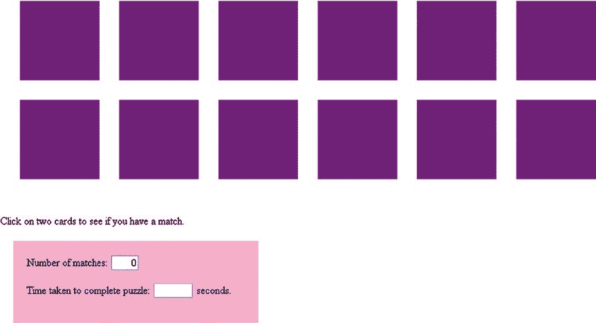
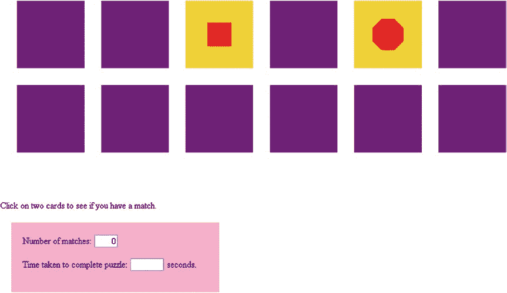
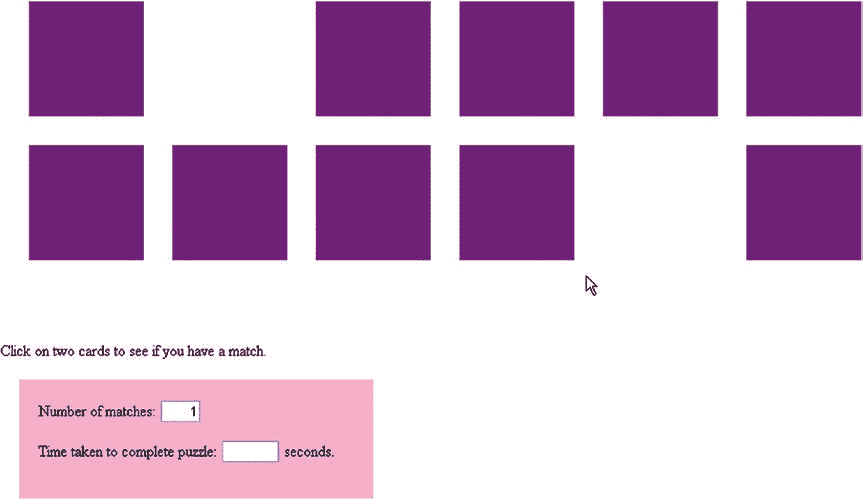
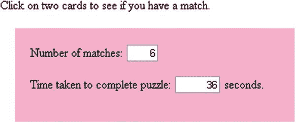
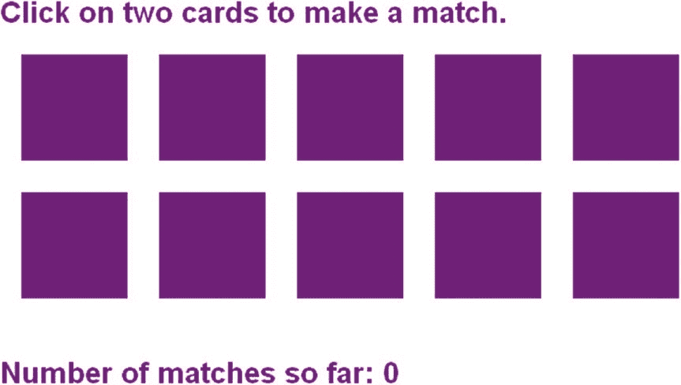
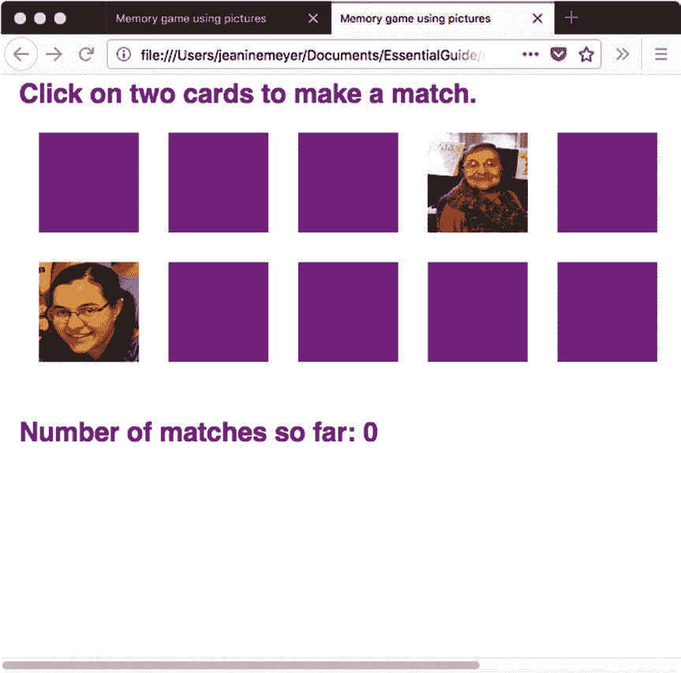
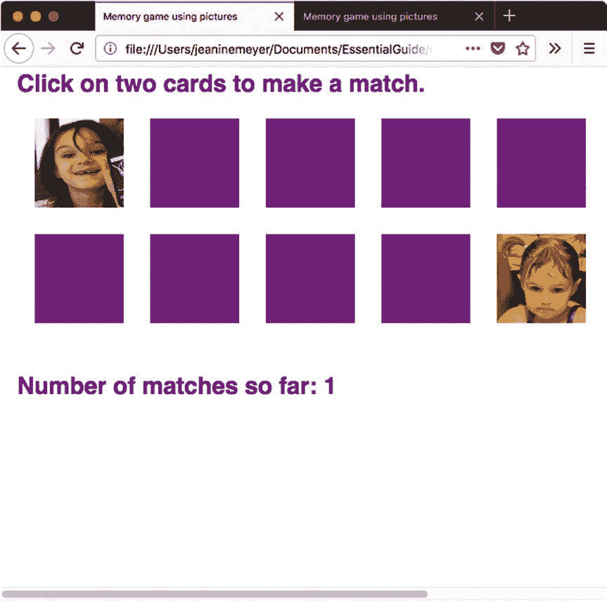
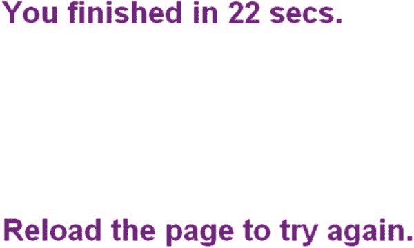

## 第 5 章：记忆（又名配对）游戏

在本章中，我们将涵盖以下内容：

-   绘制多边形
-   在画布上放置文本
-   表示信息的编程技术
-   编程实现暂停
-   计算经过的时间
-   一种洗牌（打乱一组卡牌对象）的方法

### 引言

本章演示了一款卡牌游戏的两种版本，这款游戏有多种叫法，如*记忆*游戏或*配对*游戏。卡牌牌面朝下放置，玩家每次翻开两张（通过点击），尝试找到匹配的对子。程序会将匹配的牌从牌桌上移除，并将不匹配的牌（虚拟地）翻回。当玩家匹配完所有牌对时，游戏会显示所用的时间。

我描述的第一个游戏版本使用多边形来表示牌面，第二个版本则使用家庭照片。你会注意到其他差异，这些差异是为了说明 HTML5 的多种特性而设计的，但我也强烈建议你思考这两个版本的共同点。

© Jeanine Meyer 2023

# J. Meyer，《HTML5 入门指南》，[`doi.org/10.1007/978-1-4842-8722-4_5`](https://doi.org/10.1007/978-1-4842-8722-4_5#DOI)



## 第 5 章：记忆（又称配对）游戏

图 5-1 显示了第一版的初始画面。当玩家完成游戏时，记录配对的表格也会显示已用时间。

*图 5-1. 记忆游戏第一版的初始画面*

图 5-2 显示了玩家点击两张牌（紫色方块）后的结果。图中显示的多边形不匹配，因此在短暂停顿后，程序会用牌背图像替换它们，使牌看起来像是被翻了过去。



*图 5-2. 两张牌面：不匹配*

当两张牌匹配时，应用程序会移除它们并在表单中记录这次配对（见图 5-3）。





*图 5-3. 应用程序已移除配对的两张牌*

如图 5-4 所示，游戏在玩家完成时显示结果——本例中，在 36 秒内完成了 6 次配对。

*图 5-4. 玩家完成游戏后的第一版*



在游戏的第二版中，牌面显示的是人物照片，而非多边形。请注意，虽然许多记忆游戏认为只有完全相同的图像才视为匹配，但这个游戏类似于一副扑克牌中红桃 2 匹配方块 2。为了说明一个编程要点，我们将匹配定义为同一个人，即使照片不同。这需要一种方法来编码我们用于确定匹配状态的信息。游戏第二版还演示了如何在画布上书写文本，如图 5-5 所示，它描绘了初始画面。

*图 5-5. 记忆游戏第二版初始画面*

要查看在我们新游戏中点击两张牌可能产生的结果，请看图 5-6。



*图 5-6. 不匹配的照片*

由于结果显示的是两个不同的人——在暂停让玩家查看两张照片后——应用程序会将牌翻回去，让玩家再试一次。

图 5-7 显示了一次成功的选取——同一人的两张图像（尽管照片不同）。



*图 5-7. 匹配成功（场景不同，但是同一个人）*

应用程序会将匹配的图像从面板上移除。当所有牌都被移除时，完成游戏所用的时间会与如何重新游戏的说明一同显示，如图 5-8 所示。



*图 5-8. 游戏结束画面（照片版）；所有图像已匹配，因此没有显示任何牌*

你可以使用随源代码提供的照片来玩这个游戏，但使用你自己的照片会更有趣。你可以从小规模开始——比如两到三对图像——然后逐步增加到全家、全班或整个俱乐部的照片。对于游戏的第一版，你可以用自己设计的图案替换多边形。

### 关键需求

游戏的数字版本需要能够表示牌背（所有牌背相同）以及具有各自独特多边形或照片的牌面。应用程序还必须能够判断哪些牌相互匹配，以及牌在面板上的位置。此外，玩家需要获得反馈。在实体游戏中，参与者会翻开两张牌寻找配对（这需要一点时间）。如果没有配对，他们会将牌再次翻转为牌背朝上。

计算机程序必须显示所选牌的牌面，并在揭示第二张牌后暂停，以便玩家有时间看清两张牌面。这个暂停是计算机实现所需的一个例子，而在人们进行实体游戏时则是自然发生的。应用程序还应该显示当前已找到的配对数，并在游戏结束时，显示参与者找到所有配对所用的时间。多边形版和照片版程序使用不同的方法来完成这些任务。

以下是两个游戏版本必须执行的操作的总结：

-   绘制牌背。

-   在玩家进行初始选择前洗牌，这样每次出现的排列不会相同。

-   检测玩家何时点击了一张牌，并区分是第一次点击还是第二次点击。

-   检测到点击时，通过绘制多边形（游戏第一版）或显示正确的照片（游戏第二版）来显示相应的牌面。

-   移除成功配对的牌对。

-   即使那些讨厌的玩家做出意料之外的操作，例如双击同一张牌或点击一张牌之前占据的空位，程序也要能正常运行。

### HTML5、CSS 与 JavaScript 特性

我们来详细讨论一下实现游戏所需的特定 HTML5 和 JavaScript 特性。我们将建立在之前涉及的内容之上：HTML 文档的通用结构；如何在 `canvas` 元素上绘制矩形、图片以及由线段组成的路径；程序员定义的函数和内置函数；程序员对象；`form` 元素；以及数组。

新的 HTML5 和 JavaScript 特性包括超时事件、使用 `Date` 对象计算已用时间、在画布上书写和绘制文本，以及一些有用的编程技巧，这些将在未来的应用程序中很有价值。

与前几章一样，本节将概述这些 HTML5 特性和编程技巧。你可以在“构建应用程序”部分看到上下文中的所有代码。如果愿意，你可以跳到那一节查看代码，然后再回到这里了解这些特性如何工作的解释。

### 表示牌

当我们手里拿着一张实体牌时，我们可以看到它是什么。它有牌面和牌背，且所有牌背都是相同的。我们可以清楚地确定牌在游戏板上的位置，以及当前显示的是牌面还是牌背。要实现计算机游戏，我们必须表示——*编码*——所有这些信息。编码是创建许多计算机应用程序（不仅仅是游戏）的基本部分。

在本章（以及全书）中，我描述了一种完成任务的方法。但请记住，实现应用程序的功能通常不止一种方法。尽管如此，构建应用程序的不同策略可能共享一些共同的技巧。

我们处理牌的方法将采用一个程序员定义的对象。在 JavaScript 中创建程序员定义的对象涉及编写构造函数；在本例中，我们将其命名为 `Card`。使用程序员定义对象的优点是，JavaScript 提供了访问公共类型对象的信息和代码所需的点表示法。我们在第 4 章的炮弹和弹弓游戏中就是这样做的。

我们将为 `Card` 对象赋予以下属性：一个用于保存牌的位置（`sx` 和 `sy`）和尺寸（`sWidth` 和 `sHeight`）的属性、一个指向绘制牌背的函数的指针，以及针对每种情况指定相应牌面的信息（`info`）。

在多边形卡片的情况下，`info` 的值将指示要绘制的边数（稍后会讨论绘制它的代码）。对于照片卡牌面，该值将是一个对已创建的 `Image` 对象的引用 `img`。该对象将保存一个特定的图像文件，同时带有一个将匹配图片关联起来的数字（`info`）。为了绘制文件中的图像，我们将使用内置的 `drawImage` 方法。

不用说，这些卡片并非像有两面的实体存在。应用程序在玩家期望看到的位置，在画布上绘制卡片的正面或背面。

`flipBack` 函数绘制卡片的背面。为了营造卡片被移除的视觉效果，`flipBack` 通过绘制一个与棋盘颜色相同的矩形来有效地擦除卡片。

两个应用程序都使用一个名为 `makeDeck` 的函数来准备牌堆，这个过程包括创建 `Card` 对象。对于游戏的多边形版本，我们将边数（从 3 到 8）存储在 `Card` 对象中。不过，应用程序在设置期间不会绘制任何多边形。照片版本则设置一个名为 `pairs` 的数组，列出照片的图像文件名。您可以按照此示例创建自己的家庭或团体记忆游戏。

**第 5 章 记忆（又名“连连看”）游戏**

**提示：** 如果您使用在线代码玩游戏，如前所述，您可以下载图像文件。若想让游戏成为您自己的，您需要上传图片，然后更改代码以引用您的文件。代码会指明哪些部分需要更改。

`makeDeck` 函数创建 `Image` 对象，并使用 `pairs` 数组将 `src` 属性设置为图像对象。当代码创建 `Card` 对象时，它会放入控制 `pairs` 数组的索引值，以便匹配的照片具有相同的值。与多边形版本一样，应用程序在牌堆创建期间不会在画布上绘制任何图像。在屏幕上，所有卡片看起来都一样；不过，其内部信息是不同的。

这些卡片位于固定位置——洗牌是之后的事情。

代码对 `Card` 和 `Polygon` 的位置信息（`sx` 和 `sy` 属性）做出了不同的解释。对于第一种情况，该信息指的是左上角。对于第二种情况，该值标识了多边形的中心。不过，您可以根据其中一个计算出另一个。

### 使用 `Date` 进行计时

我们需要一种方法来确定玩家完成所有匹配所花费的时间。JavaScript 提供了一种测量已用时间的方法。您可以在“构建应用程序”部分查看上下文中的代码。在此，我将说明如何确定正在运行的程序中两个不同事件之间的秒数。

调用 `Date()` 会生成一个包含日期和时间信息的对象。

以下两行代码：

```javascript
startTime = new Date();
startTime = Number(startTime.getTime());
```

将自 1970 年初以来的毫秒数（千分之一秒）存储在变量 `startTime` 中（JavaScript 使用 1970 的原因不重要）。您可以对 `Date` 对象进行算术运算，但我选择提取毫秒值。

当我们的两个记忆游戏程序中的任何一个确定游戏结束时，它会再次调用 `Date()`，如下所示：

## 代码示例

```javascript
var now = new Date();
var nt = Number(now.getTime());
var seconds = Math.floor(.5+(nt-startTime)/1000);
```

这段代码：

1.  创建一个新的`Date`对象并将其存储在变量`now`中。
2.  使用`getTime`提取时间，将其转换为`Number`，并赋值给变量`nt`。这意味着`nt`保存了从 1970 年初到代码调用`Date`时点的毫秒数。然后程序将保存的起始时间`startTime`从当前时间`nt`中减去。
3.  除以 1000 得到秒数。
4.  加上 0.5 并调用`Math.floor`将结果向上或向下取整到整秒。我们希望小数部分等于或大于 0.5 的数字向上取整，小于 0.5 的数字向下取整。

如果秒级的精度不够用，可以省略或修改最后一步。

当需要在程序中计算两个事件之间的时间差时，你可以使用这段代码。

## 提供暂停功能

当我们用实体卡片玩记忆游戏时，翻到不匹配的牌后，并不会刻意停一下再把牌面朝下扣回去。但如前所述，我们的计算机实现必须提供暂停功能，以便玩家有时间看清两张不同的牌。你可能还记得第 [3](http://dx.doi.org/10.1007/978-1-4842-4155-4_3) 章和第 [4](http://dx.doi.org/10.1007/978-1-4842-4155-4_4) 章中的动画应用——弹跳球、炮弹和弹弓——都使用了 JavaScript 函数 `setInterval` 来设置固定时间间隔的事件。我们可以在记忆游戏中使用一个相关的函数 `setTimeout`。（如需查看完整代码的上下文，请跳转到“构建应用程序”部分。）下面我们来看看如何设置该事件，以及暂停时间结束时会发生什么。

`setTimeout` 函数用于设置单个事件，我们可以利用它来施加暂停。

当玩家点击画布时，会调用 `choose` 函数，该函数首先检查 `firstPick` 变量，以确定玩家是第一次选择还是第二次选择。无论哪种情况，程序都会在画布上与牌背相同的位置绘制牌面。如果点击是第二次选择，且两张牌匹配，代码会将变量 `matched` 设为 `true` 或 `false`，具体取决于牌是否匹配。如果应用程序判断游戏尚未结束，代码将调用：

```javascript
setTimeout(flipback,1000);
```

这会导致在 1000 毫秒（1 秒）后调用 `flipBack` 函数。然后，`flipBack` 函数会使用 `matched` 变量来决定是重新绘制牌背，还是通过使用桌面背景颜色在相应牌的位置绘制矩形来擦除牌面。

你可以使用 `setTimeout` 来设置任何单个的定时事件。你需要指定时间间隔以及间隔结束时想要调用的函数。请记住，时间单位是毫秒。

## 绘制文本

HTML5 包含一种在画布上放置文本的机制。这提供了一种比之前版本更加动态、灵活的文本呈现方式。通过将文本放置与我们已展示的矩形、线条、弧线和图像绘制相结合，你可以创造出一些不错的效果。在本节中，我们概述了在 canvas 元素中放置文本的步骤，并包含了一个可供尝试的简短示例。如果你愿意，可以跳到“构建应用程序”部分，查看生成记忆游戏照片版中图 5-5 到图 5-8 所示效果的完整代码描述。

要在画布上放置文本，我们编写设置字体的代码，然后使用 `fillText` 从指定的 x-y 坐标开始绘制一串字符。以下示例使用了多种字体来创建文字（请留意本节后面的注意事项）：

```html
<html>
<head>
<title>字体</title>
<script type="text/javascript">
var ctx;
function init(){
  ctx = document.getElementById('canvas').getContext('2d');
  ctx.font="15px Lucida Handwriting";
  ctx.fillText("this is Lucida Handwriting", 10, 20);
  ctx.font="italic 30px HarlemNights";
  ctx.fillText("italic HarlemNights",40,80);
  ctx.font="bold 40px HarlemNights";
  ctx.fillText("HarlemNights",100,200);
  ctx.font="30px Accent";
  ctx.fillText("Accent", 200,300);
}
</script>
</head>
<body onLoad="init();">
<canvas id="canvas" width="900" height="400"> 你的浏览器不支持 HTML5 的 canvas 元素。
</canvas>
</body>
</html>
```

这个 HTML 文档生成了图 5-9 所示的截图。

**图 5-9.** 使用 `font` 和 `fillText` 函数在画布上绘制的不同字体文本

### 警告

请确保你选择的字体在全体玩家的电脑上都存在。第 10 章将介绍如何使用名为`font-family`的 CSS 特性，它能系统地指定主字体和备用字体。

请注意，虽然你看到的内容似乎是文字，但实际上你正在查看画布上的墨迹——即文字的位图图像，而非可原位修改的文本框。

这意味着要改变文字，我们需要编写代码完全擦除当前图像。具体做法是将`fillStyle`设置为我们先前存入变量`tableColor`的值，并使用`fillRect`在适当的位置和尺寸下执行操作。

创建文字图像后，下一步是将`fillStyle`设置为不同于`tableColor`的颜色。我们将使用为牌背选定的颜色。对于照片记忆游戏的开始画面显示，以下是设置所有文字字体的代码：`ctx.font="bold 20pt sans-serif";`

使用`sans-serif`字体是合理的，因为它是任何电脑上都存在的标准字体。

综合我们目前完成的操作，以下是游戏特定时刻显示匹配次数的代码：

```javascript
ctx.fillStyle= tableColor;
ctx.fillRect(10,340,900,100);
ctx.fillStyle=backColor;
ctx.fillText("Number of matches so far: "+String(count),10,360);
```

前两条语句擦除当前计数，后两条写入更新后的结果。表达式`"Number of matches so far: "+String(count)`值得更多解释。它完成两项任务：

-   获取数字类型的变量`count`，并将其转换为字符串。
-   将常量字符串`"Number of matches so far: "`与`String(count)`的结果进行拼接。

这个拼接操作展示了加号在 JavaScript 中的两种含义。

如果操作数是数字，该符号表示加法。如果操作数是字符串，则表示两个字符串应拼接在一起。一个符号具有多种含义的华丽说法是`运算符重载`。

如果一个操作数是字符串而另一个是数字，JavaScript 会怎么做？答案取决于哪个操作数是哪种数据类型。你会看到一些代码示例，程序员没有添加将文本转换为数字或反之的命令，但语句之所以能工作，是因为操作符的特定顺序。

不过，我建议不要冒险。相反，试着记住支配加号解释的规则。如果你发现程序将数字从 1 增加到 11 再到 111，而期望的是 1、2、3，那么你的代码是在拼接字符串而非递增数字，此时需要将字符串转换为数字。

## 绘制多边形

创建多边形能很好地展示 HTML5 的绘图功能。要理解这里用于绘制多边形的代码开发过程，可以将几何图形想象成一个轮子形状，从中心到每个顶点都有辐条。辐条不会出现在绘图中，但能帮助你（就像它们帮助我一样）理解如何绘制多边形。图 5-10 以三角形为例说明了这一点。

**图 5-10.** 将三角形表示为几何图形有助于理清绘制多边形的代码开发思路；箭头表示绘图路径中的第一个点

要确定辐条之间的角度测量值，我们将`2*Math.PI`（代表完整圆周）除以多边形的边数。我们使用该角度值和`moveTo`方法来绘制路径的点。源代码中有一个绘制三角形的简单 HTML 程序；即，变量`n`被设置为 3。你可以通过修改声明和初始化`n`的语句来绘制其他正多边形。

该程序将多边形绘制为填充路径，从由`angle`值的一半指定的点（如图 5-10 箭头所示）开始。要到达该点，我们使用`moveTo`方法，配合半径、`Math.sin`和`Math.cos`。然后，我们对剩余 n-1 个点使用`lineTo`方法，按顺时针方向进行。对于三角形，n-1 是另外两个点。对于八边形，则会是另外七个点。在用`lineTo`点运行完`for`循环后，我们调用`fill`方法生成填充形状。以下是绘制三角形的关键代码：

```
var ctx;
var rad = 50;
var centerX = 200;
var centerY = 200;
var n = 3;
var angle = (2*Math.PI)/n;

function init(){
    ctx = document.getElementById('canvas').getContext('2d');
    ctx.fillStyle="rgb(255,0,0)";
    var i;
    ctx.beginPath();
    ctx.moveTo(centerX+rad*Math.cos(-.5*angle),centerY+rad*Math.sin(-.5*angle));
    for (i=1;i<n;i++) {
        ctx.lineTo(centerX+rad*Math.cos((i-.5)*angle),
                   centerY+rad*Math.sin((i-.5)*angle));
    }
    ctx.closePath();
    ctx.fill();
}
```

注意，`n`是一个可以设置不同值的变量。在记忆游戏中使用多边形的程序中，你会看到类似的情况。

**注意** 绘制和重绘多边形需要时间，但这不会给本应用带来问题。如果程序包含大量复杂设计，预先将它们作为图片准备可能更有意义。然而，这种方法要求用户下载文件，这可能相当耗时。你需要通过实验来确定哪种方法整体效果更好。

### 第 5 章：记忆（又称“配对”）游戏

#### 洗牌

如前所述，记忆游戏要求程序在每轮开始前洗牌，因为我们不希望牌一次又一次地出现在相同位置。随机排列数值集合的最佳方式是广泛研究的课题。

在第 10 章描述二十一点纸牌游戏时，你会找到一篇描述所谓最有效洗牌技术的文章作为参考。

对于记忆/专注游戏，让我们实现我小时候玩游戏的方式。我和其他人会摊开所有牌，然后拿起并交换成对。当我们认为已经交换了足够次数时，就开始游戏。在本节中，我们将探讨这种方法背后的更多概念。（要查看洗牌函数，你可以跳到“构建应用”部分。）

为了编写洗牌交换方法的 JavaScript 代码，我们首先需要定义“足够次数”。让我们将其设为牌组中牌数的三倍，我们在数组变量`deck`中表示了这些牌。但由于没有实体牌，只有代表牌的数据，我们交换的是什么？答案是唯一标识每张牌的信息。对于多边形记忆游戏，这是属性`info`。对于图片游戏，则是`info`和`img`。

要获取随机牌，我们使用表达式`Math.floor(Math.random()*dl)`，其中`dl`（代表牌组长度）保存牌组中的牌数。我们这样做两次来获取要（虚拟）交换的一对牌。这可能会产生相同的数字，意味着牌与自身交换，但这并不是真正的问题。如果发生这种情况，此步骤过程不会产生任何影响。代码规定了大量的交换次数，因此一次交换没做任何事是可以接受的。

执行交换是下一个挑战，需要一些临时存储。对于多边形版本游戏，我们将使用一个变量`holder`；对于图片案例，则使用两个变量`holderImg`和`holderInfo`。

#### 实现点击牌

下一步我们将解释如何实现玩家的移动，即玩家点击卡牌的操作。在 HTML5 中，我们可以采用与处理`mouseDown`事件（详见第 4 章）基本相同的方式来处理点击事件。我们将使用`addEventListener`方法。

```
canvas1 = document.getElementById('canvas');
canvas1.addEventListener('click',choose,false);
```

这段代码出现在`init`函数中。`choose`函数必须包含用于确定我们选择哪张卡牌进行洗牌的代码。程序还必须返回玩家点击画布时鼠标的坐标。获取鼠标坐标的方法与第 4 章所述相同。

正如我之前在上一版中写到的，我曾使用更复杂的代码来获取鼠标坐标。不过，浏览器方面的情况似乎有所简化。以下代码在 Chrome 和 Safari 中均可工作：

```
mx = ev.pageX;
my = ev.pageY;
```

由于卡牌是矩形，利用鼠标光标坐标（`mx`，`my`）、每张卡牌左上角的位置以及卡牌的宽度和高度，遍历牌组并进行比较操作相对容易。下面是我们构建`if`条件的方式：

```
if ((mx>card.sx)&&(mx<card.sx+card.sWidth)&&(my>card.sy)&&(my<card.sy+card.sHeight))
```

**注意：** 下一章将介绍如何在运行时创建 HTML 标记，并展示如何为屏幕上特定元素（而非整个 canvas 元素）设置事件处理。

#### 防止某些类型的作弊行为

请注意，本节的具体内容仅适用于这类记忆游戏，但其中的通用经验对于构建任何交互式应用程序都适用。玩家至少有两种方式可以破坏游戏规则。一种是点击同一张卡牌两次；另一种是点击已经移除卡牌的区域（即该区域已被重新绘制过）。

针对第一种情况，在判断鼠标是否悬停在某张卡牌上的`if true`子句之后，插入以下`if`语句：

```
if ((firstPick) || (i!=firstCard)) break;
```

这行代码的作用是：当索引值（`i`）满足条件时（即要么是第一次选择，要么不是第一次选择且`i`不是第一次选中的卡牌），触发从`for`语句中退出。

解决第二个问题——点击“幽灵”卡牌——则需要更多工作。当应用程序从棋盘上移除卡牌时，除了在该画布区域覆盖绘制外，我们还可以给`sx`属性赋予一个值（比如-1）。这将标记该卡牌已被移除。这是`flipBack`函数的一部分。`choose`函数中包含检查`sx`属性并进行判断的代码（仅当`sx` >= 0 时）。该函数通过以下`for`循环整合了两种作弊检测：

```
for (i=0;i<deck.length;i++){
    var card = deck[i];
    if (card.sx >=0)
        if ((mx>card.sx)&&(mx<card.sx+card.sWidth)&&(my>card.sy)&&(my<card.sy+card.sHeight)) {
            if ((firstPick)|| (i!=firstCard)) break;
        }
}
```

在这三个`if`语句中，第二个语句是第一个语句的整个子句。第三个语句包含单个语句`break`，它使控制流跳出`for`循环。通常，我建议在`if true`和`else`子句中使用花括号（例如：`{`和`}`），但这里我为了展示简洁格式，并且因为这样看起来足够清晰，所以对单条语句使用了简化格式。

现在，让我们继续构建我们的两款记忆游戏。

#### 构建应用程序并使其个性化
```

# 本节展示了该游戏两个版本的完整代码。由于应用程序包含多个函数，本节为每个游戏提供了一个表格，说明每个函数调用了哪些函数，以及被哪些函数调用。

表 5-1 是多边形版本记忆游戏的函数列表。请注意，部分函数的调用是基于事件触发的。

***表 5-1.** 多边形版本记忆游戏的函数*

**函数** | **被谁调用** | **调用谁**
---|---|---
`init` | 响应 `body` 标签中的 `onLoad` 事件被调用 | `makeDeck`
`shuffle` | – | –
`choose` | 响应 `init` 中的 `addEventListener` 事件被调用 | `Polycard`；`drawPoly`（作为多边形的 `draw` 方法被调用）；`flipBack`
`flipBack` | 响应 `choose` 中的 `setTimeout` 调用被调用 | `drawBack`
`drawBack` | 在 `makeDeck` 和 `flipBack` 中作为卡牌的 `draw` 方法被调用 | –
`Polycard` | 在 `choose` 中被调用 | –
`shuffle` | 在 `init` 中被调用 | –
`makeDeck` | 在 `init` 中被调用 | –
`Card` | 被 `makeDeck` 调用 | –
`drawPoly` | 在 `choose` 中作为 `Polygon` 的 `draw` 方法被调用 | –

## 第 5 章 记忆游戏（又称 Concentration 游戏）

表 5-2 展示了该应用程序多边形版本的完整带注释代码。在审阅时，请思考它与其他章节中描述的应用程序的相似之处。请记住，这只是为应用程序组件命名和编写程序的一种方式，其他方式同样可行。

***表 5-2.** 多边形版本记忆游戏的完整代码*

**代码** | **说明**
---|---
`<html>` | 起始 `html` 标签。
`<head>` | 起始 `head` 标签。
`<title>Memory game using polygons</title>` | 完整的 `title` 元素。
`<style>` | 起始 `style` 标签。
`form {` | 为表单指定样式。
`width:330px;` | 设置宽度。
`margin:20px;` | 设置外边距。
`background-color:pink;` | 设置颜色。
`Padding:20px;` | 设置内边距。
`}` | 关闭样式。
`input {` | 设置输入字段的样式。
`text-align:right;` | 设置右对齐——适用于数字。
`}` | 关闭样式。
`</style>` | 关闭 `style` 元素。
`<script type="text/javascript">` | 开始 `script` 元素。`type` 属性并非必需，但此处保留，因为你会看到它。
`var ctx;` | 存储画布上下文的变量。
`var firstPick = true;` | 声明并初始化 `firstPick`。
`var firstCard;` | 声明变量，用于存储定义第一次选牌的信息。
`var secondCard;` | 声明变量，用于存储定义第二次选牌的信息。
`var frontbgcolor = "rgb(251,215,73)";` | 设置牌面背景颜色的值。
`var polyColor = "rgb(254,11,0)";` | 设置多边形颜色的值。
`var backColor = "rgb(128,0,128)";` | 设置牌背颜色的值。
`var tableColor = "rgb(255,255,255)";` | 设置面板（桌面）颜色的值。
`var cardRad = 30;` | 设置多边形的半径。
`var deck = [];` | 声明牌组，初始为空数组。
`var firstsx = 30;` | 设置第一张牌的 `x` 坐标。
`var firstsy = 50;` | 设置第一张牌的 `y` 坐标。
`var margin = 30;` | 设置牌之间的间距。
`var cardWidth = 4*cardRad;` | 设置牌宽度为多边形半径的四倍。
`var cardHeight = 4*cardRad;` | 设置牌高度为多边形半径的四倍。
`var matched;` | 该变量在 `choose` 中设置，在 `flipBack` 中使用。
`var startTime;` | 该变量在 `init` 中设置，用于计算已过时间。
`function Card(sx,sy,sWidth,sHeight,info) {` | `Card` 函数的头部，用于设置卡牌对象。
`this.sx = sx;` | 设置水平坐标。
`this.sy = sy;` | 设置垂直坐标。
`this.sWidth = sWidth;` | 设置宽度。
`this.sHeight = sHeight;` | 设置高度。
`this.info = info;` | 设置信息（边数）。
`this.draw = drawBack;` | 指定绘制方式。
`}` | 关闭函数。
`function makeDeck() {` | 用于设置牌组的函数头部。
`var i;` | 用于 `for` 循环。
`var aCard;` | 用于存储一对牌中的第一张牌。
`var bCard;` | 用于存储一对牌中的第二张牌。

# 第 5 章 记忆（亦即专注力）游戏

## 表 5-2.（续）

| **代码** | **说明** |
| --- | --- |
| `var cx = firstsx;` | 用于保存 x 坐标的变量。从第一个 x 位置开始。 |
| `var cy = firstsy;` | 用于保存 y 坐标的变量。从第一个 y 位置开始。 |
| `for(i=3;i<9;i++) {` | 循环生成从三角形到八边形的卡片。 |
| `aCard = new Card(cx,cy,cardWidth,cardHeight,i);` | 创建一张卡片并定位。 |
| `deck.push(aCard);` | 添加到牌堆中。 |
| `bCard = new Card(cx,cy+cardHeight+margin,cardWidth,cardHeight,i);` | 创建一张信息相同的卡片，但位于屏幕上上一张卡片之后。 |
| `deck.push(bCard);` | 添加到牌堆中。 |
| `cx = cx+cardWidth+ margin;` | 递增以留出卡片宽度及边距的空间。 |
| `aCard.draw();` | 在画布上绘制第一张卡片。 |
| `bCard.draw();` | 在画布上绘制第二张卡片。 |
| `}` | 关闭 for 循环。 |
| `}` | 关闭函数。 |
| `function shuffle() {` | 洗牌函数的头部。 |
| `var i;` | 用于保存对一张卡片的引用的变量。 |
| `var k;` | 用于保存对一张卡片的引用的变量。 |
| `var holder;` | 执行交换所需的变量。 |
| `var dl = deck.length;` | 用于保存牌堆中卡片数量的变量。 |
| `var nt;` | 交换次数的索引。 |
| `for (nt=0;nt<3*dl;nt++) {` | for 循环。 |
| `i = Math.floor(Math.random()*dl);` | 获取一张随机卡片。 |
| `k = Math.floor(Math.random()*dl);` | 获取一张随机卡片。 |
| `holder = deck[i].info;` | 存储卡片 i 的信息。 |
| `deck[i].info = deck[k].info;` | 将卡片 k 的信息放入卡片 i。 |
| `deck[k].info = holder;` | 将原本在 i 的信息放入卡片 k。 |
| `}` | 关闭 for 循环。 |
| `}` | 关闭函数。 |

## 表 5-2.（续）

| **代码** | **说明** |
| --- | --- |
| `function Polycard(sx,sy,rad,n) {` | `Polycard` 函数的头部。 |
| `this.sx = sx;` | 设置 x 坐标。 |
| `this.sy = sy;` | 设置 y 坐标。 |
| `this.rad = rad;` | 设置多边形半径。 |
| `this.draw = drawPoly;` | 设置绘制方式。 |
| `this.n = n;` | 设置边数。 |
| `this.angle = (2*Math.PI)/n` | 计算并存储角度。 |
| `}` | 关闭函数。 |
| `function drawPoly() {` | 函数头部。 |
| `ctx.fillStyle= frontbgcolor;` | 设置正面背景色。 |
| `ctx.fillRect(this.sx-2*this.rad,this.sy-2*this.rad,4*this.rad,4*this.rad);` | 矩形的左上角位于多边形中心的左上方。 |
| `ctx.beginPath();` | 开始路径。 |
| `ctx.fillStyle=polyColor;` | 将颜色改为多边形颜色。 |
| `var i;` | 索引变量。 |
| `var rad = this.rad;` | 提取半径值。 |
| `ctx.moveTo(this.sx+rad*Math.cos(-.5*this.angle),this.sy+rad*Math.sin(-.5*this.angle));` | 移动到第一个点。 |
| `for (i=1;i<this.n;i++) {` | 用于后续各点的 for 循环。 |
| `ctx.lineTo(this.sx+rad*Math.cos((i-.5)*this.angle),this.sy+rad*Math.sin((i-.5)*this.angle));` | 设置线段的绘制。 |
| `}` | 关闭 for 循环。 |
| `ctx.fill();` | 填充路径。 |
| `}` | 关闭函数。 |
| `function drawBack() {` | 函数头部。 |
| `ctx.fillStyle = backColor;` | 设置卡片背面颜色。 |
| `ctx.fillRect(this.sx,this.sy,this.sWidth,this.sHeight);` | 绘制矩形。 |
| `}` | 关闭函数。 |
| `function choose(ev) {` | `choose` 函数（点击卡片）的头部。 |
| `var mx;` | 用于保存鼠标 x 坐标的变量。 |
| `var my;` | 用于保存鼠标 y 坐标的变量。 |
| `var pick1;` | 用于保存所创建多边形对象引用的变量。 |
| `var pick2;` | 用于保存所创建多边形对象引用的变量。 |
| `mx = ev.pageX;` | 设置 `mx`。 |
| `my = ev.pageY;` | 设置 `my`。 |
| `var i;` | 声明用于 for 循环索引的变量。 |
| `for (i=0;i<deck.length;i++){` | 遍历整个牌堆。 |
| `var card = deck[i];` | 提取一张卡片的引用以简化代码。 |
| `if (card.sx >=0)` | 检查卡片未被标记为已移除。 |
| `if ((mx>card.sx)&&(mx<card.sx+card.sWidth)&&(my>card.sy)&&(my<card.sy+card.sHeight)) {` | 然后检查鼠标是否位于此卡片之上。 |
| `if ((firstPick)||(i!=firstCard)) break;` | 如果是，检查玩家是否没有再次点击第一张卡片，若此条件为真，则退出 for 循环。 |
| `}` | 关闭 if 真值子句。 |
| `}` | 关闭 for 循环。 |
| `if (i<deck.length) {` | for 循环是否提前退出？ |
| `if (firstPick) {` | 如果是第一次选择…… |
| `firstCard = i;` | ……将 `firstCard` 设置为该引用的值。 |

# 记忆（或称专注力）游戏

## 表 5-2（续）

| 代码 | 说明 |
|------|-------------|
| `the card in the deck` | |
| `firstPick = false;` | 将 `firstPick` 设置为 false。 |
| `pick1 = new Polycard(card.` | 创建多边形，其 |
| `sx+cardWidth*.5,card.` | 坐标位于中心。 |
| `sy+cardHeight*.5,` | |
| `cardRad, card.info);` | |
| `pick1.draw();` | 绘制多边形。 |
| `}` | 关闭首次选择分支。 |
| `else {` | 否则…… |
| `secondCard = i;` | ……将 `secondCard` 设置为对牌堆中卡牌的引用。 |
| `pick2 = new Polycard(card.` | 创建一个多边形，其坐标位于中心。 |
| `sx+cardWidth*.5,card.` | |
| `sy+cardHeight*.5,` | |
| `cardRad, card.info);` | |
| `pick2.draw();` | 绘制多边形。 |
| `if (deck[i].` | 检查是否匹配。 |
| `info==deck[firstCard].info) {` | |
| `matched = true;` | 将 `matched` 设置为 true。 |
| (续) | |

---

## 表 5-2（续）

| 代码 | 说明 |
|------|-------------|
| `var nm =` | 增加匹配次数。 |
| `1+Number(document.f.` | |
| `count.value);` | |
| `document.f.count.value` | 显示新的计数值。 |
| `= String(nm);` | |
| `if (nm >= .5*deck.` | 检查游戏是否结束。 |
| `length) {` | |
| `var now = new` | 获取新的日期信息。 |
| `Date();` | |
| `var nt =` | 提取并转换时间。 |
| `Number(now.` | |
| `getTime());` | |
| `var seconds =` | 计算已用秒数。 |
| `Math.floor` | |
| `(.5+(nt-` | |
| `startTime)/1000);` | |
| `document.f.elapsed.value = String(seconds);` | 输出时间。 |
| `}` | 关闭游戏结束分支。 |
| `}` | 关闭匹配成功分支。 |
| `else {` | 否则…… |
| `matched = false;` | ……将 `matched` 设置为 false。 |
| `}` | 关闭 else 子句。 |
| `firstPick = true;` | 重置 `firstPick`。 |
| `setTimeOut(flipback,1000);` | 设置暂停。 |
| `}` | 关闭非首次选择分支。 |
| `}` | 关闭有效选择（点击卡牌——for 循环提前退出）。 |
| (续) | |

---

## 表 5-2（续）

| 代码 | 说明 |
|------|-------------|
| `}` | 关闭函数。 |
| `function flipBack() {` | 函数头——暂停后处理翻转回退。 |
| `if (!matched) {` | 如果没有匹配…… |
| `deck[firstcard].draw();` | ……绘制卡牌背面。 |
| `deck[secondCard].draw();` | ……绘制卡牌背面。 |
| `}` | ……关闭该子句。 |
| `else {` | 否则需要移除卡牌。 |
| `ctx.fillStyle = tableColor;` | 设置为桌面/面板颜色。 |
| `ctx.fillRect(deck` | 覆盖绘制卡牌。 |
| `[secondCard].sx,` | |
| `deck[secondCard].sy,` | |
| `deck[secondCard].` | |
| `sWidth,deck[secondCard].` | |
| `sHeight);` | |
| `ctx.fillRect(deck[firstCard].` | 覆盖绘制卡牌。 |
| `sx,deck[firstCard].` | |
| `sy,deck[firstCard].` | |
| `sWidth,deck[firstCard].` | |
| `sHeight);` | |
| `deck[secondCard].sx = -1;` | 设置此值，使该卡牌不再被检查。 |
| `deck[firstCard].sx = -1;` | 设置此值，使该卡牌不再被检查。 |
| `}` | 关闭无匹配分支。 |
| `}` | 关闭函数。 |
| (续) | |

---

## 表 5-2（续）

| 代码 | 说明 |
|------|-------------|
| `function init(){` | 函数头 `init()`。 |
| `ctx = document.getElementById('canvas').` | 将 `ctx` 设置为执行所有绘图操作。 |
| `getContext('2d');` | |
| `canvas1 = document.getElementById('canvas');` | 将 `canvas1` 用于事件处理。 |
| `canvas1.addEventListener('click',choose,` | 设置事件处理。 |
| `false);` | |
| `makeDeck();` | 创建牌堆。 |
| `document.f.count.value = "0";` | 初始化可见计数值。 |
| `document.f.elapsed.value = "";` | 清除旧值。 |
| `starttime = new Date();` | 设置起始时间的第一步。 |
| `starttime = Number(starttime.getTime());` | 重用该变量，设置从基准时间开始的毫秒数。 |
| `shuffle();` | 打乱卡牌信息值。 |
| `}` | 关闭函数。 |
| `</script>` | 关闭 script 元素。 |
| `</head>` | 关闭 head 元素。 |
| `<body onLoad="init();">` | Body 标签，设置 `init()`。 |
| `<canvas id="canvas" width="900" height="400">` | Canvas 起始标签。 |
| 您的浏览器不支持 HTML5 的 canvas 元素。 | 警告信息。 |
| `</canvas>` | 关闭 canvas 元素。 |
| `<br/>` | 说明前的换行。 |
| 点击两张卡牌，查看是否匹配。 | 操作说明。 |
| `<form name="f">` | 表单起始标签。 |
| (续) | |

---

## 表 5-2（续）

| 代码 | 说明 |
|------|-------------|
| 匹配数量：`<input type="text"` | 用于输出的标签和输入元素。 |
| `name="count" value="0" size="1"/>` | |
| `<p>` | 段落间隔。 |
| 完成谜题所用时间：`<input` | 用于输出的标签和输入元素。 |
| `type="text" name="elapsed" value=" " size="4"/>` | |
| 秒。 | |
| `</form>` | 关闭表单。 |
| `</body>` | 关闭 body。 |
| `</html>` | 关闭 html。 |

无论你做出何种编程选择，请务必在代码中添加注释（使用两个

# 每行加斜杠（//）并包含空行

你不必对每一行都加注释，但做好注释工作能在日后改进代码时带来便利。比注释更重要的是变量和函数的命名。

你可以通过更改表单的字体、字号、颜色和背景色来修改这款游戏。本章稍后会给出更多让应用程序个性化的方法。

使用图片的记忆游戏版本与多边形版本结构大致相同，它不需要单独的函数来绘制图片。表 5-3 列出了该版本游戏的函数。

## 第 5 章 记忆游戏（又称连连看）

**表 5-3.** 图片版记忆游戏的函数列表

| **函数** | **调用者/被调用者** | **调用内容** |
|---|---|---|
| `init` | 响应`body`标签中的`onLoad`调用 | `makeDeck`, `shuffle` |
| `choose` | 响应`init`中的`addEventListener`调用 | `flipBack`（响应`choose`中的`setTimeout`调用）, `Card`对象的`draw`方法 |
| `drawBack` | 在`makeDeck`和`flipBack`中作为卡片的`draw`方法被调用 | |
| `shuffle` | 在`init`中被调用 | |
| `makeDeck` | 在`init`中被调用 | |
| `Card` | 由`makeDeck`调用 | |

图片版记忆游戏的代码与多边形版本相似，大部分逻辑相同。但由于此示例演示了在画布上书写文字，因此 HTML 文档中没有`form`元素。代码详见表 5-4，并在有差异的行上添加了注释。我还指出了应在何处放入照片的图像文件名。在查看第二个记忆游戏版本前，请思考哪些部分可能相同，哪些可能不同。

## 第 5 章 记忆游戏（又称连连看）

**表 5-4.** 照片版记忆游戏的完整代码

| **代码** | **说明** |
|---|---|
| `<html>` | |
| `<head>` | |
| `<title>Memory game using pictures</title>` | 完整的`title`元素。 |
| `<script type="text/javascript">` | `script`元素的头部。 |
| `var ctx;` | 将保存画布的上下文。 |
| `var firstPick = true;` | 布尔值（即标记），初始值为`true`。 |
| `var firstCard = -1;` | 将保存首张卡片在牌组中的索引。`-1`是无效数字。 |
| `var secondCard;` | 将保存第二张卡片在牌组中的索引。 |
| `var backColor = "rgb(128,0,128)";` | 卡片背面颜色。 |
| `var tableColor = "rgb(255,255,255)";` | 用于擦除卡片。 |
| `var deck = [];` | `deck`数组将在`makeDeck`中填充。 |
| `var firstsx = 30;` | 第一行卡片的水平坐标。 |
| `var firstsy = 50;` | 垂直坐标。 |
| `var margin = 30;` | 卡片间距。 |
| `var cardWidth = 100;` | 如果你希望图片有不同的宽度，可能需要更改此值…… |
| `var cardHeight = 100;` | ……和/或高度。 |
| `var matched;` | |
| `var startTime;` | |
| `var finished = false;` | 用于在结尾停止多余擦除。 |
| `var count = 0;` | 用于内部计数。 |
| ( *续*) | |

## 第 5 章 记忆游戏（又称连连看）

**表 5-4.** ( *续*)

| **代码** | **说明** |
|---|---|
| `var pairs = [` | 五个人对应的图片文件配对数组。此数组包含数组，关联每个任务的两张图片。 |
| `[ "anneGorge.jpg" , "anneNow.jpg" ],` | 在此处放入你的图片文件名。 |
| `[ "esther.jpg" , "pigtailEsther.jpg" ],` | |
| `[ "pigtailJeanine.jpg" , "jeanineGorge.jpg" ],` | |
| `[ "pigtailAviva.jpg" , "avivacuba.jpg" ],` | |
| `[ "pigtailAnnika.jpg" , "annikaTooth.jpg" ]` | 你可以使用任意数量的成对图片，但请注意最后一对的数组在右括号后没有逗号。 |
| `];` | 关闭牌组数组。 |
| `function Card(sx,sy,sWidth,sHeight, img, info) {` | `Card`构造函数的头部。 |
| `this.sx = sx;` | 使用参数设置水平位置…… |
| `this.sy = sy;` | ……垂直位置。 |
| `this.sWidth = sWidth;` | ……宽度。 |
| `this.sHeight = sHeight;` | ……高度。 |
| `this.info = info;` | 指示匹配项。 |
| `this.img = img;` | 图片引用。 |
| `this.draw = drawBack;` | 设置绘制卡片背面的函数。 |
| `}` | |

# 第 5 章：记忆（又名专注力）游戏

## 表 5-4.（续）

**代码**

**说明**

```javascript
function makeDeck() {
```

`makeDeck` 函数的头部。

```javascript
var i;
```

在循环中使用。

```javascript
var acard;
```

两张配对卡片中的第一张……

```javascript
var bcard;
```

……第二张。

```javascript
var pica;
```

将放入 `acard` 的图片……

```javascript
var picb;
```

…… `bcard` 的图片。

```javascript
var cx = firstsx;
```

水平位置。

```javascript
var cy = firstsy;
```

垂直位置。

```javascript
for(i=0;i<pairs.length;i++) {
```

循环遍历 `pairs` 数组以提取信息。

```javascript
pica = new Image();
```

创建 `Image` 对象。

```javascript
pica.src = pairs[i][0];
```

设置为第一个文件。

```javascript
acard = new Card(cx,cy,cardWidth,cardHeight,pica,i);
```

创建 `Card`。

```javascript
deck.push(acard);
```

将卡片添加到牌组。

```javascript
picb = new Image();
```

创建 `Image` 对象。

```javascript
picb.src = pairs[i][1];
```

设置为第二个图片文件。

```javascript
bcard = new Card(cx,cy+cardHeight+margin,cardWidth,cardHeight,picb,i);
```

创建 `Card`。请注意，`acard` 和 `bcard` 在将要存储在 `info` 属性中的参数上具有相同的值。还要注意，它们在垂直方向上一上一下。

```javascript
deck.push(bcard);
```

将卡片添加到牌组。

```javascript
cx = cx+cardWidth+ margin;
```

准备处理下一对。

```javascript
acard.draw();
```

绘制 `acard`。

```javascript
bcard.draw();
```

绘制 `bcard`。

```javascript
}
```

关闭循环。

```javascript
}
```

关闭 `makeDeck`。

```javascript
function shuffle() {
```

`shuffle` 函数的头部。

```javascript
var i;
var k;
var holderInfo;
```

用于交换的临时存储。

```javascript
var holderImg;
```

用于交换的临时存储。

```javascript
var dl = deck.length
```

卡片数量。

```javascript
var nt;
```

交换次数。

```javascript
for (nt=0;nt<3*dl;nt++) {
```

执行交换，次数为牌组长度的 3 倍。

```javascript
i = Math.floor(Math.random()*dl);
```

选择两个随机数。

```javascript
k = Math.floor(Math.random()*dl);
```

它们相同也没关系。

```javascript
holderInfo = deck[i].info;
```

保存 `info`。

```javascript
holderImg = deck[i].img;
```

保存 `img`。

```javascript
deck[i].info = deck[k].info;
```

将 `k` 的 `info` 放入 `i`。

```javascript
deck[i].img = deck[k].img;
```

将 `k` 的 `img` 放入 `i`。

```javascript
deck[k].info = holderInfo;
```

设置为原来的 `info`。

```javascript
deck[k].img = holderImg;
```

设置为原来的 `img`。

```javascript
}
```

关闭 `for` 循环。

```javascript
}
```

关闭 `shuffle`。

```javascript
function drawBack() {
```

`drawBack` 函数的头部。

```javascript
ctx.fillStyle = backColor;
```

设置为牌背的颜色。

```javascript
ctx.fillRect(this.sx,this.sy,this.sWidth,this.sHeight);
```

绘制一个矩形。

```javascript
}
```

关闭 `drawBack`。

```javascript
function choose(ev) {
```

`choose` 函数的头部。此函数由鼠标点击的事件处理程序调用。

```javascript
var out;
```

用于要显示的消息。

```javascript
var mx;
```

鼠标的 x 坐标。

```javascript
var my;
```

鼠标的 y 坐标。

```javascript
var pick1;
```

第一次选择。

```javascript
var pick2;
```

第二次选择。

```javascript
mx = ev.pageX;
```

从事件 `ev` 中提取 x 坐标。

```javascript
my = ev.pageY;
```

提取 y 坐标。

```javascript
var i;
```

用于循环。

```javascript
for (i=0;i<deck.length;i++){
```

`for` 循环遍历牌组，判断哪张卡片被点击了。

```javascript
var card = deck[i];
```

提取一张卡片。这简化了其余代码。

```javascript
if (card.sx >=0)
```

这是避免检查点击此空间的方法。

```javascript
if ((mx>card.sx)&&(mx<card.sx+card.sWidth)&&(my>card.sy)&&(my<card.sy+card.sHeight)) {
```

检查是否在给定的卡片上。

```javascript
if ((firstPick)|| (i==firstCard)) {
```

如果是 `firstCard` 或玩家两次选择了同一张卡片，则离开 `for` 循环。

```javascript
break;}
```

离开循环。

```javascript
}
```

关闭在卡片上的检查。

```javascript
}
```

关闭遍历牌组的循环。

```javascript
if (i<deck.length) {
```

卡片在牌组中。

```javascript
if (firstPick) {
```

如果是第一次选择。

```javascript
firstCard = i;
```

现在将 `firstCard` 设置为卡片索引。

```javascript
firstPick = false;
```

将 `firstPick` 设置为 `false`。

```javascript
ctx.drawImage(card.img,card.sx,card.sy,card.sWidth,card.sHeight);
```

绘制图片。

```javascript
}
```

关闭首次选择的判断。

```javascript
else {
secondCard = i;
```

这是第二次选择。

```javascript
ctx.drawImage(card.img,card.sx,card.sy,card.sWidth,card.sHeight);
```

绘制图片。

```javascript
if (card.info ==deck[firstCard].info) {
```

使用 `info` 字段检查是否匹配。

```javascript
matched = true;
```

将 `matched` 设置为 `true`。

```javascript
count++;
```
递增 `count`。

```javascript
ctx.fillStyle= tableColor;
```
这将擦除已显示的卡片。

```javascript
ctx.fillRect(10,340,900,100);
```
擦除文本将出现的区域。

```javascript
ctx.fillStyle=backColor;
```
重置为文本的颜色。

# 第 5 章：记忆（又称配对）游戏

`ctx.fillText("Number of matches so far: " + String(count), 10, 360);`

```
if (count >= 0.5 * deck.length) {
    // 检查是否完成所有配对。
    finished = true;
    // 防止在结束前可能的多余擦除操作。
    var now = new Date();
    // 获取一个 Date 对象。
}
```

**表 5-4.** *（续）*

| 代码 | 说明 |
|------|------|
| `var nt = Number(now.getTime());` | 提取当前时间。 |
| `var seconds = Math.floor(0.5 + (nt - startTime) / 1000);` | 计算已用时间。 |
| `ctx.fillStyle = tableColor;` | 准备擦除。 |
| `ctx.fillRect(0, 0, 900, 400);` | 擦除整个画布。 |
| `ctx.fillStyle = backColor;` | 设置绘图颜色。 |
| `out = "You finished in " + String(seconds) + " secs.";` | 准备文字内容。 |
| `ctx.fillText(out, 10, 100);` | 写入文字。 |
| `ctx.fillText("Reload the page to try again.", 10, 300);` | 写入文字。 |
| `}` | 关闭游戏是否完成的检查。 |
| `}` | 关闭配对检查。 |
| `else {` | 否则。 |
| `matched = false;` | 未配对成功。 |
| `}` | 关闭 else 分支。 |
| `firstPick = true;` | 为下一轮选择做准备。 |
| `setTimeout(flipBack, 1000);` | 设置定时回调以翻转牌面，让玩家看到他们所选的牌。 |
| `}` | 在第二次选择内。 |
| `}` | 关闭第二次选择的 else 分支。 |
| `}` | 关闭 `choose` 函数。 |

```
function flipBack() {
    // flipback 函数头部。由 setTimeout 动作调用。
    var card;
}
```

**表 5-4.** *（续）*

| 代码 | 说明 |
|------|------|
| `if (finished) return;` | 防止擦除部分最终消息。 |
| `if (!matched) {` | 如果配对不成功，则… |
| `deck[firstCard].draw();` | …绘制第一张牌，即牌背面。 |
| `deck[secondCard].draw();` | …绘制第二张牌。 |
| `}` | 关闭配对不成功的情况。 |
| `else {` | |
| `ctx.fillStyle = tableColor;` | 设置颜色，准备擦除这些牌。 |
| `ctx.fillRect(deck[secondCard].sx, deck[secondCard].sy, deck[secondCard].sWidth, deck[secondCard].sHeight);` | 覆盖第二张牌。 |
| `ctx.fillRect(deck[firstCard].sx, deck[firstCard].sy, deck[firstCard].sWidth, deck[firstCard].sHeight);` | 覆盖第一张牌。 |
| `deck[secondCard].sx = -1;` | 设置此值，防止该牌再次被选取。 |
| `deck[firstCard].sx = -1;` | 同上。 |
| `}` | 关闭 else 分支；表示配对成功。 |
| `}` | 关闭 `flipback` 函数。 |

```
function init() {
    // init 函数头部。
    ctx = document.getElementById('canvas').getContext('2d');
    canvas1 = document.getElementById('canvas');
    // 设置 canvas 变量以引用画布。用于设置事件处理。
    canvas1.addEventListener('click', choose, false);
}
```

**表 5-4.** *（续）*

| 代码 | 说明 |
|------|------|
| `makeDeck();` | 创建牌组。 |
| `shuffle();` | 洗牌（粗略洗牌）。 |
| `ctx.font = "bold 20pt sans-serif";` | 设置字体。 |
| `ctx.fillText("Click on two cards to make a match.", 10, 20);` | 在画布上显示操作说明文字。 |
| `ctx.fillText("Number of matches so far: 0", 10, 360);` | 显示已配对数量。 |
| `startTime = new Date();` | 获取一个 Date 对象。 |
| `startTime = Number(startTime.getTime());` | 提取时间作为开始时间。 |
| `}` | 关闭 `init` 函数。 |
| `</script>` | 关闭 script 元素 |
| `</head>` | 关闭 head。 |
| `<body onLoad="init();">` | 开始 body 标签。设置调用 `init` 函数。 |
| `<canvas id="canvas" width="900" height="400">` | canvas 标签。 |
| `Your browser doesn't support the HTML5 element canvas.` | 针对旧浏览器的标准提示信息。 |
| `</canvas>` | 关闭 canvas 标签。 |
| `</body>` | 关闭 body。 |
| `</html>` | 关闭 html。 |

尽管这两个程序是可玩的游戏，但仍有改进空间。例如，玩家不可能输掉游戏。在回顾本章内容后，尝试想出一种强制玩家失败的方法，比如限制移动次数或施加时间限制。

这些应用程序在加载时便开始计时。有些游戏会等到玩家执行第一次操作后才开始计时。如果你想采用这种更友好的方式，你需要设置一个初始化为 `false` 的逻辑变量，并在 `choose` 函数中创建一个检查该变量是否已设为 `true` 的机制。由于可能尚未设置，你还需要添加用于设置 `startTime` 变量的代码。

# 这是一款单人游戏

你可以设法将其改造成双人游戏。可能需要假设玩家们能正确轮流操作，但程序可以为每位参与者分别记录分数。

有些人喜欢设置带有难度等级的游戏。为此，你可以增加卡牌数量、缩短暂停时间，和/或采取其他措施。

通过使用你自己的图片，可以让这个应用变得个性化。当然，你可以使用家人和朋友的照片，但也可以创建一款教育游戏，使用代表项目或概念的图片，例如音符名称和符号、国家与首都、县区地图和名称等。你还可以调整配对数量。代码中引用了各个数组的长度，因此你无需遍历代码修改牌堆中的卡牌数量。不过，你可能需要调整`cardWidth`和`cardHeight`变量的值，以便在屏幕上排列卡牌。

当然，另一种可能性是使用一副标准的 52 张扑克牌（或加上大小王共 54 张）。

关于使用扑克牌的示例，请直接跳转到[第 10 章](http://dx.doi.org/10.1007/978-1-4842-4155-4_10)，该章节将引导你创建一款二十一点游戏。对于任何配对游戏，你都需要开发一种方法来定义哪些卡牌相互匹配的信息。

玩家可能会试图作弊。我相信我的代码能防止点击已被消除的卡牌；但可能未能阻止其他作弊行为。

### 测试与上传应用

当我们开发人员检查程序时，往往每次都会重复相同的操作。然而，用户、玩家和客户经常做出奇怪的操作。这就是为什么让其他人测试我们的应用是个好主意。所以，请朋友们来测试你的游戏。你应该始终邀请那些没有参与构建应用的人来测试它。你可能会发现一些自己未曾识别出的问题。

## 第 5 章：记忆（又名配对）游戏

多边形版本记忆游戏的 HTML 文档包含了完整的游戏，因为程序会动态绘制和重绘多边形。图片版本的游戏则需要你上传所有图像。你可以通过使用来自网络（你自己的网页之外）的图像文件来改变这个游戏。请尊重知识产权。使用自己的照片确实更有趣。请注意，`pairs`数组需要包含正确的地址。

### 总结

在这个示例中，你学会了如何利用编程技术和 HTML5 功能实现名为“记忆”或“配对”游戏的两种版本。其中包括：

• 程序员定义的函数和对象的示例

• 如何使用`moveTo`、`lineTo`以及`Math`三角函数在画布上绘制多边形

• 关于如何使用表单向玩家展示信息的指导

• 在画布上使用指定字体绘制文本的方法

• 如何在画布上绘制图像的说明

• 使用`setTimeout`强制暂停

• 使用`Date`对象计算经过的时间

这些应用演示了如何表示信息，以实现一个常见游戏的两种版本。下一章将暂时离开画布的使用，转而演示 HTML 元素的动态创建和定位。此外，还将重点介绍 HTML5 视频元素的使用。
