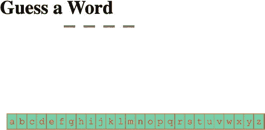
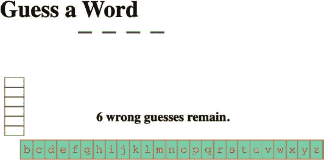
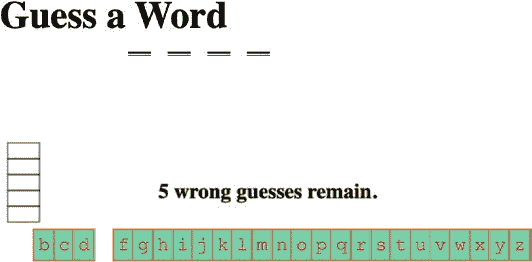
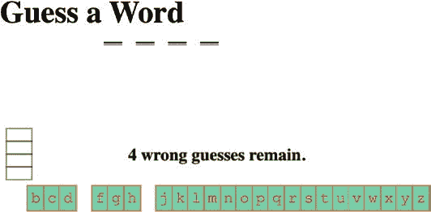
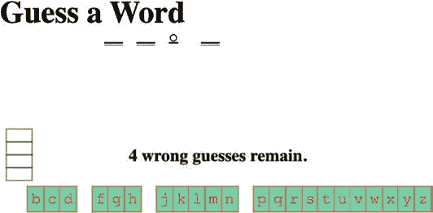

# 第 9 章  
**猜词游戏**

本章内容涵盖：

- 使用 CSS 样式
- 生成字母按钮标记与部分隐藏单词的显示
- 基于计算进行绘制
- 使用字符串作为秘密单词
- 为单词列表创建外部脚本文件
- 设置与移除事件处理

#### 引言

本章旨在继续演示编程技术以及 HTML5、层叠样式表（CSS）和 JavaScript 的功能，结合动态创建 HTML 标记、绘制视觉元素以及在画布上显示文本，为玩家提供游戏状态的反馈。本章的示例是一个通用的猜词游戏，玩家通过逐个尝试字母来猜测单词。

游戏规则如下：程序选择一个单词（称为*秘密单词*），并显示相应数量的短横线，让玩家知道该单词由多少个字母组成。玩家猜测单个字母。如果该字母存在于单词中，程序会将所有对应位置的符号替换为实际字母。

这是我选择的实现方式。在某些猜词游戏中，若单词中多次出现同一字母，玩家必须重复猜测该字母。如果猜测的字母*不*存在于秘密单词中，则视为错误。玩家拥有有限的允许错误次数。

© Jeanine Meyer 2023  
J. Meyer, *HTML5 必备指南*, [`doi.org/10.1007/978-1-4842-8722-4_9`](https://doi.org/10.1007/978-1-4842-8722-4_9)

游戏通过绘图和文本显示剩余允许错误次数，向玩家提供反馈。当允许错误次数耗尽或玩家猜出秘密单词的所有字母时，游戏结束。

在我们的游戏中，计算机会从一个单词列表（本例中是一个非常简短的列表）中随机选取秘密单词。你可以使用我的单词列表。当你制作自己的游戏时，请使用自己的单词列表。合理的做法是从小列表开始，待游戏完善后再扩展列表。我采用外部文件存储单词列表的技术正是为了支持这种开发方式。

在用户界面设计上，我选择在屏幕上显示包含所有字母的方块。玩家通过点击方块来选择字母。选定字母后，对应的方块会消失。这一设计借鉴了大多数人在玩纸笔版猜词游戏时，会先写出字母表，再逐个划掉已选字母的习惯。

图 9-1 展示了初始游戏画面。计算机已选择一个包含四个字母的单词。请注意，屏幕上还显示了包含所有字母的按钮。

**图 9-1.** 初始画面

使用小型单词库的一个好处是，即使我的代码通过随机过程选择单词，我此刻仍然知道单词是什么。这意味着我可以在不承受游戏压力的前提下开发游戏！我决定先点击字母 *a* 进行猜测。如图 9-2 所示，该字母并未出现在秘密单词中。

  
  

**图 9-2.** 猜测字母 a 后

接下来我猜测元音字母 *e*，结果如图 9-3 所示。我并非暗示这是明智的策略。

**图 9-3.** 猜测字母 e 后的游戏状态

随后我猜测 *i*，导致第三次错误操作，如图 9-4 所示。

**图 9-4.** 三次错误选择后的游戏画面

