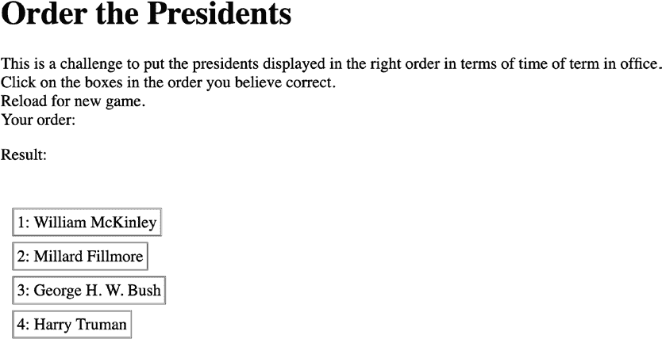
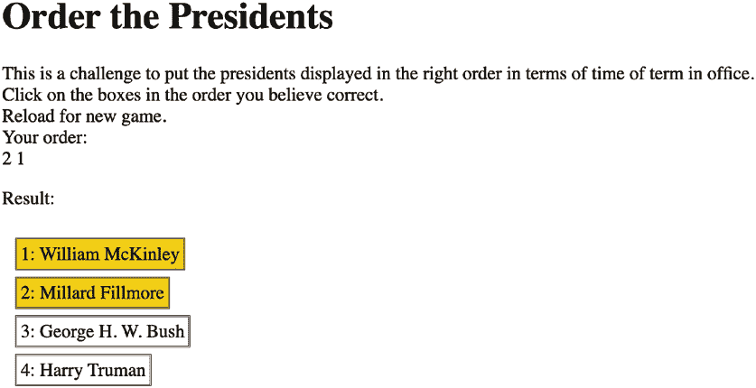
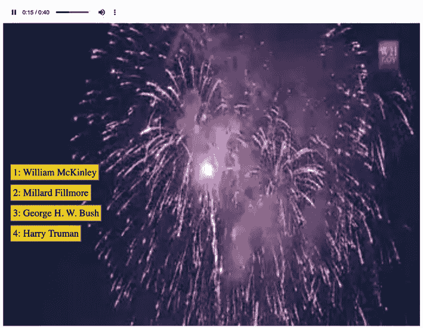
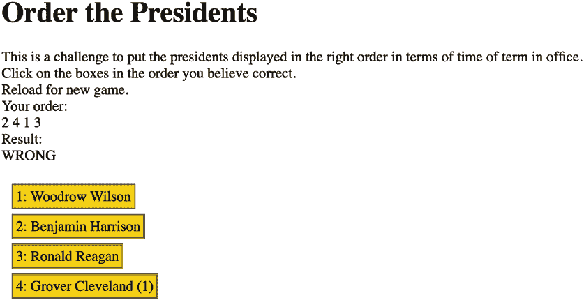

## 第 6 章：测验

本章将涵盖以下内容：

• 通过代码创建 HTML 元素

• 响应鼠标在特定元素上的点击以及停止响应鼠标在特定元素上的点击

• 创建和访问数组

• 播放音频和视频片段

• 检查玩家响应并防止不良行为

### 引言

本章演示了如何动态创建 HTML 元素并将其定位在屏幕上。这不仅是与在画布元素上绘图形成对比，也与使用 HTML 标记创建或多或少静态网页的旧方法不同。

我们的目标是制作一个测验，让玩家将一组美国总统按时间顺序排列。这组总统是从完整的总统列表中随机选取的。正确排序将获得奖励：播放一个视频片段和一个音频片段。使用 HTML5 直接（也称为*原生*）显示视频和音频的能力，相比旧系统（需要在玩家电脑上使用`<object>`元素和第三方插件）是一个巨大的进步。在我们的游戏中，视频和音频只扮演次要角色，但开发者和设计师能够在应用运行的特定时刻使用 HTML5 和 JavaScript 生成特定视频，这一事实非常重要。

自动播放是指无需用户操作即可播放的视频片段。自 2018 年 4 月起，Chrome 浏览器采纳了自动播放视频的政策（详情请参见[`developers.google.com/web/updates/2017/09/autoplay-policy-changes`](https://developers.google.com/web/updates/2017/09/autoplay-policy-changes)）。

© Jeanine Meyer 2023  

J. Meyer, *《HTML5 权威指南》*, [`doi.org/10.1007/978-1-4842-8722-4_6`](https://doi.org/10.1007/978-1-4842-8722-4_6#DOI)



第 6 章 测验

这项政策旨在在许多情况下禁止自动播放。理由是视频自动播放可能会让用户产生数据费用，并可能使网络过载。视频广告可能会令人厌烦。我接受这个理由；然而，我希望玩家成功完成游戏后能立即获得奖励。Chrome 浏览器有一种确定他们所谓的*用户参与度*的方法。我为玩家成功编程的奖励包括一个静音视频与一个音频片段同时播放。这似乎通过了 Chrome 对用户参与度的测试，媒体确实被播放了。尽管如此，自动播放政策是你需要了解并在未来持续关注的问题。

测验的基本信息由一个数组的数组组成，内部数组保存总统的姓名和一个用于确保随机过程不会选中同一姓名两次的第二项。程序会随机选择四位总统的名字，并创建包含这些名字和编号的框的 HTML 标记。程序将这些框定位在窗口中。图 6-1 显示了一个初始屏幕。

***图 6-1.** 测验的初始屏幕*

这让我有机会对这个特定游戏发表评论。我能按顺序背诵总统名单，因此可以很好地玩这个游戏。这种情况存在问题，因为我需要确保当玩家给出错误答案或以我稍后解释的其他方式“捣乱”时，测验仍能正常工作。本章的目的是介绍 HTML、CSS 和 JavaScript 特性以及通用技术，您可以使用它们来构建自己的测验，并自行选择主题。请记住，你很可能不是为自己构建这个游戏。

顺便提一下，对于美国总统，我需要提供某种方式来处理格罗弗·克利夫兰的问题，他是唯一一位担任过两届不连续任期总统的人。我选择在列表中加入*Grover Cleveland (1)*和*Grover Cleveland (2)*这两个名字。也许你需要为你的主题采取类似的步骤。

玩家依次点击选择。我已经开始了一个新游戏。图 6-2 显示了玩家选择她认为（知道）是该组中最早总统后的屏幕。请注意，“Your Order”下方出现了数字 2，并且 Fillmore 的框变成了金色。

***图 6-2.** 玩家选择她认为这 4 位总统中年代最早的一位*

# 第 6 章 测验

## 无论答案正确与否，点击任何方框都会变成金色。我不会试图制造任何错误。

图 6-3 展示了两个选项以及“您选择的顺序”下方出现的数字 2 1。



**图 6-3.** 玩家已点击 Fillmore，然后点击 McKinley

我完成了测验。图 6-4 展示了结果。此时显示的是视频片段的一帧和一个音频文件的控件。我有一段自由女神像附近烟花的视频剪辑。该视频的配套音轨是《纽约，纽约》。我决定找一个免费版本的《拉弗尔斯与花饰》（也称为《向元首致敬》）。稍后您会读到，为了将视频和音频合并，我需要采取的一些小步骤。



**图 6-4.** 成功排列总统集合后

让我调用一个新游戏，现在输入一个不正确的顺序。图 6-5 显示了顺序错误的结果。玩家的排列顺序被显示出来，并出现了“WRONG”（错误）信息。这是一个棘手的问题。我在准备图片时出现了这组总统，其中确实有格罗弗·克利夫兰（第 1 任）。这一任期是在本杰明·哈里森之前。



**图 6-5.** 玩家排列顺序错误

## 测验游戏的关键要求

测验需要一种存储信息的方式，或者说，用一个更专业的术语，需要一个知识库。我们需要一种随机选择特定问题来提问的方式，这样玩家每次都会看到不同的挑战。由于我们存储的是名称，我们可以使用一种简单的技术。

接下来，我们需要向玩家呈现问题，并对玩家的操作提供反馈。我们可以决定反馈的程度。在我的游戏中，一旦点击某个方框，其颜色就会改变，并且顺序会显示在“您选择的顺序”标题下。我决定等到玩家完成全部排列后再检查顺序。我的技术审阅者指出，在游戏的早期版本中，我的代码允许玩家两次点击同一个方框。我决定通过忽略多余的点击来处理这个问题。您可以决定这是否是您想要采用的方法。普遍问题是，您需要预料到玩家/客户/用户可能会做出奇怪的操作。有时您可能需要告诉他们这是错误的，有时您（即您的代码）应该简单地忽略该操作。

我决定，正确的排列应该获得奖励：播放一段爱国视频剪辑。正如我将要解释的，这涉及到获取一段视频剪辑和一段独立的音频剪辑。

### HTML5、CSS 和 JavaScript 特性

现在让我们深入研究 HTML5、CSS 和 JavaScript 的具体特性，它们为我们实现测验提供了所需的支持。我再次基于之前解释过的内容进行构建，并加入了一些重复内容，以防您跳着阅读。

#### 在数组中存储和检索信息

您可能记得，数组是一系列值的集合，并且变量可以设置为数组。数组的单个组件可以是任何数据类型——甚至包括其他数组！回想一下在第 5 章的配对游戏中，我们使用了一个名为 `pairs` 的数组变量，其中每个元素本身就是一个包含两个元素的数组，即匹配的照片图像文件。

在测验应用程序中，我们将再次使用数组的数组。对于测验游戏，我们设置了一个名为 `facts` 的变量作为数组来保存总统的姓名。关键信息是数组中项目的顺序。`facts` 数组的每个元素本身就是一个数组。我在创建这个应用程序时的最初想法是，它会是一个简单的 `String` 对象数组，每个 `String` 按顺序保存一位总统的姓名。然而，我随后决定，我需要一个数组的数组，其中第二个元素保存一个 `Boolean`（真/假）值，用于防止在一次游戏中两次选中同一个姓名。

数组的单个组件可以使用方括号进行访问或设置。

JavaScript 中的数组索引从零开始，到数组元素总数减一结束。记住索引从零开始的一个技巧是，想象所有数组元素排成一排。第一个元素在起始位置；第二个元素距离起点 1 个单位；第三个元素距离起点 2 个单位；以此类推。

数组的长度保存在一个名为 `length` 的数组属性中。要访问 `facts` 数组中的第一项，您使用 `facts[0]`；访问第二个元素，使用 `facts[1]`；依此类推。您将在代码中看到这一点。

对数组中的每个元素执行操作的一种常见方法是使用循环。（另请参阅第 3 章中关于在边界框的墙壁上设置渐变的解释。）假设您有一个名为 `prices` 的数组，您的任务是编写代码将每个价格提高 15%。此外，即使 1 美元超过 15%的涨幅，每个价格也必须至少提高 1 美元。您可以使用表 6-1 中的结构来执行此任务。正如您在“说明”一列中看到的，`for` 循环对数组的每个组件执行相同的操作，在此示例中使用索引变量 `i`。此示例还展示了 `Math.max` 方法的使用。

**表 6-1.** 使用 `for` 循环增加数组中的价格

| 代码 | 说明 |
|------|-------------|
| `for (var i=0; i<prices.length; i++) {` | 执行花括号内的语句，更改 `i` 的值，从 0 开始，每次增加 1（这就是 `i++` 的作用），直到该值不小于 `prices.length`（即数组中的元素个数）。 |
| `prices[i] += Math.max(prices[i]*.15, 1);` | 记住要从内到外解释此语句。计算 `.15` 乘以数组 `prices` 的第 `i` 个元素。比较此值与 1 哪个更大。如果此值更大，则 `Math.max` 返回此值。如果 1 更大（如果 1 大于 `prices[i]*.15`），则使用 1。将此值加到 `prices[i]` 的当前值上。这就是 `+=` 的作用。 |
| `}` | 关闭 `for` 循环。 |

请注意，代码没有明确说明 `prices` 数组的大小。相反，它是用表达式 `prices.length` 表示的。这很好，因为这意味着如果您向数组添加元素，`length` 的值会自动更改。当然，在我们的示例中，我们知道数量是 46，即总统的数量。这个数字确实会变化，我们为新版更改了它，所以保持灵活性更好。

这个应用程序可以作为任何数量事实的测验模型，其中事实就是一条信息，而顺序很重要。

JavaScript 仅支持一维数组。`facts` 数组是一维的。但是，数组中的项目本身也是数组：`facts[0]` 元素本身就是一个数组，依此类推。

**注意：** 如果知识库更加复杂，或者我要共享信息或从其他地方访问信息，我可能需要使用数组的数组之外的其他方法。我也可以将知识库与 HTML 文档分开存储，例如使用可扩展标记语言（XML）文件。

# JavaScript 与 XML 处理

`JavaScript` 具有读取和访问 `XML` 的函数。最重要的是，我会把这些事实信息存放在服务器上，这样玩家就无法通过查看源代码来了解实际的顺序。我没有这样做，理由有两个：1）我不想涉及服务器端编程；2）如果玩家愿意花那么大功夫，他们也能学到东西。

## 第 6 章 测验

该测验的设计理念是：为每局游戏随机展示一组四个名字，因此我们定义了一个变量 `nq`（代表每轮测验的数量）并将其值设为 `4`。这个值永远不会改变，但将其设为变量的好处是，如果我们想修改它，将会非常容易。

动态生成的 `HTML`（详见下一节）将呈现为单列显示。其逻辑用伪代码表示如下：

从 `0` 到 `facts.length` 中随机选择一个数字。如果该事实已被使用过，则重新选择。将此选择标记为已使用。

创建新的 `HTML` 块，包含文本和一个数字（`1`、`2`、`3` 或 `4`），以及总统的名字。

使该块可见，并将其定位在窗口中。

设置事件及其处理程序，用于响应玩家点击该框的操作。

那么，我们如何编写代码呢？我将在下一节中解释如何创建新的 `HTML`。

如前所述，`fact` 数组包含多个数组，每个内部数组的第二个元素是一个布尔变量。初始状态下，这些值都为 `false`，表示这些元素尚未在游戏中使用过。当然，随机调用可能会返回一个已经被选中的数字，因此我使用了另一种循环结构——`do-while` 结构，它会持续尝试，直到找到一个未被使用的事实：

```javascript
do {c = Math.floor(Math.random()*facts.length);}
while (facts[c][2]==true);
```

当 `facts[c][2]` 为 `false` 时，`do-while` 循环退出，也就是说，当索引 `c` 处的元素可供使用时，循环结束。

`facts` 数组是我完全创建好并放入 `HTML` 文档中的，它不会改变。相比之下，对于每局测验，我的代码会创建一个名为 `slots` 的区域，它最初是一个空数组：

```javascript
var slots =[];
```

每次玩家进行操作（即点击一个块）时，都会使用 `push` 方法向该数组添加信息。`slots` 数组会被 `checkorder` 函数访问，该函数将在“检查玩家答案”一节中描述。

## 第 6 章 测验：在程序执行期间创建 HTML

一个典型的 `HTML` 文档通常包含你最初编写文档时加入的文本和标记。然而，你也可以在文件被浏览器解释时向文档添加内容，具体来说，就是在 `script` 元素中的 `JavaScript` 正在执行时（称为*执行时*或*运行时*）。这就是我所说的动态创建 `HTML` 的意思。在本应用中，与本书中的大多数应用一样，`body` 标签的 `onload` 属性被设置为调用一个我命名为 `init` 的程序。该函数会调用另一个函数来设置游戏。

对于测验应用，我创建了一个名为 `pres` 的类型，代码如下：

```javascript
d = document.createElement('pres');
```

然后，我需要向这个新创建的对象中填充内容，这需要几条语句。我使用赋值语句。注意：`uniqueid` 变量已经被设置好了。

```javascript
d.innerHTML="<div class='thing' id='"+uniqueid+"'>placeholder</div>";
```

`div` 是一个块级元素，意味着它可以包含其他元素以及文本，并且显示时会带有前后的换行符。接着我使用：

```javascript
thingelem = document.getElementById(uniqueid);
```

让 `thingElement` 引用这个新创建的对象。然后使用：

```javascript
thingElem.textContent = String(i+1)+": "+facts[c][0];
```

来提供可见的内容。`i+1` 是为了让玩家看到从 `1` 开始的索引，而不是从 `0` 开始。

动态创建的 `HTML` 需要附加到某个已经可见的元素（例如 `body` 元素）上，才能被显示出来。这通过 `appendChild` 方法来实现：

```javascript
document.body.appendChild(d);
```

`body` 元素通常是一个合适的选择，但你也可以使用 `appendChild` 将其附加到其他元素上。

对其他元素也同样适用，这非常有用。例如，你可以使用`childNodes`属性来获取特定元素的所有子节点集合（一个`NodeList`），以便对每个子节点执行某些操作，包括移除它。

## 第 6 章测验

表 6-2 显示了我们将使用的方法。

***表 6-2.** 动态创建 HTML 时通常使用的方法*

| **代码** | **说明** |
| --- | --- |
| `createElement` | 创建 HTML 元素 |
| `appendChild` | 通过将元素追加到文档中的某处来添加该元素 |
| `getElementById` | 获取对元素的引用 |

每个块的格式化操作在`style`元素内的 CSS 中完成（见下文）。代码为每个块创建一个唯一的 ID。这个唯一 ID 是根据`facts`数组中名称的索引构建的。在检查玩家的排序时，会用到这个 ID。

一旦我们创建了这些新的 HTML 元素，就使用`addEventListener`来设置事件和事件处理器。`addEventListener`方法可用于各种事件。请记住，我们在[第 4 章](http://dx.doi.org/10.1007/978-1-4842-4155-4_4)中曾对`canvas`元素使用过它。

为了让程序响应玩家，我们需要使用`addEventListener`方法。语句`thingelem.addEventListener('click', pickelement);`定义了事件（即点击块）和事件处理（即调用`pickelement`函数）。

**注意：** 如果我们没有这些元素以及执行`addEventListener`并使用`this`引用属性的能力（请原谅这里蹩脚的表述），而是在画布上绘制内容，那么我们需要进行计算和比较来确定鼠标光标的位置，然后以某种方式查找相应的信息以检查匹配项（请回忆第[4 章](http://dx.doi.org/10.1007/978-1-4842-4155-4_4)中弹弓的编码）。相反，JavaScript 引擎承担了大部分工作，并且比我们自己编写代码更高效——更快。

你将在“构建应用程序”部分看到完整上下文中的代码。

## 在`style`元素中使用 CSS

层叠样式表（CSS）允许你指定 HTML 文档各部分的格式。[第 1 章](http://dx.doi.org/10.1007/978-1-4842-4155-4_1)展示了一个 CSS 的基本示例，即使对于静态 HTML，CSS 也非常强大且有用。本质上，其思想是使用 CSS 进行格式化（即应用程序的外观），并保留 HTML 用于结构化内容。有关 CSS 的更多信息，请参阅 David Powers 的《Beginning CSS3》（Apress, 2012）。

让我们在这里简单看看我们将用来生成存放总统姓名的动态创建块的内容。

HTML 文档中的`style`元素包含一个或多个样式。每个样式引用以下其中之一：

- 使用元素类型名称的元素类型
- 使用`id`值的特定元素
- 一个元素类

在第[1 章](http://dx.doi.org/10.1007/978-1-4842-4155-4_1)中，我们为`body`元素和`section`元素使用了样式。对于这个测验，我为我命名为`thing`的一个元素类编写了一条指令。

现在让我们为一个元素类设置格式。该类是一个可以在任何元素开始标签中指定的属性。对于这个应用程序，我想到了一个名为`thing`的类。是的，我知道这名字很烂。它指的是我们的代码将放置在屏幕上的一个东西。样式如下：

```
.thing {position:absolute; left: 0px; top: 0px; border: 2px; border-style: double; background-color: white; margin: 5px; padding: 5px; }
```

`padding`设置决定了文本与边框之间的间距；`margin`决定了元素周围的间距。我通过联想“带软垫的牢房”来帮助自己记住它们的区别。实际上，这里不需要`margin`设置，因为我的代码使用变量`rowSize`垂直定位这些块。

`thing`前面的句点表示这是一个类规范。`position`设置为`absolute`，`top`和`left`包含的值可以通过代码更改。

# 排版后的文档

**绝对定位**（absolute setting）指的是在文档窗口中通过具体坐标来指定位置的方式。另一种方式是**相对定位**（relative），当文档的一部分位于可能处于屏幕任意位置的包含块中时，可以使用相对定位。

## 第 6 章测验

度量单位是**像素**（pixel），因此从左和从上的位置以`0px`（0 像素）给出，而**边框**（border）、**外边距**（margin）和**内边距**（padding）的测量值分别为 2 像素、5 像素和 5 像素。

现在让我们看看如何使用**样式属性**（style attributes）来定位和格式化这些块。例如，在创建一个用于存放总统姓名的动态元素后，我们可以使用以下几行代码来获取刚创建对象的引用，将包含姓名的文本放入该元素中，然后将其定位在屏幕上的指定点。

```
thingElem = document.getElementBy(uniqueid);
thingElem.textContent = String(i+1)+": "+facts[c][0];
thingElem.style.top = String(my)+"px";
thingElem.style.left = String(mx)+"px";
```

这里，`my`和`mx`是数字。设置`style.top`和`style.left`需要一个字符串，因此我们的代码将数字转换为字符串，并在字符串末尾添加了`"px"`。

### 响应玩家移动

在`pickelement`函数中，你会看到用于响应和记录玩家移动的代码。`pickelement`头部有一个名为`ev`的参数。然而，还存在一个我们可以称之为*隐式*参数的东西。该函数是因为对特定元素的操作而被调用的。代码中的`this`指向该元素。

在代码中，`this`指向当前实例，即玩家点击的元素。我们为每个元素设置了事件监听，因此当`pickelement`执行时，代码可以使用`this`来引用*听到*点击的特定元素。

当玩家点击一个显示“John Quincy Adams”的块时，代码会*知道*这一点，我在这里用了拟人化的说法，尽管我并不太想这样。

换句话说，同一个`pickElement`函数会被屏幕上的所有块调用，但是，通过使用`this`，代码每次都可以引用玩家点击的特定块。`pickElement`代码从元素中提取 ID，并从`textContent`中提取第一个字符。来自 ID 的信息用于填充一个名为`slots`的数组，该数组将用于检查玩家的排序。来自`textContent`的字符（1、2、3 或 4）将用于向玩家显示已做出的选择。

## 第 6 章测验

我们希望在玩家点击一个框时改变其颜色。我们可以像改变`top`和`left`来重新定位块那样实现。然而，JavaScript 中属性的名称与 CSS 中略有不同：没有连字符。

```
this.style.backgroundColor = "gold";
```

`gold`是一组已定义颜色中的一种，包括`red`、`white`、`blue`等，这些颜色可以通过名称引用。或者，你也可以使用来自 Adobe Photoshop 等程序或在线网站（如[pixlr.com](http://pixlr.com)）的十六进制 RGB 值。

`pickElement`函数执行了另一项任务，我认为它是有用的，尽管说起来有些尴尬——这是我后来才添加的。如果玩家，我们称他为烦人的玩家，多次点击同一个块怎么办？在测试中，我从未尝试过这一点，但我的技术审阅者指出了这个问题。你需要预料到，并为玩家和用户做出奇怪的事情做好准备。修复方法很简单。我使用代码来停止监听点击事件。语句如下：

```
this.removeEventListener('click', functionReference);
```

变量`functionReference`已被设置为指向`pickElement`。

`pickElement`函数提取块 ID 中的原始数字部分并将其转换为数字。该数字被添加（通过`push`）到一个名为`slots`的数组中。当`slots`数组的长度等于`nq`时，调用`checkOrder`函数。

**提示** 你可以在样式部分指定字体。你可以在任何搜索引擎中搜索“安全网页字体（safe web fonts）”，会得到一份据称在所有浏览器和所有计算机上都可用的字体列表。然而，另一种方法是指定一个有序的字体列表，这样如果第一个字体不可用，浏览器会尝试查找下一个字体。

更多信息请参见第[8 章](http://dx.doi.org/10.1007/978-1-4842-4155-4_8)。

### 呈现音频和视频

HTML5 提供了`audio`和`video`元素，用于在静态 HTML 文档中或通过 JavaScript 控制来呈现音频和视频。

简而言之，音频和视频有不同的文件类型，就像图片一样。文件类型因视频及其关联音频（或单独的音频）的容器、以及视频和音频的编码方式而异。浏览器需要知道如何处理容器、如何解码视频以在屏幕上连续显示帧（构成视频的静态图像）、以及如何解码音频以将声音发送到计算机扬声器。

视频涉及大量数据，因此人们仍在研究压缩信息的最佳方法，例如利用帧之间的相似性而不损失太多质量。现在，网站在手机的小屏幕上以及大型高清电视屏幕上显示，因此利用任何关于显示设备信息的知识都很重要。考虑到这一点，尽管我们希望浏览器制造商将来能统一成为一种格式，但 HTML5 的`video`元素通过引用多个文件提供了一种绕开缺乏标准化问题的方法。因此，开发人员需要制作同一视频的不同版本（包括我们这些创建此测验应用程序的人）。

我下载了一个美国独立日烟花的视频片段，然后使用一个免费工具（Miro 视频转换器）制作了同一短视频片段的三个不同格式的版本。然后，我使用了新的 HTML5 的`video`元素以及`source`元素来编码对这三个视频文件的引用。`source`元素中的`codecs`属性提供了关于`src`属性中指定文件编码方式的信息。然后，我决定不想在烟花视频中使用音频，而是使用传统上为美国总统播放的歌曲“Ruffles and Flourishes”。幸运的是，`video`标签有一个名为`muted`的属性，可以静音视频的音频。我不需要视频和音频完全同步，因此这种方法可行。在`<body>`中，我有：

```
<audio id="ruffles" controls="controls" preload="auto" alt="Hail to the Chief">
    <source src="hail_to_the_chief.mp3" type="audio/mpeg">
    <source src="hail_to_the_chief.ogg" type="audio/ogg">
    Your browser does not accept the audio tag.
</audio>

<video id="vid" preload="auto" width="50%" alt="Fireworks video" muted>
    <source src="sfire3.webmvp8.webm" type='video/webm; codec="vp8, vorbis"'>
    <source src="sfire3.mp4">
    <source src="sfire3.theora.ogv" type='video/ogg; codecs="theora, vorbis"'>
    包含 controls="controls" 会在屏幕上显示熟悉的控件，允许玩家/用户开始或暂停音频剪辑。我没有为视频提供控件。
</video>
```

以“Your browser...”开头的文本仅在浏览器不识别音频元素时才会显示。

## 第 6 章测验

此时，你可能会问：测验开始时，视频和音频控件在哪里？答案是，我使用 CSS 使这两者不显示：

```
audio {visibility: hidden;}
video {visibility: hidden; display: none; position:absolute;}
```

你可能还会问，为什么我不写代码来创建视频和音频元素？

# 排版后的内容

这个问题的答案是：我想确保音频和视频文件能够完整下载。由于人类播放确实需要一些时间，因此即使不做特殊处理，下载通常也能完成，但采取这一预防措施是明智的。

**提示** CSS 有自己的语言，有时会包含带连字符的术语。CSS 中用于表达元素在屏幕上分层方式的术语是 `z-index`；而 JavaScript 中的对应术语是 `zIndex`。

## 检查玩家的回答

`checkOrder` 函数负责检查玩家是否按正确顺序点击了方块。起初我并不清楚这一点，但我确实意识到我的程序不需要对选定的名称集合进行排序。相反，我的代码会检查玩家在 `slots` 数组中表示的列表是否顺序错乱。`slots` 数组将存储玩家排序后每位总统的索引位置。代码会遍历所有项目，检查是否有任何项目大于其后续项目。这个 `for` 循环完成了这一任务：

```
var ok = true;
for (var i=0;i<nq-1;i++){
    if (slots[i]>slots[i+1]){
        ok = false;
        break;
    }
}
```

变量 `ok` 的初始值为 `true`。如果顺序出现任何不一致，`for` 循环中的代码会将 `ok` 的值改为 `false`。一旦发生这种情况，`break` 语句将导致控制权退出 `for` 循环。如果 `ok` 被设为 `false`，`for` 循环即告退出。下一步是提供音频/视频奖励，同时显示结果为 CORRECT（正确）或 WRONG（错误）。

```
if (ok){
    res.innerHTML= "CORRECT";
    song.style.visibility="visible";
    song.currentTime = 4; //防止无声的几秒钟
    song.play();
    v.style.visibility="visible";
    v.currentTime=0;
    v.style.display="block";
    v.play();
}
else {
    res.innerHTML = "WRONG";
}
```

基于对 JavaScript、HTML 和 CSS 的这些背景知识，我们现在可以描述这个测验应用程序的编码过程了。

## 构建应用程序并使其成为你自己的

该测验的知识库由 `facts` 变量表示，它是一个由数组组成的数组。如果你想将测验改成另一个主题（由名称或其他文本对组成），只需更改 `facts` 即可。当然，你还需要更改 `body` 元素中作为 `h1` 元素显示的文本，让玩家了解问题的类别。我定义了一个名为 `nq` 的变量，表示每次测验的数量（屏幕上显示的对数），其值为 4。当然，如果你想向玩家展示不同数量的配对，也可以更改这个值。其他变量用于记录方块的初始位置以及保存状态信息，例如是第一次点击还是第二次点击。

我为这个应用程序创建了四个函数：`init`、`setupGame`、`pickElement` 和 `checkOrder`。我本可以将 `init` 和 `setupGame` 合并，将 `pickElement` 和 `checkOrder` 合并，但为了让“重玩”按钮更便捷，同时也出于通用原则，我将它们分开了。为不同的任务定义不同的函数，是一种良好的实践。

**表 6-3.** 测验应用程序中的函数

| 函数 | 由谁调用/调用来源 | 调用哪些函数 |
|---|---|---|
| `init` | 由 `<body>` 标签中 `onLoad` 的动作为触发 | `setupGame` |
| `setupGame` | `init` | `pickElement` |
| `pickElement` | 由 `setupGame` 中的 `addEventListener` 调用触发 | `checkOrder` |
| `checkOrder` | `pickElement` | |

`setupGame` 函数负责为方块创建 HTML。简而言之，该函数会计算一个使用 `Math.random` 的表达式，从 `facts` 数组中选取一行。如果该行已被使用，代码会重新尝试。当找到未使用的行时，会将其标记为已使用（第三个元素，索引值为 2），并创建相应的方块。

`pickElement`函数在点击区块时被调用。它将字符串添加到`Your Order`显示的内容中，并添加到`slots`数组中，该数组将由`checkOrder`使用。`checkOrder`函数执行检查。它显示`WRONG`或`CORRECT`，如果顺序正确，则使音频控件和视频可见，并开始播放。

请注意，程序中存在冗余代码。这样做的目的是为了在不重新加载或重新开始的情况下轻松启用重复播放。

表 6-4 提供了代码的逐行解释。

## 第 6 章测验

### 表 6-4. 总统测验完整代码

`<html>`

HTML 标签。

`<meta charset="UTF-8">`

定义字符集，在本例中是一种 Unicode 形式。它可以省略，我在许多示例中确实省略了它，但我在此处包含它以让你了解它。

`<head>`

head 标签。

`<title>Ordering Quiz with Rewards</title>` 完整的标题元素。

`<style>`

样式标签。

`.thing {position:absolute; left: 0px;`

我称之为*区块*的格式化，带有总统的名字。

`top: 0px; border: 2px; border-style: double; background-color: white; margin: 5px; padding: 5px; }`

`audio {visibility: hidden;}`

一开始将音频控件设置为隐藏。默认定位。

`video {visibility: hidden; display: none; position:absolute;}` 一开始将视频设置为隐藏。

`</style>`

关闭样式元素。

`<script type="text/javascript">`

脚本标签，开始脚本元素，指定为 JavaScript。

```javascript
var facts = [
```

声明`facts`数组。

```javascript
["George Washington",false],
```

名称以及该名称未被使用的指示。

```javascript
["John Adams",false],
["Thomas Jefferson",false],
["James Madison",false],
["James Monroe",false],
["John Quincy Adams",false],
```

( *续*)

```javascript
["Andrew Jackson",false],
["Martin Van Buren",false],
["William Harrison",false],
["John Tyler",false],
["James Polk", false],
["Zachary Taylor",false],
["Millard Fillmore",false],
["Franklin Pierce",false],
["James Buchanan",false],
["Abraham Lincoln",false],
["Andrew Johnson",false],
["Ulysses Grant",false],
["Rutherford Hayes",false],
["James Garfield",false],
["Chester Arthur",false],
["Grover Cleveland (1)",false],
```

这是我选择表示格罗弗·克利夫兰第一个任期的方式。

```javascript
["Benjamin Harrison",false],
["Grover Cleveland (2)",false],
```

这是我选择表示格罗弗·克利夫兰第二个任期的方式，该任期与其第一个任期不连续。

```javascript
["William McKinley",false],
["Theodore Roosevelt",false],
["William Taft",false],
["Woodrow Wilson",false],
["Warren Harding",false],
```

( *续*)

```javascript
["Calvin Coolidge",false],
["Herbert Hoover",false],
["Franklin Roosevelt",false],
["Harry Truman",false],
["Dwight Eisenhower",false],
["John Kennedy",false],
["Lyndon Johnson",false],
["Richard Nixon",false],
["Gerald Ford",false],
["Jimmy Carter",false],
["Ronald Reagan",false],
["George H. W. Bush",false],
["Bill Clinton",false],
["George W. Bush",false],
["Barack Obama",false],
["Donald Trump",false],
["Joseph Biden",false]
```

我为这个版本添加的内容。

```javascript
];
```

关闭`facts`数组。

```javascript
var thingelem;
```

用于保存已创建的元素。

```javascript
var nq = 4;
```

呈现的 fact 数量。

```javascript
var col1 = 20;
```

名称列的水平位置。

```javascript
var row1 = 200;
```

第一个名称的垂直位置。

```javascript
var rowsize = 50;
```

为每个区块分配的间距。

```javascript
var slots = [];
```

用于在检查中保存指向`facts`的索引。

```javascript
var answertext=" ";
```

答案的初始值。

( *续*)

```javascript
var song;
```

将保存对音频元素的引用。

```javascript
var functionReference;
```

将保存对`pickElement`的引用。

```javascript
var v;
```

将保存对视频元素的引用。

```javascript
var res;
```

将保存对结果位置的引用。

```javascript
var ans;
```

将保存对答案位置的引用。

```javascript
function init(){
```

header init 函数。

```javascript
res = document.getElementById("results");
```

获取引用。

```javascript
ans = document.getElementById("answer");
```

获取引用。

```javascript
functionReference = pickElement;
```

设置为用于移除事件处理。

```javascript
song = document.
```

# 第 6 章 测验

`<html>` HTML 标签。

获取引用。

`getElementById("ruffles");`

`v = document.getElementById("vid");`

获取引用。

`row1 = .5 * window.innerHeight;`

适应窗口高度。

`setupGame();`

调用`setupGame`。

}

关闭`init`。

```javascript
function setupGame() {
```

头部`setupgame`。

`slots = [];`

初始化`slots`。冗余，但在此处完成以便为增强做准备。

`answertext = "";`

初始化`answertext`。冗余，但在此处完成以便为增强做准备。

`var i;`

索引变量。

`var c;`

将保存指向`facts`的索引。

`var mx = col1;`

初始水平设置。它不会改变。

`var my = row1;`

初始垂直设置。这将会改变。

`var d;`

保存新创建的元素。

`var uniqueid;`

将保存 ID。它将根据`facts`的随机索引生成。

```javascript
for (i = 0; i < facts.length; i++) {
```

`for`循环，标记所有`facts`为未使用状态。

`facts[i][2] = false;`

将事实标记为未使用。

}

关闭`for`循环。

```javascript
for(i = 0; i < nq; i++) {
```

`for`循环，选择并创建四个带有总统名字的盒子。

```javascript
do { c = Math.floor(Math.
```

获取一个随机选择。

`random() * facts.length); }`

`while (facts[c][1] == true);`

如果它已被选中，则重复`do`子句。

`facts[c][1] = true;`

现在将此事实设置为已使用。

`uniqueid = "p" + String(c);`

通过将`"p"`附加到转换为字符串的索引上，创建一个唯一 ID。

`d = document.createElement('pres');`

创建一个元素。

`d.innerHTML =`

将其`innerHTML`设置为...

`"<div class='thing'`

...是一个`div`，`class="thing"`，并且 ID 为

`id='" + uniqueid + "'>placeholder</div>";`

生成的唯一 ID。

`document.body.appendChild(d);`

将其追加到`body`。此操作使其可见。

`thingelem = document.`

获取对它的引用。

`getElementById(uniqueid);`

`thingelem.textContent = String(i + 1) + ": " + facts[c][0];`

使其内容由数字后跟名称组成。

`thingelem.style.top =`

垂直定位。

`String(my) + "px";`

`thingelem.style.left =`

水平定位。

`String(mx) + "px";`

`thingelem.addEventListener('click',`

启用对点击的响应。

`pickElement);`

`my += rowsize;`

增加`my`以便垂直定位。

}

关闭`for`循环。

}

关闭`setupGame`。

```javascript
function pickElement(ev) {
```

`pickElement`的函数头。当玩家点击一个方块时调用。注意：`ev`未被使用，但对事件处理程序是必要的。实际使用的是`this`关键字。

`var answert;`

将保存数字 1、2 等。

`var positiont;`

将保存原始数组中的位置，作为文本。

`var positionn;`

将保存位置，作为数字。

`positiont = this.id.substring(1);`

通过移除 ID 的第一个字母来创建位置。

`answert = this.textContent.`

通过提取`textContent`的第一个字符来创建将添加到答案中的内容。

`substring(0,1);`

注意：如果选项少于 10 个，此方法有效。

`answertext = answertext + answert + " ";`

将此答案添加到已有的答案中。

`ans.innerHTML = answertext;`

显示`answertext`。

`positionn = Number(positiont);`

生成数字。

`this.style.backgroundColor = "gold";`

将方块设为金色。

`this.removeEventListener('click',`

移除事件处理。

`functionReference);`

`slots.push(positionn);`

将`positionn`添加到`slots`数组中，以便在检查时使用。

```javascript
if (slots.length == nq) {
```

是否已对方块进行了`nq`次点击？

`checkOrder();`

如果是，则调用`checkOrder`。

}

关闭`if`。

}

关闭`pickElement`函数。

```javascript
function checkOrder() {
```

`checkOrder`的函数头。

`var ok = true;`

开始时将`ok`设置为`true`。

```javascript
for (var i = 0; i < nq - 1; i++) {
```

遍历`slots`中的所有元素。

```javascript
if (slots[i] > slots[i + 1]) {
```

如果第`i`个槽大于第`i+1`个槽。

`ok = false;`

将`ok`设置为`false`。答案未按顺序排列。

`break;`

离开`for`循环。

}

关闭`if`。

}

关闭`for`循环。

```javascript
if (ok) {
```

`ok`变量持有`true`或`false`。如果为`true`...

`res.innerHTML = "CORRECT";`

...显示`"CORRECT"`。

`song.style.visibility = "visible";`

使`song`元素（即控件）可见。

`song.currentTime = 4;`

此音频剪辑有若干秒的静音，因此这可以防止出现若干秒没有声音的情况。

`song.play();`

播放歌曲。

# 第 6 章 测验

## 代码与标签说明

`v.style.visibility="visible";`
将视频设置为可见。

`v.currentTime=0;`
设置为从开头开始。

`v.style.display="block";`
使其可见（可能与上一句重复）。

`v.play();`
开始播放视频。

关闭 `if ok true` 子句。

`else`
`否则`

`res.innerHTML = "WRONG";`
显示“错误”。

关闭 `else`。

关闭 `checkorder` 函数。

`</script>`
关闭脚本元素。

`</head>`
关闭 head 元素。

`<body onload="init();">`
Body 标签。注意 `onload` 的设置。

`<audio id="ruffles" controls="controls">`
音频标签。

`preload="auto" alt="Hail to the Chief">`
`<source src="hail_to_the_chief.mp3">`
Mp3 源文件。

`type="audio/mpeg">`
`<source src="hail_to_the_chief.ogg">`
OGG 源文件。

`type="audio/ogg">`
您的浏览器不支持此音频
为旧版浏览器准备的提示。

标签。

`</audio>`
关闭音频元素。

`<video id="vid" preload="auto">`
视频标签。注意 `muted` 属性。

`width="50%" alt="Fireworks video" muted>`
`<source src="sfire3.webmvp8.webm">`
WeBM 源文件。

`type='video/webm; codec="vp8, vorbis"'>`
`<source src="sfire3.mp4">`
Mp4 源文件。

（*续*）

`<html>`
HTML 标签。

`<source src="sfire3.theora.ogv">`
OGG 源文件。

`type='video/ogg; codecs="theora, vorbis"'>`
您的浏览器不支持此视频
为旧版浏览器准备的提示。

标签。

`</video>`
关闭视频元素。

`<h1>排列总统顺序</h1>`
标题。

这是一个挑战，要求将显示出来的总统按照其就职时间的正确顺序排列。`<br/>`点击您认为正确的顺序中的方框。

`<br/>`
换行。

刷新页面开始新游戏。
更多说明。

`<br/>`
换行。

您的顺序：
玩家答案的标题。

`<div id="answer"></div>`
用于放置玩家答案的区域。

结果： `<div id="results"></div>`
用于存放结果。

`</body>`
关闭 body。

`</html>`
关闭 html。

## 测验内容与扩展

让这个应用变成你自己的第一步是选择测验的内容。这里的值是一些名字，以文本形式保存，但它们也可以是对事件的描述、数学表达式或歌曲名称。你还可以创建 `img` 标签，并利用数组中保存的信息来设置 `img` 元素的 `src` 值。更复杂但依然可行的是加入音频。从一个类似于美国总统列表的简单内容开始，然后再大胆尝试。我个人认为，能够按顺序排列事件比记住日期更重要。

你可以通过修改原始 HTML 和/或创建的 HTML 来改变应用的外观。你也可以修改或扩充 CSS 部分。

你可以轻松地更改题目数量（但不能超过 9 个），或者将四题一局的游戏改为四题一轮，并在一定次数猜测后或点击按钮时自动开始新的一轮。你需要决定是否在每轮中重复出现相同的总统。

你也可以加入计时功能。有两种通用方法：跟踪时间，并在玩家成功完成一局/一轮时简单地显示出来（参见[第 5 章](http://dx.doi.org/10.1007/978-1-4842-4155-4_5)的记忆游戏），或者施加一个时间限制。第一种方法允许某人自我挑战，但不会施加太大压力。第二种方法会给玩家带来压力，并且你可以为后续的轮次减少允许的时间。这可以使用 `setTimeout` 命令来实现。

你可以链接到讨论相关事实的网站或谷歌地图位置，作为回答正确的迷你奖励——或者作为线索。

你可能不喜欢在视频播放时测验模块仍保留在屏幕上的方式。你可以使用一个循环使每个元素不可见来移除它们。

### 测试和上传应用

游戏的随机特性不会影响测试。如果需要，你可以先在 `Math.random` 代码之后替换为固定的选择，完成大部分测试，然后删除这些代码行并再次测试。对于这个游戏和类似的游戏，重要的事情是确保你的测试既包括正确的猜测也包括错误的猜测，以及玩家的不当行为，比如点击一个已经选过的选项。

美国总统游戏在 HTML 文件中是完整的，但音频和视频片段是独立的文件。如果你制作自己的测验，你不必同时使用音频和视频片段。对于媒体文件，你需要执行以下操作：

- 创建或获取视频和/或音频
- 制作不同版本的媒体文件，假设你想支持不同的浏览器
- 将所有文件上传到服务器

你可能需要与你的服务器管理员合作，以确保正确指定了不同的视频类型。这涉及到所谓的 `htaccess` 文件。HTML5 已经存在一段时间了，这种在网页上展示视频的方式对于服务器管理员来说应该很熟悉。

或者，你可以识别已在线的视频和/或音频，并在媒体元素的 `source` 元素中使用绝对 URL 作为 `src` 属性。

### 总结

在本章中，我们实现了一个简单的测验，要求玩家将从美国总统完整列表中随机选出的一小组总统按顺序排列。将事件按时间顺序排列是测验的一个合理主题，但本章的主要目的是介绍所使用的不同技术。该应用使用了以下编程技术和 HTML5 特性：

- 在运行时使用 `document.createElement`、`document.getElementById` 和 `document.body.appendChild` 创建 HTML
- 使用 `addEventListener` 设置鼠标点击事件的处理
- 使用 `removeEventListener` 移除鼠标点击事件的处理
- 使用代码更改 CSS 设置来改变屏幕上对象的颜色
- 创建数组的数组来保存测验内容
- 使用 `for` 循环来遍历数组
- 使用 `do-while` 循环来随机选择一个未使用的题目集
- 使用 `substring` 提取用于检查的字符串
- 使用 `Number` 函数将字符串转换为数字
- 使用视频和音频元素来显示和播放以不同浏览器可接受的格式编码的视频和音频

你可以结合使用动态创建和重新定位的 HTML 以及你在前几章学到的 Canvas 绘图。在第三版中，我决定在[第 3 章](https://doi.org/10.1007/978-1-4842-8722-4_3)中加入一个使用视频的程序，所以现在你已经看到了两个使用视频的例子。

你可以像本章所做的那样，将视频和音频作为应用的一小部分使用，或者作为网站的主要部分。在下一章中，我们将回到 Canvas 绘图，构建一个迷宫，然后在不穿越墙壁的情况下穿越迷宫。
