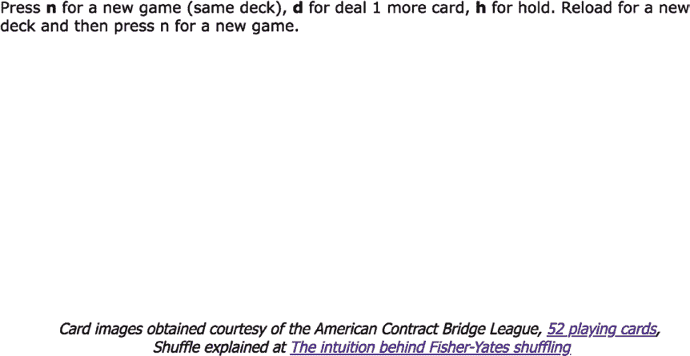
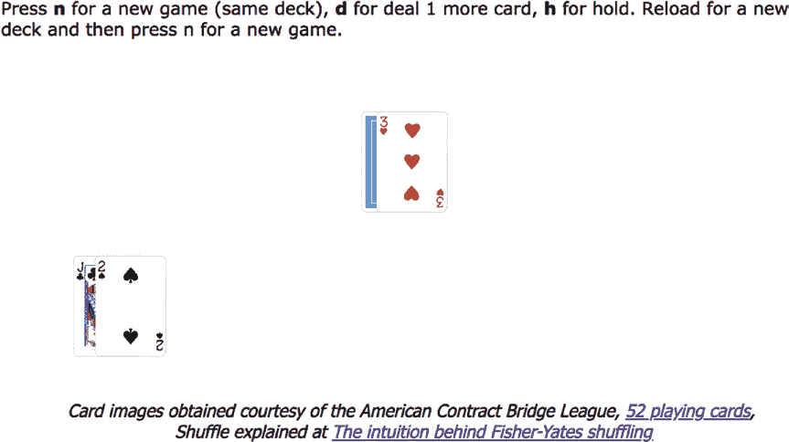
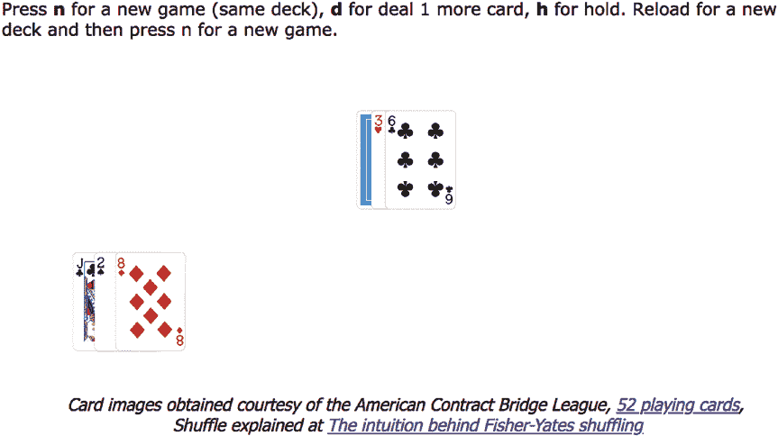
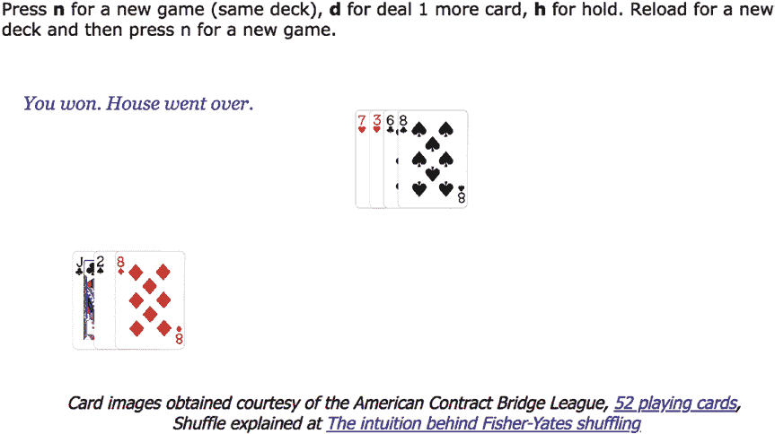
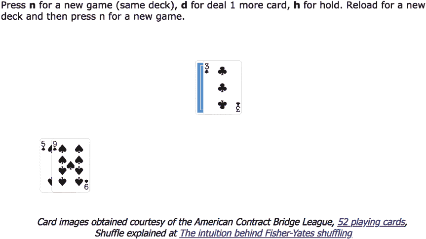
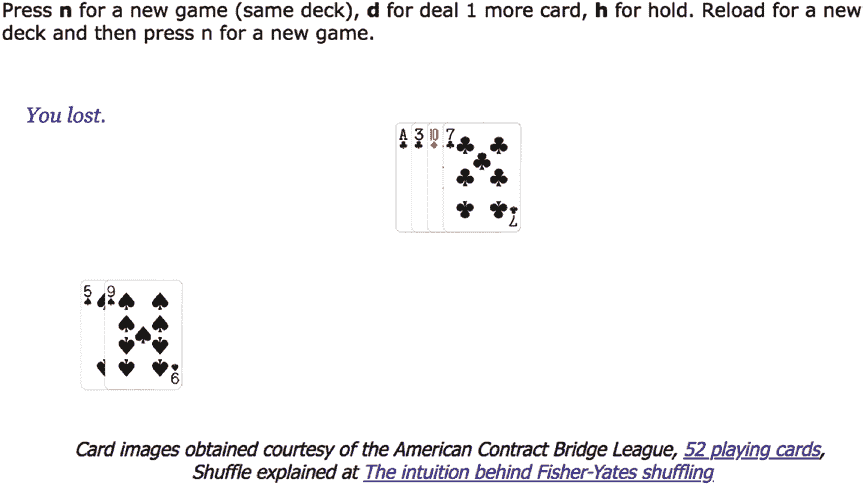
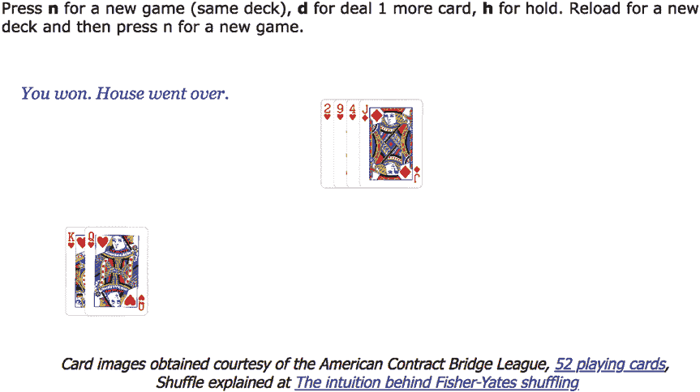
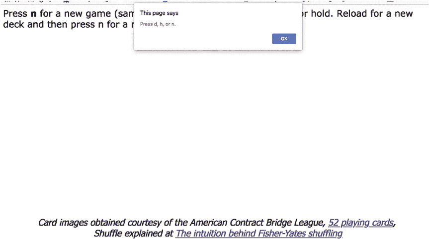

# 第 10 章 二十一点

我们将使用 HTML5 和 JavaScript 特性来实现纸牌游戏二十一点，这种游戏也被称为*21 点*。实现过程中将使用 HTML5 引入的新标签，即`<footer>`和`<header>`。我们使用`<footer>`来注明纸牌图像的来源以及洗牌算法所引用的网站。纸牌是通过程序员自定义对象和`Image`对象创建的，并编写代码来生成图像文件的名称。玩家通过按键来执行操作。

二十一点的规则如下：

- 玩家与庄家（也称为赌场方）对弈。玩家和庄家各发两张牌。庄家的第一张牌对玩家隐藏，但另一张牌可见。牌的点数：数字牌为牌面数值，J、Q、K 为 10 点，Ace（A）可以是 1 点或 11 点。手牌的点数总和即为手牌总值。游戏目标是在不超过 21 点的前提下，使手牌总值尽可能接近 21 点，并且比对方点数更高。因此，一张 A 和一张花牌组合即为 21 点，是获胜手牌。玩家可采取的行动是请求要牌或停牌。

© Jeanine Meyer 2023

J. Meyer，《HTML5 必备指南》，[`doi.org/10.1007/978-1-4842-8722-4_10`](https://doi.org/10.1007/978-1-4842-8722-4_10)



## 游戏概述

由于这是一个双人游戏，我们的玩家将与“电脑”对战，并且与石头剪刀布游戏的情况类似，我们需要生成电脑的操作。不过，我们遵循赌场的惯例——庄家（赌场方）使用固定策略。当手牌总值低于 17 点时，我们的庄家会请求要牌（赌场的游戏策略可能稍复杂，并且可能取决于是否有 Ace）。同样，如果玩家和庄家在不超过 21 点的情况下点数相同，我们的游戏会宣布平局；某些赌场的规则可能有所不同。

一张开局截图如图 10-1 所示。

**图 10-1。** 二十一点的开局画面

在用户按下`n`键后，下一画面将如图 10-2 所示。请注意，其中涉及随机过程，因此每次出现的牌组并不保证完全相同。



## 游戏过程

图 10-2 展示了玩家所能看到的内容：玩家自己的全部手牌，以及庄家手牌中除了隐藏牌之外的所有牌。虚拟庄家并不知晓玩家的手牌。在此情景中，玩家的手牌点数为 2 加 10，总计 12 点。庄家亮出的一张牌为 3 点。玩家通过按下`d`键请求要牌。图 10-3 显示了结果。





**图 10-3。** 玩家获得 20 点

此刻玩家手牌总值为 20 点，然后按下`h`键选择停牌，以停止操作并查看庄家手牌。结果如图 10-4 所示。

**图 10-4。** 玩家以 20 点获胜，庄家爆牌



由于庄家爆牌而玩家没有，玩家获胜。

玩家可以通过按下`n`键或重新加载文档来开始新一局游戏。重新加载文档意味着用一副完整、新洗好的牌开始。按下`n`键则继续使用当前牌组。任何想要练习*算牌*（一种追踪牌组中剩余牌并相应调整玩法的技巧）的人，应选择按下`n`键。

图 10-5 展示了一局新游戏。

**图 10-5。** 一局新游戏

这次，玩家按下`h`键选择停牌，图 10-6 显示了结果。



**图 10-6。** 玩家输了。

庄家持有四张牌，总点数为 21。请记住，`A`可以算作 1 点或 11 点。玩家有 14 点，因此输了。

图 10-7 展示了另一局游戏的结果。玩家初始拿到两张花牌，总点数为 20。玩家按下了`h`键选择停牌，庄家随后抽取了两张牌并爆牌。



**图 10-7.** 玩家获胜

赌场中庄家的实际做法可能与此不同。这正是一个研究的机会！玩家也可以通过爆牌但不揭晓来虚张声势。这可能导致庄家要求再发一张牌从而也爆牌。游戏仅在玩家点击`h`键停牌且不再抽牌时判定胜负。

当玩家按下非`d`、`h`或`n`的按键时，您可能需要向玩家提供反馈，如图 10-8 所示。



**图 10-8.** 按下错误按键时的反馈

### 关键需求

二十一点游戏将使用之前游戏中所描述的许多 HTML5、CSS 和 JavaScript 特性。

我在开始实现时遇到的第一个问题是为牌面寻找图片资源。我知道可以自己绘制，但我更希望使用比我能制作的更精美的素材。

下一个挑战是如何从编程角度设计一张牌，以便能够实现发牌、显示牌背或牌面。我还想研究如何洗牌。

另一个挑战是实现玩家玩游戏的交互方式。我选择了按键操作：`d`用于发牌，`h`用于停牌，`n`用于开始新游戏。当然也有其他选择，例如显示带有文字或图形的按钮，或者使用其他按键（如方向键）。由于缺乏清晰直观的界面，必须在屏幕上显示操作说明。

最后的挑战是通用问题：维护游戏状态、可见显示和内部信息；生成电脑方行动；以及遵循规则。

### HTML5、CSS 和 JavaScript 特性

现在让我们看看实现二十一点纸牌游戏所需的 HTML5、CSS 和 JavaScript 的具体特性。除了基本的 HTML 标签、函数和变量外，这里的解释是完整的。如果你已经阅读过其他章节，会注意到本章大量重复了之前已经给出的解释。

请记住，你可以直接跳到“构建应用程序”部分查看带有注释的完整游戏代码，然后再返回本节获取更多解释。

#### 牌面图片的来源及图片对象的设置

在第一版工作时，我确实找到了一个出色的牌面图片来源，它采用知识共享许可协议，我很乐意展示其链接和许可信息，但该网站已不复存在。我找到了另一个来源，来自美国定约桥牌联盟。数字文件被标记为免费，但我仍然请求并获得了许可，你可以从截图中看到我在网页上注明了数字文件的来源。

将文件复制到你的计算机后，你需要一种方法来访问 52 张牌面图片文件，而无需编写 52 条不同的语句。（请注意，牌背图片文件是在另一个地方访问的，即`init`函数中。）这可以实现，因为文件名遵循一种模式。新牌面图片的模式与原始模式略有不同，编码反而更简单。`buildDeck`函数如下：

```javascript
function buildDeck() {
    var n;
    var si; //用于遍历花色
    var suitnames = ["C","H","S","D"];
    var i;
    i=0;
    var pickName;
    var nums=["A","2","3","4","5","6","7","8","9","10","J","Q","K"];
    for (si=0; si<4; si++) {
        for (n=0; n<13; n++) {
            pickName=nums[n]+suitnames[si]+".png";
            deck[i]=new MCard(n+1,suitnames[si],pickName);
            i++;
        }
    }
}
```

注意嵌套的`for`循环。外层循环处理花色，内层循环处理一个花色中的 13 张牌。

在这个函数中，外层循环管理花色，内层循环管理每个花色中的牌。`pickName`变量将被设置为从来源下载的文件名。`MCard`函数是一个构造函数，用于创建`MCard`对象，即我们定义为程序员自定义对象类的对象。`n+1`将用作牌的点数，花牌会进行一些调整。

**注意：** 嵌套`for`循环中的三条语句可以合并为`deck[i++]=new MCard(n+1,suitnames[si], suitnames[si]+"-"+nums[n]+".png");`。这是因为递增运算符`++`在生成用于索引`deck`数组的值之后执行。然而，我建议在这个学习示例中不要这样做！使用三条语句编写和理解起来要容易得多。

#### 为纸牌创建程序员自定义对象

正如我们在之前的章节（例如第 4 章弹弓游戏）中所见，JavaScript 为程序员提供了一种创建自定义对象来分组数据的方法；这些不同的数据片段称为*属性*，我们使用点符号来访问不同的属性。也可以通过定义*方法*将代码与数据关联起来，但在这个例子中我们不需要这样做。需要提醒的是，用于设置新对象的函数称为*构造函数*。

对于纸牌，我将`MCard`定义为构造函数，上一节在`buildDeck`函数中已经展示了它的使用。该函数的定义如下：

```markdown
## 发牌

函数中的这一行`if (n>10) n = 10;`将会被花牌（`J`、`Q`、`K`）触发。请记住，每张花牌的点数都是 10。这行代码在这些情况下将点数修正为 10。

注意，这个`if`语句在结构上不同于之前的`if`语句。它没有任何用于界定 if-true 子句的花括号。单语句子句是`if`语句的一种合法形式。我通常避免这种形式，因为如果我以后决定添加另一条语句，就需要插入花括号。不过，我认为在这种情况下使用它是可以的。我也意识到你在检查代码时会看到这两种形式，因此在这里展示这种格式是有意义的。

请注意，当`n`等于 1 时，没有进行任何特殊处理。对于`A`的两种可能点数规则在程序的其他地方处理。

`MCard`对象的属性包括一个新建的`Image`对象，其`src`属性设置为传入的`pickName`。最后一个属性`dealt`初始化为 0，会根据牌发给玩家还是庄家被设置为 1 或 2。

### 开始游戏

在我的游戏实现中，玩家通过按`n`键选择使用当前牌组开始新游戏。如果玩家想使用新牌组，则需要重新加载 HTML 文档。事实上，在赌场中，决定何时使用新牌组的是庄家，而不是玩家。做出这个改变将是对本实现的一个很好的补充。我还应该指出，有些赌场使用多副牌来阻止一种称为算牌的做法。我突然想到，可以构建一个应用程序，为玩家提供练习算牌的方法。

### 玩家行为处理与发牌逻辑

另一个问题涉及玩家行为。如我之前所述，我倾向于假设玩家会正确操作。如果游戏尚未开始，玩家点击`d`（要牌）或`h`（停牌）时应该怎么办？在这种涉及玩家非标准行为的情况下，作为应用程序开发者，我们面临的选择包括：显示一条消息；尝试猜测玩家想要做什么（例如开始新游戏）；或者什么都不做。我决定显示一条消息。为了追踪游戏是否已开始，我使用了一个全局变量`gamestart`，它被初始化为`false`。顺便提一下，这类变量有一个术语叫标志。它出现在四个函数（`deal()`、`dealFromDeck()`、`playerdone()`和`newGame()`）中，你可以在代码表中查看它们在具体上下文中的使用。

`buildDeck()`函数构建了`MCard`对象的`deck`数组。玩家的手牌保存在名为`playerhand`的数组中，`pi`持有下一个位置的索引。

类似地，庄家的手牌保存在名为`househand`的数组中，`hi`持有下一个位置的索引。当对象是数组元素时，引用`MCard`对象属性的语法示例为`playerhand[pi].picture`。

`dealStart()`函数的任务是发出前四张牌：两张给玩家，两张给庄家。庄家的一张牌不显示，即显示牌的背面。`deal()`函数在玩家请求新牌时被调用（参见本节后续内容）。`deal()`函数会给玩家发一张牌，并判断庄家是否也该得到一张新牌。`dealStart()`和`deal()`都通过调用`dealFromDeck()`函数来实际发牌，将牌添加到`playerhand`和`househand`数组中，并在画布上绘制牌。形式上，`dealFromDeck()`是一个返回`MCard`类型值的函数，它的调用出现在赋值语句的右侧。如果牌面需要显示，绘制的`Image`对象由卡牌本身引用；如果牌背需要显示，`Image`对象保存在变量`back`中。

以下是`dealStart()`函数。牌被添加到`playerhand`数组和`househand`数组中。向数组添加元素有两种不同的方式：一种是使用`push`方法；另一种（我在此演示的）是使用索引值，其中索引值是数组的当前长度，即它将值放置在数组的下一个位置。请注意四组相似的语句：获取牌、绘制图像、递增下一个位置的 x 坐标、增加索引变量（`pi`或`hi`），用于发出四张牌，两张给玩家，两张给庄家。

```javascript
function dealStart() {
  playerhand[pi] = dealFromDeck(1);
  ctx.drawImage(playerhand[pi].picture, playerxp, playeryp, cardw, cardh);
  playerxp = playerxp + 30;
  pi++;

  househand[hi] = dealFromDeck(2);
  ctx.drawImage(back, houseXp, houseYp, cardw, cardh);
  houseXp = houseXp + 20;
  hi++;

  playerhand[pi] = dealFromDeck(1);
  ctx.drawImage(playerhand[pi].picture, playerxp, playeryp, cardw, cardh);
  playerxp = playerxp + 30;
  pi++;

  househand[hi] = dealFromDeck(2);
  ctx.drawImage(househand[hi].picture, houseXp, houseYp, cardw, cardh);
  houseXp = houseXp + 20;
  hi++;
}
```

`deal()`函数类似。如果`more_to_house()`返回`true`，则一张牌被添加到玩家的手牌中，也添加到庄家的手牌中。

```javascript
function deal() {
  if (gamestart) {
    playerhand[pi] = dealFromDeck(1);
    ctx.drawImage(playerhand[pi].picture, playerxp, playeryp, cardw, cardh);
    playerxp = playerxp + 30;
    pi++;

    if (more_to_house()) {
      househand[hi] = dealFromDeck(2);
      ctx.drawImage(househand[hi].picture, houseXp, houseYp, cardw, cardh);
      houseXp = houseXp + 20;
      hi++;
    }
  } else {
    alert("Press n to start a new game with the same deck.\nReload page to start a game with a new deck.");
  }
}
```

`more_to_house`是一个生成`true`或`false`值的函数。该值将基于庄家总点数的计算结果。如果总点数大于等于 17，则返回`false`；否则返回`true`。该函数调用被用作`if`语句的条件，因此如果`more_to_house`返回`true`，`if`子句中的语句将被执行。`more_to_house`的代码可以放在`deal`函数内部，但将大型任务分解为更小的任务是良好的实践。这意味着我可以继续处理`deal`函数，并暂时推迟编写`more_to_house`函数。如果你想优化`more_to_house`的计算逻辑，你很清楚该在哪里修改。

从牌堆中确定具体牌张的任务由`dealFromDeck`函数完成。

同样，我将这个职责明确的独立任务定义为一个函数。其参数是牌的接收者。在此应用程序中我们无需跟踪具体接收者，但会在代码中保留该信息，以便为构建其他纸牌游戏做准备。关键在于牌已被发给了某人。`dealt`属性从`0`开始变化。

注意`return card;`这一行，其作用是将`MCard`对象作为函数调用的结果返回。

```javascript
function dealFromDeck(who) {

  var card;

  var ch = 0;

  while ((deck[ch].dealt>0)&&(ch<51)) {
    ch++;
  }

  if (ch>=51) {
    ctx.fillText("NO MORE CARDS IN DECK. Reload. ",200,200);
    ch = 51;
    gamestart = false;
  }

  deck[ch].dealt = who;
  card = deck[ch];
  return card;
}
```

请记住，`deck`数组的索引范围是从`0`到`51`。`while`语句是另一种循环结构。在大多数编程语言中，`while`循环是一种控制流语句，允许基于给定的布尔条件重复执行代码；可以将`while`循环视为重复执行的`if`语句。只要括号内的条件保持为`true`，花括号内的语句就会持续执行。这需要程序员确保条件最终会变为`false`——避免循环无限进行。我们应用程序中的`while`循环会在找到未被发过的牌（即`dealt`属性为`0`）时停止。当最后一张牌（第 51 张牌）被发出后，该函数将提示牌堆已空。如果玩家忽略提示并再次请求发牌，最后一张牌会被再次发出。

顺便一提，庄家何时收集用过的牌或启用新牌堆的问题，对于试图推算剩余牌面的算牌者来说至关重要。在许多赌场，庄家会使用多副牌来阻止算牌行为。

我的程序没有为庄家提供这种能力。如果你想要一个练习算牌的程序，可以在本程序基础上扩展这些效果：你可以将牌堆数量设为可由玩家控制，使用随机处理，等待剩余牌数低于某个固定值，或者采用其他方式。

当玩家请求另一张牌或玩家决定停牌时，庄家可能再要一张牌。如前所述，评估庄家是否需要再要一张牌的函数是`more_to_house`。其计算方法是累加手牌的点数。如果手牌中有任何 A，当将一张 A 视为 11 点会使总点数不超过 21 点时（即让一张 A 计为 11 点），函数会额外增加 10 点。然后，它会判断总点数是否小于 17。

如果小于 17，则返回`true`，通知调用函数请求新牌。如果总点数超过 17，则返回`false`。

```
function more_to_house(){

  var ac = 0; //count of aces
  var i;
  var sumUp = 0; //will hold point value of house hand

  for (i=0;i<hi;i++) {
    sumUp += houseHand[i].value;
    if (houseHand[i].value==1) {ac++;}
  }

  if (ac>0) {
    if ((sumUp+10)<=21) {
      sumUp += 10;
    }
  }

  houseTotal = sumUp;

  if (sumUp<17) {
    return true;
  }
  else {
    return false;
  }
}
```

如果你想尝试为庄家设计不同的策略，需要修改的就是`more_to_house`函数。

## 开始新游戏

开始新游戏对程序员来说可能是个挑战。首先，需要理解"重新开始"的含义。对于这个二十一点实现，我为玩家提供了开始新一局游戏的选项，这意味着使用同一副牌继续游戏。若要使用一副未发过牌的全新牌组，玩家必须重新加载文档。我将玩家按下 `n` 键时调用的函数命名为 `newGame`。该函数需要执行的操作是：清除画布、重置玩家和庄家手牌的指针，以及存储下一张牌水平位置的变量。该函数最后调用 `dealStart` 结束。

```
function newGame() {
  if (!gameStart) {
    gameStart = true;
    ctx.clearRect(0,0,cwidth,cheight);
    pi=0;
    hi=0;
    playerXp = 100;
    houseXp= 500;
    dealStart();
  }
}
```

## 洗牌

在记忆配对游戏（参见第 [5](http://dx.doi.org/10.1007/978-1-4842-4155-4_5) 章）中展示的洗牌技术，是我和孩子们玩游戏时的做法：将牌摊开，找到成对的牌并交换它们的位置。

对于二十一点，一位朋友向我推荐了 Eli Bendersky 的网站（[`eli.thegreenplace.net/2010/05/28/the-intuition-behind-fisher-yates-shuffling/`](http://eli.thegreenplace.net/2010/05/28/the-intuition-behind-fisher-yates-shuffling/)），其中解释了*费舍尔-耶茨算法*。该算法的策略是：从牌堆末尾开始向起始位置，为每个位置随机确定一张牌。该计算会从 0 到当前位置（含当前位置）之间随机选取一个位置，并执行交换。主要的洗牌函数如下：

```
function shuffle() {
  var i = deck.length - 1;
  var s;
  while (i>0) {
    s = Math.floor(Math.random()*(i+1));
    swapinDeck(s,i);
    i--;
  }
}
```

请记住，`Math.random() * N` 返回一个从 0 到 N（不含 N）之间的数。对结果取 `Math.floor` 后返回一个从 0 到 N 的整数。因此，若想获得 0 到 i 之间的随机数，需编写 `Math.floor(Math.random()*(i+1))`。为了让洗牌函数更易读，我单独编写了一个名为 `swapinDeck` 的函数，用于交换由参数指定位置的两张牌。执行交换需要一个额外的存储空间，即变量 `hold`。之所以需要这个额外空间，是因为两个赋值语句无法同时完成。

```
function swapinDeck(j,k) {
  var hold = new MCard(deck[j].num,deck[j].suit,deck[j].picture.src);
  deck[j] = deck[k];
  deck[k] = hold;
}
```

## 捕获按键

在迷宫游戏（第 [7](http://dx.doi.org/10.1007/978-1-4842-4155-4_7) 章）中已介绍过方向键的使用。此处基本上是重复该解释。

检测键盘按键被按下并确定是哪个键被称为*捕获按键*。代码必须设置按键事件的响应，这与设置鼠标事件的响应类似。编码从调用 `addEventListener` 方法开始，本次针对的是应用程序的窗口。

```
window.addEventListener('keydown',getkey,false);
```

这意味着当按键被按下时，将调用 `getkey` 函数。

**注意** 还有 `keyup` 和 `keypress` 事件。`keydown` 和 `keyup` 仅触发一次。如果玩家按住键不放，`keypress` 事件会在一段时间后重复触发。

现在，正如你可能预料到的，获取按键信息的编码涉及不同浏览器的兼容处理。以下代码提供了两种获取按键对应数字的方法，适用于 Chrome、Firefox 和 Safari：

```
if(event == null)
{
  keyCode = window.event.keyCode;
  window.event.preventDefault();
}
else
{
  keyCode = event.keyCode;
  event.preventDefault();
}
```