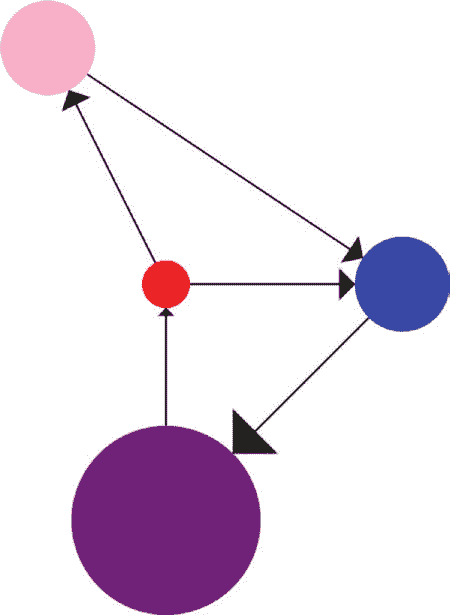
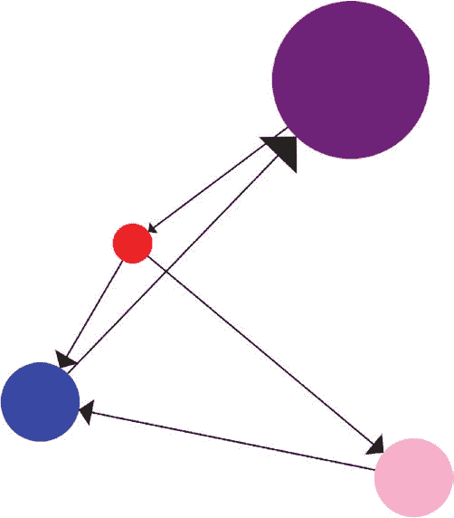

# Fisher-Yates 洗牌算法背后的直觉

*续*

### 第 10 章：二十一点

**表 10-2.** *（续）*

| **代码** | **说明** |
|----------|----------|
| `</footer>` | 关闭页脚。 |
| `</body>` | 关闭主体。 |
| `</html>` | 关闭 HTML 文件。 |

你可以通过多种方式改变这款游戏的外观和体验，包括为玩家提供不同的操作方式：请求发新牌、保持当前手牌不动，或请求重开一局。你可以创建或获取自己的一套扑克牌图像。

在每局之间累计分数（或许再加入某种下注机制）将是一个不错的增强功能。改变庄家出牌的规则也是可行的。正如我之前提到的，可以考虑让电脑/庄家根据分数或通过随机运算来决定何时启用一副新牌。另一种增加游戏难度的方法是使用多副牌。记分是一项显而易见的功能，一种实现方式是加入钱包功能：玩家初始有一定金额，每局游戏扣减相应费用（付费游戏），获胜时则增加金额。得分和/或更完整的游戏结果可以使用`localStorage`存储在本地计算机上。

#### 测试与上传应用

此程序需要进行大量测试。请记住，当身为测试者的你获胜时，测试并未结束。只有当你在多种不同场景下进行过完整测试后，才算真正完成。我最初使用未经洗牌的牌组对游戏进行了首次测试。随后我加入了洗牌功能，并持续追踪测试中暴露的各种情况。我在不同情况下按下`d`键要牌，按下`h`键停牌，以及按下`n`开始新游戏。这绝对是一种需要邀请其他人来帮你测试应用的情况。

上传应用需要上传所有图片文件。如果你使用了与我演示不同的文件名，你需要修改`buildDeck`函数来构造正确的文件名称。

## 第 10 章：二十一点 — 总结

在本章中，你学习到了如何利用 HTML5、JavaScript 和 CSS 的特性，结合通用编程技术来实现一款纸牌游戏。其中包括以下内容：

-   根据外部文件名生成一组`Image`对象。
-   设计程序员自定义的卡牌对象类，并整合`Image`元素、牌面花色和牌面点数。
-   在屏幕上绘制图像和文本。
-   使用`for`、`while`和`if`实现二十一点的逻辑。
-   运用计算和逻辑生成电脑的操作。
-   为`keydown`事件建立事件处理，以便玩家能表明发新牌、停牌或开始新游戏的请求，并使用`switch`区分不同按键。
-   使用 HTML5 新增的`header`和`footer`元素，分别用于显示操作指引和标注来源。在`footer`元素中，包含了一种注明扑克牌面图像来源的方法。

这是本书的最后一章。不过，我增加了一个附录，其中的示例着重于绘图技术，包括数学（代数和几何）的应用以及标量矢量图形。

我希望你能学以致用，创作出这些游戏的增强版本，或是发明你自己的游戏。享受编程的乐趣吧！

我的《HTML5 与 JavaScript 项目实战》（第二版）已经更新，包含了一个名为“凑 15 点”游戏的实现、新媒体的使用，以及如何让你的项目适应不同屏幕尺寸和触摸事件（而非鼠标事件）或让仅使用键盘的用户也能无障碍访问的工具介绍。从编程技术的角度来看，这本书是你的合适进阶读物。如果你想探索一门不同的编程语言，请考虑《编程入门 101：使用 Processing 编程语言揭示编程的原理与原因》这本书。该书目前正在更新第二版。

### 附录：更多绘图技巧

本书最初计划是结合超文本标记语言、层叠样式表和 JavaScript 这套组合工具来介绍编程，其中重点放在 JavaScript 上。但在筹备第三版时，我们认为读者会欣赏一些额外、更进阶的材料。和以往一样，我的示例选择受到与同事和学生交流经历的影响。以下内容将展示数学（代数和几何）的应用，以及一个名为标量矢量图形的工具。这些应用程序是完整的，以便你能在具体情境中看到相关技术。然而，正如前 10 章中游戏演示的目的一样，文本的目的是教授编程概念以及 HTML、CSS 和 JavaScript 的技术特性，而不是如何构建特定的游戏和应用程序。部分阐述会重复前 10 章的内容。你可以利用这些独立的概念和技术来构建自己设计的项目。

#### 圆形与箭头

程序以三个由箭头连接的圆形开始。注意：我常将这些箭头称为*链接*。图 A-1 显示了初始界面。

© Jeanine Meyer 2023
J. Meyer，《HTML5 权威指南》，[`doi.org/10.1007/978-1-4842-8722-4`](https://doi.org/10.1007/978-1-4842-8722-4#DOI)

**图 A-1.** 初始界面

用户/玩家可以拖拽任意圆形。箭头会移动以保持连接关系。图 A-2 显示了经过一些操作后的界面。如果你完全按原样复制代码并打开文档，你会看到图 A-1，但如果你拖拽圆形，你很可能产生不同的结果，如图 A-2 所示。

**图 A-2.** 经过一些操作后的界面

我最初编写此程序的动机是创建一个编辑器，用于绘制展示文章之间引用关系的图表。你可以用它来做类似的事情，并且你可能会发现这些独立技术的其他用途。

##### 概述

此示例所需的任务包括：绘制由箭头连接的圆形；使用鼠标操作拖拽（即移动）圆形；以及保持连接箭头正确的位置。我的程序利用 HTML 和 JavaScript 的特性，并借助一些数学知识来绘制连接线和箭头，从而完成这些任务。一个棘手的问题是如何处理垂直线。

HTML 文档被组织成所谓的*文档对象模型*，也称为文档树。在此示例中，HTML 定义了`body`元素，而该元素又包含一个`canvas`元素。我的 JavaScript 代码为每个圆形创建了独立的`canvas`元素。这些元素通过被附加到文档树中的`body`元素而变得可见。圆形显示在原始画布之上。它们的位置通过设置`style`元素的`left`和`top`属性的文本来指定。链接（箭头）则直接绘制在原始画布上。

