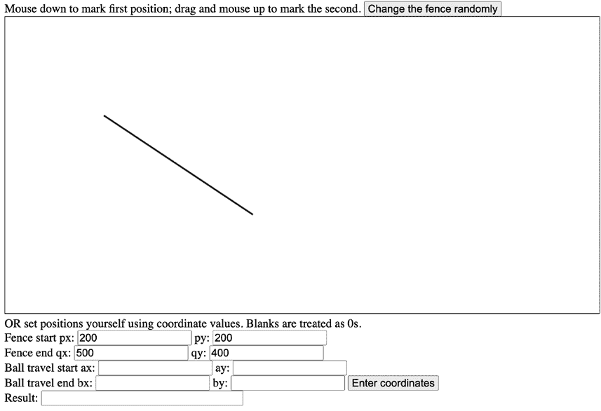
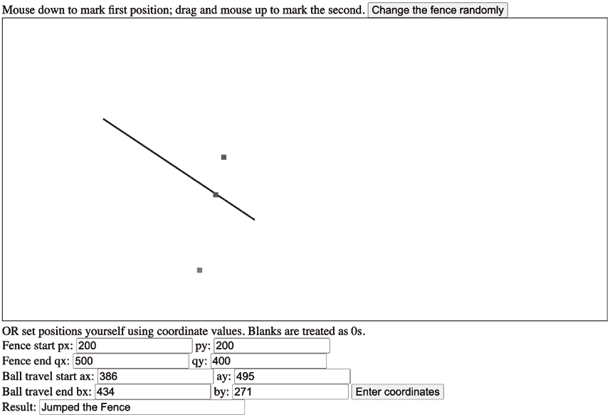
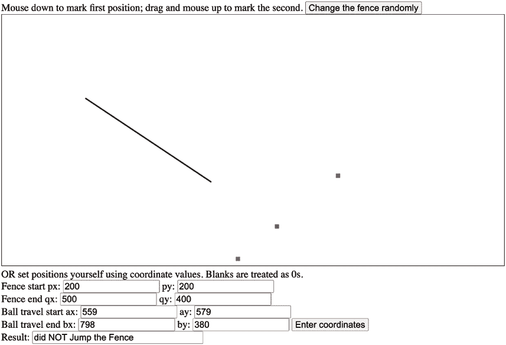
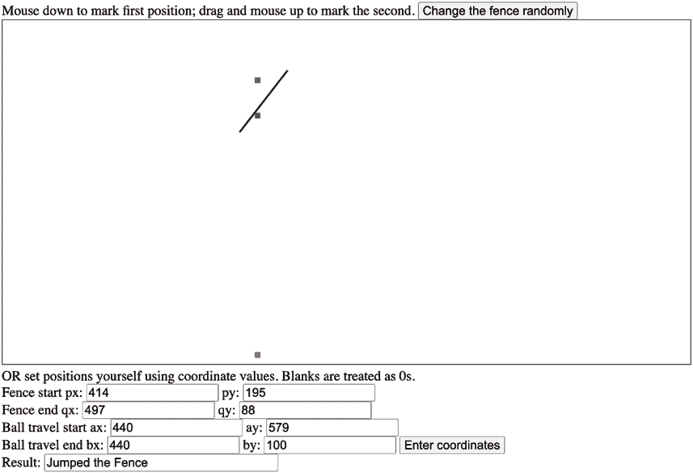

# 排版后文本

`function` 设置在 `startDragging` 中，在 `moving` 中重置。

```javascript
function init(){
```

`init` 函数头。

`canvas = document.` 获取原始画布的引用。`getElementById("canvas");`

`ctx = canvas.` 获取原始画布上下文的引用。这用于所有绘制。`getContext("2d");`

`cWidth = window.innerWidth;` 获取窗口的宽度。

（续）

**附录 A 更多绘制技术**

**表 A-2.**（续）

| 代码语句 | 解释 |
| --- | --- |
| `cHeight = window.` | 获取窗口的高度。`innerHeight;` |
| `canvas.width = cWidth;` | 重置画布以占据整个屏幕：宽度。 |
| `canvas.height= cHeight;` | …高度。 |
| `ctx.strokeStyle="black";` | 将描边设置为黑色。 |
| `ctx.strokeRect(0,0,cWidth, cHeight);` | 绘制画布的边界线。 |
| `buildCircles();` | 构建圆形。 |
| `drawLinks();` | 绘制链接。 |

}

关闭 `init` 函数。

```javascript
function buildCircles() {
```

`buildCircles` 函数头。

`var i;` 用于 `for` 循环。

`var can;` 用作每个新画布的引用。

`var circle;` 保存圆形信息。

`var diam;` 要创建的圆形的直径。

`var rad;` 要创建的圆形的半径。

`for (i=0;i<canvases.` 用于移除之前构建的所有圆形的 `for` 循环。在调整大小或重新加载时发生。`length;i++) {`

`can = canvases[i];` 需要知道要移除什么。

`document.body.` 从文档树中移除。`removeChild(can);` }

关闭 `for` 循环。

`canvases = [];` 将 `canvases` 重置为空数组。

`for (i=0;i<circles.` 用于创建包含圆形的画布的 `for` 循环。`length;i++){`

（续）

**附录 A 更多绘制技术**

**表 A-2.**（续）

| 代码语句 | 解释 |
| --- | --- |
| `circle = circles[i];` | 获取 `circles` 中第 `i` 个元素的内部数组。 |
| `can = document.` | 创建一个 canvas 元素。`createElement('canvas');` |
| `can.aindex = i;` | 添加一个新属性以引用回 `circles`。 |
| `ctxc = can.getContext('2d');` | 设置上下文。 |
| `rad = circle[2];` | 从数组中提取半径值。 |
| `diam = 2*rad;` | 计算直径。 |
| `can.width = diam;` | 使用 `diam` 作为宽度。 |
| `can.height= diam;` | …以及刚创建的画布的高度。 |
| `ctxc.fillStyle=circle[3];` | 设置填充样式。 |
| `ctxc.beginPath();` | 开始在新画布上绘制圆形路径。 |
| `ctxc.arc(rad,rad,rad,0, 2*Math.PI,true);` | 绘制一条弧线。 |
| `ctxc.closePath();` | 关闭路径。 |
| `ctxc.fill();` | 填充颜色。 |
| `circle[0] = Math.` | 准备新画布左边坐标的值，使其适合原始画布。`min(circle[0],cWidth-rad);` |
| `circle[1] = Math.` | …顶部坐标的值。`min(circle[1],cHeight-rad);` |
| `can.style.left =` | 将 `left` 属性设置为字符串，并添加了 `px`（代表像素）。`String(circle[0]-rad)+"px";` |
| `can.style.top =` | 设置 `top`。`String(circle[1]-rad)+"px";` |
| `can.addEventListener('mousedown',startDragging,false);` | 为新画布设置事件处理。 |
| `canvases.push(can);` | 将新画布添加到 `canvases` 数组。 |
| `document.body.` | 向文档树添加新画布。`appendChild(can);` |
| `can.style.visibility = 'visible';` | 设置为可见。 |

}

关闭 `for` 循环。

}

关闭 `buildCircles` 函数。

```javascript
function startDragging(ev) {
```

`startDragging` 函数头。`ev` 包含事件信息，包括对对象的引用。

`movingObj = ev.target;` 将 `movingObj` 设置为画布/圆形对象。

`movingObjectIndex =` 提取 `circles` 数组中的索引。`movingObj.aindex;`

`oldx = parseInt(ev.pageX);` 提取 `mousedown` 事件发生时的 `x` 坐标。

`oldy = parseInt(ev.pageY);` 提取 `mousedown` 事件发生时的 `y` 坐标。

`movingobj.addEventListener` 现在设置 `mousemove` 事件。`("mousemove",moving,false);`

`movingobj.addEventListener` …以及 `mouseup` 事件。`("mouseup",stopmove,false);`

}

关闭 `startDragging`。

```javascript
function moving(ev) {
```

`moving` 函数头。`ev` 包含事件信息，包括对位置的引用。

`if(movingObj) {` 检查是否存在移动对象。

`newx = parseInt(ev.pageX);` 提取 `x` 坐标。

（续）

**附录 A 更多绘制技术**

**表 A-2.**（续）

| 代码语句 | 解释 |
| --- | --- |


```content
```javascript
newy = parseInt(ev.pageY);
```
提取 y 坐标。

```javascript
delx = newx-oldx;
```
计算 x 坐标的变化量。

```javascript
dely = newy-oldy;
```
…以及 y 坐标的变化量。

```javascript
oldx = newx;
```
将 `oldx` 重置为指向 `newx`。

```javascript
oldy = newy;
```
将 `oldy` 重置为指向 `newy`。

```javascript
curx = parseInt(movingObj.
```
从当前 `left` 属性中提取数值。

```javascript
style.left);
```

```javascript
cury = parseInt(movingObj.
```
从当前 `top` 值中提取数值。

```javascript
style.top);
```

```javascript
movingObj.style.left =
```
进行计算，将结果转换为字符串并添加

```javascript
String(curx+delx)+"px";
```
`px` 以获取 `left` 的更新值。`px` 代表“像素”。

```javascript
movingObj.style.top =
```
进行计算，将结果转换为字符串并添加

```javascript
String(cury+dely)+"px";
```
`px` 以获取 `top` 的更新值。`px` 代表像素。

```javascript
circles[movingObjectIndex]
```
将 x 坐标的更新值写回 `circles`

```javascript
[0] += delx;
```
数组。

```javascript
circles[movingObjectIndex]
```
将 y 坐标的更新值写回 `circles`

```javascript
[1] += dely;
```
数组。

```javascript
drawLinks();
```
调用 `drawLinks()`，使用一个圆的新位置重绘所有连线。

```javascript
}
```
关闭 `if`（存在 `movingObj` 时）。

```javascript
}
```
关闭 `moving` 函数。

```javascript
function stopMove(ev){
```
`stopmove()` 的函数头。参数 `ev` 在事件处理中设置。

（*续*）

**附录：更多绘图技巧**

**表 A-2**（*续*）

**代码语句** | **说明**
--- | ---
`movingObj.removeEventListener ("mousemove",moving,false);` | 移除事件监听。
`movingObj.removeEventListener ("mouseup",stopmove,false);` | 移除事件监听。
`movingObj=null;` | 将 `movingObj` 设置为 `null`。
`drawLinks();` | 绘制连线。
`}` | 关闭 `stopmove()`。

```javascript
function drawLinks() {
```
`drawLinks()` 函数的函数头。

```javascript
ctx.clearRect(0,0,cWidth, cHeight);
```
清除画布。

```javascript
ctx.strokeStyle="black";
```
将描边颜色设置为黑色。

```javascript
ctx.fillStyle = "black";
```
将填充颜色设置为黑色。

```javascript
for (i=0;i<links.length;i++) {
```
遍历所有连线（箭头）。

```javascript
link = links[i];
```
设置 `link` 以简化后续代码。

```javascript
circle1 = circles[link[0]];
```
定义第一个圆。

```javascript
circle2 = circles[link[1]];
```
定义第二个圆。

```javascript
startx = circle1[0];
```
设置起始 x 坐标。

```javascript
starty = circle1[1];
```
设置起始 y 坐标。

```javascript
endx = circle2[0];
```
设置结束 x 坐标。

```javascript
endy = circle2[1];
```
设置结束 y 坐标。

```javascript
drawAdjustedLink(startx, starty,circle1[2],endx, endy,circle2[2]);
```
调用 `drawAdjustedLink()` 进行更细致的绘制。

```javascript
}
```
关闭 `for` 循环。

（*续*）

**附录：更多绘图技巧**

**表 A-2**（*续*）

**代码语句** | **说明**
--- | ---
`}` | 关闭 `drawLinks()`。

```javascript
function drawAdjustedLink (x1,y1,rad1,x2,y2,rad2) {
```
`drawAdjustedLink()` 的函数头。参数包括起始圆的 x、y 坐标及其半径，以及结束圆的 x、y 坐标及其半径。

```javascript
var t1x;
```
将这些设置为局部变量。`t1` 和 `t2` 点是箭头基部的两个端点。

```javascript
var t1y;
var t2x;
var t2y;
var bx;
```
`b` 点是箭头基部的中点。

```javascript
var by;
var mp;
```
箭头的斜率。

```javascript
var sx;
```
`s` 点是箭头的起点。

```javascript
var sy;
var ex;
```
`e` 点是箭头的终点（箭头尖端）。

```javascript
var ey;
var dx = x2-x1;
```
计算 x 的变化量。

```javascript
var dy = y2-y1;
```
计算 y 的变化量。

```javascript
var dis;
```
用于保存距离。

```javascript
var ah = .3333*rad2;
```
箭头的高度设置为目标圆半径的大约三分之一。

```javascript
if (dx==0) {
```
如果这是一条垂直线。

```javascript
dis = Math.abs(y2-y1);
```
将 `dis` 计算为 y 值之差的绝对值。

```javascript
sx = x1;
```
箭头起始的 x 坐标。

（*续*）

**附录：更多绘图技巧**

**表 A-2**（*续*）

**代码语句** | **说明**
--- | ---
`sy = y1+(rad1/dis)*dy;` | 箭头起始的 y 坐标，已调整至圆边界。
`ex = x2;` | 箭头结束的 x 坐标。
`ey = y2-(rad2/dis)*dy;` | 箭头结束的 y 坐标，已调整至在边界处结束。
`ctx.beginPath();` | 开始路径。
`ctx.moveTo(sx,sy);` | 箭头起点。
`ctx.lineTo(ex,ey);` | 移动到终点——接触圆。
`ctx.closePath();` | 闭合路径。
`ctx.stroke();` | 使用描边绘制线条。
`t1x = sx+ah;` | 线条的一侧。
`t2x = sx-ah;` | 线条的另一侧。
`t1y = y2-((rad2+ah)/ dis)*dy;` | 计算箭头基部的坐标。
`t2y = t1y;` | 相同的 y 值。
`ctx.beginPath();` | 绘制表示箭头的三角形。
`ctx.moveTo(ex,ey);` | 
```


```markdown
从箭头尖点开始。

`ctx.lineTo(t1x,t1y);`

…到基底的一侧。

`ctx.lineTo(t2x,t2y);`

…到基底的另一侧。

`ctx.closePath();`

闭合路径。

`ctx.fill();`

使用填充绘制箭头。

}

`else if (dy==0) {`

检查水平线。

`dis = Math.abs(x2-x1);`

x 值绝对差的距离。

`sx = x1+(rad1/dis)*dx;`

箭头起始点；x 位于边界。

`sy = y1 ;`

( *续*)

附录：更多绘图技巧

***表 A-2.*** ( *续*)

**代码语句**

**解释**

`ex = x2-(rad2/dis)*dx;`

箭头结束点；x 位于边界。

`ey = y2 ;`

`ctx.beginPath();`

`ctx.moveTo(sx,sy);`

开始绘制线条。

`ctx.lineTo(ex,ey);`

线条结束。

`ctx.closePath();`

闭合路径。

`ctx.stroke();`

绘制线条。

`t1y = sy+ah;`

现在计算箭头（三角形）的顶点。y 值位于一侧，对应一个顶点。

`t2y = sy-ah;`

y 值位于另一侧，对应另一个顶点。

`t1x = x2-((rad2+ah)/`

x 值刚好在第二个圆的边界之外。

`dis)*dx;`

`t2x = t1x;`

共享相同的 x 坐标。

`ctx.beginPath();`

箭头的三角形。

`ctx.moveTo(ex,ey);`

开始绘制箭头。

`ctx.lineTo(t1x,t1y);`

连线到一个顶点。

`ctx.lineTo(t2x,t2y);`

连线到另一个顶点。

`ctx.closePath();`

闭合路径。

`ctx.fill();`

绘制填充的箭头。

}

关闭水平情况的分支。

`else {`

既非垂直也非水平。

`dis = Math.`

计算距离。

`sqrt(dx*dx+dy*dy);`

`sx = x1+(rad1/dis)*dx;`

一般情况。箭头有一个角度。计算起始点的 x 坐标。

`sy = y1+(rad1/dis)*dy;`

计算起始点的 y 坐标。

( *续*)

附录：更多绘图技巧

***表 A-2.*** ( *续*)

**代码语句**

**解释**

`ex = x2-(rad2/dis)*dx;`

计算结束点的 x 坐标。

`ey = y2-(rad2/dis)*dy;`

计算结束点的 y 坐标。

`ctx.beginPath();`

绘制箭头线条。

`ctx.moveTo(sx,sy);`

移动到起点。

`ctx.lineTo(ex,ey);`

绘制线条到终点。

`ctx.closePath();`

闭合路径。

`ctx.stroke();`

绘制线条。

线条的斜率是 `= dy/dx`，其中 `dx` 不为零。

`mp = -dx/dy ;`

垂直线的斜率（`dy` 不为零）。

`bx = x2-((rad2+ah)/dis)*dx;` 开始定义垂直 x 坐标的值。

`by = y2-((rad2+ah)/dis)*dy;` 开始定义垂直 y 坐标的值。

`bb = by - mp*bx;`

垂线方程是 `y = mp * (x-bx) + by`。

垂线方程是 `y = mp*x + bb`。

求解以 `(bx, by)` 为圆心、`ah` 为半径的圆与直线的交点。

使用标准 `a`、`b`、`c` 的二次公式：

`//x*x - 2*x_bx + bx*bx - ah*ah/((mp*mp)`

`(1-bx)*(1-bx))`

`d = 1-bx;`

求解方程。

`c = bx*bx -ah*ah/`

请参阅前面关于接下来几行方程式的行和文本。

`(1+mp*mp);`

`b = -2*bx;`

`a=1;`

`sqterm = Math.sqrt(b*b-`

`4*a*c);`

`t1x = (-b+sqterm)/2;`

( *续*)

附录：更多绘图技巧

***表 A-2.*** ( *续*)

**代码语句**

**解释**

`t2x = (-b-sqterm)/2;`

`t1y = mp*t1x + bb;`

`t2y = mp*t2x + bb;`

`ctx.beginPath();`

开始绘制箭头的路径。

`ctx.moveTo(ex,ey);`

移动到 e 点：线条接触第二个圆的位置。

`ctx.lineTo(t1x,t1y);`

连线到一个顶点。

`ctx.lineTo(t2x,t2y);`

连线到另一个顶点。

`ctx.closePath();`

闭合路径。

`ctx.fill();`

绘制填充的箭头。

}

关闭既非垂直也非水平情况的 `else` 分支。

}

关闭 `drawAdjustedLinks`。

`</script>`

关闭脚本元素。

`</head>`

关闭 `head`。

`<body onload="init();"`

打开 `body` 元素。设置对 `init` 的调用。

`onresize="init();">`

`<canvas id="canvas"`

canvas 标签。将大小设置为窗口的百分之百。

`width="100%" height="100%">`

`Your browser does not`

针对旧版浏览器的标准警告。

`recognize canvas`

`</canvas>`

关闭 canvas。

`</body>`

关闭 `body`。

`</html>`

关闭 `html`。

附录：更多绘图技巧

**你学到了什么**

这个示例利用了 HTML 的文档对象模型。编码添加了新的元素。事件处理，即响应鼠标事件，是实现允许用户/玩家拖动圆形，并使圆形及其连接的任何箭头移动这一功能的关键。编码处理了数字和包含数字的字符串。所需的数学知识是处理直线时用到的基础代数。

**跨越一条线（跳过栅栏）**

一位从事游戏开发的同事让我给他一个函数，用于判断一个从位置 A 移动到位置 B 的标记是否跨越了一个固定的线段。我们可以把这个线段想象成代表一个栅栏。我为这个挑战所编写的程序提供了多种方式来定义位置 A 和 B 以及线段（即栅栏）。一种方式是用户/玩家在第一个位置按下鼠标按钮，拖动鼠标，然后在第二个位置松开按钮。或者，玩家可以将两个位置和线段的坐标输入到一个表单中。另一种可能性是在窗口中随机放置该线段。程序会指示线段是否被跨越，并在线上绘制一个标记来表示交点。我的同事并不需要所有这些前后处理工作，但我需要它们来测试执行检查的函数。图 A-3 显示了初始画面。



附录：更多绘图技巧

***图 A-3.** 跳跃栅栏的初始画面*

图 A-4 显示了通过鼠标按下、拖动和释放来设置两个位置后的结果。计算已完成；结果字段中出现一条消息；并出现了红色、蓝色和紫色的方框。线上的紫色方框表示从位置 A 到位置 B 的线段与代表栅栏的线段的交点。



附录：更多绘图技巧

***图 A-4.** 改变栅栏并标记两个位置后的画面*

连接两个位置的直线可能与包含线段的直线相交，但连接两个位置的线段与代表栅栏的线段本身并不相交。图 A-5 显示了这样一种情况：从第一个位置到第二个位置的线段与直线相交，但交点并不在代表栅栏的线段上。



附录：更多绘图技巧

***图 A-5.** 交点不在栅栏上的情况*

代码必须检测到这种情况以及其他潜在问题情况，例如垂直线。正是为了测试这些不同的情况，我觉得有必要构建一个用户可以在其中输入精确坐标值的表单。图 A-6 展示了使用表单来指定一条垂直线段。



附录：更多绘图技巧

***图 A-6.** 代表跳跃的垂直线段*

**概述**

我首先会回顾一下代数/解析几何课程中的知识，来描述相关计算。然后，我将描述如何准备数据，最后是如何向用户/玩家呈现反馈。

**数学知识复习**

让我们从两个点开始，每个点由两个值表示：`(ax, ay)` 表示横坐标为 `ax`、纵坐标为 `ay` 的点，`(bx, by)` 表示横坐标为 `bx`、纵坐标为 `by` 的点。表示 `(ax, ay)` 和 `(bx, by)` 之间直线上所有点 `(x, y)` 的方程如下：

`y – ay = ((by-ay) / (bx-ax) ) * (x-ax)`

附录：更多绘图技巧

可以求解 `y`，即重写方程，使符号 `y` 单独位于等式的一侧。

方程 1: `y = ((by-ay) / (bx-ax) ) * (x-ax) + ay`
```


**注意** 这些是数学方程，*并非*编程语句。`=` 符号表示相等关系。不过，我在此处使用了 `*` 符号表示乘法。所有满足此方程的配对 `(x,y)` 都位于该直线上。你可能会发现一个潜在问题：如果 `bx` 与 `ax` 相等怎么办？这对应于一条垂直线的情况。我们现在先假设这种情况不会发生，但请记住，程序必须对这一情况进行检查。

为了解决判断一个从点 `a` 运动到点 `b` 的球体是否穿过一条从点 `p` 到点 `q` 的线段（即围栏）这一挑战，假设两条线均非垂直线（`bx` 不等于 `ax` 且 `px` 不等于 `qx`），我进行了一些数学推导。我将 `p-q` 线的方程写为等号一侧为 `y` 的形式，如下所示：

**方程 2：** `y = ((qy-py) / (qx-px)) * (x-px) + py`

接下来我将展示为了构思程序中需要编写的代码所采取的步骤。我将两个 `y` 的表达式设为相等。

`((by-ay) / (bx-ax)) * (x-ax) + ay = ((qy-py) / (qx-px)) * (x-px) + py`

现在，我进行常规的代数变换求解 `x`。不过，首先我定义了两个新变量：`abslope = ((by-ay) / (bx-ax))` 和 `pqslope = ((qy-py) / (qx-px))`。这简化了后续计算。

`abslope * (x-ax) + ay = pqslope * (x-px) + py`

我完成两侧的乘法运算。

`abslope * x – abslope*ax + ay = pqslope * x – pqslope*px + py`

我的目标是将包含 `x` 的项移到等号一侧，而将所有其他项移到另一侧。

`(abslope - pqslope) * x = abslope*ax – ay - pqslope*px + py`

对两侧进行除法运算：

**方程 3：** `x = (abslope*ax - ay - pqslope*px + py) / (abslope - pqslope)`

方程右侧的所有变量值对于程序而言都是已知的。这意味着我可以利用这个数学方程来编写代码。然而，在将方程 3 用作一行代码之前，我需要编写代码来检查 `abslope` 是否等于 `pqslope`。如果相等，我不会让程序执行那一行代码！如果 `abslope` 等于 `pqslope`，则两条直线平行，甚至可能是同一条直线。对于这种情况，我需要以另一种方式处理问题。如果*不是*这种情况，那么我的程序将通过执行方程 3 这一行代码来求解 `x`。

下一步是将求得的 `x` 值代入两个方程中的任意一个，以得到 `y` 的值。也就是说，这是两条直线交点处的 `y` 值。我们正在取得进展，但还没有完成。到目前为止我们所描述的是计算两条直线的交点，这两条直线均非垂直线且斜率*不同*。下一步是判断这个交点是否同时位于两条线段上。换句话说，这类似于图 A-4 或图 A-5 中所示的情况。我选择的做法是计算 `x` 相对于线段 `a` 到 `b` 的位置*以及*相对于线段 `p` 到 `q` 的位置。代码如下：

```
tab = (x-ax)/(bx-ax);
tpq = (x-px)/(qx-px);
if ((tab>=0) && (tab<=1) && (tpq>=0) &&(tpq<=1))
{
    retv = true;
}
else
{
    retv = false;
}
```

稍后我将使用变量 `retv` 来表示围栏是否被跨越。在两种情况下，线段上的 `x` 值范围都是从 0 到 1。无论 `ax` 小于 `bx` 还是 `ax` 大于 `bx`，这一点都成立。同样的推理也适用于 `p` 到 `q` 的线段。不过，我只需要对 `x` 进行检查。

我所称的正常情况现已处理完毕。接下来我简要描述其他情况。

以下情况需要特殊处理：

- 两条线段 `a` 到 `b` 和 `p` 到 `q` 中恰好有一条是垂直线。
- 线段 `a` 到 `b` 和线段 `p` 到 `q` 都是垂直线。
- 两条线段均非垂直线，但斜率相同。

对于第一种情况，你将在 `oneVertical` 函数的编码中看到，我本质上是通过取 `Math` 来确定包含该线段的边界框。


