# 第 7 章

# 迷宫

## 关键词

`KeyDown`；`Lastdate`；鼠标事件；方向键；`keyCode`

在本章中，我们将涵盖以下内容：

- 响应鼠标事件

- 计算圆和线之间的碰撞

- 响应方向键

- 表单输入

- 使用 `try` 和 `catch` 测试编码是否被识别，从而对来自本地存储的信息进行编码、保存、解码和恢复

- 使用 `join` 和 `split` 对信息进行编码和解码

- 在按钮中使用 `javascript:` 来调用函数

- 单选按钮

### 引言

在本章中，我们将继续探索编程技术以及 HTML5 和 JavaScript 的特性，这次使用的是构建和穿越迷宫的程序。玩家将能够绘制一组墙壁来构成一个迷宫。他们将能够保存和加载他们的迷宫，并使用碰撞检测来穿越迷宫，确保他们不会穿过任何墙壁。

© Jeanine Meyer 2023

# J. Meyer，《HTML5 入门指南》，[`doi.org/10.1007/978-1-4842-8722-4_7`](https://doi.org/10.1007/978-1-4842-8722-4_7#DOI)

## 第 7 章 迷宫

通用的编程技术包括使用数组来存储所有需要在画布上绘制的内容，并使用一个独立的数组来存储迷宫中的墙壁集合。游戏开始前墙壁的数量未知，因此需要一种灵活的方法。

一旦迷宫构建完成，我们将学习如何响应箭头键的按下操作，以及如何检测游戏棋子（一个五边形标记）与墙壁之间的碰撞。借助 HTML5，我们可以处理鼠标事件，使玩家能够按下鼠标按钮，然后拖动并释放按钮来定义迷宫的每一面墙壁；响应箭头键来移动棋子；以及在本地计算机上保存和读取墙壁的布局。像往常一样，我们将构建不止一个版本的应用程序。

在第一个版本中，所有内容都包含在一个 HTML 文件中。也就是说，玩家可以构建一个迷宫，在其中穿行，并且可以选择将其保存到本地计算机，或者恢复之前保存的一组墙壁。在第二个版本中，一个程序用于创建迷宫，另一个文件则使用单选按钮为玩家提供选择特定迷宫进行穿行的选项。也许一个人可以在某台计算机上构建迷宫，然后请朋友尝试穿行这些迷宫。

HTML5 的本地存储功能只接受字符串，因此我们将研究如何使用 JavaScript 将迷宫信息编码成一个字符串，然后再将其解码回来，以重建迷宫的墙壁。即使计算机关闭，保存的信息仍会保留在计算机上。

我们将在本章中讨论的各项功能——构建结构、使用箭头键移动游戏棋子、检查碰撞，以及在用户计算机上编码、保存和恢复数据——都可以在各种游戏和设计应用程序中重复使用。

**注意：** HTML 文件通常被称为*脚本*，而*程序*一词通常专用于 Java 或 C 等语言。这是因为 JavaScript 是一种解释型语言：语句在执行时逐条翻译。相比之下，Java 和 C 程序是编译型的，即一次性完全翻译，并将结果存储起来供以后使用。我们中的一些人并没有那么严格，会将带有 JavaScript 的 HTML 文档称为*脚本*、*程序*、*应用程序*，或者简称为*文件*或*文档*。

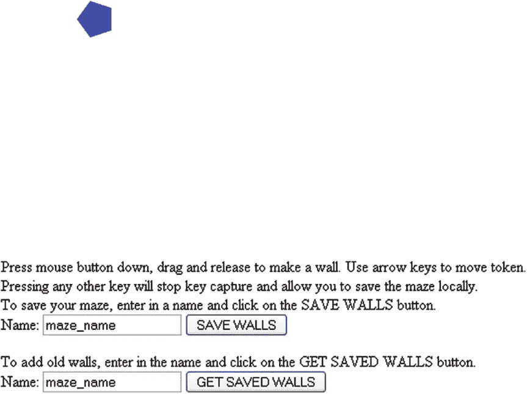

`图 7-1` 显示了用于构建、穿行、保存和读取迷宫的开始界面。

`图 7-1.` 迷宫游戏的开始界面

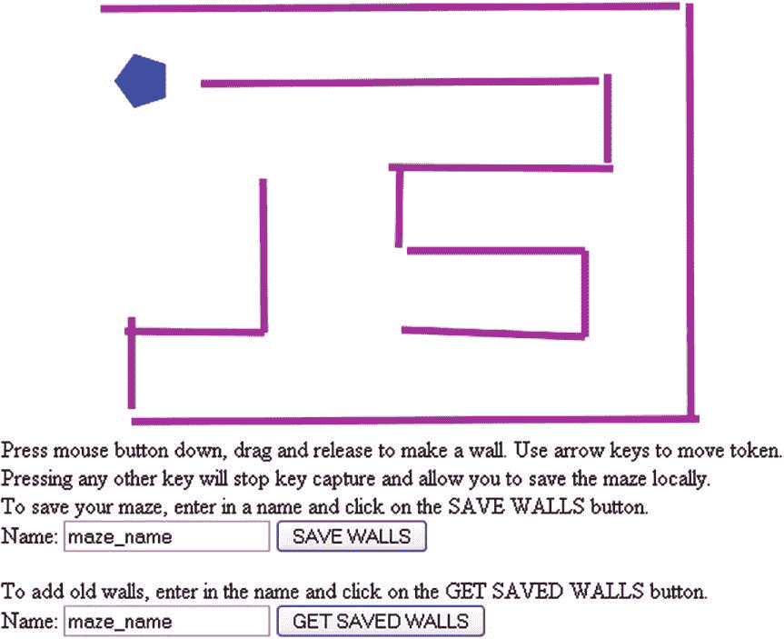

`图 7-2` 显示了在画布上放置了一些相当马虎的墙壁后的屏幕。

`图 7-2.` 迷宫的墙壁

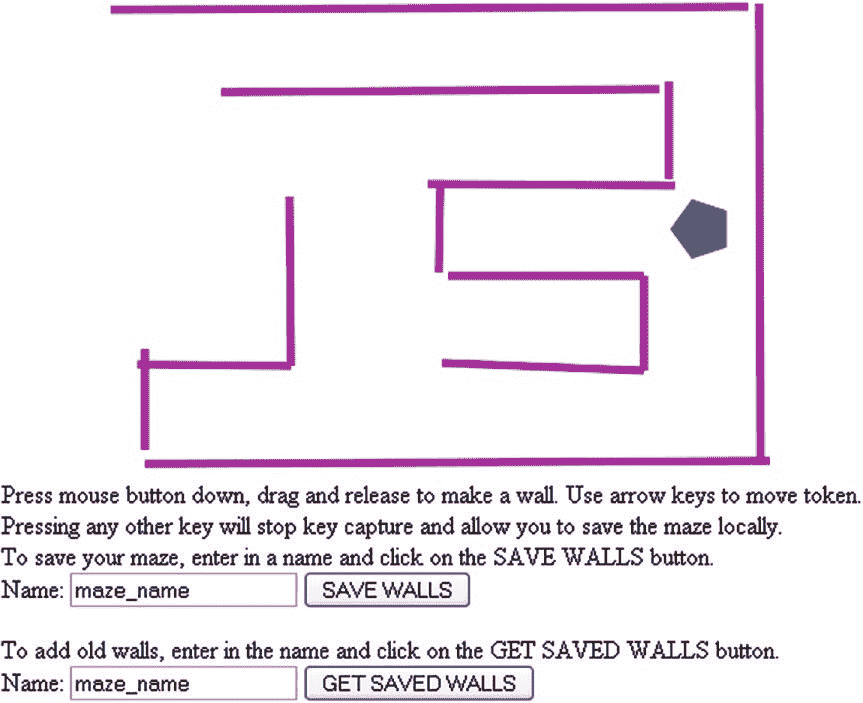

`图 7-3` 显示了玩家使用箭头键将棋子移入迷宫后的屏幕。

`图 7-3.` 在迷宫内移动棋子

如果玩家想保存一组墙壁，他或她输入一个名称并点击按钮。要读取墙壁（这些墙壁会被添加到画布上当前已有的内容中），玩家输入一个名称并按下`GET SAVED WALLS`按钮。如果该名称下没有保存任何内容，则不会发生任何操作。

第二个脚本为玩家提供了一个选择。`图 7-4` 显示了开始界面。重复说明：`travelmaze`程序假定您已使用相同的浏览器在您的计算机上构建并保存了名称为`easymaze`、`moderatemaze`和`hardmaze`的迷宫。您可以更改和/或添加这些名称。

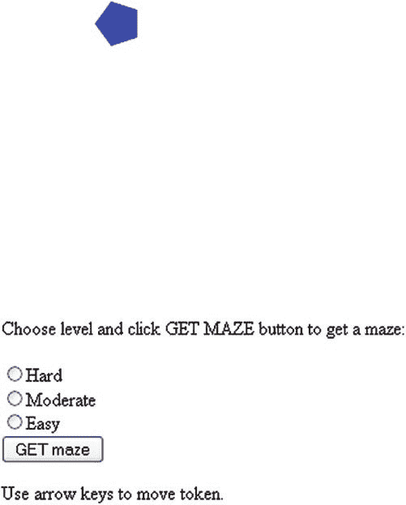

`图 7-4.` `travelmaze` 脚本的开始界面

我这样做是为了演示 HTML5 的本地存储功能，它类似于 cookie——一种供 Web 应用程序开发者存储用户信息的方式。

**注意：** Cookie 以及现在的 HTML5 `localStorage`，是所谓的*行为营销*的基础。它们为我们带来了便利——我们无需记住某些信息项，如密码——但它们也是一种被追踪和成为销售目标的方式。我在此不持立场，只是提一下这个功能。

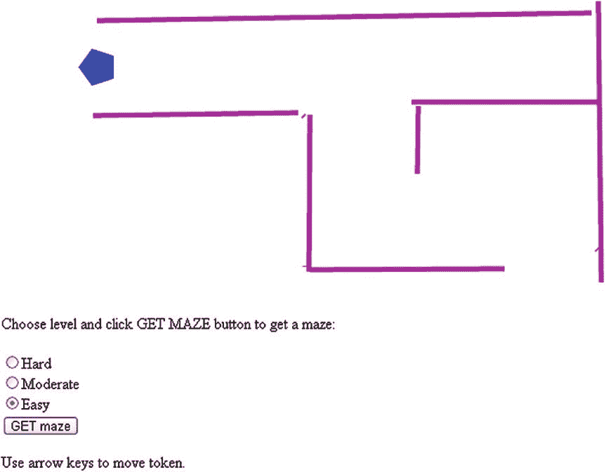

`图 7-5` 显示了一个简单的迷宫。

`图 7-5.` 一个简单的迷宫

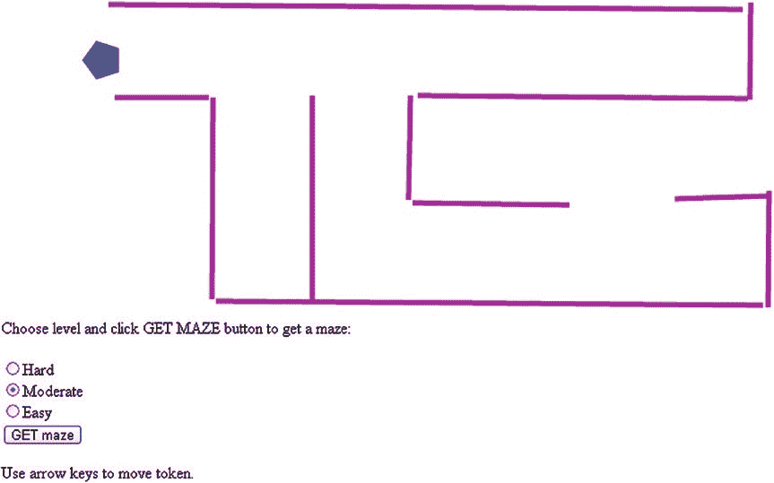

`图 7-6` 显示了一个稍微复杂的迷宫。

`图 7-6.` 一个中等难度的迷宫

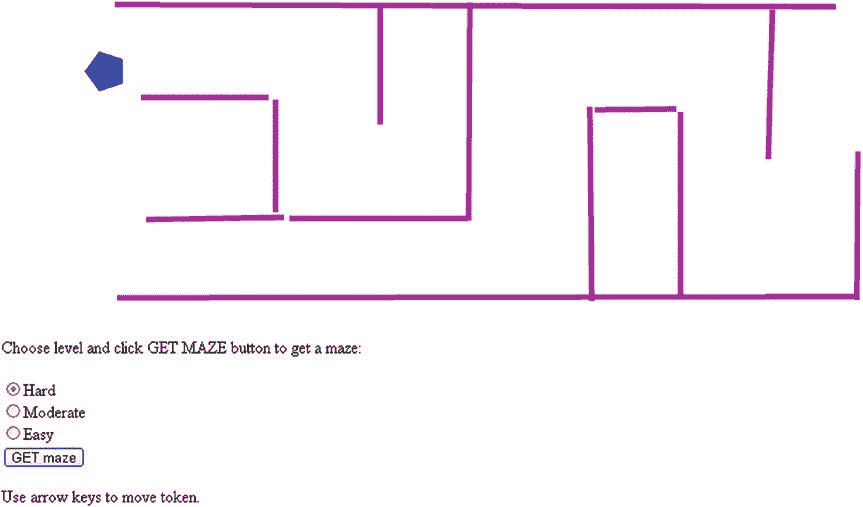

`图 7-7` 显示了一个更难的迷宫，其难度更高主要是因为玩家需要从第一个入口点移向迷宫底部才能通过。当然，设计迷宫是玩家/创建者自己的事情。

`图 7-7.` 一个更难的迷宫

一个重要的特性是，在双脚本应用程序中，点击`GET maze`按钮会强制清除当前迷宫并绘制新选择的迷宫。这与`buildmaze`程序中将旧墙壁添加到现有内容中的行为不同。与其他示例一样，这些只是程序的雏形，旨在演示 HTML5 特性和编程技术。有很大改进空间，让这些项目成为您自己的作品。

### 关键需求

迷宫应用程序需要显示一个不断更新的游戏面板，因为新的墙壁会被竖立起来，棋子也会被移动。

迷宫构建任务需要响应鼠标事件，以收集构建墙壁所需的信息。应用程序会显示正在构建的墙壁。

迷宫穿行任务需要响应箭头键来移动棋子。

游戏不能允许棋子穿过任何墙壁。

保存和读取操作要求程序对墙壁信息进行编码，将其保存在本地计算机上，然后读取它并用它来创建和显示保存的墙壁。迷宫是中等复杂结构：一个由若干墙壁组成的集合，每面墙壁由起点和终点坐标定义，即代表画布上`x,y`位置的一对数字。为了使用本地存储功能，这些信息必须转换成一个单一的字符串。

双文档版本使用单选按钮来选择迷宫。

### HTML5、CSS 和 JavaScript 特性

现在，让我们来看看实现迷宫应用程序所需的 HTML5 和 JavaScript 的具体特性。这建立在之前章节所涵盖内容的基础上：HTML 文档的通用结构；使用程序员定义的函数，包括程序员定义的对象；在画布元素上绘制由线段组成的路径；程序员对象和数组。之前的章节已经介绍了画布上的鼠标事件（第 4 章的炮弹和弹弓游戏以及第 5 章的记忆游戏）以及 HTML 元素上的鼠标事件（第 6 章的问答游戏）。我们将涵盖的新特性包括一种不同类型的事件：从玩家按下箭头键获取输入，称为*按键捕获*；以及使用本地存储在本地计算机上保存信息，即使在关闭浏览器和计算机之后也能保留。请记住，您可以跳到“构建应用程序”部分，查看带注释的所有代码，然后再回到本节阅读各个特性和技术的解释。

#### 墙壁和棋子的表示

# 第 7 章：迷宫 S

首先，我们将定义一个函数 `Wall` 来表示墙壁对象，以及另一个函数 `Token` 来表示路径点对象。我们会以比本应用所需更通用的方式来定义这些函数，但我认为这没问题：通用性对性能几乎（即便有也很少）没有影响，同时让我们能够自由地将代码用于其他应用，例如具有不同游戏棋子的游戏。我选择五边形是因为我喜欢它，并用 `myPent` 作为游戏棋子的变量名。

墙壁定义的属性包括鼠标操作指定的起点和终点。我将它们命名为 `sx`、`sy`、`fx` 和 `fy`。墙壁还有宽度和 `strokeStyle` 字符串，并指定了一个 `draw` 方法为 `drawAline`。之所以说这比必要更通用，是因为所有墙壁都会有相同的宽度和样式字符串，并且都会使用 `drawAline` 函数。当需要将墙壁保存到本地存储时，我只保存 `sx`、`sy`、`fx` 和 `fy` 的值。如果你在编写其他程序时需要存储数值，可以使用相同的技术来编码更多信息。

在迷宫中移动的路径点通过调用 `Token` 函数来定义。这个函数类似于多边形记忆游戏中定义的 `Polygon` 函数。`Token` 函数存储路径点的中心点 `sx` 和 `sy`，以及半径（`rad`）、边数（`n`）和 `fillStyle`，并将 `draw` 方法与 `drawToken` 函数关联，将 `moveit` 方法与 `moveToken` 函数关联。此外，还有一个名为 `angle` 的属性被立即计算为 `(2*Math.PI)/n`。回想一下，在弧度制测量角度时，`2*Math.PI` 代表一个完整的圆，因此这个数除以边数就是中心到每一边端点的角度。

与之前的应用（请参阅[第 4 章](http://dx.doi.org/10.1007/978-1-4842-4155-4_4)）一样，创建对象后，代码会将其添加到 `everything` 数组中。我还会将所有墙壁添加到 `walls` 数组中。正是这个数组用于将墙壁信息保存到本地存储。

## 用于构建和定位墙壁的鼠标事件

回想一下，在前几章中，我们使用 HTML5 和 JavaScript 来定义事件并指定事件处理程序。`init` 函数包含设置事件处理的代码，用于处理玩家按下主鼠标按钮、移动鼠标和释放按钮的操作。

```javascript
canvas1 = document.getElementById('canvas');
canvas1.addEventListener('mousedown', startWall, false);
canvas1.addEventListener('mousemove', stretchWall, false);
canvas1.addEventListener('mouseup', finish, false);
```

我们还会使用一个名为 `inMotion` 的变量来跟踪鼠标按钮是否被按下。`startWall` 函数确定鼠标坐标（有关事件后访问鼠标坐标的内容，请参阅[第 4 章](http://dx.doi.org/10.1007/978-1-4842-4155-4_4)和[第 5 章](http://dx.doi.org/10.1007/978-1-4842-4155-4_5)），创建一个新的 `Wall` 对象（其引用存储在全局变量 `curWall` 中），将该墙壁添加到 `everything` 数组中，绘制 `everything` 中的所有项目，并将 `inMotion` 设置为 `true`。如果 `inMotion` 不是 `true`，则 `stretchWall` 函数会立即返回而不执行任何操作。如果 `inMotion` 为 `true`，代码会获取鼠标坐标，并用它们来设置 `curWall` 的 `fx` 和 `fy` 值。当玩家按住按钮移动鼠标时，这个操作会反复执行。当按钮释放时，会调用 `finish` 函数。该函数将 `inMotion` 设置回 `false`，并将 `curWall` 添加到一个名为 `walls` 的数组中。

## 检测箭头键

检测键盘上的某个键是否被按下以及按下的是哪个键，这被称为*捕获*按键。这是 HTML5 和 JavaScript 可以处理的另一种事件类型。我们需要设置对按键事件的响应，这与设置对鼠标事件的响应类似。对任何按键按下的响应将是我编写的一个名为 `getKeyAndMove` 的函数，稍后会解释。设置事件涉及调用 `addEventListener` 方法，这次是针对 `window`（即包含 HTML 文件的内置 HTML 对象）：

```javascript
window.addEventListener('keydown', getkeyAndMove, false);
```

这条语句在第一个参数中指定了事件 `keyDown`，在第二个参数中指定了事件处理程序 `getkeyAndMove`。第三个参数与其它对象响应事件的顺序有关（由于 `false` 是默认值，因此可以省略），但这对本应用来说不是问题。这意味着当某个键被按下时，`getkeyAndMove` 函数将被调用。

**提示：** 事件处理是编程中很重要的一部分。基于事件的编程通常比本书展示的要复杂得多。例如，你可能需要考虑包含的对象或被包含的对象是否也应该响应事件，或者如果用户打开了多个窗口该怎么办。手机等设备可以检测倾斜、摇晃或用手指划过屏幕等事件。整合视频可能涉及在视频播放完毕时调用某些操作。HTML5 JavaScript 在处理事件方面并不完全一致（设置超时或时间间隔不使用 `addEventListener`），但在这一点上，你已经掌握了足够的知识去做研究，以确定你想要的事件，尝试多种可能性来弄清楚事件需要与什么关联（例如，`window` 或画布元素或其他对象），然后编写函数作为事件处理程序。另请注意，某些事件处理使用了术语 *回调*。调用指定函数的行为称为回调。

现在，你可能已经预料到，获取按下哪个键的信息的代码因浏览器而异。以下代码提供了两种获取键对应数字的方法，可在识别 HTML5 其他新功能的所有当前浏览器中工作：

```javascript
if (event == null) {
    keyCode = window.event.keyCode;
    window.event.preventDefault();
} else {
    keyCode = event.keyCode;
    event.preventDefault();
}
```

`preventDefault` 方法如其名：阻止任何默认操作，例如特定浏览器中与特定键关联的特殊快捷操作。本应用中唯一感兴趣的键是箭头键。以下 `switch` 语句用于移动变量 `myPent` 引用的 `Token`；也就是说，位置信息会被更改，以便下次绘制所有内容时路径点会移动。（这并不完全正确。`moveit` 函数包含碰撞检测，以确保我们首先不会碰到任何墙壁，但这将在后面描述。）

```javascript
switch (keyCode) {
    case 37: // 左箭头
        mypent.moveit(-unit, 0);
        break;
    case 38: // 上箭头
        mypent.moveit(0, -unit);
        break;
    case 39: // 右箭头
        mypent.moveit(unit, 0);
        break;
    case 40: // 下箭头
        mypent.moveit(0, unit);
        break;
    default:
        window.removeEventListener('keydown', getkeyAndMove, false);
}
```

**提示：** 请务必像示例代码中用注释标明不同箭头键的 `keyCode` 那样，在代码中添加注释。本书中的示例没有很多注释，因为我在相关表格中对每一行代码都提供了解释，所以这里是“按我说的做，而不是照我做的”。注释对于团队项目以及当你回到旧代码时提醒自己发生了什么至关重要。在 JavaScript 中，你可以使用 `//` 表示该行剩余部分为注释，或者使用 `/*` 和 `*/` 包围多行注释。JavaScript 解释器会忽略注释。

# 我如何知道左箭头键的键码是 37？

你可以在网上查找键码（例如[www.w3.org/2002/09/tests/keys.html](http://www.w3.org/2002/09/tests/keys.html)），或者编写一段弹出提示信息的代码。

`alert("您刚刚按下的键码是 "+keyCode);`

在我们的迷宫应用中，当按下的键不是四个方向键之一时，默认操作会停止按键事件处理。这里的假设是，玩家想要输入一个名称，以便将墙壁信息保存到本地存储或从中读取。在许多应用程序中，合适的做法是显示一条消息（可能使用`alert`），告知用户哪些按键是预期的。

## 碰撞检测：标记与任意墙壁

要穿越迷宫，玩家不能将标记移动到任何墙壁之上。我们将通过编写一个名为`intersect`的函数来强制执行此限制，该函数在给定圆心和半径的圆与线段相交时返回`true`。为此，我们需要在表述上精确：线段是直线的一部分，从`sx`、`sy`延伸到`fx`、`fy`。每堵墙对应一条有限的线段。直线本身是无限的。`intersect`函数会针对`walls`数组中的每堵墙被调用。

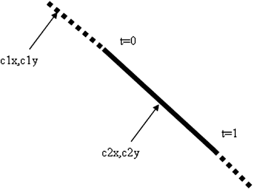

提示：我对碰撞计算中数学原理的解释相当简短，但如果你有一段时间没接触数学，可能会觉得有些困难。如果你不想深入研究，可以随意跳过，直接接受现有代码即可。

`intersect`函数基于参数化直线的概念。具体来说，直线的参数化形式使用数学公式表示如下（与代码不同，这实际上是一种混合格式，因为我确实使用了`*`表示乘法）：

*方程 a：* `x = sx + t*(fx-sx);`

*方程 b：* `y = sy + t*(fy-sy);`

`(sx,sy)` 和 `(fx,fy)` 代表线段的端点。我将直接使用`sx`、`sy`等作为变量名，而不改用`startX`之类的名称，因为这样更容易理解。

当参数`t`从 0 变化到 1 时，`x`和`y`会取到线段上对应的`x`、`y`值。目标是确定一个圆心为`cx`、`cy`、半径为`rad`的圆是否与线段重叠。一种方法是确定直线上距离`(cx, cy)`最近的点，然后检查该点到圆心的距离是否小于`rad`。在图 7-8 中，你看到了一条直线的一部分的示意图，其中线段用实线描绘，而展示出的直线其余部分用点表示。一端的`t`值为 0，另一端为 1。有两个点`c1x`、`c1y`和`c2x`、`c2y`。`(c1x, c1y)`点距离直线最近，但位于关键线段之外。`(c2x, c2y)`点则在线段中间的某处最近。其`t`值应在 0 到 1 之间。

*图 7-8. 一条线段和两个点*

两点`(x,y)`和`(cx,cy)`之间的距离公式为：

`距离 = 平方根(((cx-x)*(cx-x)+(cy-y)*(cy-y)))`

使用方程 a 和 b 替换`x`和`y`，我们得到一个距离公式。

*方程 c：* `距离 = 平方根(((cx-sx+t*(fx-sx))*(cx- sx + t*(fx- sx))+(cy- sy + t*(fy-sy))*(cy- sy + t*(fy-sy))))`

我们的目标是确定距离取最小值时的`t`值。根据微积分知识以及在这种情况下对最小值与最大值的推理，我们首先知道可以使用距离的平方来代替距离，从而避免求平方根。此外，当导数（关于`t`）为零时，该值取最小值。求导并将该表达式设为零，即可得到`(cx, cy)`离直线最近时的`t`值。在代码中，我们定义了两个额外的变量`dx`和`dy`，以使表达式更简洁。

`dx = fx-sx`

`dy = fy-sy;`

`t= 0.0 –((sx-cx)*dx+(xy-cy)*dy)/((dx*dx)+(dy*dy))`

这将产生一个`t`值。使用`0.0`是为了强制将计算作为浮点数（即带有小数部分的数字，不限于整数）进行。

我们使用方程 a 和 b 来获取与`t`值对应的`(x, y)`点。这是距离`(cx, cy)`最近的`(x, y)`点。如果`t`值小于 0，我们检查`t = 0`时的值；如果大于 1，则检查`t = 1`时的值。这意味着最近的点不在线段上，因此我们将检查线段上最接近该点的相应端点。

从`(cx, cy)`到最近点的距离是否足够近，以至于可以称为碰撞？我们再次使用距离平方而非距离。我们计算从`(cx, cy)`到计算出的`(x, y)`的距离平方。如果它小于半径的平方，则圆与线段相交。否则，不相交。使用距离平方不会产生影响：如果平方值存在最小值，那么原值也存在最小值。

现在，好消息是大部分方程并不需要写入代码中。我预先完成了求导表达式的工作。`intersect`函数如下，并附有注释：

```javascript
function intersect(sx,sy,fx,fy,cx,cy,rad) {
  var dx;
  var dy;
  var t;
  var rt;
  dx = fx-sx;
  dy = fy-sy;
  t =0.0-((sx-cx)*dx+(sy-cy)*dy)/((dx*dx)+(dy*dy)); //最近的 t 值
  if (t<0.0) { //最近点在线段起点之外
    t=0.0; 
  }
  else if (t>1.0) { //最近点在线段终点之外
    t = 1.0;
  }
  dx = (sx+t*(fx-sx))-cx; // 使用 t 定义 x 坐标
  dy = (sy +t*(fy-sy))-cy; // 使用 t 定义 y 坐标
  rt = (dx*dx) +(dy*dy); //距离的平方
  if (rt<(rad*rad)) { // 小于半径的平方？
    return true; 
  } // 相交
  else {
    return false;
  } // 不相交
}
```

在我们的应用中，玩家按下一个方向键，然后根据该键计算出标记的下一个位置。我们调用`intersect`函数来检查标记（近似为一个圆）是否会与某堵墙相交。如果`intersect`返回`true`，则标记不会移动。一旦检测到相交，检查就会停止。这是一种常见的碰撞检测技术。

## 使用本地存储

Web 最初的设计目的是将文件从服务器下载到本地（即所谓的客户端计算机）进行查看，而本地计算机上没有永久存储。随着时间的推移，构建网站的人们和组织发现某种形式的本地存储将是有利的。于是，有人提出了使用称为*cookies*的小文件来追踪信息的想法，例如存储用户 ID，以便为用户和网站所有者提供便利。随着商业 Web 的发展，Cookie 以及其他编程语言中的类似技术，以及现在的 HTML5 本地存储，其使用量已大幅增长。与此处展示的应用不同，用户通常不知道信息正在被存储、被谁存储，以及信息被访问的目的。


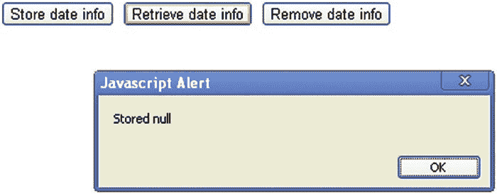

HTML5 的`localStorage`功能是特定于浏览器的。也就是说，使用 Chrome 保存的迷宫，在 Safari 中是无法访问的。

让我们通过研究一个保存日期和时间信息的小应用，来更仔细地了解如何使用本地存储。本地存储以及第 1 章中介绍的`Date`函数，提供了一种存储日期/时间信息的方法。可以将本地存储视为一个数据库，其中存储着字符串，每个字符串都对应一个特定的名称。这个名称称为*键*，字符串本身称为*值*，这个系统称为*键-值对*。本地存储仅能存储字符串这一限制，但下一节将展示如何解决这一问题。

图 7-9 显示了一个简单的日期保存应用的初始屏幕。

*图 7-9. 一个简单的日期保存应用*

用户有三个选项：存储当前日期和时间的信息、检索上次保存的信息以及删除日期信息。图 7-10 展示了首次使用此应用程序点击“检索日期信息”时发生的情况（或者在删除日期之后）。

图 7-10. 数据未保存或已删除

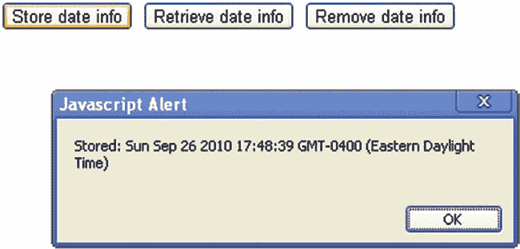

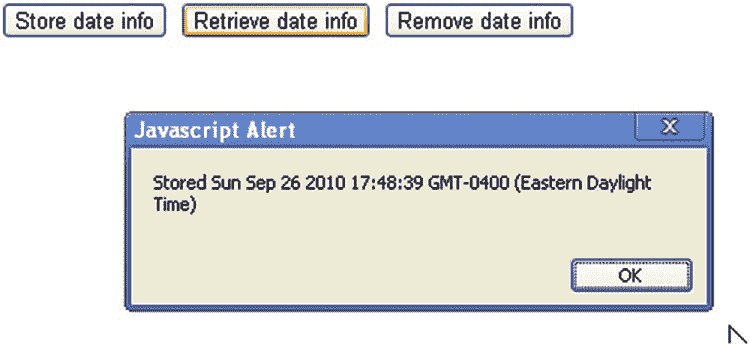

我们的应用程序使用 JavaScript 警报框来显示消息。用户需要点击“确定”按钮才能将警报框从屏幕上移除。

图 7-11 展示了用户点击“存储日期信息”按钮后的消息。

图 7-11. 存储日期信息后

如果用户稍后点击“检索日期信息”按钮，他们将看到类似于图 7-12 的消息。

图 7-12. 检索存储的日期信息

你可以为玩家提供一种通过“删除日期信息”按钮来删除存储信息的方法。图 7-13 展示了结果。

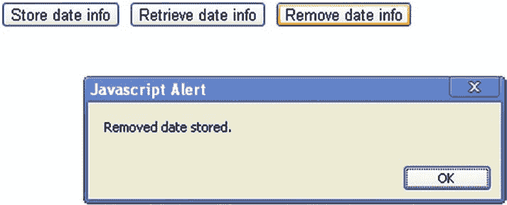

图 7-13. 删除存储信息后

HTML5 允许你使用内置对象 `localStorage` 的方法来保存、获取和删除键值对。

命令 `localStorage.setItem("lastdate",oldDate)` 设置一个新的键值对，或者替换任何之前键为 `lastdate` 的键值对。语句 `last = localStorage.getItem("lastdate");` 将获取的值赋值给变量 `last`。在我们这个简单示例的代码中，我们只是显示结果。你也可以检查某个值是否为 `null` 并提供更友好的消息。

命令 `localStorage.removeItem("lastdate")` 删除键为 `lastdate` 的键值对。

对于我们的简单日期应用程序，我们将每个按钮对象的 `onClick` 属性设置为一些 JavaScript 代码。例如：`<button onClick="javascript:store();">Store date info. </button>` 会在按钮被点击时调用 `store()`。

你可能想知道是否任何人都可以读取本地存储中保存的任何信息。答案是，对 `localStorage`（以及其他类型的 cookie）中每个键值对的访问仅限于存储该信息的网站。这是一个安全特性。

Chrome 浏览器允许使用存储在本地计算机上的 HTML5 脚本测试本地存储。在撰写第一版时，Firefox 不支持此功能，而是需要将文件上传到服务器才能使用本地存储。尽管现在所有浏览器似乎都支持 `localStorage`，但我提及这一点是为了让你做好应对不同浏览器的准备。

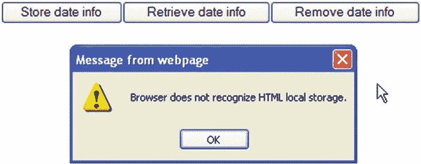

# 第七章 迷宫（MazeS）

由于可能存在其他问题，例如超出用户为本地存储和 cookie 设置的限制，因此包含一些错误检查是一个好习惯。你可以使用 JavaScript 函数 `typeof` 来检查浏览器是否支持 `localStorage`：`if (typeof(localStorage)=="undefined")`

图 7-14 显示了在旧版 Internet Explorer 中加载日期应用程序并点击“存储日期信息”按钮的结果。（在你阅读本书时，最新版本的 IE 可能已经发布，这将不再是一个问题。）

**图 7-14.** 浏览器无法识别 `localStorage`

JavaScript 还提供了一种通用机制来避免显示错误。复合语句 `try` 和 `catch` 会尝试执行一些代码，如果执行失败，则会转到 `catch` 子句。

```
try {
    oldDate = new Date();
    localStorage.setItem("lastdate", oldDate);
    alert("Stored: " + oldDate);
}
catch(e) {
    alert("Error with use of local storage: " + e);
}
```

如果你移除了 `if (typeof(localStorage)` 测试并在旧版 IE 中尝试该代码，你将看到图 7-15 中显示的消息。

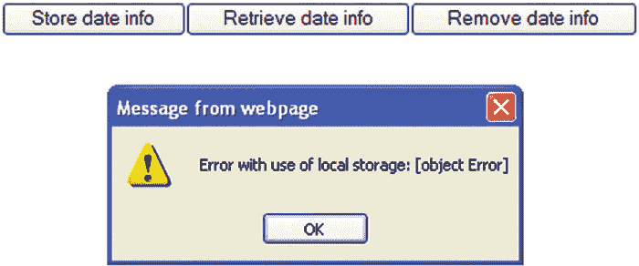

**图 7-15.** 浏览器错误，被 `try/catch` 捕获

# 表 7-1：完整的日期应用程序

表 7-1 展示了完整的日期应用程序。请记住，你可能需要将其上传到服务器才能进行测试。

## 表 7-1. 日期应用程序的完整代码

| 代码 | 说明 |
|------|------|
| `<html>` | 开始 `html` 标签。 |
| `<head>` | 开始 `head` 标签。 |
| `<title>Local Storage test</title>` | 完整的标题。 |
| `<script>` | 开始脚本。 |
| `function store() {` | `store` 函数头。 |
| `if (typeof(localStorage) ==` | 检查 `localStorage` 是否被识别。 |
| `"undefined") {` | |
| `alert("Browser does not recognize HTML Display alert message.");` | |
| `local storage.");` | |
| `}` | 关闭 `if` 子句。 |
| `else {` | `else` 分支。 |
| `try {` | 设置 `try` 子句。 |
| `oldDate = new Date();` | 定义一个新的 `Date` 对象。 |
| (*续*) | |
| `localStorage.` | 使用键存储在本地存储中 |
| `setItem("lastdate",oldDate);` | `"lastdate"`。 |
| `alert("Stored: "+oldDate);` | 显示消息，说明已存储的内容。 |
| `}` | 关闭 `try` 子句。 |
| `catch(e) {` | 开始 `catch` 子句：如果出现问题。 |
| `alert("Error with use of local` | 显示一条消息。 |
| `storage: "+e);}` | |
| `}` | 关闭 `try` 子句。 |
| `return false;` | `return false` 以防止任何页面刷新。 |
| `}` | 关闭函数。 |
| `function remove() {` | `remove` 函数头。 |
| `if (typeof(localStorage) ==` | 检查 `localStorage` 是否被识别。 |
| `"undefined") {` | |
| `alert("Browser does not recognize` | 显示警告消息。 |
| `HTML local storage.");` | |
| `}` | 关闭 `if` 子句。 |
| `else {` | `else` 分支。 |
| `localStorage.removeItem('lastdate');` | 移除使用键 `'lastdate'` 存储的项。 |
| `alert("Removed date stored.");` | 显示指示已执行操作的消息。 |
| `}` | 关闭子句。 |
| `return false;` | `return false` 以防止页面刷新。 |
| `}` | 关闭函数。 |
| (*续*) | |
| `function fetch() {` | 读取函数头。 |
| `if (typeof(localStorage) ==` | 检查 `localStorage` 是否被识别。 |
| `"undefined") {` | |
| `alert("Browser does not recognize` | 显示一条警告消息。 |
| `HTML local storage.");` | |
| `}` | 关闭 `if` 子句。 |
| `else {` | `else` 分支。 |
| `alert("Stored "+localStorage.` | 读取存储在键 |
| `getItem('lastdate'));` | `'lastdate'` 下的项并显示它。 |
| `}` | 关闭子句。 |
| `return false;` | `return false` 以防止页面刷新。 |
| `}` | 关闭函数。 |
| `</script>` | 关闭 `script` 元素。 |
| `</head>` | 关闭 `head` 元素。 |
| `<body>` | 开始 `body` 标签。 |
| `<button onClick="javascript:store();">` | 用于存储的按钮。 |
| `Store date info </button>` | |
| `<button onClick="javascript:fetch();">` | 用于检索（即读取存储数据）的按钮。 |
| `Retrieve date info </button>` | |
| `<button onClick="javascript:remove();">` | 用于移除的按钮。 |
| `Remove date info </button>` | |
| `</body>` | 关闭 `body` 标签。 |
| `</html>` | 关闭 `html` 标签。 |

将 `Date` 函数与 `localStorage` 结合，可以让你实现许多功能。例如，你可以计算玩家当前使用应用程序与上次使用之间的经过时间，或者玩家连续赢得两场比赛之间的时间。在第五章中，我们使用 `Date` 和 `getTime` 方法计算了经过的时间。回想一下，`getTime` 存储的是自 1970 年 1 月 1 日以来的毫秒数。你可以将该值转换为字符串并进行存储，然后在读取回来时，进行算术运算以计算经过的时间。

与可以设置持续时间的 JavaScript Cookie 不同，`localStorage` 的键值对会一直存在，直到它们被移除。

### 为本地存储编码数据

为简单起见，第一个应用程序仅包含一个 HTML 文档。你可以使用这个版本来创建迷宫、存储和检索迷宫，并让标记在迷宫中移动。该应用程序的第二个版本涉及两个 HTML 文档。第一个脚本与第一个应用程序相同，可用于构建、遍历和保存迷宫，以及在每个迷宫中穿行。第二个脚本仅用于遍历固定列表中的某个已保存迷宫。一组单选按钮允许玩家选择简单、中等或困难选项，前提是有人已经创建并保存了名为 `easymaze`、`moderatemaze` 和 `hardmaze` 的迷宫。你可以将这些名称更改为你想要的任何名称，并且/或者添加任意多个名称。你只需要确保在构建程序中创建、命名和保存的内容与在游览程序中引用的内容保持一致即可。

现在，让我们解决 `localStorage` 仅存储字符串的问题。这里描述的应用程序必须存储足够的关于墙壁的信息，以便这些墙壁可以添加到画布上。在单文档版本中，旧墙壁实际上被添加到画布上已有的任何内容之上。双文档版本会擦除任何旧的迷宫，并加载请求的迷宫。我使用了两个表单，每个表单都有一个用于输入名称的字段和一个提交按钮。玩家为保存迷宫选择一个名称，并且必须记住它以便检索。

要存储的数据是一个字符串，即一段文本。我们将通过为每堵墙执行以下操作，来创建包含一组墙壁信息的文本：

- 将 `sx`、`sy`、`fx`、`fy` 组合成一个名为 `w` 的数组，用于表示单堵墙。
- 使用 `join` 方法，利用 `w` 数组生成一个由 `+` 号分隔的字符串。
- 将每个这样的字符串添加到一个名为 `allw` 的数组中，用于表示所有墙壁。
- 再次使用 `join` 方法，利用 `allw` 数组生成一个名为 `sw` 的字符串。

`sw` 字符串变量将保存所有墙壁的所有坐标（每堵墙四个数字）。下一步是使用 `localStorage.setItem` 方法，将 `sw` 存储在玩家提供的名称下。我们使用上一节中解释过的 `try` 和 `catch` 结构来执行此操作。

```
try {
   localStorage.setItem(lsname,sw);
}
catch (e) {
   alert("data not saved, error given: "+e);
}
```

这是一种通用技术，它会尝试某件事，抑制任何错误消息，如果出现错误，则会调用 `catch` 块中的代码。

**注意** 这并不总是按你的意图工作。例如，当直接在计算机上通过 Firefox 执行此应用程序时（而不是从服务器下载的文件），`localStorage` 语句不会引发错误，但不会存储任何内容。当 HTML 文件通过 Firefox 从服务器下载时，此代码可以工作；并且创建脚本在作为本地文件以及通过 Chrome 下载时都能工作。双脚本版本必须在服务器上针对每个浏览器进行测试。

检索信息的工作方式类似。代码提取玩家提供的名称来设置变量 `lsname`，然后使用

```
swalls = localStorage.getItem(lsname);
```

# 第 7 章 迷宫

来设置变量 `swalls`。如果这不是 `null`，我们使用字符串方法 `split` 来执行与 `join` 相反的操作：在给定的符号处拆分字符串（我们在每个分号处拆分），并将值分配给数组的连续元素。相关的代码行是

```
wallstgs = swalls.split(";");
```

和

```
sw = wallstgs[i].split("+");
```

接下来，代码使用刚刚检索到的信息以及固定的墙壁宽度和墙壁样式信息，来创建一个新的 `Wall` 对象：

```
curWall = new Wall(sx,sy,fx,fy,wallWidth,wallStyle);
```

最后，还有将 `curWall` 添加到 `everything` 数组和 `walls` 数组的代码。

## 单选按钮

单选按钮是一组按钮，在该组中只能选择一个成员。如果玩家做出新选择，旧选择将被取消选中。对于此应用程序的困难/中等/简单选择来说，它们是合适的选择。以下是 `<body>` 部分中的 HTML 标记：

```
<form name="gf" onSubmit="return getWalls()" >
   <br/>
   <input type="radio" value="hard" name="level" />困难 <br/>
   <input type="radio" value="moderate" name="level" />中等 <br/>
   <input type="radio" value="easy" name="level" />简单<br/>
   <input type="submit" value="获取迷宫"/><br/>
</form>
```

注意所有三个输入元素都具有相同的 `name` 属性。这是定义一个单选按钮组的关键，该组中一次只能选中一个按钮。在此例中，标记创建了一个名为 `level` 的数组。`getWalls` 函数将在下一节中完整展示。它类似于一体化脚本中的函数。但在此例中，`localStorage` 项的名称由单选按钮决定。代码如下：

```
for (i=0; i<document.gf.level.length; i++) {
  if (document.gf.level[i].checked) {
    lsname = document.gf.level[i].value + "maze";
    break;
  }
}
```

`for` 循环遍历所有输入项。`if` 测试基于 `checked` 属性。当检测到 `true` 条件时，变量 `lsname` 由该项的 `value` 属性构成，并且 `break;` 语句将使执行流程退出 `for` 循环。如果你希望单选按钮在初始状态下有一项被选中，可以使用如下代码：

```
<input type="radio" value="easy" name="level" checked />
```

或这样：

```
<input type="radio" value="easy" name="level" checked="true" />
```

### 构建应用并使其成为你自己的作品

现在让我们来看看迷宫应用的编码，首先是一体化脚本，然后是双脚本版本中的第二个脚本。

表 7-2 展示了用于创建、保存、检索和穿梭迷宫的脚本中的函数。请注意，许多函数的调用是通过事件处理完成的：`onLoad`、`onSubmit` 和 `addEventListener` 调用。这些调用并非直接或立即执行函数，而是设置在指定事件发生时进行调用。

**表 7-2.** 迷宫应用中的函数

| **函数** | **调用方/被谁调用** | **调用哪些函数或方法** |
| --- | --- | --- |
| `init` | 由 `body` 标签中的 `onLoad` 动作调用 | `drawAll` |
| `drawAll` | `init`, `startWall`, `stretchWall`, `getkeyAndMove`, `getWalls` | `Wall` 和 `token` 的 `draw` 方法：`drawToken` 和 `drawAline` |
| `Token` | `var` 语句声明 `mypent` | `Wall` |
| `startWall`, `getWalls` | `drawAll` | 使用 `everything` 数组中 `token` 对象的 `draw` 方法 |
| `drawToken` | `drawAll` | 使用 `myPent` 的 `moveit` 方法 |
| `moveToken` | `getkeyAndMove` | `drawAline` |
| `intersect` | `drawAll` | 使用 `everything` 数组中 `Wall` 对象的 `draw` 方法 |
| `startWall` | 由 `init` 中的 `addEventListener` 调用触发 | `drawAll`, `Wall` |
| `stretchWall` | 由 `init` 中的 `addEventListener` 调用触发 | `drawAll` |
| `finish` | 由 `init` 中的 `addEventListener` 调用触发 | |
| `getkeyAndMove` | 由 `init` 中的 `addEventListener` 调用触发 | `moveToken`，使用 `myPent` 的 `moveit` 方法 |
| `saveWalls` | 由 `sf` 表单的 `onSubmit` 调用 | |
| `getWalls` | 由 `gf` 表单的 `onSubmit` 调用 | `drawAll`, `Wall` |

表 7-3 展示了迷宫应用的完整代码及解释。

**表 7-3.** 一体化迷宫应用的完整代码

| **代码** | **解释** |
| --- | --- |
| `<html>` | 开头的 `html` 标签。 |
| `<head>` | 开头的 `head` 标签。 |
| `<title>Build maze & travel maze</title>` | 完整的 `title` 元素。 |
| `<script type="text/javascript">` | 开头的 `script` 标签。 |
| `var cwidth = 900;` | 用于清除画布。 |
| `var cheight = 350;` | 用于清除画布。 |
| `var ctx;` | 用于保存画布上下文。 |
| `var everything = [];` | 用于保存所有对象。 |
| `var curWall;` | 用于表示正在构建的墙壁。 |
| `var wallWidth = 5;` | 固定的墙壁宽度。 |
| `var wallStyle = "rgb(200,0,200)";` | 固定的墙壁颜色。 |
| `var walls = [];` | 保存所有墙壁。 |
| `var inMotion = false;` | 当通过拖拽构建墙壁时，该标志为真。 |
| `var unit = 10;` | 令牌的移动单位。 |
| `function Token(sx, sy, rad, styleString, n) {` | 构建令牌的函数头。 |
| `this.sx = sx;` | 设置 `sx` 属性。 |
| `this.sy = sy;` | 设置 `sy` 属性。 |
| `this.rad = rad;` | 设置 `rad` 属性（半径）。 |
| `this.draw = drawToken;` | 设置 `draw` 方法。 |
| `this.n = n;` | 设置 `n` 边数。 |
| `this.angle = (2 * Math.PI) / n;` | 计算并设置角度。 |
| （*续*） | |
| `this.moveit = moveToken;` | 设置 `moveit` 方法。 |
| `this.fillstyle = styleString;` | 设置颜色。 |
| `}` | 结束函数。 |
| `function drawToken() {` | `drawToken` 函数头。 |
| `ctx.fillStyle = this.fillstyle;` | 设置颜色。 |
| `var i;` | 索引。 |
| `var rad = this.rad;` | 设置 `rad`。 |
| `ctx.beginPath();` | 开始路径。 |
| `ctx.moveTo(this.sx+rad*Math.cos(-.5*this.angle),this.sy+rad*Math.sin(-.5*this.angle));` | 移动到令牌多边形（五边形）的第一个顶点。 |
| `for (i=1;i<this.n;i++) {` | |

for 循环绘制令牌的`n`条边：此处为五边形。

```
ctx.lineTo(this.sx+rad*Math.cos((i-.5)*this.angle),this.sy+rad*Math.sin((i-.5)*this.angle));
```

指定到下一个顶点的线条，设置五边形一条边的绘制。

```
}
```

关闭 for 循环。

```
ctx.fill();
```

绘制令牌。

```
}
```

关闭函数。

```
function moveToken(dx,dy) {
```

函数头。

```
this.sx += dx;
```

增加 x 值。

```
this.sy += dy;
```

增加 y 值。

```
var i;
```

索引。

```
var wall;
```

用于每个墙。

```
for(i=0;i<walls.length;i++) {
```

循环遍历所有墙。

```
wall = walls[i];
```

提取第 i 个墙。

```
if (intersect(wall.sx,wall.sy,wall.fx,wall.fy,this.sx,this.sy,this.rad)) {
```

检查相交。如果令牌的新位置与该特定墙之间存在交集。

```
this.sx -= dx;
```

将 x 改回——不执行本次移动。

```
this.sy -= dy;
```

将 y 改回——不执行本次移动。

```
break;
```

离开 for 循环，因为如果与一面墙发生碰撞，则无需进行更多检查。

```
}
```

关闭 if true 子句。

```
}
```

关闭 for 循环。

```
}
```

关闭函数。

```
function Wall(sx,sy,fx,fy,width,styleString) {
```

创建`Wall`的函数头。

```
this.sx = sx;
```

设置`sx`属性。

```
this.sy = sy;
```

设置`sy`。

```
this.fx = fx;
```

设置`fx`。

```
this.fy = fy;
```

设置`fy`。

```
this.width = width;
```

设置`width`。

```
this.draw = drawAline;
```

设置`draw`方法。

```
this.strokestyle = styleString;
```

设置`strokestyle`。

```
}
```

关闭函数。

```
function drawAline() {
```

`drawAline`的函数头。

```
ctx.lineWidth = this.width;
```

设置线宽。

```
ctx.strokeStyle = this.strokestyle;
```

设置`strokestyle`。

```
ctx.beginPath();
```

开始路径。

```
ctx.moveTo(this.sx,this.sy);
```

移动到线条起点。

```
ctx.lineTo(this.fx,this.fy);
```

设置线条到终点。

```
ctx.stroke();
```

绘制线条。

```
}
```

关闭函数。

```
var mypent = new Token(100,100,20,"rgb(0,0,250)",5);
```

将`mypent`设置为五边形形状作为游戏棋子。

```
everything.push(mypent);
```

添加到`everything`。

```
function init(){
```

`init`的函数头。

```
ctx = document.getElementById('canvas').getContext('2d');
```

为所有绘制定义`ctx`（上下文）。

```
canvas1 = document.getElementById('canvas');
```

定义`canvas1`，用于事件。

```
canvas1.addEventListener('mousedown',startWall,false);
```

设置`mousedown`的处理。

```
canvas1.addEventListener('mousemove',stretchWall,false);
```

设置`mousemove`的处理。

```
canvas1.addEventListener('mouseup',finish,false);
```

设置`mouseup`的处理。

```
window.addEventListener('keydown', getkeyAndMove,false);
```

设置箭头键使用的处理。

```
drawAll();
```

绘制所有内容。

```
}
```

关闭函数。

```
function startWall(ev) {
```

`startWall`的函数头。

```
var mx;
```

保存鼠标 x 坐标。

```
var my;
```

保存鼠标 y 坐标。

```
mx = ev.pageX;
```

设置`mx`。

```
my = ev.pageY;
```

设置`my`。

```
curWall = new Wall(mx,my,mx+1,my+1,wallWidth,wallStyle);
```

创建一个新的墙。此时它很小。

```
inMotion = true;
```

将`inMotion`设置为`true`。

```
everything.push(curWall);
```

将`curWall`添加到`everything`。

```
drawAll();
```

绘制所有内容。

```
}
```

关闭函数。

```
function stretchWall(ev) {
```

`stretchWall`的函数头，用于在鼠标拖拽时拉伸墙。

```
if (inMotion) {
```

检查是否处于运动状态。

```
var mx;
```

保存鼠标 x 坐标。

```
var my;
```

保存鼠标 y 坐标。

```
mx = ev.pageX;
```

设置`mx`。

```
my = ev.pageY;
```

设置`my`。

```
curWall.fx = mx;
```

将`curWall.fx`更改为`mx`。

```
curWall.fy = my;
```

将`curWall.fy`更改为`my`。

```
drawAll();
```

绘制所有内容（将显示正在增长的墙）。

```
}
```

关闭`if inMotion`。

```
}
```

关闭函数。

```
function finish(ev) {
```

`finish`的函数头。

```
inMotion = false;
```

将`inMotion`设置为`false`。

```
walls.push(curWall);
```

将`curWall`添加到`walls`。

```
}
```

关闭函数。

```
function drawAll() {
```

`drawAll`的函数头。

```
ctx.clearRect(0,0,cwidth,cheight);
```

擦除整个画布。

```
var i;
```

索引。

```
for (i=0;i<everything.length;i++) {
```

循环遍历`everything`。

# 第 7 章 MazeS（迷宫）

## 表 7-3.（续）

| 代码 | 说明 |
|------|------|
| `length;i++) {` | |
| `everything[i].draw();` | 绘制所有内容。 |
| `}` | 关闭循环。 |
| `}` | 关闭函数。 |

```javascript
function getKeyAndMove(event) {
```

函数头`getKeyAndMove`。

| 代码 | 说明 |
|------|------|
| `var keyCode;` | 存放按键码`keyCode`。 |
| `if(event == null) {` | 如果事件为空。 |
| `keyCode = window.event.keyCode;` | 使用`window.event`获取`keyCode`。 |
| `window.event.preventDefault();` | 阻止默认行为。 |
| `}` | 关闭子句。 |
| `else {` | 否则。 |
| `keyCode = event.keyCode;` | 从事件中获取`keyCode`。 |
| `event.preventDefault();` | 阻止默认行为。 |
| `}` | 关闭子句。 |
| `switch(keyCode) {` | 根据`keyCode`进行切换。 |
| `case 37:` | 如果为左箭头。 |
| `mypent.moveit(-unit,0);` | 水平向后移动。 |
| `break;` | 离开`switch`。 |
| `case 38:` | 如果为上箭头。 |
| `mypent.moveit(0,-unit);` | 向屏幕上方移动。 |
| `break;` | 离开`switch`。 |

## 表 7-3.（续）

| 代码 | 说明 |
|------|------|
| `case 39:` | 如果为右箭头。 |
| `mypent.moveit(unit,0);` | 向左移动。 |
| `break;` | 离开`switch`。 |
| `case 40:` | 如果为下箭头。 |
| `mypent.moveit(0,unit);` | 向屏幕下方移动。 |
| `break;` | 离开`switch`。 |
| `default:` | 其他情况。 |
| `window.removeEventListener('keydown',getkeyAndMove,false);` | 停止监听按键。假设玩家试图保存到本地存储或从本地存储中读取。 |
| `}` | 关闭`switch`。 |
| `drawAll();` | 绘制所有内容。 |
| `}` | 关闭函数。 |

```javascript
function intersect(sx,sy,fx,fy,
```

函数头`intersect`。

| 代码 | 说明 |
|------|------|
| `cx,cy,rad) {` | |
| `var dx;` | 用于存放中间值。 |
| `var dy;` | 用于存放中间值。 |
| `var t;` | 用于表示`t`中的表达式。 |
| `var rt;` | 用于存放距离的平方。 |
| `dx = fx-sx;` | 设置 x 的差值。 |
| `dy = fy-sy;` | 设置 y 的差值。 |
| `t =0.0-((sx-cx)*dx+(sy-cy)*dy)/((dx*dx)+(dy*dy));` | 这一行来源于计算每一点到`cx,cy`距离平方的公式，然后求导并令其等于 0。 |
| `if (t<0.0) {` | 如果最近点位于`t < 0`处。 |
| `t=0.0; }` | 在 0 处检查（这将更远）。 |
| `else if (t>1.0) {` | 如果最近点位于`t > 1`处。 |

## 表 7-3.（续）

| 代码 | 说明 |
|------|------|
| `t = 1.0;` | 在 1 处检查（这将更远）。 |
| `}` | 关闭子句。 |
| `dx = (sx+t*(fx-sx))-cx;` | 计算在此`t`值下的差值。 |
| `dy = (sy +t*(fy-sy))-cy;` | 计算在此`t`值下的差值。 |
| `rt = (dx*dx) +(dy*dy);` | 计算距离的平方。 |
| `if (rt<(rad*rad)) {` | 与`rad`的平方进行比较。 |
| `return true; }` | 返回`true`。 |
| `else {` | 否则。 |
| `return false;}` | 返回`false`。 |
| `}` | 关闭函数。 |

```javascript
function saveWalls() {
```

函数头`saveWalls`。

| 代码 | 说明 |
|------|------|
| `var w = [];` | 临时数组。 |
| `var allw=[];` | 临时数组。 |
| `var sw;` | 存放最终字符串。 |
| `var oneWall;` | 存放中间字符串。 |
| `var i;` | 索引。 |
| `var lsname = document.sf.slname.value;` | 提取玩家的名称用于本地存储。 |
| `for (i=0;i<walls.length;i++) {` | 遍历所有墙壁。 |
| `w.push(walls[i].sx);` | 将`sx`添加到`w`数组中。 |
| `w.push(walls[i].sy);` | 将`sy`添加到`w`数组中。 |
| `w.push(walls[i].fx);` | 将`fx`添加到`w`数组中。 |
| `w.push(walls[i].fy);` | 将`fy`添加到`w`数组中。 |
| `onewall = w.join("+");` | 生成一个字符串。 |
| `allw.push(onewall);` | 添加到`allw`数组中。 |

## 表 7-3.（续）

| 代码 | 说明 |
|------|------|
| `w = [];` | 将`w`重置为空数组。 |
| `}` | 关闭循环。 |
| `sw = allw.join(";");` | 现在将`allw`转换为一个字符串。 |
| `try {` | 尝试。 |
| `localStorage.setItem(lsname,sw);` | 保存到`localStorage`。 |
| `}` | 结束`try`。 |
| `catch (e) {` | 如果出现可捕获的错误。 |
| `alert("data not saved, error given: "+e);` | 显示消息。 |
| `}` | 结束`catch`子句。 |
| `return false;` | 返回`false`以避免刷新。 |
| `}` | 关闭函数。 |

```javascript
function getWalls() {
```

函数头`getWalls`。

| 代码 | 说明 |
|------|------|
| `var swalls;` | 临时存储。 |
| `var sw;` | 临时存储。 |
| `var i;` | 索引。 |
| `var sx;` | 存放`sw`值。 |
| `var sy;` | 存放`sy`值。 |
| `var fx;` | 存放`fx`值。 |
| `var fy;` | 存放`fy`值。 |
| `var curWall;` | 存放正在创建的墙壁。 |
| `var lsname = document.gf.glname.value;` | 提取玩家的名称以便从存储中检索。 |
| `swalls=localStorage.getItem(lsname);` | 获取存储内容。 |

## 表 7-3.（续）

| 代码 | 说明 |
|------|------|
| `if (swalls!=null) {` | 如果取到了内容。 |
| `wallstgs = swalls.split(";");` | 分割以生成数组。 |
| `for (i=0;i<wallstgs.length;i++) {` | 遍历此数组。 |
| `sw = wallstgs[i].split("+");` | 分割单个项目。 |
| `sx = Number(sw[0]);` | 提取第 0 个值并转换为数字。 |
| `sy = Number(sw[1]);` | 提取第 1 个值并转换为数字。 |
| `fx = Number(sw[2]);` | 提取第 2 个值并转换为数字。 |
| `fy = Number(sw[3]);` | 提取第 3 个值并转换为数字。 |

# 第 7 章 迷宫

## 表 7-3（续）

| 代码 | 说明 |
|------|------|
| `curWall = new Wall(sx,sy,fx,fy, wallWidth, wallStyle);` | 使用提取并固定的值创建新墙壁。 |
| `walls.push(curWall);` | 添加到墙壁数组。 |
| `everything.push(curWall);` | 添加到全部对象数组。 |
| `}` | 关闭循环。 |
| `drawAll();` | 绘制所有内容。 |
| `}` | 关闭非空判断。 |
| `else {` | 值为空。 |
| `alert("No data retrieved.");` | 未检索到数据。 |
| `}` | 关闭子句。 |
| `window.addEventListener('keydown', getkeyAndMove, false);` | 设置按键动作。 |
| `return false;` | 返回 `false` 以防止刷新。 |
| `}` | 关闭函数。 |
| `</script>` | |
| `</head>` | 结束 `head` 元素。 |

*(续)*

| 代码 | 说明 |
|------|------|
| `<body onLoad="init();" >` | 开始 `body`；设置对`init`的调用。 |
| `<canvas id="canvas" width="900" height="350">` | `Canvas` 标签。 |
| `Your browser doesn't support the HTML5 element canvas.` | 针对某些浏览器的警告。 |
| `</canvas>` | 关闭 `canvas`。 |
| `<br/>` | 换行。 |
| 按下鼠标按钮，拖动并释放以创建墙壁。使用箭头键移动令牌。 | 操作说明。 |
| `<br/>` | 操作说明与换行。 |
| 按下任何其他键将停止按键捕捉，并允许您在本地保存迷宫。 | 操作说明。 |
| `<form name="sf" onSubmit="return saveWalls()" >` | 表单标签；设置对`saveWalls`的调用。 |
| 要保存您的迷宫，请输入名称并点击“保存墙壁”按钮。<br/>使用名称 `<em>easymaze</em>`、`<em>moderatemaze</em>` 和 `<em>hardmaze</em>` 以便在 `travelmaze` 程序中使用。 | 操作说明。这些名称必须与`travelmaze`中使用的名称相匹配。 |
| `<br/>` | |
| 名称：`<input name="slname" value="maze_name" type="text">` | 标签和输入字段。 |
| `<input type="submit" value="SAVE WALLS"/>` | 提交按钮。 |

*(续)*

| 代码 | 说明 |
|------|------|
| `</form>` | 关闭表单。 |
| `<form name="gf" onSubmit="return getWalls()" >` | 表单标签；设置对`getWalls`的调用。 |
| 要添加旧墙壁，请输入名称并点击“获取已保存墙壁”按钮。<br/> | 操作说明。 |
| 名称：`<input name="glname" value="maze_name" type="text">` | 标签和输入字段。 |
| `<input type="submit" value="GET SAVED WALLS"/>` | 提交按钮。 |
| `</form>` | 关闭表单。 |
| `</body>` | 关闭 `body`。 |
| `</html>` | 关闭 HTML。 |

## 创建旅行迷宫应用程序

只要位于同一服务器上，`localStorage` 数据可以被与创建数据的 HTML 文档不同的另一个 HTML 文档访问。如前所述，这是一项安全功能，将本地存储的读取权限限制在同一服务器上的脚本。

第二个脚本正是基于此功能。表 7-4 显示了相互调用或调用的函数；它是前一个表的一个子集。

### 表 7-4. 旅行迷宫脚本中的函数

| 函数 | 由谁调用/调用者 | 调用谁 |
|------|-----------------|--------|
| `init` | 由 `body` 标签中的`onLoad`动作调用 | `drawAll` |
| `drawAll` | `init` | `startWall`、`stretchWall`、`getkeyAndMove`、`getWalls`、墙壁的 `draw` 方法和令牌的 `draw` 方法：`drawToken`和`drawAline` |
| `Token` | 声明`mypent`的变量语句 | `Wall` |
| `Wall` | `startWall`、`getWalls` | |
| `drawToken` | 通过`everything`数组中令牌对象的 `draw` 方法由`drawAll`调用 | |
| `moveToken` | 通过`mypent`的`moveit`方法由`getKeyAndMove`调用 | `intersect` |
| `drawAline` | 通过`everything`数组中 `Wall` 对象的 `draw` 方法由`drawAll`调用 | |
| `getkeyAndMove` | 由`init`中`addEventListener`调用的动作调用 | 通过`mypent`的`moveit`方法调用`moveToken` |
| `getWalls` | 由`gf`表单的`onSubmit`动作调用 | `drawAll`、`Wall` |
| `intersect` | `moveToken` | |

这些函数与一体化脚本中的相同，但有一个例外，即`getWalls`函数，因此我仅对新增或修改的代码进行了注释。此应用程序还用单选按钮替代了表单输入字段。表 7-5 显示了`travelmaze`应用程序的完整代码。

### 表 7-5. 旅行迷宫脚本的完整代码

| 代码 | 说明 |
|------|------|
| `<html>` | |
| `<head>` | |
| `<title>Travel maze</title>` | 旅行迷宫。 |
| `<script type="text/javascript">` | |
| `var cwidth = 900;` | |
| `var cheight = 700;` | |
| `var ctx;` | |
| `var everything = [];` | |
| `var curWall;` | |
| `var wallWidth = 5;` | |
| `var wallStyle = "rgb(200,0,200)";` | |
| `var walls = [];` | |
| `var inMotion = false;` | |
| `var unit = 10 ;` | |
| `function Token(sx,sy,rad,styleString,n)` | |
| `{` | |
| `this.sx = sx;` | |
| `this.sy = sy;` | |
| `this.rad = rad;` | |
| `this.styleString = styleString;` | |
| `this.n = n;` | |
| `}` | |
| `this.draw = drawToken;` | |
| `this.n = n;` | |
| `this.angle = (2*Math.PI)/n` | |
| `this.moveit = moveToken;` | |
| `this.fillStyle = styleString;` | |
| `}` | |
| `function drawToken() {` | |
| `ctx.fillStyle=this.fillStyle;` | |
| `ctx.beginPath();` | |
| `var i;` | |
| `var rad = this.rad ;` | |
| `ctx.beginPath();` | |
| `ctx.moveTo(this.sx+rad*Math.cos(-.5*this.angle),this.sy+rad*Math.sin(-.5*this.angle));` | |

# 第 7 章 迷宫 S

## 表 7-5. (续)

| 代码 | 说明 |
| :--- | :--- |
| `for (i=1;i<this.n;i++) {` | |
| `ctx.lineTo(this.sx+rad*Math.cos((i-.5)*this.angle),this.sy+rad*Math.sin((i-.5)*this.angle));` | |
| `}` | |
| `ctx.fill();` | |
| `}` | |
| `function moveToken(dx,dy) {` | |
| `this.sx +=dx;` | |
| `this.sy +=dy;` | |
| `var i;` | |
| `var wall;` | |
| `for(i=0;i<walls.length;i++) {` | |
| `wall = walls[i];` | |
| `if (intersect(wall.sx,wall.sy,wall.fx,wall.fy,this.sx,this.sy,this.rad)) {` | |
| `this.sx -=dx;` | |
| `this.sy -=dy ;` | |
| `break;` | |
| `}` | |
| `}` | |
| `}` | |

## 表 7-5. (续)

| 代码 | 说明 |
| :--- | :--- |
| `function Wall(sx,sy,fx,fy,width,styleString) {` | |
| `this.sx = sx;` | |
| `this.sy = sy;` | |
| `this.fx = fx;` | |
| `this.fy = fy;` | |
| `this.width = width;` | |
| `this.draw = drawAline;` | |
| `this.strokestyle = styleString;` | |
| `}` | |
| `function drawAline() {` | |
| `ctx.lineWidth = this.width;` | |
| `ctx.strokeStyle = this.strokestyle;` | |
| `ctx.beginPath();` | |
| `ctx.moveTo(this.sx,this.sy);` | |
| `ctx.lineTo(this.fx,this.fy);` | |
| `ctx.stroke() ;` | |
| `}` | |

## 表 7-5. (续)

| 代码 | 说明 |
| :--- | :--- |
| `var mypent = new Token(100,100,20,"rgb(0,0,250)",5);` | |
| `everything.push(mypent);` | |
| `function init(){` | |
| `ctx = document.getElementById('canvas').getContext('2d');` | |
| `window.addEventListener('keydown',getkeyAndMove,false);` | |
| `drawAll();` | |
| `}` | |
| `function drawAll() {` | |
| `ctx.clearRect(0,0,cWidth,cHeight);` | |
| `var i;` | |
| `for (i=0;i<everything.length;i++) {` | |
| `everything[i].draw() ;` | |
| `}` | |
| `}` | |
| `function getKeyAndMove(event) {` | |
| `var keyCode;` | |
| `if(event == null)` | |
| `{` | |
| `keyCode = window.event.keyCode;` | |
| `window.event.preventDefault();` | |
| `}` | |

## 表 7-5. (续)

| 代码 | 说明 |
| :--- | :--- |
| `else` | |
| `{` | |
| `keyCode = event.keyCode;` | |
| `event.preventDefault();` | |
| `}` | |
| `switch(keyCode)` | |
| `{` | |
| `case 37: //left arrow` | |
| `mypent.moveit(-unit,0);` | |
| `break ;` | |
| `case 38: //up arrow` | |
| `mypent.moveit(0,-unit);` | |
| `break;` | |
| `case 39: //right arrow` | |
| `mypent.moveit(unit,0);` | |
| `break;` | |
| `case 40: //down arrow` | |
| `mypent.moveit(0,unit);` | |
| `break;` | |
| `default:` | |
| `window.removeEventListener('keydown',getkeyAndMove,false);` | |
| `}` | |
| `drawAll();` | |
| `}` | |

## 表 7-5. (续)

| 代码 | 说明 |
| :--- | :--- |
| `function intersect(sx,sy,fx,fy,cx,cy,rad) {` | |
| `var dx;` | |
| `var dy;` | |
| `var t ;` | |
| `var rt;` | |
| `dx = fx-sx;` | |
| `dy = fy-sy;` | |
| `t =0.0-((sx-cx)*dx+(sy-cy)*dy)/((dx*dx)+(dy*dy));` | |
| `if (t<0.0) {` | |
| `t=0.0; }` | |
| `else if (t>1.0) {` | |
| `t = 1.0;` | |
| `}` | |
| `dx = (sx+t*(fx-sx))-cx;` | |
| `dy = (sy +t*(fy-sy))-cy;` | |
| `rt = (dx*dx) +(dy*dy);` | |
| `if (rt<(rad*rad)) {` | |
| `return true; }` | |
| `else {` | |
| `return false;}` | |
| `}` | |
| `function getWalls() {` | |
| `var swalls ;` | |

## 表 7-5. (续)

| 代码 | 说明 |
| :--- | :--- |
| `var sw;` | |
| `var i;` | |
| `var sx;` | |
| `var sy;` | |
| `var fx;` | |
| `var fy;` | |
| `var curWall;` | |
| `var lsname;` | |
| `for (i=0;i<document.gf.level.length;i++) {` | 遍历`gf`表单中名为`level`的单选按钮组。 |
| `if (document.gf.level[i].checked) {` | 这个单选按钮是否被选中？ |
| `lsname= document.gf.level[i].value+"maze";` | 如果是，则使用该单选按钮元素的`value`属性构建本地存储名称。 |
| `break;` | 退出`for`循环。 |
| `}` | 关闭`if`。 |
| `}` | 关闭`for`。 |
| `swalls=localStorage.getItem(lsname);` | 从本地存储中获取此项。 |
| `if (swalls!=null) {` | 如果不为空，则是有效数据。 |
| `wallstgs = swalls.split(";");` | 提取每个墙壁的字符串。 |
| `walls = [];` | 从`walls`数组中移除所有旧墙壁。 |
| `everything = [];` | 从`everything`数组中移除所有旧墙壁。 |
| `everything.push(mypent);` | 将名为`mypent`的五边形标记添加到`everything`。 |

## 第 7 章 迷宫 S

***表 7-5.*** (*续*)

| 代码 | 说明 |
| :--- | :--- |
| `for (i=0;i<wallstgs.length;i++) {` | 开始解码每面墙壁。其余代码与全功能应用相同。 |
| `sw = wallstgs[i].split("+");` | |
| `sx = Number(sw[0]);` | |
| `sy = Number(sw[1]);` | |
| `fx = Number(sw[2]);` | |
| `fy = Number(sw[3]);` | |
| `curWall = new Wall(sx,sy,fx,fy,wallWidth,wallStyle);` | |
| `walls.push(curWall);` | |
| `everything.push(curWall);` | |
| `}` | |
| `drawAll();` | |
| `}` | |
| `else {` | |
| `alert("No data retrieved.");` | |
| `}` | |
| `window.addEventListener('keydown',getkeyAndMove,false);` | |
| `return false ;` | |
| `}` | |
| `</script>` | |
| `</head>` | |

(*续*)

# 第 7 章 迷宫

表 7-5.（续）

**代码**

**说明**

`<body onLoad="init();">`

`<canvas id="canvas" width="900" height="700">`

您的浏览器不支持 HTML5 元素 canvas。

`</canvas>`

`<br/>`

选择难度，点击“生成迷宫”按钮获取迷宫：

`<form name="gf" onSubmit="return getWalls()">`

`<br/>`

`<input type="radio" value="hard" name="level" />困难 <br/>`

设置单选按钮，通用难度；值为 `hard`。

`<input type="radio" value="moderate" name="level" />中等 <br/>`

设置单选按钮，通用难度；值为 `moderate`。

`<input type="radio" value="easy" name="level" />简单<br/>`

设置单选按钮，通用难度；值为 `easy`。

`<input type="submit" value="生成迷宫"/><br/>`

`</form>`

`<p>`

使用方向键移动标记。

`</p>`

`</body>`

`</html>`

# 第 7 章 迷宫

有很多方法可以让您个性化这个应用。某些允许用户通过拖拽将对象放置到屏幕上的应用，会通过将端点*吸附*到网格点来限制可能性，甚至可能将迷宫的墙壁严格限制为水平或垂直方向。

第二个应用设有两种用户层级：迷宫的创建者和尝试穿越迷宫的玩家。您可能想要设计非常复杂的迷宫，为此您需要一个编辑工具。另一个绝佳的附加功能是计时功能。关于计算经过时间的方法，请回顾第[5](http://dx.doi.org/10.1007/978-1-4842-4155-4_5)章中记忆游戏的计时功能。

正如我们在第[6](http://dx.doi.org/10.1007/978-1-4842-4155-4_6)章的问答秀中添加了视频彩蛋一样，您也可以在玩家完成迷宫时播放一段视频。

保存到本地存储的功能是一项强大的特性。对于这个以及任何需要花费不少时间的游戏或活动，您可能希望添加保存当前状态的能力。本地存储的另一个常见用途是保存最佳得分。

请理解，我旨在演示将本地存储用于复杂数据，而这些应用也确实做到了这一点。不过，您可能希望使用本地存储以外的其他方式来开发迷宫程序。要在此应用基础上进行扩展，您需要为每一面墙定义起点和终点的序列（总共四个数字），并据此定义墙壁。请提前查看第[9](http://dx.doi.org/10.1007/978-1-4842-4155-4_9)章猜词游戏中实现为外部脚本文件的单词列表。

本章和前一章演示了针对鼠标、键盘和定时的相关事件及事件处理。新设备提供了新事件，例如摇晃手机或在屏幕上使用多点触控。凭借您在此处获得的知识和经验，您将能够整合出许多不同的交互式应用。

### 测试与上传应用

第一个应用完整地包含在一个 HTML 文档 `buildmazesavelocally.html` 中。第二个应用使用了两个文件：`buildmazes.html` 和 `travelmaze.html`。

`buildmazesavelocally.html` 和 `buildmaze.html` 文件除了标题之外完全相同，并且 `buildmaze` 使用以下 HTML 代码添加了额外说明：

请在 `travelmaze` 程序中使用名称 `<em>easymaze</em>`、`<em>moderatemaze</em>` 和 `<em>hardmaze</em>`。

`<br/>`

# 第 7 章 迷宫

所有三个程序都可以穿越迷宫。所有三个文件都与源代码一起提供，同时还包括演示使用 Date 进行本地存储的文档。请注意，`travelmaze.html` 在您创建迷宫并使用本地存储将其保存到您自己的计算机之前无法工作。

用于双脚本版本的两个 HTML 文档可在现代浏览器本地工作，但必须同时上传到同一台服务器，才能测试由构建程序保存在服务器上的迷宫是否可以被穿越程序在服务器上使用。

某些互联网服务提供商可能限制本地存储和 cookie 的使用。这些结构之间存在差异。在生产型应用中使用任何一种都需要付出相当多的努力。最终的备选方案是使用 PHP 等语言在服务器上存储信息。

如果您同时打开了多个应用，需要意识到“电脑”（即操作系统）需要判断哪个程序来处理按键操作。用的术语是`焦点`。您可能需要使用鼠标点击包含迷宫程序的窗口。这样可以设置焦点，然后点击方向键就能生效了。

## 本章小结

在本章中，您学习了如何实现一个支持构建墙壁迷宫并将其存储在本地计算机上的程序。您还学习了如何创建一个迷宫穿越游戏。我们使用了以下编程技术和 HTML5 特性：

- 程序员定义的对象

- 捕获按键操作；即为按键事件设置事件处理并解读按下的是哪个键

- 使用 `localStorage` 在玩家计算机上保存迷宫墙壁的布局

- 使用 `try` 和 `catch` 来检查某些代码是否可接受

- 数组的 `join` 方法和字符串的 `split` 方法

- 鼠标事件

- 用于判断标记与迷宫墙壁之间碰撞的数学计算

- 单选按钮，用于向玩家提供选择

# 第 7 章 迷宫

在此应用中，本地存储的使用相当复杂，需要对迷宫信息进行编码和解码。更简单的用途可以用于存储任何游戏的最高分或当前分数。您可以参考`localstoragedate.html`作为指南。您可以回溯前面的章节，看看是否能够将此功能融入其中。请记住，`localStorage`与浏览器绑定。在下一章中，您将学习如何实现石头剪刀布游戏以及如何在应用中融入音频。
