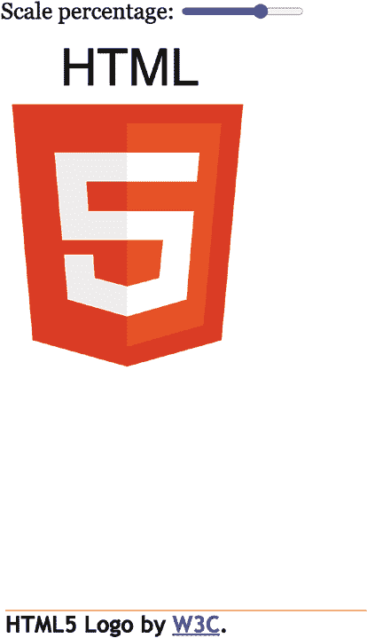
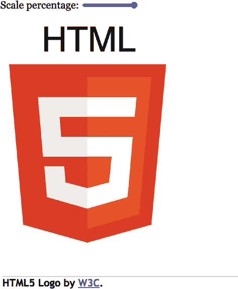
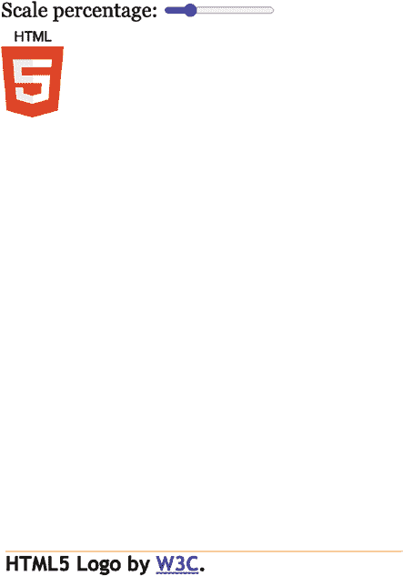
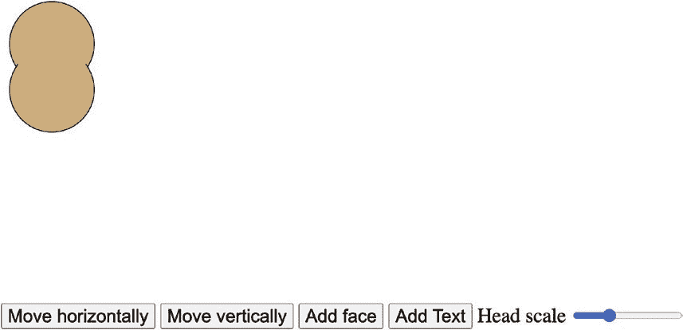
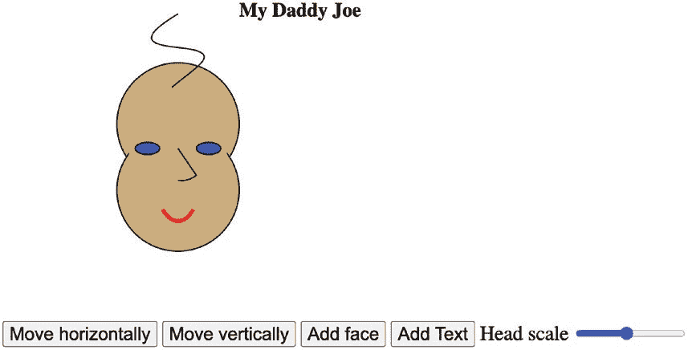

# 在 `init` 中设置 `mouseup` 的 `up`

`changeLine`

`hTML` 中的 `Button`

`setValues`

`drawLine` 和 `hTML` 中的 `onSubmit`

`crossOverLine`

`crossOverLine`

`secondPosition`、`bothVertical`、`setValues`

`oneVertical`、`parallelLines`

`parallelLines`

`crossOverLine`

`bothVertical`

`crossOverLine`

`OneVertical`

`crossOverLine`

与大多数（若非全部）编程任务一样，在定义每个函数的内容时，有多种可能性。我的做法是将大型函数拆分成更小的函数，或者推迟部分工作的处理。你会看到 `crossOverLine` 函数调用了 `oneVertical`、`bothVertical` 和 `parallelLines` 函数。我倾向于在处理其他情况之前先完成第一种情况，这是一种良好的实践。

## 附录 更多 `drAwing` 技巧

***表 A-4.** 跨越栅栏的代码*

| **代码语句** | **说明** |
| --- | --- |
| `<!DOCTYPE html>` | DOCTYPE 注释。 |
| `<html>` | 开始 html 标签。 |
| `<head>` | 开始 head。 |
| `<title>Crossing the line</title>` | 标题元素。 |
| `<script>` | 开始 script。 |
| `var px = 200;` | 栅栏的初始值。 |
| `var py = 200;` | |
| `var qx = 500;` | |
| `var qy = 400;` | |
| `var ctx;` | 将保存上下文，用于在画布上绘制。 |
| `var canvas;` | 将被设置为保存对画布元素的引用。 |
| `var ax;` | 将保存跳跃的起点和终点。 |
| `var ay;` | |
| `var bx;` | |
| `var by;` | |
| `function changeLine() {` | `changeLine` 的函数头。 |
| `px = 100 + Math.floor(Math.random()*1000);` | 计算随机值。 |
| `py = 50 + Math.floor(Math.random()*500);` | |
| `qx = 100 + Math.floor(Math.random()*1000);` | |
| `qy = 50 + Math.floor(Math.random()*500);` | |
| `drawLine();` | 绘制线条。 |
| `document.f.pxv.value = String(px);` | 将坐标放回表单。 |
| `document.f.pyv.value = String(py);` | |
| `document.f.qxv.value = String(qx);` | |
| `document.f.qyv.value = String(qy);` | |
| `}` | 关闭 `changeLine`。 |
| `function init() {` | `init` 的函数头。 |
| `canvas = document.getElementById("canvas");` | 设置对画布的引用。 |
| `ctx = canvas.getContext("2d");` | 设置上下文，用于所有绘制操作。 |
| `canvas.addEventListener("mousedown", firstPosition, false);` | 设置 `mousedown` 的事件处理。 |
| `canvas.addEventListener("mouseup", secondPosition, false);` | 设置 `mouseup` 的事件处理。 |
| `ctx.strokeStyle = "black";` | 设置描边颜色。 |
| `ctx.lineWidth = 3;` | 设置线条宽度。 |
| `drawLine();` | 绘制线条。 |
| `}` | 关闭 `init`。 |
| `function drawLine() {` | `drawLine` 的函数头。注意：它使用 `px`、`py`、`qx`、`qy` 的当前值。 |
| `ctx.clearRect(0,0,1200,800);` | 清除画布。 |
| `ctx.beginPath();` | 根据全局变量定义绘制线条。 |
| `ctx.moveTo(px,py);` | 移动到点 p。 |
| `ctx.lineTo(qx,qy);` | 连线到点 q。 |
| `ctx.closePath();` | 闭合路径。 |
| `ctx.stroke();` | 使用描边绘制线条。 |
| `document.f.pxv.value = String(px);` | 将转换为字符串的值插入表单。 |
| `document.f.pyv.value = String(py);` | |
| `document.f.qxv.value = String(qx);` | |
| `document.f.qyv.value = String(qy);` | |
| `document.f.results.value = "";` | |
| `}` | 关闭 `drawLine`。 |
| `function firstPosition(ev) {` | `firstPosition` 的函数头。`ev` 由事件处理程序设置。 |
| `ax = ev.pageX;` | 提取 x 值。 |
| `ay = ev.pageY;` | 提取 y 值。 |
| `ctx.fillStyle = "red";` | 为第一个位置将填充色设置为红色。 |
| `ctx.fillRect(ax,ay,10,10);` | 绘制一个小矩形。 |
| `document.f.axv.value = String(ax);` | 将 x 值（转换为字符串）存入表单。 |
| `document.f.ayv.value = String(ay);` | ……y 值。 |
| `}` | 关闭 `firstPosition`。 |
| `function secondPosition(ev) {` | `secondPosition` 的函数头。 |
| `bx = ev.pageX;` | 提取 x 坐标。 |
| `by = ev.pageY;` | ……y 坐标。 |
| `ctx.fillStyle = "blue";` | 将此矩形的填充色设置为蓝色。 |
| `ctx.fillRect(bx,by,10,10);` | 绘制小矩形。 |
| `document.f.bxv.value = String(bx);` | 将 x 值存入表单。 |
| `document.f.byv.value = String(by);` | ……y 值。 |
| `if ((bx==ax)&&(by==ay)) {` | 检查两点是否相同。 |
| `alert("Start and end points are the same. Try again: mouse down, drag, then mouse up.");` | 向玩家输出反馈信息。 |
| `}` | |
| `}` | 关闭 `secondPosition`。 |


### 附录：更多绘图技巧

**表 A-4.** （续）

| 代码语句 | 说明 |
|----------|------|
| `close if true.` | |
| `else crossOverLine(px,py,qx,qy,ax,ay,` | 调用`crossOverLine`函数 |
| `bx,by);` | |
| `}` | |
| `close secondPosition.` | |
| `function crossOverLine (px, py, qx, qy,` | `crossOverLine`函数头 |
| `ax, ay, bx, by) {` | 参数是表示直线（围栏）和跳跃的数据 |
| `var retv = true;` | 将`retv`初始化为`true` |
| `if ((ax==bx) && (px==qx))` | 检查两条线段是否均为垂直 |
| `{` | |
| `retv = bothVertical(ax,ay,bx,by,px,` | 调用在此情况下进行检查的函数 |
| `py,qx,qy);` | |
| `}` | |
| `else if (ax==bx)` | 检查 a-b 线段是否为垂直 |
| `{` | |
| `retv = oneVertical(ax,ay,by,px,py,` | 使用这些参数调用`oneVertical` |
| `qx,qy);` | |
| `}` | |

**表 A-4.** （续）

| 代码语句 | 说明 |
|----------|------|
| `else if (px==qx)` | 检查 p-q 线段是否为垂直 |
| `{` | |
| `retv = oneVertical(px,py,qy, ax,` | 使用这些其他参数调用`oneVertical` |
| `ay, bx, by);` | |
| `}` | |
| `else {` | 继续“正常”情况：没有线段垂直 |
| `abslope= (by-ay)/(bx-ax);` | 设置`abslope` |
| `pqslope = (qy-py)/(qx-px);` | 设置`pqslope` |
| `if (abslope==pqslope) {` | 两条线是否平行？（包括同一条线的情况） |
| `retv = parallelLines(abslope,` | 针对此情况调用相应函数 |
| `ax,ay,bx,by,px,py,qx,qy);` | |
| `}` | |
| `else {` | 我称之为正常情况 |
| `x = (abslope*ax-ay - pqslope*px+py)/` | 求解`x` |
| `(abslope-pqslope);` | |
| `y = abslope * (x-ax)+ay;` | 用`x`求解`y` |
| `ctx.fillStyle="purple";` | 将交点颜色设置为紫色 |
| `ctx.fillRect(x,y,10,10);` | 绘制矩形（注意：可能在屏幕外） |

**表 A-4.** （续）

| 代码语句 | 说明 |
|----------|------|
| `// 现在检查两条线段上的交点，没有线段垂直` | |
| `tab = (x-ax)/(bx-ax);` | 设置`x`沿 a-b 线段的比例 |
| `tpq = (x-px)/(qx-px);` | 设置`x`沿 p-q 线段的比例 |
| `if ((tab>=0) && (tab<=1) && (tpq>=0)` | 如果这两个数都在 0 到 1 之间 |
| `&&(tpq<=1))` | |
| `{` | |
| `retv = true;` | 返回`true` |
| `}` | |
| `else` | |
| `{` | |
| `retv = false;` | 返回`false` |
| `}` | |
| `}` | 闭合“斜率不相等” |
| `}` | 闭合“斜率检查前的正常情况” |
| `if (retv) {` | 现在在表单中显示结果。`retv`在多个地方设置 |
| `document.f.results.value = "Jumped the Fence";` | |
| `}` | |
| `else {` | |
| `document.f.results.value = "did NOT Jump the Fence";` | |
| `}` | |
| `}` | 关闭`crossOverLine` |

**表 A-4.** （续）

| 代码语句 | 说明 |
|----------|------|
| `function setValues() {` | `setValues`函数头 |
| `ax = Number(document.f.axv.value);` | 提取`ax` |
| `document.f.axv.value =String(ax);` | 写回文档（这将把空值设置为零） |
| `ay = Number(document.f.ayv.value);` | 提取`ay` |
| `document.f.ayv.value = String(ay);` | |
| `bx = Number(document.f.bxv.value);` | 提取`bx` |
| `document.f.bxv.value = String(bx);` | |
| `by = Number(document.f.byv.value);` | 提取`by` |
| `document.f.byv.value = String(by);` | |
| `px = Number(document.f.pxv.value);` | 提取`px` |
| `document.f.pxv.value = String(px);` | |
| `py = Number(document.f.pyv.value);` | 提取`py` |
| `document.f.pyv.value = String(py);` | |
| `qx = Number(document.f.qxv.value);` | 提取`qx` |
| `document.f.qxv.value = String(qx);` | |
| `qy = Number(document.f.qyv.value);` | 提取`qy` |
| `document.f.qyv.value = String(qy);` | |
| `drawLine();` | 使用刚设置的值绘制线条 |
| `ctx.fillStyle = "red";` | 设置颜色为红色 |
| `ctx.fillRect(ax,ay,10,10);` | 在 a-b 线段起点绘制小矩形 |
| `ctx.fillStyle = "blue";` | 设置颜色为蓝色 |
| `ctx.fillRect(bx,by,10,10);` | 在 a-b 线段终点绘制小矩形 |

**表 A-4.** （续）

| 代码语句 | 说明 |
|----------|------|
| `document.f.results.value="results will be here";` | 显示消息（不会显示太久） |
| `if ((bx==ax)&&(by==ay)) {` | 检查起点和终点是否相同（当玩家在起点松开鼠标按钮时会发生这种情况） |
| `alert("Start and end points are the same. Try again: mouse down, drag, then mouse up.");` | 向玩家显示消息 |
| `return false;` | |
| `}` | |
| `else {` | |
| `crossOverLine(px,py,qx,qy,ax,ay,bx,by);` | 调用`crossOverLine`进行计算 |
| `return false;` | 输出`false`以防止页面刷新 |
| `}` | 闭合`else` |
| `}` | 关闭`setValues` |


好的，作为一名高级文档工程师和翻译员，我将遵循您提供的注意事项和示例，将给定的英文文本翻译成中文。


```markdown
# 附录 更多绘图技巧

## 表 A-4. (续)

| 代码语句 | 说明 |
|---|---|
| `function oneVertical(vx, vy, wy, sx, sy, tx, ty)` | 当两条线段中一条为垂直线，另一条不是时调用的函数头。参数以垂直线开始（注意只有三个数字），然后是另一条非垂直线。 |
| `minvwy = Math.min(vy, wy);` | 计算最小值和最大值可使其他计算更容易。 |
| `maxvwy = Math.max(vy, wy);` | |
| `minstx = Math.min(sx, tx);` | |
| `maxstx = Math.max(sx, tx);` | |
| `minsty = Math.min(sy, ty);` | |
| `maxsty = Math.max(sy, ty);` | |
| `slope = (ty - sy) / (tx - sx);` | 非垂直线的斜率。 |
| `y = slope * (vx - tx) + ty;` | 求解 `y`。 |
| `x = vx;` | 设置为使用 `x` 和 `y` 来绘制直线（非线段）的交点。 |
| `ctx.fillStyle = "purple";` | 设置为绘制紫色矩形。 |
| `ctx.fillRect(x, y, 10, 10);` | 绘制矩形。 |
| `if (vx < minstx) { return false; }` | 如果 `vx` 小于最小值，则返回无交点。 |
| `if (vx > maxstx) { return false; }` | …或大于最大值。 |
| `if (maxvwy < minsty) { return false; }` | 或者如果最大值小于最小值。 |
| `if (minvwy > maxsty) { return false; }` | 或者最小值大于最大值。 |
| `return true;` | 否则，返回真。 |
| `}` | 关闭 `oneVertical` 函数。 |
| `function bothVertical(ax, ay, bx, by, px, py, qx, qy) {` | `bothVertical` 的函数头。 |
| `if (ax != px) {` | 如果这两条是两条不同的垂直线，则没有重叠。 |
| `return false;` | |
| `}` | |
| `minaby = Math.min(ay, by);` | 计算最大值和最小值，用于检查重叠。 |
| `maxaby = Math.max(ay, by);` | |
| `minpqy = Math.min(py, qy);` | |
| `maxpqy = Math.max(py, qy);` | |
| `if ((minaby < minpqy) && (maxaby > maxpqy)) { return true; }` | 必须完全越过栅栏线段。 |
| `else { return false; }` | |
| `}` | 关闭 `bothVertical`。 |
| `function parallelLines(slope, ax, ay, bx, by, px, py, qx, qy) {` | `parallelLines` 的函数头。参数是共享的斜率，以及 a-b 和 p-q 坐标。 |
| `y1 = slope * (-ax) + ay;` | 求解 a-b 线的 `y` 截距。 |
| `y2 = slope * (-px) + py;` | 求解 p-q 线的 `y` 截距。 |
| `if (y1 != y2) { return false; }` | 平行线，但不是同一条线。 |
| `jumpax = (ax - qx) / (px - qx);` | 使用 `x` 值确定 `ax` 在 p-q 线上的位置…… |
| `jumpbx = (bx - qx) / (px - qx);` | ……以及 `bx` 在 p-q 线上的位置。 |
| `if ((jumpax < 0) && (jumpbx > 1)) {` | 如果 `ax` 低于（沿着线段）且 `bx` 高于。 |
| `return true;` | 返回真。 |
| `}` | |
| `else {` | |
| `return false;` | 返回假。 |
| `}` | |
| `}` | 关闭 `parallelLines`。 |

```html
<script>
// ... (上面的 JavaScript 函数)
</script>
</head>

<body onload="init();">
    <p>按下鼠标标记第一个位置；拖动并释放鼠标标记第二个位置。</p>
    <button onClick="changeLine();">随机改变栅栏</button>
    <br/>
    <canvas id="canvas" width="1200" height="600" style="border: 1px solid black;">
        不支持 canvas
    </canvas>
    <br/>
    <p>或者使用坐标值自己设置位置。空白处将被视为 0。</p>
    <br/>
    <form onSubmit="setValues(); return false;" name="f">
        栅栏起点 px: <input name="pxv"/> py: <input name="pyv"/> <br/>
        栅栏终点 qx: <input name="qxv"/> qy: <input name="qyv"/> <br/>
        小球运动起点 ax: <input name="axv"/> ay: <input name="ayv"/> <br/>
        小球运动终点 bx: <input name="bxv"/> by: <input name="byv"/>
        <input type="submit" value="输入坐标"/> <br/>
        结果: <input type="text" name="results" style="width: 400px;"/>
    </form>
</body>
</html>
```

**你学到了什么**

本示例演示了代数与几何相结合的应用，即所谓的*解析几何*。我编写 JavaScript 代码时所做的并非典型的解方程，而是完成了计算的技巧。该示例使用了表单和在 canvas 上绘图的不同方法。我不会说这个界面很优雅，但它确实提供了准备数据以测试计算的方法，并演示了 JavaScript 的用途。

**使用标量矢量图形**

标量矢量图形（SVG）是一种定义图形的系统。它独立于任何编程语言。SVG 并非以可能压缩的格式逐个像素地创建和维护图形记录，而是一组指令。指令的格式是可扩展标记语言（XML），类似于 HTML。SVG 可以作为 HTML 文档的一部分，并且可以使用 JavaScript 来修改 SVG。使用 SVG 的好处包括文件体积小且不牺牲分辨率。存在用于生成 SVG 的工具，但对于这些示例，您可以使用用于创建 HTML/CSS/JavaScript 文档的编辑器。此处展示的示例包括多边形、线条、曲线和文本。您可以通过多种在线资源了解更多关于 SVG 的知识。我的建议是，在阅读众多可能性时，脑中要有具体的示例。在本附录中，我将描述一个 HTML5 徽标的静态描绘；一个可以更改大小的 HTML5 徽标；以及一个我称之为 *daddy 标志* 的卡通形象，它包含为原始图形添加元素、在屏幕上移动以及更改位置等选项。正是这些选项展示了 SVG 的强大功能。

SVG 作为一种 XML 语言，由标记元素组成。每个标记元素都有一个类型，并且要么有成对出现的开始标签和结束标签，中间包含内容，要么以 `/` 结束开始标签。开始标签可能包含属性。属性具有与元素类型关联的名称以及用引号括起来的值。以下是一些示例：

```svg
<svg id="wholesvg" height="600" width="800" xmlns="http://www.w3.org/2000/svg"> ... </svg>
<polygon points="139 51, 139 82, 213 82, 216 51" fill="#FFFFFF";/>
<text x="75" y="60" font-family="'Trebuchet MS', 'Arial Bold', Helvetica, sans-serif"; font-size="54"; font-weight: bold; >HTML</text>
```
三个点 `...` 表示所有 SVG 内容的存在。`xmlns` 属性，即所谓的*命名空间指定*，指向 SVG 标准。

SVG 的一个重要方面是标记必须是“格式良好的”。这意味着如果省略了结束标签，则开始标签必须带有结束斜杠。属性值必须用引号括起来。标记项的嵌套必须正确。这意味着不能出现以下情况：
```html
<a> <b> </a> </b>
```
SVG 元素是文档树的一部分，其结构可能对编码很重要。对于 HTML 来说，遵守这些规则是好的做法，但不是必需的，因此我们可能需要改变我们的习惯。

SVG 图形与在 canvas 上绘图不同，其元素会保留其标识。但是，它又有点像在画布上绘画，因为后绘制的元素，或部分覆盖在先绘制元素之上的元素，会遮盖住先前的元素。这将在 HTML5 徽标示例中进行演示。

**使用 SVG 绘制 HTML5 徽标**

第一个示例显示了一个静态的 HTML5 徽标渲染图，如图 A-7 所示。它由填充了不同颜色的多边形、文本和一条线组成。该示例还包括了语义标签的使用，特别是 `footer` 和 `abbr`。语义标签是 HTML5 为 HTML 新增的内容，代表了一组 452 页中的常见功能

``

```


#### SVG 与 HTML5 徽标技术

文档。它们不附带任何特定的格式或用法说明。它们在标准中的存在（仅）是对用法的建议，并可能有助于协同工作的个人和团体。提供引用是一项重要的实践，因此，在页脚提及万维网联盟（简称 W3C）是我的初衷。请注意，HTML 的字体并非 W3C 网站上显示的那一种。实际上，HTML 标准的所有权问题较为复杂。请随意探索。

***图 A-7.** 纯色 SVG HTML5 徽标*

我将解释纯色 HTML5 徽标的编码过程。然而，为了提供交互性，更重要的是，为了进一步展示 SVG 的强大功能，我加入了另一个示例。该程序提供了一种更改图形尺寸的方法。请注意，在图 A-8 中，初始界面上的滑块并未完全滑到最右侧。



***图 A-8.** 可缩放 HTML5 徽标的初始界面*

将滑块移至末端，将产生如图 A-9 所示的界面。



***图 A-9.** 可缩放 HTML5 徽标，显示最大尺寸*

将滑块向左滑动，会生成一个较小的版本，如图 A-10 所示。



***图 A-10.** 较小版本的 HTML5 徽标*

##### 概述

两个 HTML5 徽标示例所需完成的任务包括：指定多边形、为每个多边形使用特定颜色进行填充、添加文本，以及在两个示例的底部引用 W3C 组织。可缩放示例包含一个用于更改徽标大小的范围控件。范围控件中引用的一个 JavaScript 函数执行此更改操作。

##### 实现细节

让我们进入 SVG 部分。

HTML5 徽标示例的树状结构如下所示：

- 一个 `svg` 元素，`id ="whilesvg"`，包含一个子节点。
- 一个 `g` 元素，`id = "logo"`。此元素包含两个子节点。
  - 一个 `text` 元素。
  - 一个 `g` 元素，`id = "shield"`，包含六个子节点，每个子节点都是一个 `polygon` 元素。
- `Polygon` 元素。

绘制盾牌有多种方法。绘制的顺序很重要：多边形会绘制在先前的多边形之上。中心的那条线是由颜色变化产生的视觉错觉。代码如下：

```html
<svg id="wholesvg" height="600" width="800" xmlns="http://www.w3.org/2000/svg" >
  <g id="logo">
    <text x="75" y="60" font-family="'Arial Bold', sans-serif"; font-size="54"; font-weight: bold; > HTML</text>
    <g id="shield" transform="translate(0,80)">
      <polygon points="39 250, 17 0, 262 0, 239 250, 139 278" fill= "#E34C26"; />
      <polygon points="139 257, 220 234, 239 20, 139 20" fill="#F06529"; />
      <polygon points="139 113, 98 113, 96 82, 139 82, 139 51, 62 51, 70 144, 139 144" fill= "#EBEBEB"; />
      <polygon points="139 193, 105 184, 103 159, 72 159, 76 207, 139 225" fill="#EBEBEB"; />
      <polygon points="139 113, 139 144, 177 144, 173 184, 139 193, 139 225, 202 207, 210 113" fill= "#FFFFFF"; />
      <polygon points="139 51, 139 82, 213 82, 216 51" fill="#FFFFFF";/>
    </g>
  </g>
</svg>
```

与常规 HTML 一样，浏览器会忽略缩进，但这是一个好习惯。

请注意，在此示例中并未使用到 `id` 值，但此处保留它们是为了鼓励在设计结构时考虑良好的实践，并为未来可能进行的修改做好准备。

`svg` 元素包含指示宽度和高度的属性。正如前面关于 `svg` 示例的简短列表中所提到的，`xmlns` 属性是指向 SVG 标准的指针。这一点至关重要。

第一个 `g` 元素指定徽标由两部分组成：文本（在 `text` 元素的内容中指定，即起始标签和结束标签之间），内容是 **HTML**，以及代表盾牌的图形。盾牌由六个多边形组成。第二个 `g` 元素，`id = "shield"`，有一个 `transform` 属性。其值 `translate(0,80)` 将其后内容在水平方向调整 0 像素，垂直方向调整 80 像素。建议您更改这两个数字。这六个 `polygon` 元素各有两个属性。一个属性是 `points`，它给出组成多边形的各点坐标。每对数字代表水平 (x) 和垂直 (y) 值，各对之间用逗号分隔。由于不同多边形的顶点数量不同，所以坐标对的数量也不同。`fill` 属性使用 RGB（红、绿、蓝）系统指定颜色。强烈建议您尝试调整这些数字。这些数字并非我凭空捏造，而是来自 W3C 网站。每个 `polygon` 元素都是单例：只有一个起始标签，并以 `/>` 结尾。注意结尾的两个 `</g>` 标签和结束的 `</svg>` 标签。

除了 SVG 之外，我决定使用语义元素。

可缩放版本的 HTML5 徽标包含一个类型为 `range` 的控件：

```
Scale percentage: <input id="slide" type="range" min="0" max="150" value="100" onChange="changeScale(this.value)" step="10"/>
```

`min`、`max` 和 `value` 属性的作用是使初始界面上的控件位于滑块轨道向右约三分之二的位置。`onChange` 的设置使得当用户/玩家更改值时，会调用我的 JavaScript 函数 `changeScale`。该 JavaScript 函数被调用时，会传入一个参数，该参数是控件中当前的值。术语 `this` 指的是这个输入控件。`step` 属性设置为 10，意味着值按 10 的幅度变化。您可以对此进行试验。我决定将其设为 10，这样会产生相当平滑的过渡效果。

最后要解释的是 `footer` 和 `article` 元素的 CSS 样式。我使用了一种技术，按照我希望字体生效的顺序提供一系列字体类型。浏览器会优先采用解释此文档的计算机上可用的第一种字体。`display` 属性指定了文本前后的换行符。`footer` 样式中的 `font-weight` 设置为粗体。`border-top` 在页脚上方产生了一条橙色线条。`article` 样式中的 `margin` 设置为 5px。静态 HTML5 徽标的代码如表 A-5 所示。我省略了调用/被调用的函数表，因为其中没有函数。

***表 A-5.** 静态 HTML5 徽标的代码*

| 代码语句 | 说明 |
| --- | --- |
| `<!DOCTYPE html>` | DOCTYPE 注释。 |
| `<html>` | `html` 标签。 |
| `<head>` | `head` 标签。 |
| `<title>HTML5 Logo </title>` | 完整的标题。 |
| `<meta charset="UTF-8">` | 这是一个 meta 标签。它声明了字符编码。 |
| `<style>` | `style` 标签。 |
| `footer {display:block; border-top: 1px solid orange; margin: 10px; font-family: "Trebuchet MS", 'Arial Bold', Helvetica, sans-serif; font-weight: bold;}` | footer 元素用于显示对万维网联盟的引用。 |
| `</style>` | 关闭 style 元素。 |
| `</head>` | 关闭 head 元素。 |
| *(续)* | |
| ***表 A-5.*** ( *续* ) | |
| 代码语句 | 说明 |
| `<body>` | 开始 body 元素。 |
| `<svg id="wholesvg" height="600" width="800" xmlns="http://www.w3.org/2000/svg" >` | 一个 `svg` 元素的起始标签。注意指向命名空间的链接。 |
| `<g id="logo">` | 一个用于分组的 `g` 元素。 |
| `<text x="75" y="60" font-family="'Trebuchet MS', 'Arial Bold', Helvetica, sans-serif"; font-size="54"; font-weight: bold; >HTML </text>` | 该徽标包含一个 `text` 元素。 |
| `<g id="shield" transform="translate(0,80)">` | …以及一个具有 id 为 shield 和 transform 属性的分组，该属性可使图形在屏幕上向下平移。 |
| `<polygon points="39 250, 17 0, 262 0, 239 250, 139 278" fill="#E34C26" />` | 这里有多个多边形。 |


### 排版后内容

```
239 250, 139 278"
fill="#E34C26"; />
```

你可以查阅这些颜色，我是从 W3C 官网获取的。

```
<polygon points="139 257, 220 234, 239 20, 139 20"
fill="#F06529"; />
```

整个盾牌。

```
<polygon points="139 113, 98 113, 96 82, 139 82, 139 51, 62 51, 70 144, 139 144"
fill="#EBEBEB"; />
```

右侧较浅的部分。

```
<polygon points="139 193, 105 184, 103 159, 72 159, 76 207, 139 225"
fill="#EBEBEB"; />
```

顶部左侧的浅灰色。

```
<polygon points="139 113, 139 144, 177 144, 173 184, 139 193, 139 225, 202 207, 210 113"
fill="#FFFFFF"; />
```

底部右侧的白色部分。

```
<polygon points="139 51, 139 82, 213 82, 216 51"
fill="#FFFFFF"; />
```

顶部右侧的白色部分。

```
</g>
```

关闭外层 `<g>`。

```
</svg>
```

关闭 `<svg>` 元素。

```
<footer>HTML5 Logo by <a href="http://www.w3.org/"><abbr title="World Wide Web
Consortium">W3C</abbr></a>.
</footer>
```

页脚包含文本，格式未做特殊处理。

```
</body>
```

关闭 `<body>`。

```
</html>
```

关闭 `<html>`。

为了制作可缩放的 HTML5 徽标，我使用了`init`函数来设置一个变量，该变量指向 SVG 树中用于更改缩放比例的节点。此更改在`changeScale`函数中完成。这两个函数的调用信息见表 A-6。

**表 A-6. 可缩放 HTML5 徽标的被调用/调用函数**

| 函数 | 被谁调用（事件处理） | 调用谁 | 设置事件处理 |
| :--- | :--- | :--- | :--- |
| `Init` | `onLoad` | - | - |
| `changeScale` | `onChange` | - | - |

可缩放的 HTML5 徽标文档本质上是在静态 HTML5 徽标的基础上增加了这两个函数。为了完整起见，我提供了所有代码，但省略了对通用行的解释。请参考表 A-7。

**附录：更多绘图技巧**

**表 A-7. 可缩放 HTML5 徽标的代码**

| 代码语句 | 说明 |
| :--- | :--- |
| `<!DOCTYPE html>` | DOCTYPE 注释。 |
| `<html>` | HTML 开始标签。 |
| `<head>` | head 开始标签。 |
| `<title>HTML5 Logo</title>` | 完整的标题。 |
| `<meta charset="UTF-8">` | 一个声明字符编码的 meta 标签。 |
| `<style>` | style 开始标签。 |
| `footer {display:block; border-top: 1px solid orange; margin: 10px; font-family: "Trebuchet MS", 'Arial Bold', Helvetica, sans-serif; font-weight: bold;}` | 页脚的格式。 |
| `article {display:block; font-family: Georgia, "Times New Roman", Times, serif; margin: 5px;}` | article 的格式。 |
| `</style>` | 关闭 style。 |
| `<script language="Javascript">` | script 元素开始。 |
| `var factorvalue = 1;` | 用于改变缩放比例。 |
| `var logo;` | 将被设置为指向 SVG 的指针。 |
| `function init() {` | `init`函数头。 |
| `logo = document.getElementById("logo");` | 设置`logo`变量。 |
| `}` | 关闭`init`。 |
| `function changeScale(val) {` | `changeScale`函数头。参数`val`将保存滑块控件设置的值。 |
| `factorValue = val/100;` | 将`factorValue`计算为百分比。 |
| `var factorValues = String(factorValue);` | 将`factorValue`转换为字符串。 |
| `var trans = "translate(0,0) scale("+factorValues+")";` | 生成要放入 SVG 的`trans`值。 |
| `logo.setAttributeNS(null,"transform", trans); }` | 设置属性。 |
| `}` | 关闭`changeScale`函数。 |
| `</script>` | 关闭 script。 |
| `</head>` | 关闭 head。 |
| `<body onLoad="init();">` | body 元素。设置对`init`函数的调用。 |
| `<article>` | article 开始。 |
| `<input id="slide" type="range" min="0" max="150" value="100" onChange="changeScale(this.value)" step="10"/>` | 定义一个范围控件（滑块）。设置使用控件值调用`changeScale`函数。 |
| `</article>` | 关闭 article。 |
| `<svg id="wholesvg" height="600" width="800" xmlns="http://www.w3.org/2000/svg">` | SVG 与静态情况相同。 |
| `<g id="logo">` | - |


<text x="75" y="60" font-family="'Arial Bold', sans-serif"; font-size="54"; font-weight: bold; > HTML</text>

<g id="shield" transform="translate(0,80)">
<polygon points="39 250, 17 0, 262 0, 整个盾牌。 239 250, 139 278" fill= "#E34C26"; />
</g>

<polygon points="139 257, 220 234, 239 右侧较亮部分。 20, 139 20" fill="#F06529"; />

<polygon points="139 113, 98 113, 96 左上角极浅灰色。 82, 139 82, 139 51, 62 51, 70 144, 139 144" fill="#EBEBEB"; />

<polygon points="139 193, 105 184, 103 左下角极浅灰色。 159, 72 159, 76 207, 139 225" fill="#EBEBEB"; />

<polygon points="139 113, 139 144, 177 右下角白色。 144, 173 184, 139 193, 139 225, 202 207, 210 113" fill="#FFFFFF"; />

<polygon points="139 51, 139 82, 213 右上角白色。 82, 216 51" fill="#FFFFFF";/>

<footer>HTML5 标志由 <a href="http://www.w3.org/"><abbr title="万维网联盟">W3C</abbr></a> 提供。</footer>

## 附录 更多绘制技巧

**表 A-7.** （续）

| 代码语句 | 说明 |
|----------------|-------------|
| `<polygon points="39 250, 17 0, 262 0, 整个盾牌。 239 250, 139 278" fill= "#E34C26" />` | 整个盾牌。 |
| `<polygon points="139 257, 220 234, 239 20, 139 20" fill="#F06529" />` | 右侧较亮部分。 |
| `<polygon points="139 113, 98 113, 96 82, 139 82, 139 51, 62 51, 70 144, 139 144" fill="#EBEBEB" />` | 左上角极浅灰色。 |
| `<polygon points="139 193, 105 184, 103 159, 72 159, 76 207, 139 225" fill="#EBEBEB" />` | 左下角极浅灰色。 |
| `<polygon points="139 113, 139 144, 177 144, 173 184, 139 193, 139 225, 202 207, 210 113" fill="#FFFFFF" />` | 右下角白色。 |
| `<polygon points="139 51, 139 82, 213 82, 216 51" fill="#FFFFFF" />` | 右上角白色。 |

下一个示例展示了更多导致 SVG 修改的交互操作。



## 附录 更多绘制技巧

#### 使用 SVG 绘制并修改卡通图形

第二个 SVG 示例展示了一个卡通人物形象，这是我父亲在给家人留言时使用的签名。它是一个花生形状的头部，配有简单的眼睛、鼻子、微笑和一根头发。为了展示 SVG 的灵活性，我的程序初始只显示一个花生形状，同时提供按钮和一个范围控件，以展示修改图形的可能性。图 A-11 显示了初始界面。

**图 A-11.** 老爹标志初始界面

该程序提供了添加面部、添加文字、将头部逐步向下或向右移动，以及改变头部和文字大小的选项。图 A-12 显示了修改后的效果。



**图 A-12.** 添加了面部、头发、文字，并改变了大小和位置

##### 概述

该程序所需的任务包括：编写花生形状头部的 SVG 元素，以及根据用户交互后添加的眼睛、鼻子、微笑、头发和文字。界面包含一个范围控件，如 HTML5 标志示例中所示。此外，在该示例中，玩家可使用它来放大或缩小头部以及（如果已添加）面部和文字。按钮提供了调用函数的方法，用于添加面部（眼睛、鼻子、嘴巴和头发）和文字，并将图形向下或向右移动。将图形向上和向左移动留作您的练习。请注意，我还决定，如果玩家在添加过一次文字或面部后再次尝试添加，则通过警告语句向玩家提供反馈。

初始图形（头部）在 HTML 中定义。其中一个 SVG 元素是 `g`（表示分组），其 ID 为 `head`。其他元素则动态定义和创建，并附加到头部。`init` 函数在 `onload` 事件中调用，使用以下语句设置变量 `myHead`：

```javascript
myHead = document.getElementById("head");
```

新创建的元素被附加到 `myHead` 上。

面部的组成部分包括 SVG 提供的一些曲线功能，具体来说，眼睛使用椭圆，嘴巴和头发使用贝塞尔三次曲线，鼻子使用直线和弧线的组合。贝塞尔曲线以其发明者皮埃尔·贝塞尔命名，使用了端点和控制点。曲线穿过端点（起点和终点），并且生成的曲线与从端点到控制点的线段相切。表 A-8 显示了一些符号。请注意，大写和小写字母都有使用。大写表示绝对值，小写表示相对值。


