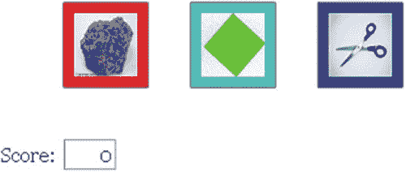
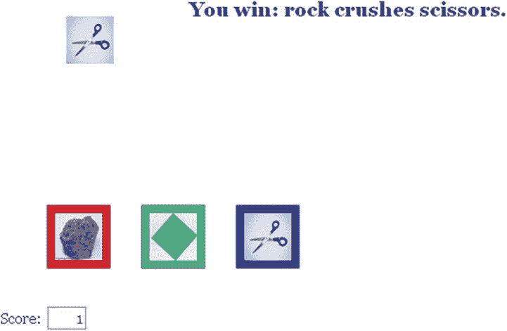
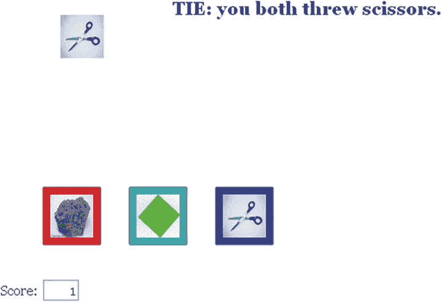
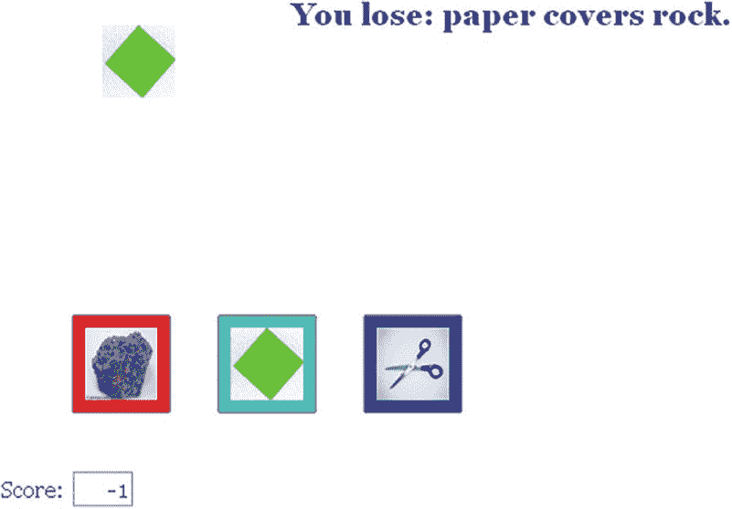
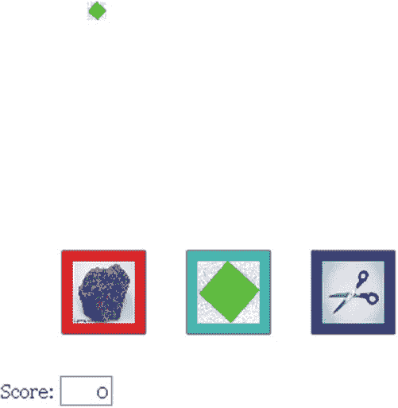
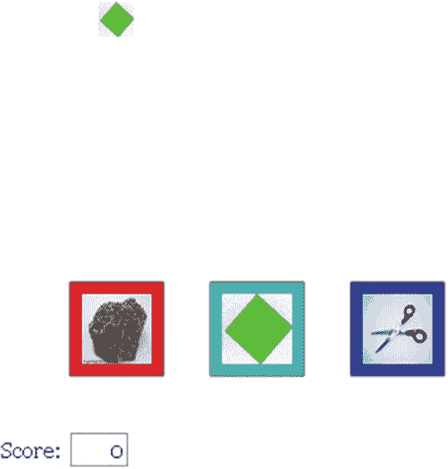
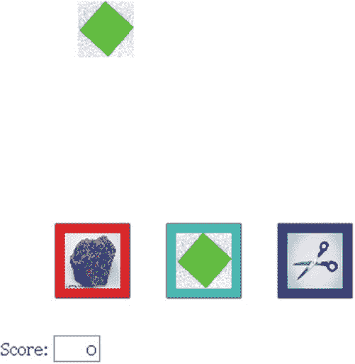
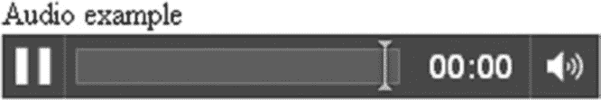

# 第 8 章：石头、剪刀、布

在本章中，我们将涵盖以下内容：

- 与计算机对战
- 创建作为按钮的图形
- 用于游戏规则的数组的数组
- `font-family` 属性
- 继承的样式设置
- 音频

## 引言

本章将编程技术与 HTML5 JavaScript 特性相结合，以实现我们熟知的石头剪刀布游戏。在校园版的此游戏中，每位玩家用手势表示三种可能性之一：石头、布或剪刀。术语是玩家`出手`三种选项之一。游戏规则陈述如下：

- 石头砸剪刀
- 布包石头
- 剪刀剪布

因此，每种符号击败另一种符号：石头胜剪刀；布胜石头；剪刀胜布。如果两位玩家出手相同，则为平局。

由于这是一个双人游戏，而我们的玩家将与计算机对战，因此我们必须创建计算机的招数。我们将生成随机招数，玩家需要相信程序是在这样做，而不是根据玩家出的招数来出招。演示必须强化这种信任感。

© Jeanine Meyer 2023

J. Meyer, *The Essential Guide to HTML5*, [`doi.org/10.1007/978-1-4842-8722-4_8`](https://doi.org/10.1007/978-1-4842-8722-4_8#DOI)



# 第 8 章 石头、剪刀、布

我们游戏的第一版仅使用您将在此处看到的视觉元素。第二版增加了音频：四个不同的音频片段分别对应三种获胜事件以及平局选项。您可以使用源代码附带的音频文件，也可以使用自己的音效。请注意，您需要更改代码中的文件名以匹配您使用的新音效文件。

在这种情况下，我们希望为玩家的招数使用特殊的图形。图 8-1 显示了应用的初始界面，包含三个作为按钮的图形，以及一个标有字符串 `"Score:"` 的字段，其初始值为零。

***图 8-1.** 石头-剪刀-布的开始画面*

玩家通过点击其中一个符号来进行出招。我们来看一个玩家点击石头图标的示例。假设电脑选择了剪刀。经过一段动画序列（剪刀符号从屏幕上的小图逐渐变大）后，会出现一条文本消息，如图 8-2 所示。在加入音频的版本中，音频片段会播放对应石头砸碎剪刀的声音效果。请注意分数现在是 1 分。





***图 8-2.** 玩家出了石头，电脑出了剪刀*

在游戏中，接下来会出现玩家和电脑平局的情况，如图 8-3 所示。出现平局时分数不变，因此仍然是 1 分。

***图 8-3.** 平局*



随后，游戏进入了胶着状态，但玩家失利，分数落到负 1 分，表示玩家落後，如图 8-4 所示。

***图 8-4.** 游戏后期的一次失利*

这个应用与本书中的所有示例一样，仅仅是一个开始。普通版和音频版都记录了玩家的连续分数，输一局分数就减一。

另一种方法是分别为玩家和电脑各自记分，只计算各自的胜场数。你还可以单独显示已玩局数。

如果你不想显示负数，这种方式更为可取。你还可以使用 `localStorage` 保存玩家分数，正如第[7](http://dx.doi.org/10.1007/978-1-4842-4155-4_7)章迷宫游戏中所描述的那样。

更复杂的增强功能可能包含视频剪辑（回顾第[6](http://dx.doi.org/10.1007/978-1-4842-4155-4_6)章）或动态 GIF，演示石头砸碎剪刀、纸包住石头和剪刀剪开纸的情景。你也可以将此视为多种不同游戏的模型。在所有情况下，你需要确定如何捕捉玩家的出招以及如何生成电脑的出招；你需要呈现并实现游戏规则；你还需要维护游戏状态并向玩家显示。石头-剪刀-布游戏除了连续分数之外，没有其他状态信息。换句话说，一局游戏只包含一轮。这与第[2](http://dx.doi.org/10.1007/978-1-4842-4155-4_2)章描述的骰子游戏截然不同——后者一局可以包含一次到任意多次投掷，也不同于第[5](http://dx.doi.org/10.1007/978-1-4842-4155-4_5)章描述的配对记忆游戏——后者一轮包含两次翻牌，一局游戏完成的轮次不限，最少为牌数的一半。

**注意** 存在石头-剪刀-布比赛的竞技活动，也有电脑根据玩家历史出招记录出招的电脑系统。甚至还有电脑对电脑的比赛。

## 关键需求

石头-剪刀-布的实现使用了之前章节演示过的许多 HTML5 和 JavaScript 构造，但在此以不同方式组合运用。编程与写作类似，就是将想法的表示形式按照某种逻辑顺序组织起来，就像把单词组合成句子、再把句子组合成段落一样。

在阅读本章时，请回顾你学到的在画布上绘制矩形、图像和文本，检测玩家点击鼠标的位置，使用 `setInterval` 设置定时事件以产生动画，以及使用数组存储信息。这些就是构建石头-剪刀-布应用的基础模块。

在规划这个应用时，我知道我希望玩家能点击按钮，每个按钮对应游戏中的一种出招类型。玩家出招后，我希望程序能自动做出自己的招数——即随机选择——并在屏幕上显示对应招数的图片。然后程序会应用游戏规则来展示结果。同时播放对应的音效，涵盖三种一物克一物的情况，以及平局时的叹气声。

这个应用最初呈现的是屏幕上的按钮或图标。这些是玩家可以点击出招的图片。还有一个用于显示分数的方框。

应用必须随机生成电脑的出招，并以一种似乎电脑与玩家同时出招的方式显示出来。我的想法是让对应的符号在屏幕上从小到大，仿佛从屏幕中浮现出来，就像电脑朝着玩家出招一样。这个动作在玩家点击三种可能的出招之一后立即开始，但又足够快速，给人一种两者同时发生的印象。

游戏规则必须严格遵守！这包括哪种招数克哪种招数，以及用于解释的通俗提示信息——“石头砸碎剪刀”、“纸包住石头”和“剪刀剪开纸”。显示的分数会根据本轮输赢或平局，分别加一分、减一分或保持不变。

含音频加强版的游戏必须根据情况播放四个音频片段之一。

## HTML5、CSS 和 JavaScript 特性

现在让我们看看 HTML5、CSS 和 JavaScript 中提供了哪些具体特性来实现游戏。除了一些基本的 HTML 标签、函数和变量之外，此处给出的解释是完整的。如果你已经阅读了其他章节，会注意到本章许多内容是对先前解释的重述。

我们当然可以使用其他章节演示过的按钮类型，但我希望这些按钮看起来像它们所代表的招数。如你所见，我们实现按钮的方式建立在先前章节演示的概念之上。并且，我们再次使用 JavaScript 伪随机处理来定义电脑的出招，并使用 `setInterval` 来动画化电脑出招的显示过程。

我们的石头-剪刀-布游戏将演示 HTML5 的原生音频功能。这意味着浏览器仅使用 HTML5 和 JavaScript 的特性即可支持音频。我们将整合音频编码与游戏规则的应用。

### 为玩家提供图形按钮

在屏幕上生成可点击的按钮或图标涉及两个方面：在画布上绘制图形，以及检测玩家何时将鼠标移动到按钮上并点击主鼠标按钮。

我们将生成的按钮或图标包括：矩形的轮廓（描边）、一个实心矩形，以及在矩形上方以一定垂直和水平边距放置的图像。由于三个按钮的操作类似，我们可以使用第[4](http://dx.doi.org/10.1007/978-1-4842-4155-4_4)章炮弹和弹弓游戏中首次介绍的方法。我们将通过编写一个名为 `Throw` 的函数来建立一个程序员自定义的对象类。

回想一下，对象由数据代码组合而成。这个被称为*构造函数*的函数将与 `new` 运算符一起使用，以创建 `Throw` 类型的新对象。函数内部使用 `this` 来设置每个对象关联的值。

```javascript
function Throw(sx,sy, sMargin,sWidth,sHeight,rectColor,picture) {
  this.sx = sx;
  this.sy = sy;
  this.sWidth = sWidth;
  this.bWidth = sWidth + 2*sMargin;
  this.bHeight = sHeight + 2*sMargin;
  this.sHeight = sHeight;
  this.fillStyle = rectColor;
  this.draw = drawThrow;
  this.img = new Image();
  this.img.src = picture;
  this.sMargin = sMargin;
}
```

函数参数包含了所有信息。通过一个简单的修改——在变量名前加上表示“存储”的`s`，就可以避免使用内置术语，从而选择`sx`、`sy`这样的名称。按钮的位置位于`sx`、`sy`。矩形的颜色由`rectColor`表示。图片的文件名由`picture`保存。我们可以视为内外宽度和内外高度的值，是基于输入`sMargin`、`sHeight`和`sWidth`计算得出的。`bHeight`和`bWidth`中的`b`代表大（big）。`s`代表小且已存储（small and stored）。不必过分纠结于合适的名称——其实并没有这种东西。命名由你决定，只要一个名字能让你记住，它就是有效的。（一个对你有意义的名称比长度更重要：不要为了少打字而把函数和变量名弄得很短。）

`Throw`对象的`img`属性是一个`Image`对象。该`Image`对象的`src`指向通过`picture`参数传递给函数的文件名。

请注意，`this.draw`属性被设置为`drawThrow`。这设置了`drawThrow`函数作为所有`Throw`类型对象的`draw`方法。这段代码的通用性超出了实际需要：这三个图形具有相同的边距、宽度和高度。不过，让代码具有通用性并无坏处，而且如果你想在此基础上构建一个表示玩家选择的更复杂对象的应用程序，这段代码大部分都能直接使用。

# 第八章 石头、剪刀、布

## 提示
编写程序时，如果你遇到了像`this.draw = drawThrow;`这样的代码，而你还未编写`drawThrow`函数，不必担心。你迟早会写的。有时，在创建函数或变量之前引用它们是不可避免的。关键在于，所有这些代码都要在你尝试执行程序之前编写完成。

以下是`drawThrow`方法：
```javascript
function drawThrow() {
   ctx.strokeStyle = "rgb(0,0,0)";
   ctx.strokeRect(this.sx,this.sy,this.bWidth,this.bHeight);
   ctx.fillStyle = this.fillstyle;
   ctx.fillRect(this.sx,this.sy,this.bWidth,this.bHeight);
   ctx.drawImage(this.img,this.sx+this.sMargin,this.sy+this.sMargin,
         this.sWidth,this.sHeight);
}
```
正如所承诺的，它会使用黑色`rgb(0,0,0)`绘制一个矩形的轮廓。回想一下，`ctx`是设置好的变量，用于获取 canvas 元素的绘图属性。黑色实际上是默认颜色，因此这一行可以省略。不过，我们还是加上它，以防你在之前颜色已被更改的应用程序中重用了这段代码。接下来，该函数使用传递给该特定对象的`rectColor`绘制一个填充矩形。最后，代码在矩形顶部绘制一张图片，在水平和垂直方向上都偏移了边距量。`bWidth`和`bHeight`分别比`sWidth`和`sHeight`大两倍的`sMargin`值。这样实际上就将图片居中显示在了矩形内部。

三个按钮通过`var`语句创建为`Throw`对象，其中变量使用`new`运算符并调用`Throw`构造函数来初始化。为此，我们需要石头、剪刀、布的图片，我通过多种方式获得了它们。这三个图片文件与 HTML 文件位于同一文件夹中。
```javascript
var rockb = new Throw(rockbx,rockby,8,50,50,"rgb(250,0,0)","rock.jpg");
var paperb = new Throw(paperbx,paperby,8,50,50,"rgb(0,200,200)","paper.gif");
var scib = new Throw(scissorsbx,scissorsby,8,50,50,"rgb(0,0,200)",
      "scissors.jpg");
```

# 第八章 石头、剪刀、布

与我们之前的应用类似，我们声明一个名为`everything`的数组并将其初始化为空数组。我们将所有三个变量都推入`everything`数组，以便对它们进行统一处理。

```
everything.push(rockb);
everything.push(paperb);
everything.push(scib);
```

例如，要绘制所有按钮，我们使用一个名为`drawAll`的函数，它遍历`everything`数组中的元素。

```
function drawAll() {
    ctx.clearRect(0, 0, cWidth, cHeight);
    var i;
    for (i = 0; i < everything.length; i++) {
        everything[i].draw();
    }
}
```

同样，这比实际需求更通用，但它非常有用，尤其是在面向对象编程中，尽可能保持通用性是一个好做法。

但如何让这些图形作为可点击的按钮呢？由于这些图形是绘制在画布上的，代码需要为整个画布设置点击事件处理，然后通过编程来检查哪个按钮（如果有）被点击了。

在本书第[4 章](http://dx.doi.org/10.1007/978-1-4842-4155-4_4)描述的弹弓游戏中，你看到处理整个画布`mousedown`事件的函数会进行计算，以判断鼠标光标是否在球上。在第[6 章](http://dx.doi.org/10.1007/978-1-4842-4155-4_6)的问答节目中，我们为每个国家和首都块设置了事件处理。JavaScript 的内置机制会指示哪个对象接收了点击事件。而本应用则类似于弹弓游戏。

我们在`init`函数中设置事件处理，下一节将详细解释。任务是让 JavaScript 监听鼠标点击事件，并在点击发生时执行我们指定的操作。我们希望调用`choose`函数。以下两行代码实现了这一任务：

```
canvas1 = document.getElementById('canvas');
canvas1.addEventListener('click', choose, false);
```

**提示**：我们的代码需要区分`id`为`canvas`的元素与通过`getContext('2d')`返回的该元素的属性。这正是 HTML5 团队所决定的方式，这不是你自己能推导出来的。

`choose`函数负责确定玩家选择了哪种出拳类型、生成电脑的出拳并设置其显示，以及应用游戏规则。现在，我们只看用于确定哪个按钮被点击的代码。

在我的实现中，我没有考虑玩家在电脑出拳逐渐显现在屏幕上的过程中点击某个选项的情况。我那位懂得如何扮演熊孩子玩家的第一技术审校提出了解决方案：我们使用一个全局变量`inMotion`，并将其初始化为`false`。

```
var inMotion = false;
```

如果`inMotion`为`true`，`choose`函数将不做任何操作。该变量在`flyin`函数中被设为`true`，并在动画结束时被设回`false`。

代码首先从保存事件信息的`ev`变量中获取鼠标坐标。你在之前的章节中已经见过这种写法：

```
function choose(ev) {
    if (!inMotion) {
        var mx;
        var my;
        mx = ev.pageX;
        my = ev.pageY;
```

下一段代码遍历`everything`数组中的元素（共有三个元素，但并未明确提及），以判断光标是否在任何一个矩形上。变量`ch`保存了对一个`Throw`对象的引用，因此所有`Throw`的属性（即`sx`、`sy`、`bWidth`和`bHeight`）都可用于比较语句中。这是`everything`数组中所有出拳选项的简写形式。

```
var i;
for (i = 0; i < everything.length; i++) {
    var ch = everything[i];
    if ((mx > ch.sx) && (mx < ch.sx + ch.bWidth) &&
        (my > ch.sy) && (my < ch.sy + ch.bHeight)) {
        ...
        break;
    }
}
```

`<...>` 表示稍后解释的代码。复合条件将点`(mx, my)`与代表玩家可能出拳的三个对象中每个对象的外矩形的左、右、上、下边界进行比较。这四个条件必须全部为真，点才在矩形内。这通过`&&`运算符表示。虽然语句较长，但这是检查点是否在矩形内的标准方法，你会逐渐习惯使用它。

这就是图形如何绘制在画布上以及它们如何充当按钮的原理。请注意，如果玩家点击了按钮之外的区域，则不会发生任何事情。有些人可能建议此时应向玩家提供反馈，例如弹出一个提示框，显示如下内容：

请点击石头、布或剪刀来完成你的出拳！

另一些人则会建议你避免屏幕杂乱，并假设玩家能自己摸索出操作方法。

**生成电脑的出拳**

生成电脑的出拳类似于我们在第[2 章](http://dx.doi.org/10.1007/978-1-4842-4155-4_2)的掷骰子游戏中生成骰子点数。在石头剪刀布游戏中，我们需要从三种可能的出拳中随机选择，而不是从六种骰子面中选。我们通过下面这行代码得到这个数字：

```
var compch = Math.floor(Math.random() * 3);
```

调用内置方法`Math.random()`会生成一个从 0（含）到 1（不含）的数字。将其乘以 3 会得到一个从 0（含）到 3（不含）的数字。应用`Math.floor`会得到一个不大于其参数的整数。它会向下取整，舍弃超过最高整数下限的任何小数部分。因此，右侧表达式会生成 0、1 或 2，这正是我们需要的值。

该值被赋值给`compch`，它被声明为一个变量。

代码将电脑的出拳（一个由涉及`random`函数的计算选出的数字 0、1 或 2）用作`choices`数组的索引：`var choices = ["rock.jpg", "paper.gif", "scissors.jpg"];` 这三个元素引用了按钮中使用的三张相同图片。

此时，为了让你放心，石头、布、剪刀的顺序是任意的。我们需要保持一致性，但顺序并不重要。如果每次都把顺序定为布、剪刀、石头，一切也仍然能正常工作。玩家永远不会看到 0 代表石头、1 代表布、2 代表剪刀的编码。

`choose` 函数中的下一行代码提取一个文件名，并将其赋值给一个`Image`变量`compimg`的`src`属性。

```
var compchn = choices[compch];
compimg.src = compchn;
```

局部变量`compchn`代表电脑出拳名称。`compimg`变量是一个全局变量，持有一个`Image`对象。代码将其`src`属性设置为相应图片文件的名称，该文件将用于显示电脑的出拳。

为了实现游戏规则，我设置了两个数组：

```
var beats = [
    ["TIE: you both threw rock.", "You win: paper covers rock.",
     "You lose: rock crushes scissors."],
    ["You lose: paper covers rock.", "TIE: you both threw paper.",
     "You win: scissors cuts paper."],
    ["You win: rock crushes scissors.", "You lose: scissors cuts paper.",
     "TIE: you both threw scissors"]
];
```

以及：

```
var points = [
    [0, 1, -1],
    [-1, 0, 1],
    [1, -1, 0]
];
```

这两个都是数组的数组。这两个数组一起被称为*并行结构*，意味着其中的元素相互对应。当我解释如何添加音效时，我会描述另一个并行结构，即第三个数组的数组。`beats`数组保存了所有消息，而`points`数组保存了要加到玩家分数上的数值。加 1 会增加玩家的分数。加-1 会减少玩家 1 分，这是当玩家输掉一局时的预期效果。加 0 则分数保持不变。现在，你可能会认为在平局的情况下什么都不做比加零更容易，但就编码而言，统一处理这种方式更简单，而且加 0 实际可能比执行一个`if`测试来判断是否为平局花费的时间更少。

每个数组的第一个索引来自电脑的出招 `compch`，第二个索引 `i` 表示内部数组的元素，来自玩家的出招。`beats` 数组和 `points` 数组被称为并行结构。`beats` 数组用于文本消息，`points` 数组用于计分。

让我们通过选取一个电脑出招来验证信息是否正确，例如剪刀，对应的索引值为 `2`；再选取一个玩家出招，例如石头，对应的索引值为 `0`。在 `beats` 数组中，电脑出招对应的值告诉我们要访问索引值为 `2` 的数组。（我避免说“第二个数组”，因为数组的索引从 `0` 开始，而不是从 `1` 开始。索引 `2` 指向的是数组的第三个元素。）该元素如下：

```
["你赢了：石头砸碎剪刀。","你输了：剪刀剪破布。",
"平局：你们都出了剪刀"];
```

现在用玩家出招的索引值 `0` 来访问这个数组。结果为 `"你赢了：石头砸碎剪刀。"`，这正是我们想要的。对 `points` 数组执行同样的操作，索引为 `2` 的元素如下：

```
[1,-1,0]
```

再用索引 `0` 访问这个数组，得到值 `1`，也完全符合预期：玩家的分数将增加 `1`。

```
result = beats[compch][i];
...
newScore += points[compch][i];
```

回顾一下，语句

```
a += b;
```

中的运算符 `+=` 解释如下：

* 获取变量 `a` 的值
* 将该值与表达式 `b` 的值进行 `+` 运算
* 将结果重新赋值给变量 `a`

第二步的表述比较通用，因为这里的 `+` 既可以解释为数字加法，也可以解释为字符串拼接。在此特定场景下，第二步的具体含义是：

* 将 `a` 和 `b` 相加

该结果会重新赋值给变量 `a`。

`result` 和 `newScore` 这两个变量是全局变量。这意味着它们可以被其他函数访问，这也是我们使用它们的方式：在一个函数中设置，然后在另一个函数中引用。

分数通过 HTML 文档 body 元素内的一个表单元素来展示。

```html
<form name="f">
分数：<input name="score" value="0" size="3"/>
</form>
```

为了展示这类操作的具体实现，我们将为分数输入框应用样式。我们设置了两种样式，一种用于 `form`，另一种用于 `input` 字段。

```css
form {
  color: blue;
  font-family: Georgia, "Times New Roman", Times, serif;
  font-size:16px;
}
input {
  text-align:right;
  font:inherit;
  color:inherit;
}
```

我们将表单中文字的颜色设置为蓝色，并通过 `font-family` 属性指定了字体。这是一种指定特定字体，并在客户端电脑没有该字体时提供后备字体的方法。这是一个强大的功能，因为这意味着你可以根据需要精确指定字体，并且通过努力，仍能确保所有人都能阅读内容。

**提示** 你可以在网上搜索网页安全字体，了解哪些字体被广泛支持。然后你可以选择最喜欢的字体作为首选，在第二选择中选一个网页安全字体，并将最后一个选择设为 `serif` 或 `sans-serif`。

如果你愿意，甚至可以指定超过三种选择。可以查阅 [`en.wikipedia.org/wiki/Web_typography`](http://en.wikipedia.org/wiki/Web_typography) 获取灵感。另一种方案是获取一种字体，将字体文件放在服务器上，然后使用 CSS 的 `@font-face` 规则，让字体随其他文件一起下载（参见 [`www.w3schools.com/css/css3_fonts.asp`](https://www.w3schools.com/css/css3_fonts.asp)）。

在此样式中，我们依次指定了字体 Georgia，然后是 "Times New Roman"，然后是 Times，最后是计算机上的标准衬线字体。衬线是指字母上那些微小的装饰线。`"Times New Roman"` 两侧必须使用引号，因为该名称包含多个单词。其他字体名称加引号也不算错，但并非必要。我们还指定了字体大小为 16 像素。

输入字段会继承其父元素（表单元素）的字体（包括字号和颜色）。但由于分数是数字，我们使用 `text-align` 属性将字段内容设置为右对齐。标签“分数”位于表单元素中，而实际分数位于输入元素中。对输入样式属性使用 `inherit` 设置，可使两者以相同的字体、字号和颜色显示。

输入字段中的值将依据其名称 `score` 被提取和设置。

例如，

```
newScore = Number(document.f.score.value);
```

此处需要 `Number` 来生成字段中文本所代表的数字，即 `0` 而非 `“0”`（字符）。如果我们将值保留为字符串，并且代码使用加号将 `1` 添加到字符串中，那么这将不是加法，而是字符串的拼接。（顺便一提，这被称为*运算符重载*：加号根据操作数的数据类型表示不同的运算。）将 `“1”` 拼接到 `“0”` 上会得到 `“01”`。你可能觉得这还行，但下一次，我们会得到 `“011”`、`“010”` 或 `“01-1”`。呃。我们不希望这样，因此我们编写代码确保该值被转换为数字。

要将调整后的新分数放回字段中，代码如下：

```
document.f.score.value = String(newScore);
```

现在，正如我经常对学生说的那样，我不得不告诉你真相。实际上，这里可能不需要 `String`。JavaScript 有时会自动执行这些转换（也称为*类型转换*）。然而，有时它不会这样做，因此明确写出是一种好习惯。

字段的尺寸是容纳三个字符所需的最大尺寸。Georgia 字体不是等宽字体——所有字符的宽度并不相同——因此这是可能需要的最大空间。你可能会注意到，根据字段中的文本不同，剩余的空间量也不同。

**注意**：JavaScript 使用圆括号、花括号和方括号。它们不可互换。圆括号用于函数头、函数和方法调用；用于 `if`、`for`、`switch` 和 `while` 语句头；以及用于指定复杂表达式中的运算顺序。花括号用于界定函数的定义以及 `if`、`for`、`switch` 和 `while` 语句的子句。方括号用于定义数组以及返回数组的特定成员。级联样式表的语言将每个样式用花括号括起来。HTML 标记包含 `<` 和 `>`，通常称为*尖括号*。

## 第 8 章 石头、剪刀、布

### 使用动画展示结果

你已经在第 [3](http://dx.doi.org/10.1007/978-1-4842-4155-4_3) 章的弹球应用和第 [4](http://dx.doi.org/10.1007/978-1-4842-4155-4_4) 章的炮弹和弹弓示例中看到了动画的实例。回顾一下，动画是通过快速连续显示一系列静止图片来产生的。单张图片被称为*帧*。在所谓的*计算动画*中，每个连续的帧都会计算屏幕上对象的新位置。产生动画的一种方法是使用 `setInterval` 命令来设置一个间隔事件，如下所示：

```
tid = setInterval(flyin,100);
```

这会导致 `flyin` 函数每 100 毫秒（每秒 10 次）被调用一次。设置变量 `tid`（定时器标识符）是为了让代码能够关闭此间隔事件。`flyin` 函数会创建尺寸不断增大的 Throw 对象，并承载相应的图像。当一个对象达到指定大小时，代码会显示结果并调整分数。这就是为什么变量 `result` 和 `newScore` 必须是全局变量——它们在 `choose` 函数中被设置，并在 `flyin` 函数中使用。

`flyin` 函数还使用一个名为 `size` 的全局变量，该变量从 15 开始，每次调用 `flyin` 时递增 5。当 `size` 超过 50 时，定时事件被停止，结果显示消息，分数发生更改。

```javascript
function flyin() {
  inMotion = true;
  ctx.drawImage(compimg, 70, 100, size, size);
  size += 5;
  if (size > 50) {
    clearInterval(tid);
    ctx.fillText(result, 200, 100, 250);
    document.f.score.value = String(newScore);
    inMotion = false;
  }
}
```

请注意，`flyin` 函数每次被调用时都将 `inMotion` 设置为 true，这意味着当 `inMotion` 已经为 true 时，它仍然会被重新设为 true。这样做是合理的，也是正确的实现方式。无需进行任何额外的检查。请注意，它只会在某一时刻被设置为 false。



顺便提一句，为了截取这些截图，我不得不修改了代码。图 8-5 是首次调用 `flyin` 后的画面。

***图 8-5.** 首次调用 flyin，显示代表电脑出拳的小图像*

经过不同的代码修改后，图 8-6 展示了动画在后续步骤中暂停的效果。



**图 8-6.** 动画的后续步骤

图 8-7 显示了动画完成后的画面，但此时还尚未显示带有结果文字的提示信息。



**图 8-7.** 在结果显示文字之前

现在，我要坦白一件能让你有所收获的事情。你可能需要先跳过这段，或者等到通读所有代码后才能领会其中的深意。当我第一次创建这个应用时，我将显示消息和调整分数的代码都放在了 `choose` 函数中。毕竟，这个函数才是确定胜负数值的地方。然而，这带来了一个非常糟糕的效果。玩家在动画中看到电脑出拳从屏幕中显现出来之前，就已经看到了结果。这让游戏看起来像是被操纵了！当我意识到问题所在后，我修改了 `choose` 函数中的代码：将消息和新的分数值存储到全局变量中，并只在 `动画完成之后` 才显示消息，并在表单输入字段中更新分数。不要以为你在开始之前就能完全了解自己的应用。要相信你会发现并解决各种问题。许多公司都有专门的质量保证团队。我就不点名了，但确实存在一些专业商业游戏，它们会过早地显示电脑部分出拳结果。

## 音频与 DOM 处理

音频的情况与视频非常相似（见第 6 章）。坏消息依然是，不同的浏览器并不都支持相同的格式。好消息是，HTML5 提供了 `<audio>` 元素，而 JavaScript 则提供了播放音频的功能，以及引用不同浏览器所支持的不同音频格式的方法。此外，还有现成的工具可用于在不同格式之间进行转换。我在这些示例中使用的两种格式是 MP3 和 OGG，它们似乎足以支持 Chrome、Firefox 和 Safari。我从免费来源获取了音频片段，并找到了可接受的 WAV 和 MP3 样本。然后，我使用之前下载用于处理视频的 Miro 转换器，将 WAV 文件转换为 MP3 和 OGG，并将其他文件也转换为 OGG。Miro 生成的 OGG 文件名为 `theor.ogv`，为简单起见，我对其进行了重命名。进行音频转换的方法有很多种。这里的要点是，这种方法要求每个声音文件都有两个版本。

**注意：** 音频文件引用的顺序可能不重要，但我曾看到过警告，如果 MP3 文件被列在第一位，Firefox 将无法正常工作。也就是说，它不会继续尝试加载其他文件。我现在不使用 Firefox，但请将此视为一个警告。随着浏览器在媒体处理方面变得更加稳健，这个问题可能已经得到解决。

在“石头剪刀布”游戏中，我没有使用 `<audio>` 元素的一些属性。`autoplay` 属性会在加载后立即开始播放，但你需要记住，对于大文件来说，加载并非瞬时的。`src` 属性指定了音频源。然而，最佳实践是不在 `<audio>` 标签中使用 `src` 属性，而是使用 `<source>` 元素作为 `<audio>` 的子元素来指定多个音频源。`loop` 属性指定循环播放，即重复播放音频片段。`controls` 属性会在屏幕上显示播放控件。这可能是个好做法，因为音频片段的声音可能会很大。但是，为了保持音频的惊喜感，并且不让视觉演示显得杂乱，我选择不这样做。

下面是一个简单的示例，你可以尝试一下。你需要从本书的下载页面下载 `sword.mp3`，或者找到你自己的音频文件并在此处用文件名引用它。如果你在 Chrome 中打开以下 HTML，你将看到如图 8-8 所示的界面。



音频示例

```html
<audio src="sword.mp3" autoplay controls>
  你的浏览器不支持音频
</audio>
```

**图 8-8.** 带有播放控件的音频标签

请记住，在我们的游戏中，我们将为石头砸碎剪刀、布包住石头、剪刀剪开布以及平局时的叹息声播放音频。以下是石头剪刀布游戏中四个音频片段的编码：

```html
<audio preload="auto">
  <source src="hithard.ogg" />
  <source src="hithard.mp3" />
</audio>

<audio preload="auto">
  <source src="inhale.ogg" />
  <source src="inhale.mp3" />
</audio>

<audio preload="auto">
  <source src="sword.ogg" />
  <source src="sword.mp3" />
</audio>

<audio preload="auto">
  <source src="crowdohh.ogg" />
  <source src="crowdohh.mp3" />
</audio>
```

这看起来合理地描述了四组音频文件，但你可能会想知道代码如何知道该播放哪一个。我们可以在每个 `<audio>` 标签中插入 `id` 属性。然而，让我们换一种方式，来演示一种在许多场景下都很有用的 JavaScript 方法。你已经见过 `document.getElementById` 方法。还有一个类似的方法：`document.getElementsByTagName`。这行代码：

```javascript
musicElements = document.getElementsByTagName("audio");
```

会提取所有由参数指定的标签名的元素，并创建一个数组。在这行代码中，这个数组被赋值给了一个名为 `musicElements` 的变量。我们在 `init` 函数中使用这行代码，因此在应用启动时就会执行它。

我们构建了另一个数组的数组，名为 `music`，并添加了两个额外的全局变量，总共三个全局变量用于处理声音。

```javascript
var music = [
  [3,1,0],
  [1,3,2],
  [0,2,3]
];

var musicElements;
var musicch;
```

你可以验证 `music` 和 `beats` 是 *并行结构*，其中 0 代表石头砸碎剪刀，1 代表布包住石头，2 代表剪刀剪开布，3 代表平局。

`choose` 函数将包含这一行额外的代码：

```javascript
musicch = music[compch][i];
```

`musicch` 变量——名字代表音乐选择——将保存 0、1、2 或 3。这为动画完成时 `flyin` 函数中将要发生的事情做好了准备。正如我在坦白中所解释的，我们不会立即播放音频片段。

```javascript
musicElements[musicch].play();
```

`musicElements` 中的第零、第一、第二或第三个元素通过使用 `musicch` 进行索引来引用；然后调用其 `play` 方法，音频片段便开始播放。

## 启动

应用程序通过设置对 `<body>` 标签的 `onLoad` 属性中一个函数的调用来启动。这也是其他游戏中的一贯做法。`init` 函数执行多项任务。它将初始分数值设置为 0。这是必要的，以防玩家重新加载文档；这是 HTML 的一个怪癖，即浏览器可能不会重置表单数据。

# 排版后的文档

该函数从 canvas 元素中提取值，用于绘图（`ctx`）和事件处理（`canvas1`）。这必须在*整个*文档加载完成之后进行，因为在此之前 canvas 元素尚不存在。该函数绘制了三个按钮，并设置了画布上文本的字体和填充样式。之后，除非玩家在三个符号之一上点击鼠标按钮，否则不会发生任何操作。

现在，我们已经了解了本游戏所使用的 HTML5 和 JavaScript 的具体特性，以及一些编程技巧（例如数组的数组），让我们更仔细地查看一下代码。

## 构建应用并使其个性化

基础石头-剪刀-布应用使用了样式、全局变量、六个函数和 HTML 标记。表 8-1 描述了这六个函数。我遵循的惯例是，除非函数是程序员定义对象的构造函数，否则函数名以小写字母开头。我将先介绍基础应用，然后展示添加音频所需的修改。

**表 8-1.** 基础石头-剪刀-布应用中的函数

| 函数 | 被调用/出发方式 | 调用 |
| :--- | :--- | :--- |
| `init` | 由 `<body>` 中的 `onLoad` 动作触发 | `drawAll` |
| `drawAll` | `init`、`choose` | 调用每个对象的 `draw` 方法，在本应用中始终在函数 `drawThrow` 中 |
| `drawThrow` | `drawAll` 使用 `Throw` 对象的 `draw` 方法 | 用于全局变量的 `var` 语句 |
| `choose` | 由 `init` 中的 `addEventListener` 调用触发 | `drawAll` |
| `flyin` | `choose` 中 `setInterval` 的动作 | - |

## 第 8 章：石头，剪刀，布

从表中可以看出，大部分函数调用都是隐式完成的（例如通过事件处理），而不是由一个函数调用另一个函数。在 `init` 函数完成设置后，主要工作由 `choose` 函数执行。游戏规则的关键信息存储在两个数组的数组中。

表 8-2 展示了基础应用的代码，并附有每行代码的注释。

**表 8-2.** 基础石头-剪刀-布应用的完整代码

| 代码 | 解释 |
| :--- | :--- |
| `<html>` | 起始 html 标签。 |
| `<head>` | 起始 head 标签。 |
| `<title>Rock Paper Scissors</title>` | 完整的 title 元素。 |
| `<style>` | 起始样式部分。 |
| `form {` | 为所有 form 元素指定的样式。本文档中只有一个。 |
| `color: blue;` | 文本颜色设置为蓝色，这是按名称识别的 16 种颜色之一。 |
| `font-family: Georgia, "Times New Roman", Times, serif;` | 设置要尝试使用的字体。 |
| `font-size:16px;` | 设置字符大小。 |
| `}` | 关闭样式。 |
| `input {` | 为所有 input 元素指定的样式。只有一个。 |
| `text-align:right;` | 使文本右对齐，适用于数字。 |
| `font: inherit ;` | 从父元素（即 form）继承字体信息。 |
| `color:inherit;` | 从父元素（即 form）继承文本颜色。 |
| `}` | 关闭样式。 |

*（续）*

**表 8-2.**（续）

| 代码 | 解释 |
| :--- | :--- |
| `</style>` | 关闭样式元素。 |
| `<script>` | 开始脚本元素。 |
| `var cWidth = 600;` | Canvas 宽度，用于清除。 |
| `var cHeight = 400;` | Canvas 高度，用于清除。 |
| `var ctx;` | Canvas 上下文，用于所有绘图。 |
| `var everything = [];` | 存放三个图形。 |
| `var rockbx = 50;` | 石头符号的水平位置。 |
| `var rockby = 300;` | 石头符号的垂直位置。 |
| `var paperbx = 150;` | 布符号的水平位置。 |
| `var paperby = 300;` | 布符号的垂直位置。 |
| `var scissorsbx = 250;` | 剪刀符号的水平位置。 |
| `var scissorsby = 300;` | 剪刀符号的垂直位置。 |
| `var canvas1;` | 用于设置 canvas 点击事件监听的引用。 |
| `var newScore;` | 要设置的新分数值。 |
| `var size = 15;` | 用于改变计算机移动图像的初始大小。 |
| `var result;` | 要显示为结果消息的值。 |
| `var choices = ["rock.jpg","paper.gif","scissors.jpg"];` | 符号图像的名称。 |
| `var compimg = new Image();` | 用于每次计算机移动的图像元素。 |
| `var beats = [` | 开始声明包含所有...的数组 |

# 第 8 章 石头、剪刀、布

**表 8-2.** （ *续*）

| 代码 | 说明 |
| :--- | :--- |
| `messages.` | |
| `["TIE: you both threw rock","You lose: computer threw rock"]`, | 电脑出石头时的一组消息。 |
| `["You lose: computer threw paper","TIE: you both threw paper","You win: computer threw paper"]`, | 电脑出布时的一组消息。 |
| `["You win: computer threw scissors","You lose: computer threw scissors","TIE: you both threw scissors"]];` | 电脑出剪刀时的一组消息。 |
| `var points = [` | 声明数组起始，该数组保存分数增量：0 代表平局，1 代表玩家赢，-1 代表玩家输。 |
| `[0,1,-1],` | 电脑出石头时的增量组。 |
| `[-1,0,1],` | 电脑出布时的增量组。 |
| `[1,-1,0]];` | 电脑出剪刀时的增量组。 |
| `var inMotion = false;` | 用于防止在电脑动画进行过程中响应玩家的出招。 |
| `function Throw(sx, sy, sMargin, sWidth, sHeight, rectColor, picture) {` | 用于三个游戏符号的构造函数头。参数包括 x 和 y 坐标、边距、内部宽度和高度、矩形颜色以及图片文件。 |
| `this.sx = sx;` | 赋值 `sx` 属性。 |
| `this.sy = sy;` | 赋值 `sy` 属性。 |
| `this.sWidth = sWidth;` | 赋值 `sWidth` 属性。 |
| `this.bWidth = sWidth + 2 * sMargin;` | 计算并赋值外部宽度。即内部宽度加上两倍的边距。 |
| `this.bHeight = sHeight + 2 * sMargin;` | 计算并赋值外部高度。即内部高度加上两倍的边距。 |
| `this.sHeight = sHeight;` | 赋值 `sHeight` 属性。 |
| `this.fillStyle = rectColor;` | 赋值 `fillStyle` 属性。 |
| `this.draw = drawThrow;` | 将绘制方法赋值为 `drawThrow`。 |
| `this.img = new Image();` | 创建一个新的 `Image` 对象。 |
| `this.img.src = picture;` | 将其 `src` 设置为图片文件。 |
| `this.sMargin = sMargin;` | 赋值 `sMargin` 属性。绘制时仍需要它。 |
| `}` | 关闭函数。 |
| `function drawThrow() {` | 绘制符号的函数头。 |
| `ctx.strokeStyle = "rgb(0,0,0)";` | 将矩形轮廓样式设置为黑色。 |
| `ctx.strokeRect(this.sx, this.sy, this.bWidth, this.bHeight);` | 绘制矩形轮廓。 |
| `ctx.fillStyle = this.fillStyle;` | 设置填充矩形的样式。 |
| `ctx.fillRect(this.sx, this.sy, this.bWidth, this.bHeight);` | 绘制填充矩形。 |
| `ctx.drawImage(this.img, this.sx + this.sMargin, this.sy + this.sMargin, this.sWidth, this.sHeight);` | 在矩形内部偏移绘制图像。 |
| `}` | 关闭函数。 |
| `function choose(ev) {` | 点击事件调用的函数头。 |
| `if (!inMotion) {` | 仅在电脑动画未进行时响应。 |
| `var compch = Math.floor(Math.random() * 3);` | 基于随机处理生成电脑的出招。 |
| `var compchn = choices[compch];` | 挑选出图片文件。 |
| `compimg.src = compchn;` | 设置已创建的 `Image` 对象的 `src`。 |
| `var mx;` | 用于鼠标 x 坐标。 |
| `var my;` | 用于鼠标 y 坐标。 |
| `mx = ev.pageX;` | 设置 `mx`。 |
| `my = ev.pageY;` | 设置 `my`。 |
| `var i;` | 用于遍历不同符号的索引。 |
| `for (i = 0; i < everything.length; i++) {` | 遍历 `everything` 数组（即三个符号）中元素的 for 头。 |
| `var ch = everything[i];` | 获取第 i 个元素。 |
| `if ((mx > ch.sx) && (mx < ch.sx + ch.bWidth) && (my > ch.sy) && (my < ch.sy + ch.bHeight)) {` | 检查 `mx`、`my` 位置是否在此符号的边界（外部矩形边界）内。 |
| `drawAll();` | 如果是，则调用 `drawAll` 函数，该函数将清除所有内容，然后绘制 `everything` 数组中的所有内容。 |
| `size = 15;` | 电脑出招图像的初始大小。 |
| `tid = setInterval(flyin, 100);` | 设置定时事件。 |
| `result = beats[compch][i];` | 设置结果消息。关于音频的补充内容请参见表格后的章节。 |
| `newScore = Number(document.` | |

获取当前分数，并将其转换为数字。

`f.score.value)`;

`newScore += points[compch][i]`;

添加调整值并保存，以便稍后显示。

`break`;

离开`for`循环。

}

结束`if`子句。

}

结束`for`循环。

}

结束`inMotion`为`false`时的`true`分支。

}

结束函数。

`function flyin() {`

处理定时区间事件的函数头。

`inMotion = true`;

计算机移动出现。此处多次设置为`true`。

`ctx.drawImage(compimg`,

在屏幕上的`70,100,size,size`位置绘制计算机移动图像；

指定的位置及指定的尺寸。

`size +=5`;

通过递增`size`来改变尺寸值。

`if (size>50) {`

使用`size`变量判断过程是否已持续足够长时间。

`clearInterval(tid)`;

停止定时事件。

`ctx.fillText(result`,

显示消息。

`200,100,250)`;

`document.f.score.value =`

显示新分数。关于音频的添加，请参见表格后的章节。

`String(newScore)`;

`inMotion = false`;

恢复为初始设置。

}

关闭`if`的`true`子句。

}

关闭函数。

( *续* )

## 第 8 章：石头、剪刀、布

***表 8-2.*** ( *续* )

| **代码** | **说明** |
|---|---|
| `var rockb = new Throw(rockbx,rockby,8,50,50,"rgb(250,0,0)","rock.jpg");` | 创建石头对象。 |
| `var paperb = new Throw(paperbx,paperby,8,50,50,"rgb(0,200,200)","paper.gif");` | 创建布对象。 |
| `var scib = new Throw(scissorsbx,scissorsby,8,50,50,"rgb(0,0,200)","scissors.jpg");` | 创建剪刀对象。 |
| `everything.push(rockb);` | 将石头对象添加到`everything`数组中。 |
| `everything.push(paperb);` | 将布对象添加到`everything`数组中。 |
| `everything.push(scib);` | 将剪刀对象添加到`everything`数组中。 |
| `function init(){` | 文档加载时调用的函数头。 |
| `document.f.score.value = "0";` | 将分数设置为零。我也可以使用`...= String(0);`（实际上这并非必要，因为 JavaScript 在此情况下会将数字转换为字符串）。 |
| `ctx = document.getElementById('canvas').getContext('2d');` | 设置用于所有绘图的变量。 |
| `canvas1 = document.getElementById('canvas');` | 设置用于鼠标点击事件处理的变量。 |
| `canvas1.addEventListener('click',choose,false);` | 设置点击事件处理。 |
| `drawAll();` | 绘制所有内容。 |

( *续* )

***表 8-2.*** ( *续* )

| **代码** | **说明** |
|---|---|
| `ctx.font="bold 16pt Georgia";` | 设置用于结果消息的字体。 |
| `ctx.fillStyle = "blue";` | 设置颜色。 |
| `}` | 关闭函数。 |
| `function drawAll() {` | 函数头。 |
| `ctx.clearRect(0,0,cWidth,cHeight);` | 清空画布。 |
| `var i;` | 用于索引的变量。 |
| `for (i=0;i<everything.length;i++) {` | 遍历`everything`数组。 |
| `everything[i].draw();` | 绘制各个元素。 |
| `}` | 关闭`for`循环。 |
| `}` | 关闭函数。 |
| `</script>` | 关闭脚本元素。 |
| `</head>` | 关闭`head`元素。 |
| `<body onLoad="init();">` | `body`标签起始。设置对`init`函数的调用。 |
| `<canvas id="canvas" width="600" height= "400">` | `canvas`标签起始。 |
| `Your browser doesn't support the HTML5 element canvas.` | 针对不兼容浏览器的消息。 |
| `</canvas>` | 关闭标签。 |
| `<br/>` | 换行。 |
| `<form name="f">` | 表单起始标签，赋予表单名称。 |
| `Score: <input name="score" value="0" size="3"/>` | 标签后接输入字段，包含初始值和尺寸。 |
| `</form>` | 表单关闭标签。 |
| `</body>` | `body`关闭标签。 |
| `</html>` | HTML 文档关闭标签。 |

音频增强版本需要额外三个全局变量，并在`init`、`choose`和`flyin`函数中进行添加。新增的全局变量如下：

```javascript
var music = [
    [3,1,0],
    [1,3,2],
    [0,2,3]
];
var musicelements;
var musicch;
```

`init`函数需要以下语句：

`musicElements = document.getElementsByTagName("audio");`

文档方法`getElementsByTagName`会生成一个包含文档中所有音频元素的数组，这正是`musicelements`所需要的。

以下是`choose`函数中包含新突出显示行的子句：

```javascript
if ((mx>ch.sx)&&(mx<ch.sx+ch.bWidth)&&(my>ch.sy)&&(my<ch.sy+ch.bHeight)) {
    drawAll();
    size = 15;
    tid = setInterval(flyin,100);
    result = beats[compch][i];
```

# 排版后的文本

`musicch = music[compch][i];`

`newScore = Number(document.f.score.value);`

`newScore += points[compch][i];`

`break;`

`}`

同样，以下是完整的 `flyin()` 函数，其中新增了一行代码：

```
function flyin() {
  inMotion = true;
  ctx.drawImage(compimg, 70, 100, size, size);
  size += 5;
  if (size > 50) {
    clearInterval(tid);
    ctx.fillText(result, 200, 100, 250);
    document.f.score.value = String(newScore);
    // Chapter 8 roCk, paper, SCiSSorS
    musicelements[musicch].play();
    inMotion = false;
  }
}
```

添加音频增强功能与添加视频类似，都是一项练习，旨在考察究竟需要改动哪些内容、哪些内容保持不变。先开发一个基础应用自然是合理的做法。

我的想法是为四种结果分别配上音效。你也可以为玩家的每次获胜添加掌声，为每次失败添加嘘声，并为平局添加一些介于两者之间的音效。

有些人喜欢加入更多可选招式，配上有趣的描述来说明哪种招式克制哪种招式，甚至用三种或更多其他选项来替代石头、剪刀、布。我有几位学生曾用西班牙语等其他语言制作过这个游戏。更具挑战性的任务是通过分离语言组件，以系统化的方式使应用支持多语言。一种方法是把 `beats` 数组改为数组的数组的数组，令第一个索引对应语言。标记语言中显示“得分”一词的标签也需要改动，你可以将其变成一个输入框，并通过 CSS 去除其边框来实现。为应用做好*本地化*准备，已成为 Web 开发中的一个重要领域。

## 测试与上传应用

你需要创建或获取（这是一个礼貌的说法，指找到某样东西并将文件复制到你的电脑上——请尊重知识产权！）三张图片，分别代表石头、剪刀和布。如果你决定通过添加音效来增强应用，则需要制作或找到合适的音频剪辑；必要时将文件转换为两种常见格式；并上传所有音效：一共是四个文件乘以两种格式，总共八个文件。

由于该应用包含随机元素，请全力以赴进行所有测试。你需要测试玩家在三种出招中对战电脑的三种出招的每一种情况。你还需要测试得分是否按照实际情况正确增加、减少或保持不变。通常，我的测试流程是反复出石头，直到看到电脑的所有三种出招至少各出现两次。然后换成出布，再换成出剪刀，最后不断变换我的出招，例如：布、石头、布、剪刀。

测试基础程序，然后决定你想对呈现方式和计分规则进行哪些增强。当你在本地电脑上完成程序测试并决定将其上传到服务器时，需要上传图片和 HTML 文档。如果你决定对电脑出招和玩家出招使用不同的图片，那么你还得查找并上传更多图片。有些人喜欢将图片和音频文件放在子文件夹中。如果这样做，别忘了在代码中使用正确的名称。

## 总结

在本章中，你学会了如何利用 HTML5、JavaScript 和 CSS 的特性，结合通用编程技术来实现一个大家熟知的游戏。具体内容包括：

- 样式，特别是 `font-family` 属性

- 用于显示得分的表单和输入框

- 使用 `addEventListener` 处理鼠标点击事件

- 使用 `setInterval` 和 `clearInterval` 实现动画

- 用于声音的 `audio` 元素和用于适配不同浏览器的 `source` 元素

- 使用 `getElementsByTagName` 和 `play()` 方法对音频剪辑进行特定控制

- 程序员自定义对象，用于在屏幕上绘制程序员创建的按钮，并包含判断鼠标是否点击在特定按钮上的逻辑
