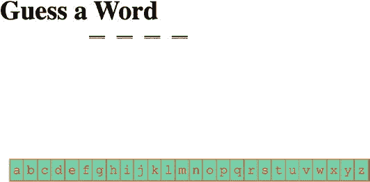
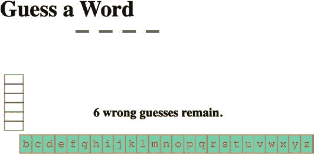
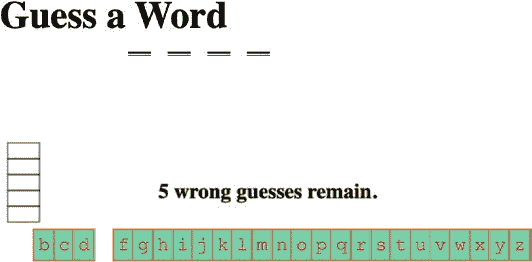
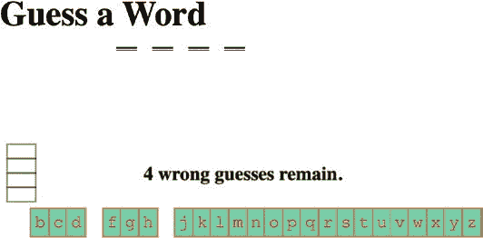
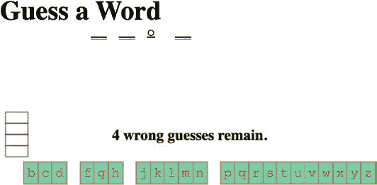

# 第 9 章

## 猜词游戏

本章内容涵盖：

- 使用 CSS 样式
- 生成字母按钮标记与部分隐藏单词的显示
- 基于计算进行绘制
- 使用字符串作为秘密单词
- 为单词列表创建外部脚本文件
- 设置与移除事件处理

### 引言

本章旨在继续演示编程技术以及 HTML5、层叠样式表（CSS）和 JavaScript 的功能，结合动态创建 HTML 标记、绘制视觉元素以及在画布上显示文本，为玩家提供游戏状态的反馈。本章的示例是一个通用的猜词游戏，玩家通过逐个尝试字母来猜测单词。

游戏规则如下：程序选择一个单词（称为`秘密单词`），并显示相应数量的短横线，让玩家知道该单词由多少个字母组成。玩家猜测单个字母。如果该字母存在于单词中，程序会将所有对应位置的符号替换为实际字母。

这是我选择的实现方式。在某些猜词游戏中，若单词中多次出现同一字母，玩家必须重复猜测该字母。如果猜测的字母`不`存在于`秘密单词`中，则视为错误。玩家拥有有限的允许错误次数。

© Jeanine Meyer 2023

J. Meyer, *HTML5 必备指南*, [`doi.org/10.1007/978-1-4842-8722-4_9`](https://doi.org/10.1007/978-1-4842-8722-4_9)



游戏通过绘图和文本显示剩余允许错误次数，向玩家提供反馈。当允许错误次数耗尽或玩家猜出`秘密单词`的所有字母时，游戏结束。

在我们的游戏中，计算机会从一个单词列表（本例中是一个非常简短的列表）中随机选取`秘密单词`。你可以使用我的单词列表。当你制作自己的游戏时，请使用自己的单词列表。合理的做法是从小列表开始，待游戏完善后再扩展列表。我采用外部文件存储单词列表的技术正是为了支持这种开发方式。

在用户界面设计上，我选择在屏幕上显示包含所有字母的方块。玩家通过点击方块来选择字母。选定字母后，对应的方块会消失。这一设计借鉴了大多数人在玩纸笔版猜词游戏时，会先写出字母表，再逐个划掉已选字母的习惯。

图 9-1 展示了初始游戏画面。计算机已选择一个包含四个字母的单词。请注意，屏幕上还显示了包含所有字母的按钮。

**图 9-1.** 初始画面

使用小型单词库的一个好处是，即使我的代码通过随机过程选择单词，我此刻仍然知道单词是什么。这意味着我可以在不承受游戏压力的前提下开发游戏！我决定先点击字母`a`进行猜测。如图 9-2 所示，该字母并未出现在`秘密单词`中。





**图 9-2.** 猜测字母`a`后

接下来我猜测元音字母`e`，结果如图 9-3 所示。我并非暗示这是明智的策略。

**图 9-3.** 猜测字母`e`后的游戏状态

随后我猜测`i`，导致第三次错误操作，如图 9-4 所示。

**图 9-4.** 三次错误选择后的游戏画面



# 第 9 章 猜单词

现在，我猜了一个字母 `o`，结果显示这个猜测是正确的（如我所知，因为我有内幕消息），并且这个 `o` 作为第三个字母出现在了单词中，如图 9-5 所示。

***图 9-5.** 正确猜中了字母 o*

我尝试了下一个元音字母 `u`，这个也是正确的，如图 9-6 所示。

***图 9-6.** 已确认两个字母*

现在我又猜了几个字母，首先猜的是 `t`，如图 9-7 所示。

***图 9-7.** 尝试猜 t 时，又是一次错误猜测*

接着，我又猜错了一次，这次猜的是 `s`，如图 9-8 所示。

***图 9-8.** 猜错字母 s 之后*

图 9-9 展示了又一次错误猜测。

***图 9-9.** 猜错字母 d 之后*

我决定猜一个正确的字母（记住，我知道所有单词），即 `m`。

图 9-10 展示了三个已确认的字母，以及屏幕上已经画出的大部分小人。

***图 9-10.** 正确猜中字母 m 之后*

此时，我正试图输掉游戏，所以我猜了 `b`。结果如图 9-11 所示。游戏还没有输，但如果下一个猜的字母同样不在单词里，那游戏就输了。

***图 9-11.** 游戏尚未失败*

此刻，亲爱的读者，也许你已经猜出这个单词了。然而，我将继续装傻，猜一个字母 `q`。

***图 9-12.** 游戏失败*

完整的秘密单词被揭示出来，并且出现一条消息，告诉玩家游戏失败，需要重新加载再试一次。

图 9-13 展示了另一局游戏的截图，计算机通过将猜中的字母 `e` 显示在两个位置，来回应玩家的猜测。处理一个单词中出现多次的字母并不困难，但在开始编程之前，这对我来说显然并非显而易见。

***图 9-13.** 在本局游戏中，字母 e 出现在两个位置*

我继续猜了一些其他字母，最终成功猜出了这个单词。同样地，用于选择的单词列表并不长，所以我可以根据字母数量来猜出单词。图 9-14 展示了这局获胜游戏的截图。请注意，秘密单词中有两个 `e` 和三个 `f`。

***图 9-14.** 赢得游戏*

涉及的编程技术和语言特性包括：操作字符串；使用一个包含英文字母的数组；创建用于存放字母表和代表秘密单词的空格（这些空格可能被字母替换，也可能不被替换）的标记元素；为已创建的字母块处理事件；以及绘制一个表示剩余允许错误次数的一摞矩形。此实现还演示了使用外部脚本文件来存放单词列表。与“石头剪刀布”之类的游戏不同，这个游戏在单局内包含多个回合，因此程序必须在内部管理游戏状态，并将其显示在屏幕上。

## 关键需求

与上一章类似，本游戏的实现使用了前面章节中演示过的许多 HTML5 和 JavaScript 结构，但在这里以不同的方式将它们组合在一起。编程类似于写作。在编程中，你将各种结构组合在一起，就像你用你知道的单词组成句子，然后将这些句子组成段落等等。在阅读本章时，请回想你学过的关于在画布上绘图、创建新的 HTML 标记、为屏幕上的标记设置鼠标点击事件以及使用 `if` 和 `for` 语句的知识。

为了实现这个或其它猜单词游戏，我们需要访问一个单词列表。我不需要一个玩家可能猜到的所有单词的列表作为开始。也就是说，在这个游戏中，由计算机/玩家选择一个单词。其他游戏可能要求单词列表包含玩家可能想要使用的所有单词。创建和测试程序时不需要一个很长的列表，这个列表以后可以替换。我决定将单词列表与程序分离作为一个需求。我的单词列表保存在文件 `words1.js` 中，稍后会在章节中展示。

用于玩家移动的用户界面可以有多种实现方式，例如，表单中的输入字段。然而，我认为更好的方法是让界面包含代表字母表中字母的图形。必须让每个图形都像一个可点击的按钮，并且提供一种方法，让每个字母在被选中后消失。这种方法还有一个额外的好处，就是防止恶作剧的玩家多次点击一个已经正确猜中的字母。

秘密单词必须显示在屏幕上，最初全部显示为空白，然后用任何正确猜中的字母填充。我选择使用双横线作为空白占位符，因为我希望被猜中的字母带有下划线。另一种选择是使用问号。

最后，程序必须监控游戏进度，并正确判断玩家何时失败、何时获胜。游戏状态对玩家是可见的，但程序必须设置并检查内部变量，以确定游戏是赢了还是输了。

## HTML5、CSS 和 JavaScript 特性

现在我们来看看 HTML5、CSS 和 JavaScript 中那些能够实现猜单词游戏所需功能的具体特性。除了基本的 HTML 标签以及函数和变量的工作原理外，这里的解释是完整的。然而，本章很大一部分内容会重复前面章节给出的解释。像之前一样，你可以选择先查看“构建应用程序”部分的所有代码，如果需要了解特定特性的解释，再回到本节。

### 将单词列表存储为在外部脚本文件中定义的数组

猜单词游戏需要能够访问一个可接受单词的列表，这个列表可以称为单词库。可以肯定地说，一种方法就是使用数组。

我们在这个初始示例中使用的短数组由以下代码定义：

```javascript
var words = [
  "muon", "blight","kerfuffle","qat"
];
```

请注意，这些单词的长度各不相同。这意味着我们可以使用我们想在最终版本中使用的随机处理代码，并且在测试时仍然知道选择了哪个单词。我们会确保代码使用 `words.length`，这样当你替换成更大的数组时，代码仍然能正常工作。

现在，问题来了，如果我们想要引入不同的单词列表，如何为此目的使用不同的数组呢？当然可以更改 HTML 文档。但是，在 HTML5（或之前的 HTML 版本）中，可以引入对外部脚本文件的引用来代替或补充 HTML 文档中的 `<script>` 元素。我们可以将声明和定义变量 `words` 的那三行代码取出，放入一个名为 `words1.js` 的文件中。我们可以使用下面这行代码将这个文件与文档的其余部分包含在一起：

```html
<script src="words1.js" defer></script>
```

使用 `defer` 方法可以使这个文件在浏览器继续处理基础 HTML 文档的其余部分时被加载。如果外部文件包含主体部分的内容，我们无法同时加载这两个文件，但在这情况下是可行的。

在我为我的课程准备的一个程序版本中，我确实用到了一个更长的单词列表。

# 这是某州中学官方拼写比赛单词表。我确实需要在 Excel 中进行一些操作才能生成 JavaScript 代码。一个增强版程序可以包含多个文件，让玩家在不同关卡或语言之间进行选择。

## 生成并定位 HTML 标记，然后将标记转换为按钮，最后禁用按钮

字母按钮和秘密单词破折号的创建是通过 JavaScript 和 CSS 的组合完成的。

我们将编写代码为程序的两个部分创建 HTML 标记：字母图标和秘密单词的空白位。（你可以参考[第 6 章](http://dx.doi.org/10.1007/978-1-4842-4155-4_6)的猜谜游戏，了解更多关于创建 HTML 标记以及附录的内容。）每种情况下，都使用以下内置方法创建 HTML 标记：

- `document.createElement(x)`: 为新元素类型`x`创建 HTML 标记
- `document.body.appendChild(d)`: 将`d`元素作为 body 元素的另一个子元素添加
- `document.getElementById(id)`: 提取 ID 值为`id`的元素

创建的 HTML 包含每个元素的唯一 ID。代码涉及设置某些属性：

- `d.innerHTML` 用于保存 HTML 内容
- `thingelem.style.top` 用于设置垂直位置
- `thingelem.style.left` 用于设置水平位置

## 第九章 猜单词

有了这些背景知识，下面是设置字母按钮的编码。我们首先声明一个全局变量`alphabet`：

```
var alphabet = "abcdefghijklmnopqrstuvwxyz";
```

`setupGame`函数中包含用于创建字母按钮的代码：

```
var i;
var x;
var y;
var uniqueid;
var an = alphabet.length;
for(i=0;i<an;i++) {
    uniqueid = "a"+String(i);
    d = document.createElement('alphabet');
    d.innerHTML = (
      "<div class="letters" id='"+uniqueid+"'>"+alphabet[i]+"</div>");
    document.body.appendChild(d);
    thingelem = document.getElementById(uniqueid);
    x = alphabetx + alphabetWidth*i;
    y = alphabety;
    thingelem.style.top = String(y)+"px";
    thingelem.style.left = String(x)+"px";
    thingelem.addEventListener('click',pickElement,false);
}
```

变量`i`用于遍历字母字符串。唯一 ID 是`a`与索引值的拼接，索引值从 0 到 25。插入到创建元素中的 HTML 是一个包含字母文本的`div`。字符串用双引号括起来，而字符串内的属性用单引号括起来。元素在屏幕上水平排列，起始位置为`alphabetx`、`alphabety`（每个全局变量在文档中更早声明），并按`alphabetWidth`水平递增。`top`和`left`属性需要设置为字符串，并以`"px"`结尾以表示像素。最后一步是设置事件处理，使这些元素充当按钮。

秘密单词元素的创建与此类似。不同之处在于每个元素的文本内容都是两个下划线。在屏幕上，这两个下划线看起来像一个长下划线。`ch`（代表选择）的赋值是程序选择秘密单词的方式。注意`length`是`String`数据类型对象以及数组的属性。在本例中，我将`length`用于单词列表。如果我的列表超过四个元素，这段代码仍然有效。

```
var ch = Math.floor(Math.random()* words.length);
secret = words[ch];
for (i=0;i<secret.length;i++) {
    uniqueid = "s"+String(i);
    d = document.createElement('secret');
    d.innerHTML = (
      "<div class="blanks" id='"+uniqueid+"'> __ </div>");
    document.body.appendChild(d);
    thingelem = document.getElementById(uniqueid);
    x = secretx + secretwidth*i;
    y = secrety;
    thingelem.style.top = String(y)+"px";
    thingelem.style.left = String(x)+"px";
}
```

看到这里，你可能会问：字母图标是如何变成带边框的块状字母的？答案是使用了 CSS。CSS 的用途远不止字体和颜色。样式决定了游戏关键部分的外观和感觉。注意，字母`div`元素的类设置为`'letters'`，而秘密单词字母`div`元素的类设置为`'blanks'`。样式部分包含以下两种样式，为了便于阅读我进行了分组。换行对浏览器没有影响。

```
<style>
.letters {
  position:absolute;
  left: 0px; top: 0px;
  border: 2px; border-style: double;
  margin: 5px; padding: 5px;
  font-size: 24px;
  color:#F00; background-color:#0FC;
  font-family:"Courier New", Courier, monospace;
}
.blanks {
  position:absolute;
  left: 0px; top: 0px;
  border:none; margin: 5px; padding: 5px;
  color:#006; background-color:white;
  font-family:"Courier New", Courier, monospace;
  text-decoration:underline;
  color: black; font-size:24px;
}
</style>
```

点号后跟名称的指定方式意味着此样式适用于该类的所有元素。这与仅使用名称（如上一章中的`form`，其中样式应用于所有`form`元素）或使用`#`后跟名称（指向文档中 ID 为该名称的唯一元素）不同。注意`letters`的样式包含边框、颜色和背景色。指定字体族是一种为任务选择首选字体，并在该字体不可用时指定备用字体。CSS 的这一功能为设计师提供了广阔的自由度。我在这里的选择是`"Courier New"`，第二选择是`Courier`，第三选择是可用的任何等宽字体（在*等宽字体*中，所有字母的宽度相同）。我决定使用等宽字体，以便于制作大小相同、在屏幕上整齐排列的图标。`margin`属性设置边框外部的间距，而`padding`指文本与边框之间的间距。

我们希望代表字母的按钮在被点击后消失。`pickElement`函数中的代码可以使用`this`来引用被点击的对象。以下两条语句（可以合并为一条）通过设置`display`属性来实现此效果：

```
var id = this.id;
document.getElementById(id).style.display = "none";
```

当游戏结束时，无论是赢还是输，我们通过遍历所有元素来移除所有字母的点击事件处理：

```
for (j=0;j<alphabet.length;j++) {
    uniqueid = "a"+String(j);
    thingelem = document.getElementById(uniqueid);
    thingelem.removeEventListener('click',pickElement,false);
}
```

`removeEventListener`事件如其名所示：它移除事件处理。

## 创建剩余错误次数的反馈

我决定通过文本和图片两种方式向玩家提供反馈。文本可以被屏幕阅读器读取，而图片则能带来强烈的视觉冲击。我选择用一叠矩形来表示剩余允许猜错的字母数量。文本和矩形堆叠都位于画布上。定位、显示和擦除需要一些坐标值的调整，但由于字母按钮和秘密单词未写在画布上，这一过程大为简化。

绘制矩形堆叠的代码如下：

```
function drawRemain(remain){
    ctx.rect(startRx,startRy,unitX+10,5);
    var ypos=startRy-unitY;
    for (i=0;i<remain;i++){
        ctx.strokeRect(startRx,ypos,unitX,unitY);
        ypos=ypos-unitY;
    }
}
```

**提示：** 如果你还没有尝试过绘图（即使尝试过了也请再试一次），可以尝试用另一种方式来传达剩余猜错次数。

### 维护游戏状态并判定胜负

# 排版后的文档

在编程中，编码和维护应用程序状态是一种常见需求。在第 2 章中，我们的程序会记录下一次掷骰子是首次投掷还是后续投掷。猜词游戏的状态包括隐藏词的身份、词中已被正确猜出的字母、已尝试过的字母，以及剩余允许猜错的次数。

当玩家点击字母块时调用的`pickElement`函数是关键时刻发生的地方，它执行以下任务：

- 检查玩家的猜测（存储在变量`picked`中）是否与变量`secret`中存储的密语中的任何字母匹配。对于每个匹配项，通过将`textContent`设置为该字母，显示空白元素中对应的字母。
- 使用变量`lettersGuessed`记录已猜出的字母数量。
- 通过比较`lettersGuessed`和`secret.length`来检查游戏是否获胜。如果游戏获胜，移除字母按钮的事件处理并显示相应的消息。
- 如果所选字母与密语中的任何字母都不匹配（如果变量`not`仍为 true），则递增变量`cur`。
- 通过比较`cur`和`guessLimit`来检查游戏是否失败。如果`cur`大于或等于`guessLimit`，则显示所有字母，移除事件处理，并给出相应的反馈。
- 无论是否匹配，通过将`display`属性设置为`none`并移除事件处理，使被点击的字母按钮消失。

这些任务使用`if`和`for`语句执行。在确定一个字母被正确猜出后，执行游戏是否获胜的检查。类似地，仅在确定字母没有被正确识别且绞刑架已推进时，才执行游戏是否失败的检查。游戏状态在代码中由变量`secret`、`lettersGuessed`和`cur`表示。玩家看到的是密语的下划线和已填充的字母以及剩余的字母块。

带有逐行注释的完整 HTML 文档代码位于“构建应用程序”部分。下一节描述了处理玩家猜测的关键首要任务。一个需要牢记的通用策略是，某些任务是通过对数组中的每个成员执行操作来完成的，即使对于数组中的某些元素可能并非必要。例如，当任务是显示密语中的所有字母时，所有字母的`textContent`都会被更改，即使其中一些字母已经显示过。类似地，变量`not`可能被多次设置为`false`。

## 通过设置 textContent 检查猜测并显示密语中的字母

玩家通过点击字母进行移动。`pickElement`函数被设置为每个字母图标的事件处理程序。因此，在函数内部，我们可以使用术语`this`来指代接收（监听并听到）点击事件的对象。因此，表达式`this.textContent`将包含所选字母。于是，语句

```
var picked = this.textContent;
```

将玩家正在猜测的具体字母赋值给局部变量`picked`。然后代码遍历变量`secret`中存储的密语的所有字母，并将每个字母与玩家的猜测进行比较。最初创建的双下划线标记对应于密语中的字母，因此当猜测正确时，对应的元素将被更改；也就是说，它的`textContent`将设置为玩家猜测的字母，该字母存储在`picked`中。

```
for (i=0;i<secret.length;i++) {
  if (picked==secret[i]) {
    id = "s"+String(i);
    document.getElementById(id).textContent = picked;
    not = false;
    lettersGuessed++;
    ...
  }
}
```

# 当猜中字母时，迭代过程并不会停止，而是会继续推进。这意味着任何一个字母的所有实例都会被找到并揭示出来。每次匹配时，变量 `not` 都会被设置为 `false`。如果同一个字母出现两次或更多次，这个变量就会被多次设置，但这并不是问题。我加入了单词 `kerfuffle` 来确保重复字母能被正确处理（此外，我也很喜欢这个词）。你可以在下一节中查看所有代码。

## 构建应用并使其为己所用

猜单词应用使用了 CSS 样式、由 JavaScript 创建的 HTML 标记以及 JavaScript 代码。它包含两个初始化和设置函数（`init` 和 `setupGame`）、一个承担大部分工作的函数（`pickElement`），以及另外两个用于提供反馈的函数。这些函数在表 9-1 中进行了描述。

**表 9-1.** 被调用或主动调用的函数

| **函数** | **被谁调用/主动调用** | **调用内容** |
| --- | --- | --- |
| `init` | 由 `<body>` 标签中的 `onLoad` 动作触发调用 | `setupGame` |
| `setupGame` | `init` | 设置字母表并选取秘密单词 |
| `pickElement` | 由 `setupGame` 中 `addEventListener` 调用的动作触发调用 | `showProgress`, `pickElement`, `drawRemain` |
| `drawRemain` | `showProgress` | — |

表 9-2 展示了猜单词游戏的完整实现。

**表 9-2.** 猜单词程序的完整实现：代码与解释

| **代码** | **解释** |
| --- | --- |
| `<html>` | 开始 html 标签。 |
| `<head>` | 开始 head 标签。 |
| `<title>Word Guess</title>` | 完成标题元素。 |
| `<style>` | 开始 style 元素。 |
| `.letters {position:absolute;left: 0px; top: 0px; border: 2px; border-style: double;margin: 5px; padding: 5px; color:#F00;background-color:#0FC; font-family:"Courier New", Courier, monospace; }` | 为指定了 `letters` 类的元素指定样式，包括边框、颜色和字体。 |
| `.blanks {position:absolute;left: 0px; top: 0px; border:none; margin: 5px; padding: 5px; color:#006; background-color: white; font-family:"Courier New", Courier, monospace; text-decoration:underline; color: black; }` | 为指定了 `blanks` 类的元素指定样式，包括边框、间距、颜色和字体，并添加下划线。 |
| `</style>` | 结束 style 元素。 |
| `<script src="words1.js" defer></script>` | 引用外部文件 `words1.js` 中的单词列表的元素，其中 `defer` 指令指示在加载本文档其余部分的同时加载该文件。 |
| `<script >` | script 元素的开始标签。 |
| `var ctx;` | 用于所有绘图的变量。 |
| `var thingelem;` | 用于创建的元素的变量。 |
| `var alphabet = "abcdefghijklmnopqrstuvwxyz";` | 定义字母表的字母，用于字母按钮。 |
| `var alphabety = 300;` | 所有字母按钮的垂直位置。 |
| `var alphabetx = 20;` | 字母表的起始水平位置。 |
| `var alphabetWidth = 25;` | 分配给字母元素宽度。 |
| `var secret;` | 将保存秘密单词。 |
| `var lettersGuessed = 0;` | 记录已猜字母的数量。 |
| `var secretx = 160;` | 秘密单词的起始水平位置。 |
| `var secrety = 50;` | 秘密单词的垂直位置。 |
| `var secretwidth = 50;` | 显示秘密单词时每个字母的分配宽度。 |
| `var cur = 0;` | 初始化 `cur`。 |
| `var guessLimit = 7;` | 如果你想改变允许的错误猜测次数，可以修改此值。 |
| `var msgx = 100;` | 消息的水平坐标。 |
| `var msgy = 120;` | 消息的垂直坐标。 |
| `var clearX = 0;` | 画布左上角的水平坐标。 |
| `var clearY = 0;` | 画布左上角的垂直坐标。 |
| `var clearW = 600;` | 画布的宽度。 |
| `var clearH = 400;` | 画布的高度。 |
| `var startRx = 10;` | 矩形堆叠的起始 x 坐标。 |
| `var startRy = alphabety - 150;` | 计算起始 y 坐标，使其位于字母表上方。 |
| `var unity = 140 / guessLimit;` | — |

### 计算矩形高度

`var unitX = 40;`
设置存储矩形宽度的变量。

```
function init(){
```

文档加载时调用的函数头。

`ctx = document.`
为画布上的所有绘图设置变量。

`getElementById('canvas').getContext('2d');`

`setupGame();`
调用设置游戏的函数。

`ctx.font="bold 20pt Ariel";`
设置字体。

```
}
```

函数结束。

```
function setupGame() {
```

设置字母按钮和秘密单词的函数头。

`var i;`
创建迭代变量。

`var x;`
创建位置变量。

`var y;`
创建位置变量。

`var uniqueid;`
为每组创建的 HTML 元素创建变量。

`var an = alphabet.length;`
值为 26。

```
for(i=0;i<an;i++) {
```

循环创建字母按钮。

`uniqueid = "a"+String(i);`
创建唯一标识符。

`d = document.`
创建一个字母类型的元素。

`createElement('alphabet');`

`d.innerHTML = (`
按下一行指定定义内容。

```
"<div class="letters" id='"+uniqueid
+"'>"+alphabet[i]+"</div>");
```

指定一个类为 `letters` 的 `div`，具有唯一标识符和文本内容，即字母表中的第 `i` 个字母。

`document.body.appendChild(d);`
添加到 `body` 中。

`thingelem = document.getElementById(uniqueid);`
获取具有该 `Id` 的元素。

`x = alphabetx + alphabetWidth*i;`
计算其水平位置。

`y = alphabety;`
设置垂直位置。

`thingelem.style.top = String(y)+"px";`
使用 `style.top` 设置垂直位置。

`thingelem.style.left = String(x)+"px";`
使用 `style.left` 设置水平位置。

`thingelem.addEventListener('click', pickElement,false);`
设置鼠标点击事件的处理程序。

```
}
```

字母循环结束。

`var ch = Math.floor(Math.random()*words.length);`
随机选择一个单词的索引。

`secret = words[ch];`
将全局变量 `secret` 设置为此单词。

```
for (i=0;i<secret.length;i++) {
```

根据秘密单词的长度进行循环。

`uniqueid = "s"+String(i);`
为单词创建唯一标识符。

`d = document.createElement('secret');`
为单词创建一个元素。

`d.innerHTML = ("<div class=\"blanks\" id='" + uniqueid + "'> __ </div>");`

设置内容为一个类为 blanks 的 div，其 Id 为刚创建的 `uniqueid`。文本内容为下划线。

`document.body.appendChild(d);`

将创建的元素作为 body 的子元素添加。

`thingelem = document.getElementById(uniqueid);`

获取创建的元素。

`x = secretx + secretwidth * i;`

计算元素的水平位置。

`y = secrety;`

设置其垂直位置。

`thingelem.style.top = String(y) + "px";`

使用 `style.top` 设置垂直位置。

`thingelem.style.left = String(x) + "px";`

使用 `style.left` 设置水平位置。

```
}
```

循环结束。

`return false;`

返回 false 以防止 HTML 页面刷新。

```
}
```

函数结束。

### `function pickElement(ev)`

因点击而调用的函数头。

`var not = true;`

将 `not` 设置为 true，可能会被改变。

`var picked = this.textContent;`

从 `this` 引用的对象中提取文本内容，即字母。

`var i;`

用于迭代。

`var j;`

用于迭代。

`var uniqueid;`

用于为元素创建唯一标识符。

`var thingelem;`

保存元素。

`var out;`

显示消息。

```
for (i = 0; i < secret.length; i++) {
```

遍历秘密单词中的字母。

```
if (picked == secret[i]) {
```

表示：“如果玩家猜中的字母与秘密单词中的这个字母相等……”

`id = "s" + String(i);`

构建该字母的标识符。

`document.getElementById(id).textContent = picked;`

将文本内容更改为该字母。

`not = false;`

将 `not` 设置为 false。

`lettersGuessed++;`

正确识别的字母数加一。

```
if (lettersGuessed == secret.length) {
```

表示：“如果整个秘密单词已被猜中……”

`ctx.fillStyle = gallowsColor;`

设置颜色，这里使用了绞刑架的棕色，但也可以是其他任意颜色。

`out = "You won!";`

设置消息。

`ctx.fillText(out, 200, 80);`

显示消息。

`ctx.fillText("Re-load the page to try again.", 200, 120);`

显示另一条消息。

```
for (j = 0; j < alphabet.length; j++) {
```

遍历整个字母表。

```
uniqueid = "a" + String(j);
```

构造标识符。

```
thingelem = document.getElementById(uniqueid);
```

获取元素。

```
thingelem.removeEventListener('click', pickElement, false);
```

移除事件处理。

```
}
```

结束 `j` 的 `for` 循环迭代。

```
}
```

结束 `if (lettersGuessed...)`，即全部猜中的测试。

```
}
```

结束 `if (picked == secret[i])` 为真的子句。

```
}
```

结束对秘密单词中字母的 `for` 循环迭代。

(*续*)

# 第 9 章 猜单词

***表 9-2.*** (*续*)

| 代码 | 说明 |
| :--- | :--- |
| `if (not) {` | 检查是否没有识别出任何字母。 |
| `cur++;` | 递增计数器。 |
| `showProgress(cur);` | 反馈文本和绘图。 |
| `if (cur >= guessLimit) {` | 检查是否所有步骤都已完成。 |
| ``` for (i = 0; i < secret.length; i++) { ``` | 开始对秘密单词中的字母进行新一轮迭代，以揭示所有字母。 |
| ``` id = "s" + String(i); ``` | 构造标识符。 |
| ``` document.getElementById(id).textContent = secret[i]; ``` | 获取元素的引用并将其设置为秘密单词中的该字母。 |
| ``` } ``` | 结束迭代。 |
| `ctx.fillStyle = "red";` | 设置颜色。 |
| `out = "You lost! Reload the page to try again.";` | 设置消息。 |
| `ctx.clearRect(clearX, clearY, clearW, clearH);` | 清除画布。 |
| `ctx.fillText(out, msgx, msgy);` | 显示`out`消息。 |
| ``` for (j = 0; j < alphabet.length; j++) { ``` | 遍历字母表中的所有字母。 |
| ``` uniqueid = "a" + String(j); ``` | 构造唯一标识符。 |
| ``` thingelem = document.getElementById(uniqueid); ``` | 获取元素。 |
| ``` thingelem.removeEventListener('click', pickElement, false); ``` | 移除此元素的事件处理。 |
| ``` } ``` | 结束`j`循环 |
| ``` } ``` | 结束`if (cur > guessLimit)` |
| ``` } ``` | 结束`if (not)`测试（玩家猜错）。 |

(*续*)

# 第 9 章 猜单词

## 表 9-2. (续)

| 代码 | 说明 |
| --- | --- |
| `var id = this.id;` | 提取此元素的标识符。 |
| `thingelem = document.getElementById(id);` | 获取元素引用。 |
| `thingelem.style.display = "none";` | 使这个特定的字母按钮消失。 |
| `thingelem.removeEventListener('click', pickElement, false);` | 移除事件处理。 |
| `}` | 结束`pickElement`函数。 |
| `function showProgress(cur) {` | `showProgress`的函数头。 |
| `ctx.clearRect(clearX, clearY, clearW, clearH);` | 清除画布。 |
| `var remain = guessLimit - cur;` | 计算剩余次数。 |
| `drawRemain(remain);` | 转到另一个函数进行绘图。 |
| `out = String(remain) + " wrong guesses remain.";` | 准备文本。 |
| `ctx.fillText(out, msgx, msgy);` | 显示文本。 |
| `}` | 结束`showProgress`。 |
| `function drawRemain(remain) {` | `drawRemain`的函数头。 |
| `var ypos = startRy - unitY;` | 确定起始垂直点（最低点）。 |
| `for (i = 0; i < remain; i++) {` | 循环绘制矩形。 |
| `ctx.strokeRect(startRx, ypos, unitX, unitY);` | 绘制矩形。 |
| `ypos = ypos - unitY;` | 递减`ypos`。 |
| `}` | 结束循环。 |
| `}` | 结束`drawRemain`函数。 |

(续)

# 第 9 章 猜单词

***表 9-2.*** (*续*)

**代码** | **说明**
-------|--------
`</script>` | 关闭脚本。
`</head>` | 关闭头部。
`<body onLoad="init();">` | 开始标签，设置对`init()`的调用。
`<h1>Word Guess</h1>` | 以大字显示游戏名称。
`<p>` | 段落开始标签。
`<canvas id="canvas" width="600" height="400">` | 画布元素开始标签，包含尺寸。
`Your browser doesn't support the HTML5 element canvas.` | 给使用不支持 canvas 的浏览器的用户的消息。
`</canvas>` | 画布结束标签。
`</body>` | 关闭主体。
`</html>` | 关闭文档。

猜字母来揭示单词的一个变体是猜单词来揭示一句常见的谚语。基于这个游戏来创建那个游戏对你来说是一个挑战。关键步骤是处理单词之间的空格和标点符号。你可能希望立即揭示单词之间以及句号、逗号和问号之间的每个空格实例，将这些作为给玩家的提示。这意味着你需要确保`lettersGuessed`从一开始就包含正确的计数。不要担心所选字母会与空格或标点符号进行比较。

另一个变体是改变字母表，当然，还有单词列表。我仔细地用`alphabet.length`替换了所有`26`的实例。你还需要改变输赢消息的语言。当然，这不适用于使用字符而非字母的语言。

游戏的一个合适的增强功能是制作一个“新单词”按钮。为此，你需要将`setupGame`按钮的功能拆分成两个函数。一个函数创建新的字母图标和最长的可能秘密单词的位置。另一个函数确保所有字母图标可见并设置好事件处理，然后选择并设置秘密单词的空白，确保合适数量的空白可见。如果你这样做，你可能想要显示一个分数和游戏次数。

# 第 9 章 猜单词

继续这个教育性的想法，并假设你使用不常见的单词，你可能希望包含定义。定义可以在游戏结束时通过在画布上书写文本来揭示。或者你可以制作一个按钮，点击即可将定义作为提示显示给玩家。或者，你可以创建一个指向某个网站的链接，例如 [Dictionary.com](http://dictionary.com)。

## 测试和上传应用程序

要测试此应用程序，你可以下载我的单词列表或创建你自己的单词列表。如果你自己创建，请从一份简短单词列表开始，将其准备为纯文本，命名为 `words1.js`。在测试时，不要总是以相同的模式猜测，例如按顺序选择元音。要故意乱来，并尝试在游戏结束后继续猜测。当你对编码感到满意时，创建一个更长的单词列表，并将其保存为 `words1.js`。

`HTML` 文件和 `words1.js` 文件都需要上传到你的服务器。

## 总结

在本章中，你学会了如何使用 HTML5、JavaScript 和 CSS 的特性以及通用的编程技术来实现一个熟悉的游戏，其中包括以下内容：

-   动态创建 HTML 标记
-   使用 `addEventListener` 和 `removeEventListener` 为单个元素设置和移除事件处理
-   使用样式从显示中移除元素并移除事件处理
-   操作变量以维护游戏状态，并通过计算判断是赢是输
-   创建一个外部脚本文件来保存单词列表，以增加灵活性
-   使用 CSS，包括用于选择字体、颜色和显示的 `font-family`

# 第 9 章 猜单词

像这样的游戏是展示编程概念的吸引人的例子，我在《Programming 101: The How and Why of Programming Revealed Using the Processing Programming Language》（也由 Apress 出版）中使用了类似的内容。

本书的下一章也是最后一章描述了 21 点纸牌游戏（也称为 Blackjack）的实现。它将基于你所学的内容，并描述一些新的编程技术、添加到 HTML5 中的元素以及更多的 CSS。
