## 第 10 章 二十一点

**注意**：如果你像我一样，有时会在电脑的不同窗口间切换，你可能会发现，当返回二十一点游戏并按下一个按键时，程序没有响应。你需要用鼠标点击包含二十一点文档的窗口。这会让操作系统将焦点恢复到二十一点文档上，从而能够监听按键事件。

### 使用页眉和页脚元素类型

HTML5 新增了一些内置元素类型，包括 `header` 和 `footer`。引入这些以及其他新元素（例如 `article` 和 `nav`）的设计理念是提供服务于标准目的的元素，以便搜索引擎和其他程序能够识别如何处理这些内容，不过仍然需要指定其格式。以下是我们将在本例中使用的样式：

```
footer {
  display:block;
  font-family:Tahoma, Geneva, sans-serif;
  text-align: center;
  font-style:oblique;
}

header {
  width:100%;
  display:block;
}
```

`display` 设置可以是 `block`（块级）或 `inline`（行内）。将其设置为 `block` 会强制换行。请注意，对于某些浏览器，强制换行可能不是必需的，但这样做并无坏处。`font-family` 属性用于指定字体选项。如果用户的计算机上安装了 Tahoma 字体，则会使用它。接下来会尝试使用 Geneva 字体。如果两者都不存在，浏览器将使用默认设置的 `sans-serif` 字体。`text-align` 和 `font-style` 设置如其表面含义所示。`width` 设置将元素宽度设为包含元素（在此例中为 `body`）的整个宽度。请随意尝试！

请注意，你不能假设 `footer` 会出现在屏幕底部，或 `header` 会出现在屏幕顶部。我是在 HTML 文档中使用定位实现这一效果的。

我使用了 `footer` 来显示扑克牌图片的来源和洗牌算法。提供致谢、显示版权信息和展示联系方式都是 `footer` 元素的典型用途，但对于如何使用这些新元素、在 HTML 文档中将其放置在何处以及如何格式化它们，并没有限制。

#### 构建应用程序并使其成为你的专属

表 10-1 描述了该游戏中使用的函数。

**表 10-1.** 二十一点函数

| 函数 | 被谁调用 | 调用谁 |
|---|---|---|
| `init` | 由 `<body>` 标签中的 `onLoad` 函数调用 | `buildDeck`、`shuffle` 和 `dealStart` |
| `getKey` | 由 `init` 中的 `window.addEventListener` 调用 | `deal`、`playerDone` 和 `newGame` |
| `dealStart` | `init` | 四次调用 `dealFromDeck` |
| `deal` | `getKey` | 两次调用 `dealFromDeck` 和一次调用 `more_to_house` |
| `more_to_house` | `deal`、`playerDone` | `dealFromDeck` |
| `dealFromDeck` | `deal`、`dealStart`、`playerDone` | - |
| `buildDeck` | `init` | `MCard` |
| `MCard` | `buildDeck`、`swapInDeck` | - |
| `add_up_player` | `playerDone` | - |
| `playerDone` | `getKey` | - |

# 第 10 章 21 点

## 表 10-2. 21 点游戏的注释代码

本示例中的函数展现出一种过程调用模式，只有 `init()` 和 `getKey()` 是通过事件触发的。请注意，编写应用程序有很多方式，包括函数的定义方式。通常，将代码拆分为小函数是一种良好的实践，但这并非必须。代码中有许多重复的相似行，因此有机会定义更多函数。注释文档见下文表 10-2。

| **代码** | **解释** |
|---|---|
| `more_to_house`, `dealFromDeck`, `showHouse`, 和 `add_up_player` | |
| `newGame` | |
| `getKey` | |
| `dealStart` | |
| `showHouse` | |
| `playerDone` | |
| `shuffle` | |
| `init` | |
| `swapInDeck` | |
| `swapInDeck` | |
| `shuffle` | |
| `MCard` | |

| **代码** | **解释** |
|---|---|
| `<html>` | 开始 html 标签。 |
| `<head>` | 开始 head 标签。 |
| `<title>Black Jack</title>` | 完成标题元素。 |
| `<style>` | 开始 style 标签。 |
| `body {` | 指定 body 元素的样式。 |
| `background-color:white;` | 设置背景颜色。 |
| `color: black;` | 设置文本颜色。 |
| `font-size:18px;` | 设置字体大小。 |
| `font-family:Verdana, Geneva, sans-serif;` | 设置字体系列。 |
| `}` | 结束样式。 |
| `footer {` | 指定 footer 元素的样式。 |
| `display:block;` | 将此元素视为块级元素。 |
| `font-family:Tahoma, Geneva, sans-serif;` | 设置字体系列。 |
| `text-align: center;` | 将文本居中对齐。 |
| `font-style:oblique;` | 使文本倾斜。 |
| `}` | 结束样式。 |
| `header {` | 指定 header 元素的样式。 |
| `width:100%;` | 使其占据整个窗口宽度。 |
| `display:block;` | 将其视为块级元素。 |
| `}` | 结束样式。 |
| `</style>` | 结束 style 元素。 |
| `<script>` | 开始 script 元素。 |
| `var cwidth = 800;` | 设置画布宽度；用于清除画布。 |
| `var cheight = 500;` | 设置画布高度；用于清除画布。 |
| `var cardw = 75;` | 设置每张牌的宽度。 |
| `var cardh = 107;` | 设置每张牌的高度。 |
| `var playerXp = 100;` | 设置玩家手牌起始水平位置。 |
| `var playerYp = 300;` | 设置玩家手牌的垂直位置。 |
| `var houseXp = 500;` | 设置庄家手牌起始水平位置。 |
| `var houseYp = 100;` | 设置庄家手牌的垂直位置。 |
| `var houseTotal;` | 用于存储庄家手牌的总点数。 |
| `var playerTotal;` | 用于存储玩家手牌的总点数。 |
| `var pi = 0;` | 玩家手牌下一张牌的索引。 |
| `var hi = 0;` | 庄家手牌下一张牌的索引。 |
| `var deck = [];` | 存储所有牌。 |
| `var playerHand = [];` | 存储玩家的手牌。 |
| `var houseHand = [];` | 存储庄家的手牌。 |
| `var back = new Image();` | 用于牌背图像。 |
| `var ctx;` | 用于存储画布上下文。 |
| `var gameStart = false;` | 用于检查游戏是否已开始。 |
| `function init() {` | 由 body 中的 `onLoad` 调用的函数，用于执行初始化任务。 |
| `ctx = document.getElementById('canvas').getContext('2d');` | 设置用于所有绘图的变量。 |
| `ctx.font="italic 20pt Georgia";` | 设置字体。 |
| `ctx.fillStyle = "blue";` | 设置颜色。 |
| `buildDeck();` | 调用构建牌组的函数。 |
| `back.src ="cardback.png";` | 指定牌背图像（注意：只出现一张牌背：庄家的暗牌）。 |
| `canvas1 = document.getElementById('canvas');` | 设置用于事件处理的变量。 |
| `window.addEventListener('keydown',getkey,false);` | 设置按键按下的事件处理。 |
| `shuffle();` | 调用洗牌函数。 |
| `dealStart();` | 调用发前四张牌的函数。 |
| `}` | 结束函数。 |
| `function getKey(event) {` | 响应按键事件的函数。 |
| `var keyCode;` | 存储按键代码。 |
| `if(event == null)` | 浏览器特定代码，判断事件是否为空。 |
| `{` | 开始子句。 |
| `keyCode = window.event.keyCode;` | 从 `window.event.keyCode` 获取按键代码。 |
| `window.event.preventDefault();` | 阻止其他按键响应。 |

# 代码与说明

## 事件处理函数

```javascript
}
```
闭合该子句。

```javascript
else {
```
子句。

```javascript
keyCode = event.keyCode;
```
从 `event.keyCode` 获取键码。

```javascript
event.preventDefault();
```
阻止其他按键响应。

```javascript
}
```
闭合该子句。

```javascript
switch(keyCode) {
```
基于 `keyCode` 的 `switch` 语句头部。

```javascript
case 68:
```
已按下 `d` 键。

```javascript
deal();
```
给玩家（以及可能给庄家）发一张新牌。

```javascript
break;
```
退出 `switch`。

```javascript
case 72:
```
已按下 `h` 键。

```javascript
playerDone();
```
调用 `playerDone` 函数。

```javascript
break;
```
退出 `switch`。

```javascript
case 78:
```
已按下 `n` 键。

```javascript
newGame();
```
调用 `newGame` 函数。

```javascript
break;
```
退出 `switch`。

```javascript
default:
```
默认选项，如果你觉得不需要在玩家按下未识别键时提供反馈，可以将其移除。

```javascript
alert("Press d, h, or n.");
```
反馈消息。

```javascript
}
```
闭合 `switch`。

```javascript
}
```
闭合该函数。

## `dealStart()` 函数

用于初始发牌的函数头部。

```javascript
playerHand[pi] =
```
获取玩家的第一张牌。

```javascript
dealFromDeck(1);
```

```javascript
ctx.drawImage(playerhand[pi].picture,playerXp,playerYp,cardw,cardh);
```
在画布上绘制。

```javascript
playerXp = playerXp+30;
```
调整水平指针。

```javascript
pi++;
```
增加玩家手中的牌数。

```javascript
houseHand[hi] =
```
获取庄家的第一张牌。

```javascript
dealFromDeck(2);
```

```javascript
ctx.drawImage(back,houseXp,houseYp,cardw,cardh);
```
在画布上绘制牌背。

```javascript
houseXp = houseXp+20;
```
调整水平指针。

```javascript
hi++;
```
增加庄家手中的牌数。

```javascript
playerHand[pi] =
```
给玩家发第二张牌。

```javascript
dealFromDeck(1);
```

```javascript
ctx.drawImage(playerhand[pi].picture,playerxp,playeryp,cardw,cardh);
```
在画布上绘制。

```javascript
playerXp = playerXp+30;
```
调整水平指针。

```javascript
pi++;
```
增加玩家手中的牌数。

```javascript
houseHand[hi] =
```
给庄家发第二张牌。

```javascript
dealFromDeck(2);
```

```javascript
ctx.drawImage(househand[hi].picture,houseXp,houseYp,cardw,cardh);
```
在画布上绘制。

```javascript
houseXp = houseXp+20;
```
调整水平指针。

```javascript
hi++;
```
增加庄家手中的牌数。

```javascript
}
```
闭合该函数。

## `deal()` 函数

用于游戏过程中发牌的函数头部。

```javascript
if (gameStart) {
```
检查游戏是否已开始。

```javascript
playerHand[pi] =
```
给玩家发一张牌。

```javascript
dealFromDeck(1);
```

```javascript
ctx.drawImage(playerhand[pi].picture,playerxp,playeryp,cardw,cardh);
```
在画布上绘制。

```javascript
playerXp = playerXp+30;
```
调整水平指针。

```javascript
pi++;
```
增加玩家手中的牌数。

```javascript
if (more_to_house()) {
```
判断庄家是否应继续要牌的函数。

```javascript
houseHand[hi] =
```
给庄家发一张牌。

```javascript
dealFromDeck(2);
```

```javascript
ctx.drawImage(househand[hi].picture,houseXp,houseYp,cardw,cardh);
```
在画布上绘制一张牌。

```javascript
houseXp = houseXp+20;
```
调整水平指针。

```javascript
hi++;
```
增加庄家手中的牌数。

```javascript
}
```
闭合 `if` 真子句。

```javascript
}
```
闭合 `if (gameStart)` 的真子句。

```javascript
else {
```

```javascript
alert("Press n to start a new game with the same deck.\n Reload page to start a game with a new deck.");
```
向玩家输出提示信息：开始新游戏（使用同一副牌）或重新加载页面（使用新牌组）。

```javascript
}
```
闭合游戏*未*开始的 `else` 分支。

```javascript
}
```
闭合该函数。

## `more_to_house()` 函数

用于决定庄家行动的函数头部。

```javascript
var ac = 0;
```
用于记录 A 牌数量的变量。

```javascript
var i;
```
用于迭代的变量。

```javascript
var sumUp = 0;
```
初始化总和变量。

```javascript
for (i=0;i<hi;i++) {
```
遍历所有牌。

```javascript
sumUp += houseHand[i].value;
```
累加庄家手中牌的点数。

```javascript
if (houseHand[i].value==1) { ac++; }
```
记录 A 牌的数量。

```javascript
}
```
闭合 `for` 循环。

```javascript
if (ac>0) {
```
判断是否存在 A 牌。

```javascript
if ((sumUp+10)<=21) {
```
如果存在，判断将一张 A 牌视为 11 点后总数是否仍不超过 21。

```javascript
sumUp += 10;
```
如果是，则将其视为 11 点。

```javascript
}
```
闭合内层 `if`。

```javascript
}
```
闭合外层 `if`。

```javascript
houseTotal = sumUp;
```
将全局变量设为该总和。

```javascript
if (sumUp<17) {
```
判断总和是否小于 17。

# 黑杰克代码解释

## 表 10-2 代码解释（续）

`return true;`

如果是，返回 `true`，表示可以再拿一张牌。

`}`

结束该子句。

`else {`

开始 else 子句。

`return false;`

返回 `false`，表示庄家不再拿牌。

`}`

结束 else 子句。

`}`

结束该函数。

---

`function dealFromDeck(who)` 从牌堆发牌的函数头。

`{`

`var card;`

存放牌。

`var ch = 0;`

存放下一张未发牌的索引。

`while ((deck[ch].`

询问这张牌是否已被发出。

`dealt>0)&&(ch<51)) {`

`ch++;`

增加 `ch` 以进入下一张牌。

`}`

结束 while 循环。

`if (ch>=51) {`

询问是否没有未发的牌了。

`ctx.fillText("NO MORE`

直接在画布上显示一条消息。

`CARDS IN DECK. Reload. ", 200, 250);`

`ch = 51;`

将 `ch` 设置为 51 以使该函数正常工作。

`gameStart = false;`

阻止响应任何玩家要新牌的请求。

`}`

结束 if 真子句。

`deck[ch].dealt = who;`

存储 `who`（一个非零值），以此标记该牌已被发出。

`card = deck[ch];`

设置一张牌。

`return card;`

返回一张牌。

---

## 表 10-2 代码解释（续）

**代码** | **解释**

--- | ---

`}` | 结束该函数。

`function buildDeck() {` | 构建 `MCard` 对象的函数头。

`var n;` | 用于内部迭代的变量。

`var si;` | 用于外部迭代（遍历花色）的变量。

`var suitnames= ["clubs", "hearts","spades", "diamonds"];` | 花色的名称。

`var i;` | 追踪放入牌堆数组的元素。

`i=0;` | 将数组初始化为 0。

`var pickName;` | 简化编码。

`var nums=["a","2","3","4", "5","6","7","8","9","10", "j","q","k"];` | 所有牌的名称。

`for (si=0;si<4;si++) {` | 遍历花色。

`for (n=0;n<13;n++) {` | 遍历同花色中的牌。

`pickName=suitNames[si]+"-"+nums[n]+"-75.png";` | 构造文件名。

`deck[i]=new MCard(n+1, suitNames[si],pickName);` | 用指定的值构造一个 `MCard` 对象。

`i++;` | 递增 `i`。

`}` | 结束内部 for 循环。

`}` | 结束外部 for 循环。

`}` | 结束该函数。

---

## 表 10-2 代码解释（续）

**代码** | **解释**

--- | ---

`function MCard(n, s, pickName){` | 用于创建对象的构造函数头。

`this.num = n;` | 设置 `num` 值。

`if (n>10) n = 10;` | 对花牌进行调整。

`this.value = n;` | 设置 `value`。

`this.suit = s;` | 设置 `suit`。

`this.picture = new Image();` | 创建一个新的 `Image` 对象并将其赋值为一个属性。

`this.picture.src = pickName;` | 将此 `Image` 对象的 `src` 属性设置为图片文件名。

`this.dealt = 0;` | 将 `dealt` 属性初始化为 0。

`}` | 结束该函数。

---

## 表 10-2 代码解释（续）

**代码** | **解释**

--- | ---

`function add_up_player() {` | 确定玩家手牌点数的函数头。

`var ac = 0;` | 存放 A 牌的数量。

`var i;` | 用于迭代。

`var sumUp = 0;` | 初始化总和。

`for (i=0;i<pi;i++) {` | 遍历玩家手中的牌。

`sumUp += playerHand[i].value;` | 累加玩家手牌的点数。

`if (playerHand[i].value==1) {ac++;}` | 询问牌是否为 A 牌。增加 A 牌计数。

`}` | 结束 for 循环。

`if (ac>0) {` | 询问是否有任何 A 牌。

`if ((sumUp+10)<=21) {` | 如果这不会导致总和超过 21。

`sumUp +=10;` | 将一张 A 牌改为 11 点。

`}` | 结束内部 if。

`}` | 结束外部 if。

`return sumUp;` | 返回总和。

`}` | 结束该函数。

---

## 表 10-2 代码解释（续）

**代码** | **解释**

--- | ---

`function playerDone() {` | 当玩家表示停牌时调用的函数头。

`If (gameStart) {` | 检查游戏是否已开始。

`while(more_to_house()) {` | `more_to_house()` 函数指示庄家应该再拿一张牌。

`houseHand[hi] = dealFromDeck(2);` | 给庄家发一张牌。

`ctx.drawImage(back,houseXp, houseYp,cardw,cardh);` | 在画布上绘制这张牌。

`houseXp = houseXp+20;` | 调整水平指针。

`hi++;` | 增加庄家手牌的索引。

`}` | 结束 while 循环。

`showHouse();` | 亮出庄家的手牌。

`playerTotal = add_up_player();` | 确定玩家的总点数。

`if (playerTotal>21){` | 询问玩家是否爆牌。

`if (houseTotal>21) {` | 询问庄家是否爆牌。

`ctx.fillText("You and house both went over.",30,100);` | 显示一条消息。

`}`

# 表 10-2. (续)

| 代码 | 说明 |
|------|------|
| `}` | 关闭内部的 `if` 语句。 |
| `else {` | 开始 `else` 子句。 |
| *(续)* | |
| `ctx.fillText("You went over and lost.",30,100);` | 显示一条消息。 |
| `}` | 关闭 `else` 子句。 |
| `}` | 关闭外部子句（玩家点数爆了）。 |
| `else` | `else` 玩家点数未爆。 |
| `if (houseTotal>21) {` | 询问庄家点数是否爆了。 |
| `ctx.fillText("You won. House went over.",30,100);` | 显示一条消息。 |
| `}` | 关闭该子句。 |
| `else` | `else`。 |
| `if (playerTotal>=houseTotal) {` | 比较两个点数。 |
| `if (playerTotal>houseTotal) {` | 执行更具体的比较。 |
| `ctx.fillText("You won.",30,100);` | 显示赢家消息。 |
| `}` | 关闭内部子句。 |
| `else {` | 开始 `else` 子句。 |
| `ctx.fillText("TIE!",30,100);` | 显示一条消息。 |
| `}` | 关闭 `else` 子句。 |
| `}` | 关闭外部子句。 |
| `else` | `else`。 |
| `if (houseTotal<=21) {` | 检查庄家是否未爆。 |
| `ctx.fillText("You lost.",30,100);` | 显示一条消息。 |
| `}` | 关闭该子句。 |
| *(续)* | |
| `else {` | 开始 `else` 子句。 |
| `ctx.fillText("You won because house went over.");` | 显示一条消息（玩家未爆，庄家爆了）。 |
| `}` | 关闭该子句。 |
| `gameStart = false;` | 重置 `gameStart`。 |
| `}` | 关闭 `if(gamestart)` 的真值分支。 |
| `else {` | 向玩家显示消息。 |
| `alert("Press n to start a new game with the same deck.\n Reload for a new deck and then press n to start a game.");` | |
| `}` | |
| `}` | 关闭函数。 |
| `function newGame() {` | 新游戏函数的头部。 |
| `ctx.clearRect(0,0,cwidth,cheight);` | 清除画布。 |
| `pi=0;` | 重置玩家的索引。 |
| `hi=0;` | 重置庄家的索引。 |
| `playerXp = 100;` | 重置玩家手牌第一张牌的水平位置。 |
| `houseXp= 500;` | 重置庄家手牌的水平位置。 |
| `dealStart();` | 调用函数以初始发牌。 |
| `}` | 关闭函数。 |
| `function showHouse() {` | 揭示庄家手牌函数的头部。 |
| `var i;` | 用于迭代。 |
| `houseXp = 500;` | 重置水平位置。 |
| *(续)* | |
| `for (i=0;i<hi;i++) {` | 遍历手牌的 `for` 循环。 |
| `ctx.drawImage(househand[i].picture,houseXp,houseYp,cardw,cardh);` | 绘制牌。 |
| `houseXp = houseXp+20;` | 调整指针。 |
| `}` | 关闭 `for` 循环。 |
| `}` | 关闭函数。 |
| `function shuffle() {` | 洗牌函数的头部。 |
| `var i = deck.length - 1;` | 设置 `i` 变量的初始值，指向最后一张牌。 |
| `var s;` | 用于随机选择的变量。 |
| `while (i>0) {` | 只要 `i` 大于零。 |
| `s = Math.floor(Math.random()*(i+1));` | 随机挑选。 |
| `swapindeck(s,i);` | 与 `i` 位置的牌交换。 |
| `i--;` | 递减。 |
| `}` | 关闭 `while` 循环。 |
| `}` | 关闭函数。 |
| `function swapInDeck(j,k) {` | 交换辅助函数的头部。 |
| `var hold = new MCard(deck[j].num,deck[j].suit,deck[j].picture.src);` | 保存位置 `j` 的牌。 |
| `deck[j] = deck[k];` | 将位置 `k` 的牌赋值给位置 `j`。 |
| `deck[k] = hold;` | 将 `hold` 赋值给位置 `k` 的牌。 |
| `}` | 关闭函数。 |
| `</script>` | 关闭 script 元素。 |
| *(续)* | |
| `</head>` | 关闭 `head` 元素。 |
| `<body onLoad="init();">` | 设置调用 `init` 的起始标签。 |
| `<header>` | 包含说明的 `header` 元素。 |
| `Press <b>n</b> for a new game (same deck), <b>d</b> for deal 1 more card, <b>h</b> for hold. Reload for a new deck and then press n for a new game.<br></header>` | |
| `<canvas id="canvas" width="800" height="500">` | Canvas 起始标签。 |
| `Your browser doesn't support the HTML5 element canvas.` | 对不兼容浏览器的警告。 |
| `</canvas>` | 关闭该标签。 |
| `<footer>Card images obtained courtesy of the American Contract Bridge Association, <a href="http://acbl.mybigcommerce.com/52-playing-cards/">52 playing cards </a><br/> Fisher-Yates shuffle explained at [`eli.thegreenplace.net/2010/05/28/the-intuition-behind-fisher-yates-shuffling`](http://eli.thegreenplace.net/2010/05/28/the-intuition-behind-fisher-yates-shuffling)</footer>` | 打开 `footer` 元素，该元素提供扑克牌图片的致谢和链接，并添加洗牌算法文章的致谢。 |

## Fisher-Yates 洗牌算法背后的直觉

*续*

### 第 10 章：二十一点

**表 10-2.** *（续）*

| **代码** | **说明** |
|----------|----------|
| `</footer>` | 关闭页脚。 |
| `</body>` | 关闭主体。 |
| `</html>` | 关闭 HTML 文件。 |

你可以通过多种方式改变这款游戏的外观和体验，包括为玩家提供不同的操作方式：请求发新牌、保持当前手牌不动，或请求重开一局。你可以创建或获取自己的一套扑克牌图像。

在每局之间累计分数（或许再加入某种下注机制）将是一个不错的增强功能。改变庄家出牌的规则也是可行的。正如我之前提到的，可以考虑让电脑/庄家根据分数或通过随机运算来决定何时启用一副新牌。另一种增加游戏难度的方法是使用多副牌。记分是一项显而易见的功能，一种实现方式是加入钱包功能：玩家初始有一定金额，每局游戏扣减相应费用（付费游戏），获胜时则增加金额。得分和/或更完整的游戏结果可以使用`localStorage`存储在本地计算机上。

#### 测试与上传应用

此程序需要进行大量测试。请记住，当身为测试者的你获胜时，测试并未结束。只有当你在多种不同场景下进行过完整测试后，才算真正完成。我最初使用未经洗牌的牌组对游戏进行了首次测试。随后我加入了洗牌功能，并持续追踪测试中暴露的各种情况。我在不同情况下按下`d`键要牌，按下`h`键停牌，以及按下`n`开始新游戏。这绝对是一种需要邀请其他人来帮你测试应用的情况。

上传应用需要上传所有图片文件。如果你使用了与我演示不同的文件名，你需要修改`buildDeck`函数来构造正确的文件名称。

### 第 10 章：二十一点 — 总结

在本章中，你学习到了如何利用 HTML5、JavaScript 和 CSS 的特性，结合通用编程技术来实现一款纸牌游戏。其中包括以下内容：

-   根据外部文件名生成一组`Image`对象。
-   设计程序员自定义的卡牌对象类，并整合`Image`元素、牌面花色和牌面点数。
-   在屏幕上绘制图像和文本。
-   使用`for`、`while`和`if`实现二十一点的逻辑。
-   运用计算和逻辑生成电脑的操作。
-   为`keydown`事件建立事件处理，以便玩家能表明发新牌、停牌或开始新游戏的请求，并使用`switch`区分不同按键。
-   使用 HTML5 新增的`header`和`footer`元素，分别用于显示操作指引和标注来源。在`footer`元素中，包含了一种注明扑克牌面图像来源的方法。

这是本书的最后一章。不过，我增加了一个附录，其中的示例着重于绘图技术，包括数学（代数和几何）的应用以及标量矢量图形。

我希望你能学以致用，创作出这些游戏的增强版本，或是发明你自己的游戏。享受编程的乐趣吧！

我的《HTML5 与 JavaScript 项目实战》（第二版）已经更新，包含了一个名为“凑 15 点”游戏的实现、新媒体的使用，以及如何让你的项目适应不同屏幕尺寸和触摸事件（而非鼠标事件）或让仅使用键盘的用户也能无障碍访问的工具介绍。从编程技术的角度来看，这本书是你的合适进阶读物。如果你想探索一门不同的编程语言，请考虑《编程入门 101：使用 Processing 编程语言揭示编程的原理与原因》这本书。该书目前正在更新第二版。

### 附录：更多绘图技巧

本书最初计划是结合超文本标记语言、层叠样式表和 JavaScript 这套组合工具来介绍编程，其中重点放在 JavaScript 上。但在筹备第三版时，我们认为读者会欣赏一些额外、更进阶的材料。和以往一样，我的示例选择受到与同事和学生交流经历的影响。以下内容将展示数学（代数和几何）的应用，以及一个名为标量矢量图形的工具。这些应用程序是完整的，以便你能在具体情境中看到相关技术。然而，正如前 10 章中游戏演示的目的一样，文本的目的是教授编程概念以及 HTML、CSS 和 JavaScript 的技术特性，而不是如何构建特定的游戏和应用程序。部分阐述会重复前 10 章的内容。你可以利用这些独立的概念和技术来构建自己设计的项目。

#### 圆形与箭头

程序以三个由箭头连接的圆形开始。注意：我常将这些箭头称为*链接*。图 A-1 显示了初始界面。

© Jeanine Meyer 2023

J. Meyer，《HTML5 权威指南》，[`doi.org/10.1007/978-1-4842-8722-4`](https://doi.org/10.1007/978-1-4842-8722-4#DOI)

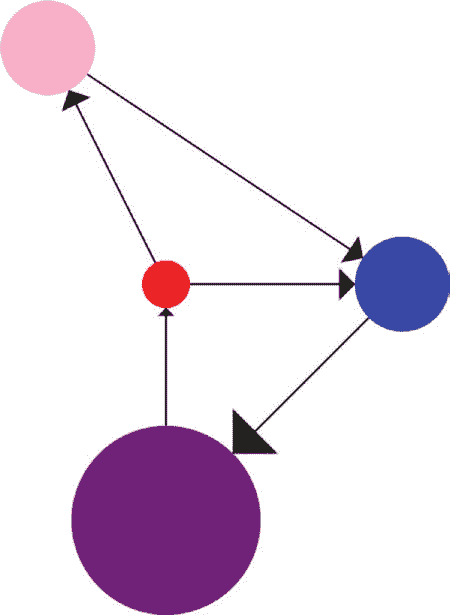

**图 A-1.** 初始界面

用户/玩家可以拖拽任意圆形。箭头会移动以保持连接关系。图 A-2 显示了经过一些操作后的界面。如果你完全按原样复制代码并打开文档，你会看到图 A-1，但如果你拖拽圆形，你很可能产生不同的结果，如图 A-2 所示。

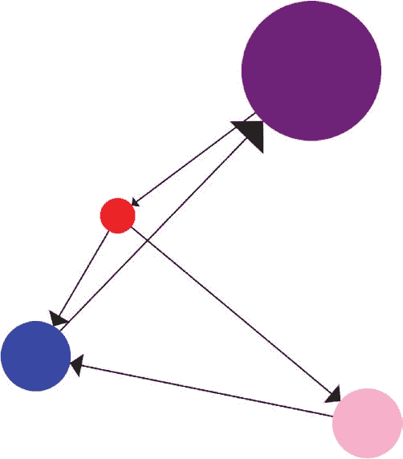

**图 A-2.** 经过一些操作后的界面

我最初编写此程序的动机是创建一个编辑器，用于绘制展示文章之间引用关系的图表。你可以用它来做类似的事情，并且你可能会发现这些独立技术的其他用途。

##### 概述

此示例所需的任务包括：绘制由箭头连接的圆形；使用鼠标操作拖拽（即移动）圆形；以及保持连接箭头正确的位置。我的程序利用 HTML 和 JavaScript 的特性，并借助一些数学知识来绘制连接线和箭头，从而完成这些任务。一个棘手的问题是如何处理垂直线。

HTML 文档被组织成所谓的*文档对象模型*，也称为文档树。在此示例中，HTML 定义了`body`元素，而该元素又包含一个`canvas`元素。我的 JavaScript 代码为每个圆形创建了独立的`canvas`元素。这些元素通过被附加到文档树中的`body`元素而变得可见。圆形显示在原始画布之上。它们的位置通过设置`style`元素的`left`和`top`属性的文本来指定。链接（箭头）则直接绘制在原始画布上。

# 箭头实现

箭头被设计为绘制在从一个圆的圆心到另一个圆圆心的连线上。但线条起始于圆的边界（圆周），尤其箭头尖端终止于第二个圆的边界。每个箭头被构建为一个三角形，其底边与连线垂直。这需要进行一系列计算，包括对垂直和水平线的特殊处理。

## 实现细节

注意：附录中的示例遵循当前推荐的做法，即每个文档以`<!DOCTYPE html>`开头。我还使用`meta`标签声明字符编码。这些内容需要您在阅读中自行探究，目前先接受它们即可。`<!... >`结构是 HTML 中编写注释的方式。JavaScript 中的注释通过`//`表示单行注释，`/* ... 和 */`表示多行注释。

如前所述，文档的`body`部分包含一个`canvas`元素。`canvas`元素中的单行文本会在浏览器不支持`canvas`时显示。这能让旧版浏览器更友好地显示异常信息，被视为良好实践。`canvas`的尺寸通过将`width`和`height`设置为`100%`来指定占满整个窗口。

```
<body onload="init();" onresize="init();">
<canvas id="canvas" width="100%" height="100%">
  您的浏览器不支持 canvas
</canvas>
</body>
```

您已在本书中见过类似内容。同样，您也见过动态创建 HTML 元素的例子（如第 6 章）。在页面加载和窗口调整大小时调用的`init`函数，会调用`buildCircles`函数为每个圆创建新的`canvas`元素，然后调用`drawLinks`函数绘制箭头（连线）。圆和连线的规格定义在`script`元素开头的变量声明中。

```
var circles=[
  [200,300,20,"red"],
  [400,300,40,"blue"],
  [200,500,80,"purple"],
  [100,100,40,"pink"]
];

var links =[
  [0,1],
  [2,0],
  [1,2],
  [0,3],
  [3,1]
];
```

`circles`和`links`数组代表平行结构。`circles`数组中的每个项目本身是一个数组，包含位置（水平和垂直坐标）、半径和颜色。`links`数组中的每个项目是一个包含对`circles`数组引用的数组。因此，`links[0]`表示从第 0 个圆到第 1 个圆的箭头。

请记住，数组索引从 0 开始。当圆被移动时，`circles`数组中保存的水平和垂直坐标将发生变化。探索此程序的一个步骤是向`circles`和`links`数组添加内容。您需要使用标准颜色之一来指定圆的颜色。

回到`init`函数，它设置某些变量，确保`canvas`尺寸与窗口匹配，然后调用`buildCircles`和`drawLinks`函数。`buildCircles`函数如其名所示。通过`for`循环，它为`circles`数组中描述的每个圆创建一个`canvas`元素，并将其追加到`body`元素中以成为文档的一部分。它设置其为可见状态，并在该`canvas`元素上绘制指定大小的圆，并用指定颜色填充。每个`canvas`元素被推入`canvases`数组，每个圆对应一个。每个新创建的`canvas`元素都会添加一个名为`aindex`的新属性，以引用`circles`数组中的项目。该属性用于改变位置。该函数还为`mousedown`事件调用`addEventListener`，事件处理程序指定为`startDragging`函数。也就是说，它为玩家在特定对象上按下鼠标按钮时的事件处理进行了设置。

`startDragging`函数会针对该对象两次调用`addEventListener`。

事件已被触发：在某个 `canvas` 元素上。其中一次事件是 `mousemove`，事件处理程序是 `moving()` 函数。另一次事件是 `mouseup`，事件处理程序是 `stopmove()` 函数。`moving()` 函数用于移动对象，即包含圆形的 `canvas`。请记住，正如我之前所写的，对象的位置由 `left` 和 `top` 属性指定。这意味着需要使用 `String()` 函数将数字转换为字符串，使用 `+` 运算符将这些字符串与 `px` 拼接，并使用 `parseInt()` 函数提取数值。由于底层的 JavaScript 程序会响应事件并多次调用 `moving()` 函数，因此 `drawLinks()` 函数也会被多次调用，用于重新绘制链接（箭头）。移动过程看起来十分流畅。我认为，理论上有可能让事件处理程序承担过多工作，但我并没有遇到过这种情况。

我将链接的绘制拆分成两个函数：`drawLinks()` 和 `drawAdjustedLink()`，以便单独处理垂直或水平线的特殊情况。将一个大型任务分解成若干较小的任务，始终是一个好做法。

表 A-1 列出了每个函数，并说明了它们是如何被调用的，以及它们调用了哪些函数（如果有的话），或者设置了哪些事件处理程序来进行调用。

## 附录 关于绘图的更多技巧

### 表 A-1. 圆形与箭头函数调用关系表

| 函数 | 被谁调用 | 由事件调用 | 调用谁 | 设置事件处理 |
| :--- | :--- | :--- | :--- | :--- |
| `init` | `onLoad`, `buildCircles`, `onResize` | | `drawLinks` | |
| `buildCircles` | `init` | `mouseDown` 事件处理程序 | `startDragging` | |
| `drawLinks` | `init`, `drawAdjustedLink` | | `moving`, `stopMove` | |
| `startDragging` | 在 `buildCircles` 中通过 `mouseDown` 设置 | `MouseMove` 事件处理程序 `moving`, `mouseUp` 事件处理程序 `stopMove` | | |
| `moving` | 在 `startDragging` 中通过 `mouseMove` 设置 | | | `drawLinks` |
| `stopMove` | 在 `startDragging` 中通过 `mouseUp` 设置 | | | `drawLinks` |
| `drawAdjustedLink` | `drawLinks` | | | |

请注意（并赞赏这一点）：我们无需编写代码来确定鼠标下方是哪个圆形！对象的事件处理机制已经完成了这项工作。

包含解释的完整代码见表 A-2。

### 表 A-2. 圆形与箭头代码

| 代码语句 | 解释 |
| :--- | :--- |
| `<!DOCTYPE html>` | DOCTYPE 注释。 |
| `<html>` | 开始标签 `<html>`。 |
| `<head>` | 开始标签 `<head>`。 |
| `<meta charset="UTF-8">` | 指定标准字符集。 |
| `<meta name="viewport" content="initial-scale=1">` | 标准 `<meta>` 标签。 |
| `<title>Circles and arrows</title>` | 设置标题，该标题将显示在浏览器的标签页上。 |
| `<style>` | 开始标签 `<style>`。 |
| `body {font-family:Garamond,serif; font-size: 24px; position:absolute;}` | 开始标签 `<body>` 的样式，指定字体……字号……定位方式。 |
| `}` | 关闭 body 样式定义。 |
| `canvas {position:absolute;}` | canvas 元素的样式规定。 |
| `</style>` | 关闭 style 标签。 |
| `<script>` | 开始标签 `<script>`。 |
| `var circles=[ [200,300,20,"red"], [400,300,40,"blue"], [200,500,80,"purple"], [100,100,40,"pink"] ];` | circles 数组声明和赋值的开始：一个包含多个数组的数组。红色圆形。蓝色圆形。紫色圆形。粉色圆形。 |
| `var links =[ [0,1], [2,0], [1,2], [0,3], [3,1] ];` | links 数组声明和赋值的开始：一个包含多个数组的数组。 |
| `var canvases = new Array();` | canvases 数组的声明和初始化。该数组将由所创建的、包含圆形的 canvas 元素填充。 |
| `var canvas;` | 将保存对原始 canvas 的引用。 |
| `var ctx;` | 将保存对原始 canvas 上下文的引用。 |

| `var cWidth;` | 将保存 canvas 宽度。 |
| `var cHeight;` | 将保存 canvas 高度。 |
| `var movingObject;` | 将保存对移动对象的引用。该值会发生变化。 |
| `var movingObjectIndex;` | 将保存移动对象在 canvases 数组中的索引。 |
| `var oldx;` | 将保存先前的 x 坐标。在 `moving` 函数中使用。在 `startDragging` 中设置，在 `moving` 中重置。 |
| `var oldy;` | 将保存先前的 y 坐标。在 `moving` 函数中使用。在 `startDragging` 中设置，在 `moving` 中重置。 |

（*续*）

# 排版后文本

`function` 设置在 `startDragging` 中，在 `moving` 中重置。

```javascript
function init(){
```

`init` 函数头。

`canvas = document.getElementById("canvas");` 获取原始画布的引用。

`ctx = canvas.getContext("2d");` 获取原始画布上下文的引用。这用于所有绘制。

`cWidth = window.innerWidth;` 获取窗口的宽度。

（续）

## 附录 A 更多绘制技术

### 表 A-2.（续）

| 代码语句 | 解释 |
| --- | --- |
| `cHeight = window.innerHeight;` | 获取窗口的高度。 |
| `canvas.width = cWidth;` | 重置画布以占据整个屏幕：宽度。 |
| `canvas.height= cHeight;` | …高度。 |
| `ctx.strokeStyle="black";` | 将描边设置为黑色。 |
| `ctx.strokeRect(0,0,cWidth, cHeight);` | 绘制画布的边界线。 |
| `buildCircles();` | 构建圆形。 |
| `drawLinks();` | 绘制链接。 |

}

关闭 `init` 函数。

```javascript
function buildCircles() {
```

`buildCircles` 函数头。

`var i;` 用于 `for` 循环。

`var can;` 用作每个新画布的引用。

`var circle;` 保存圆形信息。

`var diam;` 要创建的圆形的直径。

`var rad;` 要创建的圆形的半径。

`for (i=0;i<canvases.length;i++) {` 用于移除之前构建的所有圆形的 `for` 循环。在调整大小或重新加载时发生。

`can = canvases[i];` 需要知道要移除什么。

`document.body.removeChild(can);` 从文档树中移除。

}

关闭 `for` 循环。

`canvases = [];` 将 `canvases` 重置为空数组。

`for (i=0;i<circles.length;i++){` 用于创建包含圆形的画布的 `for` 循环。

（续）

## 附录 A 更多绘制技术

### 表 A-2.（续）

| 代码语句 | 解释 |
| --- | --- |
| `circle = circles[i];` | 获取 `circles` 中第 `i` 个元素的内部数组。 |
| `can = document.createElement('canvas');` | 创建一个 canvas 元素。 |
| `can.aindex = i;` | 添加一个新属性以引用回 `circles`。 |
| `ctxc = can.getContext('2d');` | 设置上下文。 |
| `rad = circle[2];` | 从数组中提取半径值。 |
| `diam = 2*rad;` | 计算直径。 |
| `can.width = diam;` | 使用 `diam` 作为宽度。 |
| `can.height= diam;` | …以及刚创建的画布的高度。 |
| `ctxc.fillStyle=circle[3];` | 设置填充样式。 |
| `ctxc.beginPath();` | 开始在新画布上绘制圆形路径。 |
| `ctxc.arc(rad,rad,rad,0, 2*Math.PI,true);` | 绘制一条弧线。 |
| `ctxc.closePath();` | 关闭路径。 |
| `ctxc.fill();` | 填充颜色。 |
| `circle[0] = Math.min(circle[0],cWidth-rad);` | 准备新画布左边坐标的值，使其适合原始画布。 |
| `circle[1] = Math.min(circle[1],cHeight-rad);` | …顶部坐标的值。 |
| `can.style.left = String(circle[0]-rad)+"px";` | 将 `left` 属性设置为字符串，并添加了 `px`（代表像素）。 |
| `can.style.top = String(circle[1]-rad)+"px";` | 设置 `top`。 |
| `can.addEventListener('mousedown',startDragging,false);` | 为新画布设置事件处理。 |
| `canvases.push(can);` | 将新画布添加到 `canvases` 数组。 |
| `document.body.appendChild(can);` | 向文档树添加新画布。 |
| `can.style.visibility = 'visible';` | 设置为可见。 |

}

关闭 `for` 循环。

}

关闭 `buildCircles` 函数。

```javascript
function startDragging(ev) {
```

`startDragging` 函数头。`ev` 包含事件信息，包括对对象的引用。

`movingObj = ev.target;` 将 `movingObj` 设置为画布/圆形对象。

`movingObjectIndex = movingObj.aindex;` 提取 `circles` 数组中的索引。

`oldx = parseInt(ev.pageX);` 提取 `mousedown` 事件发生时的 `x` 坐标。

`oldy = parseInt(ev.pageY);` 提取 `mousedown` 事件发生时的 `y` 坐标。

`movingobj.addEventListener("mousemove",moving,false);` 现在设置 `mousemove` 事件。

`movingobj.addEventListener("mouseup",stopmove,false);` …以及 `mouseup` 事件。

}

关闭 `startDragging`。

```javascript
function moving(ev) {
```

`moving` 函数头。`ev` 包含事件信息，包括对位置的引用。

`if(movingObj) {` 检查是否存在移动对象。

`newx = parseInt(ev.pageX);` 提取 `x` 坐标。

（续）

## 附录 A 更多绘制技术

### 表 A-2.（续）

| 代码语句 | 解释 |
| --- | --- |
| `newy = parseInt(ev.pageY);` | 提取 `y` 坐标。 |
| `delx = newx-oldx;` | 计算 `x` 坐标的变化量。 |
| `dely = newy-oldy;` | …以及 `y` 坐标的变化量。 |
| `oldx = newx;` | 将 `oldx` 重置为指向 `newx`。 |
| `oldy = newy;` | 将 `oldy` 重置为指向 `newy`。 |
| `curx = parseInt(movingObj.style.left);` | 从当前 `left` 属性中提取数值。 |
| `cury = parseInt(movingObj.style.top);` | 从当前 `top` 值中提取数值。 |
| `movingObj.style.left = String(curx+delx)+"px";` | 进行计算，将结果转换为字符串并添加 `px` 以获取 `left` 的更新值。`px` 代表“像素”。 |
| `movingObj.style.top = String(cury+dely)+"px";` | 进行计算，将结果转换为字符串并添加 `px` 以获取 `top` 的更新值。`px` 代表像素。 |
| `circles[movingObjectIndex][0] += delx;` | 将 `x` 坐标的更新值写回 `circles` 数组。 |
| `circles[movingObjectIndex][1] += dely;` | 将 `y` 坐标的更新值写回 `circles` 数组。 |

# JavaScript 绘图函数参考

## 事件处理与重绘

在事件处理函数中，当 `movingObj` 存在时，会执行以下操作：

```javascript
[1] += dely;
```

```javascript
drawLinks();
```

调用 `drawLinks()`，使用一个圆的新位置重绘所有连线。

```javascript
}
```

关闭 `if`（存在 `movingObj` 时）。

```javascript
}
```

关闭 `moving` 函数。

## `stopMove` 函数

```javascript
function stopMove(ev){
```

`stopMove()` 的函数头。参数 `ev` 在事件处理中设置。

### 附录：更多绘图技巧

**表 A-2**（续）

| 代码语句 | 说明 |
| --- | --- |
| `movingObj.removeEventListener("mousemove", moving, false);` | 移除事件监听。 |
| `movingObj.removeEventListener("mouseup", stopmove, false);` | 移除事件监听。 |
| `movingObj = null;` | 将 `movingObj` 设置为 `null`。 |
| `drawLinks();` | 绘制连线。 |
| `}` | 关闭 `stopmove()`。 |

## `drawLinks` 函数

```javascript
function drawLinks() {
```

`drawLinks()` 函数的函数头。

```javascript
ctx.clearRect(0, 0, cWidth, cHeight);
```

清除画布。

```javascript
ctx.strokeStyle = "black";
```

将描边颜色设置为黑色。

```javascript
ctx.fillStyle = "black";
```

将填充颜色设置为黑色。

```javascript
for (i = 0; i < links.length; i++) {
```

遍历所有连线（箭头）。

```javascript
link = links[i];
```

设置 `link` 以简化后续代码。

```javascript
circle1 = circles[link[0]];
```

定义第一个圆。

```javascript
circle2 = circles[link[1]];
```

定义第二个圆。

```javascript
startx = circle1[0];
```

设置起始 x 坐标。

```javascript
starty = circle1[1];
```

设置起始 y 坐标。

```javascript
endx = circle2[0];
```

设置结束 x 坐标。

```javascript
endy = circle2[1];
```

设置结束 y 坐标。

```javascript
drawAdjustedLink(startx, starty, circle1[2], endx, endy, circle2[2]);
```

调用 `drawAdjustedLink()` 进行更细致的绘制。

```javascript
}
```

关闭 `for` 循环。

### 附录：更多绘图技巧

**表 A-2**（续）

| 代码语句 | 说明 |
| --- | --- |
| `}` | 关闭 `drawLinks()`。 |

## `drawAdjustedLink` 函数

```javascript
function drawAdjustedLink(x1, y1, rad1, x2, y2, rad2) {
```

`drawAdjustedLink()` 的函数头。参数包括起始圆的 x、y 坐标及其半径，以及结束圆的 x、y 坐标及其半径。

```javascript
var t1x;
```

将这些设置为局部变量。`t1` 和 `t2` 点是箭头基部的两个端点。

```javascript
var t1y;
var t2x;
var t2y;
var bx;
```

`b` 点是箭头基部的中点。

```javascript
var by;
var mp;
```

箭头的斜率。

```javascript
var sx;
```

`s` 点是箭头的起点。

```javascript
var sy;
var ex;
```

`e` 点是箭头的终点（箭头尖端）。

```javascript
var ey;
var dx = x2 - x1;
```

计算 x 的变化量。

```javascript
var dy = y2 - y1;
```

计算 y 的变化量。

```javascript
var dis;
```

用于保存距离。

```javascript
var ah = .3333 * rad2;
```

箭头的高度设置为目标圆半径的大约三分之一。

```javascript
if (dx == 0) {
```

如果这是一条垂直线。

```javascript
dis = Math.abs(y2 - y1);
```

将 `dis` 计算为 y 值之差的绝对值。

```javascript
sx = x1;
```

箭头起始的 x 坐标。

### 附录：更多绘图技巧

**表 A-2**（续）

| 代码语句 | 说明 |
| --- | --- |
| `sy = y1 + (rad1 / dis) * dy;` | 箭头起始的 y 坐标，已调整至圆边界。 |
| `ex = x2;` | 箭头结束的 x 坐标。 |
| `ey = y2 - (rad2 / dis) * dy;` | 箭头结束的 y 坐标，已调整至在边界处结束。 |
| `ctx.beginPath();` | 开始路径。 |
| `ctx.moveTo(sx, sy);` | 箭头起点。 |
| `ctx.lineTo(ex, ey);` | 移动到终点——接触圆。 |
| `ctx.closePath();` | 闭合路径。 |
| `ctx.stroke();` | 使用描边绘制线条。 |
| `t1x = sx + ah;` | 线条的一侧。 |
| `t2x = sx - ah;` | 线条的另一侧。 |
| `t1y = y2 - ((rad2 + ah) / dis) * dy;` | 计算箭头基部的坐标。 |
| `t2y = t1y;` | 相同的 y 值。 |
| `ctx.beginPath();` | 绘制表示箭头的三角形。 |
| `ctx.moveTo(ex, ey);` | |

## 附录：更多绘图技巧

### 表 A-2. (续)

**代码语句** | **解释**
--- | ---
`ex = x2-(rad2/dis)*dx;` | 箭头结束点；x 位于边界。
`ey = y2 ;` |
`ctx.beginPath();` |
`ctx.moveTo(sx,sy);` | 开始绘制线条。
`ctx.lineTo(ex,ey);` | 线条结束。
`ctx.closePath();` | 闭合路径。
`ctx.stroke();` | 绘制线条。
`t1y = sy+ah;` | 现在计算箭头（三角形）的顶点。y 值位于一侧，对应一个顶点。
`t2y = sy-ah;` | y 值位于另一侧，对应另一个顶点。
`t1x = x2-((rad2+ah)/` | x 值刚好在第二个圆的边界之外。
`dis)*dx;` |
`t2x = t1x;` | 共享相同的 x 坐标。
`ctx.beginPath();` | 箭头的三角形。
`ctx.moveTo(ex,ey);` | 开始绘制箭头。
`ctx.lineTo(t1x,t1y);` | 连线到一个顶点。
`ctx.lineTo(t2x,t2y);` | 连线到另一个顶点。
`ctx.closePath();` | 闭合路径。
`ctx.fill();` | 绘制填充的箭头。

关闭水平情况的分支。

`else {` 既非垂直也非水平。

`dis = Math.` 计算距离。
`sqrt(dx*dx+dy*dy);`

`sx = x1+(rad1/dis)*dx;` 一般情况。箭头有一个角度。计算起始点的 x 坐标。
`sy = y1+(rad1/dis)*dy;` 计算起始点的 y 坐标。

### 表 A-2. (续)

**代码语句** | **解释**
--- | ---
`ex = x2-(rad2/dis)*dx;` | 计算结束点的 x 坐标。
`ey = y2-(rad2/dis)*dy;` | 计算结束点的 y 坐标。
`ctx.beginPath();` | 绘制箭头线条。
`ctx.moveTo(sx,sy);` | 移动到起点。
`ctx.lineTo(ex,ey);` | 绘制线条到终点。
`ctx.closePath();` | 闭合路径。
`ctx.stroke();` | 绘制线条。

线条的斜率是 `= dy/dx`，其中 `dx` 不为零。

`mp = -dx/dy ;` 垂直线的斜率（`dy` 不为零）。

`bx = x2-((rad2+ah)/dis)*dx;` 开始定义垂直 x 坐标的值。
`by = y2-((rad2+ah)/dis)*dy;` 开始定义垂直 y 坐标的值。
`bb = by - mp*bx;` 垂线方程是 `y = mp * (x-bx) + by`。
垂线方程是 `y = mp*x + bb`。

求解以 `(bx, by)` 为圆心、`ah` 为半径的圆与直线的交点。

使用标准 `a`、`b`、`c` 的二次公式：

```
//x*x - 2*x_bx + bx*bx - ah*ah/((mp*mp)
(1-bx)*(1-bx))
d = 1-bx;
```

求解方程。

```
c = bx*bx -ah*ah/
(1+mp*mp);
b = -2*bx;
a=1;
sqterm = Math.sqrt(b*b-
4*a*c);
t1x = (-b+sqterm)/2;
```

### 表 A-2. (续)

**代码语句** | **解释**
--- | ---
`t2x = (-b-sqterm)/2;` |
`t1y = mp*t1x + bb;` |
`t2y = mp*t2x + bb;` |
`ctx.beginPath();` | 开始绘制箭头的路径。
`ctx.moveTo(ex,ey);` | 移动到 e 点：线条接触第二个圆的位置。
`ctx.lineTo(t1x,t1y);` | 连线到一个顶点。
`ctx.lineTo(t2x,t2y);` | 连线到另一个顶点。
`ctx.closePath();` | 闭合路径。
`ctx.fill();` | 绘制填充的箭头。

关闭既非垂直也非水平情况的 `else` 分支。

关闭 `drawAdjustedLinks`。

`</script>` 关闭脚本元素。

`</head>` 关闭 `head`。

`<body onload="init();"` 打开 `body` 元素。设置对 `init` 的调用。
`onresize="init();">`

`<canvas id="canvas"` canvas 标签。将大小设置为窗口的百分之百。
`width="100%" height="100%">`
`Your browser does not` 针对旧版浏览器的标准警告。
`recognize canvas`
`</canvas>` 关闭 canvas。

`</body>` 关闭 `body`。

`</html>` 关闭 `html`。

## 你学到了什么

这个示例利用了 HTML 的文档对象模型。编码添加了新的元素。事件处理，即响应鼠标事件，是实现允许用户/玩家拖动圆形，并使圆形及其连接的任何箭头移动这一功能的关键。编码处理了数字和包含数字的字符串。所需的数学知识是处理直线时用到的基础代数。

## 跨越一条线（跳过栅栏）

一位从事游戏开发的同事让我给他一个函数，用于判断一个从位置 A 移动到位置 B 的标记是否跨越了一个固定的线段。我们可以把这个线段想象成代表一个栅栏。我为这个挑战所编写的程序提供了多种方式来定义位置 A 和 B 以及线段（即栅栏）。一种方式是用户/玩家在第一个位置按下鼠标按钮，拖动鼠标，然后在第二个位置松开按钮。或者，玩家可以将两个位置和线段的坐标输入到一个表单中。另一种可能性是在窗口中随机放置该线段。程序会指示线段是否被跨越，并在线上绘制一个标记来表示交点。我的同事并不需要所有这些前后处理工作，但我需要它们来测试执行检查的函数。图 A-3 显示了初始画面。

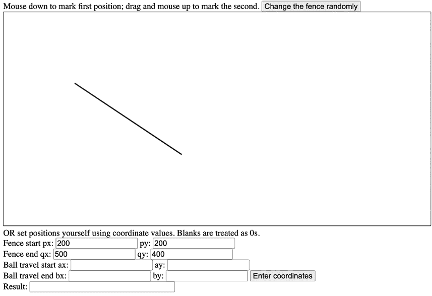

图 A-4 显示了通过鼠标按下、拖动和释放来设置两个位置后的结果。计算已完成；结果字段中出现一条消息；并出现了红色、蓝色和紫色的方框。线上的紫色方框表示从位置 A 到位置 B 的线段与代表栅栏的线段的交点。

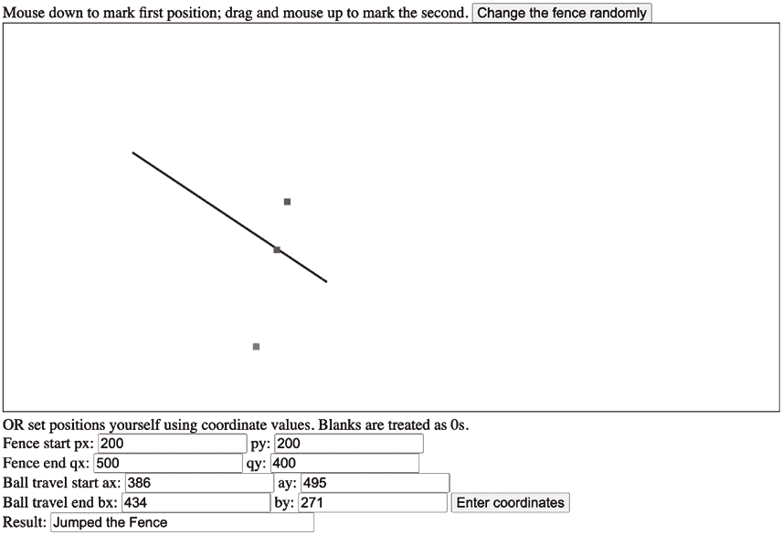

连接两个位置的直线可能与包含线段的直线相交，但连接两个位置的线段与代表栅栏的线段本身并不相交。图 A-5 显示了这样一种情况：从第一个位置到第二个位置的线段与直线相交，但交点并不在代表栅栏的线段上。

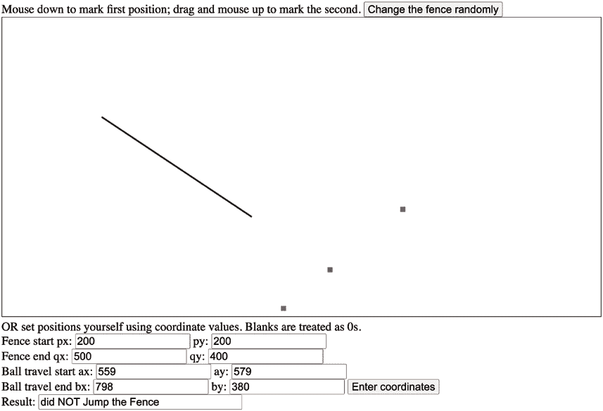

代码必须检测到这种情况以及其他潜在问题情况，例如垂直线。正是为了测试这些不同的情况，我觉得有必要构建一个用户可以在其中输入精确坐标值的表单。图 A-6 展示了使用表单来指定一条垂直线段。

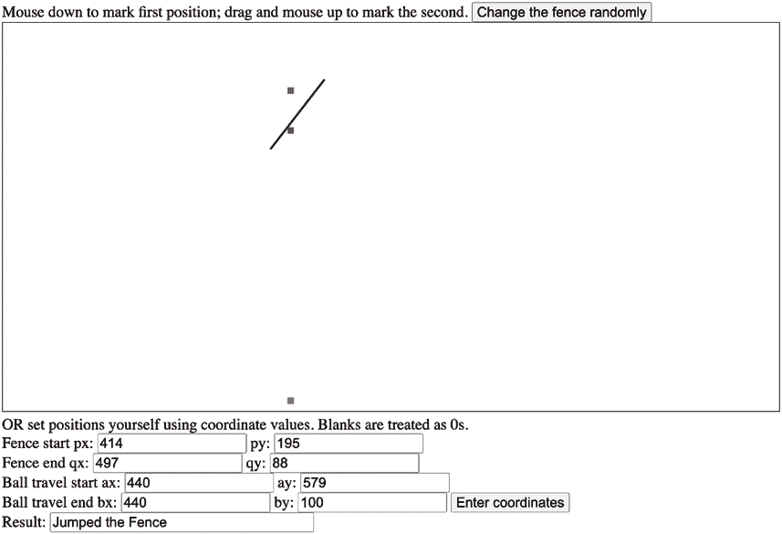

## 概述

我首先会回顾一下代数/解析几何课程中的知识，来描述相关计算。然后，我将描述如何准备数据，最后是如何向用户/玩家呈现反馈。

## 数学知识复习

让我们从两个点开始，每个点由两个值表示：`(ax, ay)` 表示横坐标为 `ax`、纵坐标为 `ay` 的点，`(bx, by)` 表示横坐标为 `bx`、纵坐标为 `by` 的点。表示 `(ax, ay)` 和 `(bx, by)` 之间直线上所有点 `(x, y)` 的方程如下：

`y – ay = ((by-ay) / (bx-ax) ) * (x-ax)`

可以求解 `y`，即重写方程，使符号 `y` 单独位于等式的一侧。

方程 1: `y = ((by-ay) / (bx-ax) ) * (x-ax) + ay`

**注意** 这些是数学方程，*并非*编程语句。`=` 符号表示相等关系。不过，我在此处使用了 `*` 符号表示乘法。所有满足此方程的配对 `(x,y)` 都位于该直线上。你可能会发现一个潜在问题：如果 `bx` 与 `ax` 相等怎么办？这对应于一条垂直线的情况。我们现在先假设这种情况不会发生，但请记住，程序必须对这一情况进行检查。

为了解决判断一个从点 `a` 运动到点 `b` 的球体是否穿过一条从点 `p` 到点 `q` 的线段（即围栏）这一挑战，假设两条线均非垂直线（`bx` 不等于 `ax` 且 `px` 不等于 `qx`），我进行了一些数学推导。我将 `p-q` 线的方程写为等号一侧为 `y` 的形式，如下所示：

**方程 2：** `y = ((qy-py) / (qx-px)) * (x-px) + py`

接下来我将展示为了构思程序中需要编写的代码所采取的步骤。我将两个 `y` 的表达式设为相等。

`((by-ay) / (bx-ax)) * (x-ax) + ay = ((qy-py) / (qx-px)) * (x-px) + py`

现在，我进行常规的代数变换求解 `x`。不过，首先我定义了两个新变量：`abslope = ((by-ay) / (bx-ax))` 和 `pqslope = ((qy-py) / (qx-px))`。这简化了后续计算。

`abslope * (x-ax) + ay = pqslope * (x-px) + py`

我完成两侧的乘法运算。

`abslope * x – abslope*ax + ay = pqslope * x – pqslope*px + py`

我的目标是将包含 `x` 的项移到等号一侧，而将所有其他项移到另一侧。

`(abslope - pqslope) * x = abslope*ax – ay - pqslope*px + py`

对两侧进行除法运算：

**方程 3：** `x = (abslope*ax - ay - pqslope*px + py) / (abslope - pqslope)`

方程右侧的所有变量值对于程序而言都是已知的。这意味着我可以利用这个数学方程来编写代码。然而，在将方程 3 用作一行代码之前，我需要编写代码来检查 `abslope` 是否等于 `pqslope`。如果相等，我不会让程序执行那一行代码！如果 `abslope` 等于 `pqslope`，则两条直线平行，甚至可能是同一条直线。对于这种情况，我需要以另一种方式处理问题。如果*不是*这种情况，那么我的程序将通过执行方程 3 这一行代码来求解 `x`。

下一步是将求得的 `x` 值代入两个方程中的任意一个，以得到 `y` 的值。也就是说，这是两条直线交点处的 `y` 值。我们正在取得进展，但还没有完成。到目前为止我们所描述的是计算两条直线的交点，这两条直线均非垂直线且斜率*不同*。下一步是判断这个交点是否同时位于两条线段上。换句话说，这类似于图 A-4 或图 A-5 中所示的情况。我选择的做法是计算 `x` 相对于线段 `a` 到 `b` 的位置*以及*相对于线段 `p` 到 `q` 的位置。代码如下：

```
tab = (x-ax)/(bx-ax);
tpq = (x-px)/(qx-px);
if ((tab>=0) && (tab<=1) && (tpq>=0) &&(tpq<=1))
{
    retv = true;
}
else
{
    retv = false;
}
```

稍后我将使用变量 `retv` 来表示围栏是否被跨越。在两种情况下，线段上的 `x` 值范围都是从 0 到 1。无论 `ax` 小于 `bx` 还是 `ax` 大于 `bx`，这一点都成立。同样的推理也适用于 `p` 到 `q` 的线段。不过，我只需要对 `x` 进行检查。

我所称的正常情况现已处理完毕。接下来我简要描述其他情况。

以下情况需要特殊处理：

- 两条线段 `a` 到 `b` 和 `p` 到 `q` 中恰好有一条是垂直线。

- 线段 `a` 到 `b` 和线段 `p` 到 `q` 都是垂直线。

- 两条线段均非垂直线，但斜率相同。

对于第一种情况，你将在 `oneVertical` 函数的编码中看到，我本质上是通过取 `Math` 来确定包含该线段的边界框。

# 算法实现文档

## 几何判断逻辑

取端点的`min`和`Math.max`。代码随后检查垂直线段是否在矩形外部。

如果`a`到`b`线段和`p`到`q`线段都是垂直的（参见`bothVertical`的编码），且`ax`不等于`px`，则无重叠。若这两个值相等，则认为存在跳跃围栏的情况——当`p`到`q`线段完全位于`a`到`b`线段内部时。此判断同样利用了包围盒。

相同斜率的情况包含两种可能：两条直线不是同一条直线。此时它们平行且不相交，*或者*它们是同一条直线。我的代码通过比较`y`轴截距来确定是否为同一直线。`y`轴截距是直线与`y`轴交点的值，即直线表达式中`x`为零时的值。如果它们*不是*同一条直线，则平行且不相交，因此不存在跳跃围栏。如果它们是同一条直线，当`a`到`b`线段完全覆盖`p`到`q`线段（即围栏）时，代码判定为跳跃。

## 数据准备

完成数学运算后，让我们转向实现。我们可以将其视为计算后的两个额外任务：准备信息和展示信息。从截图中可以看出，我的程序初始时围栏处于特定位置。用户/玩家通过按下鼠标按钮、拖动然后释放鼠标按钮来定义跳跃（即从点`a`(ax, ay)到`b`(bx, by)的移动）。此操作产生用于计算的数据。我提供了定义数据的替代方式。一种方式是通过调用随机函数来定位围栏，此术语称为*随机处理*。最后一种方式是让用户/玩家输入所有四个点（`a`、`b`、`p`、`q`）的坐标，共八个数字。准备数据的主要编码工作位于 HTML 中。

## 附录：更多绘图技术

```html
<body onload="init();">
```

```html
Mouse down to mark first position; drag and mouse up to mark the second.
```

```html
<button onClick="changeLine();">Change the fence randomly </button> <br/>
<canvas id="canvas" width="1200" height="600" style="border: 1px solid black;"> no canvas support
</canvas>
<br/>
```

```html
OR set positions yourself using coordinate values. Blanks are treated as 0s. <br/>
<form onSubmit="setValues(); return false;" name="f">
Fence start px: <input name="pxv"/> py: <input name="pyv"/> <br/>
Fence end qx: <input name="qxv"/> qy: <input name="qyv"/> <br/>
Ball travel start ax: <input name="axv"/> ay: <input name="ayv"/> <br/>
Ball travel end bx: <input name="bxv"/> by: <input name="byv"/>
<input type="submit" value="Enter coordinates"/> <br/>
Result: <input type="text" name="results" style="width: 400px;"/>
</form>
</body>
```

HTML 代码包含 JavaScript 函数的调用。这些函数将在表 A-3 和表 A-4 中详细描述。

### 用户/玩家反馈

表示围栏的线条由`drawLine`函数绘制。小方框用于指示`a`到`b`线段（即跳跃）的起点和终点。`a`位置由`firstPosition`绘制，`b`位置由`secondPosition`绘制。如果找到两条线的交点，则通过显示一个小紫色方框来图形化展示结果。如果线段相交，紫色方框将位于围栏上。

### 实现细节

JavaScript 函数可以通过直接函数调用或通过其他函数（或 HTML）中设置的事件处理来调用。这正是 HTML 和 JavaScript 组合的强大之处。

## 附录：更多绘图技术

**表 A-3.** 跳跃围栏的调用/被调用表

| 函数 | 被谁调用 | 调用谁 | 通过事件处理设置 |
|------|----------|--------|------------------|
| `init` | `onload`、`onresize` | `drawLine` | `mousedown`、`mouseup` |
| `drawLine` | `init`、`setValues` | — | — |
| `firstPosition` | `mousedown`（在`init`中设置） | — | — |
| `secondPosition` | — | — | — |

# 在 `init` 中设置 `mouseup` 的 `up`

`changeLine`、`hTML` 中的 `Button`、`setValues`、`drawLine` 和 `hTML` 中的 `onSubmit`、`crossOverLine`、`secondPosition`、`bothVertical`、`oneVertical`、`parallelLines`、`OneVertical`。

与大多数（若非全部）编程任务一样，在定义每个函数的内容时，有多种可能性。我的做法是将大型函数拆分成更小的函数，或者推迟部分工作的处理。你会看到 `crossOverLine` 函数调用了 `oneVertical`、`bothVertical` 和 `parallelLines` 函数。我倾向于在处理其他情况之前先完成第一种情况，这是一种良好的实践。

## 附录 更多 `drAwing` 技巧

**表 A-4.** 跨越栅栏的代码

| 代码语句 | 说明 |
| --- | --- |
| `<!DOCTYPE html>` | DOCTYPE 注释。 |
| `<html>` | 开始 html 标签。 |
| `<head>` | 开始 head。 |
| `<title>Crossing the line</title>` | 标题元素。 |
| `<script>` | 开始 script。 |
| `var px = 200;` | 栅栏的初始值。 |
| `var py = 200;` | |
| `var qx = 500;` | |
| `var qy = 400;` | |
| `var ctx;` | 将保存上下文，用于在画布上绘制。 |
| `var canvas;` | 将被设置为保存对画布元素的引用。 |
| `var ax;` | 将保存跳跃的起点和终点。 |
| `var ay;` | |
| `var bx;` | |
| `var by;` | |
| `function changeLine() {` | `changeLine` 的函数头。 |
| `px = 100 + Math.floor(Math.random()*1000);` | 计算随机值。 |
| `py = 50 + Math.floor(Math.random()*500);` | |
| `qx = 100 + Math.floor(Math.random()*1000);` | |
| `qy = 50 + Math.floor(Math.random()*500);` | |
| `drawLine();` | 绘制线条。 |
| `document.f.pxv.value = String(px);` | 将坐标放回表单。 |
| `document.f.pyv.value = String(py);` | |
| `document.f.qxv.value = String(qx);` | |
| `document.f.qyv.value = String(qy);` | |
| `}` | 关闭 `changeLine`。 |
| `function init() {` | `init` 的函数头。 |
| `canvas = document.getElementById("canvas");` | 设置对画布的引用。 |
| `ctx = canvas.getContext("2d");` | 设置上下文，用于所有绘制操作。 |
| `canvas.addEventListener("mousedown", firstPosition, false);` | 设置 `mousedown` 的事件处理。 |
| `canvas.addEventListener("mouseup", secondPosition, false);` | 设置 `mouseup` 的事件处理。 |
| `ctx.strokeStyle = "black";` | 设置描边颜色。 |
| `ctx.lineWidth = 3;` | 设置线条宽度。 |
| `drawLine();` | 绘制线条。 |
| `}` | 关闭 `init`。 |
| `function drawLine() {` | `drawLine` 的函数头。注意：它使用 `px`、`py`、`qx`、`qy` 的当前值。 |
| `ctx.clearRect(0,0,1200,800);` | 清除画布。 |
| `ctx.beginPath();` | 根据全局变量定义绘制线条。 |
| `ctx.moveTo(px,py);` | 移动到点 p。 |
| `ctx.lineTo(qx,qy);` | 连线到点 q。 |
| `ctx.closePath();` | 闭合路径。 |
| `ctx.stroke();` | 使用描边绘制线条。 |
| `document.f.pxv.value = String(px);` | 将转换为字符串的值插入表单。 |
| `document.f.pyv.value = String(py);` | |
| `document.f.qxv.value = String(qx);` | |
| `document.f.qyv.value = String(qy);` | |
| `document.f.results.value = "";` | |
| `}` | 关闭 `drawLine`。 |
| `function firstPosition(ev) {` | `firstPosition` 的函数头。`ev` 由事件处理程序设置。 |
| `ax = ev.pageX;` | 提取 x 值。 |
| `ay = ev.pageY;` | 提取 y 值。 |
| `ctx.fillStyle = "red";` | 为第一个位置将填充色设置为红色。 |
| `ctx.fillRect(ax,ay,10,10);` | 绘制一个小矩形。 |
| `document.f.axv.value = String(ax);` | 将 x 值（转换为字符串）存入表单。 |
| `document.f.ayv.value = String(ay);` | ……y 值。 |
| `}` | 关闭 `firstPosition`。 |
| `function secondPosition(ev) {` | `secondPosition` 的函数头。 |
| `bx = ev.pageX;` | 提取 x 坐标。 |
| `by = ev.pageY;` | ……y 坐标。 |
| `ctx.fillStyle = "blue";` | 将此矩形的填充色设置为蓝色。 |
| `ctx.fillRect(bx,by,10,10);` | 绘制小矩形。 |
| `document.f.bxv.value = String(bx);` | 将 x 值存入表单。 |
| `document.f.byv.value = String(by);` | ……y 值。 |
| `if ((bx==ax)&&(by==ay)) {` | 检查两点是否相同。 |
| `alert("Start and end points are the same. Try again: mouse down, drag, then mouse up.");` | 向玩家输出反馈信息。 |
| `}` | |
| `}` | 关闭 `secondPosition`。 |

### 附录：更多绘图技巧

**表 A-4.** （续）

| 代码语句 | 说明 |
|----------|------|
| `close if true.` | |
| `else crossOverLine(px,py,qx,qy,ax,ay,` | 调用`crossOverLine`函数 |
| `bx,by);` | |
| `}` | |
| `close secondPosition.` | |
| `function crossOverLine (px, py, qx, qy,` | `crossOverLine`函数头 |
| `ax, ay, bx, by) {` | 参数是表示直线（围栏）和跳跃的数据 |
| `var retv = true;` | 将`retv`初始化为`true` |
| `if ((ax==bx) && (px==qx))` | 检查两条线段是否均为垂直 |
| `{` | |
| `retv = bothVertical(ax,ay,bx,by,px,` | 调用在此情况下进行检查的函数 |
| `py,qx,qy);` | |
| `}` | |
| `else if (ax==bx)` | 检查 a-b 线段是否为垂直 |

### 表 A-4. （续）

| 代码语句 | 说明 |
|----------|------|
| `retv = oneVertical(ax,ay,by,px,py,` | 使用这些参数调用`oneVertical` |
| `qx,qy);` | |
| `}` | |
| `else if (px==qx)` | 检查 p-q 线段是否为垂直 |
| `{` | |
| `retv = oneVertical(px,py,qy, ax,` | 使用这些其他参数调用`oneVertical` |
| `ay, bx, by);` | |
| `}` | |
| `else {` | 继续“正常”情况：没有线段垂直 |
| `abslope= (by-ay)/(bx-ax);` | 设置`abslope` |
| `pqslope = (qy-py)/(qx-px);` | 设置`pqslope` |
| `if (abslope==pqslope) {` | 两条线是否平行？（包括同一条线的情况） |
| `retv = parallelLines(abslope,` | 针对此情况调用相应函数 |
| `ax,ay,bx,by,px,py,qx,qy);` | |
| `}` | |
| `else {` | 我称之为正常情况 |
| `x = (abslope*ax-ay - pqslope*px+py)/` | 求解`x` |
| `(abslope-pqslope);` | |
| `y = abslope * (x-ax)+ay;` | 用`x`求解`y` |
| `ctx.fillStyle="purple";` | 将交点颜色设置为紫色 |
| `ctx.fillRect(x,y,10,10);` | 绘制矩形（注意：可能在屏幕外） |
| `// 现在检查两条线段上的交点，没有线段垂直` | |
| `tab = (x-ax)/(bx-ax);` | 设置`x`沿 a-b 线段的比例 |
| `tpq = (x-px)/(qx-px);` | 设置`x`沿 p-q 线段的比例 |
| `if ((tab>=0) && (tab<=1) && (tpq>=0)` | 如果这两个数都在 0 到 1 之间 |
| `&&(tpq<=1))` | |
| `{` | |
| `retv = true;` | 返回`true` |
| `}` | |
| `else` | |
| `{` | |
| `retv = false;` | 返回`false` |
| `}` | |
| `}` | 闭合“斜率不相等” |
| `}` | 闭合“斜率检查前的正常情况” |
| `if (retv) {` | 现在在表单中显示结果。`retv`在多个地方设置 |
| `document.f.results.value = "Jumped the Fence";` | |
| `}` | |
| `else {` | |
| `document.f.results.value = "did NOT Jump the Fence";` | |
| `}` | |
| `}` | 关闭`crossOverLine` |

### 表 A-4. （续）

| 代码语句 | 说明 |
|----------|------|
| `function setValues() {` | `setValues`函数头 |
| `ax = Number(document.f.axv.value);` | 提取`ax` |
| `document.f.axv.value =String(ax);` | 写回文档（这将把空值设置为零） |
| `ay = Number(document.f.ayv.value);` | 提取`ay` |
| `document.f.ayv.value = String(ay);` | |
| `bx = Number(document.f.bxv.value);` | 提取`bx` |
| `document.f.bxv.value = String(bx);` | |
| `by = Number(document.f.byv.value);` | 提取`by` |
| `document.f.byv.value = String(by);` | |
| `px = Number(document.f.pxv.value);` | 提取`px` |
| `document.f.pxv.value = String(px);` | |
| `py = Number(document.f.pyv.value);` | 提取`py` |
| `document.f.pyv.value = String(py);` | |
| `qx = Number(document.f.qxv.value);` | 提取`qx` |
| `document.f.qxv.value = String(qx);` | |
| `qy = Number(document.f.qyv.value);` | 提取`qy` |
| `document.f.qyv.value = String(qy);` | |
| `drawLine();` | 使用刚设置的值绘制线条 |
| `ctx.fillStyle = "red";` | 设置颜色为红色 |
| `ctx.fillRect(ax,ay,10,10);` | 在 a-b 线段起点绘制小矩形 |
| `ctx.fillStyle = "blue";` | 设置颜色为蓝色 |
| `ctx.fillRect(bx,by,10,10);` | 在 a-b 线段终点绘制小矩形 |
| `document.f.results.value="results will be here";` | 显示消息（不会显示太久） |
| `if ((bx==ax)&&(by==ay)) {` | 检查起点和终点是否相同（当玩家在起点松开鼠标按钮时会发生这种情况） |
| `alert("Start and end points are the same. Try again: mouse down, drag, then mouse up.");` | 向玩家显示消息 |
| `return false;` | |
| `}` | |
| `else {` | |
| `crossOverLine(px,py,qx,qy,ax,ay,bx,by);` | 调用`crossOverLine`进行计算 |
| `return false;` | 输出`false`以防止页面刷新 |
| `}` | 闭合`else` |
| `}` | 关闭`setValues` |

# 附录 更多绘图技巧

## 表 A-4. (续)

| 代码语句 | 说明 |
|---|---|
| `function oneVertical(vx, vy, wy, sx, sy, tx, ty)` | 当两条线段中一条为垂直线，另一条不是时调用的函数头。参数以垂直线开始（注意只有三个数字），然后是另一条非垂直线。 |
| `minvwy = Math.min(vy, wy);` | 计算最小值和最大值可使其他计算更容易。 |
| `maxvwy = Math.max(vy, wy);` | |
| `minstx = Math.min(sx, tx);` | |
| `maxstx = Math.max(sx, tx);` | |
| `minsty = Math.min(sy, ty);` | |
| `maxsty = Math.max(sy, ty);` | |
| `slope = (ty - sy) / (tx - sx);` | 非垂直线的斜率。 |
| `y = slope * (vx - tx) + ty;` | 求解 `y`。 |
| `x = vx;` | 设置为使用 `x` 和 `y` 来绘制直线（非线段）的交点。 |
| `ctx.fillStyle = "purple";` | 设置为绘制紫色矩形。 |
| `ctx.fillRect(x, y, 10, 10);` | 绘制矩形。 |
| `if (vx < minstx) { return false; }` | 如果 `vx` 小于最小值，则返回无交点。 |
| `if (vx > maxstx) { return false; }` | …或大于最大值。 |
| `if (maxvwy < minsty) { return false; }` | 或者如果最大值小于最小值。 |
| `if (minvwy > maxsty) { return false; }` | 或者最小值大于最大值。 |
| `return true;` | 否则，返回真。 |
| `}` | 关闭 `oneVertical` 函数。 |
| `function bothVertical(ax, ay, bx, by, px, py, qx, qy) {` | `bothVertical` 的函数头。 |
| `if (ax != px) {` | 如果这两条是两条不同的垂直线，则没有重叠。 |
| `return false;` | |
| `}` | |
| `minaby = Math.min(ay, by);` | 计算最大值和最小值，用于检查重叠。 |
| `maxaby = Math.max(ay, by);` | |
| `minpqy = Math.min(py, qy);` | |
| `maxpqy = Math.max(py, qy);` | |
| `if ((minaby < minpqy) && (maxaby > maxpqy)) { return true; }` | 必须完全越过栅栏线段。 |
| `else { return false; }` | |
| `}` | 关闭 `bothVertical`。 |
| `function parallelLines(slope, ax, ay, bx, by, px, py, qx, qy) {` | `parallelLines` 的函数头。参数是共享的斜率，以及 a-b 和 p-q 坐标。 |
| `y1 = slope * (-ax) + ay;` | 求解 a-b 线的 `y` 截距。 |
| `y2 = slope * (-px) + py;` | 求解 p-q 线的 `y` 截距。 |
| `if (y1 != y2) { return false; }` | 平行线，但不是同一条线。 |
| `jumpax = (ax - qx) / (px - qx);` | 使用 `x` 值确定 `ax` 在 p-q 线上的位置…… |
| `jumpbx = (bx - qx) / (px - qx);` | ……以及 `bx` 在 p-q 线上的位置。 |
| `if ((jumpax < 0) && (jumpbx > 1)) {` | 如果 `ax` 低于（沿着线段）且 `bx` 高于。 |
| `return true;` | 返回真。 |
| `}` | |
| `else {` | |
| `return false;` | 返回假。 |
| `}` | |
| `}` | 关闭 `parallelLines`。 |

```html
<script>
// ... (上面的 JavaScript 函数)
</script>
</head>
<body onload="init();">
    <p>按下鼠标标记第一个位置；拖动并释放鼠标标记第二个位置。</p>
    <button onClick="changeLine();">随机改变栅栏</button>
    <br/>
    <canvas id="canvas" width="1200" height="600" style="border: 1px solid black;">
        不支持 canvas
    </canvas>
    <br/>
    <p>或者使用坐标值自己设置位置。空白处将被视为 0。</p>
    <br/>
    <form onSubmit="setValues(); return false;" name="f">
        栅栏起点 px: <input name="pxv"/> py: <input name="pyv"/> <br/>
        栅栏终点 qx: <input name="qxv"/> qy: <input name="qyv"/> <br/>
        小球运动起点 ax: <input name="axv"/> ay: <input name="ayv"/> <br/>
        小球运动终点 bx: <input name="bxv"/> by: <input name="byv"/>
        <input type="submit" value="输入坐标"/> <br/>
        结果: <input type="text" name="results" style="width: 400px;"/>
    </form>
</body>
</html>
```

### 你学到了什么

本示例演示了代数与几何相结合的应用，即所谓的解析几何。我编写 JavaScript 代码时所做的并非典型的解方程，而是完成了计算的技巧。该示例使用了表单和在 `canvas` 上绘图的不同方法。我不会说这个界面很优雅，但它确实提供了准备数据以测试计算的方法，并演示了 JavaScript 的用途。

### 使用标量矢量图形

标量矢量图形（SVG）是一种定义图形的系统。它独立于任何编程语言。SVG 并非以可能压缩的格式逐个像素地创建和维护图形记录，而是一组指令。指令的格式是可扩展标记语言（XML），类似于 HTML。SVG 可以作为 HTML 文档的一部分，并且可以使用 JavaScript 来修改 SVG。使用 SVG 的好处包括文件体积小且不牺牲分辨率。存在用于生成 SVG 的工具，但对于这些示例，您可以使用用于创建 HTML/CSS/JavaScript 文档的编辑器。此处展示的示例包括多边形、线条、曲线和文本。您可以通过多种在线资源了解更多关于 SVG 的知识。我的建议是，在阅读众多可能性时，脑中要有具体的示例。在本附录中，我将描述一个 HTML5 徽标的静态描绘；一个可以更改大小的 HTML5 徽标；以及一个我称之为 daddy 标志的卡通形象，它包含为原始图形添加元素、在屏幕上移动以及更改位置等选项。正是这些选项展示了 SVG 的强大功能。

SVG 作为一种 XML 语言，由标记元素组成。每个标记元素都有一个类型，并且要么有成对出现的开始标签和结束标签，中间包含内容，要么以 `/` 结束开始标签。开始标签可能包含属性。属性具有与元素类型关联的名称以及用引号括起来的值。以下是一些示例：

```svg
<svg id="wholesvg" height="600" width="800" xmlns="http://www.w3.org/2000/svg"> ... </svg>
<polygon points="139 51, 139 82, 213 82, 216 51" fill="#FFFFFF";/>
<text x="75" y="60" font-family="'Trebuchet MS', 'Arial Bold', Helvetica, sans-serif"; font-size="54"; font-weight: bold; >HTML</text>
```

# 三个点 `...` 表示所有 SVG 内容的存在。`xmlns` 属性，即所谓的命名空间指定，指向 SVG 标准。

SVG 的一个重要方面是标记必须是“格式良好的”。这意味着如果省略了结束标签，则开始标签必须带有结束斜杠。属性值必须用引号括起来。标记项的嵌套必须正确。这意味着不能出现以下情况：

```html
<a> <b> </a> </b>
```

SVG 元素是文档树的一部分，其结构可能对编码很重要。对于 HTML 来说，遵守这些规则是好的做法，但不是必需的，因此我们可能需要改变我们的习惯。

SVG 图形与在 canvas 上绘图不同，其元素会保留其标识。但是，它又有点像在画布上绘画，因为后绘制的元素，或部分覆盖在先绘制元素之上的元素，会遮盖住先前的元素。这将在 HTML5 徽标示例中进行演示。

## 使用 SVG 绘制 HTML5 徽标

第一个示例显示了一个静态的 HTML5 徽标渲染图，如图 A-7 所示。它由填充了不同颜色的多边形、文本和一条线组成。该示例还包括了语义标签的使用，特别是 `footer` 和 `abbr`。语义标签是 HTML5 为 HTML 新增的内容，代表了一组 452 页中的常见功能。

``

### SVG 与 HTML5 徽标技术

文档。它们不附带任何特定的格式或用法说明。它们在标准中的存在（仅）是对用法的建议，并可能有助于协同工作的个人和团体。提供引用是一项重要的实践，因此，在页脚提及万维网联盟（简称 W3C）是我的初衷。请注意，HTML 的字体并非 W3C 网站上显示的那一种。实际上，HTML 标准的所有权问题较为复杂。请随意探索。

*图 A-7. 纯色 SVG HTML5 徽标*

我将解释纯色 HTML5 徽标的编码过程。然而，为了提供交互性，更重要的是，为了进一步展示 SVG 的强大功能，我加入了另一个示例。该程序提供了一种更改图形尺寸的方法。请注意，在图 A-8 中，初始界面上的滑块并未完全滑到最右侧。

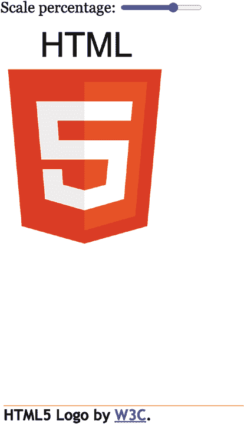

*图 A-8. 可缩放 HTML5 徽标的初始界面*

将滑块移至末端，将产生如图 A-9 所示的界面。

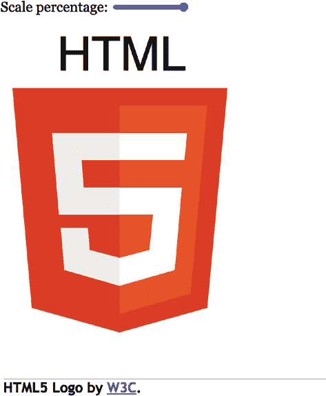

*图 A-9. 可缩放 HTML5 徽标，显示最大尺寸*

将滑块向左滑动，会生成一个较小的版本，如图 A-10 所示。

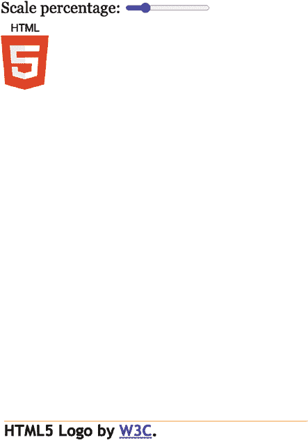

*图 A-10. 较小版本的 HTML5 徽标*

### 概述

两个 HTML5 徽标示例所需完成的任务包括：指定多边形、为每个多边形使用特定颜色进行填充、添加文本，以及在两个示例的底部引用 W3C 组织。可缩放示例包含一个用于更改徽标大小的范围控件。范围控件中引用的一个 JavaScript 函数执行此更改操作。

### 实现细节

让我们进入 SVG 部分。

HTML5 徽标示例的树状结构如下所示：

- 一个 `svg` 元素，`id ="whilesvg"`，包含一个子节点。
- 一个 `g` 元素，`id = "logo"`。此元素包含两个子节点。
  - 一个 `text` 元素。
  - 一个 `g` 元素，`id = "shield"`，包含六个子节点，每个子节点都是一个 `polygon` 元素。
- `Polygon` 元素。

绘制盾牌有多种方法。绘制的顺序很重要：多边形会绘制在先前的多边形之上。中心的那条线是由颜色变化产生的视觉错觉。代码如下：

```html
<svg id="wholesvg" height="600" width="800" xmlns="http://www.w3.org/2000/svg" >
  <g id="logo">
    <text x="75" y="60" font-family="'Arial Bold', sans-serif"; font-size="54"; font-weight: bold; > HTML</text>
    <g id="shield" transform="translate(0,80)">
      <polygon points="39 250, 17 0, 262 0, 239 250, 139 278" fill= "#E34C26"; />
      <polygon points="139 257, 220 234, 239 20, 139 20" fill="#F06529"; />
      <polygon points="139 113, 98 113, 96 82, 139 82, 139 51, 62 51, 70 144, 139 144" fill= "#EBEBEB"; />
      <polygon points="139 193, 105 184, 103 159, 72 159, 76 207, 139 225" fill="#EBEBEB"; />
      <polygon points="139 113, 139 144, 177 144, 173 184, 139 193, 139 225, 202 207, 210 113" fill= "#FFFFFF"; />
      <polygon points="139 51, 139 82, 213 82, 216 51" fill="#FFFFFF";/>
    </g>
  </g>
</svg>
```

与常规 HTML 一样，浏览器会忽略缩进，但这是一个好习惯。

请注意，在此示例中并未使用到 `id` 值，但此处保留它们是为了鼓励在设计结构时考虑良好的实践，并为未来可能进行的修改做好准备。

`svg` 元素包含指示宽度和高度的属性。正如前面关于 `svg` 示例的简短列表中所提到的，`xmlns` 属性是指向 SVG 标准的指针。这一点至关重要。

第一个 `g` 元素指定徽标由两部分组成：文本（在 `text` 元素的内容中指定，即起始标签和结束标签之间），内容是 **HTML**，以及代表盾牌的图形。盾牌由六个多边形组成。第二个 `g` 元素，`id = "shield"`，有一个 `transform` 属性。其值 `translate(0,80)` 将其后内容在水平方向调整 0 像素，垂直方向调整 80 像素。建议您更改这两个数字。这六个 `polygon` 元素各有两个属性。一个属性是 `points`，它给出组成多边形的各点坐标。每对数字代表水平 (x) 和垂直 (y) 值，各对之间用逗号分隔。由于不同多边形的顶点数量不同，所以坐标对的数量也不同。`fill` 属性使用 RGB（红、绿、蓝）系统指定颜色。强烈建议您尝试调整这些数字。这些数字并非我凭空捏造，而是来自 W3C 网站。每个 `polygon` 元素都是单例：只有一个起始标签，并以 `/>` 结尾。注意结尾的两个 `</g>` 标签和结束的 `</svg>` 标签。

除了 SVG 之外，我决定使用语义元素。

可缩放版本的 HTML5 徽标包含一个类型为 `range` 的控件：

```
Scale percentage: <input id="slide" type="range" min="0" max="150" value="100" onChange="changeScale(this.value)" step="10"/>
```

`min`、`max` 和 `value` 属性的作用是使初始界面上的控件位于滑块轨道向右约三分之二的位置。`onChange` 的设置使得当用户/玩家更改值时，会调用我的 JavaScript 函数 `changeScale`。该 JavaScript 函数被调用时，会传入一个参数，该参数是控件中当前的值。术语 `this` 指的是这个输入控件。`step` 属性设置为 10，意味着值按 10 的幅度变化。您可以对此进行试验。我决定将其设为 10，这样会产生相当平滑的过渡效果。

最后要解释的是 `footer` 和 `article` 元素的 CSS 样式。我使用了一种技术，按照我希望字体生效的顺序提供一系列字体类型。浏览器会优先采用解释此文档的计算机上可用的第一种字体。`display` 属性指定了文本前后的换行符。`footer` 样式中的 `font-weight` 设置为粗体。`border-top` 在页脚上方产生了一条橙色线条。`article` 样式中的 `margin` 设置为 5px。静态 HTML5 徽标的代码如表 A-5 所示。我省略了调用/被调用的函数表，因为其中没有函数。

*表 A-5. 静态 HTML5 徽标的代码*

| 代码语句 | 说明 |
| --- | --- |
| `<!DOCTYPE html>` | DOCTYPE 注释。 |
| `<html>` | `html` 标签。 |
| `<head>` | `head` 标签。 |
| `<title>HTML5 Logo </title>` | 完整的标题。 |
| `<meta charset="UTF-8">` | 这是一个 meta 标签。它声明了字符编码。 |

# 表 A-5. (续)

| 代码语句 | 说明 |
| :--- | :--- |
| `<style>` | `style` 标签。 |
| `footer {display:block; border-top: 1px solid orange; margin: 10px; font-family: "Trebuchet MS", 'Arial Bold', Helvetica, sans-serif; font-weight: bold;}` | `footer` 元素用于显示对万维网联盟的引用。 |
| `</style>` | 关闭 `style` 元素。 |
| `</head>` | 关闭 `head` 元素。 |
| `<body>` | 开始 `body` 元素。 |
| `<svg id="wholesvg" height="600" width="800" xmlns="http://www.w3.org/2000/svg" >` | 一个 `svg` 元素的起始标签。注意指向命名空间的链接。 |
| `<g id="logo">` | 一个用于分组的 `g` 元素。 |
| `<text x="75" y="60" font-family="'Trebuchet MS', 'Arial Bold', Helvetica, sans-serif"; font-size="54"; font-weight: bold; >HTML </text>` | 该徽标包含一个 `text` 元素。 |
| `<g id="shield" transform="translate(0,80)">` | …以及一个具有 `id` 为 `shield` 和 `transform` 属性的分组，该属性可使图形在屏幕上向下平移。 |
| `<polygon points="39 250, 17 0, 262 0, 239 250, 139 278" fill="#E34C26" />` | 这里有多个多边形。 |

你可以查阅这些颜色，我是从 W3C 官网获取的。

```
<polygon points="139 257, 220 234, 239 20, 139 20"
fill="#F06529"; />
```

整个盾牌。

```
<polygon points="139 113, 98 113, 96 82, 139 82, 139 51, 62 51, 70 144, 139 144"
fill="#EBEBEB"; />
```

右侧较浅的部分。

```
<polygon points="139 193, 105 184, 103 159, 72 159, 76 207, 139 225"
fill="#EBEBEB"; />
```

顶部左侧的浅灰色。

```
<polygon points="139 113, 139 144, 177 144, 173 184, 139 193, 139 225, 202 207, 210 113"
fill="#FFFFFF"; />
```

底部右侧的白色部分。

```
<polygon points="139 51, 139 82, 213 82, 216 51"
fill="#FFFFFF"; />
```

顶部右侧的白色部分。

```
</g>
```

关闭外层 `<g>`。

```
</svg>
```

关闭 `<svg>` 元素。

```
<footer>HTML5 Logo by <a href="http://www.w3.org/"><abbr title="World Wide Web
Consortium">W3C</abbr></a>.
</footer>
```

页脚包含文本，格式未做特殊处理。

```
</body>
```

关闭 `<body>`。

```
</html>
```

关闭 `<html>`。

为了制作可缩放的 HTML5 徽标，我使用了 `init` 函数来设置一个变量，该变量指向 SVG 树中用于更改缩放比例的节点。此更改在 `changeScale` 函数中完成。这两个函数的调用信息见表 A-6。

# 表 A-6. 可缩放 HTML5 徽标的被调用/调用函数

| 函数 | 被谁调用（事件处理） | 调用谁 | 设置事件处理 |
| :--- | :--- | :--- | :--- |
| `Init` | `onLoad` | - | - |
| `changeScale` | `onChange` | - | - |

可缩放的 HTML5 徽标文档本质上是在静态 HTML5 徽标的基础上增加了这两个函数。为了完整起见，我提供了所有代码，但省略了对通用行的解释。请参考表 A-7。

## 附录：更多绘图技巧

# 表 A-7. 可缩放 HTML5 徽标的代码

| 代码语句 | 说明 |
| :--- | :--- |
| `<!DOCTYPE html>` | DOCTYPE 注释。 |
| `<html>` | HTML 开始标签。 |
| `<head>` | head 开始标签。 |
| `<title>HTML5 Logo</title>` | 完整的标题。 |
| `<meta charset="UTF-8">` | 一个声明字符编码的 `meta` 标签。 |
| `<style>` | style 开始标签。 |
| `footer {display:block; border-top: 1px solid orange; margin: 10px; font-family: "Trebuchet MS", 'Arial Bold', Helvetica, sans-serif; font-weight: bold;}` | 页脚的格式。 |
| `article {display:block; font-family: Georgia, "Times New Roman", Times, serif; margin: 5px;}` | `article` 的格式。 |
| `</style>` | 关闭 `style`。 |
| `<script language="Javascript">` | `script` 元素开始。 |
| `var factorvalue = 1;` | 用于改变缩放比例。 |
| `var logo;` | 将被设置为指向 SVG 的指针。 |
| `function init() {` | `init` 函数头。 |
| `logo = document.getElementById("logo");` | 设置 `logo` 变量。 |
| `}` | 关闭 `init`。 |
| `function changeScale(val) {` | `changeScale` 函数头。参数 `val` 将保存滑块控件设置的值。 |
| `factorValue = val/100;` | 将 `factorValue` 计算为百分比。 |
| `var factorValues = String(factorValue);` | 将 `factorValue` 转换为字符串。 |
| `var trans = "translate(0,0) scale("+factorValues+")";` | 生成要放入 SVG 的 `trans` 值。 |
| `logo.setAttributeNS(null,"transform", trans); }` | 设置属性。 |
| `}` | 关闭 `changeScale` 函数。 |
| `</script>` | 关闭 `script`。 |
| `</head>` | 关闭 `head`。 |
| `<body onLoad="init();">` | `body` 元素。设置对 `init` 函数的调用。 |
| `<article>` | `article` 开始。 |
| `<input id="slide" type="range" min="0" max="150" value="100" onChange="changeScale(this.value)" step="10"/>` | 定义一个范围控件（滑块）。设置使用控件值调用 `changeScale` 函数。 |
| `</article>` | 关闭 `article`。 |
| `<svg id="wholesvg" height="600" width="800" xmlns="http://www.w3.org/2000/svg">` | SVG 与静态情况相同。 |
| `<g id="logo">` | - |
| `<text x="75" y="60" font-family="'Arial Bold', sans-serif"; font-size="54"; font-weight: bold; > HTML</text>` | |
| `<g id="shield" transform="translate(0,80)">` | |

## 附录 更多绘制技巧

**表 A-7.** （续）

| 代码语句 | 说明 |
|----------------|-------------|
| `<polygon points="39 250, 17 0, 262 0, 整个盾牌。 239 250, 139 278" fill= "#E34C26" />` | 整个盾牌。 |
| `<polygon points="139 257, 220 234, 239 20, 139 20" fill="#F06529" />` | 右侧较亮部分。 |
| `<polygon points="139 113, 98 113, 96 82, 139 82, 139 51, 62 51, 70 144, 139 144" fill="#EBEBEB" />` | 左上角极浅灰色。 |
| `<polygon points="139 193, 105 184, 103 159, 72 159, 76 207, 139 225" fill="#EBEBEB" />` | 左下角极浅灰色。 |
| `<polygon points="139 113, 139 144, 177 144, 173 184, 139 193, 139 225, 202 207, 210 113" fill="#FFFFFF" />` | 右下角白色。 |
| `<polygon points="139 51, 139 82, 213 82, 216 51" fill="#FFFFFF" />` | 右上角白色。 |

下一个示例展示了更多导致 SVG 修改的交互操作。

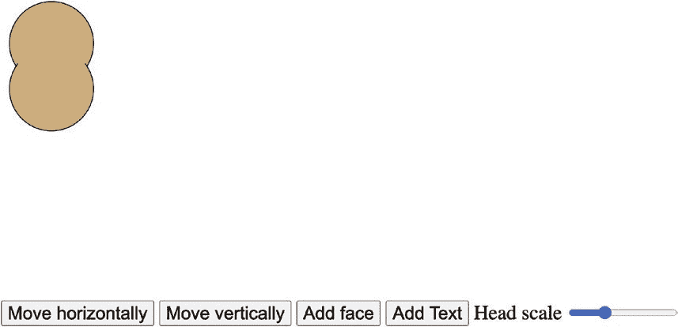

### 使用 SVG 绘制并修改卡通图形

第二个 SVG 示例展示了一个卡通人物形象，这是我父亲在给家人留言时使用的签名。它是一个花生形状的头部，配有简单的眼睛、鼻子、微笑和一根头发。为了展示 SVG 的灵活性，我的程序初始只显示一个花生形状，同时提供按钮和一个范围控件，以展示修改图形的可能性。图 A-11 显示了初始界面。

**图 A-11.** 老爹标志初始界面

该程序提供了添加面部、添加文字、将头部逐步向下或向右移动，以及改变头部和文字大小的选项。图 A-12 显示了修改后的效果。

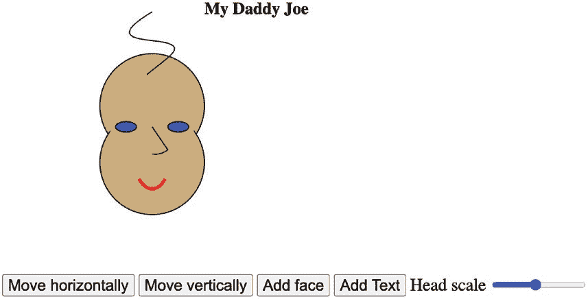

**图 A-12.** 添加了面部、头发、文字，并改变了大小和位置

#### 概述

该程序所需的任务包括：编写花生形状头部的 SVG 元素，以及根据用户交互后添加的眼睛、鼻子、微笑、头发和文字。界面包含一个范围控件，如 HTML5 标志示例中所示。此外，在该示例中，玩家可使用它来放大或缩小头部以及（如果已添加）面部和文字。按钮提供了调用函数的方法，用于添加面部（眼睛、鼻子、嘴巴和头发）和文字，并将图形向下或向右移动。将图形向上和向左移动留作您的练习。请注意，我还决定，如果玩家在添加过一次文字或面部后再次尝试添加，则通过警告语句向玩家提供反馈。

初始图形（头部）在 HTML 中定义。其中一个 SVG 元素是 `g`（表示分组），其 ID 为 `head`。其他元素则动态定义和创建，并附加到头部。`init` 函数在 `onload` 事件中调用，使用以下语句设置变量 `myHead`：

```javascript
myHead = document.getElementById("head");
```

新创建的元素被附加到 `myHead` 上。

面部的组成部分包括 SVG 提供的一些曲线功能，具体来说，眼睛使用椭圆，嘴巴和头发使用贝塞尔三次曲线，鼻子使用直线和弧线的组合。贝塞尔曲线以其发明者皮埃尔·贝塞尔命名，使用了端点和控制点。曲线穿过端点（起点和终点），并且生成的曲线与从端点到控制点的线段相切。表 A-8 显示了一些符号。请注意，大写和小写字母都有使用。大写表示绝对值，小写表示相对值。

# 排版后的文本

（从上一个值更改）。

**表 A-8：SVG 路径元素中使用的符号**

| 符号 | 用途 |
|------|------|
| `M` | 移动到 |
| `A` | 椭圆弧 |
| `c` | 三次贝塞尔曲线 |
| `L` | 连线到 |
| `s` | 快捷指定；表示下一个控制点是上一个控制点的镜像 |

我对你加深理解的建议是：首先，检查并对这里的代码做小幅调整。你最终可能会得到一些奇怪的脸。完成这一步后，粗略设计一下你想要制作的东西，比如一个包含一条或两条曲线的图形。

带着目标，去访问一个在线贝塞尔编辑器。这些编辑器都能生成用于你 SVG 代码的数据。

与 HTML5 徽标的情况一样，关键是要将 SVG 元素组织成树状结构，这样它们就可以按你的需要移动和改变大小。重复一下，要制作一个更大的头，并配上位置合适的脸、头发和文本，并不需要修改具体的坐标。

### 实现细节

在 daddy 徽标应用中，`body` 中的 `svg` 标签没有命名空间声明。

我的代码会检查默认的命名空间是否正确。我这样做是为了与 HTML 徽标示例有所区别，因为你可能会看到实现相同功能的两种不同方式。

# 附录 更多绘图技巧

花生形状是用一个我称之为技巧的方法制作的。它由三个圆组成。

中间的那个圆用来擦除边界（描边）曲线。

创建动态 SVG 元素需要创建元素、设置属性，并将新创建的元素附加到文档树中已有的元素上。一个有点棘手的地方是属性都是字符串。这意味着在少数情况下，必须使用 `String` 函数将一个整数值转换为字符串。

本例中的所有函数，除了一个之外，都是由事件处理调用的，如表 A-9 所示。我本可以将 `createFace` 和 `setattributesface` 合并，但遵循将较大函数拆分为较小函数的实践，我对它们进行了分离。

表 A-9：函数调用/被调用表

| 函数 | 被谁调用 | 是否由事件处理调用 | 调用谁 | 是否设置事件处理 |
| :--- | :--- | :--- | :--- | :--- |
| `init` | body 标签中的 `onload` | | | |
| `changeScale` | range 标签中的 `onChange` | | | |
| `moveOvalh` | “水平移动”按钮中的 `onClick` | | | |
| `moveOvalv` | “垂直移动”按钮中的 `onClick` | | | |
| `createFace` | “添加脸部”按钮中的 `onClick` | | `setAttributesface` | |
| `addText` | “添加文本”按钮中的 `onClick` | | | |
| `setAttributesface` | | | `createFace` | |

在完成概述和一般性说明之后，下表中我展示了 daddy 徽标示例的所有代码，并附有每条语句的注释：

# 附录 更多绘图技巧

| 代码语句 | 解释 |
| :--- | :--- |
| `<!DOCTYPE html>` | DOCTYPE 注释。 |
| `<html>` | html 开始标签。 |
| `<head>` | head 开始标签。 |
| `<title>Little guy Joe</title>` | 完整的标题。 |
| `<script>` | script 开始标签。 |
| `var svgNS = "http://www.w3.org/2000/svg";` | 设置用于保存命名空间引用。 |
| `var headx = 0;` | 用于移动头部（以及脸部和文本）；保存头部 x 坐标。 |
| `var heady = 0;` | 保存头部 y 坐标。 |
| `var cheadx = 60;` | 用于定位头发。头部的水平中心。 |
| `var cheady = 100 + 20;` | 头部的垂直中心。 |
| `var rx = 50;` | 用于绘制眼睛。这是一个椭圆，因此必须给出水平和垂直直径。它是一个圆。 |
| `var ry = 50;` | …垂直直径。 |
| `var hairy = cheady - 2.2 * ry;` | 单根头发的位置。 |
| `var scaleFactor = 1;` | 初始缩放因子。 |
| `var fillColor = "tan";` | 肤色。 |
| `var strokeColor = "none";` | 构成花生的圆没有描边。 |
| `var myUpper;` | 接下来的变量将保存对面部各部分的引用，这里是上半部分。 |
| `var myMiddle;` | 中间部分。 |
| `var myLower;` | 下半部分。 |
| `var myHead;` | 对头部的引用。 |
| `var myNose;` | 对鼻子的引用。 |
| `var myLeftEye;` | 对左眼的引用。 |

*（续）*

# 附录 更多绘图技巧

| 代码语句 | 解释 |
| :--- | :--- |
| `var myRightEye;` | 对右眼的引用。 |
| `var myMouth;` | 对嘴巴的引用。 |
| `var myHair;` | 对头发的引用。 |
| `var faceadded = false;` | 布尔值，表示脸部尚未添加。 |
| `var textadded = false;` | 布尔值，表示文本尚未添加。 |
| `var nosedatatail="l 15 22 a 20 20 0 0 1 细节描述鼻子：一条线然后一个弧。-15 4";` | |
| `var hairdatatail = "c -50 30, 0 25, 15 头发细节：一条三次贝塞尔曲线。30 s 2 12 -20 30";` | |
| `var upperradius = 50;` | 上方圆的半径。 |
| `var lowerradius = 50;` | 下方圆的半径。 |
| `var middleradius = 40;` | 中间圆的半径（用于擦除边界）。 |
| `var myPlace;` | 对整个绘图的引用。 |
| `var myText;` | 对文本的引用。 |
| `function init() {` | `init` 函数的头部。 |
| `myHead = document.getElementById("head");` | 设置 `myHead`。 |
| `if(myHead.namespaceURI != "http://www.w3.org/2000/svg")` | 检查命名空间。 |
| `alert("HTML5 中的内联 SVG 不受支持。此文档需要支持 HTML5 内联 SVG 的浏览器。");` | 如果用户的浏览器不支持 SVG，则向用户发出警告。 |
| `myPlace = document.getElementById("place");` | 设置 `myPlace`。 |
| `myUpper = document.getElementById("upper");` | 设置 `myUpper`。 |
| `myLower = document.getElementById("lower");` | 设置 `myLower`。 |
| `myMiddle = document.getElementById("middle");` | 设置 `myMiddle`。 |
| `}` | 关闭 `init`。 |
| `function createFace() {` | `createFace` 函数的头部。 |
| `if (faceAdded) {` | 检查是否已经完成，如果是…… |
| `alert("face already added");` | 向玩家显示消息。 |
| `return;}` | 返回。 |
| `myNose = document.createElementNS(svgNS, "path");` | 创建新元素并设置 `myNose`。 |
| `myMouth = document.createElementNS(svgNS,"path");` | 创建一个新元素并设置 `myMouth`。 |
| `myLeftEye = document.createElementNS(svgNS,"ellipse");` | 创建一个新元素并设置 `myLeftEye`。 |
| `myRightEye = document.createElementNS(svgNS,"ellipse");` | 创建一个新元素并设置 `myRightEye`。 |
| `myMouth = document.createElementNS(svgNS,"path");` | 创建一个新元素并设置 `myMouth`。 |
| `myHair = document.createElementNS(svgNS,"path");` | 创建一个新元素并设置 `myHair`。 |
| `myLeftEye.setAttributeNS(null,"id","myLeftEye");` | 此语句及后续语句用于设置属性。 |
| `myLeftEye.setAttributeNS(null,"fill","blue");` | |
| `myLeftEye.setAttributeNS(null, "stroke","black");` | |
| `myRightEye.setAttributeNS(null, "id","myRightEye");` | |
| `myRightEye.setAttributeNS(null, "fill","blue");` | |
| `myRightEye.setAttributeNS(null, "stroke","black");` | |
| `myMouth.setAttributeNS(null,"id", "myMouth");` | |
| `myMouth.setAttributeNS(null, "stroke","red");` | |
| `myMouth.setAttributeNS(null, "fill","transparent");` | |
| `myMouth.setAttributeNS(null, "stroke-width",3);` | |
| `myNose.setAttributeNS(null,"id", "myNose");` | |
| `myNose.setAttributeNS(null, "stroke","black");` | |
| `myNose.setAttributeNS(null, "fill","transparent");` | |
| `myHair.setAttributeNS(null, "stroke","black");` | |
| `myHair.setAttributeNS(null, "fill","transparent");` | |
| `setAttributesFace();` | 调用该函数以完成设置属性的任务。 |
| `myHead.appendChild(myNose);` | 通过将这些元素追加到 `myHead` 使其可见。 |
| `myHead.appendChild(myLeftEye);` | |
| `myHead.appendChild(myRightEye);` | |
| `myHead.appendChild(myMouth);` | |
| `myHead.appendChild(myHair);` | |
| `faceAdded = true;` | 将 `faceAdded` 设置为 true。 |
| `}` | 关闭 `createFace`。 |
| `function setAttributesFace() {` | `setAttributesFace` 函数的头部。创建这个独立的函数只是为了分割代码。 |
| `var nosedata = "M"+String(cheadx)+" "+String(cheady)+" "+nosedatatail;` | 定义 `nosedata`。这包括将数字转换为字符串。 |
| `var mouthx1 = cheadx - .25*rx;` | 起始点 x 坐标。 |
| `var mouthy = cheady + ry;` | 起始点 y 坐标。 |
| `var mouthx2 = cheadx+.25*rx;` | 终点 x 坐标。 |
| `var mouthyc = mouthy + .25*ry;` | 控制点 y 坐标。 |
| `var mouthx1c = mouthx1+.15*rx;` | 左侧控制点 x 坐标。 |
| `var mouthx2c = mouthx2-.15*rx;` | 右侧控制点 x 坐标。 |
| `var mouthdata = "M"+String(mouthx1)+" "+ String(mouthy)+" C"+ String(mouthx1c) +" "+ String(mouthyc)+", "+String(mouthx2c)+" "+String(mouthyc)+", "+String(mouthx2)+" "+String(mouthy);` | 现在可以设置 `mouthdata`。 |
| `myMouth.setAttributeNS(null,"d",mouthdata);` | 为 `myMouth` 设置 `d` 属性。 |

`myNose.setAttributeNS(null,"d",nosedata);` 设置`myNose`的`d`属性。

`var hairdata = "M" +String(cheadx)+"` 定义`hairdata`。

`"+String(hairy)+" "+hairdatatail;`

`myHair.setAttributeNS(null,"d",hairdata);` 设置`myHair`的`d`属性。

`var leftx = cheadx - .5*rx;` 为眼睛元素准备变量。设置`leftx`。

`var eyey = cheady ;`

`var rightx = cheadx + .5*rx;`

`var ex = .2*rx;`

`var ey = .5*ex;`

`myLeftEye.setAttributeNS(null,"cx",leftx);` 为`myLeftEye`设置属性。

`myLeftEye.setAttributeNS(null,"cy",eyey);`

`myLeftEye.setAttributeNS(null,"rx",ex);`

`myLeftEye.setAttributeNS(null,"ry",ey);`

`myRightEye.setAttributeNS(null,"cx",rightx);` 为`myRightEye`设置属性。

`myRightEye.setAttributeNS(null,"cy",eyey);`

`myRightEye.setAttributeNS(null,"rx",ex);`

`myRightEye.setAttributeNS(null,"ry",ey);` 关闭`setattributesface`。

(*续*)

# 附录 更多绘图技巧

| 代码语句 | 说明 |
| :--- | :--- |
| `function moveOvalh() {` | 函数`moveOvalh`头部。 |
| `headx +=10;` | 为水平移动增加`headx`值。 |
| `if (headx>300) {headx = 0;}` | 检查是否超出范围。`300`是任意值。重置回起始位置。 |
| `var trans = "translate("+String(headx)+", "+String(heady)+") scale("+String(scaleFactor)+")";` | 设置变换字符串。 |
| `myHead.setAttributeNS(null,"transform", trans);` | 将变换属性设置为`trans`。 |
| `}` | 结束`moveOvalh`函数。 |
| `function moveOvalv() {` | 函数`moveOvalv`头部。 |
| `heady +=10;` | 增加`heady`。 |
| `if (heady>100) {heady = 0;}` | 检查是否过大。如果是，则重置为`0`。 |
| `var trans = "translate("+String(headx)+", "+String(heady)+") scale("+String(scaleFactor)+")";` | 设置`trans`变量。 |
| `myHead.setAttributeNS(null,"transform", trans);` | 使用`trans`设置`myHead`的变换属性。 |
| `}` | 结束`moveOvalv`函数。 |
| `function changeScale(val) {` | 函数`changeScale`头部。参数将用于设置缩放因子。 |
| `scaleFactor = val/100;` | 将`scaleFactor`设置为`val`除以`100`的分数。 |
| `var trans = "translate("+String(headx)+", "+String(heady)+") scale("+String(scaleFactor)+")";` | 定义`trans`。 |

(*续*)

# 附录 更多绘图技巧

| 代码语句 | 说明 |
| :--- | :--- |
| `myHead.setAttributeNS(null,"transform", trans);` | 使用`trans`设置`myHead`的变换属性。 |
| `}` | 结束`changeScale`函数。 |
| `function addText() {` | 函数`addText`头部。 |
| `if (textAdded) {` | 检查是否已经添加。如果是…… |
| `alert("text already added ");` | 弹出消息。 |
| `return;}` | 返回。结束条件子句。 |
| `myText = document.createElementNS(svgNS, "text");` | 创建一个类型为`text`的新元素并设置为`myText`。 |
| `myText.setAttributeNS(null,"x",110);` | 设置属性。 |
| `myText.setAttributeNS(null,"y",12);` | |
| `myText.setAttributeNS(null,"font-family","serif");` | |
| `myText.setAttributeNS(null,"font-size",16);` | |
| `myText.setAttributeNS(null,"font-weight","bold");` | |
| `myText.appendChild(document.createTextNode("My Daddy Joe"));` | 添加文本节点。 |
| `myHead.appendChild(myText);` | 通过附加到`myHead`使其可见。 |
| `textAdded = true;` | 将`textAdded`设置为`true`。 |
| `}` | 结束`addText`函数。 |
| `</script>` | 结束`<script>`元素。 |
| `</head>` | 结束`<head>`元素。 |

(*续*)

# 附录 更多绘图技巧

## 代码语句说明

| 代码语句 | 说明 |
| :--- | :--- |
| `<body onload="init();">` | `<body>`标签。设置调用`init()`函数。 |
| `<svg id="place" height="400" width="600">` | 精简后的`<svg>`元素。 |
| `<g id="head">` | 子元素类型为`g`（分组）。`id`为`head`。 |
| `<circle id="upper" cx="60" cy="100" r="50" fill="tan" stroke="black"/>` | 上部圆形。 |
| `<circle id="lower" cx="60" cy="154" r="50" fill="tan" stroke="black"/>` | 下部圆形。 |
| `<circle id="middle" cx="60" cy="125" r="40" fill="tan" stroke="transparent"/>` | 中间圆形。必须最后绘制。 |
| `</g>` | 结束`<g>`元素。 |
| `</svg>` | 结束`<svg>`元素。 |
| `<br/>` | 常规换行元素。 |
| `<button onClick="moveOvalh();">水平移动</button> <button onClick="moveOvalv();">垂直移动</button>` | 移动按钮。 |
| `<button onClick="createFace();">添加脸部</button>` | 创建脸部按钮。 |
| `<button onClick="addText();">添加文本</button>` | 添加文本按钮。 |
| `头部缩放 <input type="range" onChange="changeScale(this.value)" min="10" max="300" value="100"/>` | 用于改变大小的范围输入元素。 |
| `</body>` | 结束`<body>`。 |
| `</html>` | 结束`<html>`。 |

## 附录：更多绘图技巧

### 本章所学内容

本附录中的三个示例向你介绍了标量矢量图形。这包括演示如何生成静态图形，以及如何根据玩家/用户的交互来为图形添加内容。

在本附录以及为本版本所做的其他补充内容中，我的目标是向你展示将 HTML 和 JavaScript 结合使用的强大功能，以及如何与代数和几何知识以及更专业的标量矢量图形工具相结合。总的来说，要乐于定义函数，使用对你有意义的变量和函数名称，并运用代数和几何知识。你所做的任何事情都只受限于你的想象力。
